<!-- markdownlint-capture -->
<!-- markdownlint-disable -->

# Code Metrics

This file is dynamically maintained by a bot, *please do not* edit this by hand. It represents various [code metrics](https://aka.ms/dotnet/code-metrics), such as cyclomatic complexity, maintainability index, and so on.

<div id='validationmodules-aspnetcore'></div>

## ValidationModules.AspNetCore :heavy_check_mark:

The *ValidationModules.AspNetCore.csproj* project file contains:

- 3 namespaces.
- 10 named types.
- 1,082 total lines of source code.
- Approximately 163 lines of executable code.
- The highest cyclomatic complexity is 7 :heavy_check_mark:.

<details>
<summary>
  <strong id="validationmodules-aspnetcore">
    ValidationModules.AspNetCore :heavy_check_mark:
  </strong>
</summary>
<br>

The `ValidationModules.AspNetCore` namespace contains 8 named types.

- 8 named types.
- 926 total lines of source code.
- Approximately 146 lines of executable code.
- The highest cyclomatic complexity is 7 :heavy_check_mark:.

<details>
<summary>
  <strong id="badrequeststatushandler">
    BadRequestStatusHandler :heavy_check_mark:
  </strong>
</summary>
<br>

- The `BadRequestStatusHandler` contains 3 members.
- 100 total lines of source code.
- Approximately 9 lines of executable code.
- The highest cyclomatic complexity is 2 :heavy_check_mark:.

| Member kind | Line number | Maintainability index | Cyclomatic complexity | Depth of inheritance | Class coupling | Lines of source / executable code |
| :-: | :-: | :-: | :-: | :-: | :-: | :-: |
| Method | <a href='https://github.com/ipjohnson/ValidationModules/blob/main/src/ValidationModules.AspNetCore/BadRequestStatusHandler.cs#L86' title='string BadRequestStatusHandler.ReasonFor(int statusCode)'>86</a> | 92 | 1 :heavy_check_mark: | 0 | 1 | 9 / 1 |
| Method | <a href='https://github.com/ipjohnson/ValidationModules/blob/main/src/ValidationModules.AspNetCore/BadRequestStatusHandler.cs#L42' title='ValueTask<bool> BadRequestStatusHandler.TryHandleAsync(HttpContext httpContext, Exception exception, CancellationToken cancellationToken)'>42</a> | 68 | 2 :heavy_check_mark: | 0 | 7 | 49 / 7 |
| Method | <a href='https://github.com/ipjohnson/ValidationModules/blob/main/src/ValidationModules.AspNetCore/BadRequestStatusHandler.cs#L95' title='string BadRequestStatusHandler.TypeFor(int statusCode)'>95</a> | 93 | 1 :heavy_check_mark: | 0 | 1 | 10 / 1 |

<a href="#BadRequestStatusHandler-class-diagram">:link: to `BadRequestStatusHandler` class diagram</a>

<a href="#validationmodules-aspnetcore">:top: back to ValidationModules.AspNetCore</a>

</details>

<details>
<summary>
  <strong id="validationendpointfiltert">
    ValidationEndpointFilter&lt;T&gt; :heavy_check_mark:
  </strong>
</summary>
<br>

- The `ValidationEndpointFilter<T>` contains 6 members.
- 155 total lines of source code.
- Approximately 25 lines of executable code.
- The highest cyclomatic complexity is 4 :heavy_check_mark:.

| Member kind | Line number | Maintainability index | Cyclomatic complexity | Depth of inheritance | Class coupling | Lines of source / executable code |
| :-: | :-: | :-: | :-: | :-: | :-: | :-: |
| Field | <a href='https://github.com/ipjohnson/ValidationModules/blob/main/src/ValidationModules.AspNetCore/ValidationEndpointFilter.cs#L43' title='ValidationProblemOptions ValidationEndpointFilter<T>._options'>43</a> | 100 | 0 :heavy_check_mark: | 0 | 1 | 1 / 0 |
| Field | <a href='https://github.com/ipjohnson/ValidationModules/blob/main/src/ValidationModules.AspNetCore/ValidationEndpointFilter.cs#L44' title='int? ValidationEndpointFilter<T>._statusCode'>44</a> | 100 | 0 :heavy_check_mark: | 0 | 1 | 1 / 0 |
| Method | <a href='https://github.com/ipjohnson/ValidationModules/blob/main/src/ValidationModules.AspNetCore/ValidationEndpointFilter.cs#L57' title='ValidationEndpointFilter<T>.ValidationEndpointFilter(IOptions<ValidationProblemOptions> options, int? statusCode = null)'>57</a> | 75 | 1 :heavy_check_mark: | 0 | 4 | 21 / 4 |
| Method | <a href='https://github.com/ipjohnson/ValidationModules/blob/main/src/ValidationModules.AspNetCore/ValidationEndpointFilter.cs#L69' title='ValueTask<object?> ValidationEndpointFilter<T>.InvokeAsync(EndpointFilterInvocationContext context, EndpointFilterDelegate next)'>69</a> | 64 | 4 :heavy_check_mark: | 0 | 8 | 30 / 9 |
| Method | <a href='https://github.com/ipjohnson/ValidationModules/blob/main/src/ValidationModules.AspNetCore/ValidationEndpointFilter.cs#L104' title='bool ValidationEndpointFilter<T>.TryFindArgument(EndpointFilterInvocationContext context, out T value)'>104</a> | 70 | 3 :heavy_check_mark: | 0 | 2 | 19 / 6 |
| Method | <a href='https://github.com/ipjohnson/ValidationModules/blob/main/src/ValidationModules.AspNetCore/ValidationEndpointFilter.cs#L137' title='ValueTask<ValidationResult> ValidationEndpointFilter<T>.ValidateAsync(HttpContext http, T value)'>137</a> | 68 | 3 :heavy_check_mark: | 0 | 9 | 42 / 6 |

<a href="#ValidationEndpointFilter&lt;T&gt;-class-diagram">:link: to `ValidationEndpointFilter&lt;T&gt;` class diagram</a>

<a href="#validationmodules-aspnetcore">:top: back to ValidationModules.AspNetCore</a>

</details>

<details>
<summary>
  <strong id="validationendpointfilterfactory">
    ValidationEndpointFilterFactory :heavy_check_mark:
  </strong>
</summary>
<br>

- The `ValidationEndpointFilterFactory` contains 4 members.
- 176 total lines of source code.
- Approximately 30 lines of executable code.
- The highest cyclomatic complexity is 6 :heavy_check_mark:.

| Member kind | Line number | Maintainability index | Cyclomatic complexity | Depth of inheritance | Class coupling | Lines of source / executable code |
| :-: | :-: | :-: | :-: | :-: | :-: | :-: |
| Method | <a href='https://github.com/ipjohnson/ValidationModules/blob/main/src/ValidationModules.AspNetCore/ValidationEndpointFilterFactory.cs#L144' title='bool ValidationEndpointFilterFactory.CanReceive<T>(MethodInfo handler)'>144</a> | 66 | 6 :heavy_check_mark: | 0 | 3 | 31 / 7 |
| Method | <a href='https://github.com/ipjohnson/ValidationModules/blob/main/src/ValidationModules.AspNetCore/ValidationEndpointFilterFactory.cs#L165' title='string ValidationEndpointFilterFactory.Describe(MethodInfo handler)'>165</a> | 67 | 3 :heavy_check_mark: | 0 | 2 | 19 / 7 |
| Method | <a href='https://github.com/ipjohnson/ValidationModules/blob/main/src/ValidationModules.AspNetCore/ValidationEndpointFilterFactory.cs#L107' title='void ValidationEndpointFilterFactory.EnsureValidatorRegistered<T>(IServiceProvider services, MethodInfo handler)'>107</a> | 76 | 4 :heavy_check_mark: | 0 | 6 | 44 / 3 |
| Method | <a href='https://github.com/ipjohnson/ValidationModules/blob/main/src/ValidationModules.AspNetCore/ValidationEndpointFilterFactory.cs#L54' title='Func<EndpointFilterFactoryContext, EndpointFilterDelegate, EndpointFilterDelegate> ValidationEndpointFilterFactory.For<T>(bool strict, int? statusCode = null)'>54</a> | 60 | 3 :heavy_check_mark: | 0 | 10 | 49 / 13 |

<a href="#ValidationEndpointFilterFactory-class-diagram">:link: to `ValidationEndpointFilterFactory` class diagram</a>

<a href="#validationmodules-aspnetcore">:top: back to ValidationModules.AspNetCore</a>

</details>

<details>
<summary>
  <strong id="validationexceptionhandler">
    ValidationExceptionHandler :heavy_check_mark:
  </strong>
</summary>
<br>

- The `ValidationExceptionHandler` contains 3 members.
- 73 total lines of source code.
- Approximately 9 lines of executable code.
- The highest cyclomatic complexity is 3 :heavy_check_mark:.

| Member kind | Line number | Maintainability index | Cyclomatic complexity | Depth of inheritance | Class coupling | Lines of source / executable code |
| :-: | :-: | :-: | :-: | :-: | :-: | :-: |
| Field | <a href='https://github.com/ipjohnson/ValidationModules/blob/main/src/ValidationModules.AspNetCore/ValidationExceptionHandler.cs#L30' title='ValidationProblemOptions ValidationExceptionHandler._options'>30</a> | 100 | 0 :heavy_check_mark: | 0 | 1 | 1 / 0 |
| Method | <a href='https://github.com/ipjohnson/ValidationModules/blob/main/src/ValidationModules.AspNetCore/ValidationExceptionHandler.cs#L40' title='ValidationExceptionHandler.ValidationExceptionHandler(IOptions<ValidationProblemOptions> options)'>40</a> | 88 | 1 :heavy_check_mark: | 0 | 3 | 14 / 2 |
| Method | <a href='https://github.com/ipjohnson/ValidationModules/blob/main/src/ValidationModules.AspNetCore/ValidationExceptionHandler.cs#L48' title='ValueTask<bool> ValidationExceptionHandler.TryHandleAsync(HttpContext httpContext, Exception exception, CancellationToken cancellationToken)'>48</a> | 67 | 3 :heavy_check_mark: | 0 | 8 | 32 / 7 |

<a href="#ValidationExceptionHandler-class-diagram">:link: to `ValidationExceptionHandler` class diagram</a>

<a href="#validationmodules-aspnetcore">:top: back to ValidationModules.AspNetCore</a>

</details>

<details>
<summary>
  <strong id="validationproblem">
    ValidationProblem :heavy_check_mark:
  </strong>
</summary>
<br>

- The `ValidationProblem` contains 4 members.
- 151 total lines of source code.
- Approximately 40 lines of executable code.
- The highest cyclomatic complexity is 7 :heavy_check_mark:.

| Member kind | Line number | Maintainability index | Cyclomatic complexity | Depth of inheritance | Class coupling | Lines of source / executable code |
| :-: | :-: | :-: | :-: | :-: | :-: | :-: |
| Method | <a href='https://github.com/ipjohnson/ValidationModules/blob/main/src/ValidationModules.AspNetCore/ValidationProblem.cs#L74' title='Dictionary<string, string[]> ValidationProblem.ToCodeDictionary(ValidationResult result, ValidationProblemOptions? options = null)'>74</a> | 57 | 6 :heavy_check_mark: | 0 | 6 | 40 / 15 |
| Method | <a href='https://github.com/ipjohnson/ValidationModules/blob/main/src/ValidationModules.AspNetCore/ValidationProblem.cs#L26' title='Dictionary<string, string[]> ValidationProblem.ToDictionary(ValidationResult result, ValidationProblemOptions? options = null)'>26</a> | 56 | 7 :heavy_check_mark: | 0 | 8 | 53 / 15 |
| Method | <a href='https://github.com/ipjohnson/ValidationModules/blob/main/src/ValidationModules.AspNetCore/ValidationProblem.cs#L115' title='ValidationProblemDetails ValidationProblem.ToProblemDetails(ValidationResult result, ValidationProblemOptions? options = null)'>115</a> | 66 | 2 :heavy_check_mark: | 0 | 5 | 26 / 7 |
| Method | <a href='https://github.com/ipjohnson/ValidationModules/blob/main/src/ValidationModules.AspNetCore/ValidationProblem.cs#L147' title='IResult ValidationProblem.ToResult(ValidationResult result, ValidationProblemOptions? options = null)'>147</a> | 76 | 1 :heavy_check_mark: | 0 | 6 | 17 / 3 |

<a href="#ValidationProblem-class-diagram">:link: to `ValidationProblem` class diagram</a>

<a href="#validationmodules-aspnetcore">:top: back to ValidationModules.AspNetCore</a>

</details>

<details>
<summary>
  <strong id="validationproblemjsoncontext">
    ValidationProblemJsonContext :question:
  </strong>
</summary>
<br>

- The `ValidationProblemJsonContext` contains 0 members.
- 25 total lines of source code.
- Approximately 10 lines of executable code.
- The highest cyclomatic complexity is 0 :question:.

| Member kind | Line number | Maintainability index | Cyclomatic complexity | Depth of inheritance | Class coupling | Lines of source / executable code |
| :-: | :-: | :-: | :-: | :-: | :-: | :-: |

<a href="#ValidationProblemJsonContext-class-diagram">:link: to `ValidationProblemJsonContext` class diagram</a>

<a href="#validationmodules-aspnetcore">:top: back to ValidationModules.AspNetCore</a>

</details>

<details>
<summary>
  <strong id="validationproblemoptions">
    ValidationProblemOptions :heavy_check_mark:
  </strong>
</summary>
<br>

- The `ValidationProblemOptions` contains 12 members.
- 174 total lines of source code.
- Approximately 18 lines of executable code.
- The highest cyclomatic complexity is 3 :heavy_check_mark:.

| Member kind | Line number | Maintainability index | Cyclomatic complexity | Depth of inheritance | Class coupling | Lines of source / executable code |
| :-: | :-: | :-: | :-: | :-: | :-: | :-: |
| Field | <a href='https://github.com/ipjohnson/ValidationModules/blob/main/src/ValidationModules.AspNetCore/ValidationProblemOptions.cs#L12' title='string? ValidationProblemOptions._type'>12</a> | 100 | 0 :heavy_check_mark: | 0 | 1 | 1 / 0 |
| Method | <a href='https://github.com/ipjohnson/ValidationModules/blob/main/src/ValidationModules.AspNetCore/ValidationProblemOptions.cs#L140' title='ValidationProblemOptions ValidationProblemOptions.Copy()'>140</a> | 86 | 1 :heavy_check_mark: | 0 | 3 | 16 / 1 |
| Property | <a href='https://github.com/ipjohnson/ValidationModules/blob/main/src/ValidationModules.AspNetCore/ValidationProblemOptions.cs#L48' title='bool ValidationProblemOptions.IncludeCodes'>48</a> | 100 | 2 :heavy_check_mark: | 0 | 0 | 19 / 1 |
| Property | <a href='https://github.com/ipjohnson/ValidationModules/blob/main/src/ValidationModules.AspNetCore/ValidationProblemOptions.cs#L59' title='bool ValidationProblemOptions.IncludeNonErrors'>59</a> | 100 | 2 :heavy_check_mark: | 0 | 0 | 10 / 0 |
| Property | <a href='https://github.com/ipjohnson/ValidationModules/blob/main/src/ValidationModules.AspNetCore/ValidationProblemOptions.cs#L80' title='ValidationMessageFormatter? ValidationProblemOptions.MessageFormatter'>80</a> | 100 | 2 :heavy_check_mark: | 0 | 2 | 20 / 0 |
| Property | <a href='https://github.com/ipjohnson/ValidationModules/blob/main/src/ValidationModules.AspNetCore/ValidationProblemOptions.cs#L93' title='ValidationPathMode ValidationProblemOptions.PathMode'>93</a> | 100 | 2 :heavy_check_mark: | 0 | 2 | 12 / 1 |
| Property | <a href='https://github.com/ipjohnson/ValidationModules/blob/main/src/ValidationModules.AspNetCore/ValidationProblemOptions.cs#L28' title='int ValidationProblemOptions.StatusCode'>28</a> | 100 | 2 :heavy_check_mark: | 0 | 0 | 2 / 1 |
| Property | <a href='https://github.com/ipjohnson/ValidationModules/blob/main/src/ValidationModules.AspNetCore/ValidationProblemOptions.cs#L15' title='string ValidationProblemOptions.Title'>15</a> | 100 | 2 :heavy_check_mark: | 0 | 0 | 2 / 1 |
| Property | <a href='https://github.com/ipjohnson/ValidationModules/blob/main/src/ValidationModules.AspNetCore/ValidationProblemOptions.cs#L21' title='string ValidationProblemOptions.Type'>21</a> | 94 | 3 :heavy_check_mark: | 0 | 2 | 9 / 2 |
| Method | <a href='https://github.com/ipjohnson/ValidationModules/blob/main/src/ValidationModules.AspNetCore/ValidationProblemOptions.cs#L157' title='string ValidationProblemOptions.TypeFor(int statusCode)'>157</a> | 85 | 1 :heavy_check_mark: | 0 | 0 | 24 / 1 |
| Method | <a href='https://github.com/ipjohnson/ValidationModules/blob/main/src/ValidationModules.AspNetCore/ValidationProblemOptions.cs#L101' title='ValidationProblemOptions ValidationProblemOptions.WithFormatterFrom(IServiceProvider services)'>101</a> | 72 | 3 :heavy_check_mark: | 0 | 5 | 21 / 5 |
| Method | <a href='https://github.com/ipjohnson/ValidationModules/blob/main/src/ValidationModules.AspNetCore/ValidationProblemOptions.cs#L123' title='ValidationProblemOptions ValidationProblemOptions.WithStatusCode(int statusCode)'>123</a> | 73 | 2 :heavy_check_mark: | 0 | 0 | 17 / 5 |

<a href="#ValidationProblemOptions-class-diagram">:link: to `ValidationProblemOptions` class diagram</a>

<a href="#validationmodules-aspnetcore">:top: back to ValidationModules.AspNetCore</a>

</details>

<details>
<summary>
  <strong id="validationproblemresult">
    ValidationProblemResult :heavy_check_mark:
  </strong>
</summary>
<br>

- The `ValidationProblemResult` contains 4 members.
- 50 total lines of source code.
- Approximately 5 lines of executable code.
- The highest cyclomatic complexity is 2 :heavy_check_mark:.

| Member kind | Line number | Maintainability index | Cyclomatic complexity | Depth of inheritance | Class coupling | Lines of source / executable code |
| :-: | :-: | :-: | :-: | :-: | :-: | :-: |
| Field | <a href='https://github.com/ipjohnson/ValidationModules/blob/main/src/ValidationModules.AspNetCore/ValidationProblemResult.cs#L31' title='ValidationProblemDetails ValidationProblemResult._problem'>31</a> | 100 | 0 :heavy_check_mark: | 0 | 1 | 1 / 0 |
| Field | <a href='https://github.com/ipjohnson/ValidationModules/blob/main/src/ValidationModules.AspNetCore/ValidationProblemResult.cs#L32' title='int ValidationProblemResult._statusCode'>32</a> | 100 | 0 :heavy_check_mark: | 0 | 0 | 1 / 0 |
| Method | <a href='https://github.com/ipjohnson/ValidationModules/blob/main/src/ValidationModules.AspNetCore/ValidationProblemResult.cs#L34' title='ValidationProblemResult.ValidationProblemResult(ValidationProblemDetails problem, int statusCode)'>34</a> | 85 | 1 :heavy_check_mark: | 0 | 1 | 5 / 2 |
| Method | <a href='https://github.com/ipjohnson/ValidationModules/blob/main/src/ValidationModules.AspNetCore/ValidationProblemResult.cs#L40' title='Task ValidationProblemResult.ExecuteAsync(HttpContext httpContext)'>40</a> | 79 | 2 :heavy_check_mark: | 0 | 4 | 15 / 3 |

<a href="#ValidationProblemResult-class-diagram">:link: to `ValidationProblemResult` class diagram</a>

<a href="#validationmodules-aspnetcore">:top: back to ValidationModules.AspNetCore</a>

</details>

</details>

<details>
<summary>
  <strong id="microsoft-aspnetcore-builder">
    Microsoft.AspNetCore.Builder :heavy_check_mark:
  </strong>
</summary>
<br>

The `Microsoft.AspNetCore.Builder` namespace contains 1 named types.

- 1 named types.
- 94 total lines of source code.
- Approximately 8 lines of executable code.
- The highest cyclomatic complexity is 1 :heavy_check_mark:.

<details>
<summary>
  <strong id="validationmodulesendpointextensions">
    ValidationModulesEndpointExtensions :heavy_check_mark:
  </strong>
</summary>
<br>

- The `ValidationModulesEndpointExtensions` contains 2 members.
- 89 total lines of source code.
- Approximately 8 lines of executable code.
- The highest cyclomatic complexity is 1 :heavy_check_mark:.

| Member kind | Line number | Maintainability index | Cyclomatic complexity | Depth of inheritance | Class coupling | Lines of source / executable code |
| :-: | :-: | :-: | :-: | :-: | :-: | :-: |
| Method | <a href='https://github.com/ipjohnson/ValidationModules/blob/main/src/ValidationModules.AspNetCore/ValidationModulesEndpointExtensions.cs#L47' title='RouteHandlerBuilder ValidationModulesEndpointExtensions.Validate<T>(RouteHandlerBuilder builder, int? statusCode = null)'>47</a> | 75 | 1 :heavy_check_mark: | 0 | 7 | 46 / 4 |
| Method | <a href='https://github.com/ipjohnson/ValidationModules/blob/main/src/ValidationModules.AspNetCore/ValidationModulesEndpointExtensions.cs#L84' title='RouteGroupBuilder ValidationModulesEndpointExtensions.Validate<T>(RouteGroupBuilder builder, int? statusCode = null)'>84</a> | 75 | 1 :heavy_check_mark: | 0 | 7 | 36 / 4 |

<a href="#ValidationModulesEndpointExtensions-class-diagram">:link: to `ValidationModulesEndpointExtensions` class diagram</a>

<a href="#microsoft-aspnetcore-builder">:top: back to Microsoft.AspNetCore.Builder</a>

</details>

</details>

<details>
<summary>
  <strong id="microsoft-extensions-dependencyinjection">
    Microsoft.Extensions.DependencyInjection :heavy_check_mark:
  </strong>
</summary>
<br>

The `Microsoft.Extensions.DependencyInjection` namespace contains 1 named types.

- 1 named types.
- 62 total lines of source code.
- Approximately 9 lines of executable code.
- The highest cyclomatic complexity is 2 :heavy_check_mark:.

<details>
<summary>
  <strong id="validationmodulesaspnetcoreextensions">
    ValidationModulesAspNetCoreExtensions :heavy_check_mark:
  </strong>
</summary>
<br>

- The `ValidationModulesAspNetCoreExtensions` contains 1 members.
- 57 total lines of source code.
- Approximately 9 lines of executable code.
- The highest cyclomatic complexity is 2 :heavy_check_mark:.

| Member kind | Line number | Maintainability index | Cyclomatic complexity | Depth of inheritance | Class coupling | Lines of source / executable code |
| :-: | :-: | :-: | :-: | :-: | :-: | :-: |
| Method | <a href='https://github.com/ipjohnson/ValidationModules/blob/main/src/ValidationModules.AspNetCore/ValidationModulesAspNetCoreExtensions.cs#L37' title='IServiceCollection ValidationModulesAspNetCoreExtensions.AddValidationProblemDetails(IServiceCollection services, Action<ValidationProblemOptions>? configure = null)'>37</a> | 69 | 2 :heavy_check_mark: | 0 | 5 | 51 / 9 |

<a href="#ValidationModulesAspNetCoreExtensions-class-diagram">:link: to `ValidationModulesAspNetCoreExtensions` class diagram</a>

<a href="#microsoft-extensions-dependencyinjection">:top: back to Microsoft.Extensions.DependencyInjection</a>

</details>

</details>

<a href="#validationmodules-aspnetcore">:top: back to ValidationModules.AspNetCore</a>

<div id='validationmodules-messages'></div>

## ValidationModules.Messages :question:

The *ValidationModules.Messages.csproj* project file contains:

- 0 namespaces.
- 0 named types.
- 0 total lines of source code.
- Approximately 0 lines of executable code.
- The highest cyclomatic complexity is 0 :question:.

<a href="#validationmodules-messages">:top: back to ValidationModules.Messages</a>

<div id='validationmodules-options'></div>

## ValidationModules.Options :warning:

The *ValidationModules.Options.csproj* project file contains:

- 2 namespaces.
- 2 named types.
- 139 total lines of source code.
- Approximately 24 lines of executable code.
- The highest cyclomatic complexity is 8 :warning:.

<details>
<summary>
  <strong id="microsoft-extensions-dependencyinjection">
    Microsoft.Extensions.DependencyInjection :heavy_check_mark:
  </strong>
</summary>
<br>

The `Microsoft.Extensions.DependencyInjection` namespace contains 1 named types.

- 1 named types.
- 63 total lines of source code.
- Approximately 6 lines of executable code.
- The highest cyclomatic complexity is 1 :heavy_check_mark:.

<details>
<summary>
  <strong id="validationmodulesoptionsextensions">
    ValidationModulesOptionsExtensions :heavy_check_mark:
  </strong>
</summary>
<br>

- The `ValidationModulesOptionsExtensions` contains 1 members.
- 58 total lines of source code.
- Approximately 6 lines of executable code.
- The highest cyclomatic complexity is 1 :heavy_check_mark:.

| Member kind | Line number | Maintainability index | Cyclomatic complexity | Depth of inheritance | Class coupling | Lines of source / executable code |
| :-: | :-: | :-: | :-: | :-: | :-: | :-: |
| Method | <a href='https://github.com/ipjohnson/ValidationModules/blob/main/src/ValidationModules.Options/ValidationModulesOptionsExtensions.cs#L48' title='OptionsBuilder<TOptions> ValidationModulesOptionsExtensions.AddValidatedOptions<TOptions>(IServiceCollection services, string? name = null)'>48</a> | 72 | 1 :heavy_check_mark: | 0 | 5 | 52 / 6 |

<a href="#ValidationModulesOptionsExtensions-class-diagram">:link: to `ValidationModulesOptionsExtensions` class diagram</a>

<a href="#microsoft-extensions-dependencyinjection">:top: back to Microsoft.Extensions.DependencyInjection</a>

</details>

</details>

<details>
<summary>
  <strong id="validationmodules-options">
    ValidationModules.Options :warning:
  </strong>
</summary>
<br>

The `ValidationModules.Options` namespace contains 1 named types.

- 1 named types.
- 76 total lines of source code.
- Approximately 18 lines of executable code.
- The highest cyclomatic complexity is 8 :warning:.

<details>
<summary>
  <strong id="validatorforvalidateoptionstoptions">
    ValidatorForValidateOptions&lt;TOptions&gt; :warning:
  </strong>
</summary>
<br>

- The `ValidatorForValidateOptions<TOptions>` contains 4 members.
- 73 total lines of source code.
- Approximately 18 lines of executable code.
- The highest cyclomatic complexity is 8 :warning:.

| Member kind | Line number | Maintainability index | Cyclomatic complexity | Depth of inheritance | Class coupling | Lines of source / executable code |
| :-: | :-: | :-: | :-: | :-: | :-: | :-: |
| Field | <a href='https://github.com/ipjohnson/ValidationModules/blob/main/src/ValidationModules.Options/ValidatorForValidateOptions.cs#L14' title='string? ValidatorForValidateOptions<TOptions>._name'>14</a> | 100 | 0 :heavy_check_mark: | 0 | 1 | 1 / 0 |
| Field | <a href='https://github.com/ipjohnson/ValidationModules/blob/main/src/ValidationModules.Options/ValidatorForValidateOptions.cs#L15' title='IValidatorFor<TOptions>[] ValidatorForValidateOptions<TOptions>._validators'>15</a> | 100 | 0 :heavy_check_mark: | 0 | 0 | 1 / 0 |
| Method | <a href='https://github.com/ipjohnson/ValidationModules/blob/main/src/ValidationModules.Options/ValidatorForValidateOptions.cs#L17' title='ValidatorForValidateOptions<TOptions>.ValidatorForValidateOptions(string? name, IEnumerable<IValidatorFor<TOptions>> validators)'>17</a> | 80 | 2 :heavy_check_mark: | 0 | 4 | 11 / 3 |
| Method | <a href='https://github.com/ipjohnson/ValidationModules/blob/main/src/ValidationModules.Options/ValidatorForValidateOptions.cs#L30' title='ValidateOptionsResult ValidatorForValidateOptions<TOptions>.Validate(string? name, TOptions options)'>30</a> | 57 | 8 :warning: | 0 | 8 | 48 / 15 |

<a href="#ValidatorForValidateOptions&lt;TOptions&gt;-class-diagram">:link: to `ValidatorForValidateOptions&lt;TOptions&gt;` class diagram</a>

<a href="#validationmodules-options">:top: back to ValidationModules.Options</a>

</details>

</details>

<a href="#validationmodules-options">:top: back to ValidationModules.Options</a>

<div id='validationmodules-runtime'></div>

## ValidationModules.Runtime :exploding_head:

The *ValidationModules.Runtime.csproj* project file contains:

- 5 namespaces.
- 75 named types.
- 8,572 total lines of source code.
- Approximately 1,265 lines of executable code.
- The highest cyclomatic complexity is 33 :exploding_head:.

<details>
<summary>
  <strong id="validationmodules-constraints">
    ValidationModules.Constraints :heavy_check_mark:
  </strong>
</summary>
<br>

The `ValidationModules.Constraints` namespace contains 22 named types.

- 22 named types.
- 874 total lines of source code.
- Approximately 39 lines of executable code.
- The highest cyclomatic complexity is 2 :heavy_check_mark:.

<details>
<summary>
  <strong id="allowedvaluesattribute">
    AllowedValuesAttribute :heavy_check_mark:
  </strong>
</summary>
<br>

- The `AllowedValuesAttribute` contains 3 members.
- 35 total lines of source code.
- Approximately 3 lines of executable code.
- The highest cyclomatic complexity is 2 :heavy_check_mark:.

| Member kind | Line number | Maintainability index | Cyclomatic complexity | Depth of inheritance | Class coupling | Lines of source / executable code |
| :-: | :-: | :-: | :-: | :-: | :-: | :-: |
| Method | <a href='https://github.com/ipjohnson/ValidationModules/blob/main/src/ValidationModules.Runtime/Constraints/AllowedValuesAttribute.cs#L22' title='AllowedValuesAttribute.AllowedValuesAttribute(params object[] values)'>22</a> | 88 | 1 :heavy_check_mark: | 0 | 1 | 10 / 2 |
| Property | <a href='https://github.com/ipjohnson/ValidationModules/blob/main/src/ValidationModules.Runtime/Constraints/AllowedValuesAttribute.cs#L36' title='StringComparison AllowedValuesAttribute.Comparison'>36</a> | 100 | 2 :heavy_check_mark: | 0 | 2 | 5 / 1 |
| Property | <a href='https://github.com/ipjohnson/ValidationModules/blob/main/src/ValidationModules.Runtime/Constraints/AllowedValuesAttribute.cs#L30' title='object[] AllowedValuesAttribute.Values'>30</a> | 100 | 1 :heavy_check_mark: | 0 | 0 | 2 / 0 |

<a href="#AllowedValuesAttribute-class-diagram">:link: to `AllowedValuesAttribute` class diagram</a>

<a href="#validationmodules-constraints">:top: back to ValidationModules.Constraints</a>

</details>

<details>
<summary>
  <strong id="base64stringattribute">
    Base64StringAttribute :question:
  </strong>
</summary>
<br>

- The `Base64StringAttribute` contains 0 members.
- 17 total lines of source code.
- Approximately 0 lines of executable code.
- The highest cyclomatic complexity is 0 :question:.

| Member kind | Line number | Maintainability index | Cyclomatic complexity | Depth of inheritance | Class coupling | Lines of source / executable code |
| :-: | :-: | :-: | :-: | :-: | :-: | :-: |

<a href="#Base64StringAttribute-class-diagram">:link: to `Base64StringAttribute` class diagram</a>

<a href="#validationmodules-constraints">:top: back to ValidationModules.Constraints</a>

</details>

<details>
<summary>
  <strong id="creditcardattribute">
    CreditCardAttribute :question:
  </strong>
</summary>
<br>

- The `CreditCardAttribute` contains 0 members.
- 16 total lines of source code.
- Approximately 0 lines of executable code.
- The highest cyclomatic complexity is 0 :question:.

| Member kind | Line number | Maintainability index | Cyclomatic complexity | Depth of inheritance | Class coupling | Lines of source / executable code |
| :-: | :-: | :-: | :-: | :-: | :-: | :-: |

<a href="#CreditCardAttribute-class-diagram">:link: to `CreditCardAttribute` class diagram</a>

<a href="#validationmodules-constraints">:top: back to ValidationModules.Constraints</a>

</details>

<details>
<summary>
  <strong id="customconstraintattribute">
    CustomConstraintAttribute :question:
  </strong>
</summary>
<br>

- The `CustomConstraintAttribute` contains 0 members.
- 55 total lines of source code.
- Approximately 0 lines of executable code.
- The highest cyclomatic complexity is 0 :question:.

| Member kind | Line number | Maintainability index | Cyclomatic complexity | Depth of inheritance | Class coupling | Lines of source / executable code |
| :-: | :-: | :-: | :-: | :-: | :-: | :-: |

<a href="#CustomConstraintAttribute-class-diagram">:link: to `CustomConstraintAttribute` class diagram</a>

<a href="#validationmodules-constraints">:top: back to ValidationModules.Constraints</a>

</details>

<details>
<summary>
  <strong id="deniedvaluesattribute">
    DeniedValuesAttribute :heavy_check_mark:
  </strong>
</summary>
<br>

- The `DeniedValuesAttribute` contains 2 members.
- 32 total lines of source code.
- Approximately 2 lines of executable code.
- The highest cyclomatic complexity is 1 :heavy_check_mark:.

| Member kind | Line number | Maintainability index | Cyclomatic complexity | Depth of inheritance | Class coupling | Lines of source / executable code |
| :-: | :-: | :-: | :-: | :-: | :-: | :-: |
| Method | <a href='https://github.com/ipjohnson/ValidationModules/blob/main/src/ValidationModules.Runtime/Constraints/DeniedValuesAttribute.cs#L25' title='DeniedValuesAttribute.DeniedValuesAttribute(params object[] values)'>25</a> | 88 | 1 :heavy_check_mark: | 0 | 1 | 10 / 2 |
| Property | <a href='https://github.com/ipjohnson/ValidationModules/blob/main/src/ValidationModules.Runtime/Constraints/DeniedValuesAttribute.cs#L33' title='object[] DeniedValuesAttribute.Values'>33</a> | 100 | 1 :heavy_check_mark: | 0 | 0 | 2 / 0 |

<a href="#DeniedValuesAttribute-class-diagram">:link: to `DeniedValuesAttribute` class diagram</a>

<a href="#validationmodules-constraints">:top: back to ValidationModules.Constraints</a>

</details>

<details>
<summary>
  <strong id="emailaddressattribute">
    EmailAddressAttribute :question:
  </strong>
</summary>
<br>

- The `EmailAddressAttribute` contains 0 members.
- 23 total lines of source code.
- Approximately 0 lines of executable code.
- The highest cyclomatic complexity is 0 :question:.

| Member kind | Line number | Maintainability index | Cyclomatic complexity | Depth of inheritance | Class coupling | Lines of source / executable code |
| :-: | :-: | :-: | :-: | :-: | :-: | :-: |

<a href="#EmailAddressAttribute-class-diagram">:link: to `EmailAddressAttribute` class diagram</a>

<a href="#validationmodules-constraints">:top: back to ValidationModules.Constraints</a>

</details>

<details>
<summary>
  <strong id="enumdefinedattribute">
    EnumDefinedAttribute :question:
  </strong>
</summary>
<br>

- The `EnumDefinedAttribute` contains 0 members.
- 23 total lines of source code.
- Approximately 2 lines of executable code.
- The highest cyclomatic complexity is 0 :question:.

| Member kind | Line number | Maintainability index | Cyclomatic complexity | Depth of inheritance | Class coupling | Lines of source / executable code |
| :-: | :-: | :-: | :-: | :-: | :-: | :-: |

<a href="#EnumDefinedAttribute-class-diagram">:link: to `EnumDefinedAttribute` class diagram</a>

<a href="#validationmodules-constraints">:top: back to ValidationModules.Constraints</a>

</details>

<details>
<summary>
  <strong id="fileextensionsattribute">
    FileExtensionsAttribute :heavy_check_mark:
  </strong>
</summary>
<br>

- The `FileExtensionsAttribute` contains 1 members.
- 31 total lines of source code.
- Approximately 0 lines of executable code.
- The highest cyclomatic complexity is 2 :heavy_check_mark:.

| Member kind | Line number | Maintainability index | Cyclomatic complexity | Depth of inheritance | Class coupling | Lines of source / executable code |
| :-: | :-: | :-: | :-: | :-: | :-: | :-: |
| Property | <a href='https://github.com/ipjohnson/ValidationModules/blob/main/src/ValidationModules.Runtime/Constraints/FileExtensionsAttribute.cs#L32' title='string? FileExtensionsAttribute.Extensions'>32</a> | 100 | 2 :heavy_check_mark: | 0 | 1 | 5 / 0 |

<a href="#FileExtensionsAttribute-class-diagram">:link: to `FileExtensionsAttribute` class diagram</a>

<a href="#validationmodules-constraints">:top: back to ValidationModules.Constraints</a>

</details>

<details>
<summary>
  <strong id="generatevalidatorattribute">
    GenerateValidatorAttribute :question:
  </strong>
</summary>
<br>

- The `GenerateValidatorAttribute` contains 0 members.
- 10 total lines of source code.
- Approximately 2 lines of executable code.
- The highest cyclomatic complexity is 0 :question:.

| Member kind | Line number | Maintainability index | Cyclomatic complexity | Depth of inheritance | Class coupling | Lines of source / executable code |
| :-: | :-: | :-: | :-: | :-: | :-: | :-: |

<a href="#GenerateValidatorAttribute-class-diagram">:link: to `GenerateValidatorAttribute` class diagram</a>

<a href="#validationmodules-constraints">:top: back to ValidationModules.Constraints</a>

</details>

<details>
<summary>
  <strong id="itemcountattribute">
    ItemCountAttribute :heavy_check_mark:
  </strong>
</summary>
<br>

- The `ItemCountAttribute` contains 4 members.
- 35 total lines of source code.
- Approximately 5 lines of executable code.
- The highest cyclomatic complexity is 2 :heavy_check_mark:.

| Member kind | Line number | Maintainability index | Cyclomatic complexity | Depth of inheritance | Class coupling | Lines of source / executable code |
| :-: | :-: | :-: | :-: | :-: | :-: | :-: |
| Method | <a href='https://github.com/ipjohnson/ValidationModules/blob/main/src/ValidationModules.Runtime/Constraints/ItemCountAttribute.cs#L15' title='ItemCountAttribute.ItemCountAttribute()'>15</a> | 100 | 1 :heavy_check_mark: | 0 | 0 | 4 / 0 |
| Method | <a href='https://github.com/ipjohnson/ValidationModules/blob/main/src/ValidationModules.Runtime/Constraints/ItemCountAttribute.cs#L26' title='ItemCountAttribute.ItemCountAttribute(int min = 0, int max = null)'>26</a> | 74 | 1 :heavy_check_mark: | 0 | 1 | 14 / 4 |
| Property | <a href='https://github.com/ipjohnson/ValidationModules/blob/main/src/ValidationModules.Runtime/Constraints/ItemCountAttribute.cs#L36' title='int ItemCountAttribute.Max'>36</a> | 100 | 2 :heavy_check_mark: | 0 | 1 | 2 / 1 |
| Property | <a href='https://github.com/ipjohnson/ValidationModules/blob/main/src/ValidationModules.Runtime/Constraints/ItemCountAttribute.cs#L33' title='int ItemCountAttribute.Min'>33</a> | 100 | 2 :heavy_check_mark: | 0 | 0 | 2 / 0 |

<a href="#ItemCountAttribute-class-diagram">:link: to `ItemCountAttribute` class diagram</a>

<a href="#validationmodules-constraints">:top: back to ValidationModules.Constraints</a>

</details>

<details>
<summary>
  <strong id="multipleofattribute">
    MultipleOfAttribute :heavy_check_mark:
  </strong>
</summary>
<br>

- The `MultipleOfAttribute` contains 5 members.
- 55 total lines of source code.
- Approximately 4 lines of executable code.
- The highest cyclomatic complexity is 1 :heavy_check_mark:.

| Member kind | Line number | Maintainability index | Cyclomatic complexity | Depth of inheritance | Class coupling | Lines of source / executable code |
| :-: | :-: | :-: | :-: | :-: | :-: | :-: |
| Method | <a href='https://github.com/ipjohnson/ValidationModules/blob/main/src/ValidationModules.Runtime/Constraints/MultipleOfAttribute.cs#L41' title='MultipleOfAttribute.MultipleOfAttribute(int divisor)'>41</a> | 96 | 1 :heavy_check_mark: | 0 | 0 | 2 / 1 |
| Method | <a href='https://github.com/ipjohnson/ValidationModules/blob/main/src/ValidationModules.Runtime/Constraints/MultipleOfAttribute.cs#L44' title='MultipleOfAttribute.MultipleOfAttribute(long divisor)'>44</a> | 96 | 1 :heavy_check_mark: | 0 | 0 | 2 / 1 |
| Method | <a href='https://github.com/ipjohnson/ValidationModules/blob/main/src/ValidationModules.Runtime/Constraints/MultipleOfAttribute.cs#L47' title='MultipleOfAttribute.MultipleOfAttribute(double divisor)'>47</a> | 96 | 1 :heavy_check_mark: | 0 | 0 | 2 / 1 |
| Method | <a href='https://github.com/ipjohnson/ValidationModules/blob/main/src/ValidationModules.Runtime/Constraints/MultipleOfAttribute.cs#L53' title='MultipleOfAttribute.MultipleOfAttribute(string divisor)'>53</a> | 96 | 1 :heavy_check_mark: | 0 | 0 | 5 / 1 |
| Property | <a href='https://github.com/ipjohnson/ValidationModules/blob/main/src/ValidationModules.Runtime/Constraints/MultipleOfAttribute.cs#L56' title='object MultipleOfAttribute.Divisor'>56</a> | 100 | 1 :heavy_check_mark: | 0 | 0 | 2 / 0 |

<a href="#MultipleOfAttribute-class-diagram">:link: to `MultipleOfAttribute` class diagram</a>

<a href="#validationmodules-constraints">:top: back to ValidationModules.Constraints</a>

</details>

<details>
<summary>
  <strong id="patternattribute">
    PatternAttribute :heavy_check_mark:
  </strong>
</summary>
<br>

- The `PatternAttribute` contains 7 members.
- 99 total lines of source code.
- Approximately 6 lines of executable code.
- The highest cyclomatic complexity is 2 :heavy_check_mark:.

| Member kind | Line number | Maintainability index | Cyclomatic complexity | Depth of inheritance | Class coupling | Lines of source / executable code |
| :-: | :-: | :-: | :-: | :-: | :-: | :-: |
| Method | <a href='https://github.com/ipjohnson/ValidationModules/blob/main/src/ValidationModules.Runtime/Constraints/PatternAttribute.cs#L50' title='PatternAttribute.PatternAttribute(string pattern)'>50</a> | 88 | 1 :heavy_check_mark: | 0 | 2 | 11 / 2 |
| Method | <a href='https://github.com/ipjohnson/ValidationModules/blob/main/src/ValidationModules.Runtime/Constraints/PatternAttribute.cs#L67' title='PatternAttribute.PatternAttribute(Type regexProvider, string regexMember)'>67</a> | 78 | 1 :heavy_check_mark: | 0 | 3 | 18 / 4 |
| Property | <a href='https://github.com/ipjohnson/ValidationModules/blob/main/src/ValidationModules.Runtime/Constraints/PatternAttribute.cs#L102' title='int PatternAttribute.MatchTimeoutMilliseconds'>102</a> | 100 | 2 :heavy_check_mark: | 0 | 0 | 10 / 0 |
| Property | <a href='https://github.com/ipjohnson/ValidationModules/blob/main/src/ValidationModules.Runtime/Constraints/PatternAttribute.cs#L91' title='RegexOptions PatternAttribute.Options'>91</a> | 100 | 2 :heavy_check_mark: | 0 | 1 | 7 / 0 |
| Property | <a href='https://github.com/ipjohnson/ValidationModules/blob/main/src/ValidationModules.Runtime/Constraints/PatternAttribute.cs#L77' title='string? PatternAttribute.Pattern'>77</a> | 100 | 1 :heavy_check_mark: | 0 | 1 | 2 / 0 |
| Property | <a href='https://github.com/ipjohnson/ValidationModules/blob/main/src/ValidationModules.Runtime/Constraints/PatternAttribute.cs#L83' title='string? PatternAttribute.RegexMember'>83</a> | 100 | 1 :heavy_check_mark: | 0 | 1 | 2 / 0 |
| Property | <a href='https://github.com/ipjohnson/ValidationModules/blob/main/src/ValidationModules.Runtime/Constraints/PatternAttribute.cs#L80' title='Type? PatternAttribute.RegexProvider'>80</a> | 100 | 1 :heavy_check_mark: | 0 | 2 | 2 / 0 |

<a href="#PatternAttribute-class-diagram">:link: to `PatternAttribute` class diagram</a>

<a href="#validationmodules-constraints">:top: back to ValidationModules.Constraints</a>

</details>

<details>
<summary>
  <strong id="pervalidationinstanceattribute">
    PerValidationInstanceAttribute :question:
  </strong>
</summary>
<br>

- The `PerValidationInstanceAttribute` contains 0 members.
- 25 total lines of source code.
- Approximately 2 lines of executable code.
- The highest cyclomatic complexity is 0 :question:.

| Member kind | Line number | Maintainability index | Cyclomatic complexity | Depth of inheritance | Class coupling | Lines of source / executable code |
| :-: | :-: | :-: | :-: | :-: | :-: | :-: |

<a href="#PerValidationInstanceAttribute-class-diagram">:link: to `PerValidationInstanceAttribute` class diagram</a>

<a href="#validationmodules-constraints">:top: back to ValidationModules.Constraints</a>

</details>

<details>
<summary>
  <strong id="phoneattribute">
    PhoneAttribute :question:
  </strong>
</summary>
<br>

- The `PhoneAttribute` contains 0 members.
- 18 total lines of source code.
- Approximately 0 lines of executable code.
- The highest cyclomatic complexity is 0 :question:.

| Member kind | Line number | Maintainability index | Cyclomatic complexity | Depth of inheritance | Class coupling | Lines of source / executable code |
| :-: | :-: | :-: | :-: | :-: | :-: | :-: |

<a href="#PhoneAttribute-class-diagram">:link: to `PhoneAttribute` class diagram</a>

<a href="#validationmodules-constraints">:top: back to ValidationModules.Constraints</a>

</details>

<details>
<summary>
  <strong id="polymorphism">
    Polymorphism :heavy_check_mark:
  </strong>
</summary>
<br>

- The `Polymorphism` contains 3 members.
- 65 total lines of source code.
- Approximately 0 lines of executable code.
- The highest cyclomatic complexity is 0 :heavy_check_mark:.

| Member kind | Line number | Maintainability index | Cyclomatic complexity | Depth of inheritance | Class coupling | Lines of source / executable code |
| :-: | :-: | :-: | :-: | :-: | :-: | :-: |
| Field | <a href='https://github.com/ipjohnson/ValidationModules/blob/main/src/ValidationModules.Runtime/Constraints/Polymorphism.cs#L43' title='Polymorphism.CompileTime'>43</a> | 100 | 0 :heavy_check_mark: | 0 | 0 | 10 / 0 |
| Field | <a href='https://github.com/ipjohnson/ValidationModules/blob/main/src/ValidationModules.Runtime/Constraints/Polymorphism.cs#L32' title='Polymorphism.DeclaredOnly'>32</a> | 100 | 0 :heavy_check_mark: | 0 | 0 | 7 / 0 |
| Field | <a href='https://github.com/ipjohnson/ValidationModules/blob/main/src/ValidationModules.Runtime/Constraints/Polymorphism.cs#L66' title='Polymorphism.Runtime'>66</a> | 100 | 0 :heavy_check_mark: | 0 | 0 | 22 / 0 |

<a href="#Polymorphism-class-diagram">:link: to `Polymorphism` class diagram</a>

<a href="#validationmodules-constraints">:top: back to ValidationModules.Constraints</a>

</details>

<details>
<summary>
  <strong id="rangeattribute">
    RangeAttribute :heavy_check_mark:
  </strong>
</summary>
<br>

- The `RangeAttribute` contains 9 members.
- 76 total lines of source code.
- Approximately 8 lines of executable code.
- The highest cyclomatic complexity is 2 :heavy_check_mark:.

| Member kind | Line number | Maintainability index | Cyclomatic complexity | Depth of inheritance | Class coupling | Lines of source / executable code |
| :-: | :-: | :-: | :-: | :-: | :-: | :-: |
| Method | <a href='https://github.com/ipjohnson/ValidationModules/blob/main/src/ValidationModules.Runtime/Constraints/RangeAttribute.cs#L30' title='RangeAttribute.RangeAttribute()'>30</a> | 100 | 1 :heavy_check_mark: | 0 | 0 | 9 / 0 |
| Method | <a href='https://github.com/ipjohnson/ValidationModules/blob/main/src/ValidationModules.Runtime/Constraints/RangeAttribute.cs#L33' title='RangeAttribute.RangeAttribute(int min, int max)'>33</a> | 85 | 1 :heavy_check_mark: | 0 | 1 | 6 / 2 |
| Method | <a href='https://github.com/ipjohnson/ValidationModules/blob/main/src/ValidationModules.Runtime/Constraints/RangeAttribute.cs#L40' title='RangeAttribute.RangeAttribute(long min, long max)'>40</a> | 85 | 1 :heavy_check_mark: | 0 | 1 | 6 / 2 |
| Method | <a href='https://github.com/ipjohnson/ValidationModules/blob/main/src/ValidationModules.Runtime/Constraints/RangeAttribute.cs#L47' title='RangeAttribute.RangeAttribute(double min, double max)'>47</a> | 85 | 1 :heavy_check_mark: | 0 | 1 | 6 / 2 |
| Method | <a href='https://github.com/ipjohnson/ValidationModules/blob/main/src/ValidationModules.Runtime/Constraints/RangeAttribute.cs#L57' title='RangeAttribute.RangeAttribute(string min, string max)'>57</a> | 85 | 1 :heavy_check_mark: | 0 | 1 | 9 / 2 |
| Property | <a href='https://github.com/ipjohnson/ValidationModules/blob/main/src/ValidationModules.Runtime/Constraints/RangeAttribute.cs#L77' title='bool RangeAttribute.ExclusiveMax'>77</a> | 100 | 2 :heavy_check_mark: | 0 | 0 | 4 / 0 |
| Property | <a href='https://github.com/ipjohnson/ValidationModules/blob/main/src/ValidationModules.Runtime/Constraints/RangeAttribute.cs#L72' title='bool RangeAttribute.ExclusiveMin'>72</a> | 100 | 2 :heavy_check_mark: | 0 | 0 | 4 / 0 |
| Property | <a href='https://github.com/ipjohnson/ValidationModules/blob/main/src/ValidationModules.Runtime/Constraints/RangeAttribute.cs#L67' title='object? RangeAttribute.Max'>67</a> | 100 | 2 :heavy_check_mark: | 0 | 1 | 2 / 0 |
| Property | <a href='https://github.com/ipjohnson/ValidationModules/blob/main/src/ValidationModules.Runtime/Constraints/RangeAttribute.cs#L64' title='object? RangeAttribute.Min'>64</a> | 100 | 2 :heavy_check_mark: | 0 | 1 | 2 / 0 |

<a href="#RangeAttribute-class-diagram">:link: to `RangeAttribute` class diagram</a>

<a href="#validationmodules-constraints">:top: back to ValidationModules.Constraints</a>

</details>

<details>
<summary>
  <strong id="requiredattribute">
    RequiredAttribute :heavy_check_mark:
  </strong>
</summary>
<br>

- The `RequiredAttribute` contains 1 members.
- 22 total lines of source code.
- Approximately 0 lines of executable code.
- The highest cyclomatic complexity is 2 :heavy_check_mark:.

| Member kind | Line number | Maintainability index | Cyclomatic complexity | Depth of inheritance | Class coupling | Lines of source / executable code |
| :-: | :-: | :-: | :-: | :-: | :-: | :-: |
| Property | <a href='https://github.com/ipjohnson/ValidationModules/blob/main/src/ValidationModules.Runtime/Constraints/RequiredAttribute.cs#L23' title='bool RequiredAttribute.AllowEmptyStrings'>23</a> | 100 | 2 :heavy_check_mark: | 0 | 0 | 4 / 0 |

<a href="#RequiredAttribute-class-diagram">:link: to `RequiredAttribute` class diagram</a>

<a href="#validationmodules-constraints">:top: back to ValidationModules.Constraints</a>

</details>

<details>
<summary>
  <strong id="stringlengthattribute">
    StringLengthAttribute :heavy_check_mark:
  </strong>
</summary>
<br>

- The `StringLengthAttribute` contains 4 members.
- 44 total lines of source code.
- Approximately 2 lines of executable code.
- The highest cyclomatic complexity is 2 :heavy_check_mark:.

| Member kind | Line number | Maintainability index | Cyclomatic complexity | Depth of inheritance | Class coupling | Lines of source / executable code |
| :-: | :-: | :-: | :-: | :-: | :-: | :-: |
| Method | <a href='https://github.com/ipjohnson/ValidationModules/blob/main/src/ValidationModules.Runtime/Constraints/StringLengthAttribute.cs#L24' title='StringLengthAttribute.StringLengthAttribute()'>24</a> | 100 | 1 :heavy_check_mark: | 0 | 0 | 4 / 0 |
| Method | <a href='https://github.com/ipjohnson/ValidationModules/blob/main/src/ValidationModules.Runtime/Constraints/StringLengthAttribute.cs#L36' title='StringLengthAttribute.StringLengthAttribute(int max)'>36</a> | 96 | 1 :heavy_check_mark: | 0 | 0 | 14 / 1 |
| Property | <a href='https://github.com/ipjohnson/ValidationModules/blob/main/src/ValidationModules.Runtime/Constraints/StringLengthAttribute.cs#L45' title='int StringLengthAttribute.Max'>45</a> | 100 | 2 :heavy_check_mark: | 0 | 1 | 2 / 1 |
| Property | <a href='https://github.com/ipjohnson/ValidationModules/blob/main/src/ValidationModules.Runtime/Constraints/StringLengthAttribute.cs#L42' title='int StringLengthAttribute.Min'>42</a> | 100 | 2 :heavy_check_mark: | 0 | 0 | 2 / 0 |

<a href="#StringLengthAttribute-class-diagram">:link: to `StringLengthAttribute` class diagram</a>

<a href="#validationmodules-constraints">:top: back to ValidationModules.Constraints</a>

</details>

<details>
<summary>
  <strong id="uniqueitemsattribute">
    UniqueItemsAttribute :question:
  </strong>
</summary>
<br>

- The `UniqueItemsAttribute` contains 0 members.
- 28 total lines of source code.
- Approximately 0 lines of executable code.
- The highest cyclomatic complexity is 0 :question:.

| Member kind | Line number | Maintainability index | Cyclomatic complexity | Depth of inheritance | Class coupling | Lines of source / executable code |
| :-: | :-: | :-: | :-: | :-: | :-: | :-: |

<a href="#UniqueItemsAttribute-class-diagram">:link: to `UniqueItemsAttribute` class diagram</a>

<a href="#validationmodules-constraints">:top: back to ValidationModules.Constraints</a>

</details>

<details>
<summary>
  <strong id="urlattribute">
    UrlAttribute :question:
  </strong>
</summary>
<br>

- The `UrlAttribute` contains 0 members.
- 20 total lines of source code.
- Approximately 0 lines of executable code.
- The highest cyclomatic complexity is 0 :question:.

| Member kind | Line number | Maintainability index | Cyclomatic complexity | Depth of inheritance | Class coupling | Lines of source / executable code |
| :-: | :-: | :-: | :-: | :-: | :-: | :-: |

<a href="#UrlAttribute-class-diagram">:link: to `UrlAttribute` class diagram</a>

<a href="#validationmodules-constraints">:top: back to ValidationModules.Constraints</a>

</details>

<details>
<summary>
  <strong id="validatenestedattribute">
    ValidateNestedAttribute :heavy_check_mark:
  </strong>
</summary>
<br>

- The `ValidateNestedAttribute` contains 3 members.
- 35 total lines of source code.
- Approximately 1 lines of executable code.
- The highest cyclomatic complexity is 1 :heavy_check_mark:.

| Member kind | Line number | Maintainability index | Cyclomatic complexity | Depth of inheritance | Class coupling | Lines of source / executable code |
| :-: | :-: | :-: | :-: | :-: | :-: | :-: |
| Method | <a href='https://github.com/ipjohnson/ValidationModules/blob/main/src/ValidationModules.Runtime/Constraints/ValidateNestedAttribute.cs#L19' title='ValidateNestedAttribute.ValidateNestedAttribute()'>19</a> | 100 | 1 :heavy_check_mark: | 0 | 0 | 2 / 0 |
| Method | <a href='https://github.com/ipjohnson/ValidationModules/blob/main/src/ValidationModules.Runtime/Constraints/ValidateNestedAttribute.cs#L27' title='ValidateNestedAttribute.ValidateNestedAttribute(Polymorphism polymorphism)'>27</a> | 96 | 1 :heavy_check_mark: | 0 | 1 | 10 / 1 |
| Property | <a href='https://github.com/ipjohnson/ValidationModules/blob/main/src/ValidationModules.Runtime/Constraints/ValidateNestedAttribute.cs#L36' title='Polymorphism ValidateNestedAttribute.Polymorphism'>36</a> | 100 | 1 :heavy_check_mark: | 0 | 1 | 5 / 0 |

<a href="#ValidateNestedAttribute-class-diagram">:link: to `ValidateNestedAttribute` class diagram</a>

<a href="#validationmodules-constraints">:top: back to ValidationModules.Constraints</a>

</details>

<details>
<summary>
  <strong id="validationconstraintattribute">
    ValidationConstraintAttribute :heavy_check_mark:
  </strong>
</summary>
<br>

- The `ValidationConstraintAttribute` contains 4 members.
- 73 total lines of source code.
- Approximately 2 lines of executable code.
- The highest cyclomatic complexity is 2 :heavy_check_mark:.

| Member kind | Line number | Maintainability index | Cyclomatic complexity | Depth of inheritance | Class coupling | Lines of source / executable code |
| :-: | :-: | :-: | :-: | :-: | :-: | :-: |
| Property | <a href='https://github.com/ipjohnson/ValidationModules/blob/main/src/ValidationModules.Runtime/Constraints/ValidationConstraintAttribute.cs#L35' title='string? ValidationConstraintAttribute.Code'>35</a> | 100 | 2 :heavy_check_mark: | 0 | 1 | 5 / 0 |
| Property | <a href='https://github.com/ipjohnson/ValidationModules/blob/main/src/ValidationModules.Runtime/Constraints/ValidationConstraintAttribute.cs#L40' title='string? ValidationConstraintAttribute.Message'>40</a> | 100 | 2 :heavy_check_mark: | 0 | 1 | 4 / 0 |
| Property | <a href='https://github.com/ipjohnson/ValidationModules/blob/main/src/ValidationModules.Runtime/Constraints/ValidationConstraintAttribute.cs#L74' title='string? ValidationConstraintAttribute.Unless'>74</a> | 100 | 2 :heavy_check_mark: | 0 | 1 | 9 / 0 |
| Property | <a href='https://github.com/ipjohnson/ValidationModules/blob/main/src/ValidationModules.Runtime/Constraints/ValidationConstraintAttribute.cs#L64' title='string? ValidationConstraintAttribute.When'>64</a> | 100 | 2 :heavy_check_mark: | 0 | 1 | 23 / 0 |

<a href="#ValidationConstraintAttribute-class-diagram">:link: to `ValidationConstraintAttribute` class diagram</a>

<a href="#validationmodules-constraints">:top: back to ValidationModules.Constraints</a>

</details>

</details>

<details>
<summary>
  <strong id="microsoft-extensions-dependencyinjection">
    Microsoft.Extensions.DependencyInjection :heavy_check_mark:
  </strong>
</summary>
<br>

The `Microsoft.Extensions.DependencyInjection` namespace contains 1 named types.

- 1 named types.
- 171 total lines of source code.
- Approximately 23 lines of executable code.
- The highest cyclomatic complexity is 2 :heavy_check_mark:.

<details>
<summary>
  <strong id="validationmodulesservicecollectionextensions">
    ValidationModulesServiceCollectionExtensions :heavy_check_mark:
  </strong>
</summary>
<br>

- The `ValidationModulesServiceCollectionExtensions` contains 3 members.
- 166 total lines of source code.
- Approximately 23 lines of executable code.
- The highest cyclomatic complexity is 2 :heavy_check_mark:.

| Member kind | Line number | Maintainability index | Cyclomatic complexity | Depth of inheritance | Class coupling | Lines of source / executable code |
| :-: | :-: | :-: | :-: | :-: | :-: | :-: |
| Method | <a href='https://github.com/ipjohnson/ValidationModules/blob/main/src/ValidationModules.Runtime/ServiceCollectionExtensions.cs#L139' title='IServiceCollection ValidationModulesServiceCollectionExtensions.AddCollectionValidatorsFor<TElement>(IServiceCollection services)'>139</a> | 65 | 1 :heavy_check_mark: | 0 | 4 | 59 / 12 |
| Method | <a href='https://github.com/ipjohnson/ValidationModules/blob/main/src/ValidationModules.Runtime/ServiceCollectionExtensions.cs#L40' title='IServiceCollection ValidationModulesServiceCollectionExtensions.AddValidationModules(IServiceCollection services, IReadOnlyList<ValidatorRegistration> registrations)'>40</a> | 69 | 2 :heavy_check_mark: | 0 | 6 | 45 / 7 |
| Method | <a href='https://github.com/ipjohnson/ValidationModules/blob/main/src/ValidationModules.Runtime/ServiceCollectionExtensions.cs#L98' title='IServiceCollection ValidationModulesServiceCollectionExtensions.AddValidationRunner<T>(IServiceCollection services)'>98</a> | 81 | 1 :heavy_check_mark: | 0 | 3 | 46 / 4 |

<a href="#ValidationModulesServiceCollectionExtensions-class-diagram">:link: to `ValidationModulesServiceCollectionExtensions` class diagram</a>

<a href="#microsoft-extensions-dependencyinjection">:top: back to Microsoft.Extensions.DependencyInjection</a>

</details>

</details>

<details>
<summary>
  <strong id="validationmodules-naming">
    ValidationModules.Naming :radioactive:
  </strong>
</summary>
<br>

The `ValidationModules.Naming` namespace contains 5 named types.

- 5 named types.
- 199 total lines of source code.
- Approximately 34 lines of executable code.
- The highest cyclomatic complexity is 10 :radioactive:.

<details>
<summary>
  <strong id="camelcasefieldnamer">
    CamelCaseFieldNamer :radioactive:
  </strong>
</summary>
<br>

- The `CamelCaseFieldNamer` contains 2 members.
- 64 total lines of source code.
- Approximately 15 lines of executable code.
- The highest cyclomatic complexity is 10 :radioactive:.

| Member kind | Line number | Maintainability index | Cyclomatic complexity | Depth of inheritance | Class coupling | Lines of source / executable code |
| :-: | :-: | :-: | :-: | :-: | :-: | :-: |
| Property | <a href='https://github.com/ipjohnson/ValidationModules/blob/main/src/ValidationModules.Runtime/Naming/FieldNamer.cs#L44' title='CamelCaseFieldNamer CamelCaseFieldNamer.Instance'>44</a> | 100 | 1 :heavy_check_mark: | 0 | 0 | 2 / 1 |
| Method | <a href='https://github.com/ipjohnson/ValidationModules/blob/main/src/ValidationModules.Runtime/Naming/FieldNamer.cs#L47' title='string CamelCaseFieldNamer.ToFieldName(string clrPropertyName)'>47</a> | 57 | 10 :radioactive: | 0 | 1 | 44 / 14 |

<a href="#CamelCaseFieldNamer-class-diagram">:link: to `CamelCaseFieldNamer` class diagram</a>

<a href="#validationmodules-naming">:top: back to ValidationModules.Naming</a>

</details>

<details>
<summary>
  <strong id="fieldnamer">
    FieldNamer :heavy_check_mark:
  </strong>
</summary>
<br>

- The `FieldNamer` contains 3 members.
- 21 total lines of source code.
- Approximately 2 lines of executable code.
- The highest cyclomatic complexity is 2 :heavy_check_mark:.

| Member kind | Line number | Maintainability index | Cyclomatic complexity | Depth of inheritance | Class coupling | Lines of source / executable code |
| :-: | :-: | :-: | :-: | :-: | :-: | :-: |
| Method | <a href='https://github.com/ipjohnson/ValidationModules/blob/main/src/ValidationModules.Runtime/Naming/FieldNamer.cs#L19' title='string FieldNamer.Combine(string parentPath, string fieldName)'>19</a> | 93 | 2 :heavy_check_mark: | 0 | 1 | 3 / 1 |
| Method | <a href='https://github.com/ipjohnson/ValidationModules/blob/main/src/ValidationModules.Runtime/Naming/FieldNamer.cs#L23' title='string FieldNamer.CombineIndex(string parentPath, string fieldName, int index)'>23</a> | 91 | 1 :heavy_check_mark: | 0 | 1 | 3 / 1 |
| Method | <a href='https://github.com/ipjohnson/ValidationModules/blob/main/src/ValidationModules.Runtime/Naming/FieldNamer.cs#L16' title='string FieldNamer.ToFieldName(string clrPropertyName)'>16</a> | 100 | 1 :heavy_check_mark: | 0 | 0 | 2 / 0 |

<a href="#FieldNamer-class-diagram">:link: to `FieldNamer` class diagram</a>

<a href="#validationmodules-naming">:top: back to ValidationModules.Naming</a>

</details>

<details>
<summary>
  <strong id="ivalidationfieldnamer">
    IValidationFieldNamer :heavy_check_mark:
  </strong>
</summary>
<br>

- The `IValidationFieldNamer` contains 3 members.
- 38 total lines of source code.
- Approximately 0 lines of executable code.
- The highest cyclomatic complexity is 1 :heavy_check_mark:.

| Member kind | Line number | Maintainability index | Cyclomatic complexity | Depth of inheritance | Class coupling | Lines of source / executable code |
| :-: | :-: | :-: | :-: | :-: | :-: | :-: |
| Method | <a href='https://github.com/ipjohnson/ValidationModules/blob/main/src/ValidationModules.Runtime/Naming/IValidationFieldNamer.cs#L31' title='string IValidationFieldNamer.Combine(string parentPath, string fieldName)'>31</a> | 100 | 1 :heavy_check_mark: | 0 | 0 | 6 / 0 |
| Method | <a href='https://github.com/ipjohnson/ValidationModules/blob/main/src/ValidationModules.Runtime/Naming/IValidationFieldNamer.cs#L39' title='string IValidationFieldNamer.CombineIndex(string parentPath, string fieldName, int index)'>39</a> | 100 | 1 :heavy_check_mark: | 0 | 0 | 7 / 0 |
| Method | <a href='https://github.com/ipjohnson/ValidationModules/blob/main/src/ValidationModules.Runtime/Naming/IValidationFieldNamer.cs#L24' title='string IValidationFieldNamer.ToFieldName(string clrPropertyName)'>24</a> | 100 | 1 :heavy_check_mark: | 0 | 0 | 4 / 0 |

<a href="#IValidationFieldNamer-class-diagram">:link: to `IValidationFieldNamer` class diagram</a>

<a href="#validationmodules-naming">:top: back to ValidationModules.Naming</a>

</details>

<details>
<summary>
  <strong id="pascalcasefieldnamer">
    PascalCaseFieldNamer :heavy_check_mark:
  </strong>
</summary>
<br>

- The `PascalCaseFieldNamer` contains 2 members.
- 16 total lines of source code.
- Approximately 3 lines of executable code.
- The highest cyclomatic complexity is 1 :heavy_check_mark:.

| Member kind | Line number | Maintainability index | Cyclomatic complexity | Depth of inheritance | Class coupling | Lines of source / executable code |
| :-: | :-: | :-: | :-: | :-: | :-: | :-: |
| Property | <a href='https://github.com/ipjohnson/ValidationModules/blob/main/src/ValidationModules.Runtime/Naming/FieldNamer.cs#L98' title='PascalCaseFieldNamer PascalCaseFieldNamer.Instance'>98</a> | 100 | 1 :heavy_check_mark: | 0 | 0 | 2 / 1 |
| Method | <a href='https://github.com/ipjohnson/ValidationModules/blob/main/src/ValidationModules.Runtime/Naming/FieldNamer.cs#L101' title='string PascalCaseFieldNamer.ToFieldName(string clrPropertyName)'>101</a> | 93 | 1 :heavy_check_mark: | 0 | 1 | 7 / 2 |

<a href="#PascalCaseFieldNamer-class-diagram">:link: to `PascalCaseFieldNamer` class diagram</a>

<a href="#validationmodules-naming">:top: back to ValidationModules.Naming</a>

</details>

<details>
<summary>
  <strong id="snakecasefieldnamer">
    SnakeCaseFieldNamer :warning:
  </strong>
</summary>
<br>

- The `SnakeCaseFieldNamer` contains 2 members.
- 52 total lines of source code.
- Approximately 14 lines of executable code.
- The highest cyclomatic complexity is 8 :warning:.

| Member kind | Line number | Maintainability index | Cyclomatic complexity | Depth of inheritance | Class coupling | Lines of source / executable code |
| :-: | :-: | :-: | :-: | :-: | :-: | :-: |
| Property | <a href='https://github.com/ipjohnson/ValidationModules/blob/main/src/ValidationModules.Runtime/Naming/FieldNamer.cs#L115' title='SnakeCaseFieldNamer SnakeCaseFieldNamer.Instance'>115</a> | 100 | 1 :heavy_check_mark: | 0 | 0 | 2 / 1 |
| Method | <a href='https://github.com/ipjohnson/ValidationModules/blob/main/src/ValidationModules.Runtime/Naming/FieldNamer.cs#L118' title='string SnakeCaseFieldNamer.ToFieldName(string clrPropertyName)'>118</a> | 58 | 8 :warning: | 0 | 2 | 43 / 13 |

<a href="#SnakeCaseFieldNamer-class-diagram">:link: to `SnakeCaseFieldNamer` class diagram</a>

<a href="#validationmodules-naming">:top: back to ValidationModules.Naming</a>

</details>

</details>

<details>
<summary>
  <strong id="validationmodules-rules">
    ValidationModules.Rules :exploding_head:
  </strong>
</summary>
<br>

The `ValidationModules.Rules` namespace contains 1 named types.

- 1 named types.
- 1,282 total lines of source code.
- Approximately 384 lines of executable code.
- The highest cyclomatic complexity is 33 :exploding_head:.

<details>
<summary>
  <strong id="ruletext">
    RuleText :exploding_head:
  </strong>
</summary>
<br>

- The `RuleText` contains 35 members.
- 1,279 total lines of source code.
- Approximately 384 lines of executable code.
- The highest cyclomatic complexity is 33 :exploding_head:.

| Member kind | Line number | Maintainability index | Cyclomatic complexity | Depth of inheritance | Class coupling | Lines of source / executable code |
| :-: | :-: | :-: | :-: | :-: | :-: | :-: |
| Method | <a href='https://github.com/ipjohnson/ValidationModules/blob/main/src/ValidationModules.Runtime/Rules/RuleText.cs#L106' title='string? RuleText.AnchorOfPredicate(string? predicateText)'>106</a> | 61 | 6 :heavy_check_mark: | 0 | 1 | 39 / 12 |
| Method | <a href='https://github.com/ipjohnson/ValidationModules/blob/main/src/ValidationModules.Runtime/Rules/RuleText.cs#L724' title='void RuleText.AppendLiteral(StringBuilder builder, string text)'>724</a> | 63 | 4 :heavy_check_mark: | 0 | 2 | 28 / 10 |
| Method | <a href='https://github.com/ipjohnson/ValidationModules/blob/main/src/ValidationModules.Runtime/Rules/RuleText.cs#L953' title='void RuleText.AppendSegment(StringBuilder builder, string segment)'>953</a> | 69 | 5 :heavy_check_mark: | 0 | 2 | 21 / 6 |
| Method | <a href='https://github.com/ipjohnson/ValidationModules/blob/main/src/ValidationModules.Runtime/Rules/RuleText.cs#L918' title='void RuleText.AppendWords(StringBuilder builder, string text)'>918</a> | 59 | 8 :warning: | 0 | 2 | 38 / 11 |
| Method | <a href='https://github.com/ipjohnson/ValidationModules/blob/main/src/ValidationModules.Runtime/Rules/RuleText.cs#L984' title='string? RuleText.BodyOf(string? text, out string? parameter)'>984</a> | 50 | 12 :x: | 0 | 2 | 63 / 22 |
| Field | <a href='https://github.com/ipjohnson/ValidationModules/blob/main/src/ValidationModules.Runtime/Rules/RuleText.cs#L61' title='string RuleText.CodeDerivationChecksum'>61</a> | 93 | 0 :heavy_check_mark: | 0 | 0 | 1 / 1 |
| Field | <a href='https://github.com/ipjohnson/ValidationModules/blob/main/src/ValidationModules.Runtime/Rules/RuleText.cs#L55' title='int RuleText.CodeDerivationContract'>55</a> | 93 | 0 :heavy_check_mark: | 0 | 0 | 1 / 1 |
| Method | <a href='https://github.com/ipjohnson/ValidationModules/blob/main/src/ValidationModules.Runtime/Rules/RuleText.cs#L259' title='string? RuleText.CodeOfPredicate(string? predicateText, Func<string, string> fieldNamer)'>259</a> | 33 | 29 :exploding_head: | 0 | 5 | 194 / 74 |
| Method | <a href='https://github.com/ipjohnson/ValidationModules/blob/main/src/ValidationModules.Runtime/Rules/RuleText.cs#L1042' title='int RuleText.IndexOfArrow(string text)'>1,042</a> | 63 | 6 :heavy_check_mark: | 0 | 1 | 25 / 9 |
| Method | <a href='https://github.com/ipjohnson/ValidationModules/blob/main/src/ValidationModules.Runtime/Rules/RuleText.cs#L1241' title='bool RuleText.IsIdentifierPart(char character)'>1,241</a> | 92 | 2 :heavy_check_mark: | 0 | 1 | 2 / 1 |
| Method | <a href='https://github.com/ipjohnson/ValidationModules/blob/main/src/ValidationModules.Runtime/Rules/RuleText.cs#L1238' title='bool RuleText.IsIdentifierStart(char character)'>1,238</a> | 90 | 3 :heavy_check_mark: | 0 | 1 | 2 / 1 |
| Method | <a href='https://github.com/ipjohnson/ValidationModules/blob/main/src/ValidationModules.Runtime/Rules/RuleText.cs#L653' title='bool RuleText.IsLambdaArrowAhead(string text, int index)'>653</a> | 75 | 5 :heavy_check_mark: | 0 | 1 | 10 / 3 |
| Method | <a href='https://github.com/ipjohnson/ValidationModules/blob/main/src/ValidationModules.Runtime/Rules/RuleText.cs#L583' title='bool RuleText.Matches(string text, int index, string expected)'>583</a> | 68 | 5 :heavy_check_mark: | 0 | 1 | 17 / 6 |
| Method | <a href='https://github.com/ipjohnson/ValidationModules/blob/main/src/ValidationModules.Runtime/Rules/RuleText.cs#L602' title='int RuleText.MatchingParenthesis(string text, int index)'>602</a> | 61 | 7 :heavy_check_mark: | 0 | 1 | 27 / 11 |
| Method | <a href='https://github.com/ipjohnson/ValidationModules/blob/main/src/ValidationModules.Runtime/Rules/RuleText.cs#L1247' title='string RuleText.NormalizeWhitespace(string text)'>1,247</a> | 54 | 6 :heavy_check_mark: | 0 | 2 | 40 / 20 |
| Method | <a href='https://github.com/ipjohnson/ValidationModules/blob/main/src/ValidationModules.Runtime/Rules/RuleText.cs#L889' title='string? RuleText.OneCharacterOperator(char character)'>889</a> | 83 | 10 :radioactive: | 0 | 1 | 24 / 1 |
| Method | <a href='https://github.com/ipjohnson/ValidationModules/blob/main/src/ValidationModules.Runtime/Rules/RuleText.cs#L630' title='bool RuleText.PopTrailingNot(StringBuilder builder)'>630</a> | 64 | 5 :heavy_check_mark: | 0 | 2 | 22 / 8 |
| Method | <a href='https://github.com/ipjohnson/ValidationModules/blob/main/src/ValidationModules.Runtime/Rules/RuleText.cs#L69' title='string? RuleText.PropertyOfSelector(string? selectorText)'>69</a> | 59 | 8 :warning: | 0 | 2 | 37 / 12 |
| Method | <a href='https://github.com/ipjohnson/ValidationModules/blob/main/src/ValidationModules.Runtime/Rules/RuleText.cs#L753' title='string RuleText.PunctuationWord(char character)'>753</a> | 75 | 33 :exploding_head: | 0 | 1 | 77 / 1 |
| Method | <a href='https://github.com/ipjohnson/ValidationModules/blob/main/src/ValidationModules.Runtime/Rules/RuleText.cs#L1220' title='string? RuleText.ReadIdentifier(string text, ref int index)'>1,220</a> | 67 | 5 :heavy_check_mark: | 0 | 2 | 17 / 7 |
| Method | <a href='https://github.com/ipjohnson/ValidationModules/blob/main/src/ValidationModules.Runtime/Rules/RuleText.cs#L677' title='bool RuleText.ReadLambdaHead(string text, ref int index, List<string> parameters)'>677</a> | 52 | 9 :warning: | 0 | 3 | 46 / 20 |
| Method | <a href='https://github.com/ipjohnson/ValidationModules/blob/main/src/ValidationModules.Runtime/Rules/RuleText.cs#L1094' title='List<string> RuleText.ReadMemberPath(string body, ref int index, string first, List<string> separators)'>1,094</a> | 64 | 5 :heavy_check_mark: | 0 | 3 | 32 / 8 |
| Method | <a href='https://github.com/ipjohnson/ValidationModules/blob/main/src/ValidationModules.Runtime/Rules/RuleText.cs#L830' title='string? RuleText.ReadOperator(string text, ref int index)'>830</a> | 63 | 4 :heavy_check_mark: | 0 | 2 | 26 / 10 |
| Method | <a href='https://github.com/ipjohnson/ValidationModules/blob/main/src/ValidationModules.Runtime/Rules/RuleText.cs#L1069' title='string? RuleText.ReadParameterMember(string body, ref int index, string parameter)'>1,069</a> | 63 | 5 :heavy_check_mark: | 0 | 2 | 23 / 9 |
| Method | <a href='https://github.com/ipjohnson/ValidationModules/blob/main/src/ValidationModules.Runtime/Rules/RuleText.cs#L153' title='string RuleText.RenderPredicate(string? predicateText, Func<string, string> fieldNamer)'>153</a> | 89 | 1 :heavy_check_mark: | 0 | 4 | 14 / 2 |
| Method | <a href='https://github.com/ipjohnson/ValidationModules/blob/main/src/ValidationModules.Runtime/Rules/RuleText.cs#L171' title='string RuleText.RenderPredicate(string? predicateText, Func<IReadOnlyList<string>, IReadOnlyList<string>> pathNamer)'>171</a> | 49 | 9 :warning: | 0 | 6 | 70 / 25 |
| Method | <a href='https://github.com/ipjohnson/ValidationModules/blob/main/src/ValidationModules.Runtime/Rules/RuleText.cs#L1123' title='int RuleText.SeparatorWidth(string body, int index)'>1,123</a> | 74 | 7 :heavy_check_mark: | 0 | 1 | 15 / 3 |
| Method | <a href='https://github.com/ipjohnson/ValidationModules/blob/main/src/ValidationModules.Runtime/Rules/RuleText.cs#L663' title='void RuleText.SkipLambdaArrow(string text, ref int index)'>663</a> | 78 | 3 :heavy_check_mark: | 0 | 1 | 9 / 3 |
| Method | <a href='https://github.com/ipjohnson/ValidationModules/blob/main/src/ValidationModules.Runtime/Rules/RuleText.cs#L1197' title='void RuleText.SkipLiteral(string text, ref int index)'>1,197</a> | 65 | 4 :heavy_check_mark: | 0 | 1 | 22 / 9 |
| Method | <a href='https://github.com/ipjohnson/ValidationModules/blob/main/src/ValidationModules.Runtime/Rules/RuleText.cs#L1166' title='bool RuleText.SkipNonIdentifier(string body, ref int index)'>1,166</a> | 59 | 6 :heavy_check_mark: | 0 | 2 | 39 / 14 |
| Method | <a href='https://github.com/ipjohnson/ValidationModules/blob/main/src/ValidationModules.Runtime/Rules/RuleText.cs#L1142' title='IReadOnlyList<string> RuleText.SpellFirst(IReadOnlyList<string> path, Func<string, string> fieldNamer)'>1,142</a> | 75 | 2 :heavy_check_mark: | 0 | 4 | 18 / 4 |
| Method | <a href='https://github.com/ipjohnson/ValidationModules/blob/main/src/ValidationModules.Runtime/Rules/RuleText.cs#L440' title='bool RuleText.TryAppendBlankIdiom(string text, ref int index, StringBuilder builder)'>440</a> | 56 | 6 :heavy_check_mark: | 0 | 2 | 57 / 16 |
| Method | <a href='https://github.com/ipjohnson/ValidationModules/blob/main/src/ValidationModules.Runtime/Rules/RuleText.cs#L484' title='bool RuleText.TryAppendEmptinessIdiom(string identifier, string text, ref int index, int end, StringBuilder builder)'>484</a> | 52 | 13 :x: | 0 | 2 | 63 / 19 |
| Method | <a href='https://github.com/ipjohnson/ValidationModules/blob/main/src/ValidationModules.Runtime/Rules/RuleText.cs#L548' title='bool RuleText.TryAppendNullIdiom(string text, ref int index, int end, StringBuilder builder)'>548</a> | 60 | 4 :heavy_check_mark: | 0 | 2 | 38 / 12 |
| Method | <a href='https://github.com/ipjohnson/ValidationModules/blob/main/src/ValidationModules.Runtime/Rules/RuleText.cs#L859' title='string? RuleText.TwoCharacterOperator(char first, char second)'>859</a> | 57 | 13 :x: | 0 | 1 | 34 / 13 |

<a href="#RuleText-class-diagram">:link: to `RuleText` class diagram</a>

<a href="#validationmodules-rules">:top: back to ValidationModules.Rules</a>

</details>

</details>

<details>
<summary>
  <strong id="validationmodules">
    ValidationModules :exploding_head:
  </strong>
</summary>
<br>

The `ValidationModules` namespace contains 46 named types.

- 46 named types.
- 6,046 total lines of source code.
- Approximately 785 lines of executable code.
- The highest cyclomatic complexity is 24 :exploding_head:.

<details>
<summary>
  <strong id="">
     :question:
  </strong>
</summary>
<br>

- The `` contains 0 members.
- 64 total lines of source code.
- Approximately 0 lines of executable code.
- The highest cyclomatic complexity is 0 :question:.

| Member kind | Line number | Maintainability index | Cyclomatic complexity | Depth of inheritance | Class coupling | Lines of source / executable code |
| :-: | :-: | :-: | :-: | :-: | :-: | :-: |

<a href="#-class-diagram">:link: to `` class diagram</a>

<a href="#validationmodules">:top: back to ValidationModules</a>

</details>

<details>
<summary>
  <strong id="languagepackformatter-">
    LanguagePackFormatter. :question:
  </strong>
</summary>
<br>

- The `LanguagePackFormatter.` contains 0 members.
- 7 total lines of source code.
- Approximately 0 lines of executable code.
- The highest cyclomatic complexity is 0 :question:.

| Member kind | Line number | Maintainability index | Cyclomatic complexity | Depth of inheritance | Class coupling | Lines of source / executable code |
| :-: | :-: | :-: | :-: | :-: | :-: | :-: |

<a href="#LanguagePackFormatter.-class-diagram">:link: to `LanguagePackFormatter.` class diagram</a>

<a href="#validationmodules">:top: back to ValidationModules</a>

</details>

<details>
<summary>
  <strong id="collectionasyncvalidatorfortelement">
    CollectionAsyncValidatorFor&lt;TElement&gt; :heavy_check_mark:
  </strong>
</summary>
<br>

- The `CollectionAsyncValidatorFor<TElement>` contains 3 members.
- 63 total lines of source code.
- Approximately 9 lines of executable code.
- The highest cyclomatic complexity is 4 :heavy_check_mark:.

| Member kind | Line number | Maintainability index | Cyclomatic complexity | Depth of inheritance | Class coupling | Lines of source / executable code |
| :-: | :-: | :-: | :-: | :-: | :-: | :-: |
| Field | <a href='https://github.com/ipjohnson/ValidationModules/blob/main/src/ValidationModules.Runtime/CollectionAsyncValidatorFor.cs#L24' title='IAsyncValidatorFor<TElement>[] CollectionAsyncValidatorFor<TElement>._element'>24</a> | 100 | 0 :heavy_check_mark: | 0 | 0 | 1 / 0 |
| Method | <a href='https://github.com/ipjohnson/ValidationModules/blob/main/src/ValidationModules.Runtime/CollectionAsyncValidatorFor.cs#L33' title='CollectionAsyncValidatorFor<TElement>.CollectionAsyncValidatorFor(IEnumerable<IAsyncValidatorFor<TElement>> element)'>33</a> | 87 | 2 :heavy_check_mark: | 0 | 3 | 14 / 2 |
| Method | <a href='https://github.com/ipjohnson/ValidationModules/blob/main/src/ValidationModules.Runtime/CollectionAsyncValidatorFor.cs#L42' title='ValueTask CollectionAsyncValidatorFor<TElement>.ValidateAsync(ValidationContext context, IReadOnlyList<TElement> value, CancellationToken cancellationToken = null)'>42</a> | 65 | 4 :heavy_check_mark: | 0 | 6 | 24 / 7 |

<a href="#CollectionAsyncValidatorFor&lt;TElement&gt;-class-diagram">:link: to `CollectionAsyncValidatorFor&lt;TElement&gt;` class diagram</a>

<a href="#validationmodules">:top: back to ValidationModules</a>

</details>

<details>
<summary>
  <strong id="collectionvalidatorfortelement">
    CollectionValidatorFor&lt;TElement&gt; :heavy_check_mark:
  </strong>
</summary>
<br>

- The `CollectionValidatorFor<TElement>` contains 3 members.
- 69 total lines of source code.
- Approximately 10 lines of executable code.
- The highest cyclomatic complexity is 5 :heavy_check_mark:.

| Member kind | Line number | Maintainability index | Cyclomatic complexity | Depth of inheritance | Class coupling | Lines of source / executable code |
| :-: | :-: | :-: | :-: | :-: | :-: | :-: |
| Field | <a href='https://github.com/ipjohnson/ValidationModules/blob/main/src/ValidationModules.Runtime/CollectionValidatorFor.cs#L30' title='IValidatorFor<TElement>[] CollectionValidatorFor<TElement>._element'>30</a> | 100 | 0 :heavy_check_mark: | 0 | 0 | 1 / 0 |
| Method | <a href='https://github.com/ipjohnson/ValidationModules/blob/main/src/ValidationModules.Runtime/CollectionValidatorFor.cs#L39' title='CollectionValidatorFor<TElement>.CollectionValidatorFor(IEnumerable<IValidatorFor<TElement>> element)'>39</a> | 87 | 2 :heavy_check_mark: | 0 | 3 | 13 / 2 |
| Method | <a href='https://github.com/ipjohnson/ValidationModules/blob/main/src/ValidationModules.Runtime/CollectionValidatorFor.cs#L47' title='ValidationFlow CollectionValidatorFor<TElement>.Validate(ref ValidationContext context, IReadOnlyList<TElement> value)'>47</a> | 65 | 5 :heavy_check_mark: | 0 | 5 | 25 / 8 |

<a href="#CollectionValidatorFor&lt;TElement&gt;-class-diagram">:link: to `CollectionValidatorFor&lt;TElement&gt;` class diagram</a>

<a href="#validationmodules">:top: back to ValidationModules</a>

</details>

<details>
<summary>
  <strong id="constraintchecks">
    ConstraintChecks :radioactive:
  </strong>
</summary>
<br>

- The `ConstraintChecks` contains 20 members.
- 439 total lines of source code.
- Approximately 90 lines of executable code.
- The highest cyclomatic complexity is 11 :radioactive:.

| Member kind | Line number | Maintainability index | Cyclomatic complexity | Depth of inheritance | Class coupling | Lines of source / executable code |
| :-: | :-: | :-: | :-: | :-: | :-: | :-: |
| Method | <a href='https://github.com/ipjohnson/ValidationModules/blob/main/src/ValidationModules.Runtime/ConstraintChecks.cs#L67' title='bool ConstraintChecks.AllUnique<T>(IEnumerable<T> items)'>67</a> | 60 | 8 :warning: | 0 | 5 | 36 / 12 |
| Field | <a href='https://github.com/ipjohnson/ValidationModules/blob/main/src/ValidationModules.Runtime/ConstraintChecks.cs#L62' title='double ConstraintChecks.DecimalRange'>62</a> | 93 | 0 :heavy_check_mark: | 0 | 0 | 1 / 1 |
| Method | <a href='https://github.com/ipjohnson/ValidationModules/blob/main/src/ValidationModules.Runtime/ConstraintChecks.cs#L351' title='bool ConstraintChecks.HasFileExtension(string value, string[] extensions)'>351</a> | 74 | 3 :heavy_check_mark: | 0 | 1 | 30 / 5 |
| Method | <a href='https://github.com/ipjohnson/ValidationModules/blob/main/src/ValidationModules.Runtime/ConstraintChecks.cs#L333' title='bool ConstraintChecks.IsBase64(string value)'>333</a> | 100 | 1 :heavy_check_mark: | 0 | 1 | 8 / 1 |
| Method | <a href='https://github.com/ipjohnson/ValidationModules/blob/main/src/ValidationModules.Runtime/ConstraintChecks.cs#L293' title='bool ConstraintChecks.IsCreditCard(string value)'>293</a> | 57 | 6 :heavy_check_mark: | 0 | 1 | 36 / 14 |
| Method | <a href='https://github.com/ipjohnson/ValidationModules/blob/main/src/ValidationModules.Runtime/ConstraintChecks.cs#L192' title='bool ConstraintChecks.IsEmail(string value)'>192</a> | 72 | 4 :heavy_check_mark: | 0 | 1 | 20 / 4 |
| Method | <a href='https://github.com/ipjohnson/ValidationModules/blob/main/src/ValidationModules.Runtime/ConstraintChecks.cs#L171' title='bool ConstraintChecks.IsMatch(Regex regex, string value)'>171</a> | 83 | 1 :heavy_check_mark: | 0 | 2 | 25 / 3 |
| Method | <a href='https://github.com/ipjohnson/ValidationModules/blob/main/src/ValidationModules.Runtime/ConstraintChecks.cs#L114' title='bool ConstraintChecks.IsMultipleOf(double value, decimal divisor)'>114</a> | 75 | 5 :heavy_check_mark: | 0 | 2 | 27 / 3 |
| Method | <a href='https://github.com/ipjohnson/ValidationModules/blob/main/src/ValidationModules.Runtime/ConstraintChecks.cs#L142' title='bool ConstraintChecks.IsMultipleOf(float value, decimal divisor)'>142</a> | 75 | 5 :heavy_check_mark: | 0 | 2 | 27 / 3 |
| Method | <a href='https://github.com/ipjohnson/ValidationModules/blob/main/src/ValidationModules.Runtime/ConstraintChecks.cs#L216' title='bool ConstraintChecks.IsPhone(string value)'>216</a> | 54 | 11 :radioactive: | 0 | 5 | 58 / 18 |
| Method | <a href='https://github.com/ipjohnson/ValidationModules/blob/main/src/ValidationModules.Runtime/ConstraintChecks.cs#L267' title='bool ConstraintChecks.IsUrl(string value)'>267</a> | 91 | 3 :heavy_check_mark: | 0 | 1 | 8 / 1 |
| Method | <a href='https://github.com/ipjohnson/ValidationModules/blob/main/src/ValidationModules.Runtime/ConstraintChecks.cs#L281' title='bool ConstraintChecks.IsUrl(Uri value)'>281</a> | 90 | 4 :heavy_check_mark: | 0 | 2 | 16 / 1 |
| Method | <a href='https://github.com/ipjohnson/ValidationModules/blob/main/src/ValidationModules.Runtime/ConstraintChecks.cs#L426' title='bool ConstraintChecks.MatchesPhoneExtension(ReadOnlySpan<char> potentialExtension)'>426</a> | 70 | 4 :heavy_check_mark: | 0 | 3 | 19 / 7 |
| Field | <a href='https://github.com/ipjohnson/ValidationModules/blob/main/src/ValidationModules.Runtime/ConstraintChecks.cs#L55' title='int ConstraintChecks.PairwiseLimit'>55</a> | 93 | 0 :heavy_check_mark: | 0 | 0 | 1 / 1 |
| Field | <a href='https://github.com/ipjohnson/ValidationModules/blob/main/src/ValidationModules.Runtime/ConstraintChecks.cs#L35' title='string ConstraintChecks.PhoneCharacters'>35</a> | 93 | 0 :heavy_check_mark: | 0 | 0 | 1 / 1 |
| Field | <a href='https://github.com/ipjohnson/ValidationModules/blob/main/src/ValidationModules.Runtime/ConstraintChecks.cs#L37' title='string ConstraintChecks.PhoneExtensionExt'>37</a> | 93 | 0 :heavy_check_mark: | 0 | 0 | 1 / 1 |
| Field | <a href='https://github.com/ipjohnson/ValidationModules/blob/main/src/ValidationModules.Runtime/ConstraintChecks.cs#L36' title='string ConstraintChecks.PhoneExtensionExtDot'>36</a> | 93 | 0 :heavy_check_mark: | 0 | 0 | 1 / 1 |
| Field | <a href='https://github.com/ipjohnson/ValidationModules/blob/main/src/ValidationModules.Runtime/ConstraintChecks.cs#L38' title='string ConstraintChecks.PhoneExtensionX'>38</a> | 93 | 0 :heavy_check_mark: | 0 | 0 | 1 / 1 |
| Field | <a href='https://github.com/ipjohnson/ValidationModules/blob/main/src/ValidationModules.Runtime/ConstraintChecks.cs#L44' title='int ConstraintChecks.PhoneStackLimit'>44</a> | 93 | 0 :heavy_check_mark: | 0 | 0 | 1 / 1 |
| Method | <a href='https://github.com/ipjohnson/ValidationModules/blob/main/src/ValidationModules.Runtime/ConstraintChecks.cs#L370' title='ReadOnlySpan<char> ConstraintChecks.RemovePhoneExtension(ReadOnlySpan<char> potentialPhoneNumber)'>370</a> | 56 | 7 :heavy_check_mark: | 0 | 2 | 59 / 16 |

<a href="#ConstraintChecks-class-diagram">:link: to `ConstraintChecks` class diagram</a>

<a href="#validationmodules">:top: back to ValidationModules</a>

</details>

<details>
<summary>
  <strong id="dataannotationssupport">
    DataAnnotationsSupport :heavy_check_mark:
  </strong>
</summary>
<br>

- The `DataAnnotationsSupport` contains 7 members.
- 237 total lines of source code.
- Approximately 28 lines of executable code.
- The highest cyclomatic complexity is 7 :heavy_check_mark:.

| Member kind | Line number | Maintainability index | Cyclomatic complexity | Depth of inheritance | Class coupling | Lines of source / executable code |
| :-: | :-: | :-: | :-: | :-: | :-: | :-: |
| Method | <a href='https://github.com/ipjohnson/ValidationModules/blob/main/src/ValidationModules.Runtime/DataAnnotationsSupport.cs#L115' title='ValidationFlow DataAnnotationsSupport.Apply(ref ValidationContext context, ValidationResult? result, string? field, IValidationFieldNamer namer)'>115</a> | 58 | 7 :heavy_check_mark: | 0 | 9 | 58 / 14 |
| Method | <a href='https://github.com/ipjohnson/ValidationModules/blob/main/src/ValidationModules.Runtime/DataAnnotationsSupport.cs#L201' title='ValidationContext DataAnnotationsSupport.CreateContext(IServiceProvider? services, object instance, string? memberName, string displayName)'>201</a> | 92 | 1 :heavy_check_mark: | 0 | 3 | 24 / 1 |
| Method | <a href='https://github.com/ipjohnson/ValidationModules/blob/main/src/ValidationModules.Runtime/DataAnnotationsSupport.cs#L88' title='bool DataAnnotationsSupport.IsValid(ValidationAttribute attribute, object instance, object? value, string memberName, string displayName)'>88</a> | 91 | 1 :heavy_check_mark: | 0 | 4 | 17 / 1 |
| Method | <a href='https://github.com/ipjohnson/ValidationModules/blob/main/src/ValidationModules.Runtime/DataAnnotationsSupport.cs#L242' title='string DataAnnotationsSupport.Message(ValidationResult result, string? field)'>242</a> | 83 | 3 :heavy_check_mark: | 0 | 3 | 11 / 2 |
| Method | <a href='https://github.com/ipjohnson/ValidationModules/blob/main/src/ValidationModules.Runtime/DataAnnotationsSupport.cs#L228' title='ValidationContext DataAnnotationsSupport.Net8Context(IServiceProvider? services, object instance, string? memberName, string displayName)'>228</a> | 82 | 1 :heavy_check_mark: | 0 | 5 | 21 / 2 |
| Method | <a href='https://github.com/ipjohnson/ValidationModules/blob/main/src/ValidationModules.Runtime/DataAnnotationsSupport.cs#L60' title='ValidationFlow DataAnnotationsSupport.Validate(ref ValidationContext context, ValidationAttribute attribute, object instance, object? value, string field, string memberName, string displayName)'>60</a> | 80 | 2 :heavy_check_mark: | 0 | 9 | 34 / 2 |
| Method | <a href='https://github.com/ipjohnson/ValidationModules/blob/main/src/ValidationModules.Runtime/DataAnnotationsSupport.cs#L168' title='ValidationFlow DataAnnotationsSupport.ValidateObject(ref ValidationContext context, IValidatableObject value, IValidationFieldNamer namer)'>168</a> | 69 | 3 :heavy_check_mark: | 0 | 10 | 31 / 6 |

<a href="#DataAnnotationsSupport-class-diagram">:link: to `DataAnnotationsSupport` class diagram</a>

<a href="#validationmodules">:top: back to ValidationModules</a>

</details>

<details>
<summary>
  <strong id="delegatemessageprovider">
    DelegateMessageProvider :heavy_check_mark:
  </strong>
</summary>
<br>

- The `DelegateMessageProvider` contains 3 members.
- 24 total lines of source code.
- Approximately 3 lines of executable code.
- The highest cyclomatic complexity is 1 :heavy_check_mark:.

| Member kind | Line number | Maintainability index | Cyclomatic complexity | Depth of inheritance | Class coupling | Lines of source / executable code |
| :-: | :-: | :-: | :-: | :-: | :-: | :-: |
| Field | <a href='https://github.com/ipjohnson/ValidationModules/blob/main/src/ValidationModules.Runtime/DelegateMessageProvider.cs#L13' title='Func<string> DelegateMessageProvider._template'>13</a> | 100 | 0 :heavy_check_mark: | 0 | 1 | 1 / 0 |
| Method | <a href='https://github.com/ipjohnson/ValidationModules/blob/main/src/ValidationModules.Runtime/DelegateMessageProvider.cs#L17' title='DelegateMessageProvider.DelegateMessageProvider(Func<string> template)'>17</a> | 88 | 1 :heavy_check_mark: | 0 | 2 | 8 / 2 |
| Method | <a href='https://github.com/ipjohnson/ValidationModules/blob/main/src/ValidationModules.Runtime/DelegateMessageProvider.cs#L25' title='string DelegateMessageProvider.Template(in ValidationError error)'>25</a> | 100 | 1 :heavy_check_mark: | 0 | 3 | 2 / 1 |

<a href="#DelegateMessageProvider-class-diagram">:link: to `DelegateMessageProvider` class diagram</a>

<a href="#validationmodules">:top: back to ValidationModules</a>

</details>

<details>
<summary>
  <strong id="dynamicvalidation">
    DynamicValidation :heavy_check_mark:
  </strong>
</summary>
<br>

- The `DynamicValidation` contains 3 members.
- 81 total lines of source code.
- Approximately 9 lines of executable code.
- The highest cyclomatic complexity is 4 :heavy_check_mark:.

| Member kind | Line number | Maintainability index | Cyclomatic complexity | Depth of inheritance | Class coupling | Lines of source / executable code |
| :-: | :-: | :-: | :-: | :-: | :-: | :-: |
| Method | <a href='https://github.com/ipjohnson/ValidationModules/blob/main/src/ValidationModules.Runtime/DynamicValidation.cs#L34' title='bool DynamicValidation.IsValid(IServiceProvider? services, object value, string property, string owner)'>34</a> | 90 | 1 :heavy_check_mark: | 0 | 3 | 7 / 1 |
| Method | <a href='https://github.com/ipjohnson/ValidationModules/blob/main/src/ValidationModules.Runtime/DynamicValidation.cs#L41' title='IDynamicValidator DynamicValidation.Resolve(IServiceProvider? services, object value, string property, string owner)'>41</a> | 66 | 4 :heavy_check_mark: | 0 | 8 | 42 / 7 |
| Method | <a href='https://github.com/ipjohnson/ValidationModules/blob/main/src/ValidationModules.Runtime/DynamicValidation.cs#L26' title='ValidationFlow DynamicValidation.Validate(ref ValidationContext context, object value, string property, string owner)'>26</a> | 89 | 1 :heavy_check_mark: | 0 | 5 | 11 / 1 |

<a href="#DynamicValidation-class-diagram">:link: to `DynamicValidation` class diagram</a>

<a href="#validationmodules">:top: back to ValidationModules</a>

</details>

<details>
<summary>
  <strong id="dynamicvalidatorregistry">
    DynamicValidatorRegistry :heavy_check_mark:
  </strong>
</summary>
<br>

- The `DynamicValidatorRegistry` contains 3 members.
- 30 total lines of source code.
- Approximately 5 lines of executable code.
- The highest cyclomatic complexity is 2 :heavy_check_mark:.

| Member kind | Line number | Maintainability index | Cyclomatic complexity | Depth of inheritance | Class coupling | Lines of source / executable code |
| :-: | :-: | :-: | :-: | :-: | :-: | :-: |
| Field | <a href='https://github.com/ipjohnson/ValidationModules/blob/main/src/ValidationModules.Runtime/DynamicValidatorRegistry.cs#L14' title='Dictionary<Type, IDynamicValidator> DynamicValidatorRegistry._byType'>14</a> | 100 | 0 :heavy_check_mark: | 0 | 3 | 1 / 0 |
| Method | <a href='https://github.com/ipjohnson/ValidationModules/blob/main/src/ValidationModules.Runtime/DynamicValidatorRegistry.cs#L17' title='DynamicValidatorRegistry.DynamicValidatorRegistry(IEnumerable<IDynamicValidator> validators)'>17</a> | 78 | 2 :heavy_check_mark: | 0 | 6 | 12 / 4 |
| Method | <a href='https://github.com/ipjohnson/ValidationModules/blob/main/src/ValidationModules.Runtime/DynamicValidatorRegistry.cs#L30' title='IDynamicValidator? DynamicValidatorRegistry.Find(Type type)'>30</a> | 92 | 2 :heavy_check_mark: | 0 | 5 | 3 / 1 |

<a href="#DynamicValidatorRegistry-class-diagram">:link: to `DynamicValidatorRegistry` class diagram</a>

<a href="#validationmodules">:top: back to ValidationModules</a>

</details>

<details>
<summary>
  <strong id="languagepackformatter-entry">
    LanguagePackFormatter.Entry :question:
  </strong>
</summary>
<br>

- The `LanguagePackFormatter.Entry` contains 0 members.
- 1 total lines of source code.
- Approximately 0 lines of executable code.
- The highest cyclomatic complexity is 0 :question:.

| Member kind | Line number | Maintainability index | Cyclomatic complexity | Depth of inheritance | Class coupling | Lines of source / executable code |
| :-: | :-: | :-: | :-: | :-: | :-: | :-: |

<a href="#LanguagePackFormatter.Entry-class-diagram">:link: to `LanguagePackFormatter.Entry` class diagram</a>

<a href="#validationmodules">:top: back to ValidationModules</a>

</details>

<details>
<summary>
  <strong id="validationerrorcollector-errornode">
    ValidationErrorCollector.ErrorNode :heavy_check_mark:
  </strong>
</summary>
<br>

- The `ValidationErrorCollector.ErrorNode` contains 2 members.
- 9 total lines of source code.
- Approximately 0 lines of executable code.
- The highest cyclomatic complexity is 0 :heavy_check_mark:.

| Member kind | Line number | Maintainability index | Cyclomatic complexity | Depth of inheritance | Class coupling | Lines of source / executable code |
| :-: | :-: | :-: | :-: | :-: | :-: | :-: |
| Field | <a href='https://github.com/ipjohnson/ValidationModules/blob/main/src/ValidationModules.Runtime/ValidationErrorCollector.cs#L63' title='ValidationError ErrorNode.Error'>63</a> | 100 | 0 :heavy_check_mark: | 0 | 1 | 1 / 0 |
| Field | <a href='https://github.com/ipjohnson/ValidationModules/blob/main/src/ValidationModules.Runtime/ValidationErrorCollector.cs#L64' title='ErrorNode? ErrorNode.Next'>64</a> | 100 | 0 :heavy_check_mark: | 0 | 0 | 1 / 0 |

<a href="#ValidationErrorCollector.ErrorNode-class-diagram">:link: to `ValidationErrorCollector.ErrorNode` class diagram</a>

<a href="#validationmodules">:top: back to ValidationModules</a>

</details>

<details>
<summary>
  <strong id="iasyncvalidatorfort">
    IAsyncValidatorFor&lt;T&gt; :heavy_check_mark:
  </strong>
</summary>
<br>

- The `IAsyncValidatorFor<T>` contains 1 members.
- 31 total lines of source code.
- Approximately 2 lines of executable code.
- The highest cyclomatic complexity is 1 :heavy_check_mark:.

| Member kind | Line number | Maintainability index | Cyclomatic complexity | Depth of inheritance | Class coupling | Lines of source / executable code |
| :-: | :-: | :-: | :-: | :-: | :-: | :-: |
| Method | <a href='https://github.com/ipjohnson/ValidationModules/blob/main/src/ValidationModules.Runtime/IAsyncValidatorFor.cs#L28' title='ValueTask IAsyncValidatorFor<T>.ValidateAsync(ValidationContext context, T value, CancellationToken cancellationToken = null)'>28</a> | 87 | 1 :heavy_check_mark: | 0 | 3 | 11 / 2 |

<a href="#IAsyncValidatorFor&lt;T&gt;-class-diagram">:link: to `IAsyncValidatorFor&lt;T&gt;` class diagram</a>

<a href="#validationmodules">:top: back to ValidationModules</a>

</details>

<details>
<summary>
  <strong id="iconstraintfort">
    IConstraintFor&lt;T&gt; :heavy_check_mark:
  </strong>
</summary>
<br>

- The `IConstraintFor<T>` contains 2 members.
- 124 total lines of source code.
- Approximately 4 lines of executable code.
- The highest cyclomatic complexity is 5 :heavy_check_mark:.

| Member kind | Line number | Maintainability index | Cyclomatic complexity | Depth of inheritance | Class coupling | Lines of source / executable code |
| :-: | :-: | :-: | :-: | :-: | :-: | :-: |
| Method | <a href='https://github.com/ipjohnson/ValidationModules/blob/main/src/ValidationModules.Runtime/IConstraintFor.cs#L91' title='bool IConstraintFor<T>.IsValid(T value)'>91</a> | 100 | 1 :heavy_check_mark: | 0 | 0 | 6 / 0 |
| Method | <a href='https://github.com/ipjohnson/ValidationModules/blob/main/src/ValidationModules.Runtime/IConstraintFor.cs#L102' title='ValidationFlow IConstraintFor<T>.Validate(ref ValidationContext context, T value, string field)'>102</a> | 72 | 5 :heavy_check_mark: | 0 | 6 | 33 / 4 |

<a href="#IConstraintFor&lt;T&gt;-class-diagram">:link: to `IConstraintFor&lt;T&gt;` class diagram</a>

<a href="#validationmodules">:top: back to ValidationModules</a>

</details>

<details>
<summary>
  <strong id="idynamicvalidator">
    IDynamicValidator :heavy_check_mark:
  </strong>
</summary>
<br>

- The `IDynamicValidator` contains 3 members.
- 32 total lines of source code.
- Approximately 0 lines of executable code.
- The highest cyclomatic complexity is 1 :heavy_check_mark:.

| Member kind | Line number | Maintainability index | Cyclomatic complexity | Depth of inheritance | Class coupling | Lines of source / executable code |
| :-: | :-: | :-: | :-: | :-: | :-: | :-: |
| Method | <a href='https://github.com/ipjohnson/ValidationModules/blob/main/src/ValidationModules.Runtime/IDynamicValidator.cs#L33' title='bool IDynamicValidator.IsValid(object value)'>33</a> | 100 | 1 :heavy_check_mark: | 0 | 0 | 2 / 0 |
| Method | <a href='https://github.com/ipjohnson/ValidationModules/blob/main/src/ValidationModules.Runtime/IDynamicValidator.cs#L30' title='ValidationFlow IDynamicValidator.Validate(ref ValidationContext context, object value)'>30</a> | 100 | 1 :heavy_check_mark: | 0 | 2 | 5 / 0 |
| Property | <a href='https://github.com/ipjohnson/ValidationModules/blob/main/src/ValidationModules.Runtime/IDynamicValidator.cs#L24' title='Type IDynamicValidator.ValidatedType'>24</a> | 100 | 1 :heavy_check_mark: | 0 | 1 | 2 / 0 |

<a href="#IDynamicValidator-class-diagram">:link: to `IDynamicValidator` class diagram</a>

<a href="#validationmodules">:top: back to ValidationModules</a>

</details>

<details>
<summary>
  <strong id="ivalidationcontextreporter">
    IValidationContextReporter :heavy_check_mark:
  </strong>
</summary>
<br>

- The `IValidationContextReporter` contains 3 members.
- 76 total lines of source code.
- Approximately 6 lines of executable code.
- The highest cyclomatic complexity is 1 :heavy_check_mark:.

| Member kind | Line number | Maintainability index | Cyclomatic complexity | Depth of inheritance | Class coupling | Lines of source / executable code |
| :-: | :-: | :-: | :-: | :-: | :-: | :-: |
| Method | <a href='https://github.com/ipjohnson/ValidationModules/blob/main/src/ValidationModules.Runtime/IValidationContextReporter.cs#L36' title='ValidationFlow IValidationContextReporter.Report(string field, string code, string message, ValidationSeverity severity = default(ValidationSeverity))'>36</a> | 87 | 1 :heavy_check_mark: | 0 | 2 | 14 / 2 |
| Method | <a href='https://github.com/ipjohnson/ValidationModules/blob/main/src/ValidationModules.Runtime/IValidationContextReporter.cs#L59' title='ValidationFlow IValidationContextReporter.Report(string field, string code, object? value, ValidationMessageInfo messageInfo, ValidationSeverity severity = default(ValidationSeverity))'>59</a> | 87 | 1 :heavy_check_mark: | 0 | 4 | 23 / 2 |
| Method | <a href='https://github.com/ipjohnson/ValidationModules/blob/main/src/ValidationModules.Runtime/IValidationContextReporter.cs#L73' title='ValidationFlow IValidationContextReporter.ReportHere(string code, string message, ValidationSeverity severity = default(ValidationSeverity))'>73</a> | 87 | 1 :heavy_check_mark: | 0 | 2 | 11 / 2 |

<a href="#IValidationContextReporter-class-diagram">:link: to `IValidationContextReporter` class diagram</a>

<a href="#validationmodules">:top: back to ValidationModules</a>

</details>

<details>
<summary>
  <strong id="ivalidationlanguagepack">
    IValidationLanguagePack :heavy_check_mark:
  </strong>
</summary>
<br>

- The `IValidationLanguagePack` contains 2 members.
- 43 total lines of source code.
- Approximately 0 lines of executable code.
- The highest cyclomatic complexity is 1 :heavy_check_mark:.

| Member kind | Line number | Maintainability index | Cyclomatic complexity | Depth of inheritance | Class coupling | Lines of source / executable code |
| :-: | :-: | :-: | :-: | :-: | :-: | :-: |
| Property | <a href='https://github.com/ipjohnson/ValidationModules/blob/main/src/ValidationModules.Runtime/IValidationLanguagePack.cs#L37' title='string IValidationLanguagePack.Culture'>37</a> | 100 | 1 :heavy_check_mark: | 0 | 0 | 6 / 0 |
| Property | <a href='https://github.com/ipjohnson/ValidationModules/blob/main/src/ValidationModules.Runtime/IValidationLanguagePack.cs#L44' title='IReadOnlyList<KeyValuePair<string, string>> IValidationLanguagePack.Templates'>44</a> | 100 | 1 :heavy_check_mark: | 0 | 2 | 6 / 0 |

<a href="#IValidationLanguagePack-class-diagram">:link: to `IValidationLanguagePack` class diagram</a>

<a href="#validationmodules">:top: back to ValidationModules</a>

</details>

<details>
<summary>
  <strong id="ivalidationmessageprovider">
    IValidationMessageProvider :heavy_check_mark:
  </strong>
</summary>
<br>

- The `IValidationMessageProvider` contains 1 members.
- 25 total lines of source code.
- Approximately 0 lines of executable code.
- The highest cyclomatic complexity is 1 :heavy_check_mark:.

| Member kind | Line number | Maintainability index | Cyclomatic complexity | Depth of inheritance | Class coupling | Lines of source / executable code |
| :-: | :-: | :-: | :-: | :-: | :-: | :-: |
| Method | <a href='https://github.com/ipjohnson/ValidationModules/blob/main/src/ValidationModules.Runtime/IValidationMessageProvider.cs#L26' title='string IValidationMessageProvider.Template(in ValidationError error)'>26</a> | 100 | 1 :heavy_check_mark: | 0 | 1 | 3 / 0 |

<a href="#IValidationMessageProvider-class-diagram">:link: to `IValidationMessageProvider` class diagram</a>

<a href="#validationmodules">:top: back to ValidationModules</a>

</details>

<details>
<summary>
  <strong id="ivalidationrulesfort">
    IValidationRulesFor&lt;T&gt; :heavy_check_mark:
  </strong>
</summary>
<br>

- The `IValidationRulesFor<T>` contains 1 members.
- 35 total lines of source code.
- Approximately 0 lines of executable code.
- The highest cyclomatic complexity is 1 :heavy_check_mark:.

| Member kind | Line number | Maintainability index | Cyclomatic complexity | Depth of inheritance | Class coupling | Lines of source / executable code |
| :-: | :-: | :-: | :-: | :-: | :-: | :-: |
| Method | <a href='https://github.com/ipjohnson/ValidationModules/blob/main/src/ValidationModules.Runtime/Rules/IValidationRulesFor.cs#L36' title='void IValidationRulesFor<T>.Describe(ValidationRules<T> rules, T x)'>36</a> | 100 | 1 :heavy_check_mark: | 0 | 1 | 9 / 0 |

<a href="#IValidationRulesFor&lt;T&gt;-class-diagram">:link: to `IValidationRulesFor&lt;T&gt;` class diagram</a>

<a href="#validationmodules">:top: back to ValidationModules</a>

</details>

<details>
<summary>
  <strong id="ivalidatorfort">
    IValidatorFor&lt;T&gt; :heavy_check_mark:
  </strong>
</summary>
<br>

- The `IValidatorFor<T>` contains 2 members.
- 81 total lines of source code.
- Approximately 8 lines of executable code.
- The highest cyclomatic complexity is 1 :heavy_check_mark:.

| Member kind | Line number | Maintainability index | Cyclomatic complexity | Depth of inheritance | Class coupling | Lines of source / executable code |
| :-: | :-: | :-: | :-: | :-: | :-: | :-: |
| Method | <a href='https://github.com/ipjohnson/ValidationModules/blob/main/src/ValidationModules.Runtime/IValidatorFor.cs#L61' title='bool IValidatorFor<T>.IsValid(T value)'>61</a> | 67 | 1 :heavy_check_mark: | 0 | 5 | 38 / 8 |
| Method | <a href='https://github.com/ipjohnson/ValidationModules/blob/main/src/ValidationModules.Runtime/IValidatorFor.cs#L43' title='ValidationFlow IValidatorFor<T>.Validate(ref ValidationContext context, T value)'>43</a> | 100 | 1 :heavy_check_mark: | 0 | 2 | 22 / 0 |

<a href="#IValidatorFor&lt;T&gt;-class-diagram">:link: to `IValidatorFor&lt;T&gt;` class diagram</a>

<a href="#validationmodules">:top: back to ValidationModules</a>

</details>

<details>
<summary>
  <strong id="languagepackformatter">
    LanguagePackFormatter :x:
  </strong>
</summary>
<br>

- The `LanguagePackFormatter` contains 6 members.
- 202 total lines of source code.
- Approximately 39 lines of executable code.
- The highest cyclomatic complexity is 12 :x:.

| Member kind | Line number | Maintainability index | Cyclomatic complexity | Depth of inheritance | Class coupling | Lines of source / executable code |
| :-: | :-: | :-: | :-: | :-: | :-: | :-: |
| Field | <a href='https://github.com/ipjohnson/ValidationModules/blob/main/src/ValidationModules.Runtime/LanguagePackFormatter.cs#L57' title='ConcurrentDictionary<string, Dictionary<string, Entry>> LanguagePackFormatter._byCulture'>57</a> | 93 | 0 :heavy_check_mark: | 0 | 4 | 2 / 1 |
| Field | <a href='https://github.com/ipjohnson/ValidationModules/blob/main/src/ValidationModules.Runtime/LanguagePackFormatter.cs#L55' title='IValidationLanguagePack[] LanguagePackFormatter._packs'>55</a> | 100 | 0 :heavy_check_mark: | 0 | 0 | 1 / 0 |
| Method | <a href='https://github.com/ipjohnson/ValidationModules/blob/main/src/ValidationModules.Runtime/LanguagePackFormatter.cs#L76' title='LanguagePackFormatter.LanguagePackFormatter(IEnumerable<IValidationLanguagePack> packs)'>76</a> | 88 | 1 :heavy_check_mark: | 0 | 3 | 13 / 2 |
| Method | <a href='https://github.com/ipjohnson/ValidationModules/blob/main/src/ValidationModules.Runtime/LanguagePackFormatter.cs#L146' title='Dictionary<string, Entry> LanguagePackFormatter.BuildTable(string cultureName, LanguagePackFormatter self)'>146</a> | 57 | 6 :heavy_check_mark: | 0 | 9 | 49 / 15 |
| Method | <a href='https://github.com/ipjohnson/ValidationModules/blob/main/src/ValidationModules.Runtime/LanguagePackFormatter.cs#L196' title='CultureInfo LanguagePackFormatter.Culture(string name)'>196</a> | 89 | 1 :heavy_check_mark: | 0 | 2 | 15 / 3 |
| Method | <a href='https://github.com/ipjohnson/ValidationModules/blob/main/src/ValidationModules.Runtime/LanguagePackFormatter.cs#L84' title='string LanguagePackFormatter.Format(in ValidationError error)'>84</a> | 53 | 12 :x: | 0 | 8 | 58 / 18 |

<a href="#LanguagePackFormatter-class-diagram">:link: to `LanguagePackFormatter` class diagram</a>

<a href="#validationmodules">:top: back to ValidationModules</a>

</details>

<details>
<summary>
  <strong id="validationmessagemap-messagerenderer">
    ValidationMessageMap.MessageRenderer :question:
  </strong>
</summary>
<br>

- The `ValidationMessageMap.MessageRenderer` contains 0 members.
- 3 total lines of source code.
- Approximately 0 lines of executable code.
- The highest cyclomatic complexity is 0 :question:.

| Member kind | Line number | Maintainability index | Cyclomatic complexity | Depth of inheritance | Class coupling | Lines of source / executable code |
| :-: | :-: | :-: | :-: | :-: | :-: | :-: |

<a href="#ValidationMessageMap.MessageRenderer-class-diagram">:link: to `ValidationMessageMap.MessageRenderer` class diagram</a>

<a href="#validationmodules">:top: back to ValidationModules</a>

</details>

<details>
<summary>
  <strong id="pathsegment">
    PathSegment :heavy_check_mark:
  </strong>
</summary>
<br>

- The `PathSegment` contains 4 members.
- 24 total lines of source code.
- Approximately 0 lines of executable code.
- The highest cyclomatic complexity is 0 :heavy_check_mark:.

| Member kind | Line number | Maintainability index | Cyclomatic complexity | Depth of inheritance | Class coupling | Lines of source / executable code |
| :-: | :-: | :-: | :-: | :-: | :-: | :-: |
| Field | <a href='https://github.com/ipjohnson/ValidationModules/blob/main/src/ValidationModules.Runtime/PathSegment.cs#L18' title='int PathSegment.Index'>18</a> | 100 | 0 :heavy_check_mark: | 0 | 0 | 1 / 0 |
| Field | <a href='https://github.com/ipjohnson/ValidationModules/blob/main/src/ValidationModules.Runtime/PathSegment.cs#L16' title='string? PathSegment.Key'>16</a> | 100 | 0 :heavy_check_mark: | 0 | 1 | 1 / 0 |
| Field | <a href='https://github.com/ipjohnson/ValidationModules/blob/main/src/ValidationModules.Runtime/PathSegment.cs#L14' title='string PathSegment.Name'>14</a> | 100 | 0 :heavy_check_mark: | 0 | 0 | 1 / 0 |
| Field | <a href='https://github.com/ipjohnson/ValidationModules/blob/main/src/ValidationModules.Runtime/PathSegment.cs#L25' title='long PathSegment.Stamp'>25</a> | 100 | 0 :heavy_check_mark: | 0 | 0 | 1 / 0 |

<a href="#PathSegment-class-diagram">:link: to `PathSegment` class diagram</a>

<a href="#validationmodules">:top: back to ValidationModules</a>

</details>

<details>
<summary>
  <strong id="propertyrulest,+tvalue">
    PropertyRules&lt;T, TValue&gt; :heavy_check_mark:
  </strong>
</summary>
<br>

- The `PropertyRules<T, TValue>` contains 1 members.
- 24 total lines of source code.
- Approximately 0 lines of executable code.
- The highest cyclomatic complexity is 1 :heavy_check_mark:.

| Member kind | Line number | Maintainability index | Cyclomatic complexity | Depth of inheritance | Class coupling | Lines of source / executable code |
| :-: | :-: | :-: | :-: | :-: | :-: | :-: |
| Method | <a href='https://github.com/ipjohnson/ValidationModules/blob/main/src/ValidationModules.Runtime/Rules/PropertyRules.cs#L29' title='PropertyRules<T, TValue>.PropertyRules()'>29</a> | 100 | 1 :heavy_check_mark: | 0 | 0 | 1 / 0 |

<a href="#PropertyRules&lt;T, TValue&gt;-class-diagram">:link: to `PropertyRules&lt;T, TValue&gt;` class diagram</a>

<a href="#validationmodules">:top: back to ValidationModules</a>

</details>

<details>
<summary>
  <strong id="propertyrulesextensions">
    PropertyRulesExtensions :heavy_check_mark:
  </strong>
</summary>
<br>

- The `PropertyRulesExtensions` contains 25 members.
- 200 total lines of source code.
- Approximately 29 lines of executable code.
- The highest cyclomatic complexity is 1 :heavy_check_mark:.

| Member kind | Line number | Maintainability index | Cyclomatic complexity | Depth of inheritance | Class coupling | Lines of source / executable code |
| :-: | :-: | :-: | :-: | :-: | :-: | :-: |
| Method | <a href='https://github.com/ipjohnson/ValidationModules/blob/main/src/ValidationModules.Runtime/Rules/PropertyRules.cs#L135' title='PropertyRules<T, TValue> PropertyRulesExtensions.AllowedValues<T, TValue>(PropertyRules<T, TValue> rules, params TValue[] allowed)'>135</a> | 100 | 1 :heavy_check_mark: | 0 | 5 | 5 / 1 |
| Method | <a href='https://github.com/ipjohnson/ValidationModules/blob/main/src/ValidationModules.Runtime/Rules/PropertyRules.cs#L141' title='PropertyRules<T, IReadOnlyList<TElement>?> PropertyRulesExtensions.Count<T, TElement>(PropertyRules<T, IReadOnlyList<TElement>?> rules, int min = 0, int max = null)'>141</a> | 80 | 1 :heavy_check_mark: | 0 | 7 | 6 / 3 |
| Method | <a href='https://github.com/ipjohnson/ValidationModules/blob/main/src/ValidationModules.Runtime/Rules/PropertyRules.cs#L196' title='PropertyRules<T, IReadOnlyList<TElement>?> PropertyRulesExtensions.Each<T, TElement>(PropertyRules<T, IReadOnlyList<TElement>?> rules)'>196</a> | 100 | 1 :heavy_check_mark: | 0 | 7 | 5 / 1 |
| Method | <a href='https://github.com/ipjohnson/ValidationModules/blob/main/src/ValidationModules.Runtime/Rules/PropertyRules.cs#L205' title='PropertyRules<T, IReadOnlyList<TElement>?> PropertyRulesExtensions.Each<T, TElement>(PropertyRules<T, IReadOnlyList<TElement>?> rules, Polymorphism polymorphism)'>205</a> | 100 | 1 :heavy_check_mark: | 0 | 8 | 9 / 1 |
| Method | <a href='https://github.com/ipjohnson/ValidationModules/blob/main/src/ValidationModules.Runtime/Rules/PropertyRules.cs#L215' title='PropertyRules<T, string?> PropertyRulesExtensions.Each<T>(PropertyRules<T, IReadOnlyList<string>?> rules)'>215</a> | 100 | 1 :heavy_check_mark: | 0 | 7 | 7 / 1 |
| Method | <a href='https://github.com/ipjohnson/ValidationModules/blob/main/src/ValidationModules.Runtime/Rules/PropertyRules.cs#L57' title='PropertyRules<T, string?> PropertyRulesExtensions.Length<T>(PropertyRules<T, string?> rules, int min = 0, int max = null)'>57</a> | 80 | 1 :heavy_check_mark: | 0 | 6 | 6 / 3 |
| Method | <a href='https://github.com/ipjohnson/ValidationModules/blob/main/src/ValidationModules.Runtime/Rules/PropertyRules.cs#L153' title='PropertyRules<T, long?> PropertyRulesExtensions.MultipleOf<T>(PropertyRules<T, long?> rules, long divisor)'>153</a> | 100 | 1 :heavy_check_mark: | 0 | 6 | 5 / 1 |
| Method | <a href='https://github.com/ipjohnson/ValidationModules/blob/main/src/ValidationModules.Runtime/Rules/PropertyRules.cs#L159' title='PropertyRules<T, decimal?> PropertyRulesExtensions.MultipleOf<T>(PropertyRules<T, decimal?> rules, decimal divisor)'>159</a> | 100 | 1 :heavy_check_mark: | 0 | 7 | 5 / 1 |
| Method | <a href='https://github.com/ipjohnson/ValidationModules/blob/main/src/ValidationModules.Runtime/Rules/PropertyRules.cs#L165' title='PropertyRules<T, double?> PropertyRulesExtensions.MultipleOf<T>(PropertyRules<T, double?> rules, double divisor)'>165</a> | 100 | 1 :heavy_check_mark: | 0 | 6 | 5 / 1 |
| Method | <a href='https://github.com/ipjohnson/ValidationModules/blob/main/src/ValidationModules.Runtime/Rules/PropertyRules.cs#L179' title='PropertyRules<T, TValue?> PropertyRulesExtensions.MultipleOf<T, TValue>(PropertyRules<T, TValue?> rules, TValue divisor)'>179</a> | 100 | 1 :heavy_check_mark: | 0 | 6 | 14 / 1 |
| Method | <a href='https://github.com/ipjohnson/ValidationModules/blob/main/src/ValidationModules.Runtime/Rules/PropertyRules.cs#L189' title='PropertyRules<T, TValue> PropertyRulesExtensions.MultipleOf<T, TValue>(PropertyRules<T, TValue> rules, TValue divisor)'>189</a> | 100 | 1 :heavy_check_mark: | 0 | 5 | 9 / 1 |
| Method | <a href='https://github.com/ipjohnson/ValidationModules/blob/main/src/ValidationModules.Runtime/Rules/PropertyRules.cs#L220' title='PropertyRules<T, TValue?> PropertyRulesExtensions.Nested<T, TValue>(PropertyRules<T, TValue?> rules)'>220</a> | 100 | 1 :heavy_check_mark: | 0 | 5 | 3 / 1 |
| Method | <a href='https://github.com/ipjohnson/ValidationModules/blob/main/src/ValidationModules.Runtime/Rules/PropertyRules.cs#L226' title='PropertyRules<T, TValue?> PropertyRulesExtensions.Nested<T, TValue>(PropertyRules<T, TValue?> rules, Polymorphism polymorphism)'>226</a> | 100 | 1 :heavy_check_mark: | 0 | 6 | 8 / 1 |
| Method | <a href='https://github.com/ipjohnson/ValidationModules/blob/main/src/ValidationModules.Runtime/Rules/PropertyRules.cs#L64' title='PropertyRules<T, string?> PropertyRulesExtensions.Pattern<T>(PropertyRules<T, string?> rules, Func<Regex> pattern)'>64</a> | 100 | 1 :heavy_check_mark: | 0 | 8 | 5 / 1 |
| Method | <a href='https://github.com/ipjohnson/ValidationModules/blob/main/src/ValidationModules.Runtime/Rules/PropertyRules.cs#L70' title='PropertyRules<T, TValue?> PropertyRulesExtensions.Range<T, TValue>(PropertyRules<T, TValue?> rules, TValue min, TValue max)'>70</a> | 100 | 1 :heavy_check_mark: | 0 | 6 | 8 / 1 |
| Method | <a href='https://github.com/ipjohnson/ValidationModules/blob/main/src/ValidationModules.Runtime/Rules/PropertyRules.cs#L90' title='PropertyRules<T, TValue> PropertyRulesExtensions.Range<T, TValue>(PropertyRules<T, TValue> rules, TValue min, TValue max)'>90</a> | 100 | 1 :heavy_check_mark: | 0 | 5 | 19 / 1 |
| Method | <a href='https://github.com/ipjohnson/ValidationModules/blob/main/src/ValidationModules.Runtime/Rules/PropertyRules.cs#L99' title='PropertyRules<T, TValue?> PropertyRulesExtensions.RangeAtLeast<T, TValue>(PropertyRules<T, TValue?> rules, TValue min)'>99</a> | 100 | 1 :heavy_check_mark: | 0 | 6 | 7 / 1 |
| Method | <a href='https://github.com/ipjohnson/ValidationModules/blob/main/src/ValidationModules.Runtime/Rules/PropertyRules.cs#L109' title='PropertyRules<T, TValue> PropertyRulesExtensions.RangeAtLeast<T, TValue>(PropertyRules<T, TValue> rules, TValue min)'>109</a> | 100 | 1 :heavy_check_mark: | 0 | 5 | 9 / 1 |
| Method | <a href='https://github.com/ipjohnson/ValidationModules/blob/main/src/ValidationModules.Runtime/Rules/PropertyRules.cs#L117' title='PropertyRules<T, TValue?> PropertyRulesExtensions.RangeAtMost<T, TValue>(PropertyRules<T, TValue?> rules, TValue max)'>117</a> | 100 | 1 :heavy_check_mark: | 0 | 6 | 7 / 1 |
| Method | <a href='https://github.com/ipjohnson/ValidationModules/blob/main/src/ValidationModules.Runtime/Rules/PropertyRules.cs#L127' title='PropertyRules<T, TValue> PropertyRulesExtensions.RangeAtMost<T, TValue>(PropertyRules<T, TValue> rules, TValue max)'>127</a> | 100 | 1 :heavy_check_mark: | 0 | 5 | 9 / 1 |
| Method | <a href='https://github.com/ipjohnson/ValidationModules/blob/main/src/ValidationModules.Runtime/Rules/PropertyRules.cs#L38' title='PropertyRules<T, string?> PropertyRulesExtensions.Require<T>(PropertyRules<T, string?> rules)'>38</a> | 100 | 1 :heavy_check_mark: | 0 | 6 | 3 / 1 |
| Method | <a href='https://github.com/ipjohnson/ValidationModules/blob/main/src/ValidationModules.Runtime/Rules/PropertyRules.cs#L49' title='PropertyRules<T, TValue?> PropertyRulesExtensions.Require<T, TValue>(PropertyRules<T, TValue?> rules)'>49</a> | 100 | 1 :heavy_check_mark: | 0 | 5 | 3 / 1 |
| Method | <a href='https://github.com/ipjohnson/ValidationModules/blob/main/src/ValidationModules.Runtime/Rules/PropertyRules.cs#L53' title='PropertyRules<T, TValue?> PropertyRulesExtensions.Require<T, TValue>(PropertyRules<T, TValue?> rules)'>53</a> | 100 | 1 :heavy_check_mark: | 0 | 6 | 3 / 1 |
| Method | <a href='https://github.com/ipjohnson/ValidationModules/blob/main/src/ValidationModules.Runtime/Rules/PropertyRules.cs#L44' title='PropertyRules<T, string?> PropertyRulesExtensions.RequireAllowingEmpty<T>(PropertyRules<T, string?> rules)'>44</a> | 100 | 1 :heavy_check_mark: | 0 | 6 | 6 / 1 |
| Method | <a href='https://github.com/ipjohnson/ValidationModules/blob/main/src/ValidationModules.Runtime/Rules/PropertyRules.cs#L148' title='PropertyRules<T, IEnumerable<TElement>?> PropertyRulesExtensions.Unique<T, TElement>(PropertyRules<T, IEnumerable<TElement>?> rules)'>148</a> | 100 | 1 :heavy_check_mark: | 0 | 7 | 4 / 1 |

<a href="#PropertyRulesExtensions-class-diagram">:link: to `PropertyRulesExtensions` class diagram</a>

<a href="#validationmodules">:top: back to ValidationModules</a>

</details>

<details>
<summary>
  <strong id="ruleactiont">
    RuleAction&lt;T&gt; :question:
  </strong>
</summary>
<br>

- The `RuleAction<T>` contains 0 members.
- 18 total lines of source code.
- Approximately 0 lines of executable code.
- The highest cyclomatic complexity is 0 :question:.

| Member kind | Line number | Maintainability index | Cyclomatic complexity | Depth of inheritance | Class coupling | Lines of source / executable code |
| :-: | :-: | :-: | :-: | :-: | :-: | :-: |

<a href="#RuleAction&lt;T&gt;-class-diagram">:link: to `RuleAction&lt;T&gt;` class diagram</a>

<a href="#validationmodules">:top: back to ValidationModules</a>

</details>

<details>
<summary>
  <strong id="runtimecontract">
    RuntimeContract :heavy_check_mark:
  </strong>
</summary>
<br>

- The `RuntimeContract` contains 1 members.
- 157 total lines of source code.
- Approximately 1 lines of executable code.
- The highest cyclomatic complexity is 0 :heavy_check_mark:.

| Member kind | Line number | Maintainability index | Cyclomatic complexity | Depth of inheritance | Class coupling | Lines of source / executable code |
| :-: | :-: | :-: | :-: | :-: | :-: | :-: |
| Field | <a href='https://github.com/ipjohnson/ValidationModules/blob/main/src/ValidationModules.Runtime/RuntimeContract.cs#L158' title='int RuntimeContract.Version'>158</a> | 93 | 0 :heavy_check_mark: | 0 | 0 | 1 / 1 |

<a href="#RuntimeContract-class-diagram">:link: to `RuntimeContract` class diagram</a>

<a href="#validationmodules">:top: back to ValidationModules</a>

</details>

<details>
<summary>
  <strong id="validationcodes">
    ValidationCodes :heavy_check_mark:
  </strong>
</summary>
<br>

- The `ValidationCodes` contains 17 members.
- 132 total lines of source code.
- Approximately 2 lines of executable code.
- The highest cyclomatic complexity is 0 :heavy_check_mark:.

| Member kind | Line number | Maintainability index | Cyclomatic complexity | Depth of inheritance | Class coupling | Lines of source / executable code |
| :-: | :-: | :-: | :-: | :-: | :-: | :-: |
| Field | <a href='https://github.com/ipjohnson/ValidationModules/blob/main/src/ValidationModules.Runtime/ValidationCodes.cs#L36' title='string ValidationCodes.ArrayBounds'>36</a> | 93 | 0 :heavy_check_mark: | 0 | 0 | 1 / 1 |
| Field | <a href='https://github.com/ipjohnson/ValidationModules/blob/main/src/ValidationModules.Runtime/ValidationCodes.cs#L102' title='string ValidationCodes.Base64'>102</a> | 93 | 0 :heavy_check_mark: | 0 | 0 | 1 / 1 |
| Field | <a href='https://github.com/ipjohnson/ValidationModules/blob/main/src/ValidationModules.Runtime/ValidationCodes.cs#L99' title='string ValidationCodes.CreditCard'>99</a> | 93 | 0 :heavy_check_mark: | 0 | 0 | 1 / 1 |
| Field | <a href='https://github.com/ipjohnson/ValidationModules/blob/main/src/ValidationModules.Runtime/ValidationCodes.cs#L120' title='string ValidationCodes.Custom'>120</a> | 93 | 0 :heavy_check_mark: | 0 | 0 | 1 / 1 |
| Field | <a href='https://github.com/ipjohnson/ValidationModules/blob/main/src/ValidationModules.Runtime/ValidationCodes.cs#L81' title='string ValidationCodes.Email'>81</a> | 93 | 0 :heavy_check_mark: | 0 | 0 | 1 / 1 |
| Field | <a href='https://github.com/ipjohnson/ValidationModules/blob/main/src/ValidationModules.Runtime/ValidationCodes.cs#L33' title='string ValidationCodes.Enum'>33</a> | 93 | 0 :heavy_check_mark: | 0 | 0 | 1 / 1 |
| Field | <a href='https://github.com/ipjohnson/ValidationModules/blob/main/src/ValidationModules.Runtime/ValidationCodes.cs#L107' title='string ValidationCodes.FileExtension'>107</a> | 93 | 0 :heavy_check_mark: | 0 | 0 | 1 / 1 |
| Field | <a href='https://github.com/ipjohnson/ValidationModules/blob/main/src/ValidationModules.Runtime/ValidationCodes.cs#L69' title='string ValidationCodes.Invalid'>69</a> | 93 | 0 :heavy_check_mark: | 0 | 0 | 1 / 1 |
| Field | <a href='https://github.com/ipjohnson/ValidationModules/blob/main/src/ValidationModules.Runtime/ValidationCodes.cs#L41' title='string ValidationCodes.MultipleOf'>41</a> | 93 | 0 :heavy_check_mark: | 0 | 0 | 1 / 1 |
| Field | <a href='https://github.com/ipjohnson/ValidationModules/blob/main/src/ValidationModules.Runtime/ValidationCodes.cs#L27' title='string ValidationCodes.Pattern'>27</a> | 93 | 0 :heavy_check_mark: | 0 | 0 | 1 / 1 |
| Field | <a href='https://github.com/ipjohnson/ValidationModules/blob/main/src/ValidationModules.Runtime/ValidationCodes.cs#L87' title='string ValidationCodes.Phone'>87</a> | 93 | 0 :heavy_check_mark: | 0 | 0 | 1 / 1 |
| Field | <a href='https://github.com/ipjohnson/ValidationModules/blob/main/src/ValidationModules.Runtime/ValidationCodes.cs#L133' title='string ValidationCodes.Predicate'>133</a> | 93 | 0 :heavy_check_mark: | 0 | 0 | 1 / 1 |
| Field | <a href='https://github.com/ipjohnson/ValidationModules/blob/main/src/ValidationModules.Runtime/ValidationCodes.cs#L24' title='string ValidationCodes.Range'>24</a> | 93 | 0 :heavy_check_mark: | 0 | 0 | 1 / 1 |
| Field | <a href='https://github.com/ipjohnson/ValidationModules/blob/main/src/ValidationModules.Runtime/ValidationCodes.cs#L18' title='string ValidationCodes.Required'>18</a> | 93 | 0 :heavy_check_mark: | 0 | 0 | 1 / 1 |
| Field | <a href='https://github.com/ipjohnson/ValidationModules/blob/main/src/ValidationModules.Runtime/ValidationCodes.cs#L21' title='string ValidationCodes.StringLength'>21</a> | 93 | 0 :heavy_check_mark: | 0 | 0 | 1 / 1 |
| Field | <a href='https://github.com/ipjohnson/ValidationModules/blob/main/src/ValidationModules.Runtime/ValidationCodes.cs#L51' title='string ValidationCodes.UniqueItems'>51</a> | 93 | 0 :heavy_check_mark: | 0 | 0 | 1 / 1 |
| Field | <a href='https://github.com/ipjohnson/ValidationModules/blob/main/src/ValidationModules.Runtime/ValidationCodes.cs#L93' title='string ValidationCodes.Url'>93</a> | 93 | 0 :heavy_check_mark: | 0 | 0 | 1 / 1 |

<a href="#ValidationCodes-class-diagram">:link: to `ValidationCodes` class diagram</a>

<a href="#validationmodules">:top: back to ValidationModules</a>

</details>

<details>
<summary>
  <strong id="validationcontext">
    ValidationContext :heavy_check_mark:
  </strong>
</summary>
<br>

- The `ValidationContext` contains 32 members.
- 550 total lines of source code.
- Approximately 87 lines of executable code.
- The highest cyclomatic complexity is 6 :heavy_check_mark:.

| Member kind | Line number | Maintainability index | Cyclomatic complexity | Depth of inheritance | Class coupling | Lines of source / executable code |
| :-: | :-: | :-: | :-: | :-: | :-: | :-: |
| Field | <a href='https://github.com/ipjohnson/ValidationModules/blob/main/src/ValidationModules.Runtime/ValidationContext.cs#L42' title='ValidationErrorCollector ValidationContext._collector'>42</a> | 100 | 0 :heavy_check_mark: | 0 | 1 | 1 / 0 |
| Field | <a href='https://github.com/ipjohnson/ValidationModules/blob/main/src/ValidationModules.Runtime/ValidationContext.cs#L55' title='int ValidationContext._depth'>55</a> | 100 | 0 :heavy_check_mark: | 0 | 0 | 1 / 0 |
| Field | <a href='https://github.com/ipjohnson/ValidationModules/blob/main/src/ValidationModules.Runtime/ValidationContext.cs#L49' title='PathSegment[] ValidationContext._path'>49</a> | 100 | 0 :heavy_check_mark: | 0 | 0 | 1 / 0 |
| Field | <a href='https://github.com/ipjohnson/ValidationModules/blob/main/src/ValidationModules.Runtime/ValidationContext.cs#L65' title='bool ValidationContext._resolvedFieldNames'>65</a> | 100 | 0 :heavy_check_mark: | 0 | 0 | 1 / 0 |
| Field | <a href='https://github.com/ipjohnson/ValidationModules/blob/main/src/ValidationModules.Runtime/ValidationContext.cs#L68' title='long ValidationContext._stamp'>68</a> | 100 | 0 :heavy_check_mark: | 0 | 0 | 1 / 0 |
| Method | <a href='https://github.com/ipjohnson/ValidationModules/blob/main/src/ValidationModules.Runtime/ValidationContext.cs#L79' title='ValidationContext.ValidationContext(ValidationErrorCollector collector)'>79</a> | 95 | 1 :heavy_check_mark: | 0 | 1 | 11 / 0 |
| Method | <a href='https://github.com/ipjohnson/ValidationModules/blob/main/src/ValidationModules.Runtime/ValidationContext.cs#L86' title='ValidationContext.ValidationContext(ValidationErrorCollector collector, PathSegment[] path)'>86</a> | 69 | 2 :heavy_check_mark: | 0 | 5 | 21 / 7 |
| Method | <a href='https://github.com/ipjohnson/ValidationModules/blob/main/src/ValidationModules.Runtime/ValidationContext.cs#L104' title='ValidationContext.ValidationContext(ValidationErrorCollector collector, PathSegment[] path, int depth, long stamp, bool resolvedFieldNames = false)'>104</a> | 68 | 1 :heavy_check_mark: | 0 | 2 | 14 / 6 |
| Method | <a href='https://github.com/ipjohnson/ValidationModules/blob/main/src/ValidationModules.Runtime/ValidationContext.cs#L480' title='void ValidationContext.Append(StringBuilder builder, in PathSegment segment)'>480</a> | 71 | 3 :heavy_check_mark: | 0 | 6 | 13 / 5 |
| Method | <a href='https://github.com/ipjohnson/ValidationModules/blob/main/src/ValidationModules.Runtime/ValidationContext.cs#L442' title='string ValidationContext.BuildBoundedPath(string? field)'>442</a> | 66 | 5 :heavy_check_mark: | 0 | 3 | 15 / 6 |
| Method | <a href='https://github.com/ipjohnson/ValidationModules/blob/main/src/ValidationModules.Runtime/ValidationContext.cs#L458' title='string ValidationContext.BuildFullPath(string? field)'>458</a> | 66 | 4 :heavy_check_mark: | 0 | 4 | 21 / 8 |
| Method | <a href='https://github.com/ipjohnson/ValidationModules/blob/main/src/ValidationModules.Runtime/ValidationContext.cs#L428' title='string ValidationContext.BuildPath(string? field)'>428</a> | 73 | 4 :heavy_check_mark: | 0 | 4 | 18 / 4 |
| Method | <a href='https://github.com/ipjohnson/ValidationModules/blob/main/src/ValidationModules.Runtime/ValidationContext.cs#L401' title='ValidationContext ValidationContext.Descend(string segment, int index, string? key)'>401</a> | 63 | 2 :heavy_check_mark: | 0 | 6 | 27 / 8 |
| Method | <a href='https://github.com/ipjohnson/ValidationModules/blob/main/src/ValidationModules.Runtime/ValidationContext.cs#L512' title='void ValidationContext.EnsurePathIsIntact()'>512</a> | 63 | 5 :heavy_check_mark: | 0 | 4 | 48 / 8 |
| Property | <a href='https://github.com/ipjohnson/ValidationModules/blob/main/src/ValidationModules.Runtime/ValidationContext.cs#L393' title='int ValidationContext.ErrorCount'>393</a> | 96 | 2 :heavy_check_mark: | 0 | 1 | 5 / 2 |
| Field | <a href='https://github.com/ipjohnson/ValidationModules/blob/main/src/ValidationModules.Runtime/ValidationContext.cs#L255' title='char[] ValidationContext.FieldShaping'>255</a> | 90 | 0 :heavy_check_mark: | 0 | 0 | 1 / 1 |
| Method | <a href='https://github.com/ipjohnson/ValidationModules/blob/main/src/ValidationModules.Runtime/ValidationContext.cs#L379' title='bool ValidationContext.HasBlockingErrorsSince(ValidationMark mark)'>379</a> | 92 | 1 :heavy_check_mark: | 0 | 3 | 20 / 1 |
| Property | <a href='https://github.com/ipjohnson/ValidationModules/blob/main/src/ValidationModules.Runtime/ValidationContext.cs#L348' title='bool ValidationContext.HasErrors'>348</a> | 96 | 2 :heavy_check_mark: | 0 | 1 | 4 / 2 |
| Method | <a href='https://github.com/ipjohnson/ValidationModules/blob/main/src/ValidationModules.Runtime/ValidationContext.cs#L359' title='ValidationMark ValidationContext.Mark()'>359</a> | 93 | 1 :heavy_check_mark: | 0 | 3 | 10 / 1 |
| Field | <a href='https://github.com/ipjohnson/ValidationModules/blob/main/src/ValidationModules.Runtime/ValidationContext.cs#L40' title='int ValidationContext.NoIndex'>40</a> | 93 | 0 :heavy_check_mark: | 0 | 1 | 1 / 1 |
| Method | <a href='https://github.com/ipjohnson/ValidationModules/blob/main/src/ValidationModules.Runtime/ValidationContext.cs#L281' title='string ValidationContext.Normalized(string field)'>281</a> | 75 | 6 :heavy_check_mark: | 0 | 6 | 37 / 3 |
| Method | <a href='https://github.com/ipjohnson/ValidationModules/blob/main/src/ValidationModules.Runtime/ValidationContext.cs#L171' title='ValidationContext ValidationContext.Push(string segment)'>171</a> | 92 | 1 :heavy_check_mark: | 0 | 1 | 6 / 1 |
| Method | <a href='https://github.com/ipjohnson/ValidationModules/blob/main/src/ValidationModules.Runtime/ValidationContext.cs#L179' title='ValidationContext ValidationContext.PushIndex(string segment, int index)'>179</a> | 93 | 1 :heavy_check_mark: | 0 | 1 | 7 / 1 |
| Method | <a href='https://github.com/ipjohnson/ValidationModules/blob/main/src/ValidationModules.Runtime/ValidationContext.cs#L187' title='ValidationContext ValidationContext.PushKey(string segment, string key)'>187</a> | 94 | 1 :heavy_check_mark: | 0 | 0 | 7 / 1 |
| Method | <a href='https://github.com/ipjohnson/ValidationModules/blob/main/src/ValidationModules.Runtime/ValidationContext.cs#L213' title='ValidationFlow ValidationContext.Report(string field, string code, string message, ValidationSeverity severity = default(ValidationSeverity))'>213</a> | 74 | 1 :heavy_check_mark: | 0 | 4 | 38 / 3 |
| Method | <a href='https://github.com/ipjohnson/ValidationModules/blob/main/src/ValidationModules.Runtime/ValidationContext.cs#L238' title='ValidationFlow ValidationContext.Report(string field, string code, object? value, ValidationMessageInfo messageInfo, ValidationSeverity severity = default(ValidationSeverity))'>238</a> | 73 | 1 :heavy_check_mark: | 0 | 6 | 25 / 3 |
| Method | <a href='https://github.com/ipjohnson/ValidationModules/blob/main/src/ValidationModules.Runtime/ValidationContext.cs#L312' title='ValidationFlow ValidationContext.ReportAuthored(string field, string code, string message, ValidationSeverity severity = default(ValidationSeverity))'>312</a> | 73 | 1 :heavy_check_mark: | 0 | 4 | 32 / 3 |
| Method | <a href='https://github.com/ipjohnson/ValidationModules/blob/main/src/ValidationModules.Runtime/ValidationContext.cs#L334' title='ValidationFlow ValidationContext.ReportHere(string code, string message, ValidationSeverity severity = default(ValidationSeverity))'>334</a> | 74 | 1 :heavy_check_mark: | 0 | 5 | 16 / 3 |
| Method | <a href='https://github.com/ipjohnson/ValidationModules/blob/main/src/ValidationModules.Runtime/ValidationContext.cs#L543' title='string ValidationContext.Segment(in PathSegment segment)'>543</a> | 75 | 3 :heavy_check_mark: | 0 | 3 | 9 / 3 |
| Property | <a href='https://github.com/ipjohnson/ValidationModules/blob/main/src/ValidationModules.Runtime/ValidationContext.cs#L164' title='IServiceProvider? ValidationContext.Services'>164</a> | 96 | 2 :heavy_check_mark: | 0 | 3 | 19 / 2 |
| Property | <a href='https://github.com/ipjohnson/ValidationModules/blob/main/src/ValidationModules.Runtime/ValidationContext.cs#L387' title='ValidationStopMode ValidationContext.StopMode'>387</a> | 96 | 2 :heavy_check_mark: | 0 | 2 | 6 / 2 |
| Method | <a href='https://github.com/ipjohnson/ValidationModules/blob/main/src/ValidationModules.Runtime/ValidationContext.cs#L143' title='ValidationContext ValidationContext.WithResolvedFieldNames(bool resolved = true)'>143</a> | 79 | 1 :heavy_check_mark: | 0 | 1 | 26 / 2 |

<a href="#ValidationContext-class-diagram">:link: to `ValidationContext` class diagram</a>

<a href="#validationmodules">:top: back to ValidationModules</a>

</details>

<details>
<summary>
  <strong id="validationcontextextensions">
    ValidationContextExtensions :heavy_check_mark:
  </strong>
</summary>
<br>

- The `ValidationContextExtensions` contains 19 members.
- 650 total lines of source code.
- Approximately 86 lines of executable code.
- The highest cyclomatic complexity is 7 :heavy_check_mark:.

| Member kind | Line number | Maintainability index | Cyclomatic complexity | Depth of inheritance | Class coupling | Lines of source / executable code |
| :-: | :-: | :-: | :-: | :-: | :-: | :-: |
| Method | <a href='https://github.com/ipjohnson/ValidationModules/blob/main/src/ValidationModules.Runtime/ValidationContextExtensions.cs#L627' title='ValidationMessageInfo ValidationContextExtensions.BoundedInfo(int min, int max, string between, string betweenSingular, string atMost, string atMostSingular, string atLeast, string atLeastSingular)'>627</a> | 67 | 7 :heavy_check_mark: | 0 | 2 | 30 / 6 |
| Method | <a href='https://github.com/ipjohnson/ValidationModules/blob/main/src/ValidationModules.Runtime/ValidationContextExtensions.cs#L382' title='ValidationFlow ValidationContextExtensions.ReportAllowedValues<TReporter>(TReporter context, string field, string allowedValues, ValidationSeverity severity = default(ValidationSeverity), string? code = null, object? value = null)'>382</a> | 69 | 2 :heavy_check_mark: | 0 | 7 | 29 / 4 |
| Method | <a href='https://github.com/ipjohnson/ValidationModules/blob/main/src/ValidationModules.Runtime/ValidationContextExtensions.cs#L546' title='ValidationFlow ValidationContextExtensions.ReportBase64<TReporter>(TReporter context, string field, ValidationSeverity severity = default(ValidationSeverity), string? code = null, object? value = null)'>546</a> | 70 | 2 :heavy_check_mark: | 0 | 6 | 23 / 4 |
| Method | <a href='https://github.com/ipjohnson/ValidationModules/blob/main/src/ValidationModules.Runtime/ValidationContextExtensions.cs#L522' title='ValidationFlow ValidationContextExtensions.ReportCreditCard<TReporter>(TReporter context, string field, ValidationSeverity severity = default(ValidationSeverity), string? code = null, object? value = null)'>522</a> | 70 | 2 :heavy_check_mark: | 0 | 6 | 23 / 4 |
| Method | <a href='https://github.com/ipjohnson/ValidationModules/blob/main/src/ValidationModules.Runtime/ValidationContextExtensions.cs#L606' title='ValidationFlow ValidationContextExtensions.ReportCustom<TReporter>(TReporter context, string field, ValidationSeverity severity = default(ValidationSeverity), string? code = null, object? value = null)'>606</a> | 70 | 2 :heavy_check_mark: | 0 | 6 | 29 / 4 |
| Method | <a href='https://github.com/ipjohnson/ValidationModules/blob/main/src/ValidationModules.Runtime/ValidationContextExtensions.cs#L415' title='ValidationFlow ValidationContextExtensions.ReportDeniedValues<TReporter>(TReporter context, string field, string deniedValues, ValidationSeverity severity = default(ValidationSeverity), string? code = null, object? value = null)'>415</a> | 69 | 2 :heavy_check_mark: | 0 | 7 | 32 / 4 |
| Method | <a href='https://github.com/ipjohnson/ValidationModules/blob/main/src/ValidationModules.Runtime/ValidationContextExtensions.cs#L445' title='ValidationFlow ValidationContextExtensions.ReportEmail<TReporter>(TReporter context, string field, ValidationSeverity severity = default(ValidationSeverity), string? code = null, object? value = null)'>445</a> | 70 | 2 :heavy_check_mark: | 0 | 6 | 28 / 4 |
| Method | <a href='https://github.com/ipjohnson/ValidationModules/blob/main/src/ValidationModules.Runtime/ValidationContextExtensions.cs#L575' title='ValidationFlow ValidationContextExtensions.ReportFileExtension<TReporter>(TReporter context, string field, string extensions, ValidationSeverity severity = default(ValidationSeverity), string? code = null, object? value = null)'>575</a> | 69 | 2 :heavy_check_mark: | 0 | 7 | 29 / 4 |
| Method | <a href='https://github.com/ipjohnson/ValidationModules/blob/main/src/ValidationModules.Runtime/ValidationContextExtensions.cs#L128' title='ValidationFlow ValidationContextExtensions.ReportItemCount<TReporter>(TReporter context, string field, int min = 0, int max = null, ValidationSeverity severity = default(ValidationSeverity), string? code = null, object? value = null)'>128</a> | 62 | 2 :heavy_check_mark: | 0 | 7 | 36 / 6 |
| Method | <a href='https://github.com/ipjohnson/ValidationModules/blob/main/src/ValidationModules.Runtime/ValidationContextExtensions.cs#L169' title='ValidationFlow ValidationContextExtensions.ReportMultipleOf<TReporter>(TReporter context, string field, decimal divisor, ValidationSeverity severity = default(ValidationSeverity), string? code = null, object? value = null)'>169</a> | 69 | 2 :heavy_check_mark: | 0 | 8 | 30 / 4 |
| Method | <a href='https://github.com/ipjohnson/ValidationModules/blob/main/src/ValidationModules.Runtime/ValidationContextExtensions.cs#L353' title='ValidationFlow ValidationContextExtensions.ReportPattern<TReporter>(TReporter context, string field, ValidationSeverity severity = default(ValidationSeverity), string? code = null, object? value = null)'>353</a> | 70 | 2 :heavy_check_mark: | 0 | 6 | 28 / 4 |
| Method | <a href='https://github.com/ipjohnson/ValidationModules/blob/main/src/ValidationModules.Runtime/ValidationContextExtensions.cs#L469' title='ValidationFlow ValidationContextExtensions.ReportPhone<TReporter>(TReporter context, string field, ValidationSeverity severity = default(ValidationSeverity), string? code = null, object? value = null)'>469</a> | 70 | 2 :heavy_check_mark: | 0 | 6 | 23 / 4 |
| Method | <a href='https://github.com/ipjohnson/ValidationModules/blob/main/src/ValidationModules.Runtime/ValidationContextExtensions.cs#L234' title='ValidationFlow ValidationContextExtensions.ReportRange<TReporter, T>(TReporter context, string field, T min, T max, ValidationSeverity severity = default(ValidationSeverity), string? code = null, object? value = null, bool exclusiveMin = false, bool exclusiveMax = false)'>234</a> | 62 | 2 :heavy_check_mark: | 0 | 8 | 49 / 6 |
| Method | <a href='https://github.com/ipjohnson/ValidationModules/blob/main/src/ValidationModules.Runtime/ValidationContextExtensions.cs#L282' title='ValidationFlow ValidationContextExtensions.ReportRangeAtLeast<TReporter, T>(TReporter context, string field, T min, ValidationSeverity severity = default(ValidationSeverity), string? code = null, object? value = null, bool exclusive = false)'>282</a> | 65 | 3 :heavy_check_mark: | 0 | 7 | 40 / 5 |
| Method | <a href='https://github.com/ipjohnson/ValidationModules/blob/main/src/ValidationModules.Runtime/ValidationContextExtensions.cs#L316' title='ValidationFlow ValidationContextExtensions.ReportRangeAtMost<TReporter, T>(TReporter context, string field, T max, ValidationSeverity severity = default(ValidationSeverity), string? code = null, object? value = null, bool exclusive = false)'>316</a> | 65 | 3 :heavy_check_mark: | 0 | 7 | 33 / 5 |
| Method | <a href='https://github.com/ipjohnson/ValidationModules/blob/main/src/ValidationModules.Runtime/ValidationContextExtensions.cs#L65' title='ValidationFlow ValidationContextExtensions.ReportRequired<TReporter>(TReporter context, string field, ValidationSeverity severity = default(ValidationSeverity), string? code = null, object? value = null)'>65</a> | 70 | 2 :heavy_check_mark: | 0 | 6 | 21 / 4 |
| Method | <a href='https://github.com/ipjohnson/ValidationModules/blob/main/src/ValidationModules.Runtime/ValidationContextExtensions.cs#L91' title='ValidationFlow ValidationContextExtensions.ReportStringLength<TReporter>(TReporter context, string field, int min = 0, int max = null, ValidationSeverity severity = default(ValidationSeverity), string? code = null, object? value = null)'>91</a> | 62 | 2 :heavy_check_mark: | 0 | 7 | 36 / 6 |
| Method | <a href='https://github.com/ipjohnson/ValidationModules/blob/main/src/ValidationModules.Runtime/ValidationContextExtensions.cs#L199' title='ValidationFlow ValidationContextExtensions.ReportUniqueItems<TReporter>(TReporter context, string field, ValidationSeverity severity = default(ValidationSeverity), string? code = null, object? value = null)'>199</a> | 70 | 2 :heavy_check_mark: | 0 | 6 | 28 / 4 |
| Method | <a href='https://github.com/ipjohnson/ValidationModules/blob/main/src/ValidationModules.Runtime/ValidationContextExtensions.cs#L498' title='ValidationFlow ValidationContextExtensions.ReportUrl<TReporter>(TReporter context, string field, ValidationSeverity severity = default(ValidationSeverity), string? code = null, object? value = null)'>498</a> | 70 | 2 :heavy_check_mark: | 0 | 6 | 28 / 4 |

<a href="#ValidationContextExtensions-class-diagram">:link: to `ValidationContextExtensions` class diagram</a>

<a href="#validationmodules">:top: back to ValidationModules</a>

</details>

<details>
<summary>
  <strong id="validationerror">
    ValidationError :warning:
  </strong>
</summary>
<br>

- The `ValidationError` contains 13 members.
- 121 total lines of source code.
- Approximately 15 lines of executable code.
- The highest cyclomatic complexity is 8 :warning:.

| Member kind | Line number | Maintainability index | Cyclomatic complexity | Depth of inheritance | Class coupling | Lines of source / executable code |
| :-: | :-: | :-: | :-: | :-: | :-: | :-: |
| Field | <a href='https://github.com/ipjohnson/ValidationModules/blob/main/src/ValidationModules.Runtime/ValidationError.cs#L50' title='string? ValidationError._message'>50</a> | 100 | 0 :heavy_check_mark: | 0 | 1 | 1 / 0 |
| Method | <a href='https://github.com/ipjohnson/ValidationModules/blob/main/src/ValidationModules.Runtime/ValidationError.cs#L59' title='ValidationError.ValidationError(string field, string code, string message)'>59</a> | 79 | 1 :heavy_check_mark: | 0 | 1 | 13 / 3 |
| Method | <a href='https://github.com/ipjohnson/ValidationModules/blob/main/src/ValidationModules.Runtime/ValidationError.cs#L74' title='ValidationError.ValidationError(string field, string code, object? value, ValidationMessageInfo messageInfo)'>74</a> | 75 | 1 :heavy_check_mark: | 0 | 2 | 20 / 4 |
| Property | <a href='https://github.com/ipjohnson/ValidationModules/blob/main/src/ValidationModules.Runtime/ValidationError.cs#L91' title='string ValidationError.Code'>91</a> | 100 | 2 :heavy_check_mark: | 0 | 0 | 2 / 0 |
| Method | <a href='https://github.com/ipjohnson/ValidationModules/blob/main/src/ValidationModules.Runtime/ValidationError.cs#L154' title='void ValidationError.Deconstruct(out string field, out string code, out string message)'>154</a> | 79 | 1 :heavy_check_mark: | 0 | 0 | 13 / 3 |
| Property | <a href='https://github.com/ipjohnson/ValidationModules/blob/main/src/ValidationModules.Runtime/ValidationError.cs#L88' title='string ValidationError.Field'>88</a> | 100 | 2 :heavy_check_mark: | 0 | 0 | 2 / 0 |
| Property | <a href='https://github.com/ipjohnson/ValidationModules/blob/main/src/ValidationModules.Runtime/ValidationError.cs#L133' title='string ValidationError.Message'>133</a> | 91 | 8 :warning: | 0 | 4 | 6 / 2 |
| Property | <a href='https://github.com/ipjohnson/ValidationModules/blob/main/src/ValidationModules.Runtime/ValidationError.cs#L111' title='ValidationMessageInfo? ValidationError.MessageInfo'>111</a> | 100 | 2 :heavy_check_mark: | 0 | 1 | 5 / 0 |
| Property | <a href='https://github.com/ipjohnson/ValidationModules/blob/main/src/ValidationModules.Runtime/ValidationError.cs#L126' title='bool ValidationError.MessageIsAuthored'>126</a> | 100 | 2 :heavy_check_mark: | 0 | 0 | 14 / 0 |
| Property | <a href='https://github.com/ipjohnson/ValidationModules/blob/main/src/ValidationModules.Runtime/ValidationError.cs#L105' title='ValidationSeverity ValidationError.Severity'>105</a> | 100 | 2 :heavy_check_mark: | 0 | 1 | 5 / 0 |
| Method | <a href='https://github.com/ipjohnson/ValidationModules/blob/main/src/ValidationModules.Runtime/ValidationError.cs#L140' title='string ValidationError.ToMessage(ValidationMessageFormatter formatter)'>140</a> | 88 | 1 :heavy_check_mark: | 0 | 2 | 11 / 2 |
| Method | <a href='https://github.com/ipjohnson/ValidationModules/blob/main/src/ValidationModules.Runtime/ValidationError.cs#L167' title='string ValidationError.ToString()'>167</a> | 91 | 1 :heavy_check_mark: | 0 | 1 | 7 / 1 |
| Property | <a href='https://github.com/ipjohnson/ValidationModules/blob/main/src/ValidationModules.Runtime/ValidationError.cs#L99' title='object? ValidationError.Value'>99</a> | 100 | 2 :heavy_check_mark: | 0 | 1 | 7 / 0 |

<a href="#ValidationError-class-diagram">:link: to `ValidationError` class diagram</a>

<a href="#validationmodules">:top: back to ValidationModules</a>

</details>

<details>
<summary>
  <strong id="validationerrorcollector">
    ValidationErrorCollector :heavy_check_mark:
  </strong>
</summary>
<br>

- The `ValidationErrorCollector` contains 26 members.
- 426 total lines of source code.
- Approximately 48 lines of executable code.
- The highest cyclomatic complexity is 5 :heavy_check_mark:.

| Member kind | Line number | Maintainability index | Cyclomatic complexity | Depth of inheritance | Class coupling | Lines of source / executable code |
| :-: | :-: | :-: | :-: | :-: | :-: | :-: |
| Field | <a href='https://github.com/ipjohnson/ValidationModules/blob/main/src/ValidationModules.Runtime/ValidationErrorCollector.cs#L77' title='ErrorNode? ValidationErrorCollector._head'>77</a> | 100 | 0 :heavy_check_mark: | 0 | 1 | 1 / 0 |
| Field | <a href='https://github.com/ipjohnson/ValidationModules/blob/main/src/ValidationModules.Runtime/ValidationErrorCollector.cs#L86' title='List<string>? ValidationErrorCollector._requiredFields'>86</a> | 100 | 0 :heavy_check_mark: | 0 | 2 | 1 / 0 |
| Field | <a href='https://github.com/ipjohnson/ValidationModules/blob/main/src/ValidationModules.Runtime/ValidationErrorCollector.cs#L79' title='long ValidationErrorCollector._stamp'>79</a> | 100 | 0 :heavy_check_mark: | 0 | 0 | 1 / 0 |
| Method | <a href='https://github.com/ipjohnson/ValidationModules/blob/main/src/ValidationModules.Runtime/ValidationErrorCollector.cs#L91' title='ValidationErrorCollector.ValidationErrorCollector()'>91</a> | 100 | 1 :heavy_check_mark: | 0 | 1 | 5 / 0 |
| Method | <a href='https://github.com/ipjohnson/ValidationModules/blob/main/src/ValidationModules.Runtime/ValidationErrorCollector.cs#L95' title='ValidationErrorCollector.ValidationErrorCollector(ValidationPathMode pathMode)'>95</a> | 97 | 1 :heavy_check_mark: | 0 | 3 | 3 / 0 |
| Method | <a href='https://github.com/ipjohnson/ValidationModules/blob/main/src/ValidationModules.Runtime/ValidationErrorCollector.cs#L99' title='ValidationErrorCollector.ValidationErrorCollector(IServiceProvider? services)'>99</a> | 96 | 1 :heavy_check_mark: | 0 | 3 | 3 / 0 |
| Method | <a href='https://github.com/ipjohnson/ValidationModules/blob/main/src/ValidationModules.Runtime/ValidationErrorCollector.cs#L103' title='ValidationErrorCollector.ValidationErrorCollector(IServiceProvider? services, ValidationPathMode pathMode)'>103</a> | 85 | 1 :heavy_check_mark: | 0 | 3 | 6 / 2 |
| Method | <a href='https://github.com/ipjohnson/ValidationModules/blob/main/src/ValidationModules.Runtime/ValidationErrorCollector.cs#L254' title='ValidationFlow ValidationErrorCollector.Add(in ValidationError error)'>254</a> | 77 | 2 :heavy_check_mark: | 0 | 2 | 15 / 4 |
| Method | <a href='https://github.com/ipjohnson/ValidationModules/blob/main/src/ValidationModules.Runtime/ValidationErrorCollector.cs#L338' title='void ValidationErrorCollector.AddCore(in ValidationError error)'>338</a> | 72 | 5 :heavy_check_mark: | 0 | 6 | 50 / 4 |
| Method | <a href='https://github.com/ipjohnson/ValidationModules/blob/main/src/ValidationModules.Runtime/ValidationErrorCollector.cs#L238' title='ValidationFlow ValidationErrorCollector.AddDirect(in ValidationError error)'>238</a> | 77 | 2 :heavy_check_mark: | 0 | 2 | 18 / 4 |
| Property | <a href='https://github.com/ipjohnson/ValidationModules/blob/main/src/ValidationModules.Runtime/ValidationErrorCollector.cs#L193' title='object? ValidationErrorCollector.ChangeToken'>193</a> | 100 | 2 :heavy_check_mark: | 0 | 2 | 6 / 2 |
| Property | <a href='https://github.com/ipjohnson/ValidationModules/blob/main/src/ValidationModules.Runtime/ValidationErrorCollector.cs#L174' title='int ValidationErrorCollector.Count'>174</a> | 75 | 2 :heavy_check_mark: | 0 | 2 | 22 / 4 |
| Field | <a href='https://github.com/ipjohnson/ValidationModules/blob/main/src/ValidationModules.Runtime/ValidationErrorCollector.cs#L55' title='int ValidationErrorCollector.DefaultDepthLimit'>55</a> | 93 | 0 :heavy_check_mark: | 0 | 0 | 1 / 1 |
| Property | <a href='https://github.com/ipjohnson/ValidationModules/blob/main/src/ValidationModules.Runtime/ValidationErrorCollector.cs#L381' title='bool ValidationErrorCollector.Finished'>381</a> | 91 | 4 :heavy_check_mark: | 0 | 1 | 24 / 2 |
| Method | <a href='https://github.com/ipjohnson/ValidationModules/blob/main/src/ValidationModules.Runtime/ValidationErrorCollector.cs#L401' title='ValidationFlow ValidationErrorCollector.Flow(in ValidationError error)'>401</a> | 88 | 3 :heavy_check_mark: | 0 | 4 | 23 / 1 |
| Property | <a href='https://github.com/ipjohnson/ValidationModules/blob/main/src/ValidationModules.Runtime/ValidationErrorCollector.cs#L200' title='bool ValidationErrorCollector.HasBlockingErrors'>200</a> | 97 | 2 :heavy_check_mark: | 0 | 1 | 6 / 2 |
| Method | <a href='https://github.com/ipjohnson/ValidationModules/blob/main/src/ValidationModules.Runtime/ValidationErrorCollector.cs#L212' title='bool ValidationErrorCollector.HasBlockingErrorsSince(object? token)'>212</a> | 72 | 4 :heavy_check_mark: | 0 | 5 | 22 / 4 |
| Property | <a href='https://github.com/ipjohnson/ValidationModules/blob/main/src/ValidationModules.Runtime/ValidationErrorCollector.cs#L163' title='bool ValidationErrorCollector.HasErrors'>163</a> | 96 | 2 :heavy_check_mark: | 0 | 1 | 4 / 2 |
| Method | <a href='https://github.com/ipjohnson/ValidationModules/blob/main/src/ValidationModules.Runtime/ValidationErrorCollector.cs#L414' title='bool ValidationErrorCollector.IsSuppressed(string field)'>414</a> | 72 | 3 :heavy_check_mark: | 0 | 3 | 14 / 5 |
| Method | <a href='https://github.com/ipjohnson/ValidationModules/blob/main/src/ValidationModules.Runtime/ValidationErrorCollector.cs#L229' title='long ValidationErrorCollector.NextStamp()'>229</a> | 100 | 1 :heavy_check_mark: | 0 | 1 | 5 / 1 |
| Property | <a href='https://github.com/ipjohnson/ValidationModules/blob/main/src/ValidationModules.Runtime/ValidationErrorCollector.cs#L137' title='ValidationPathMode ValidationErrorCollector.PathMode'>137</a> | 100 | 1 :heavy_check_mark: | 0 | 1 | 2 / 0 |
| Method | <a href='https://github.com/ipjohnson/ValidationModules/blob/main/src/ValidationModules.Runtime/ValidationErrorCollector.cs#L411' title='void ValidationErrorCollector.Record(in ValidationError error)'>411</a> | 90 | 1 :heavy_check_mark: | 0 | 2 | 6 / 1 |
| Method | <a href='https://github.com/ipjohnson/ValidationModules/blob/main/src/ValidationModules.Runtime/ValidationErrorCollector.cs#L301' title='void ValidationErrorCollector.Reset()'>301</a> | 86 | 2 :heavy_check_mark: | 0 | 4 | 14 / 2 |
| Property | <a href='https://github.com/ipjohnson/ValidationModules/blob/main/src/ValidationModules.Runtime/ValidationErrorCollector.cs#L134' title='IServiceProvider? ValidationErrorCollector.Services'>134</a> | 100 | 1 :heavy_check_mark: | 0 | 2 | 26 / 0 |
| Property | <a href='https://github.com/ipjohnson/ValidationModules/blob/main/src/ValidationModules.Runtime/ValidationErrorCollector.cs#L158' title='ValidationStopMode ValidationErrorCollector.StopMode'>158</a> | 100 | 2 :heavy_check_mark: | 0 | 1 | 20 / 0 |
| Method | <a href='https://github.com/ipjohnson/ValidationModules/blob/main/src/ValidationModules.Runtime/ValidationErrorCollector.cs#L275' title='ValidationResult ValidationErrorCollector.ToResult()'>275</a> | 66 | 3 :heavy_check_mark: | 0 | 5 | 25 / 7 |

<a href="#ValidationErrorCollector-class-diagram">:link: to `ValidationErrorCollector` class diagram</a>

<a href="#validationmodules">:top: back to ValidationModules</a>

</details>

<details>
<summary>
  <strong id="validationexception">
    ValidationException :heavy_check_mark:
  </strong>
</summary>
<br>

- The `ValidationException` contains 3 members.
- 44 total lines of source code.
- Approximately 7 lines of executable code.
- The highest cyclomatic complexity is 4 :heavy_check_mark:.

| Member kind | Line number | Maintainability index | Cyclomatic complexity | Depth of inheritance | Class coupling | Lines of source / executable code |
| :-: | :-: | :-: | :-: | :-: | :-: | :-: |
| Method | <a href='https://github.com/ipjohnson/ValidationModules/blob/main/src/ValidationModules.Runtime/ValidationException.cs#L19' title='ValidationException.ValidationException(ValidationResult result)'>19</a> | 86 | 1 :heavy_check_mark: | 0 | 2 | 11 / 2 |
| Method | <a href='https://github.com/ipjohnson/ValidationModules/blob/main/src/ValidationModules.Runtime/ValidationException.cs#L32' title='string ValidationException.BuildMessage(ValidationResult result)'>32</a> | 69 | 4 :heavy_check_mark: | 0 | 4 | 14 / 5 |
| Property | <a href='https://github.com/ipjohnson/ValidationModules/blob/main/src/ValidationModules.Runtime/ValidationException.cs#L30' title='ValidationResult ValidationException.Result'>30</a> | 100 | 1 :heavy_check_mark: | 0 | 1 | 4 / 0 |

<a href="#ValidationException-class-diagram">:link: to `ValidationException` class diagram</a>

<a href="#validationmodules">:top: back to ValidationModules</a>

</details>

<details>
<summary>
  <strong id="validationflow">
    ValidationFlow :heavy_check_mark:
  </strong>
</summary>
<br>

- The `ValidationFlow` contains 11 members.
- 63 total lines of source code.
- Approximately 13 lines of executable code.
- The highest cyclomatic complexity is 2 :heavy_check_mark:.

| Member kind | Line number | Maintainability index | Cyclomatic complexity | Depth of inheritance | Class coupling | Lines of source / executable code |
| :-: | :-: | :-: | :-: | :-: | :-: | :-: |
| Field | <a href='https://github.com/ipjohnson/ValidationModules/blob/main/src/ValidationModules.Runtime/ValidationFlow.cs#L34' title='bool ValidationFlow._stop'>34</a> | 100 | 0 :heavy_check_mark: | 0 | 0 | 1 / 0 |
| Method | <a href='https://github.com/ipjohnson/ValidationModules/blob/main/src/ValidationModules.Runtime/ValidationFlow.cs#L36' title='ValidationFlow.ValidationFlow(bool stop)'>36</a> | 96 | 1 :heavy_check_mark: | 0 | 0 | 1 / 1 |
| Property | <a href='https://github.com/ipjohnson/ValidationModules/blob/main/src/ValidationModules.Runtime/ValidationFlow.cs#L39' title='ValidationFlow ValidationFlow.Continue'>39</a> | 100 | 2 :heavy_check_mark: | 0 | 0 | 2 / 2 |
| Method | <a href='https://github.com/ipjohnson/ValidationModules/blob/main/src/ValidationModules.Runtime/ValidationFlow.cs#L48' title='bool ValidationFlow.Equals(ValidationFlow other)'>48</a> | 93 | 1 :heavy_check_mark: | 0 | 0 | 2 / 1 |
| Method | <a href='https://github.com/ipjohnson/ValidationModules/blob/main/src/ValidationModules.Runtime/ValidationFlow.cs#L51' title='bool ValidationFlow.Equals(object? obj)'>51</a> | 92 | 2 :heavy_check_mark: | 0 | 1 | 2 / 1 |
| Method | <a href='https://github.com/ipjohnson/ValidationModules/blob/main/src/ValidationModules.Runtime/ValidationFlow.cs#L54' title='int ValidationFlow.GetHashCode()'>54</a> | 100 | 1 :heavy_check_mark: | 0 | 1 | 2 / 1 |
| Method | <a href='https://github.com/ipjohnson/ValidationModules/blob/main/src/ValidationModules.Runtime/ValidationFlow.cs#L60' title='bool ValidationFlow.operator ==(ValidationFlow left, ValidationFlow right)'>60</a> | 94 | 1 :heavy_check_mark: | 0 | 0 | 2 / 1 |
| Method | <a href='https://github.com/ipjohnson/ValidationModules/blob/main/src/ValidationModules.Runtime/ValidationFlow.cs#L63' title='bool ValidationFlow.operator !=(ValidationFlow left, ValidationFlow right)'>63</a> | 94 | 1 :heavy_check_mark: | 0 | 1 | 3 / 1 |
| Property | <a href='https://github.com/ipjohnson/ValidationModules/blob/main/src/ValidationModules.Runtime/ValidationFlow.cs#L45' title='bool ValidationFlow.ShouldStop'>45</a> | 100 | 2 :heavy_check_mark: | 0 | 0 | 2 / 2 |
| Property | <a href='https://github.com/ipjohnson/ValidationModules/blob/main/src/ValidationModules.Runtime/ValidationFlow.cs#L42' title='ValidationFlow ValidationFlow.Stop'>42</a> | 97 | 2 :heavy_check_mark: | 0 | 0 | 2 / 2 |
| Method | <a href='https://github.com/ipjohnson/ValidationModules/blob/main/src/ValidationModules.Runtime/ValidationFlow.cs#L57' title='string ValidationFlow.ToString()'>57</a> | 91 | 2 :heavy_check_mark: | 0 | 0 | 2 / 1 |

<a href="#ValidationFlow-class-diagram">:link: to `ValidationFlow` class diagram</a>

<a href="#validationmodules">:top: back to ValidationModules</a>

</details>

<details>
<summary>
  <strong id="validationmark">
    ValidationMark :heavy_check_mark:
  </strong>
</summary>
<br>

- The `ValidationMark` contains 2 members.
- 22 total lines of source code.
- Approximately 1 lines of executable code.
- The highest cyclomatic complexity is 1 :heavy_check_mark:.

| Member kind | Line number | Maintainability index | Cyclomatic complexity | Depth of inheritance | Class coupling | Lines of source / executable code |
| :-: | :-: | :-: | :-: | :-: | :-: | :-: |
| Method | <a href='https://github.com/ipjohnson/ValidationModules/blob/main/src/ValidationModules.Runtime/ValidationMark.cs#L20' title='ValidationMark.ValidationMark(object? token)'>20</a> | 96 | 1 :heavy_check_mark: | 0 | 1 | 1 / 1 |
| Property | <a href='https://github.com/ipjohnson/ValidationModules/blob/main/src/ValidationModules.Runtime/ValidationMark.cs#L23' title='object? ValidationMark.Token'>23</a> | 100 | 1 :heavy_check_mark: | 0 | 1 | 2 / 0 |

<a href="#ValidationMark-class-diagram">:link: to `ValidationMark` class diagram</a>

<a href="#validationmodules">:top: back to ValidationModules</a>

</details>

<details>
<summary>
  <strong id="validationmessageformatter">
    ValidationMessageFormatter :heavy_check_mark:
  </strong>
</summary>
<br>

- The `ValidationMessageFormatter` contains 1 members.
- 40 total lines of source code.
- Approximately 0 lines of executable code.
- The highest cyclomatic complexity is 1 :heavy_check_mark:.

| Member kind | Line number | Maintainability index | Cyclomatic complexity | Depth of inheritance | Class coupling | Lines of source / executable code |
| :-: | :-: | :-: | :-: | :-: | :-: | :-: |
| Method | <a href='https://github.com/ipjohnson/ValidationModules/blob/main/src/ValidationModules.Runtime/ValidationMessageFormatter.cs#L41' title='string ValidationMessageFormatter.Format(in ValidationError error)'>41</a> | 100 | 1 :heavy_check_mark: | 0 | 1 | 6 / 0 |

<a href="#ValidationMessageFormatter-class-diagram">:link: to `ValidationMessageFormatter` class diagram</a>

<a href="#validationmodules">:top: back to ValidationModules</a>

</details>

<details>
<summary>
  <strong id="validationmessageinfo">
    ValidationMessageInfo :exploding_head:
  </strong>
</summary>
<br>

- The `ValidationMessageInfo` contains 27 members.
- 588 total lines of source code.
- Approximately 105 lines of executable code.
- The highest cyclomatic complexity is 24 :exploding_head:.

| Member kind | Line number | Maintainability index | Cyclomatic complexity | Depth of inheritance | Class coupling | Lines of source / executable code |
| :-: | :-: | :-: | :-: | :-: | :-: | :-: |
| Field | <a href='https://github.com/ipjohnson/ValidationModules/blob/main/src/ValidationModules.Runtime/ValidationMessageInfo.cs#L48' title='object[] ValidationMessageInfo._args'>48</a> | 100 | 0 :heavy_check_mark: | 0 | 0 | 1 / 0 |
| Method | <a href='https://github.com/ipjohnson/ValidationModules/blob/main/src/ValidationModules.Runtime/ValidationMessageInfo.cs#L58' title='ValidationMessageInfo.ValidationMessageInfo(string template, params object[]? args)'>58</a> | 78 | 2 :heavy_check_mark: | 0 | 1 | 15 / 3 |
| Property | <a href='https://github.com/ipjohnson/ValidationModules/blob/main/src/ValidationModules.Runtime/ValidationMessageInfo.cs#L70' title='IReadOnlyList<object> ValidationMessageInfo.Args'>70</a> | 100 | 2 :heavy_check_mark: | 0 | 1 | 2 / 2 |
| Field | <a href='https://github.com/ipjohnson/ValidationModules/blob/main/src/ValidationModules.Runtime/ValidationMessageInfo.cs#L129' title='ValidationMessageInfo ValidationMessageInfo.Base64'>129</a> | 89 | 0 :heavy_check_mark: | 0 | 1 | 1 / 1 |
| Field | <a href='https://github.com/ipjohnson/ValidationModules/blob/main/src/ValidationModules.Runtime/ValidationMessageInfo.cs#L124' title='ValidationMessageInfo ValidationMessageInfo.CreditCard'>124</a> | 89 | 0 :heavy_check_mark: | 0 | 1 | 2 / 1 |
| Field | <a href='https://github.com/ipjohnson/ValidationModules/blob/main/src/ValidationModules.Runtime/ValidationMessageInfo.cs#L132' title='ValidationMessageInfo ValidationMessageInfo.Custom'>132</a> | 89 | 0 :heavy_check_mark: | 0 | 1 | 1 / 1 |
| Property | <a href='https://github.com/ipjohnson/ValidationModules/blob/main/src/ValidationModules.Runtime/ValidationMessageInfo.cs#L84' title='bool ValidationMessageInfo.DataAnnotationsHoles'>84</a> | 100 | 2 :heavy_check_mark: | 0 | 0 | 6 / 0 |
| Property | <a href='https://github.com/ipjohnson/ValidationModules/blob/main/src/ValidationModules.Runtime/ValidationMessageInfo.cs#L99' title='string? ValidationMessageInfo.DisplayName'>99</a> | 100 | 2 :heavy_check_mark: | 0 | 1 | 14 / 0 |
| Field | <a href='https://github.com/ipjohnson/ValidationModules/blob/main/src/ValidationModules.Runtime/ValidationMessageInfo.cs#L115' title='ValidationMessageInfo ValidationMessageInfo.Email'>115</a> | 89 | 0 :heavy_check_mark: | 0 | 1 | 1 / 1 |
| Method | <a href='https://github.com/ipjohnson/ValidationModules/blob/main/src/ValidationModules.Runtime/ValidationMessageInfo.cs#L456' title='void ValidationMessageInfo.Fill(Span<char> span, string template, int start, int holeLength, string replacement, ref int read, ref int written)'>456</a> | 71 | 1 :heavy_check_mark: | 0 | 4 | 16 / 5 |
| Method | <a href='https://github.com/ipjohnson/ValidationModules/blob/main/src/ValidationModules.Runtime/ValidationMessageInfo.cs#L216' title='bool ValidationMessageInfo.HasArgumentHole(string template)'>216</a> | 55 | 10 :radioactive: | 0 | 1 | 53 / 16 |
| Method | <a href='https://github.com/ipjohnson/ValidationModules/blob/main/src/ValidationModules.Runtime/ValidationMessageInfo.cs#L591' title='bool ValidationMessageInfo.IsArgumentHole(ReadOnlySpan<char> hole)'>591</a> | 90 | 2 :heavy_check_mark: | 0 | 2 | 6 / 1 |
| Method | <a href='https://github.com/ipjohnson/ValidationModules/blob/main/src/ValidationModules.Runtime/ValidationMessageInfo.cs#L268' title='string ValidationMessageInfo.Leaf(string field)'>268</a> | 82 | 2 :heavy_check_mark: | 0 | 1 | 13 / 2 |
| Field | <a href='https://github.com/ipjohnson/ValidationModules/blob/main/src/ValidationModules.Runtime/ValidationMessageInfo.cs#L46' title='object[] ValidationMessageInfo.None'>46</a> | 93 | 0 :heavy_check_mark: | 0 | 1 | 1 / 1 |
| Field | <a href='https://github.com/ipjohnson/ValidationModules/blob/main/src/ValidationModules.Runtime/ValidationMessageInfo.cs#L112' title='ValidationMessageInfo ValidationMessageInfo.Pattern'>112</a> | 89 | 0 :heavy_check_mark: | 0 | 1 | 1 / 1 |
| Field | <a href='https://github.com/ipjohnson/ValidationModules/blob/main/src/ValidationModules.Runtime/ValidationMessageInfo.cs#L118' title='ValidationMessageInfo ValidationMessageInfo.Phone'>118</a> | 89 | 0 :heavy_check_mark: | 0 | 1 | 1 / 1 |
| Property | <a href='https://github.com/ipjohnson/ValidationModules/blob/main/src/ValidationModules.Runtime/ValidationMessageInfo.cs#L77' title='IValidationMessageProvider? ValidationMessageInfo.Provider'>77</a> | 100 | 2 :heavy_check_mark: | 0 | 1 | 6 / 0 |
| Method | <a href='https://github.com/ipjohnson/ValidationModules/blob/main/src/ValidationModules.Runtime/ValidationMessageInfo.cs#L147' title='string ValidationMessageInfo.Render(in ValidationError error, IFormatProvider? formatProvider = null)'>147</a> | 72 | 5 :heavy_check_mark: | 0 | 5 | 25 / 3 |
| Method | <a href='https://github.com/ipjohnson/ValidationModules/blob/main/src/ValidationModules.Runtime/ValidationMessageInfo.cs#L172' title='string ValidationMessageInfo.Render(in ValidationError error, string template, IFormatProvider? formatProvider = null)'>172</a> | 74 | 3 :heavy_check_mark: | 0 | 4 | 28 / 3 |
| Method | <a href='https://github.com/ipjohnson/ValidationModules/blob/main/src/ValidationModules.Runtime/ValidationMessageInfo.cs#L476' title='string ValidationMessageInfo.RenderSlow(string template, string field, object[] args, bool daHoles, IFormatProvider formatProvider)'>476</a> | 50 | 11 :radioactive: | 0 | 4 | 66 / 23 |
| Method | <a href='https://github.com/ipjohnson/ValidationModules/blob/main/src/ValidationModules.Runtime/ValidationMessageInfo.cs#L194' title='string ValidationMessageInfo.RenderStandalone(string template, string field, IFormatProvider? formatProvider = null)'>194</a> | 79 | 2 :heavy_check_mark: | 0 | 3 | 17 / 2 |
| Method | <a href='https://github.com/ipjohnson/ValidationModules/blob/main/src/ValidationModules.Runtime/ValidationMessageInfo.cs#L282' title='string ValidationMessageInfo.RenderTemplate(string template, string field, object[] args, bool daHoles, IFormatProvider formatProvider)'>282</a> | 42 | 24 :exploding_head: | 0 | 9 | 180 / 29 |
| Field | <a href='https://github.com/ipjohnson/ValidationModules/blob/main/src/ValidationModules.Runtime/ValidationMessageInfo.cs#L102' title='ValidationMessageInfo ValidationMessageInfo.Required'>102</a> | 89 | 0 :heavy_check_mark: | 0 | 1 | 2 / 1 |
| Method | <a href='https://github.com/ipjohnson/ValidationModules/blob/main/src/ValidationModules.Runtime/ValidationMessageInfo.cs#L544' title='string? ValidationMessageInfo.Resolve(ReadOnlySpan<char> hole, string field, object[] args, bool daHoles, IFormatProvider formatProvider)'>544</a> | 59 | 8 :warning: | 0 | 5 | 46 / 13 |
| Property | <a href='https://github.com/ipjohnson/ValidationModules/blob/main/src/ValidationModules.Runtime/ValidationMessageInfo.cs#L67' title='string ValidationMessageInfo.Template'>67</a> | 100 | 1 :heavy_check_mark: | 0 | 0 | 2 / 0 |
| Field | <a href='https://github.com/ipjohnson/ValidationModules/blob/main/src/ValidationModules.Runtime/ValidationMessageInfo.cs#L107' title='ValidationMessageInfo ValidationMessageInfo.UniqueItems'>107</a> | 89 | 0 :heavy_check_mark: | 0 | 1 | 2 / 1 |
| Field | <a href='https://github.com/ipjohnson/ValidationModules/blob/main/src/ValidationModules.Runtime/ValidationMessageInfo.cs#L121' title='ValidationMessageInfo ValidationMessageInfo.Url'>121</a> | 89 | 0 :heavy_check_mark: | 0 | 1 | 1 / 1 |

<a href="#ValidationMessageInfo-class-diagram">:link: to `ValidationMessageInfo` class diagram</a>

<a href="#validationmodules">:top: back to ValidationModules</a>

</details>

<details>
<summary>
  <strong id="validationmessagemap">
    ValidationMessageMap :heavy_check_mark:
  </strong>
</summary>
<br>

- The `ValidationMessageMap` contains 3 members.
- 60 total lines of source code.
- Approximately 6 lines of executable code.
- The highest cyclomatic complexity is 2 :heavy_check_mark:.

| Member kind | Line number | Maintainability index | Cyclomatic complexity | Depth of inheritance | Class coupling | Lines of source / executable code |
| :-: | :-: | :-: | :-: | :-: | :-: | :-: |
| Field | <a href='https://github.com/ipjohnson/ValidationModules/blob/main/src/ValidationModules.Runtime/ValidationMessageMap.cs#L37' title='Dictionary<string, MessageRenderer> ValidationMessageMap._renderers'>37</a> | 93 | 0 :heavy_check_mark: | 0 | 3 | 1 / 1 |
| Method | <a href='https://github.com/ipjohnson/ValidationModules/blob/main/src/ValidationModules.Runtime/ValidationMessageMap.cs#L60' title='string ValidationMessageMap.Format(in ValidationError error)'>60</a> | 90 | 2 :heavy_check_mark: | 0 | 5 | 6 / 1 |
| Method | <a href='https://github.com/ipjohnson/ValidationModules/blob/main/src/ValidationModules.Runtime/ValidationMessageMap.cs#L46' title='ValidationMessageMap ValidationMessageMap.Map(string code, MessageRenderer renderer)'>46</a> | 79 | 1 :heavy_check_mark: | 0 | 3 | 16 / 4 |

<a href="#ValidationMessageMap-class-diagram">:link: to `ValidationMessageMap` class diagram</a>

<a href="#validationmodules">:top: back to ValidationModules</a>

</details>

<details>
<summary>
  <strong id="validationmessagetemplates">
    ValidationMessageTemplates :heavy_check_mark:
  </strong>
</summary>
<br>

- The `ValidationMessageTemplates` contains 40 members.
- 252 total lines of source code.
- Approximately 10 lines of executable code.
- The highest cyclomatic complexity is 4 :heavy_check_mark:.

| Member kind | Line number | Maintainability index | Cyclomatic complexity | Depth of inheritance | Class coupling | Lines of source / executable code |
| :-: | :-: | :-: | :-: | :-: | :-: | :-: |
| Field | <a href='https://github.com/ipjohnson/ValidationModules/blob/main/src/ValidationModules.Runtime/ValidationMessageTemplates.cs#L111' title='string ValidationMessageTemplates.AllowedValues'>111</a> | 93 | 0 :heavy_check_mark: | 0 | 0 | 1 / 1 |
| Field | <a href='https://github.com/ipjohnson/ValidationModules/blob/main/src/ValidationModules.Runtime/ValidationMessageTemplates.cs#L136' title='string ValidationMessageTemplates.Base64'>136</a> | 93 | 0 :heavy_check_mark: | 0 | 0 | 1 / 1 |
| Method | <a href='https://github.com/ipjohnson/ValidationModules/blob/main/src/ValidationModules.Runtime/ValidationMessageTemplates.cs#L233' title='Dictionary<string, string> ValidationMessageTemplates.BuildReverse()'>233</a> | 78 | 2 :heavy_check_mark: | 0 | 4 | 11 / 4 |
| Field | <a href='https://github.com/ipjohnson/ValidationModules/blob/main/src/ValidationModules.Runtime/ValidationMessageTemplates.cs#L133' title='string ValidationMessageTemplates.CreditCard'>133</a> | 93 | 0 :heavy_check_mark: | 0 | 0 | 1 / 1 |
| Field | <a href='https://github.com/ipjohnson/ValidationModules/blob/main/src/ValidationModules.Runtime/ValidationMessageTemplates.cs#L143' title='string ValidationMessageTemplates.Custom'>143</a> | 93 | 0 :heavy_check_mark: | 0 | 0 | 1 / 1 |
| Field | <a href='https://github.com/ipjohnson/ValidationModules/blob/main/src/ValidationModules.Runtime/ValidationMessageTemplates.cs#L118' title='string ValidationMessageTemplates.DeniedValues'>118</a> | 93 | 0 :heavy_check_mark: | 0 | 0 | 1 / 1 |
| Field | <a href='https://github.com/ipjohnson/ValidationModules/blob/main/src/ValidationModules.Runtime/ValidationMessageTemplates.cs#L124' title='string ValidationMessageTemplates.Email'>124</a> | 93 | 0 :heavy_check_mark: | 0 | 0 | 1 / 1 |
| Field | <a href='https://github.com/ipjohnson/ValidationModules/blob/main/src/ValidationModules.Runtime/ValidationMessageTemplates.cs#L121' title='string ValidationMessageTemplates.EnumFlags'>121</a> | 93 | 0 :heavy_check_mark: | 0 | 0 | 1 / 1 |
| Field | <a href='https://github.com/ipjohnson/ValidationModules/blob/main/src/ValidationModules.Runtime/ValidationMessageTemplates.cs#L139' title='string ValidationMessageTemplates.FileExtension'>139</a> | 93 | 0 :heavy_check_mark: | 0 | 0 | 1 / 1 |
| Field | <a href='https://github.com/ipjohnson/ValidationModules/blob/main/src/ValidationModules.Runtime/ValidationMessageTemplates.cs#L69' title='string ValidationMessageTemplates.ItemCountAtLeast'>69</a> | 93 | 0 :heavy_check_mark: | 0 | 0 | 1 / 1 |
| Field | <a href='https://github.com/ipjohnson/ValidationModules/blob/main/src/ValidationModules.Runtime/ValidationMessageTemplates.cs#L72' title='string ValidationMessageTemplates.ItemCountAtLeastSingular'>72</a> | 93 | 0 :heavy_check_mark: | 0 | 0 | 1 / 1 |
| Field | <a href='https://github.com/ipjohnson/ValidationModules/blob/main/src/ValidationModules.Runtime/ValidationMessageTemplates.cs#L63' title='string ValidationMessageTemplates.ItemCountAtMost'>63</a> | 93 | 0 :heavy_check_mark: | 0 | 0 | 1 / 1 |
| Field | <a href='https://github.com/ipjohnson/ValidationModules/blob/main/src/ValidationModules.Runtime/ValidationMessageTemplates.cs#L66' title='string ValidationMessageTemplates.ItemCountAtMostSingular'>66</a> | 93 | 0 :heavy_check_mark: | 0 | 0 | 1 / 1 |
| Field | <a href='https://github.com/ipjohnson/ValidationModules/blob/main/src/ValidationModules.Runtime/ValidationMessageTemplates.cs#L56' title='string ValidationMessageTemplates.ItemCountBetween'>56</a> | 93 | 0 :heavy_check_mark: | 0 | 0 | 1 / 1 |
| Field | <a href='https://github.com/ipjohnson/ValidationModules/blob/main/src/ValidationModules.Runtime/ValidationMessageTemplates.cs#L59' title='string ValidationMessageTemplates.ItemCountBetweenSingular'>59</a> | 93 | 0 :heavy_check_mark: | 0 | 0 | 1 / 1 |
| Method | <a href='https://github.com/ipjohnson/ValidationModules/blob/main/src/ValidationModules.Runtime/ValidationMessageTemplates.cs#L252' title='string? ValidationMessageTemplates.KeyOf(string? template)'>252</a> | 90 | 3 :heavy_check_mark: | 0 | 4 | 9 / 1 |
| Field | <a href='https://github.com/ipjohnson/ValidationModules/blob/main/src/ValidationModules.Runtime/ValidationMessageTemplates.cs#L231' title='Dictionary<string, string> ValidationMessageTemplates.KeysByTemplate'>231</a> | 93 | 0 :heavy_check_mark: | 0 | 1 | 1 / 1 |
| Property | <a href='https://github.com/ipjohnson/ValidationModules/blob/main/src/ValidationModules.Runtime/ValidationMessageTemplates.cs#L197' title='IReadOnlyCollection<string> ValidationMessageTemplates.KnownKeys'>197</a> | 100 | 4 :heavy_check_mark: | 0 | 5 | 3 / 2 |
| Field | <a href='https://github.com/ipjohnson/ValidationModules/blob/main/src/ValidationModules.Runtime/ValidationMessageTemplates.cs#L102' title='string ValidationMessageTemplates.MultipleOf'>102</a> | 93 | 0 :heavy_check_mark: | 0 | 0 | 1 / 1 |
| Field | <a href='https://github.com/ipjohnson/ValidationModules/blob/main/src/ValidationModules.Runtime/ValidationMessageTemplates.cs#L108' title='string ValidationMessageTemplates.Pattern'>108</a> | 93 | 0 :heavy_check_mark: | 0 | 0 | 1 / 1 |
| Field | <a href='https://github.com/ipjohnson/ValidationModules/blob/main/src/ValidationModules.Runtime/ValidationMessageTemplates.cs#L127' title='string ValidationMessageTemplates.Phone'>127</a> | 93 | 0 :heavy_check_mark: | 0 | 0 | 1 / 1 |
| Field | <a href='https://github.com/ipjohnson/ValidationModules/blob/main/src/ValidationModules.Runtime/ValidationMessageTemplates.cs#L90' title='string ValidationMessageTemplates.RangeAtLeast'>90</a> | 93 | 0 :heavy_check_mark: | 0 | 0 | 1 / 1 |
| Field | <a href='https://github.com/ipjohnson/ValidationModules/blob/main/src/ValidationModules.Runtime/ValidationMessageTemplates.cs#L82' title='string ValidationMessageTemplates.RangeAtLeastAndLess'>82</a> | 93 | 0 :heavy_check_mark: | 0 | 0 | 1 / 1 |
| Field | <a href='https://github.com/ipjohnson/ValidationModules/blob/main/src/ValidationModules.Runtime/ValidationMessageTemplates.cs#L96' title='string ValidationMessageTemplates.RangeAtMost'>96</a> | 93 | 0 :heavy_check_mark: | 0 | 0 | 1 / 1 |
| Field | <a href='https://github.com/ipjohnson/ValidationModules/blob/main/src/ValidationModules.Runtime/ValidationMessageTemplates.cs#L75' title='string ValidationMessageTemplates.RangeBetween'>75</a> | 93 | 0 :heavy_check_mark: | 0 | 0 | 1 / 1 |
| Field | <a href='https://github.com/ipjohnson/ValidationModules/blob/main/src/ValidationModules.Runtime/ValidationMessageTemplates.cs#L78' title='string ValidationMessageTemplates.RangeGreaterAndAtMost'>78</a> | 93 | 0 :heavy_check_mark: | 0 | 0 | 1 / 1 |
| Field | <a href='https://github.com/ipjohnson/ValidationModules/blob/main/src/ValidationModules.Runtime/ValidationMessageTemplates.cs#L86' title='string ValidationMessageTemplates.RangeGreaterAndLess'>86</a> | 93 | 0 :heavy_check_mark: | 0 | 0 | 1 / 1 |
| Field | <a href='https://github.com/ipjohnson/ValidationModules/blob/main/src/ValidationModules.Runtime/ValidationMessageTemplates.cs#L93' title='string ValidationMessageTemplates.RangeGreaterThan'>93</a> | 93 | 0 :heavy_check_mark: | 0 | 0 | 1 / 1 |
| Field | <a href='https://github.com/ipjohnson/ValidationModules/blob/main/src/ValidationModules.Runtime/ValidationMessageTemplates.cs#L99' title='string ValidationMessageTemplates.RangeLessThan'>99</a> | 93 | 0 :heavy_check_mark: | 0 | 0 | 1 / 1 |
| Field | <a href='https://github.com/ipjohnson/ValidationModules/blob/main/src/ValidationModules.Runtime/ValidationMessageTemplates.cs#L31' title='string ValidationMessageTemplates.Required'>31</a> | 93 | 0 :heavy_check_mark: | 0 | 0 | 1 / 1 |
| Field | <a href='https://github.com/ipjohnson/ValidationModules/blob/main/src/ValidationModules.Runtime/ValidationMessageTemplates.cs#L229' title='string ValidationMessageTemplates.ShapeVocabularyChecksum'>229</a> | 93 | 0 :heavy_check_mark: | 0 | 0 | 1 / 1 |
| Field | <a href='https://github.com/ipjohnson/ValidationModules/blob/main/src/ValidationModules.Runtime/ValidationMessageTemplates.cs#L49' title='string ValidationMessageTemplates.StringLengthAtLeast'>49</a> | 93 | 0 :heavy_check_mark: | 0 | 0 | 1 / 1 |
| Field | <a href='https://github.com/ipjohnson/ValidationModules/blob/main/src/ValidationModules.Runtime/ValidationMessageTemplates.cs#L52' title='string ValidationMessageTemplates.StringLengthAtLeastSingular'>52</a> | 93 | 0 :heavy_check_mark: | 0 | 0 | 1 / 1 |
| Field | <a href='https://github.com/ipjohnson/ValidationModules/blob/main/src/ValidationModules.Runtime/ValidationMessageTemplates.cs#L42' title='string ValidationMessageTemplates.StringLengthAtMost'>42</a> | 93 | 0 :heavy_check_mark: | 0 | 0 | 1 / 1 |
| Field | <a href='https://github.com/ipjohnson/ValidationModules/blob/main/src/ValidationModules.Runtime/ValidationMessageTemplates.cs#L45' title='string ValidationMessageTemplates.StringLengthAtMostSingular'>45</a> | 93 | 0 :heavy_check_mark: | 0 | 0 | 1 / 1 |
| Field | <a href='https://github.com/ipjohnson/ValidationModules/blob/main/src/ValidationModules.Runtime/ValidationMessageTemplates.cs#L34' title='string ValidationMessageTemplates.StringLengthBetween'>34</a> | 93 | 0 :heavy_check_mark: | 0 | 0 | 1 / 1 |
| Field | <a href='https://github.com/ipjohnson/ValidationModules/blob/main/src/ValidationModules.Runtime/ValidationMessageTemplates.cs#L38' title='string ValidationMessageTemplates.StringLengthBetweenSingular'>38</a> | 93 | 0 :heavy_check_mark: | 0 | 0 | 1 / 1 |
| Property | <a href='https://github.com/ipjohnson/ValidationModules/blob/main/src/ValidationModules.Runtime/ValidationMessageTemplates.cs#L157' title='IReadOnlyDictionary<string, string> ValidationMessageTemplates.TemplatesByKey'>157</a> | 100 | 1 :heavy_check_mark: | 0 | 3 | 50 / 1 |
| Field | <a href='https://github.com/ipjohnson/ValidationModules/blob/main/src/ValidationModules.Runtime/ValidationMessageTemplates.cs#L105' title='string ValidationMessageTemplates.UniqueItems'>105</a> | 93 | 0 :heavy_check_mark: | 0 | 0 | 1 / 1 |
| Field | <a href='https://github.com/ipjohnson/ValidationModules/blob/main/src/ValidationModules.Runtime/ValidationMessageTemplates.cs#L130' title='string ValidationMessageTemplates.Url'>130</a> | 93 | 0 :heavy_check_mark: | 0 | 0 | 1 / 1 |

<a href="#ValidationMessageTemplates-class-diagram">:link: to `ValidationMessageTemplates` class diagram</a>

<a href="#validationmodules">:top: back to ValidationModules</a>

</details>

<details>
<summary>
  <strong id="validationpathmode">
    ValidationPathMode :heavy_check_mark:
  </strong>
</summary>
<br>

- The `ValidationPathMode` contains 2 members.
- 18 total lines of source code.
- Approximately 2 lines of executable code.
- The highest cyclomatic complexity is 0 :heavy_check_mark:.

| Member kind | Line number | Maintainability index | Cyclomatic complexity | Depth of inheritance | Class coupling | Lines of source / executable code |
| :-: | :-: | :-: | :-: | :-: | :-: | :-: |
| Field | <a href='https://github.com/ipjohnson/ValidationModules/blob/main/src/ValidationModules.Runtime/ValidationPathMode.cs#L12' title='ValidationPathMode.Bounded'>12</a> | 93 | 0 :heavy_check_mark: | 0 | 0 | 6 / 1 |
| Field | <a href='https://github.com/ipjohnson/ValidationModules/blob/main/src/ValidationModules.Runtime/ValidationPathMode.cs#L19' title='ValidationPathMode.Full'>19</a> | 93 | 0 :heavy_check_mark: | 0 | 0 | 6 / 1 |

<a href="#ValidationPathMode-class-diagram">:link: to `ValidationPathMode` class diagram</a>

<a href="#validationmodules">:top: back to ValidationModules</a>

</details>

<details>
<summary>
  <strong id="validationresult">
    ValidationResult :heavy_check_mark:
  </strong>
</summary>
<br>

- The `ValidationResult` contains 9 members.
- 116 total lines of source code.
- Approximately 22 lines of executable code.
- The highest cyclomatic complexity is 3 :heavy_check_mark:.

| Member kind | Line number | Maintainability index | Cyclomatic complexity | Depth of inheritance | Class coupling | Lines of source / executable code |
| :-: | :-: | :-: | :-: | :-: | :-: | :-: |
| Method | <a href='https://github.com/ipjohnson/ValidationModules/blob/main/src/ValidationModules.Runtime/ValidationResult.cs#L21' title='ValidationResult.ValidationResult(IReadOnlyList<ValidationError> errors)'>21</a> | 96 | 1 :heavy_check_mark: | 0 | 2 | 4 / 1 |
| Property | <a href='https://github.com/ipjohnson/ValidationModules/blob/main/src/ValidationModules.Runtime/ValidationResult.cs#L34' title='IReadOnlyList<ValidationError> ValidationResult.Errors'>34</a> | 100 | 1 :heavy_check_mark: | 0 | 2 | 4 / 0 |
| Method | <a href='https://github.com/ipjohnson/ValidationModules/blob/main/src/ValidationModules.Runtime/ValidationResult.cs#L65' title='ValidationResult ValidationResult.FromErrors(IEnumerable<ValidationError> errors)'>65</a> | 79 | 2 :heavy_check_mark: | 0 | 5 | 14 / 3 |
| Method | <a href='https://github.com/ipjohnson/ValidationModules/blob/main/src/ValidationModules.Runtime/ValidationResult.cs#L89' title='ValidationResult ValidationResult.FromOwnedArray(ValidationError[] errors)'>89</a> | 92 | 2 :heavy_check_mark: | 0 | 2 | 14 / 1 |
| Property | <a href='https://github.com/ipjohnson/ValidationModules/blob/main/src/ValidationModules.Runtime/ValidationResult.cs#L60' title='bool ValidationResult.HasErrors'>60</a> | 94 | 2 :heavy_check_mark: | 0 | 2 | 5 / 2 |
| Property | <a href='https://github.com/ipjohnson/ValidationModules/blob/main/src/ValidationModules.Runtime/ValidationResult.cs#L40' title='bool ValidationResult.IsValid'>40</a> | 74 | 3 :heavy_check_mark: | 0 | 4 | 19 / 4 |
| Method | <a href='https://github.com/ipjohnson/ValidationModules/blob/main/src/ValidationModules.Runtime/ValidationResult.cs#L100' title='ValidationResult ValidationResult.Merge(ValidationResult other)'>100</a> | 66 | 3 :heavy_check_mark: | 0 | 5 | 28 / 9 |
| Field | <a href='https://github.com/ipjohnson/ValidationModules/blob/main/src/ValidationModules.Runtime/ValidationResult.cs#L18' title='IReadOnlyList<ValidationError> ValidationResult.NoErrors'>18</a> | 93 | 0 :heavy_check_mark: | 0 | 4 | 1 / 1 |
| Property | <a href='https://github.com/ipjohnson/ValidationModules/blob/main/src/ValidationModules.Runtime/ValidationResult.cs#L29' title='ValidationResult ValidationResult.Valid'>29</a> | 100 | 1 :heavy_check_mark: | 0 | 2 | 4 / 1 |

<a href="#ValidationResult-class-diagram">:link: to `ValidationResult` class diagram</a>

<a href="#validationmodules">:top: back to ValidationModules</a>

</details>

<details>
<summary>
  <strong id="validationrulest">
    ValidationRules&lt;T&gt; :heavy_check_mark:
  </strong>
</summary>
<br>

- The `ValidationRules<T>` contains 32 members.
- 368 total lines of source code.
- Approximately 67 lines of executable code.
- The highest cyclomatic complexity is 2 :heavy_check_mark:.

| Member kind | Line number | Maintainability index | Cyclomatic complexity | Depth of inheritance | Class coupling | Lines of source / executable code |
| :-: | :-: | :-: | :-: | :-: | :-: | :-: |
| Method | <a href='https://github.com/ipjohnson/ValidationModules/blob/main/src/ValidationModules.Runtime/Rules/ValidationRules.cs#L33' title='ValidationRules<T>.ValidationRules()'>33</a> | 100 | 1 :heavy_check_mark: | 0 | 0 | 1 / 0 |
| Method | <a href='https://github.com/ipjohnson/ValidationModules/blob/main/src/ValidationModules.Runtime/Rules/ValidationRules.cs#L191' title='PropertyRules<T, TValue> ValidationRules<T>.AllowedValues<TValue>(TValue value, TValue[] allowed, string? field = null)'>191</a> | 85 | 1 :heavy_check_mark: | 0 | 5 | 8 / 2 |
| Method | <a href='https://github.com/ipjohnson/ValidationModules/blob/main/src/ValidationModules.Runtime/Rules/ValidationRules.cs#L362' title='ValidationRules<T> ValidationRules<T>.Apply(RuleAction<T> rule)'>362</a> | 100 | 1 :heavy_check_mark: | 0 | 4 | 5 / 1 |
| Method | <a href='https://github.com/ipjohnson/ValidationModules/blob/main/src/ValidationModules.Runtime/Rules/ValidationRules.cs#L356' title='ValidationRules<T> ValidationRules<T>.As<TFacet>(TFacet value)'>356</a> | 100 | 1 :heavy_check_mark: | 0 | 3 | 25 / 1 |
| Property | <a href='https://github.com/ipjohnson/ValidationModules/blob/main/src/ValidationModules.Runtime/Rules/ValidationRules.cs#L40' title='IValidationContextReporter ValidationRules<T>.Context'>40</a> | 100 | 2 :heavy_check_mark: | 0 | 4 | 6 / 2 |
| Method | <a href='https://github.com/ipjohnson/ValidationModules/blob/main/src/ValidationModules.Runtime/Rules/ValidationRules.cs#L206' title='PropertyRules<T, IReadOnlyList<TElement>?> ValidationRules<T>.Count<TElement>(IReadOnlyList<TElement>? value, int min = 0, int max = null, string? field = null)'>206</a> | 75 | 1 :heavy_check_mark: | 0 | 6 | 15 / 4 |
| Method | <a href='https://github.com/ipjohnson/ValidationModules/blob/main/src/ValidationModules.Runtime/Rules/ValidationRules.cs#L272' title='PropertyRules<T, IReadOnlyList<TElement>?> ValidationRules<T>.Each<TElement>(IReadOnlyList<TElement>? value, string? field = null)'>272</a> | 85 | 1 :heavy_check_mark: | 0 | 6 | 6 / 2 |
| Method | <a href='https://github.com/ipjohnson/ValidationModules/blob/main/src/ValidationModules.Runtime/Rules/ValidationRules.cs#L282' title='PropertyRules<T, IReadOnlyList<TElement>?> ValidationRules<T>.Each<TElement>(IReadOnlyList<TElement>? value, Polymorphism polymorphism, string? field = null)'>282</a> | 85 | 1 :heavy_check_mark: | 0 | 7 | 10 / 2 |
| Method | <a href='https://github.com/ipjohnson/ValidationModules/blob/main/src/ValidationModules.Runtime/Rules/ValidationRules.cs#L298' title='PropertyRules<T, string?> ValidationRules<T>.Each(IReadOnlyList<string>? value, string? field = null)'>298</a> | 85 | 1 :heavy_check_mark: | 0 | 6 | 11 / 2 |
| Method | <a href='https://github.com/ipjohnson/ValidationModules/blob/main/src/ValidationModules.Runtime/Rules/ValidationRules.cs#L324' title='ValidationRules<T> ValidationRules<T>.Ensure(bool condition, string? field = null, string? code = null, string? message = null, ValidationSeverity severity = default(ValidationSeverity))'>324</a> | 71 | 1 :heavy_check_mark: | 0 | 5 | 30 / 5 |
| Method | <a href='https://github.com/ipjohnson/ValidationModules/blob/main/src/ValidationModules.Runtime/Rules/ValidationRules.cs#L46' title='PropertyRules<T, TValue> ValidationRules<T>.For<TValue>(TValue value, string? field = null)'>46</a> | 85 | 1 :heavy_check_mark: | 0 | 5 | 6 / 2 |
| Method | <a href='https://github.com/ipjohnson/ValidationModules/blob/main/src/ValidationModules.Runtime/Rules/ValidationRules.cs#L367' title='NotSupportedException ValidationRules<T>.Inert()'>367</a> | 91 | 1 :heavy_check_mark: | 0 | 3 | 10 / 1 |
| Method | <a href='https://github.com/ipjohnson/ValidationModules/blob/main/src/ValidationModules.Runtime/Rules/ValidationRules.cs#L99' title='PropertyRules<T, string?> ValidationRules<T>.Length(string? value, int min = 0, int max = null, string? field = null)'>99</a> | 75 | 1 :heavy_check_mark: | 0 | 5 | 10 / 4 |
| Method | <a href='https://github.com/ipjohnson/ValidationModules/blob/main/src/ValidationModules.Runtime/Rules/ValidationRules.cs#L230' title='PropertyRules<T, long?> ValidationRules<T>.MultipleOf(long? value, long divisor, string? field = null)'>230</a> | 85 | 1 :heavy_check_mark: | 0 | 5 | 8 / 2 |
| Method | <a href='https://github.com/ipjohnson/ValidationModules/blob/main/src/ValidationModules.Runtime/Rules/ValidationRules.cs#L234' title='PropertyRules<T, decimal?> ValidationRules<T>.MultipleOf(decimal? value, decimal divisor, string? field = null)'>234</a> | 85 | 1 :heavy_check_mark: | 0 | 6 | 6 / 2 |
| Method | <a href='https://github.com/ipjohnson/ValidationModules/blob/main/src/ValidationModules.Runtime/Rules/ValidationRules.cs#L244' title='PropertyRules<T, double?> ValidationRules<T>.MultipleOf(double? value, double divisor, string? field = null)'>244</a> | 85 | 1 :heavy_check_mark: | 0 | 5 | 9 / 2 |
| Method | <a href='https://github.com/ipjohnson/ValidationModules/blob/main/src/ValidationModules.Runtime/Rules/ValidationRules.cs#L251' title='PropertyRules<T, TValue?> ValidationRules<T>.Nested<TValue>(TValue? value, string? field = null)'>251</a> | 85 | 1 :heavy_check_mark: | 0 | 5 | 3 / 2 |
| Method | <a href='https://github.com/ipjohnson/ValidationModules/blob/main/src/ValidationModules.Runtime/Rules/ValidationRules.cs#L264' title='PropertyRules<T, TValue?> ValidationRules<T>.Nested<TValue>(TValue? value, Polymorphism polymorphism, string? field = null)'>264</a> | 85 | 1 :heavy_check_mark: | 0 | 6 | 16 / 2 |
| Method | <a href='https://github.com/ipjohnson/ValidationModules/blob/main/src/ValidationModules.Runtime/Rules/ValidationRules.cs#L182' title='PropertyRules<T, string?> ValidationRules<T>.Pattern(string? value, Func<Regex> pattern, string? field = null)'>182</a> | 85 | 1 :heavy_check_mark: | 0 | 7 | 12 / 2 |
| Method | <a href='https://github.com/ipjohnson/ValidationModules/blob/main/src/ValidationModules.Runtime/Rules/ValidationRules.cs#L125' title='PropertyRules<T, TValue?> ValidationRules<T>.Range<TValue>(TValue value, TValue min, TValue max, string? field = null)'>125</a> | 85 | 1 :heavy_check_mark: | 0 | 5 | 26 / 2 |
| Method | <a href='https://github.com/ipjohnson/ValidationModules/blob/main/src/ValidationModules.Runtime/Rules/ValidationRules.cs#L135' title='PropertyRules<T, TValue?> ValidationRules<T>.Range<TValue>(TValue? value, TValue min, TValue max, string? field = null)'>135</a> | 85 | 1 :heavy_check_mark: | 0 | 5 | 9 / 2 |
| Method | <a href='https://github.com/ipjohnson/ValidationModules/blob/main/src/ValidationModules.Runtime/Rules/ValidationRules.cs#L144' title='PropertyRules<T, TValue?> ValidationRules<T>.RangeAtLeast<TValue>(TValue value, TValue min, string? field = null)'>144</a> | 85 | 1 :heavy_check_mark: | 0 | 5 | 7 / 2 |
| Method | <a href='https://github.com/ipjohnson/ValidationModules/blob/main/src/ValidationModules.Runtime/Rules/ValidationRules.cs#L152' title='PropertyRules<T, TValue?> ValidationRules<T>.RangeAtLeast<TValue>(TValue? value, TValue min, string? field = null)'>152</a> | 85 | 1 :heavy_check_mark: | 0 | 5 | 7 / 2 |
| Method | <a href='https://github.com/ipjohnson/ValidationModules/blob/main/src/ValidationModules.Runtime/Rules/ValidationRules.cs#L160' title='PropertyRules<T, TValue?> ValidationRules<T>.RangeAtMost<TValue>(TValue value, TValue max, string? field = null)'>160</a> | 85 | 1 :heavy_check_mark: | 0 | 5 | 7 / 2 |
| Method | <a href='https://github.com/ipjohnson/ValidationModules/blob/main/src/ValidationModules.Runtime/Rules/ValidationRules.cs#L168' title='PropertyRules<T, TValue?> ValidationRules<T>.RangeAtMost<TValue>(TValue? value, TValue max, string? field = null)'>168</a> | 85 | 1 :heavy_check_mark: | 0 | 5 | 7 / 2 |
| Method | <a href='https://github.com/ipjohnson/ValidationModules/blob/main/src/ValidationModules.Runtime/Rules/ValidationRules.cs#L53' title='PropertyRules<T, string?> ValidationRules<T>.Require(string? value, string? field = null)'>53</a> | 85 | 1 :heavy_check_mark: | 0 | 5 | 5 / 2 |
| Method | <a href='https://github.com/ipjohnson/ValidationModules/blob/main/src/ValidationModules.Runtime/Rules/ValidationRules.cs#L60' title='PropertyRules<T, TValue?> ValidationRules<T>.Require<TValue>(TValue? value, string? field = null)'>60</a> | 85 | 1 :heavy_check_mark: | 0 | 5 | 3 / 2 |
| Method | <a href='https://github.com/ipjohnson/ValidationModules/blob/main/src/ValidationModules.Runtime/Rules/ValidationRules.cs#L64' title='PropertyRules<T, TValue?> ValidationRules<T>.Require<TValue>(TValue? value, string? field = null)'>64</a> | 85 | 1 :heavy_check_mark: | 0 | 5 | 3 / 2 |
| Method | <a href='https://github.com/ipjohnson/ValidationModules/blob/main/src/ValidationModules.Runtime/Rules/ValidationRules.cs#L75' title='PropertyRules<T, IReadOnlyList<TElement>?> ValidationRules<T>.Require<TElement>(ImmutableArray<TElement> value, string? field = null)'>75</a> | 85 | 1 :heavy_check_mark: | 0 | 7 | 12 / 2 |
| Method | <a href='https://github.com/ipjohnson/ValidationModules/blob/main/src/ValidationModules.Runtime/Rules/ValidationRules.cs#L93' title='PropertyRules<T, object?> ValidationRules<T>.Require(object? value, string? field = null)'>93</a> | 83 | 1 :heavy_check_mark: | 0 | 6 | 14 / 3 |
| Method | <a href='https://github.com/ipjohnson/ValidationModules/blob/main/src/ValidationModules.Runtime/Rules/ValidationRules.cs#L56' title='PropertyRules<T, string?> ValidationRules<T>.RequireAllowingEmpty(string? value, string? field = null)'>56</a> | 85 | 1 :heavy_check_mark: | 0 | 5 | 3 / 2 |
| Method | <a href='https://github.com/ipjohnson/ValidationModules/blob/main/src/ValidationModules.Runtime/Rules/ValidationRules.cs#L219' title='PropertyRules<T, IEnumerable<TElement>?> ValidationRules<T>.Unique<TElement>(IEnumerable<TElement>? value, string? field = null)'>219</a> | 85 | 1 :heavy_check_mark: | 0 | 6 | 10 / 2 |

<a href="#ValidationRules&lt;T&gt;-class-diagram">:link: to `ValidationRules&lt;T&gt;` class diagram</a>

<a href="#validationmodules">:top: back to ValidationModules</a>

</details>

<details>
<summary>
  <strong id="validationrunnert">
    ValidationRunner&lt;T&gt; :heavy_check_mark:
  </strong>
</summary>
<br>

- The `ValidationRunner<T>` contains 10 members.
- 191 total lines of source code.
- Approximately 32 lines of executable code.
- The highest cyclomatic complexity is 3 :heavy_check_mark:.

| Member kind | Line number | Maintainability index | Cyclomatic complexity | Depth of inheritance | Class coupling | Lines of source / executable code |
| :-: | :-: | :-: | :-: | :-: | :-: | :-: |
| Field | <a href='https://github.com/ipjohnson/ValidationModules/blob/main/src/ValidationModules.Runtime/ValidationRunner.cs#L35' title='IAsyncValidatorFor<T>[] ValidationRunner<T>._business'>35</a> | 100 | 0 :heavy_check_mark: | 0 | 0 | 1 / 0 |
| Field | <a href='https://github.com/ipjohnson/ValidationModules/blob/main/src/ValidationModules.Runtime/ValidationRunner.cs#L36' title='IServiceProvider? ValidationRunner<T>._services'>36</a> | 100 | 0 :heavy_check_mark: | 0 | 2 | 1 / 0 |
| Field | <a href='https://github.com/ipjohnson/ValidationModules/blob/main/src/ValidationModules.Runtime/ValidationRunner.cs#L34' title='IValidatorFor<T>[] ValidationRunner<T>._structural'>34</a> | 100 | 0 :heavy_check_mark: | 0 | 0 | 1 / 0 |
| Method | <a href='https://github.com/ipjohnson/ValidationModules/blob/main/src/ValidationModules.Runtime/ValidationRunner.cs#L52' title='ValidationRunner<T>.ValidationRunner(IEnumerable<IValidatorFor<T>> structural, IEnumerable<IAsyncValidatorFor<T>> business, IServiceProvider? services = null)'>52</a> | 69 | 3 :heavy_check_mark: | 0 | 6 | 28 / 6 |
| Method | <a href='https://github.com/ipjohnson/ValidationModules/blob/main/src/ValidationModules.Runtime/ValidationRunner.cs#L141' title='ValueTask<ValidationResult> ValidationRunner<T>.RunAsync(T value, ValidationPathMode pathMode, CancellationToken cancellationToken)'>141</a> | 62 | 3 :heavy_check_mark: | 0 | 11 | 37 / 10 |
| Method | <a href='https://github.com/ipjohnson/ValidationModules/blob/main/src/ValidationModules.Runtime/ValidationRunner.cs#L179' title='void ValidationRunner<T>.RunStructural(ValidationErrorCollector collector, PathSegment[] path, T value)'>179</a> | 76 | 3 :heavy_check_mark: | 0 | 6 | 16 / 3 |
| Method | <a href='https://github.com/ipjohnson/ValidationModules/blob/main/src/ValidationModules.Runtime/ValidationRunner.cs#L72' title='ValidationResult ValidationRunner<T>.Validate(T value)'>72</a> | 94 | 1 :heavy_check_mark: | 0 | 2 | 6 / 1 |
| Method | <a href='https://github.com/ipjohnson/ValidationModules/blob/main/src/ValidationModules.Runtime/ValidationRunner.cs#L80' title='ValidationResult ValidationRunner<T>.Validate(T value, ValidationPathMode pathMode)'>80</a> | 69 | 1 :heavy_check_mark: | 0 | 7 | 24 / 7 |
| Method | <a href='https://github.com/ipjohnson/ValidationModules/blob/main/src/ValidationModules.Runtime/ValidationRunner.cs#L116' title='ValueTask<ValidationResult> ValidationRunner<T>.ValidateAsync(T value, CancellationToken cancellationToken = null)'>116</a> | 82 | 1 :heavy_check_mark: | 0 | 4 | 21 / 2 |
| Method | <a href='https://github.com/ipjohnson/ValidationModules/blob/main/src/ValidationModules.Runtime/ValidationRunner.cs#L128' title='ValueTask<ValidationResult> ValidationRunner<T>.ValidateAsync(T value, ValidationPathMode pathMode, CancellationToken cancellationToken = null)'>128</a> | 78 | 1 :heavy_check_mark: | 0 | 5 | 19 / 3 |

<a href="#ValidationRunner&lt;T&gt;-class-diagram">:link: to `ValidationRunner&lt;T&gt;` class diagram</a>

<a href="#validationmodules">:top: back to ValidationModules</a>

</details>

<details>
<summary>
  <strong id="validationseverity">
    ValidationSeverity :heavy_check_mark:
  </strong>
</summary>
<br>

- The `ValidationSeverity` contains 3 members.
- 18 total lines of source code.
- Approximately 2 lines of executable code.
- The highest cyclomatic complexity is 0 :heavy_check_mark:.

| Member kind | Line number | Maintainability index | Cyclomatic complexity | Depth of inheritance | Class coupling | Lines of source / executable code |
| :-: | :-: | :-: | :-: | :-: | :-: | :-: |
| Field | <a href='https://github.com/ipjohnson/ValidationModules/blob/main/src/ValidationModules.Runtime/ValidationSeverity.cs#L13' title='ValidationSeverity.Error'>13</a> | 93 | 0 :heavy_check_mark: | 0 | 0 | 1 / 1 |
| Field | <a href='https://github.com/ipjohnson/ValidationModules/blob/main/src/ValidationModules.Runtime/ValidationSeverity.cs#L19' title='ValidationSeverity.Info'>19</a> | 93 | 0 :heavy_check_mark: | 0 | 0 | 2 / 1 |
| Field | <a href='https://github.com/ipjohnson/ValidationModules/blob/main/src/ValidationModules.Runtime/ValidationSeverity.cs#L16' title='ValidationSeverity.Warning'>16</a> | 93 | 0 :heavy_check_mark: | 0 | 0 | 2 / 1 |

<a href="#ValidationSeverity-class-diagram">:link: to `ValidationSeverity` class diagram</a>

<a href="#validationmodules">:top: back to ValidationModules</a>

</details>

<details>
<summary>
  <strong id="validationstopmode">
    ValidationStopMode :heavy_check_mark:
  </strong>
</summary>
<br>

- The `ValidationStopMode` contains 2 members.
- 28 total lines of source code.
- Approximately 2 lines of executable code.
- The highest cyclomatic complexity is 0 :heavy_check_mark:.

| Member kind | Line number | Maintainability index | Cyclomatic complexity | Depth of inheritance | Class coupling | Lines of source / executable code |
| :-: | :-: | :-: | :-: | :-: | :-: | :-: |
| Field | <a href='https://github.com/ipjohnson/ValidationModules/blob/main/src/ValidationModules.Runtime/ValidationStopMode.cs#L10' title='ValidationStopMode.CollectAll'>10</a> | 93 | 0 :heavy_check_mark: | 0 | 0 | 4 / 1 |
| Field | <a href='https://github.com/ipjohnson/ValidationModules/blob/main/src/ValidationModules.Runtime/ValidationStopMode.cs#L29' title='ValidationStopMode.StopOnFirstError'>29</a> | 93 | 0 :heavy_check_mark: | 0 | 0 | 18 / 1 |

<a href="#ValidationStopMode-class-diagram">:link: to `ValidationStopMode` class diagram</a>

<a href="#validationmodules">:top: back to ValidationModules</a>

</details>

<details>
<summary>
  <strong id="validatorforextensions">
    ValidatorForExtensions :heavy_check_mark:
  </strong>
</summary>
<br>

- The `ValidatorForExtensions` contains 7 members.
- 189 total lines of source code.
- Approximately 35 lines of executable code.
- The highest cyclomatic complexity is 2 :heavy_check_mark:.

| Member kind | Line number | Maintainability index | Cyclomatic complexity | Depth of inheritance | Class coupling | Lines of source / executable code |
| :-: | :-: | :-: | :-: | :-: | :-: | :-: |
| Method | <a href='https://github.com/ipjohnson/ValidationModules/blob/main/src/ValidationModules.Runtime/ValidatorForExtensions.cs#L115' title='bool ValidatorForExtensions.IsValid<T>(IValidatorFor<T> validator, T value)'>115</a> | 82 | 1 :heavy_check_mark: | 0 | 2 | 18 / 3 |
| Method | <a href='https://github.com/ipjohnson/ValidationModules/blob/main/src/ValidationModules.Runtime/ValidatorForExtensions.cs#L186' title='void ValidatorForExtensions.ThrowIfNullValue<T>(T value)'>186</a> | 86 | 2 :heavy_check_mark: | 0 | 2 | 16 / 2 |
| Method | <a href='https://github.com/ipjohnson/ValidationModules/blob/main/src/ValidationModules.Runtime/ValidatorForExtensions.cs#L20' title='ValidationResult ValidatorForExtensions.Validate<T>(IValidatorFor<T> validator, T value)'>20</a> | 92 | 1 :heavy_check_mark: | 0 | 3 | 8 / 1 |
| Method | <a href='https://github.com/ipjohnson/ValidationModules/blob/main/src/ValidationModules.Runtime/ValidatorForExtensions.cs#L30' title='ValidationResult ValidatorForExtensions.Validate<T>(IValidatorFor<T> validator, T value, ValidationPathMode pathMode)'>30</a> | 65 | 1 :heavy_check_mark: | 0 | 7 | 34 / 9 |
| Method | <a href='https://github.com/ipjohnson/ValidationModules/blob/main/src/ValidationModules.Runtime/ValidatorForExtensions.cs#L128' title='void ValidatorForExtensions.ValidateAndThrow<T>(IValidatorFor<T> validator, T value)'>128</a> | 78 | 2 :heavy_check_mark: | 0 | 5 | 14 / 3 |
| Method | <a href='https://github.com/ipjohnson/ValidationModules/blob/main/src/ValidationModules.Runtime/ValidatorForExtensions.cs#L79' title='ValidationResult ValidatorForExtensions.ValidateFirst<T>(IValidatorFor<T> validator, T value)'>79</a> | 65 | 1 :heavy_check_mark: | 0 | 7 | 45 / 9 |
| Method | <a href='https://github.com/ipjohnson/ValidationModules/blob/main/src/ValidationModules.Runtime/ValidatorForExtensions.cs#L153' title='void ValidatorForExtensions.ValidateInto<T>(IValidatorFor<T> validator, ValidationErrorCollector collector, T value)'>153</a> | 68 | 1 :heavy_check_mark: | 0 | 5 | 38 / 8 |

<a href="#ValidatorForExtensions-class-diagram">:link: to `ValidatorForExtensions` class diagram</a>

<a href="#validationmodules">:top: back to ValidationModules</a>

</details>

<details>
<summary>
  <strong id="validatorregistration">
    ValidatorRegistration :question:
  </strong>
</summary>
<br>

- The `ValidatorRegistration` contains 0 members.
- 1 total lines of source code.
- Approximately 0 lines of executable code.
- The highest cyclomatic complexity is 0 :question:.

| Member kind | Line number | Maintainability index | Cyclomatic complexity | Depth of inheritance | Class coupling | Lines of source / executable code |
| :-: | :-: | :-: | :-: | :-: | :-: | :-: |

<a href="#ValidatorRegistration-class-diagram">:link: to `ValidatorRegistration` class diagram</a>

<a href="#validationmodules">:top: back to ValidationModules</a>

</details>

</details>

<a href="#validationmodules-runtime">:top: back to ValidationModules.Runtime</a>

<div id='validationmodules-sourcegenerator-impl'></div>

## ValidationModules.SourceGenerator.Impl :exploding_head:

The *ValidationModules.SourceGenerator.Impl.csproj* project file contains:

- 6 namespaces.
- 74 named types.
- 21,654 total lines of source code.
- Approximately 4,194 lines of executable code.
- The highest cyclomatic complexity is 147 :exploding_head:.

<details>
<summary>
  <strong id="global+namespace">
    &lt;global namespace&gt; :exploding_head:
  </strong>
</summary>
<br>

The `<global namespace>` namespace contains 2 named types.

- 2 named types.
- 3,474 total lines of source code.
- Approximately 580 lines of executable code.
- The highest cyclomatic complexity is 147 :exploding_head:.

<details>
<summary>
  <strong id="program$">
    &lt;Program&gt;$ :exploding_head:
  </strong>
</summary>
<br>

- The `<Program>$` contains 1 members.
- 3,353 total lines of source code.
- Approximately 562 lines of executable code.
- The highest cyclomatic complexity is 147 :exploding_head:.

| Member kind | Line number | Maintainability index | Cyclomatic complexity | Depth of inheritance | Class coupling | Lines of source / executable code |
| :-: | :-: | :-: | :-: | :-: | :-: | :-: |
| Method | <a href='https://github.com/ipjohnson/ValidationModules/blob/main/src/ValidationModules.SourceGenerator.Impl/FrontEnds/AttributeFrontEnd.cs#L1' title='<top-level-statements-entry-point>'>1</a> | 0 | 147 :exploding_head: | 0 | 23 | 3,353 / 281 |

<a href="#global+namespace">:top: back to &lt;global namespace&gt;</a>

</details>

<details>
<summary>
  <strong id="entrypointlookup">
    EntryPointLookup :heavy_check_mark:
  </strong>
</summary>
<br>

- The `EntryPointLookup` contains 5 members.
- 121 total lines of source code.
- Approximately 18 lines of executable code.
- The highest cyclomatic complexity is 6 :heavy_check_mark:.

| Member kind | Line number | Maintainability index | Cyclomatic complexity | Depth of inheritance | Class coupling | Lines of source / executable code |
| :-: | :-: | :-: | :-: | :-: | :-: | :-: |
| Method | <a href='https://github.com/ipjohnson/ValidationModules/blob/main/src/ValidationModules.SourceGenerator.Impl/EntryPointLookup.cs#L118' title='bool EntryPointLookup.DeclaresAModule(INamedTypeSymbol symbol)'>118</a> | 69 | 5 :heavy_check_mark: | 0 | 3 | 22 / 7 |
| Field | <a href='https://github.com/ipjohnson/ValidationModules/blob/main/src/ValidationModules.SourceGenerator.Impl/EntryPointLookup.cs#L50' title='string EntryPointLookup.DependencyModuleAttribute'>50</a> | 93 | 0 :heavy_check_mark: | 0 | 0 | 1 / 1 |
| Field | <a href='https://github.com/ipjohnson/ValidationModules/blob/main/src/ValidationModules.SourceGenerator.Impl/EntryPointLookup.cs#L58' title='string EntryPointLookup.HardenedModuleAttribute'>58</a> | 93 | 0 :heavy_check_mark: | 0 | 0 | 1 / 1 |
| Method | <a href='https://github.com/ipjohnson/ValidationModules/blob/main/src/ValidationModules.SourceGenerator.Impl/EntryPointLookup.cs#L68' title='bool EntryPointLookup.IsCandidate(SyntaxNode node)'>68</a> | 89 | 2 :heavy_check_mark: | 0 | 4 | 15 / 1 |
| Method | <a href='https://github.com/ipjohnson/ValidationModules/blob/main/src/ValidationModules.SourceGenerator.Impl/EntryPointLookup.cs#L81' title='ModuleEntryPoint? EntryPointLookup.Read(GeneratorSyntaxContext context, CancellationToken token)'>81</a> | 66 | 6 :heavy_check_mark: | 0 | 7 | 40 / 8 |

<a href="#EntryPointLookup-class-diagram">:link: to `EntryPointLookup` class diagram</a>

<a href="#global+namespace">:top: back to &lt;global namespace&gt;</a>

</details>

</details>

<details>
<summary>
  <strong id="validationmodules-sourcegenerator-impl-emitters">
    ValidationModules.SourceGenerator.Impl.Emitters :exploding_head:
  </strong>
</summary>
<br>

The `ValidationModules.SourceGenerator.Impl.Emitters` namespace contains 13 named types.

- 13 named types.
- 4,194 total lines of source code.
- Approximately 868 lines of executable code.
- The highest cyclomatic complexity is 55 :exploding_head:.

<details>
<summary>
  <strong id="validatoremitter-conditionscope">
    ValidatorEmitter.ConditionScope :heavy_check_mark:
  </strong>
</summary>
<br>

- The `ValidatorEmitter.ConditionScope` contains 4 members.
- 72 total lines of source code.
- Approximately 17 lines of executable code.
- The highest cyclomatic complexity is 4 :heavy_check_mark:.

| Member kind | Line number | Maintainability index | Cyclomatic complexity | Depth of inheritance | Class coupling | Lines of source / executable code |
| :-: | :-: | :-: | :-: | :-: | :-: | :-: |
| Field | <a href='https://github.com/ipjohnson/ValidationModules/blob/main/src/ValidationModules.SourceGenerator.Impl/Emitters/ValidatorEmitter.cs#L141' title='List<(string Name, string Expression)> ConditionScope._declarations'>141</a> | 93 | 0 :heavy_check_mark: | 0 | 2 | 1 / 1 |
| Field | <a href='https://github.com/ipjohnson/ValidationModules/blob/main/src/ValidationModules.SourceGenerator.Impl/Emitters/ValidatorEmitter.cs#L140' title='Dictionary<string, string> ConditionScope._names'>140</a> | 93 | 0 :heavy_check_mark: | 0 | 2 | 1 / 1 |
| Property | <a href='https://github.com/ipjohnson/ValidationModules/blob/main/src/ValidationModules.SourceGenerator.Impl/Emitters/ValidatorEmitter.cs#L186' title='IReadOnlyList<(string Name, string Expression)> ConditionScope.Declarations'>186</a> | 100 | 2 :heavy_check_mark: | 0 | 3 | 2 / 2 |
| Method | <a href='https://github.com/ipjohnson/ValidationModules/blob/main/src/ValidationModules.SourceGenerator.Impl/Emitters/ValidatorEmitter.cs#L143' title='string ConditionScope.Local(string condition)'>143</a> | 59 | 4 :heavy_check_mark: | 0 | 5 | 41 / 13 |

<a href="#ValidatorEmitter.ConditionScope-class-diagram">:link: to `ValidatorEmitter.ConditionScope` class diagram</a>

<a href="#validationmodules-sourcegenerator-impl-emitters">:top: back to ValidationModules.SourceGenerator.Impl.Emitters</a>

</details>

<details>
<summary>
  <strong id="emitteroutput">
    EmitterOutput :heavy_check_mark:
  </strong>
</summary>
<br>

- The `EmitterOutput` contains 11 members.
- 192 total lines of source code.
- Approximately 23 lines of executable code.
- The highest cyclomatic complexity is 5 :heavy_check_mark:.

| Member kind | Line number | Maintainability index | Cyclomatic complexity | Depth of inheritance | Class coupling | Lines of source / executable code |
| :-: | :-: | :-: | :-: | :-: | :-: | :-: |
| Method | <a href='https://github.com/ipjohnson/ValidationModules/blob/main/src/ValidationModules.SourceGenerator.Impl/Emitters/EmitterOutput.cs#L172' title='void EmitterOutput.BlankLine(BaseBlockDefinition block)'>172</a> | 94 | 1 :heavy_check_mark: | 0 | 3 | 7 / 1 |
| Method | <a href='https://github.com/ipjohnson/ValidationModules/blob/main/src/ValidationModules.SourceGenerator.Impl/Emitters/EmitterOutput.cs#L141' title='ITypeDefinition EmitterOutput.EnumerableOf(ITypeDefinition element)'>141</a> | 94 | 1 :heavy_check_mark: | 0 | 3 | 8 / 1 |
| Method | <a href='https://github.com/ipjohnson/ValidationModules/blob/main/src/ValidationModules.SourceGenerator.Impl/Emitters/EmitterOutput.cs#L32' title='CSharpFileDefinition EmitterOutput.GeneratedFile(string ns)'>32</a> | 74 | 2 :heavy_check_mark: | 0 | 2 | 17 / 5 |
| Method | <a href='https://github.com/ipjohnson/ValidationModules/blob/main/src/ValidationModules.SourceGenerator.Impl/Emitters/EmitterOutput.cs#L50' title='void EmitterOutput.Header(CSharpFileDefinition file)'>50</a> | 90 | 1 :heavy_check_mark: | 0 | 3 | 12 / 2 |
| Method | <a href='https://github.com/ipjohnson/ValidationModules/blob/main/src/ValidationModules.SourceGenerator.Impl/Emitters/EmitterOutput.cs#L127' title='ITypeDefinition EmitterOutput.NamedType(string ns, string name)'>127</a> | 98 | 1 :heavy_check_mark: | 0 | 2 | 12 / 1 |
| Method | <a href='https://github.com/ipjohnson/ValidationModules/blob/main/src/ValidationModules.SourceGenerator.Impl/Emitters/EmitterOutput.cs#L155' title='string EmitterOutput.NamerFor(string? fieldNamer)'>155</a> | 91 | 1 :heavy_check_mark: | 0 | 1 | 13 / 1 |
| Method | <a href='https://github.com/ipjohnson/ValidationModules/blob/main/src/ValidationModules.SourceGenerator.Impl/Emitters/EmitterOutput.cs#L164' title='string EmitterOutput.NamerInstance(string? fieldNamer)'>164</a> | 96 | 1 :heavy_check_mark: | 0 | 1 | 3 / 1 |
| Method | <a href='https://github.com/ipjohnson/ValidationModules/blob/main/src/ValidationModules.SourceGenerator.Impl/Emitters/EmitterOutput.cs#L63' title='string EmitterOutput.Render(CSharpFileDefinition file, BraceStyle style)'>63</a> | 80 | 1 :heavy_check_mark: | 0 | 5 | 23 / 3 |
| Method | <a href='https://github.com/ipjohnson/ValidationModules/blob/main/src/ValidationModules.SourceGenerator.Impl/Emitters/EmitterOutput.cs#L93' title='ITypeDefinition EmitterOutput.TypeRef(string qualifiedName)'>93</a> | 67 | 5 :heavy_check_mark: | 0 | 4 | 32 / 6 |
| Field | <a href='https://github.com/ipjohnson/ValidationModules/blob/main/src/ValidationModules.SourceGenerator.Impl/Emitters/EmitterOutput.cs#L129' title='char[] EmitterOutput.UnexpectedInATypeName'>129</a> | 84 | 0 :heavy_check_mark: | 0 | 0 | 1 / 1 |
| Method | <a href='https://github.com/ipjohnson/ValidationModules/blob/main/src/ValidationModules.SourceGenerator.Impl/Emitters/EmitterOutput.cs#L132' title='ITypeDefinition EmitterOutput.ValidatorFor(ITypeDefinition validated)'>132</a> | 94 | 1 :heavy_check_mark: | 0 | 3 | 8 / 1 |

<a href="#EmitterOutput-class-diagram">:link: to `EmitterOutput` class diagram</a>

<a href="#validationmodules-sourcegenerator-impl-emitters">:top: back to ValidationModules.SourceGenerator.Impl.Emitters</a>

</details>

<details>
<summary>
  <strong id="languagepackemitter-entriesinitializer">
    LanguagePackEmitter.EntriesInitializer :heavy_check_mark:
  </strong>
</summary>
<br>

- The `LanguagePackEmitter.EntriesInitializer` contains 3 members.
- 36 total lines of source code.
- Approximately 13 lines of executable code.
- The highest cyclomatic complexity is 2 :heavy_check_mark:.

| Member kind | Line number | Maintainability index | Cyclomatic complexity | Depth of inheritance | Class coupling | Lines of source / executable code |
| :-: | :-: | :-: | :-: | :-: | :-: | :-: |
| Field | <a href='https://github.com/ipjohnson/ValidationModules/blob/main/src/ValidationModules.SourceGenerator.Impl/Emitters/LanguagePackEmitter.cs#L97' title='LanguagePackModel EntriesInitializer._model'>97</a> | 100 | 0 :heavy_check_mark: | 0 | 1 | 1 / 0 |
| Method | <a href='https://github.com/ipjohnson/ValidationModules/blob/main/src/ValidationModules.SourceGenerator.Impl/Emitters/LanguagePackEmitter.cs#L99' title='EntriesInitializer.EntriesInitializer(LanguagePackModel model)'>99</a> | 96 | 1 :heavy_check_mark: | 0 | 1 | 1 / 1 |
| Method | <a href='https://github.com/ipjohnson/ValidationModules/blob/main/src/ValidationModules.SourceGenerator.Impl/Emitters/LanguagePackEmitter.cs#L101' title='void EntriesInitializer.WriteComponentOutput(IOutputContext output)'>101</a> | 63 | 2 :heavy_check_mark: | 0 | 7 | 19 / 12 |

<a href="#LanguagePackEmitter.EntriesInitializer-class-diagram">:link: to `LanguagePackEmitter.EntriesInitializer` class diagram</a>

<a href="#validationmodules-sourcegenerator-impl-emitters">:top: back to ValidationModules.SourceGenerator.Impl.Emitters</a>

</details>

<details>
<summary>
  <strong id="generatedcodestyle">
    GeneratedCodeStyle :heavy_check_mark:
  </strong>
</summary>
<br>

- The `GeneratedCodeStyle` contains 2 members.
- 45 total lines of source code.
- Approximately 4 lines of executable code.
- The highest cyclomatic complexity is 5 :heavy_check_mark:.

| Member kind | Line number | Maintainability index | Cyclomatic complexity | Depth of inheritance | Class coupling | Lines of source / executable code |
| :-: | :-: | :-: | :-: | :-: | :-: | :-: |
| Field | <a href='https://github.com/ipjohnson/ValidationModules/blob/main/src/ValidationModules.SourceGenerator.Impl/Emitters/GeneratedCodeStyle.cs#L25' title='string GeneratedCodeStyle.BuildProperty'>25</a> | 93 | 0 :heavy_check_mark: | 0 | 0 | 1 / 1 |
| Method | <a href='https://github.com/ipjohnson/ValidationModules/blob/main/src/ValidationModules.SourceGenerator.Impl/Emitters/GeneratedCodeStyle.cs#L33' title='BraceStyle GeneratedCodeStyle.Parse(string? value)'>33</a> | 79 | 5 :heavy_check_mark: | 0 | 3 | 22 / 3 |

<a href="#GeneratedCodeStyle-class-diagram">:link: to `GeneratedCodeStyle` class diagram</a>

<a href="#validationmodules-sourcegenerator-impl-emitters">:top: back to ValidationModules.SourceGenerator.Impl.Emitters</a>

</details>

<details>
<summary>
  <strong id="languagepackemitter">
    LanguagePackEmitter :heavy_check_mark:
  </strong>
</summary>
<br>

- The `LanguagePackEmitter` contains 4 members.
- 116 total lines of source code.
- Approximately 24 lines of executable code.
- The highest cyclomatic complexity is 1 :heavy_check_mark:.

| Member kind | Line number | Maintainability index | Cyclomatic complexity | Depth of inheritance | Class coupling | Lines of source / executable code |
| :-: | :-: | :-: | :-: | :-: | :-: | :-: |
| Method | <a href='https://github.com/ipjohnson/ValidationModules/blob/main/src/ValidationModules.SourceGenerator.Impl/Emitters/LanguagePackEmitter.cs#L38' title='string LanguagePackEmitter.Emit(LanguagePackModel model, string assemblyNamespace, BraceStyle style = null)'>38</a> | 52 | 1 :heavy_check_mark: | 0 | 9 | 49 / 21 |
| Method | <a href='https://github.com/ipjohnson/ValidationModules/blob/main/src/ValidationModules.SourceGenerator.Impl/Emitters/LanguagePackEmitter.cs#L122' title='string LanguagePackEmitter.Literal(string value)'>122</a> | 98 | 1 :heavy_check_mark: | 0 | 1 | 1 / 1 |
| Field | <a href='https://github.com/ipjohnson/ValidationModules/blob/main/src/ValidationModules.SourceGenerator.Impl/Emitters/LanguagePackEmitter.cs#L25' title='ITypeDefinition LanguagePackEmitter.PackInterface'>25</a> | 91 | 0 :heavy_check_mark: | 0 | 2 | 4 / 1 |
| Field | <a href='https://github.com/ipjohnson/ValidationModules/blob/main/src/ValidationModules.SourceGenerator.Impl/Emitters/LanguagePackEmitter.cs#L31' title='ITypeDefinition LanguagePackEmitter.Pair'>31</a> | 93 | 0 :heavy_check_mark: | 0 | 3 | 2 / 1 |

<a href="#LanguagePackEmitter-class-diagram">:link: to `LanguagePackEmitter` class diagram</a>

<a href="#validationmodules-sourcegenerator-impl-emitters">:top: back to ValidationModules.SourceGenerator.Impl.Emitters</a>

</details>

<details>
<summary>
  <strong id="validatoremitter-messageinfopool">
    ValidatorEmitter.MessageInfoPool :heavy_check_mark:
  </strong>
</summary>
<br>

- The `ValidatorEmitter.MessageInfoPool` contains 7 members.
- 41 total lines of source code.
- Approximately 14 lines of executable code.
- The highest cyclomatic complexity is 2 :heavy_check_mark:.

| Member kind | Line number | Maintainability index | Cyclomatic complexity | Depth of inheritance | Class coupling | Lines of source / executable code |
| :-: | :-: | :-: | :-: | :-: | :-: | :-: |
| Field | <a href='https://github.com/ipjohnson/ValidationModules/blob/main/src/ValidationModules.SourceGenerator.Impl/Emitters/ValidatorEmitter.cs#L82' title='Dictionary<string, string> MessageInfoPool._byInitializer'>82</a> | 93 | 0 :heavy_check_mark: | 0 | 2 | 1 / 1 |
| Field | <a href='https://github.com/ipjohnson/ValidationModules/blob/main/src/ValidationModules.SourceGenerator.Impl/Emitters/ValidatorEmitter.cs#L83' title='List<(string Field, string Initializer)> MessageInfoPool._fields'>83</a> | 93 | 0 :heavy_check_mark: | 0 | 2 | 1 / 1 |
| Field | <a href='https://github.com/ipjohnson/ValidationModules/blob/main/src/ValidationModules.SourceGenerator.Impl/Emitters/ValidatorEmitter.cs#L84' title='string MessageInfoPool._prefix'>84</a> | 100 | 0 :heavy_check_mark: | 0 | 0 | 1 / 0 |
| Field | <a href='https://github.com/ipjohnson/ValidationModules/blob/main/src/ValidationModules.SourceGenerator.Impl/Emitters/ValidatorEmitter.cs#L85' title='int MessageInfoPool._seed'>85</a> | 100 | 0 :heavy_check_mark: | 0 | 0 | 1 / 0 |
| Method | <a href='https://github.com/ipjohnson/ValidationModules/blob/main/src/ValidationModules.SourceGenerator.Impl/Emitters/ValidatorEmitter.cs#L92' title='MessageInfoPool.MessageInfoPool(string prefix = "_message", int seed = 0)'>92</a> | 73 | 1 :heavy_check_mark: | 0 | 0 | 10 / 4 |
| Property | <a href='https://github.com/ipjohnson/ValidationModules/blob/main/src/ValidationModules.SourceGenerator.Impl/Emitters/ValidatorEmitter.cs#L98' title='IReadOnlyList<(string Field, string Initializer)> MessageInfoPool.Fields'>98</a> | 100 | 2 :heavy_check_mark: | 0 | 3 | 1 / 2 |
| Method | <a href='https://github.com/ipjohnson/ValidationModules/blob/main/src/ValidationModules.SourceGenerator.Impl/Emitters/ValidatorEmitter.cs#L100' title='string MessageInfoPool.Get(string initializer)'>100</a> | 69 | 2 :heavy_check_mark: | 0 | 5 | 14 / 6 |

<a href="#ValidatorEmitter.MessageInfoPool-class-diagram">:link: to `ValidatorEmitter.MessageInfoPool` class diagram</a>

<a href="#validationmodules-sourcegenerator-impl-emitters">:top: back to ValidationModules.SourceGenerator.Impl.Emitters</a>

</details>

<details>
<summary>
  <strong id="nestinggraph">
    NestingGraph :heavy_check_mark:
  </strong>
</summary>
<br>

- The `NestingGraph` contains 8 members.
- 135 total lines of source code.
- Approximately 34 lines of executable code.
- The highest cyclomatic complexity is 7 :heavy_check_mark:.

| Member kind | Line number | Maintainability index | Cyclomatic complexity | Depth of inheritance | Class coupling | Lines of source / executable code |
| :-: | :-: | :-: | :-: | :-: | :-: | :-: |
| Field | <a href='https://github.com/ipjohnson/ValidationModules/blob/main/src/ValidationModules.SourceGenerator.Impl/Emitters/NestingGraph.cs#L31' title='Dictionary<string, HashSet<string>> NestingGraph._reachable'>31</a> | 100 | 0 :heavy_check_mark: | 0 | 2 | 1 / 0 |
| Method | <a href='https://github.com/ipjohnson/ValidationModules/blob/main/src/ValidationModules.SourceGenerator.Impl/Emitters/NestingGraph.cs#L33' title='NestingGraph.NestingGraph(Dictionary<string, HashSet<string>> reachable)'>33</a> | 96 | 1 :heavy_check_mark: | 0 | 2 | 1 / 1 |
| Method | <a href='https://github.com/ipjohnson/ValidationModules/blob/main/src/ValidationModules.SourceGenerator.Impl/Emitters/NestingGraph.cs#L42' title='NestingGraph NestingGraph.Build(IEnumerable<ValidatedTypeModel> models)'>42</a> | 61 | 6 :heavy_check_mark: | 0 | 6 | 35 / 13 |
| Method | <a href='https://github.com/ipjohnson/ValidationModules/blob/main/src/ValidationModules.SourceGenerator.Impl/Emitters/NestingGraph.cs#L80' title='HashSet<string> NestingGraph.Close(string start, Dictionary<string, HashSet<string>> edges)'>80</a> | 61 | 7 :heavy_check_mark: | 0 | 5 | 35 / 12 |
| Method | <a href='https://github.com/ipjohnson/ValidationModules/blob/main/src/ValidationModules.SourceGenerator.Impl/Emitters/NestingGraph.cs#L115' title='bool NestingGraph.DescentReturnsToDeclarer(ValidatedTypeModel model, ValidatedPropertyModel property)'>115</a> | 73 | 4 :heavy_check_mark: | 0 | 7 | 16 / 4 |
| Property | <a href='https://github.com/ipjohnson/ValidationModules/blob/main/src/ValidationModules.SourceGenerator.Impl/Emitters/NestingGraph.cs#L36' title='NestingGraph NestingGraph.Empty'>36</a> | 100 | 1 :heavy_check_mark: | 0 | 3 | 3 / 1 |
| Method | <a href='https://github.com/ipjohnson/ValidationModules/blob/main/src/ValidationModules.SourceGenerator.Impl/Emitters/NestingGraph.cs#L135' title='string NestingGraph.NameOf(ValidatedTypeModel model)'>135</a> | 89 | 2 :heavy_check_mark: | 0 | 2 | 4 / 1 |
| Method | <a href='https://github.com/ipjohnson/ValidationModules/blob/main/src/ValidationModules.SourceGenerator.Impl/Emitters/NestingGraph.cs#L132' title='bool NestingGraph.ParticipatesInACycle(ValidatedTypeModel model)'>132</a> | 87 | 1 :heavy_check_mark: | 0 | 4 | 6 / 2 |

<a href="#NestingGraph-class-diagram">:link: to `NestingGraph` class diagram</a>

<a href="#validationmodules-sourcegenerator-impl-emitters">:top: back to ValidationModules.SourceGenerator.Impl.Emitters</a>

</details>

<details>
<summary>
  <strong id="regionemitter">
    RegionEmitter :heavy_check_mark:
  </strong>
</summary>
<br>

- The `RegionEmitter` contains 11 members.
- 400 total lines of source code.
- Approximately 90 lines of executable code.
- The highest cyclomatic complexity is 7 :heavy_check_mark:.

| Member kind | Line number | Maintainability index | Cyclomatic complexity | Depth of inheritance | Class coupling | Lines of source / executable code |
| :-: | :-: | :-: | :-: | :-: | :-: | :-: |
| Method | <a href='https://github.com/ipjohnson/ValidationModules/blob/main/src/ValidationModules.SourceGenerator.Impl/Emitters/RegionEmitter.cs#L188' title='void RegionEmitter.Body(BaseBlockDefinition block, IReadOnlyList<RegionStatement> statements)'>188</a> | 81 | 4 :heavy_check_mark: | 0 | 10 | 19 / 2 |
| Method | <a href='https://github.com/ipjohnson/ValidationModules/blob/main/src/ValidationModules.SourceGenerator.Impl/Emitters/RegionEmitter.cs#L337' title='void RegionEmitter.CopyUsings(CSharpFileDefinition file, INamedTypeSymbol declaringType)'>337</a> | 77 | 3 :heavy_check_mark: | 0 | 6 | 17 / 4 |
| Method | <a href='https://github.com/ipjohnson/ValidationModules/blob/main/src/ValidationModules.SourceGenerator.Impl/Emitters/RegionEmitter.cs#L100' title='string? RegionEmitter.EmitFragments(FragmentContainer fragments, BraceStyle style = null)'>100</a> | 52 | 5 :heavy_check_mark: | 0 | 11 | 47 / 22 |
| Method | <a href='https://github.com/ipjohnson/ValidationModules/blob/main/src/ValidationModules.SourceGenerator.Impl/Emitters/RegionEmitter.cs#L44' title='string RegionEmitter.EmitRegion(IReadOnlyList<RulesDeclaration> declarations, BraceStyle style = null)'>44</a> | 52 | 7 :heavy_check_mark: | 0 | 9 | 60 / 22 |
| Method | <a href='https://github.com/ipjohnson/ValidationModules/blob/main/src/ValidationModules.SourceGenerator.Impl/Emitters/RegionEmitter.cs#L151' title='void RegionEmitter.Fields(ClassDefinition container, IReadOnlyList<CompanionField> fields)'>151</a> | 86 | 2 :heavy_check_mark: | 0 | 6 | 15 / 2 |
| Method | <a href='https://github.com/ipjohnson/ValidationModules/blob/main/src/ValidationModules.SourceGenerator.Impl/Emitters/RegionEmitter.cs#L355' title='string? RegionEmitter.ImportOf(string directive)'>355</a> | 64 | 5 :heavy_check_mark: | 0 | 2 | 28 / 9 |
| Method | <a href='https://github.com/ipjohnson/ValidationModules/blob/main/src/ValidationModules.SourceGenerator.Impl/Emitters/RegionEmitter.cs#L295' title='IReadOnlyList<string> RegionEmitter.LinesOf(string text)'>295</a> | 63 | 5 :heavy_check_mark: | 0 | 4 | 33 / 11 |
| Method | <a href='https://github.com/ipjohnson/ValidationModules/blob/main/src/ValidationModules.SourceGenerator.Impl/Emitters/RegionEmitter.cs#L167' title='void RegionEmitter.MessageInfos(ClassDefinition container, IReadOnlyList<(string Field, string Initializer)> infos)'>167</a> | 74 | 2 :heavy_check_mark: | 0 | 6 | 21 / 4 |
| Method | <a href='https://github.com/ipjohnson/ValidationModules/blob/main/src/ValidationModules.SourceGenerator.Impl/Emitters/RegionEmitter.cs#L327' title='ITypeDefinition RegionEmitter.SymbolType(INamedTypeSymbol type)'>327</a> | 94 | 3 :heavy_check_mark: | 0 | 3 | 9 / 1 |
| Method | <a href='https://github.com/ipjohnson/ValidationModules/blob/main/src/ValidationModules.SourceGenerator.Impl/Emitters/RegionEmitter.cs#L382' title='IEnumerable<string> RegionEmitter.UsingsOf(INamedTypeSymbol declaringType)'>382</a> | 65 | 5 :heavy_check_mark: | 0 | 7 | 32 / 9 |
| Method | <a href='https://github.com/ipjohnson/ValidationModules/blob/main/src/ValidationModules.SourceGenerator.Impl/Emitters/RegionEmitter.cs#L273' title='void RegionEmitter.WriteLines(IOutputContext output, string text)'>273</a> | 77 | 3 :heavy_check_mark: | 0 | 4 | 18 / 4 |

<a href="#RegionEmitter-class-diagram">:link: to `RegionEmitter` class diagram</a>

<a href="#validationmodules-sourcegenerator-impl-emitters">:top: back to ValidationModules.SourceGenerator.Impl.Emitters</a>

</details>

<details>
<summary>
  <strong id="registrationemitter">
    RegistrationEmitter :warning:
  </strong>
</summary>
<br>

- The `RegistrationEmitter` contains 22 members.
- 603 total lines of source code.
- Approximately 108 lines of executable code.
- The highest cyclomatic complexity is 8 :warning:.

| Member kind | Line number | Maintainability index | Cyclomatic complexity | Depth of inheritance | Class coupling | Lines of source / executable code |
| :-: | :-: | :-: | :-: | :-: | :-: | :-: |
| Method | <a href='https://github.com/ipjohnson/ValidationModules/blob/main/src/ValidationModules.SourceGenerator.Impl/Emitters/RegistrationEmitter.cs#L602' title='ITypeDefinition RegistrationEmitter.AdapterType(ValidatedTypeModel model)'>602</a> | 91 | 1 :heavy_check_mark: | 0 | 3 | 2 / 1 |
| Method | <a href='https://github.com/ipjohnson/ValidationModules/blob/main/src/ValidationModules.SourceGenerator.Impl/Emitters/RegistrationEmitter.cs#L527' title='string RegistrationEmitter.ApplyRecordDeclarations(string source, IReadOnlyList<ModuleEntryPoint> entryPoints)'>527</a> | 73 | 3 :heavy_check_mark: | 0 | 4 | 30 / 5 |
| Field | <a href='https://github.com/ipjohnson/ValidationModules/blob/main/src/ValidationModules.SourceGenerator.Impl/Emitters/RegistrationEmitter.cs#L49' title='string RegistrationEmitter.DependencyInjection'>49</a> | 93 | 0 :heavy_check_mark: | 0 | 0 | 1 / 1 |
| Field | <a href='https://github.com/ipjohnson/ValidationModules/blob/main/src/ValidationModules.SourceGenerator.Impl/Emitters/RegistrationEmitter.cs#L73' title='ITypeDefinition RegistrationEmitter.DescriptorExtensions'>73</a> | 86 | 0 :heavy_check_mark: | 0 | 2 | 3 / 1 |
| Field | <a href='https://github.com/ipjohnson/ValidationModules/blob/main/src/ValidationModules.SourceGenerator.Impl/Emitters/RegistrationEmitter.cs#L90' title='ITypeDefinition RegistrationEmitter.DynamicValidator'>90</a> | 91 | 0 :heavy_check_mark: | 0 | 2 | 4 / 1 |
| Method | <a href='https://github.com/ipjohnson/ValidationModules/blob/main/src/ValidationModules.SourceGenerator.Impl/Emitters/RegistrationEmitter.cs#L109' title='string? RegistrationEmitter.Emit(IReadOnlyList<ValidatedTypeModel> models, RegistrationMode mode, string assemblyNamespace, string? fieldNamer = null, bool withDynamicAdapters = false, BraceStyle style = null, IReadOnlyList<LanguagePackModel>? languagePacks = null, IReadOnlyList<ModuleEntryPoint>? entryPoints = null)'>109</a> | 50 | 8 :warning: | 0 | 11 | 63 / 22 |
| Method | <a href='https://github.com/ipjohnson/ValidationModules/blob/main/src/ValidationModules.SourceGenerator.Impl/Emitters/RegistrationEmitter.cs#L468' title='void RegistrationEmitter.EmitEntryPointRegistration(IConstructContainer container, ModuleEntryPoint entryPoint, string ns)'>468</a> | 59 | 1 :heavy_check_mark: | 0 | 8 | 64 / 12 |
| Method | <a href='https://github.com/ipjohnson/ValidationModules/blob/main/src/ValidationModules.SourceGenerator.Impl/Emitters/RegistrationEmitter.cs#L413' title='void RegistrationEmitter.EmitEntryPointRegistrations(CSharpFileDefinition file, IReadOnlyList<ModuleEntryPoint> entryPoints, string ns)'>413</a> | 66 | 4 :heavy_check_mark: | 0 | 7 | 48 / 9 |
| Method | <a href='https://github.com/ipjohnson/ValidationModules/blob/main/src/ValidationModules.SourceGenerator.Impl/Emitters/RegistrationEmitter.cs#L160' title='void RegistrationEmitter.EmitExtension(NamespaceDefinition di, IReadOnlyList<ValidatedTypeModel> models, string ns, string? fieldNamer, bool withDynamicAdapters, IReadOnlyList<LanguagePackModel> languagePacks)'>160</a> | 43 | 8 :warning: | 0 | 10 | 183 / 38 |
| Method | <a href='https://github.com/ipjohnson/ValidationModules/blob/main/src/ValidationModules.SourceGenerator.Impl/Emitters/RegistrationEmitter.cs#L566' title='void RegistrationEmitter.EmitModule(NamespaceDefinition consumer, string ns)'>566</a> | 65 | 1 :heavy_check_mark: | 0 | 3 | 43 / 8 |
| Method | <a href='https://github.com/ipjohnson/ValidationModules/blob/main/src/ValidationModules.SourceGenerator.Impl/Emitters/RegistrationEmitter.cs#L598' title='string RegistrationEmitter.Identifier(string ns)'>598</a> | 97 | 1 :heavy_check_mark: | 0 | 1 | 6 / 1 |
| Field | <a href='https://github.com/ipjohnson/ValidationModules/blob/main/src/ValidationModules.SourceGenerator.Impl/Emitters/RegistrationEmitter.cs#L84' title='ITypeDefinition RegistrationEmitter.LanguagePack'>84</a> | 91 | 0 :heavy_check_mark: | 0 | 2 | 4 / 1 |
| Method | <a href='https://github.com/ipjohnson/ValidationModules/blob/main/src/ValidationModules.SourceGenerator.Impl/Emitters/RegistrationEmitter.cs#L600' title='string RegistrationEmitter.NamerFor(string? fieldNamer)'>600</a> | 97 | 1 :heavy_check_mark: | 0 | 2 | 1 / 1 |
| Method | <a href='https://github.com/ipjohnson/ValidationModules/blob/main/src/ValidationModules.SourceGenerator.Impl/Emitters/RegistrationEmitter.cs#L374' title='IOutputComponent RegistrationEmitter.PackFormatter()'>374</a> | 76 | 1 :heavy_check_mark: | 0 | 5 | 24 / 3 |
| Field | <a href='https://github.com/ipjohnson/ValidationModules/blob/main/src/ValidationModules.SourceGenerator.Impl/Emitters/RegistrationEmitter.cs#L58' title='string RegistrationEmitter.RegistrationField'>58</a> | 93 | 0 :heavy_check_mark: | 0 | 0 | 1 / 1 |
| Field | <a href='https://github.com/ipjohnson/ValidationModules/blob/main/src/ValidationModules.SourceGenerator.Impl/Emitters/RegistrationEmitter.cs#L56' title='string RegistrationEmitter.RegistrationMethod'>56</a> | 93 | 0 :heavy_check_mark: | 0 | 0 | 1 / 1 |
| Method | <a href='https://github.com/ipjohnson/ValidationModules/blob/main/src/ValidationModules.SourceGenerator.Impl/Emitters/RegistrationEmitter.cs#L349' title='IOutputComponent RegistrationEmitter.Registry()'>349</a> | 76 | 1 :heavy_check_mark: | 0 | 5 | 25 / 3 |
| Method | <a href='https://github.com/ipjohnson/ValidationModules/blob/main/src/ValidationModules.SourceGenerator.Impl/Emitters/RegistrationEmitter.cs#L510' title='ITypeDefinition RegistrationEmitter.RegistryOf(ITypeDefinition entryPoint)'>510</a> | 94 | 1 :heavy_check_mark: | 0 | 3 | 8 / 1 |
| Field | <a href='https://github.com/ipjohnson/ValidationModules/blob/main/src/ValidationModules.SourceGenerator.Impl/Emitters/RegistrationEmitter.cs#L79' title='ITypeDefinition RegistrationEmitter.RunnerExtensions'>79</a> | 90 | 0 :heavy_check_mark: | 0 | 2 | 3 / 1 |
| Field | <a href='https://github.com/ipjohnson/ValidationModules/blob/main/src/ValidationModules.SourceGenerator.Impl/Emitters/RegistrationEmitter.cs#L60' title='ITypeDefinition RegistrationEmitter.ServiceCollection'>60</a> | 90 | 0 :heavy_check_mark: | 0 | 2 | 4 / 1 |
| Field | <a href='https://github.com/ipjohnson/ValidationModules/blob/main/src/ValidationModules.SourceGenerator.Impl/Emitters/RegistrationEmitter.cs#L67' title='ITypeDefinition RegistrationEmitter.ServiceExtensions'>67</a> | 90 | 0 :heavy_check_mark: | 0 | 2 | 3 / 1 |
| Method | <a href='https://github.com/ipjohnson/ValidationModules/blob/main/src/ValidationModules.SourceGenerator.Impl/Emitters/RegistrationEmitter.cs#L605' title='ITypeDefinition RegistrationEmitter.ValidatorType(ValidatedTypeModel model)'>605</a> | 91 | 1 :heavy_check_mark: | 0 | 3 | 2 / 1 |

<a href="#RegistrationEmitter-class-diagram">:link: to `RegistrationEmitter` class diagram</a>

<a href="#validationmodules-sourcegenerator-impl-emitters">:top: back to ValidationModules.SourceGenerator.Impl.Emitters</a>

</details>

<details>
<summary>
  <strong id="emitteroutput-statementbuffer">
    EmitterOutput.StatementBuffer :heavy_check_mark:
  </strong>
</summary>
<br>

- The `EmitterOutput.StatementBuffer` contains 1 members.
- 21 total lines of source code.
- Approximately 2 lines of executable code.
- The highest cyclomatic complexity is 2 :heavy_check_mark:.

| Member kind | Line number | Maintainability index | Cyclomatic complexity | Depth of inheritance | Class coupling | Lines of source / executable code |
| :-: | :-: | :-: | :-: | :-: | :-: | :-: |
| Method | <a href='https://github.com/ipjohnson/ValidationModules/blob/main/src/ValidationModules.SourceGenerator.Impl/Emitters/EmitterOutput.cs#L188' title='void StatementBuffer.WriteComponentOutput(IOutputContext outputContext)'>188</a> | 91 | 2 :heavy_check_mark: | 0 | 3 | 7 / 2 |

<a href="#EmitterOutput.StatementBuffer-class-diagram">:link: to `EmitterOutput.StatementBuffer` class diagram</a>

<a href="#validationmodules-sourcegenerator-impl-emitters">:top: back to ValidationModules.SourceGenerator.Impl.Emitters</a>

</details>

<details>
<summary>
  <strong id="regionemitter-transcribedblock">
    RegionEmitter.TranscribedBlock :heavy_check_mark:
  </strong>
</summary>
<br>

- The `RegionEmitter.TranscribedBlock` contains 4 members.
- 52 total lines of source code.
- Approximately 16 lines of executable code.
- The highest cyclomatic complexity is 4 :heavy_check_mark:.

| Member kind | Line number | Maintainability index | Cyclomatic complexity | Depth of inheritance | Class coupling | Lines of source / executable code |
| :-: | :-: | :-: | :-: | :-: | :-: | :-: |
| Field | <a href='https://github.com/ipjohnson/ValidationModules/blob/main/src/ValidationModules.SourceGenerator.Impl/Emitters/RegionEmitter.cs#L227' title='RegionBlock TranscribedBlock._block'>227</a> | 100 | 0 :heavy_check_mark: | 0 | 1 | 1 / 0 |
| Method | <a href='https://github.com/ipjohnson/ValidationModules/blob/main/src/ValidationModules.SourceGenerator.Impl/Emitters/RegionEmitter.cs#L229' title='TranscribedBlock.TranscribedBlock(RegionBlock block)'>229</a> | 96 | 1 :heavy_check_mark: | 0 | 1 | 1 / 1 |
| Method | <a href='https://github.com/ipjohnson/ValidationModules/blob/main/src/ValidationModules.SourceGenerator.Impl/Emitters/RegionEmitter.cs#L231' title='void TranscribedBlock.WriteComponentOutput(IOutputContext output)'>231</a> | 63 | 4 :heavy_check_mark: | 0 | 4 | 24 / 11 |
| Method | <a href='https://github.com/ipjohnson/ValidationModules/blob/main/src/ValidationModules.SourceGenerator.Impl/Emitters/RegionEmitter.cs#L256' title='void TranscribedBlock.WriteIndented(IOutputContext output)'>256</a> | 82 | 2 :heavy_check_mark: | 0 | 3 | 11 / 4 |

<a href="#RegionEmitter.TranscribedBlock-class-diagram">:link: to `RegionEmitter.TranscribedBlock` class diagram</a>

<a href="#validationmodules-sourcegenerator-impl-emitters">:top: back to ValidationModules.SourceGenerator.Impl.Emitters</a>

</details>

<details>
<summary>
  <strong id="regionemitter-transcribedcode">
    RegionEmitter.TranscribedCode :heavy_check_mark:
  </strong>
</summary>
<br>

- The `RegionEmitter.TranscribedCode` contains 3 members.
- 10 total lines of source code.
- Approximately 2 lines of executable code.
- The highest cyclomatic complexity is 1 :heavy_check_mark:.

| Member kind | Line number | Maintainability index | Cyclomatic complexity | Depth of inheritance | Class coupling | Lines of source / executable code |
| :-: | :-: | :-: | :-: | :-: | :-: | :-: |
| Field | <a href='https://github.com/ipjohnson/ValidationModules/blob/main/src/ValidationModules.SourceGenerator.Impl/Emitters/RegionEmitter.cs#L208' title='string TranscribedCode._text'>208</a> | 100 | 0 :heavy_check_mark: | 0 | 0 | 1 / 0 |
| Method | <a href='https://github.com/ipjohnson/ValidationModules/blob/main/src/ValidationModules.SourceGenerator.Impl/Emitters/RegionEmitter.cs#L210' title='TranscribedCode.TranscribedCode(string text)'>210</a> | 96 | 1 :heavy_check_mark: | 0 | 0 | 1 / 1 |
| Method | <a href='https://github.com/ipjohnson/ValidationModules/blob/main/src/ValidationModules.SourceGenerator.Impl/Emitters/RegionEmitter.cs#L212' title='void TranscribedCode.WriteComponentOutput(IOutputContext output)'>212</a> | 96 | 1 :heavy_check_mark: | 0 | 1 | 2 / 1 |

<a href="#RegionEmitter.TranscribedCode-class-diagram">:link: to `RegionEmitter.TranscribedCode` class diagram</a>

<a href="#validationmodules-sourcegenerator-impl-emitters">:top: back to ValidationModules.SourceGenerator.Impl.Emitters</a>

</details>

<details>
<summary>
  <strong id="validatoremitter">
    ValidatorEmitter :exploding_head:
  </strong>
</summary>
<br>

- The `ValidatorEmitter` contains 59 members.
- 2,682 total lines of source code.
- Approximately 521 lines of executable code.
- The highest cyclomatic complexity is 55 :exploding_head:.

| Member kind | Line number | Maintainability index | Cyclomatic complexity | Depth of inheritance | Class coupling | Lines of source / executable code |
| :-: | :-: | :-: | :-: | :-: | :-: | :-: |
| Method | <a href='https://github.com/ipjohnson/ValidationModules/blob/main/src/ValidationModules.SourceGenerator.Impl/Emitters/ValidatorEmitter.cs#L1029' title='string ValidatorEmitter.Accessor(ValidatedPropertyModel property)'>1,029</a> | 96 | 1 :heavy_check_mark: | 0 | 1 | 2 / 1 |
| Method | <a href='https://github.com/ipjohnson/ValidationModules/blob/main/src/ValidationModules.SourceGenerator.Impl/Emitters/ValidatorEmitter.cs#L2101' title='void ValidatorEmitter.AddRule(StatementBuffer block, string test, string report, bool failFast)'>2,101</a> | 79 | 2 :heavy_check_mark: | 0 | 2 | 20 / 3 |
| Method | <a href='https://github.com/ipjohnson/ValidationModules/blob/main/src/ValidationModules.SourceGenerator.Impl/Emitters/ValidatorEmitter.cs#L2489' title='string ValidatorEmitter.BoundedArgs(ConstraintModel constraint)'>2,489</a> | 69 | 6 :heavy_check_mark: | 0 | 4 | 13 / 5 |
| Method | <a href='https://github.com/ipjohnson/ValidationModules/blob/main/src/ValidationModules.SourceGenerator.Impl/Emitters/ValidatorEmitter.cs#L2473' title='string ValidatorEmitter.BoundedTemplate(ConstraintModel constraint, string prefix)'>2,473</a> | 67 | 8 :warning: | 0 | 4 | 19 / 5 |
| Method | <a href='https://github.com/ipjohnson/ValidationModules/blob/main/src/ValidationModules.SourceGenerator.Impl/Emitters/ValidatorEmitter.cs#L2465' title='string ValidatorEmitter.Bounds(ConstraintModel constraint)'>2,465</a> | 90 | 3 :heavy_check_mark: | 0 | 3 | 2 / 1 |
| Method | <a href='https://github.com/ipjohnson/ValidationModules/blob/main/src/ValidationModules.SourceGenerator.Impl/Emitters/ValidatorEmitter.cs#L1032' title='string ValidatorEmitter.Camel(string name)'>1,032</a> | 89 | 3 :heavy_check_mark: | 0 | 1 | 4 / 1 |
| Method | <a href='https://github.com/ipjohnson/ValidationModules/blob/main/src/ValidationModules.SourceGenerator.Impl/Emitters/ValidatorEmitter.cs#L2651' title='string ValidatorEmitter.CodeConstant(ConstraintKind kind)'>2,651</a> | 83 | 1 :heavy_check_mark: | 0 | 1 | 21 / 1 |
| Field | <a href='https://github.com/ipjohnson/ValidationModules/blob/main/src/ValidationModules.SourceGenerator.Impl/Emitters/ValidatorEmitter.cs#L43' title='string ValidatorEmitter.Codes'>43</a> | 93 | 0 :heavy_check_mark: | 0 | 0 | 1 / 1 |
| Method | <a href='https://github.com/ipjohnson/ValidationModules/blob/main/src/ValidationModules.SourceGenerator.Impl/Emitters/ValidatorEmitter.cs#L2124' title='string ValidatorEmitter.Conjoin(string test, string report)'>2,124</a> | 91 | 2 :heavy_check_mark: | 0 | 1 | 13 / 1 |
| Field | <a href='https://github.com/ipjohnson/ValidationModules/blob/main/src/ValidationModules.SourceGenerator.Impl/Emitters/ValidatorEmitter.cs#L58' title='string ValidatorEmitter.ContextExtensions'>58</a> | 93 | 0 :heavy_check_mark: | 0 | 0 | 1 / 1 |
| Method | <a href='https://github.com/ipjohnson/ValidationModules/blob/main/src/ValidationModules.SourceGenerator.Impl/Emitters/ValidatorEmitter.cs#L1689' title='(string Flow, string Boolean) ValidatorEmitter.CustomCalls(string access, ValidatedPropertyModel property, ConstraintModel constraint, List<(string, ConstraintModel)> customAttributes, List<(string, ConstraintModel)> instanceConstraints, string memberNamer)'>1,689</a> | 49 | 10 :radioactive: | 0 | 7 | 93 / 21 |
| Field | <a href='https://github.com/ipjohnson/ValidationModules/blob/main/src/ValidationModules.SourceGenerator.Impl/Emitters/ValidatorEmitter.cs#L46' title='string ValidatorEmitter.DataAnnotations'>46</a> | 93 | 0 :heavy_check_mark: | 0 | 0 | 1 / 1 |
| Method | <a href='https://github.com/ipjohnson/ValidationModules/blob/main/src/ValidationModules.SourceGenerator.Impl/Emitters/ValidatorEmitter.cs#L676' title='string ValidatorEmitter.DescentMethod(string propertyName, PolymorphismMode polymorphism)'>676</a> | 97 | 1 :heavy_check_mark: | 0 | 1 | 5 / 1 |
| Method | <a href='https://github.com/ipjohnson/ValidationModules/blob/main/src/ValidationModules.SourceGenerator.Impl/Emitters/ValidatorEmitter.cs#L2406' title='string ValidatorEmitter.DisplayArguments(ConstraintModel constraint)'>2,406</a> | 94 | 1 :heavy_check_mark: | 0 | 3 | 3 / 1 |
| Method | <a href='https://github.com/ipjohnson/ValidationModules/blob/main/src/ValidationModules.SourceGenerator.Impl/Emitters/ValidatorEmitter.cs#L1068' title='string ValidatorEmitter.DisplayName(ValidatedTypeModel model)'>1,068</a> | 88 | 2 :heavy_check_mark: | 0 | 2 | 8 / 1 |
| Method | <a href='https://github.com/ipjohnson/ValidationModules/blob/main/src/ValidationModules.SourceGenerator.Impl/Emitters/ValidatorEmitter.cs#L2687' title='IEnumerable<string> ValidatorEmitter.Displays(ConstraintModel constraint)'>2,687</a> | 86 | 3 :heavy_check_mark: | 0 | 4 | 13 / 1 |
| Method | <a href='https://github.com/ipjohnson/ValidationModules/blob/main/src/ValidationModules.SourceGenerator.Impl/Emitters/ValidatorEmitter.cs#L1006' title='string ValidatorEmitter.ElementType(ValidatedPropertyModel property)'>1,006</a> | 92 | 2 :heavy_check_mark: | 0 | 3 | 7 / 1 |
| Method | <a href='https://github.com/ipjohnson/ValidationModules/blob/main/src/ValidationModules.SourceGenerator.Impl/Emitters/ValidatorEmitter.cs#L1009' title='ITypeDefinition ValidatorEmitter.ElementTypeRef(ValidatedPropertyModel property)'>1,009</a> | 94 | 1 :heavy_check_mark: | 0 | 3 | 2 / 1 |
| Method | <a href='https://github.com/ipjohnson/ValidationModules/blob/main/src/ValidationModules.SourceGenerator.Impl/Emitters/ValidatorEmitter.cs#L215' title='string ValidatorEmitter.Emit(ValidatedTypeModel model, bool withDynamicAdapter = false, bool failFast = true, NestingGraph? nesting = null, BraceStyle style = null, string? fieldNamer = null, bool captureValues = true)'>215</a> | 25 | 38 :exploding_head: | 0 | 22 | 433 / 113 |
| Method | <a href='https://github.com/ipjohnson/ValidationModules/blob/main/src/ValidationModules.SourceGenerator.Impl/Emitters/ValidatorEmitter.cs#L1423' title='void ValidatorEmitter.EmitDeclaredCall(BaseBlockDefinition block, ValidatedPropertyModel property, string value, string context, string validators, bool boolean, bool failFast = true)'>1,423</a> | 64 | 3 :heavy_check_mark: | 0 | 3 | 29 / 8 |
| Method | <a href='https://github.com/ipjohnson/ValidationModules/blob/main/src/ValidationModules.SourceGenerator.Impl/Emitters/ValidatorEmitter.cs#L1335' title='void ValidatorEmitter.EmitDescent(BaseBlockDefinition block, ValidatedPropertyModel property, string value, string context, string validators, string owner, List<string> dispatchers, bool boolean, bool failFast = true)'>1,335</a> | 48 | 10 :radioactive: | 0 | 9 | 103 / 26 |
| Method | <a href='https://github.com/ipjohnson/ValidationModules/blob/main/src/ValidationModules.SourceGenerator.Impl/Emitters/ValidatorEmitter.cs#L708' title='void ValidatorEmitter.EmitDynamicAdapter(CSharpFileDefinition file, ValidatedTypeModel model)'>708</a> | 43 | 1 :heavy_check_mark: | 0 | 6 | 115 / 44 |
| Method | <a href='https://github.com/ipjohnson/ValidationModules/blob/main/src/ValidationModules.SourceGenerator.Impl/Emitters/ValidatorEmitter.cs#L1611' title='void ValidatorEmitter.EmitElementWalk(BaseBlockDefinition block, ValidatedPropertyModel property, string items, string index, string owner, List<string> dispatchers, bool boolean, bool failFast, Action<BaseBlockDefinition>? beforeDescent)'>1,611</a> | 60 | 7 :heavy_check_mark: | 0 | 7 | 57 / 11 |
| Method | <a href='https://github.com/ipjohnson/ValidationModules/blob/main/src/ValidationModules.SourceGenerator.Impl/Emitters/ValidatorEmitter.cs#L1452' title='void ValidatorEmitter.EmitNested(StatementBuffer builder, StatementBuffer fast, ValidatedPropertyModel property, string access, ConditionScope conditions, ConditionScope fastConditions, List<string> dispatchers, string owner, bool failFast)'>1,452</a> | 46 | 5 :heavy_check_mark: | 0 | 8 | 150 / 28 |
| Method | <a href='https://github.com/ipjohnson/ValidationModules/blob/main/src/ValidationModules.SourceGenerator.Impl/Emitters/ValidatorEmitter.cs#L882' title='void ValidatorEmitter.EmitNestedDependencies(ClassDefinition validator, ValidatedTypeModel model, NestingGraph graph)'>882</a> | 49 | 9 :warning: | 0 | 11 | 135 / 27 |
| Method | <a href='https://github.com/ipjohnson/ValidationModules/blob/main/src/ValidationModules.SourceGenerator.Impl/Emitters/ValidatorEmitter.cs#L1073' title='void ValidatorEmitter.EmitProperty(StatementBuffer builder, StatementBuffer fast, ValidatedPropertyModel property, ValidatedTypeModel model, List<(string, ConstraintModel)> patterns, List<(string, ConstraintModel)> extensionSets, List<(string, ConstraintModel)> customAttributes, List<(string, ConstraintModel)> instanceConstraints, ConditionScope conditions, ConditionScope fastConditions, List<string> dispatchers, bool failFast, string memberNamer, MessageInfoPool messageInfos, bool captureValues)'>1,073</a> | 36 | 25 :exploding_head: | 0 | 14 | 244 / 56 |
| Method | <a href='https://github.com/ipjohnson/ValidationModules/blob/main/src/ValidationModules.SourceGenerator.Impl/Emitters/ValidatorEmitter.cs#L637' title='void ValidatorEmitter.EmitRegionDescent(ClassDefinition validator, ValidatedPropertyModel property, PolymorphismMode polymorphism, string owner, List<string> dispatchers, bool failFast)'>637</a> | 64 | 1 :heavy_check_mark: | 0 | 6 | 45 / 8 |
| Method | <a href='https://github.com/ipjohnson/ValidationModules/blob/main/src/ValidationModules.SourceGenerator.Impl/Emitters/ValidatorEmitter.cs#L1057' title='string ValidatorEmitter.Escape(string identifier)'>1,057</a> | 100 | 1 :heavy_check_mark: | 0 | 1 | 21 / 1 |
| Method | <a href='https://github.com/ipjohnson/ValidationModules/blob/main/src/ValidationModules.SourceGenerator.Impl/Emitters/ValidatorEmitter.cs#L2462' title='string ValidatorEmitter.Exclusivity(bool exclusive, string parameter)'>2,462</a> | 96 | 2 :heavy_check_mark: | 0 | 1 | 2 / 1 |
| Method | <a href='https://github.com/ipjohnson/ValidationModules/blob/main/src/ValidationModules.SourceGenerator.Impl/Emitters/ValidatorEmitter.cs#L1012' title='string ValidatorEmitter.Field(ValidatedPropertyModel property)'>1,012</a> | 93 | 1 :heavy_check_mark: | 0 | 1 | 2 / 1 |
| Field | <a href='https://github.com/ipjohnson/ValidationModules/blob/main/src/ValidationModules.SourceGenerator.Impl/Emitters/ValidatorEmitter.cs#L41' title='string ValidatorEmitter.Flow'>41</a> | 93 | 0 :heavy_check_mark: | 0 | 0 | 1 / 1 |
| Method | <a href='https://github.com/ipjohnson/ValidationModules/blob/main/src/ValidationModules.SourceGenerator.Impl/Emitters/ValidatorEmitter.cs#L190' title='string ValidatorEmitter.Guarded(ConditionScope scope, string? condition, string test)'>190</a> | 91 | 2 :heavy_check_mark: | 0 | 2 | 3 / 1 |
| Method | <a href='https://github.com/ipjohnson/ValidationModules/blob/main/src/ValidationModules.SourceGenerator.Impl/Emitters/ValidatorEmitter.cs#L2352' title='bool ValidatorEmitter.HasArguments(ConstraintKind kind)'>2,352</a> | 90 | 1 :heavy_check_mark: | 0 | 1 | 13 / 1 |
| Method | <a href='https://github.com/ipjohnson/ValidationModules/blob/main/src/ValidationModules.SourceGenerator.Impl/Emitters/ValidatorEmitter.cs#L2127' title='bool ValidatorEmitter.HasTopLevelOr(string text)'>2,127</a> | 70 | 7 :heavy_check_mark: | 0 | 1 | 21 / 4 |
| Method | <a href='https://github.com/ipjohnson/ValidationModules/blob/main/src/ValidationModules.SourceGenerator.Impl/Emitters/ValidatorEmitter.cs#L2343' title='string? ValidatorEmitter.LabelFor(ConstraintModel constraint, ValidatedPropertyModel property)'>2,343</a> | 88 | 3 :heavy_check_mark: | 0 | 4 | 9 / 1 |
| Method | <a href='https://github.com/ipjohnson/ValidationModules/blob/main/src/ValidationModules.SourceGenerator.Impl/Emitters/ValidatorEmitter.cs#L2584' title='string ValidatorEmitter.LiteralReport(string field, ConstraintModel constraint, ValidatedPropertyModel property)'>2,584</a> | 65 | 6 :heavy_check_mark: | 0 | 5 | 33 / 6 |
| Method | <a href='https://github.com/ipjohnson/ValidationModules/blob/main/src/ValidationModules.SourceGenerator.Impl/Emitters/ValidatorEmitter.cs#L806' title='string ValidatorEmitter.MemberNamerFor(ClassDefinition validator, ValidatedTypeModel model, string? fieldNamer)'>806</a> | 54 | 3 :heavy_check_mark: | 0 | 10 | 60 / 20 |
| Field | <a href='https://github.com/ipjohnson/ValidationModules/blob/main/src/ValidationModules.SourceGenerator.Impl/Emitters/ValidatorEmitter.cs#L61' title='string ValidatorEmitter.MessageInfoType'>61</a> | 93 | 0 :heavy_check_mark: | 0 | 0 | 1 / 1 |
| Field | <a href='https://github.com/ipjohnson/ValidationModules/blob/main/src/ValidationModules.SourceGenerator.Impl/Emitters/ValidatorEmitter.cs#L65' title='string ValidatorEmitter.MessageProviderType'>65</a> | 93 | 0 :heavy_check_mark: | 0 | 0 | 1 / 1 |
| Field | <a href='https://github.com/ipjohnson/ValidationModules/blob/main/src/ValidationModules.SourceGenerator.Impl/Emitters/ValidatorEmitter.cs#L63' title='string ValidatorEmitter.MessageTemplates'>63</a> | 93 | 0 :heavy_check_mark: | 0 | 0 | 1 / 1 |
| Method | <a href='https://github.com/ipjohnson/ValidationModules/blob/main/src/ValidationModules.SourceGenerator.Impl/Emitters/ValidatorEmitter.cs#L996' title='bool ValidatorEmitter.NestsItsOwnType(ValidatedPropertyModel property, ValidatedTypeModel model)'>996</a> | 91 | 1 :heavy_check_mark: | 0 | 3 | 8 / 1 |
| Field | <a href='https://github.com/ipjohnson/ValidationModules/blob/main/src/ValidationModules.SourceGenerator.Impl/Emitters/ValidatorEmitter.cs#L72' title='string ValidatorEmitter.ObjectMark'>72</a> | 93 | 0 :heavy_check_mark: | 0 | 0 | 1 / 1 |
| Method | <a href='https://github.com/ipjohnson/ValidationModules/blob/main/src/ValidationModules.SourceGenerator.Impl/Emitters/ValidatorEmitter.cs#L1788' title='string ValidatorEmitter.ObjectRuleCall(ConstraintModel rule, List<(string, ConstraintModel)> customAttributes, string memberNamer)'>1,788</a> | 66 | 3 :heavy_check_mark: | 0 | 6 | 37 / 7 |
| Method | <a href='https://github.com/ipjohnson/ValidationModules/blob/main/src/ValidationModules.SourceGenerator.Impl/Emitters/ValidatorEmitter.cs#L1026' title='string ValidatorEmitter.Parameter(ValidatedPropertyModel property)'>1,026</a> | 92 | 1 :heavy_check_mark: | 0 | 1 | 13 / 1 |
| Method | <a href='https://github.com/ipjohnson/ValidationModules/blob/main/src/ValidationModules.SourceGenerator.Impl/Emitters/ValidatorEmitter.cs#L1833' title='string ValidatorEmitter.PresentPattern(bool missingWhenDefault)'>1,833</a> | 95 | 2 :heavy_check_mark: | 0 | 0 | 6 / 1 |
| Method | <a href='https://github.com/ipjohnson/ValidationModules/blob/main/src/ValidationModules.SourceGenerator.Impl/Emitters/ValidatorEmitter.cs#L1822' title='string? ValidatorEmitter.PresentTest(string access, ValidatedPropertyModel property)'>1,822</a> | 75 | 6 :heavy_check_mark: | 0 | 2 | 12 / 3 |
| Method | <a href='https://github.com/ipjohnson/ValidationModules/blob/main/src/ValidationModules.SourceGenerator.Impl/Emitters/ValidatorEmitter.cs#L1059' title='string ValidatorEmitter.Qualify(ValidatedTypeModel model)'>1,059</a> | 89 | 2 :heavy_check_mark: | 0 | 2 | 4 / 1 |
| Method | <a href='https://github.com/ipjohnson/ValidationModules/blob/main/src/ValidationModules.SourceGenerator.Impl/Emitters/ValidatorEmitter.cs#L2453' title='string ValidatorEmitter.RangeArgs(ConstraintModel constraint)'>2,453</a> | 88 | 1 :heavy_check_mark: | 0 | 3 | 9 / 1 |
| Method | <a href='https://github.com/ipjohnson/ValidationModules/blob/main/src/ValidationModules.SourceGenerator.Impl/Emitters/ValidatorEmitter.cs#L2415' title='string ValidatorEmitter.RangeReport(string field, ConstraintModel constraint, ValidatedPropertyModel property, string? valueAccess)'>2,415</a> | 82 | 1 :heavy_check_mark: | 0 | 4 | 42 / 1 |
| Method | <a href='https://github.com/ipjohnson/ValidationModules/blob/main/src/ValidationModules.SourceGenerator.Impl/Emitters/ValidatorEmitter.cs#L2502' title='string ValidatorEmitter.RangeTemplate(ConstraintModel constraint)'>2,502</a> | 83 | 3 :heavy_check_mark: | 0 | 3 | 18 / 1 |
| Method | <a href='https://github.com/ipjohnson/ValidationModules/blob/main/src/ValidationModules.SourceGenerator.Impl/Emitters/ValidatorEmitter.cs#L2623' title='string ValidatorEmitter.Report(string field, ConstraintModel constraint, string helper, string arguments, ValidatedPropertyModel property, string? valueAccess)'>2,623</a> | 66 | 5 :heavy_check_mark: | 0 | 4 | 39 / 6 |
| Method | <a href='https://github.com/ipjohnson/ValidationModules/blob/main/src/ValidationModules.SourceGenerator.Impl/Emitters/ValidatorEmitter.cs#L2149' title='string ValidatorEmitter.ReportFor(string field, ConstraintModel constraint, ValidatedPropertyModel property, string? valueAccess = null, MessageInfoPool? infos = null)'>2,149</a> | 49 | 12 :x: | 0 | 10 | 188 / 14 |
| Method | <a href='https://github.com/ipjohnson/ValidationModules/blob/main/src/ValidationModules.SourceGenerator.Impl/Emitters/ValidatorEmitter.cs#L1661' title='string ValidatorEmitter.RequiredTest(string access, ValidatedPropertyModel property, ConstraintModel constraint)'>1,661</a> | 70 | 5 :heavy_check_mark: | 0 | 2 | 22 / 5 |
| Field | <a href='https://github.com/ipjohnson/ValidationModules/blob/main/src/ValidationModules.SourceGenerator.Impl/Emitters/ValidatorEmitter.cs#L48' title='string ValidatorEmitter.SeverityEnum'>48</a> | 93 | 0 :heavy_check_mark: | 0 | 0 | 1 / 1 |
| Method | <a href='https://github.com/ipjohnson/ValidationModules/blob/main/src/ValidationModules.SourceGenerator.Impl/Emitters/ValidatorEmitter.cs#L2554' title='string ValidatorEmitter.Structured(string field, ConstraintModel constraint, string? valueAccess, MessageInfoPool infos, string template, string argumentsExpression, string? initializerSuffix = null)'>2,554</a> | 65 | 5 :heavy_check_mark: | 0 | 5 | 27 / 6 |
| Method | <a href='https://github.com/ipjohnson/ValidationModules/blob/main/src/ValidationModules.SourceGenerator.Impl/Emitters/ValidatorEmitter.cs#L2366' title='(string Template, string Arguments) ValidatorEmitter.StructuredShape(ConstraintModel constraint)'>2,366</a> | 82 | 3 :heavy_check_mark: | 0 | 5 | 42 / 1 |
| Method | <a href='https://github.com/ipjohnson/ValidationModules/blob/main/src/ValidationModules.SourceGenerator.Impl/Emitters/ValidatorEmitter.cs#L2526' title='string ValidatorEmitter.TemplateFor(ConstraintModel constraint)'>2,526</a> | 82 | 2 :heavy_check_mark: | 0 | 2 | 27 / 1 |
| Method | <a href='https://github.com/ipjohnson/ValidationModules/blob/main/src/ValidationModules.SourceGenerator.Impl/Emitters/ValidatorEmitter.cs#L1841' title='string? ValidatorEmitter.TestFor(string access, ValidatedPropertyModel property, ConstraintModel constraint, List<(string, ConstraintModel)> patterns, List<(string, ConstraintModel)> extensionSets)'>1,841</a> | 29 | 55 :exploding_head: | 0 | 8 | 255 / 66 |
| Method | <a href='https://github.com/ipjohnson/ValidationModules/blob/main/src/ValidationModules.SourceGenerator.Impl/Emitters/ValidatorEmitter.cs#L2673' title='string ValidatorEmitter.Unquote(string literal)'>2,673</a> | 88 | 3 :heavy_check_mark: | 0 | 1 | 4 / 1 |

<a href="#ValidatorEmitter-class-diagram">:link: to `ValidatorEmitter` class diagram</a>

<a href="#validationmodules-sourcegenerator-impl-emitters">:top: back to ValidationModules.SourceGenerator.Impl.Emitters</a>

</details>

</details>

<details>
<summary>
  <strong id="validationmodules-sourcegenerator-impl-frontends">
    ValidationModules.SourceGenerator.Impl.FrontEnds :exploding_head:
  </strong>
</summary>
<br>

The `ValidationModules.SourceGenerator.Impl.FrontEnds` namespace contains 33 named types.

- 33 named types.
- 10,281 total lines of source code.
- Approximately 2,049 lines of executable code.
- The highest cyclomatic complexity is 50 :exploding_head:.

<details>
<summary>
  <strong id="dataannotationsconstraintreader-">
    DataAnnotationsConstraintReader. :question:
  </strong>
</summary>
<br>

- The `DataAnnotationsConstraintReader.` contains 0 members.
- 8 total lines of source code.
- Approximately 0 lines of executable code.
- The highest cyclomatic complexity is 0 :question:.

| Member kind | Line number | Maintainability index | Cyclomatic complexity | Depth of inheritance | Class coupling | Lines of source / executable code |
| :-: | :-: | :-: | :-: | :-: | :-: | :-: |

<a href="#DataAnnotationsConstraintReader.-class-diagram">:link: to `DataAnnotationsConstraintReader.` class diagram</a>

<a href="#validationmodules-sourcegenerator-impl-frontends">:top: back to ValidationModules.SourceGenerator.Impl.FrontEnds</a>

</details>

<details>
<summary>
  <strong id="languagepackreader-">
    LanguagePackReader. :question:
  </strong>
</summary>
<br>

- The `LanguagePackReader.` contains 0 members.
- 1 total lines of source code.
- Approximately 0 lines of executable code.
- The highest cyclomatic complexity is 0 :question:.

| Member kind | Line number | Maintainability index | Cyclomatic complexity | Depth of inheritance | Class coupling | Lines of source / executable code |
| :-: | :-: | :-: | :-: | :-: | :-: | :-: |

<a href="#LanguagePackReader.-class-diagram">:link: to `LanguagePackReader.` class diagram</a>

<a href="#validationmodules-sourcegenerator-impl-frontends">:top: back to ValidationModules.SourceGenerator.Impl.FrontEnds</a>

</details>

<details>
<summary>
  <strong id="memberwalk-">
    MemberWalk. :question:
  </strong>
</summary>
<br>

- The `MemberWalk.` contains 0 members.
- 20 total lines of source code.
- Approximately 0 lines of executable code.
- The highest cyclomatic complexity is 0 :question:.

| Member kind | Line number | Maintainability index | Cyclomatic complexity | Depth of inheritance | Class coupling | Lines of source / executable code |
| :-: | :-: | :-: | :-: | :-: | :-: | :-: |

<a href="#MemberWalk.-class-diagram">:link: to `MemberWalk.` class diagram</a>

<a href="#validationmodules-sourcegenerator-impl-frontends">:top: back to ValidationModules.SourceGenerator.Impl.FrontEnds</a>

</details>

<details>
<summary>
  <strong id="attributeconstructionrenderer">
    AttributeConstructionRenderer :radioactive:
  </strong>
</summary>
<br>

- The `AttributeConstructionRenderer` contains 4 members.
- 148 total lines of source code.
- Approximately 34 lines of executable code.
- The highest cyclomatic complexity is 11 :radioactive:.

| Member kind | Line number | Maintainability index | Cyclomatic complexity | Depth of inheritance | Class coupling | Lines of source / executable code |
| :-: | :-: | :-: | :-: | :-: | :-: | :-: |
| Method | <a href='https://github.com/ipjohnson/ValidationModules/blob/main/src/ValidationModules.SourceGenerator.Impl/FrontEnds/AttributeConstructionRenderer.cs#L86' title='string? AttributeConstructionRenderer.Argument(TypedConstant constant)'>86</a> | 60 | 11 :radioactive: | 0 | 7 | 49 / 12 |
| Method | <a href='https://github.com/ipjohnson/ValidationModules/blob/main/src/ValidationModules.SourceGenerator.Impl/FrontEnds/AttributeConstructionRenderer.cs#L33' title='string? AttributeConstructionRenderer.Render(AttributeData attribute, string? code = null)'>33</a> | 54 | 9 :warning: | 0 | 5 | 52 / 19 |
| Method | <a href='https://github.com/ipjohnson/ValidationModules/blob/main/src/ValidationModules.SourceGenerator.Impl/FrontEnds/AttributeConstructionRenderer.cs#L84' title='string? AttributeConstructionRenderer.RenderArgument(TypedConstant constant)'>84</a> | 97 | 1 :heavy_check_mark: | 0 | 2 | 5 / 1 |
| Method | <a href='https://github.com/ipjohnson/ValidationModules/blob/main/src/ValidationModules.SourceGenerator.Impl/FrontEnds/AttributeConstructionRenderer.cs#L141' title='string AttributeConstructionRenderer.Scalar(TypedConstant constant)'>141</a> | 81 | 2 :heavy_check_mark: | 0 | 3 | 17 / 2 |

<a href="#AttributeConstructionRenderer-class-diagram">:link: to `AttributeConstructionRenderer` class diagram</a>

<a href="#validationmodules-sourcegenerator-impl-frontends">:top: back to ValidationModules.SourceGenerator.Impl.FrontEnds</a>

</details>

<details>
<summary>
  <strong id="attributefrontend">
    AttributeFrontEnd :exploding_head:
  </strong>
</summary>
<br>

- The `AttributeFrontEnd` contains 46 members.
- 2,104 total lines of source code.
- Approximately 444 lines of executable code.
- The highest cyclomatic complexity is 44 :exploding_head:.

| Member kind | Line number | Maintainability index | Cyclomatic complexity | Depth of inheritance | Class coupling | Lines of source / executable code |
| :-: | :-: | :-: | :-: | :-: | :-: | :-: |
| Field | <a href='https://github.com/ipjohnson/ValidationModules/blob/main/src/ValidationModules.SourceGenerator.Impl/FrontEnds/AttributeFrontEnd.cs#L26' title='string? AttributeFrontEnd._codeNamespace'>26</a> | 100 | 0 :heavy_check_mark: | 0 | 1 | 1 / 0 |
| Field | <a href='https://github.com/ipjohnson/ValidationModules/blob/main/src/ValidationModules.SourceGenerator.Impl/FrontEnds/AttributeFrontEnd.cs#L20' title='Compilation AttributeFrontEnd._compilation'>20</a> | 100 | 0 :heavy_check_mark: | 0 | 1 | 1 / 0 |
| Field | <a href='https://github.com/ipjohnson/ValidationModules/blob/main/src/ValidationModules.SourceGenerator.Impl/FrontEnds/AttributeFrontEnd.cs#L21' title='bool AttributeFrontEnd._compileDataAnnotations'>21</a> | 100 | 0 :heavy_check_mark: | 0 | 0 | 1 / 0 |
| Field | <a href='https://github.com/ipjohnson/ValidationModules/blob/main/src/ValidationModules.SourceGenerator.Impl/FrontEnds/AttributeFrontEnd.cs#L19' title='List<Diagnostic> AttributeFrontEnd._diagnostics'>19</a> | 93 | 0 :heavy_check_mark: | 0 | 2 | 1 / 1 |
| Field | <a href='https://github.com/ipjohnson/ValidationModules/blob/main/src/ValidationModules.SourceGenerator.Impl/FrontEnds/AttributeFrontEnd.cs#L22' title='Func<string, string> AttributeFrontEnd._fieldNamer'>22</a> | 100 | 0 :heavy_check_mark: | 0 | 1 | 1 / 0 |
| Field | <a href='https://github.com/ipjohnson/ValidationModules/blob/main/src/ValidationModules.SourceGenerator.Impl/FrontEnds/AttributeFrontEnd.cs#L56' title='Func<INamedTypeSymbol, bool>? AttributeFrontEnd._hasRulesClass'>56</a> | 100 | 0 :heavy_check_mark: | 0 | 3 | 1 / 0 |
| Field | <a href='https://github.com/ipjohnson/ValidationModules/blob/main/src/ValidationModules.SourceGenerator.Impl/FrontEnds/AttributeFrontEnd.cs#L23' title='PatternPolicy AttributeFrontEnd._patternPolicy'>23</a> | 100 | 0 :heavy_check_mark: | 0 | 1 | 1 / 0 |
| Field | <a href='https://github.com/ipjohnson/ValidationModules/blob/main/src/ValidationModules.SourceGenerator.Impl/FrontEnds/AttributeFrontEnd.cs#L36' title='bool AttributeFrontEnd._quiet'>36</a> | 100 | 0 :heavy_check_mark: | 0 | 0 | 1 / 0 |
| Field | <a href='https://github.com/ipjohnson/ValidationModules/blob/main/src/ValidationModules.SourceGenerator.Impl/FrontEnds/AttributeFrontEnd.cs#L50' title='Func<INamedTypeSymbol, IReadOnlyList<(INamedTypeSymbol Type, int Depth)>>? AttributeFrontEnd._subtypesOf'>50</a> | 100 | 0 :heavy_check_mark: | 0 | 5 | 1 / 0 |
| Field | <a href='https://github.com/ipjohnson/ValidationModules/blob/main/src/ValidationModules.SourceGenerator.Impl/FrontEnds/AttributeFrontEnd.cs#L44' title='INamedTypeSymbol? AttributeFrontEnd._validatedType'>44</a> | 100 | 0 :heavy_check_mark: | 0 | 2 | 1 / 0 |
| Method | <a href='https://github.com/ipjohnson/ValidationModules/blob/main/src/ValidationModules.SourceGenerator.Impl/FrontEnds/AttributeFrontEnd.cs#L58' title='AttributeFrontEnd.AttributeFrontEnd(Compilation compilation, bool compileDataAnnotations, Func<string, string> fieldNamer, PatternPolicy patternPolicy, string? codeNamespace = null)'>58</a> | 68 | 1 :heavy_check_mark: | 0 | 4 | 14 / 6 |
| Method | <a href='https://github.com/ipjohnson/ValidationModules/blob/main/src/ValidationModules.SourceGenerator.Impl/FrontEnds/AttributeFrontEnd.cs#L101' title='ValidatedTypeModel? AttributeFrontEnd.Build(INamedTypeSymbol type, Func<INamedTypeSymbol, string> validatorNameFor, IReadOnlyList<DeclaredRule>? declared = null, IReadOnlyList<string>? applied = null, Func<INamedTypeSymbol, bool>? hasRulesClass = null, Func<INamedTypeSymbol, IReadOnlyList<(INamedTypeSymbol Type, int Depth)>>? subtypesOf = null, IReadOnlyList<RegionModel>? regions = null, IReadOnlyList<INamedTypeSymbol>? facets = null)'>101</a> | 26 | 44 :exploding_head: | 0 | 30 | 368 / 103 |
| Method | <a href='https://github.com/ipjohnson/ValidationModules/blob/main/src/ValidationModules.SourceGenerator.Impl/FrontEnds/AttributeFrontEnd.cs#L860' title='ValidatedPropertyModel AttributeFrontEnd.BuildProperty(IPropertySymbol property, List<ConstraintModel> constraints, bool validateNested, Func<INamedTypeSymbol, string> validatorNameFor, string? overriddenField = null, string? condition = null, PolymorphismMode polymorphism = default(PolymorphismMode), bool nestedWalkInRegion = false, bool regionCompileTime = false, bool regionRuntime = false)'>860</a> | 40 | 15 :exploding_head: | 0 | 17 | 138 / 43 |
| Method | <a href='https://github.com/ipjohnson/ValidationModules/blob/main/src/ValidationModules.SourceGenerator.Impl/FrontEnds/AttributeFrontEnd.cs#L779' title='bool AttributeFrontEnd.CarriesConstraints(IPropertySymbol property)'>779</a> | 94 | 1 :heavy_check_mark: | 0 | 2 | 6 / 1 |
| Method | <a href='https://github.com/ipjohnson/ValidationModules/blob/main/src/ValidationModules.SourceGenerator.Impl/FrontEnds/AttributeFrontEnd.cs#L700' title='ITypeSymbol AttributeFrontEnd.DescentTargetOf(IPropertySymbol property)'>700</a> | 74 | 4 :heavy_check_mark: | 0 | 6 | 21 / 5 |
| Property | <a href='https://github.com/ipjohnson/ValidationModules/blob/main/src/ValidationModules.SourceGenerator.Impl/FrontEnds/AttributeFrontEnd.cs#L73' title='IReadOnlyList<Diagnostic> AttributeFrontEnd.Diagnostics'>73</a> | 100 | 2 :heavy_check_mark: | 0 | 3 | 1 / 2 |
| Method | <a href='https://github.com/ipjohnson/ValidationModules/blob/main/src/ValidationModules.SourceGenerator.Impl/FrontEnds/AttributeFrontEnd.cs#L1004' title='string AttributeFrontEnd.DisplayNameFor(IPropertySymbol property)'>1,004</a> | 95 | 2 :heavy_check_mark: | 0 | 4 | 7 / 1 |
| Method | <a href='https://github.com/ipjohnson/ValidationModules/blob/main/src/ValidationModules.SourceGenerator.Impl/FrontEnds/AttributeFrontEnd.cs#L734' title='HashSet<IPropertySymbol> AttributeFrontEnd.FacetDeclarations(INamedTypeSymbol type, IReadOnlyList<INamedTypeSymbol>? facets)'>734</a> | 67 | 5 :heavy_check_mark: | 0 | 10 | 45 / 9 |
| Method | <a href='https://github.com/ipjohnson/ValidationModules/blob/main/src/ValidationModules.SourceGenerator.Impl/FrontEnds/AttributeFrontEnd.cs#L839' title='int AttributeFrontEnd.FirstMentionOf(IPropertySymbol property, IReadOnlyList<DeclaredRule>? declared)'>839</a> | 71 | 4 :heavy_check_mark: | 0 | 5 | 21 / 6 |
| Method | <a href='https://github.com/ipjohnson/ValidationModules/blob/main/src/ValidationModules.SourceGenerator.Impl/FrontEnds/AttributeFrontEnd.cs#L1805' title='string AttributeFrontEnd.FormatConstraintDisplay(ConstraintKind kind)'>1,805</a> | 88 | 1 :heavy_check_mark: | 0 | 1 | 11 / 1 |
| Method | <a href='https://github.com/ipjohnson/ValidationModules/blob/main/src/ValidationModules.SourceGenerator.Impl/FrontEnds/AttributeFrontEnd.cs#L1188' title='string AttributeFrontEnd.InstanceProperty(ISymbol member, ITypeSymbol type, string accessors)'>1,188</a> | 92 | 1 :heavy_check_mark: | 0 | 3 | 7 / 1 |
| Method | <a href='https://github.com/ipjohnson/ValidationModules/blob/main/src/ValidationModules.SourceGenerator.Impl/FrontEnds/AttributeFrontEnd.cs#L1247' title='bool AttributeFrontEnd.IsCompiledCustomValidation(INamedTypeSymbol attributeClass)'>1,247</a> | 91 | 2 :heavy_check_mark: | 0 | 3 | 8 / 1 |
| Method | <a href='https://github.com/ipjohnson/ValidationModules/blob/main/src/ValidationModules.SourceGenerator.Impl/FrontEnds/AttributeFrontEnd.cs#L1213' title='bool AttributeFrontEnd.IsConstraintAttribute(INamedTypeSymbol attributeClass)'>1,213</a> | 65 | 7 :heavy_check_mark: | 0 | 4 | 28 / 8 |
| Method | <a href='https://github.com/ipjohnson/ValidationModules/blob/main/src/ValidationModules.SourceGenerator.Impl/FrontEnds/AttributeFrontEnd.cs#L790' title='bool AttributeFrontEnd.IsExternallyVisible(INamedTypeSymbol type)'>790</a> | 75 | 3 :heavy_check_mark: | 0 | 3 | 24 / 4 |
| Method | <a href='https://github.com/ipjohnson/ValidationModules/blob/main/src/ValidationModules.SourceGenerator.Impl/FrontEnds/AttributeFrontEnd.cs#L1200' title='bool AttributeFrontEnd.IsPrimaryConstructor(IMethodSymbol constructor)'>1,200</a> | 78 | 3 :heavy_check_mark: | 0 | 3 | 20 / 4 |
| Method | <a href='https://github.com/ipjohnson/ValidationModules/blob/main/src/ValidationModules.SourceGenerator.Impl/FrontEnds/AttributeFrontEnd.cs#L448' title='ImmutableArray<MemberFieldName> AttributeFrontEnd.MemberFieldNamesOf(INamedTypeSymbol type)'>448</a> | 71 | 3 :heavy_check_mark: | 0 | 8 | 20 / 6 |
| Method | <a href='https://github.com/ipjohnson/ValidationModules/blob/main/src/ValidationModules.SourceGenerator.Impl/FrontEnds/AttributeFrontEnd.cs#L672' title='string? AttributeFrontEnd.ObjectRuleKey(AttributeData attribute, INamedTypeSymbol attributeClass, bool isCustomValidation)'>672</a> | 70 | 5 :heavy_check_mark: | 0 | 4 | 28 / 5 |
| Method | <a href='https://github.com/ipjohnson/ValidationModules/blob/main/src/ValidationModules.SourceGenerator.Impl/FrontEnds/AttributeFrontEnd.cs#L643' title='IEnumerable<INamedTypeSymbol> AttributeFrontEnd.ObjectRuleSources(INamedTypeSymbol type)'>643</a> | 70 | 4 :heavy_check_mark: | 0 | 5 | 28 / 6 |
| Field | <a href='https://github.com/ipjohnson/ValidationModules/blob/main/src/ValidationModules.SourceGenerator.Impl/FrontEnds/AttributeFrontEnd.cs#L2104' title='Private AttributeFrontEnd.or'>2,104</a> | 100 | 0 :heavy_check_mark: | 0 | 1 | 1 / 0 |
| Method | <a href='https://github.com/ipjohnson/ValidationModules/blob/main/src/ValidationModules.SourceGenerator.Impl/FrontEnds/AttributeFrontEnd.cs#L1012' title='IEnumerable<ConstraintModel> AttributeFrontEnd.Order(List<ConstraintModel> constraints)'>1,012</a> | 80 | 1 :heavy_check_mark: | 0 | 5 | 9 / 3 |
| Method | <a href='https://github.com/ipjohnson/ValidationModules/blob/main/src/ValidationModules.SourceGenerator.Impl/FrontEnds/AttributeFrontEnd.cs#L819' title='ImmutableArray<ValidatedPropertyModel> AttributeFrontEnd.Ordered(ImmutableArray<ValidatedPropertyModel> properties, List<int> order, bool sawAttribute)'>819</a> | 69 | 3 :heavy_check_mark: | 0 | 5 | 30 / 7 |
| Method | <a href='https://github.com/ipjohnson/ValidationModules/blob/main/src/ValidationModules.SourceGenerator.Impl/FrontEnds/AttributeFrontEnd.cs#L767' title='bool AttributeFrontEnd.ProducesAValidator(INamedTypeSymbol type)'>767</a> | 91 | 1 :heavy_check_mark: | 0 | 5 | 11 / 1 |
| Method | <a href='https://github.com/ipjohnson/ValidationModules/blob/main/src/ValidationModules.SourceGenerator.Impl/FrontEnds/AttributeFrontEnd.cs#L1816' title='List<ConstraintModel> AttributeFrontEnd.ReadConstraintsFor(ISymbol member, ITypeSymbol memberType)'>1,816</a> | 37 | 28 :exploding_head: | 0 | 14 | 248 / 56 |
| Method | <a href='https://github.com/ipjohnson/ValidationModules/blob/main/src/ValidationModules.SourceGenerator.Impl/FrontEnds/AttributeFrontEnd.cs#L531' title='void AttributeFrontEnd.ReadObjectRule(INamedTypeSymbol type, AttributeData attribute, INamedTypeSymbol attributeClass, bool isCustomValidation, List<ConstraintModel> rules)'>531</a> | 55 | 7 :heavy_check_mark: | 0 | 13 | 109 / 16 |
| Method | <a href='https://github.com/ipjohnson/ValidationModules/blob/main/src/ValidationModules.SourceGenerator.Impl/FrontEnds/AttributeFrontEnd.cs#L486' title='List<ConstraintModel> AttributeFrontEnd.ReadObjectRules(INamedTypeSymbol type)'>486</a> | 57 | 7 :heavy_check_mark: | 0 | 9 | 61 / 15 |
| Method | <a href='https://github.com/ipjohnson/ValidationModules/blob/main/src/ValidationModules.SourceGenerator.Impl/FrontEnds/AttributeFrontEnd.cs#L1106' title='void AttributeFrontEnd.ReportConstraintsOnSkippedMembers(INamedTypeSymbol type)'>1,106</a> | 59 | 16 :exploding_head: | 0 | 9 | 100 / 9 |
| Method | <a href='https://github.com/ipjohnson/ValidationModules/blob/main/src/ValidationModules.SourceGenerator.Impl/FrontEnds/AttributeFrontEnd.cs#L1036' title='void AttributeFrontEnd.ReportRecordParameterConstraints(INamedTypeSymbol type)'>1,036</a> | 64 | 9 :warning: | 0 | 9 | 65 / 10 |
| Method | <a href='https://github.com/ipjohnson/ValidationModules/blob/main/src/ValidationModules.SourceGenerator.Impl/FrontEnds/AttributeFrontEnd.cs#L1354' title='void AttributeFrontEnd.ReportUnsatisfiableRange(ISymbol member, ConstraintModel constraint, IComparable? low, IComparable? high)'>1,354</a> | 65 | 7 :heavy_check_mark: | 0 | 7 | 61 / 6 |
| Method | <a href='https://github.com/ipjohnson/ValidationModules/blob/main/src/ValidationModules.SourceGenerator.Impl/FrontEnds/AttributeFrontEnd.cs#L1523' title='void AttributeFrontEnd.ResolveEnumMembers(ISymbol member, ITypeSymbol memberType, List<ConstraintModel> constraints)'>1,523</a> | 49 | 8 :warning: | 0 | 11 | 101 / 27 |
| Method | <a href='https://github.com/ipjohnson/ValidationModules/blob/main/src/ValidationModules.SourceGenerator.Impl/FrontEnds/AttributeFrontEnd.cs#L1450' title='void AttributeFrontEnd.ResolveMultipleOfDivisors(ISymbol member, ITypeSymbol memberType, List<ConstraintModel> constraints)'>1,450</a> | 57 | 7 :heavy_check_mark: | 0 | 10 | 67 / 14 |
| Method | <a href='https://github.com/ipjohnson/ValidationModules/blob/main/src/ValidationModules.SourceGenerator.Impl/FrontEnds/AttributeFrontEnd.cs#L2069' title='ConstraintModel? AttributeFrontEnd.ResolvePattern(ConstraintModel constraint, AttributeData attribute, ISymbol owner)'>2,069</a> | 56 | 4 :heavy_check_mark: | 0 | 10 | 35 / 19 |
| Method | <a href='https://github.com/ipjohnson/ValidationModules/blob/main/src/ValidationModules.SourceGenerator.Impl/FrontEnds/AttributeFrontEnd.cs#L1267' title='void AttributeFrontEnd.ResolveRangeBounds(ISymbol member, ITypeSymbol memberType, List<ConstraintModel> constraints)'>1,267</a> | 49 | 10 :radioactive: | 0 | 11 | 77 / 26 |
| Method | <a href='https://github.com/ipjohnson/ValidationModules/blob/main/src/ValidationModules.SourceGenerator.Impl/FrontEnds/AttributeFrontEnd.cs#L1252' title='string AttributeFrontEnd.Unsuffixed(string attributeName)'>1,252</a> | 91 | 2 :heavy_check_mark: | 0 | 1 | 5 / 1 |
| Method | <a href='https://github.com/ipjohnson/ValidationModules/blob/main/src/ValidationModules.SourceGenerator.Impl/FrontEnds/AttributeFrontEnd.cs#L1425' title='void AttributeFrontEnd.ValidateAndResolve(ISymbol member, ITypeSymbol memberType, List<ConstraintModel> constraints, bool isString, ITypeSymbol? elementType)'>1,425</a> | 75 | 1 :heavy_check_mark: | 0 | 5 | 37 / 4 |
| Method | <a href='https://github.com/ipjohnson/ValidationModules/blob/main/src/ValidationModules.SourceGenerator.Impl/FrontEnds/AttributeFrontEnd.cs#L1609' title='void AttributeFrontEnd.ValidateConstraintsAgainstType(ISymbol member, ITypeSymbol memberType, List<ConstraintModel> constraints, bool isString, ITypeSymbol? elementType)'>1,609</a> | 48 | 29 :exploding_head: | 0 | 13 | 194 / 16 |
| Method | <a href='https://github.com/ipjohnson/ValidationModules/blob/main/src/ValidationModules.SourceGenerator.Impl/FrontEnds/AttributeFrontEnd.cs#L1398' title='string AttributeFrontEnd.WrittenBound(string literal)'>1,398</a> | 92 | 2 :heavy_check_mark: | 0 | 1 | 3 / 1 |

<a href="#AttributeFrontEnd-class-diagram">:link: to `AttributeFrontEnd` class diagram</a>

<a href="#validationmodules-sourcegenerator-impl-frontends">:top: back to ValidationModules.SourceGenerator.Impl.FrontEnds</a>

</details>

<details>
<summary>
  <strong id="companionfield">
    CompanionField :heavy_check_mark:
  </strong>
</summary>
<br>

- The `CompanionField` contains 3 members.
- 4 total lines of source code.
- Approximately 0 lines of executable code.
- The highest cyclomatic complexity is 1 :heavy_check_mark:.

| Member kind | Line number | Maintainability index | Cyclomatic complexity | Depth of inheritance | Class coupling | Lines of source / executable code |
| :-: | :-: | :-: | :-: | :-: | :-: | :-: |
| Method | <a href='https://github.com/ipjohnson/ValidationModules/blob/main/src/ValidationModules.SourceGenerator.Impl/FrontEnds/RulesFrontEnd.cs#L4235' title='CompanionField.CompanionField(string TypeQualified, string Name)'>4,235</a> | 100 | 1 :heavy_check_mark: | 0 | 0 | 4 / 0 |
| Property | <a href='https://github.com/ipjohnson/ValidationModules/blob/main/src/ValidationModules.SourceGenerator.Impl/FrontEnds/RulesFrontEnd.cs#L4235' title='string CompanionField.Name'>4,235</a> | 100 | 0 :heavy_check_mark: | 0 | 0 | 1 / 0 |
| Property | <a href='https://github.com/ipjohnson/ValidationModules/blob/main/src/ValidationModules.SourceGenerator.Impl/FrontEnds/RulesFrontEnd.cs#L4235' title='string CompanionField.TypeQualified'>4,235</a> | 100 | 0 :heavy_check_mark: | 0 | 0 | 1 / 0 |

<a href="#CompanionField-class-diagram">:link: to `CompanionField` class diagram</a>

<a href="#validationmodules-sourcegenerator-impl-frontends">:top: back to ValidationModules.SourceGenerator.Impl.FrontEnds</a>

</details>

<details>
<summary>
  <strong id="dataannotationsconstraintreader">
    DataAnnotationsConstraintReader :exploding_head:
  </strong>
</summary>
<br>

- The `DataAnnotationsConstraintReader` contains 21 members.
- 852 total lines of source code.
- Approximately 103 lines of executable code.
- The highest cyclomatic complexity is 38 :exploding_head:.

| Member kind | Line number | Maintainability index | Cyclomatic complexity | Depth of inheritance | Class coupling | Lines of source / executable code |
| :-: | :-: | :-: | :-: | :-: | :-: | :-: |
| Method | <a href='https://github.com/ipjohnson/ValidationModules/blob/main/src/ValidationModules.SourceGenerator.Impl/FrontEnds/DataAnnotationsConstraintReader.cs#L528' title='bool DataAnnotationsConstraintReader.Accepts(ITypeSymbol parameter, ITypeSymbol memberType)'>528</a> | 64 | 6 :heavy_check_mark: | 0 | 4 | 34 / 10 |
| Method | <a href='https://github.com/ipjohnson/ValidationModules/blob/main/src/ValidationModules.SourceGenerator.Impl/FrontEnds/DataAnnotationsConstraintReader.cs#L758' title='string DataAnnotationsConstraintReader.BakeComposite(string message, AttributeData attribute, string attributeName)'>758</a> | 69 | 5 :heavy_check_mark: | 0 | 5 | 25 / 5 |
| Method | <a href='https://github.com/ipjohnson/ValidationModules/blob/main/src/ValidationModules.SourceGenerator.Impl/FrontEnds/DataAnnotationsConstraintReader.cs#L580' title='ConstraintModel DataAnnotationsConstraintReader.Bounded(ConstraintKind kind, AttributeData attribute, string min, string max)'>580</a> | 91 | 1 :heavy_check_mark: | 0 | 5 | 12 / 1 |
| Method | <a href='https://github.com/ipjohnson/ValidationModules/blob/main/src/ValidationModules.SourceGenerator.Impl/FrontEnds/DataAnnotationsConstraintReader.cs#L82' title='bool DataAnnotationsConstraintReader.Compiles(string attributeName)'>82</a> | 91 | 2 :heavy_check_mark: | 0 | 0 | 9 / 1 |
| Field | <a href='https://github.com/ipjohnson/ValidationModules/blob/main/src/ValidationModules.SourceGenerator.Impl/FrontEnds/DataAnnotationsConstraintReader.cs#L31' title='string[] DataAnnotationsConstraintReader.Constraints'>31</a> | 83 | 0 :heavy_check_mark: | 0 | 0 | 11 / 1 |
| Method | <a href='https://github.com/ipjohnson/ValidationModules/blob/main/src/ValidationModules.SourceGenerator.Impl/FrontEnds/DataAnnotationsConstraintReader.cs#L422' title='Outcome DataAnnotationsConstraintReader.CustomValidation(AttributeData attribute, ITypeSymbol memberType)'>422</a> | 52 | 12 :x: | 0 | 12 | 110 / 18 |
| Field | <a href='https://github.com/ipjohnson/ValidationModules/blob/main/src/ValidationModules.SourceGenerator.Impl/FrontEnds/DataAnnotationsConstraintReader.cs#L58' title='string DataAnnotationsConstraintReader.DefaultFileExtensions'>58</a> | 93 | 0 :heavy_check_mark: | 0 | 0 | 1 / 1 |
| Field | <a href='https://github.com/ipjohnson/ValidationModules/blob/main/src/ValidationModules.SourceGenerator.Impl/FrontEnds/DataAnnotationsConstraintReader.cs#L64' title='int DataAnnotationsConstraintReader.DefaultMatchTimeoutMilliseconds'>64</a> | 93 | 0 :heavy_check_mark: | 0 | 0 | 1 / 1 |
| Method | <a href='https://github.com/ipjohnson/ValidationModules/blob/main/src/ValidationModules.SourceGenerator.Impl/FrontEnds/DataAnnotationsConstraintReader.cs#L613' title='Outcome DataAnnotationsConstraintReader.FinishMessage(Outcome outcome, AttributeData attribute, string attributeName, Compilation compilation)'>613</a> | 59 | 8 :warning: | 0 | 12 | 82 / 11 |
| Method | <a href='https://github.com/ipjohnson/ValidationModules/blob/main/src/ValidationModules.SourceGenerator.Impl/FrontEnds/DataAnnotationsConstraintReader.cs#L593' title='string? DataAnnotationsConstraintReader.First(AttributeData attribute)'>593</a> | 92 | 2 :heavy_check_mark: | 0 | 3 | 4 / 1 |
| Method | <a href='https://github.com/ipjohnson/ValidationModules/blob/main/src/ValidationModules.SourceGenerator.Impl/FrontEnds/DataAnnotationsConstraintReader.cs#L376' title='Outcome DataAnnotationsConstraintReader.Format(ConstraintKind kind, AttributeData attribute, ITypeSymbol memberType, string semantics)'>376</a> | 75 | 4 :heavy_check_mark: | 0 | 10 | 26 / 3 |
| Method | <a href='https://github.com/ipjohnson/ValidationModules/blob/main/src/ValidationModules.SourceGenerator.Impl/FrontEnds/DataAnnotationsConstraintReader.cs#L823' title='ImmutableArray<string> DataAnnotationsConstraintReader.FormatArgumentLiterals(AttributeData attribute, string attributeName)'>823</a> | 75 | 7 :heavy_check_mark: | 0 | 5 | 40 / 2 |
| Method | <a href='https://github.com/ipjohnson/ValidationModules/blob/main/src/ValidationModules.SourceGenerator.Impl/FrontEnds/DataAnnotationsConstraintReader.cs#L783' title='ImmutableArray<object?> DataAnnotationsConstraintReader.FormatArgumentValues(AttributeData attribute, string attributeName)'>783</a> | 75 | 7 :heavy_check_mark: | 0 | 5 | 38 / 2 |
| Field | <a href='https://github.com/ipjohnson/ValidationModules/blob/main/src/ValidationModules.SourceGenerator.Impl/FrontEnds/DataAnnotationsConstraintReader.cs#L44' title='string[] DataAnnotationsConstraintReader.FormatValidators'>44</a> | 85 | 0 :heavy_check_mark: | 0 | 0 | 8 / 1 |
| Method | <a href='https://github.com/ipjohnson/ValidationModules/blob/main/src/ValidationModules.SourceGenerator.Impl/FrontEnds/DataAnnotationsConstraintReader.cs#L71' title='bool DataAnnotationsConstraintReader.IsConstraint(string attributeName)'>71</a> | 89 | 2 :heavy_check_mark: | 0 | 1 | 8 / 1 |
| Method | <a href='https://github.com/ipjohnson/ValidationModules/blob/main/src/ValidationModules.SourceGenerator.Impl/FrontEnds/DataAnnotationsConstraintReader.cs#L401' title='bool DataAnnotationsConstraintReader.IsUri(ITypeSymbol type)'>401</a> | 93 | 1 :heavy_check_mark: | 0 | 2 | 12 / 1 |
| Method | <a href='https://github.com/ipjohnson/ValidationModules/blob/main/src/ValidationModules.SourceGenerator.Impl/FrontEnds/DataAnnotationsConstraintReader.cs#L361' title='ImmutableArray<string> DataAnnotationsConstraintReader.NormalizedFileExtensions(string? raw)'>361</a> | 83 | 2 :heavy_check_mark: | 0 | 3 | 15 / 2 |
| Method | <a href='https://github.com/ipjohnson/ValidationModules/blob/main/src/ValidationModules.SourceGenerator.Impl/FrontEnds/DataAnnotationsConstraintReader.cs#L92' title='Outcome DataAnnotationsConstraintReader.Read(AttributeData attribute, string attributeName, ITypeSymbol memberType, Compilation compilation)'>92</a> | 90 | 1 :heavy_check_mark: | 0 | 4 | 19 / 1 |
| Method | <a href='https://github.com/ipjohnson/ValidationModules/blob/main/src/ValidationModules.SourceGenerator.Impl/FrontEnds/DataAnnotationsConstraintReader.cs#L105' title='Outcome DataAnnotationsConstraintReader.ReadCore(AttributeData attribute, string attributeName, ITypeSymbol memberType)'>105</a> | 43 | 38 :exploding_head: | 0 | 12 | 248 / 22 |
| Method | <a href='https://github.com/ipjohnson/ValidationModules/blob/main/src/ValidationModules.SourceGenerator.Impl/FrontEnds/DataAnnotationsConstraintReader.cs#L556' title='Outcome DataAnnotationsConstraintReader.Sized(AttributeData attribute, ITypeSymbol memberType, string min, string max)'>556</a> | 70 | 3 :heavy_check_mark: | 0 | 10 | 23 / 5 |
| Method | <a href='https://github.com/ipjohnson/ValidationModules/blob/main/src/ValidationModules.SourceGenerator.Impl/FrontEnds/DataAnnotationsConstraintReader.cs#L691' title='string? DataAnnotationsConstraintReader.UnreadableResource(INamedTypeSymbol resourceType, string name, Compilation compilation)'>691</a> | 54 | 12 :x: | 0 | 9 | 72 / 15 |

<a href="#DataAnnotationsConstraintReader-class-diagram">:link: to `DataAnnotationsConstraintReader` class diagram</a>

<a href="#validationmodules-sourcegenerator-impl-frontends">:top: back to ValidationModules.SourceGenerator.Impl.FrontEnds</a>

</details>

<details>
<summary>
  <strong id="declaredrule">
    DeclaredRule :heavy_check_mark:
  </strong>
</summary>
<br>

- The `DeclaredRule` contains 7 members.
- 14 total lines of source code.
- Approximately 8 lines of executable code.
- The highest cyclomatic complexity is 1 :heavy_check_mark:.

| Member kind | Line number | Maintainability index | Cyclomatic complexity | Depth of inheritance | Class coupling | Lines of source / executable code |
| :-: | :-: | :-: | :-: | :-: | :-: | :-: |
| Method | <a href='https://github.com/ipjohnson/ValidationModules/blob/main/src/ValidationModules.SourceGenerator.Impl/FrontEnds/RulesFrontEnd.cs#L4292' title='DeclaredRule.DeclaredRule(IPropertySymbol? Property, string? Field, ConstraintModel? Constraint, Nesting Nesting, string? Condition = null, PolymorphismMode Polymorphism = default(PolymorphismMode))'>4,292</a> | 75 | 1 :heavy_check_mark: | 0 | 5 | 14 / 4 |
| Property | <a href='https://github.com/ipjohnson/ValidationModules/blob/main/src/ValidationModules.SourceGenerator.Impl/FrontEnds/RulesFrontEnd.cs#L4297' title='string? DeclaredRule.Condition'>4,297</a> | 100 | 0 :heavy_check_mark: | 0 | 1 | 1 / 1 |
| Property | <a href='https://github.com/ipjohnson/ValidationModules/blob/main/src/ValidationModules.SourceGenerator.Impl/FrontEnds/RulesFrontEnd.cs#L4295' title='ConstraintModel? DeclaredRule.Constraint'>4,295</a> | 100 | 0 :heavy_check_mark: | 0 | 1 | 1 / 0 |
| Property | <a href='https://github.com/ipjohnson/ValidationModules/blob/main/src/ValidationModules.SourceGenerator.Impl/FrontEnds/RulesFrontEnd.cs#L4294' title='string? DeclaredRule.Field'>4,294</a> | 100 | 0 :heavy_check_mark: | 0 | 1 | 1 / 0 |
| Property | <a href='https://github.com/ipjohnson/ValidationModules/blob/main/src/ValidationModules.SourceGenerator.Impl/FrontEnds/RulesFrontEnd.cs#L4296' title='Nesting DeclaredRule.Nesting'>4,296</a> | 100 | 0 :heavy_check_mark: | 0 | 1 | 1 / 0 |
| Property | <a href='https://github.com/ipjohnson/ValidationModules/blob/main/src/ValidationModules.SourceGenerator.Impl/FrontEnds/RulesFrontEnd.cs#L4298' title='PolymorphismMode DeclaredRule.Polymorphism'>4,298</a> | 100 | 0 :heavy_check_mark: | 0 | 1 | 1 / 1 |
| Property | <a href='https://github.com/ipjohnson/ValidationModules/blob/main/src/ValidationModules.SourceGenerator.Impl/FrontEnds/RulesFrontEnd.cs#L4293' title='IPropertySymbol? DeclaredRule.Property'>4,293</a> | 100 | 0 :heavy_check_mark: | 0 | 2 | 1 / 0 |

<a href="#DeclaredRule-class-diagram">:link: to `DeclaredRule` class diagram</a>

<a href="#validationmodules-sourcegenerator-impl-frontends">:top: back to ValidationModules.SourceGenerator.Impl.FrontEnds</a>

</details>

<details>
<summary>
  <strong id="descenttargets">
    DescentTargets :x:
  </strong>
</summary>
<br>

- The `DescentTargets` contains 9 members.
- 335 total lines of source code.
- Approximately 50 lines of executable code.
- The highest cyclomatic complexity is 12 :x:.

| Member kind | Line number | Maintainability index | Cyclomatic complexity | Depth of inheritance | Class coupling | Lines of source / executable code |
| :-: | :-: | :-: | :-: | :-: | :-: | :-: |
| Method | <a href='https://github.com/ipjohnson/ValidationModules/blob/main/src/ValidationModules.SourceGenerator.Impl/FrontEnds/DescentTargets.cs#L208' title='bool DescentTargets.CarriesConstraints(IPropertySymbol property, bool compileDataAnnotations)'>208</a> | 58 | 12 :x: | 0 | 4 | 72 / 15 |
| Method | <a href='https://github.com/ipjohnson/ValidationModules/blob/main/src/ValidationModules.SourceGenerator.Impl/FrontEnds/DescentTargets.cs#L264' title='bool DescentTargets.HasGenerateValidator(INamedTypeSymbol type)'>264</a> | 86 | 2 :heavy_check_mark: | 0 | 3 | 6 / 2 |
| Method | <a href='https://github.com/ipjohnson/ValidationModules/blob/main/src/ValidationModules.SourceGenerator.Impl/FrontEnds/DescentTargets.cs#L289' title='bool DescentTargets.HasReachableValidator(INamedTypeSymbol target, Compilation compilation)'>289</a> | 68 | 6 :heavy_check_mark: | 0 | 5 | 30 / 6 |
| Method | <a href='https://github.com/ipjohnson/ValidationModules/blob/main/src/ValidationModules.SourceGenerator.Impl/FrontEnds/DescentTargets.cs#L271' title='bool DescentTargets.HasValidateNested(IPropertySymbol property)'>271</a> | 82 | 4 :heavy_check_mark: | 0 | 3 | 9 / 2 |
| Method | <a href='https://github.com/ipjohnson/ValidationModules/blob/main/src/ValidationModules.SourceGenerator.Impl/FrontEnds/DescentTargets.cs#L63' title='Verdict DescentTargets.Judge(ITypeSymbol target, Compilation compilation, bool compileDataAnnotations, Func<INamedTypeSymbol, bool>? hasRulesClass)'>63</a> | 69 | 7 :heavy_check_mark: | 0 | 7 | 37 / 5 |
| Method | <a href='https://github.com/ipjohnson/ValidationModules/blob/main/src/ValidationModules.SourceGenerator.Impl/FrontEnds/DescentTargets.cs#L322' title='string DescentTargets.MetadataName(INamespaceSymbol ns, string typeName)'>322</a> | 72 | 2 :heavy_check_mark: | 0 | 3 | 22 / 5 |
| Method | <a href='https://github.com/ipjohnson/ValidationModules/blob/main/src/ValidationModules.SourceGenerator.Impl/FrontEnds/DescentTargets.cs#L103' title='(DiagnosticDescriptor Descriptor, object?[] Arguments)? DescentTargets.Problem(Verdict verdict, ITypeSymbol target, string member, string construct)'>103</a> | 85 | 2 :heavy_check_mark: | 0 | 9 | 45 / 1 |
| Method | <a href='https://github.com/ipjohnson/ValidationModules/blob/main/src/ValidationModules.SourceGenerator.Impl/FrontEnds/DescentTargets.cs#L143' title='bool DescentTargets.ProducesAValidator(INamedTypeSymbol type, Compilation compilation, bool compileDataAnnotations, Func<INamedTypeSymbol, bool>? hasRulesClass)'>143</a> | 60 | 9 :warning: | 0 | 11 | 56 / 12 |
| Method | <a href='https://github.com/ipjohnson/ValidationModules/blob/main/src/ValidationModules.SourceGenerator.Impl/FrontEnds/DescentTargets.cs#L311' title='bool DescentTargets.Validates(INamedTypeSymbol candidate, INamedTypeSymbol target)'>311</a> | 83 | 2 :heavy_check_mark: | 0 | 3 | 5 / 2 |

<a href="#DescentTargets-class-diagram">:link: to `DescentTargets` class diagram</a>

<a href="#validationmodules-sourcegenerator-impl-frontends">:top: back to ValidationModules.SourceGenerator.Impl.FrontEnds</a>

</details>

<details>
<summary>
  <strong id="fragmentcontainer">
    FragmentContainer :heavy_check_mark:
  </strong>
</summary>
<br>

- The `FragmentContainer` contains 5 members.
- 18 total lines of source code.
- Approximately 4 lines of executable code.
- The highest cyclomatic complexity is 1 :heavy_check_mark:.

| Member kind | Line number | Maintainability index | Cyclomatic complexity | Depth of inheritance | Class coupling | Lines of source / executable code |
| :-: | :-: | :-: | :-: | :-: | :-: | :-: |
| Method | <a href='https://github.com/ipjohnson/ValidationModules/blob/main/src/ValidationModules.SourceGenerator.Impl/FrontEnds/RulesFrontEnd.cs#L4304' title='FragmentContainer.FragmentContainer(string ns, string name, INamedTypeSymbol declaringType)'>4,304</a> | 79 | 1 :heavy_check_mark: | 0 | 1 | 6 / 3 |
| Property | <a href='https://github.com/ipjohnson/ValidationModules/blob/main/src/ValidationModules.SourceGenerator.Impl/FrontEnds/RulesFrontEnd.cs#L4315' title='INamedTypeSymbol FragmentContainer.DeclaringType'>4,315</a> | 100 | 1 :heavy_check_mark: | 0 | 1 | 1 / 0 |
| Property | <a href='https://github.com/ipjohnson/ValidationModules/blob/main/src/ValidationModules.SourceGenerator.Impl/FrontEnds/RulesFrontEnd.cs#L4317' title='List<FragmentMethod> FragmentContainer.Methods'>4,317</a> | 100 | 1 :heavy_check_mark: | 0 | 2 | 1 / 1 |
| Property | <a href='https://github.com/ipjohnson/ValidationModules/blob/main/src/ValidationModules.SourceGenerator.Impl/FrontEnds/RulesFrontEnd.cs#L4313' title='string FragmentContainer.Name'>4,313</a> | 100 | 1 :heavy_check_mark: | 0 | 0 | 1 / 0 |
| Property | <a href='https://github.com/ipjohnson/ValidationModules/blob/main/src/ValidationModules.SourceGenerator.Impl/FrontEnds/RulesFrontEnd.cs#L4311' title='string FragmentContainer.Namespace'>4,311</a> | 100 | 1 :heavy_check_mark: | 0 | 0 | 1 / 0 |

<a href="#FragmentContainer-class-diagram">:link: to `FragmentContainer` class diagram</a>

<a href="#validationmodules-sourcegenerator-impl-frontends">:top: back to ValidationModules.SourceGenerator.Impl.FrontEnds</a>

</details>

<details>
<summary>
  <strong id="fragmentmethod">
    FragmentMethod :heavy_check_mark:
  </strong>
</summary>
<br>

- The `FragmentMethod` contains 11 members.
- 48 total lines of source code.
- Approximately 10 lines of executable code.
- The highest cyclomatic complexity is 1 :heavy_check_mark:.

| Member kind | Line number | Maintainability index | Cyclomatic complexity | Depth of inheritance | Class coupling | Lines of source / executable code |
| :-: | :-: | :-: | :-: | :-: | :-: | :-: |
| Method | <a href='https://github.com/ipjohnson/ValidationModules/blob/main/src/ValidationModules.SourceGenerator.Impl/FrontEnds/RulesFrontEnd.cs#L4243' title='FragmentMethod.FragmentMethod(string name, IMethodSymbol definition, INamedTypeSymbol target, IParameterSymbol? subject, string builderParameterName, IReadOnlyList<IParameterSymbol> extraParameters)'>4,243</a> | 69 | 1 :heavy_check_mark: | 0 | 5 | 16 / 6 |
| Property | <a href='https://github.com/ipjohnson/ValidationModules/blob/main/src/ValidationModules.SourceGenerator.Impl/FrontEnds/RulesFrontEnd.cs#L4276' title='List<RegionStatement> FragmentMethod.Body'>4,276</a> | 100 | 1 :heavy_check_mark: | 0 | 2 | 1 / 1 |
| Property | <a href='https://github.com/ipjohnson/ValidationModules/blob/main/src/ValidationModules.SourceGenerator.Impl/FrontEnds/RulesFrontEnd.cs#L4272' title='string FragmentMethod.BuilderParameterName'>4,272</a> | 100 | 1 :heavy_check_mark: | 0 | 0 | 1 / 0 |
| Property | <a href='https://github.com/ipjohnson/ValidationModules/blob/main/src/ValidationModules.SourceGenerator.Impl/FrontEnds/RulesFrontEnd.cs#L4262' title='IMethodSymbol FragmentMethod.Definition'>4,262</a> | 100 | 1 :heavy_check_mark: | 0 | 1 | 1 / 0 |
| Property | <a href='https://github.com/ipjohnson/ValidationModules/blob/main/src/ValidationModules.SourceGenerator.Impl/FrontEnds/RulesFrontEnd.cs#L4274' title='IReadOnlyList<IParameterSymbol> FragmentMethod.ExtraParameters'>4,274</a> | 100 | 1 :heavy_check_mark: | 0 | 2 | 1 / 0 |
| Property | <a href='https://github.com/ipjohnson/ValidationModules/blob/main/src/ValidationModules.SourceGenerator.Impl/FrontEnds/RulesFrontEnd.cs#L4283' title='List<INamedTypeSymbol> FragmentMethod.Facets'>4,283</a> | 100 | 1 :heavy_check_mark: | 0 | 2 | 2 / 1 |
| Property | <a href='https://github.com/ipjohnson/ValidationModules/blob/main/src/ValidationModules.SourceGenerator.Impl/FrontEnds/RulesFrontEnd.cs#L4278' title='List<CompanionField> FragmentMethod.Fields'>4,278</a> | 100 | 1 :heavy_check_mark: | 0 | 2 | 1 / 1 |
| Property | <a href='https://github.com/ipjohnson/ValidationModules/blob/main/src/ValidationModules.SourceGenerator.Impl/FrontEnds/RulesFrontEnd.cs#L4280' title='List<(string Field, string Initializer)> FragmentMethod.MessageInfos'>4,280</a> | 100 | 1 :heavy_check_mark: | 0 | 2 | 1 / 1 |
| Property | <a href='https://github.com/ipjohnson/ValidationModules/blob/main/src/ValidationModules.SourceGenerator.Impl/FrontEnds/RulesFrontEnd.cs#L4260' title='string FragmentMethod.Name'>4,260</a> | 100 | 1 :heavy_check_mark: | 0 | 0 | 1 / 0 |
| Property | <a href='https://github.com/ipjohnson/ValidationModules/blob/main/src/ValidationModules.SourceGenerator.Impl/FrontEnds/RulesFrontEnd.cs#L4270' title='IParameterSymbol? FragmentMethod.Subject'>4,270</a> | 100 | 1 :heavy_check_mark: | 0 | 2 | 3 / 0 |
| Property | <a href='https://github.com/ipjohnson/ValidationModules/blob/main/src/ValidationModules.SourceGenerator.Impl/FrontEnds/RulesFrontEnd.cs#L4266' title='INamedTypeSymbol FragmentMethod.Target'>4,266</a> | 100 | 1 :heavy_check_mark: | 0 | 1 | 3 / 0 |

<a href="#FragmentMethod-class-diagram">:link: to `FragmentMethod` class diagram</a>

<a href="#validationmodules-sourcegenerator-impl-frontends">:top: back to ValidationModules.SourceGenerator.Impl.FrontEnds</a>

</details>

<details>
<summary>
  <strong id="rulesfrontend-regionwriter-islandexpansion">
    RulesFrontEnd.RegionWriter.IslandExpansion :exploding_head:
  </strong>
</summary>
<br>

- The `RulesFrontEnd.RegionWriter.IslandExpansion` contains 47 members.
- 1,770 total lines of source code.
- Approximately 377 lines of executable code.
- The highest cyclomatic complexity is 50 :exploding_head:.

| Member kind | Line number | Maintainability index | Cyclomatic complexity | Depth of inheritance | Class coupling | Lines of source / executable code |
| :-: | :-: | :-: | :-: | :-: | :-: | :-: |
| Field | <a href='https://github.com/ipjohnson/ValidationModules/blob/main/src/ValidationModules.SourceGenerator.Impl/FrontEnds/RulesFrontEnd.cs#L2052' title='string? IslandExpansion._access'>2,052</a> | 100 | 0 :heavy_check_mark: | 0 | 1 | 1 / 0 |
| Field | <a href='https://github.com/ipjohnson/ValidationModules/blob/main/src/ValidationModules.SourceGenerator.Impl/FrontEnds/RulesFrontEnd.cs#L2056' title='List<ConstraintModel> IslandExpansion._constraints'>2,056</a> | 93 | 0 :heavy_check_mark: | 0 | 2 | 1 / 1 |
| Field | <a href='https://github.com/ipjohnson/ValidationModules/blob/main/src/ValidationModules.SourceGenerator.Impl/FrontEnds/RulesFrontEnd.cs#L2049' title='int IslandExpansion._depth'>2,049</a> | 100 | 0 :heavy_check_mark: | 0 | 0 | 1 / 0 |
| Field | <a href='https://github.com/ipjohnson/ValidationModules/blob/main/src/ValidationModules.SourceGenerator.Impl/FrontEnds/RulesFrontEnd.cs#L2064' title='List<(bool Elements, ExpressionSyntax Value, string? Field, InvocationExpressionSyntax Site, PolymorphismMode Polymorphism, bool Stated)> IslandExpansion._descents'>2,064</a> | 93 | 0 :heavy_check_mark: | 0 | 6 | 1 / 1 |
| Field | <a href='https://github.com/ipjohnson/ValidationModules/blob/main/src/ValidationModules.SourceGenerator.Impl/FrontEnds/RulesFrontEnd.cs#L2071' title='List<ConstraintModel> IslandExpansion._elementConstraints'>2,071</a> | 93 | 0 :heavy_check_mark: | 0 | 2 | 1 / 1 |
| Field | <a href='https://github.com/ipjohnson/ValidationModules/blob/main/src/ValidationModules.SourceGenerator.Impl/FrontEnds/RulesFrontEnd.cs#L2053' title='ValidatedPropertyModel? IslandExpansion._facts'>2,053</a> | 100 | 0 :heavy_check_mark: | 0 | 1 | 1 / 0 |
| Field | <a href='https://github.com/ipjohnson/ValidationModules/blob/main/src/ValidationModules.SourceGenerator.Impl/FrontEnds/RulesFrontEnd.cs#L2054' title='string? IslandExpansion._field'>2,054</a> | 100 | 0 :heavy_check_mark: | 0 | 1 | 1 / 0 |
| Field | <a href='https://github.com/ipjohnson/ValidationModules/blob/main/src/ValidationModules.SourceGenerator.Impl/FrontEnds/RulesFrontEnd.cs#L2070' title='bool IslandExpansion._perElement'>2,070</a> | 100 | 0 :heavy_check_mark: | 0 | 0 | 1 / 0 |
| Field | <a href='https://github.com/ipjohnson/ValidationModules/blob/main/src/ValidationModules.SourceGenerator.Impl/FrontEnds/RulesFrontEnd.cs#L2055' title='ConstraintModel? IslandExpansion._required'>2,055</a> | 100 | 0 :heavy_check_mark: | 0 | 1 | 1 / 0 |
| Field | <a href='https://github.com/ipjohnson/ValidationModules/blob/main/src/ValidationModules.SourceGenerator.Impl/FrontEnds/RulesFrontEnd.cs#L2051' title='ExpressionSyntax? IslandExpansion._value'>2,051</a> | 100 | 0 :heavy_check_mark: | 0 | 2 | 1 / 0 |
| Field | <a href='https://github.com/ipjohnson/ValidationModules/blob/main/src/ValidationModules.SourceGenerator.Impl/FrontEnds/RulesFrontEnd.cs#L2048' title='RegionWriter IslandExpansion._writer'>2,048</a> | 100 | 0 :heavy_check_mark: | 0 | 0 | 1 / 0 |
| Method | <a href='https://github.com/ipjohnson/ValidationModules/blob/main/src/ValidationModules.SourceGenerator.Impl/FrontEnds/RulesFrontEnd.cs#L2073' title='IslandExpansion.IslandExpansion(RegionWriter writer, int depth)'>2,073</a> | 85 | 1 :heavy_check_mark: | 0 | 0 | 5 / 2 |
| Method | <a href='https://github.com/ipjohnson/ValidationModules/blob/main/src/ValidationModules.SourceGenerator.Impl/FrontEnds/RulesFrontEnd.cs#L3788' title='string IslandExpansion.Bound(IReadOnlyDictionary<string, ExpressionSyntax> arguments, string parameter, string fallback)'>3,788</a> | 91 | 2 :heavy_check_mark: | 0 | 4 | 13 / 1 |
| Method | <a href='https://github.com/ipjohnson/ValidationModules/blob/main/src/ValidationModules.SourceGenerator.Impl/FrontEnds/RulesFrontEnd.cs#L3421' title='IMethodSymbol? IslandExpansion.CalledMethod(ExpressionSyntax argument, string vocabulary, string replacement)'>3,421</a> | 63 | 4 :heavy_check_mark: | 0 | 9 | 59 / 8 |
| Method | <a href='https://github.com/ipjohnson/ValidationModules/blob/main/src/ValidationModules.SourceGenerator.Impl/FrontEnds/RulesFrontEnd.cs#L3330' title='decimal? IslandExpansion.ConstantBound(ExpressionSyntax bound)'>3,330</a> | 71 | 3 :heavy_check_mark: | 0 | 5 | 41 / 6 |
| Method | <a href='https://github.com/ipjohnson/ValidationModules/blob/main/src/ValidationModules.SourceGenerator.Impl/FrontEnds/RulesFrontEnd.cs#L3124' title='ConstraintModel? IslandExpansion.ConstraintFor(string name, IReadOnlyDictionary<string, ExpressionSyntax> arguments, InvocationExpressionSyntax call)'>3,124</a> | 84 | 1 :heavy_check_mark: | 0 | 7 | 26 / 1 |
| Method | <a href='https://github.com/ipjohnson/ValidationModules/blob/main/src/ValidationModules.SourceGenerator.Impl/FrontEnds/RulesFrontEnd.cs#L3028' title='void IslandExpansion.Descend(RegionDependency dependency, int n, string context, string item)'>3,028</a> | 66 | 2 :heavy_check_mark: | 0 | 5 | 29 / 7 |
| Property | <a href='https://github.com/ipjohnson/ValidationModules/blob/main/src/ValidationModules.SourceGenerator.Impl/FrontEnds/RulesFrontEnd.cs#L2619' title='bool IslandExpansion.DescendedIntoElements'>2,619</a> | 90 | 2 :heavy_check_mark: | 0 | 7 | 2 / 4 |
| Method | <a href='https://github.com/ipjohnson/ValidationModules/blob/main/src/ValidationModules.SourceGenerator.Impl/FrontEnds/RulesFrontEnd.cs#L3697' title='string IslandExpansion.DisplayOf(SyntaxNode element, object? constant)'>3,697</a> | 70 | 7 :heavy_check_mark: | 0 | 7 | 35 / 5 |
| Method | <a href='https://github.com/ipjohnson/ValidationModules/blob/main/src/ValidationModules.SourceGenerator.Impl/FrontEnds/RulesFrontEnd.cs#L3656' title='IReadOnlyList<SyntaxNode>? IslandExpansion.ElementsOf(IArgumentOperation allowed)'>3,656</a> | 71 | 5 :heavy_check_mark: | 0 | 8 | 40 / 5 |
| Method | <a href='https://github.com/ipjohnson/ValidationModules/blob/main/src/ValidationModules.SourceGenerator.Impl/FrontEnds/RulesFrontEnd.cs#L3689' title='SyntaxNode IslandExpansion.ElementSyntax(IOperation element)'>3,689</a> | 96 | 2 :heavy_check_mark: | 0 | 4 | 2 / 1 |
| Method | <a href='https://github.com/ipjohnson/ValidationModules/blob/main/src/ValidationModules.SourceGenerator.Impl/FrontEnds/RulesFrontEnd.cs#L2740' title='void IslandExpansion.Emit()'>2,740</a> | 47 | 19 :exploding_head: | 0 | 14 | 79 / 24 |
| Method | <a href='https://github.com/ipjohnson/ValidationModules/blob/main/src/ValidationModules.SourceGenerator.Impl/FrontEnds/RulesFrontEnd.cs#L2896' title='void IslandExpansion.EmitDescent(bool elements, ExpressionSyntax value, string? explicitField, string? missing, InvocationExpressionSyntax site, PolymorphismMode polymorphism, bool stated)'>2,896</a> | 43 | 15 :exploding_head: | 0 | 13 | 123 / 36 |
| Method | <a href='https://github.com/ipjohnson/ValidationModules/blob/main/src/ValidationModules.SourceGenerator.Impl/FrontEnds/RulesFrontEnd.cs#L2831' title='void IslandExpansion.EmitElementRules(string access, ValidatedPropertyModel collection, string? missing)'>2,831</a> | 53 | 4 :heavy_check_mark: | 0 | 10 | 75 / 19 |
| Method | <a href='https://github.com/ipjohnson/ValidationModules/blob/main/src/ValidationModules.SourceGenerator.Impl/FrontEnds/RulesFrontEnd.cs#L3084' title='ValidatedPropertyModel IslandExpansion.FactsFor(ExpressionSyntax value, List<IPropertySymbol>? path, bool labelled)'>3,084</a> | 70 | 14 :x: | 0 | 10 | 34 / 3 |
| Method | <a href='https://github.com/ipjohnson/ValidationModules/blob/main/src/ValidationModules.SourceGenerator.Impl/FrontEnds/RulesFrontEnd.cs#L3747' title='string? IslandExpansion.FieldLiteral(IReadOnlyDictionary<string, ExpressionSyntax> arguments)'>3,747</a> | 74 | 6 :heavy_check_mark: | 0 | 8 | 25 / 3 |
| Method | <a href='https://github.com/ipjohnson/ValidationModules/blob/main/src/ValidationModules.SourceGenerator.Impl/FrontEnds/RulesFrontEnd.cs#L3119' title='MessageInfoPool? IslandExpansion.InfosFor(ConstraintModel constraint, ValidatedPropertyModel facts)'>3,119</a> | 88 | 3 :heavy_check_mark: | 0 | 4 | 8 / 1 |
| Method | <a href='https://github.com/ipjohnson/ValidationModules/blob/main/src/ValidationModules.SourceGenerator.Impl/FrontEnds/RulesFrontEnd.cs#L3466' title='IMethodSymbol? IslandExpansion.LambdaTarget(ExpressionSyntax argument)'>3,466</a> | 57 | 14 :x: | 0 | 9 | 54 / 12 |
| Method | <a href='https://github.com/ipjohnson/ValidationModules/blob/main/src/ValidationModules.SourceGenerator.Impl/FrontEnds/RulesFrontEnd.cs#L3269' title='ConstraintModel IslandExpansion.LengthOrCountConstraint(ConstraintKind kind, IReadOnlyDictionary<string, ExpressionSyntax> arguments, InvocationExpressionSyntax call)'>3,269</a> | 83 | 1 :heavy_check_mark: | 0 | 6 | 18 / 2 |
| Method | <a href='https://github.com/ipjohnson/ValidationModules/blob/main/src/ValidationModules.SourceGenerator.Impl/FrontEnds/RulesFrontEnd.cs#L3728' title='string? IslandExpansion.Literal(IReadOnlyDictionary<string, ExpressionSyntax> arguments, string parameter)'>3,728</a> | 88 | 3 :heavy_check_mark: | 0 | 6 | 9 / 1 |
| Method | <a href='https://github.com/ipjohnson/ValidationModules/blob/main/src/ValidationModules.SourceGenerator.Impl/FrontEnds/RulesFrontEnd.cs#L2504' title='string IslandExpansion.ModuleIdentifier(string assemblyName)'>2,504</a> | 61 | 10 :radioactive: | 0 | 3 | 36 / 11 |
| Method | <a href='https://github.com/ipjohnson/ValidationModules/blob/main/src/ValidationModules.SourceGenerator.Impl/FrontEnds/RulesFrontEnd.cs#L3797' title='string? IslandExpansion.OptionalBound(IReadOnlyDictionary<string, ExpressionSyntax> arguments, string parameter)'>3,797</a> | 89 | 3 :heavy_check_mark: | 0 | 5 | 8 / 1 |
| Method | <a href='https://github.com/ipjohnson/ValidationModules/blob/main/src/ValidationModules.SourceGenerator.Impl/FrontEnds/RulesFrontEnd.cs#L3368' title='ConstraintModel? IslandExpansion.PatternConstraint(IReadOnlyDictionary<string, ExpressionSyntax> arguments, InvocationExpressionSyntax call)'>3,368</a> | 68 | 6 :heavy_check_mark: | 0 | 11 | 33 / 5 |
| Method | <a href='https://github.com/ipjohnson/ValidationModules/blob/main/src/ValidationModules.SourceGenerator.Impl/FrontEnds/RulesFrontEnd.cs#L3806' title='string IslandExpansion.Quote(string text)'>3,806</a> | 98 | 1 :heavy_check_mark: | 0 | 1 | 2 / 1 |
| Method | <a href='https://github.com/ipjohnson/ValidationModules/blob/main/src/ValidationModules.SourceGenerator.Impl/FrontEnds/RulesFrontEnd.cs#L3285' title='ConstraintModel IslandExpansion.RangeConstraint(IReadOnlyDictionary<string, ExpressionSyntax> arguments, InvocationExpressionSyntax call)'>3,285</a> | 82 | 1 :heavy_check_mark: | 0 | 7 | 14 / 2 |
| Method | <a href='https://github.com/ipjohnson/ValidationModules/blob/main/src/ValidationModules.SourceGenerator.Impl/FrontEnds/RulesFrontEnd.cs#L3543' title='bool IslandExpansion.ReadAllowedValues(InvocationExpressionSyntax call, IReadOnlyDictionary<string, ExpressionSyntax> arguments)'>3,543</a> | 46 | 15 :exploding_head: | 0 | 19 | 116 / 29 |
| Method | <a href='https://github.com/ipjohnson/ValidationModules/blob/main/src/ValidationModules.SourceGenerator.Impl/FrontEnds/RulesFrontEnd.cs#L2621' title='bool IslandExpansion.ReadApply(InvocationExpressionSyntax call, IReadOnlyDictionary<string, ExpressionSyntax> arguments)'>2,621</a> | 64 | 5 :heavy_check_mark: | 0 | 12 | 36 / 7 |
| Method | <a href='https://github.com/ipjohnson/ValidationModules/blob/main/src/ValidationModules.SourceGenerator.Impl/FrontEnds/RulesFrontEnd.cs#L2079' title='bool IslandExpansion.ReadCall(InvocationExpressionSyntax call, SyntaxNode report)'>2,079</a> | 31 | 50 :exploding_head: | 0 | 21 | 285 / 58 |
| Method | <a href='https://github.com/ipjohnson/ValidationModules/blob/main/src/ValidationModules.SourceGenerator.Impl/FrontEnds/RulesFrontEnd.cs#L2538' title='bool IslandExpansion.ReadDescent(InvocationExpressionSyntax call, IReadOnlyDictionary<string, ExpressionSyntax> arguments, bool elements)'>2,538</a> | 50 | 11 :radioactive: | 0 | 15 | 79 / 21 |
| Method | <a href='https://github.com/ipjohnson/ValidationModules/blob/main/src/ValidationModules.SourceGenerator.Impl/FrontEnds/RulesFrontEnd.cs#L2658' title='bool IslandExpansion.ReadEnsure(InvocationExpressionSyntax call, IReadOnlyDictionary<string, ExpressionSyntax> arguments)'>2,658</a> | 47 | 15 :exploding_head: | 0 | 13 | 81 / 25 |
| Method | <a href='https://github.com/ipjohnson/ValidationModules/blob/main/src/ValidationModules.SourceGenerator.Impl/FrontEnds/RulesFrontEnd.cs#L2374' title='bool IslandExpansion.ReadFacet(InvocationExpressionSyntax call, IMethodSymbol method, IReadOnlyDictionary<string, ExpressionSyntax> arguments)'>2,374</a> | 43 | 10 :radioactive: | 0 | 16 | 135 / 37 |
| Method | <a href='https://github.com/ipjohnson/ValidationModules/blob/main/src/ValidationModules.SourceGenerator.Impl/FrontEnds/RulesFrontEnd.cs#L3159' title='bool IslandExpansion.ReadMultipleOf(InvocationExpressionSyntax call, IMethodSymbol method, IReadOnlyDictionary<string, ExpressionSyntax> arguments)'>3,159</a> | 49 | 12 :x: | 0 | 17 | 113 / 22 |
| Method | <a href='https://github.com/ipjohnson/ValidationModules/blob/main/src/ValidationModules.SourceGenerator.Impl/FrontEnds/RulesFrontEnd.cs#L3522' title='RefKind IslandExpansion.RefKindOf(ArgumentSyntax argument)'>3,522</a> | 100 | 1 :heavy_check_mark: | 0 | 3 | 8 / 1 |
| Method | <a href='https://github.com/ipjohnson/ValidationModules/blob/main/src/ValidationModules.SourceGenerator.Impl/FrontEnds/RulesFrontEnd.cs#L3303' title='void IslandExpansion.ReportInvertedBounds(IReadOnlyDictionary<string, ExpressionSyntax> arguments, InvocationExpressionSyntax call)'>3,303</a> | 77 | 9 :warning: | 0 | 10 | 26 / 2 |
| Method | <a href='https://github.com/ipjohnson/ValidationModules/blob/main/src/ValidationModules.SourceGenerator.Impl/FrontEnds/RulesFrontEnd.cs#L3764' title='string? IslandExpansion.SeverityOf(IReadOnlyDictionary<string, ExpressionSyntax> arguments)'>3,764</a> | 76 | 3 :heavy_check_mark: | 0 | 6 | 18 / 3 |
| Method | <a href='https://github.com/ipjohnson/ValidationModules/blob/main/src/ValidationModules.SourceGenerator.Impl/FrontEnds/RulesFrontEnd.cs#L3517' title='IMethodSymbol? IslandExpansion.StaticMethod(ISymbol? symbol)'>3,517</a> | 93 | 2 :heavy_check_mark: | 0 | 4 | 4 / 1 |
| Method | <a href='https://github.com/ipjohnson/ValidationModules/blob/main/src/ValidationModules.SourceGenerator.Impl/FrontEnds/RulesFrontEnd.cs#L3053' title='string IslandExpansion.WithCompileTime(InvocationExpressionSyntax call)'>3,053</a> | 67 | 2 :heavy_check_mark: | 0 | 2 | 29 / 8 |

<a href="#RulesFrontEnd.RegionWriter.IslandExpansion-class-diagram">:link: to `RulesFrontEnd.RegionWriter.IslandExpansion` class diagram</a>

<a href="#validationmodules-sourcegenerator-impl-frontends">:top: back to ValidationModules.SourceGenerator.Impl.FrontEnds</a>

</details>

<details>
<summary>
  <strong id="languagepackreader">
    LanguagePackReader :exploding_head:
  </strong>
</summary>
<br>

- The `LanguagePackReader` contains 11 members.
- 695 total lines of source code.
- Approximately 92 lines of executable code.
- The highest cyclomatic complexity is 17 :exploding_head:.

| Member kind | Line number | Maintainability index | Cyclomatic complexity | Depth of inheritance | Class coupling | Lines of source / executable code |
| :-: | :-: | :-: | :-: | :-: | :-: | :-: |
| Method | <a href='https://github.com/ipjohnson/ValidationModules/blob/main/src/ValidationModules.SourceGenerator.Impl/FrontEnds/LanguagePackReader.cs#L365' title='int LanguagePackReader.Distance(string a, string b)'>365</a> | 59 | 5 :heavy_check_mark: | 0 | 2 | 27 / 11 |
| Method | <a href='https://github.com/ipjohnson/ValidationModules/blob/main/src/ValidationModules.SourceGenerator.Impl/FrontEnds/LanguagePackReader.cs#L392' title='Location LanguagePackReader.FileLocation(string path)'>392</a> | 100 | 1 :heavy_check_mark: | 0 | 2 | 1 / 1 |
| Method | <a href='https://github.com/ipjohnson/ValidationModules/blob/main/src/ValidationModules.SourceGenerator.Impl/FrontEnds/LanguagePackReader.cs#L397' title='string? LanguagePackReader.FileNameCulture(string path)'>397</a> | 61 | 10 :radioactive: | 0 | 2 | 27 / 9 |
| Method | <a href='https://github.com/ipjohnson/ValidationModules/blob/main/src/ValidationModules.SourceGenerator.Impl/FrontEnds/LanguagePackReader.cs#L313' title='int? LanguagePackReader.HighestHole(string template)'>313</a> | 59 | 9 :warning: | 0 | 2 | 32 / 11 |
| Method | <a href='https://github.com/ipjohnson/ValidationModules/blob/main/src/ValidationModules.SourceGenerator.Impl/FrontEnds/LanguagePackReader.cs#L291' title='string LanguagePackReader.Identifier(string culture)'>291</a> | 66 | 5 :heavy_check_mark: | 0 | 2 | 21 / 8 |
| Method | <a href='https://github.com/ipjohnson/ValidationModules/blob/main/src/ValidationModules.SourceGenerator.Impl/FrontEnds/LanguagePackReader.cs#L267' title='bool LanguagePackReader.IsCultureName(string culture)'>267</a> | 65 | 5 :heavy_check_mark: | 0 | 1 | 32 / 8 |
| Field | <a href='https://github.com/ipjohnson/ValidationModules/blob/main/src/ValidationModules.SourceGenerator.Impl/FrontEnds/LanguagePackReader.cs#L74' title='ImmutableHashSet<string> LanguagePackReader.KnownCodes'>74</a> | 81 | 0 :heavy_check_mark: | 0 | 2 | 19 / 1 |
| Method | <a href='https://github.com/ipjohnson/ValidationModules/blob/main/src/ValidationModules.SourceGenerator.Impl/FrontEnds/LanguagePackReader.cs#L346' title='string LanguagePackReader.NearestKey(string key)'>346</a> | 68 | 3 :heavy_check_mark: | 0 | 4 | 18 / 7 |
| Method | <a href='https://github.com/ipjohnson/ValidationModules/blob/main/src/ValidationModules.SourceGenerator.Impl/FrontEnds/LanguagePackReader.cs#L394' title='string LanguagePackReader.PackName(string path)'>394</a> | 100 | 1 :heavy_check_mark: | 0 | 1 | 1 / 1 |
| Method | <a href='https://github.com/ipjohnson/ValidationModules/blob/main/src/ValidationModules.SourceGenerator.Impl/FrontEnds/LanguagePackReader.cs#L103' title='Outcome LanguagePackReader.Read(LanguagePackFile file, int index)'>103</a> | 43 | 17 :exploding_head: | 0 | 17 | 156 / 34 |
| Field | <a href='https://github.com/ipjohnson/ValidationModules/blob/main/src/ValidationModules.SourceGenerator.Impl/FrontEnds/LanguagePackReader.cs#L32' title='ImmutableDictionary<string, int> LanguagePackReader.ShapeInventory'>32</a> | 74 | 0 :heavy_check_mark: | 0 | 3 | 39 / 1 |

<a href="#LanguagePackReader-class-diagram">:link: to `LanguagePackReader` class diagram</a>

<a href="#validationmodules-sourcegenerator-impl-frontends">:top: back to ValidationModules.SourceGenerator.Impl.FrontEnds</a>

</details>

<details>
<summary>
  <strong id="memberwalk-member">
    MemberWalk.Member :question:
  </strong>
</summary>
<br>

- The `MemberWalk.Member` contains 0 members.
- 1 total lines of source code.
- Approximately 0 lines of executable code.
- The highest cyclomatic complexity is 0 :question:.

| Member kind | Line number | Maintainability index | Cyclomatic complexity | Depth of inheritance | Class coupling | Lines of source / executable code |
| :-: | :-: | :-: | :-: | :-: | :-: | :-: |

<a href="#MemberWalk.Member-class-diagram">:link: to `MemberWalk.Member` class diagram</a>

<a href="#validationmodules-sourcegenerator-impl-frontends">:top: back to ValidationModules.SourceGenerator.Impl.FrontEnds</a>

</details>

<details>
<summary>
  <strong id="memberwalk">
    MemberWalk :exploding_head:
  </strong>
</summary>
<br>

- The `MemberWalk` contains 3 members.
- 282 total lines of source code.
- Approximately 55 lines of executable code.
- The highest cyclomatic complexity is 26 :exploding_head:.

| Member kind | Line number | Maintainability index | Cyclomatic complexity | Depth of inheritance | Class coupling | Lines of source / executable code |
| :-: | :-: | :-: | :-: | :-: | :-: | :-: |
| Method | <a href='https://github.com/ipjohnson/ValidationModules/blob/main/src/ValidationModules.SourceGenerator.Impl/FrontEnds/MemberWalk.cs#L271' title='bool MemberWalk.IsReadableFrom(IPropertySymbol property, INamedTypeSymbol type, Compilation compilation)'>271</a> | 79 | 3 :heavy_check_mark: | 0 | 4 | 20 / 3 |
| Method | <a href='https://github.com/ipjohnson/ValidationModules/blob/main/src/ValidationModules.SourceGenerator.Impl/FrontEnds/MemberWalk.cs#L250' title='bool MemberWalk.Overrides(IPropertySymbol property, IPropertySymbol candidate)'>250</a> | 75 | 3 :heavy_check_mark: | 0 | 2 | 23 / 4 |
| Method | <a href='https://github.com/ipjohnson/ValidationModules/blob/main/src/ValidationModules.SourceGenerator.Impl/FrontEnds/MemberWalk.cs#L66' title='ImmutableArray<Member> MemberWalk.PropertiesOf(INamedTypeSymbol type, Compilation compilation, Func<IPropertySymbol, bool> carriesConstraints)'>66</a> | 40 | 26 :exploding_head: | 0 | 10 | 190 / 48 |

<a href="#MemberWalk-class-diagram">:link: to `MemberWalk` class diagram</a>

<a href="#validationmodules-sourcegenerator-impl-frontends">:top: back to ValidationModules.SourceGenerator.Impl.FrontEnds</a>

</details>

<details>
<summary>
  <strong id="languagepackreader-minijson">
    LanguagePackReader.MiniJson :x:
  </strong>
</summary>
<br>

- The `LanguagePackReader.MiniJson` contains 9 members.
- 278 total lines of source code.
- Approximately 87 lines of executable code.
- The highest cyclomatic complexity is 13 :x:.

| Member kind | Line number | Maintainability index | Cyclomatic complexity | Depth of inheritance | Class coupling | Lines of source / executable code |
| :-: | :-: | :-: | :-: | :-: | :-: | :-: |
| Method | <a href='https://github.com/ipjohnson/ValidationModules/blob/main/src/ValidationModules.SourceGenerator.Impl/FrontEnds/LanguagePackReader.cs#L677' title='void MiniJson.Expect(string text, ref int position, char expected)'>677</a> | 78 | 3 :heavy_check_mark: | 0 | 3 | 9 / 3 |
| Method | <a href='https://github.com/ipjohnson/ValidationModules/blob/main/src/ValidationModules.SourceGenerator.Impl/FrontEnds/LanguagePackReader.cs#L687' title='int MiniJson.Line(string text, int position)'>687</a> | 71 | 4 :heavy_check_mark: | 0 | 1 | 14 / 5 |
| Method | <a href='https://github.com/ipjohnson/ValidationModules/blob/main/src/ValidationModules.SourceGenerator.Impl/FrontEnds/LanguagePackReader.cs#L672' title='char MiniJson.Peek(string text, int position)'>672</a> | 92 | 2 :heavy_check_mark: | 0 | 3 | 4 / 1 |
| Method | <a href='https://github.com/ipjohnson/ValidationModules/blob/main/src/ValidationModules.SourceGenerator.Impl/FrontEnds/LanguagePackReader.cs#L535' title='string MiniJson.ReadString(string text, ref int position)'>535</a> | 56 | 6 :heavy_check_mark: | 0 | 4 | 50 / 15 |
| Method | <a href='https://github.com/ipjohnson/ValidationModules/blob/main/src/ValidationModules.SourceGenerator.Impl/FrontEnds/LanguagePackReader.cs#L498' title='void MiniJson.ReadTemplates(string text, ref int position, List<(string, string)> templates)'>498</a> | 58 | 4 :heavy_check_mark: | 0 | 3 | 36 / 15 |
| Method | <a href='https://github.com/ipjohnson/ValidationModules/blob/main/src/ValidationModules.SourceGenerator.Impl/FrontEnds/LanguagePackReader.cs#L614' title='void MiniJson.SkipValue(string text, ref int position)'>614</a> | 59 | 13 :x: | 0 | 3 | 46 / 10 |
| Method | <a href='https://github.com/ipjohnson/ValidationModules/blob/main/src/ValidationModules.SourceGenerator.Impl/FrontEnds/LanguagePackReader.cs#L660' title='void MiniJson.SkipWhitespace(string text, ref int position)'>660</a> | 81 | 4 :heavy_check_mark: | 0 | 1 | 11 / 2 |
| Method | <a href='https://github.com/ipjohnson/ValidationModules/blob/main/src/ValidationModules.SourceGenerator.Impl/FrontEnds/LanguagePackReader.cs#L430' title='bool MiniJson.TryParse(string text, out string? culture, out List<(string Key, string Value)> templates, out string error)'>430</a> | 49 | 6 :heavy_check_mark: | 0 | 5 | 67 / 29 |
| Method | <a href='https://github.com/ipjohnson/ValidationModules/blob/main/src/ValidationModules.SourceGenerator.Impl/FrontEnds/LanguagePackReader.cs#L586' title='char MiniJson.Unicode(string text, ref int position)'>586</a> | 64 | 3 :heavy_check_mark: | 0 | 3 | 26 / 7 |

<a href="#LanguagePackReader.MiniJson-class-diagram">:link: to `LanguagePackReader.MiniJson` class diagram</a>

<a href="#validationmodules-sourcegenerator-impl-frontends">:top: back to ValidationModules.SourceGenerator.Impl.FrontEnds</a>

</details>

<details>
<summary>
  <strong id="multipleofreader">
    MultipleOfReader :exploding_head:
  </strong>
</summary>
<br>

- The `MultipleOfReader` contains 3 members.
- 128 total lines of source code.
- Approximately 17 lines of executable code.
- The highest cyclomatic complexity is 15 :exploding_head:.

| Member kind | Line number | Maintainability index | Cyclomatic complexity | Depth of inheritance | Class coupling | Lines of source / executable code |
| :-: | :-: | :-: | :-: | :-: | :-: | :-: |
| Method | <a href='https://github.com/ipjohnson/ValidationModules/blob/main/src/ValidationModules.SourceGenerator.Impl/FrontEnds/MultipleOfReader.cs#L121' title='bool MultipleOfReader.Integral(decimal value, string suffix, out string expression)'>121</a> | 73 | 2 :heavy_check_mark: | 0 | 2 | 16 / 5 |
| Method | <a href='https://github.com/ipjohnson/ValidationModules/blob/main/src/ValidationModules.SourceGenerator.Impl/FrontEnds/MultipleOfReader.cs#L92' title='bool MultipleOfReader.IsSupported(ITypeSymbol type)'>92</a> | 75 | 13 :x: | 0 | 4 | 25 / 3 |
| Method | <a href='https://github.com/ipjohnson/ValidationModules/blob/main/src/ValidationModules.SourceGenerator.Impl/FrontEnds/MultipleOfReader.cs#L38' title='bool MultipleOfReader.TryResolve(ITypeSymbol type, string literal, out string expression, out decimal value, out bool decimalDomain)'>38</a> | 59 | 15 :exploding_head: | 0 | 6 | 64 / 9 |

<a href="#MultipleOfReader-class-diagram">:link: to `MultipleOfReader` class diagram</a>

<a href="#validationmodules-sourcegenerator-impl-frontends">:top: back to ValidationModules.SourceGenerator.Impl.FrontEnds</a>

</details>

<details>
<summary>
  <strong id="nativeconstraintreader">
    NativeConstraintReader :exploding_head:
  </strong>
</summary>
<br>

- The `NativeConstraintReader` contains 12 members.
- 397 total lines of source code.
- Approximately 68 lines of executable code.
- The highest cyclomatic complexity is 37 :exploding_head:.

| Member kind | Line number | Maintainability index | Cyclomatic complexity | Depth of inheritance | Class coupling | Lines of source / executable code |
| :-: | :-: | :-: | :-: | :-: | :-: | :-: |
| Method | <a href='https://github.com/ipjohnson/ValidationModules/blob/main/src/ValidationModules.SourceGenerator.Impl/FrontEnds/NativeConstraintReader.cs#L350' title='string NativeConstraintReader.Display(TypedConstant constant)'>350</a> | 63 | 7 :heavy_check_mark: | 0 | 2 | 34 / 8 |
| Method | <a href='https://github.com/ipjohnson/ValidationModules/blob/main/src/ValidationModules.SourceGenerator.Impl/FrontEnds/NativeConstraintReader.cs#L323' title='string NativeConstraintReader.EnumLiteral(TypedConstant constant)'>323</a> | 70 | 4 :heavy_check_mark: | 0 | 4 | 23 / 5 |
| Method | <a href='https://github.com/ipjohnson/ValidationModules/blob/main/src/ValidationModules.SourceGenerator.Impl/FrontEnds/NativeConstraintReader.cs#L312' title='string NativeConstraintReader.Literal(TypedConstant constant)'>312</a> | 89 | 3 :heavy_check_mark: | 0 | 2 | 13 / 1 |
| Method | <a href='https://github.com/ipjohnson/ValidationModules/blob/main/src/ValidationModules.SourceGenerator.Impl/FrontEnds/NativeConstraintReader.cs#L290' title='object? NativeConstraintReader.Named(AttributeData attribute, string name)'>290</a> | 78 | 3 :heavy_check_mark: | 0 | 4 | 12 / 4 |
| Method | <a href='https://github.com/ipjohnson/ValidationModules/blob/main/src/ValidationModules.SourceGenerator.Impl/FrontEnds/NativeConstraintReader.cs#L250' title='(string Min, string Max) NativeConstraintReader.NamedBounds(AttributeData attribute, string min, string max)'>250</a> | 72 | 3 :heavy_check_mark: | 0 | 4 | 22 / 5 |
| Method | <a href='https://github.com/ipjohnson/ValidationModules/blob/main/src/ValidationModules.SourceGenerator.Impl/FrontEnds/NativeConstraintReader.cs#L277' title='TypedConstant? NativeConstraintReader.NamedConstant(AttributeData attribute, string name)'>277</a> | 78 | 3 :heavy_check_mark: | 0 | 5 | 20 / 4 |
| Method | <a href='https://github.com/ipjohnson/ValidationModules/blob/main/src/ValidationModules.SourceGenerator.Impl/FrontEnds/NativeConstraintReader.cs#L400' title='string NativeConstraintReader.NonFinite(string type, double value)'>400</a> | 82 | 3 :heavy_check_mark: | 0 | 1 | 9 / 2 |
| Method | <a href='https://github.com/ipjohnson/ValidationModules/blob/main/src/ValidationModules.SourceGenerator.Impl/FrontEnds/NativeConstraintReader.cs#L11' title='ConstraintModel? NativeConstraintReader.Read(AttributeData attribute, string attributeName)'>11</a> | 38 | 37 :exploding_head: | 0 | 10 | 199 / 34 |
| Method | <a href='https://github.com/ipjohnson/ValidationModules/blob/main/src/ValidationModules.SourceGenerator.Impl/FrontEnds/NativeConstraintReader.cs#L235' title='(string Min, string Max) NativeConstraintReader.ReadBounds(AttributeData attribute)'>235</a> | 81 | 2 :heavy_check_mark: | 0 | 3 | 11 / 2 |
| Method | <a href='https://github.com/ipjohnson/ValidationModules/blob/main/src/ValidationModules.SourceGenerator.Impl/FrontEnds/NativeConstraintReader.cs#L225' title='ConstraintModel NativeConstraintReader.ReadCommon(AttributeData attribute)'>225</a> | 87 | 1 :heavy_check_mark: | 0 | 4 | 8 / 1 |
| Method | <a href='https://github.com/ipjohnson/ValidationModules/blob/main/src/ValidationModules.SourceGenerator.Impl/FrontEnds/NativeConstraintReader.cs#L376' title='string NativeConstraintReader.Scalar(TypedConstant constant)'>376</a> | 84 | 7 :heavy_check_mark: | 0 | 3 | 18 / 1 |
| Method | <a href='https://github.com/ipjohnson/ValidationModules/blob/main/src/ValidationModules.SourceGenerator.Impl/FrontEnds/NativeConstraintReader.cs#L219' title='string? NativeConstraintReader.StringComparisonOf(AttributeData attribute)'>219</a> | 88 | 3 :heavy_check_mark: | 0 | 4 | 13 / 1 |

<a href="#NativeConstraintReader-class-diagram">:link: to `NativeConstraintReader` class diagram</a>

<a href="#validationmodules-sourcegenerator-impl-frontends">:top: back to ValidationModules.SourceGenerator.Impl.FrontEnds</a>

</details>

<details>
<summary>
  <strong id="nesting">
    Nesting :heavy_check_mark:
  </strong>
</summary>
<br>

- The `Nesting` contains 3 members.
- 7 total lines of source code.
- Approximately 0 lines of executable code.
- The highest cyclomatic complexity is 0 :heavy_check_mark:.

| Member kind | Line number | Maintainability index | Cyclomatic complexity | Depth of inheritance | Class coupling | Lines of source / executable code |
| :-: | :-: | :-: | :-: | :-: | :-: | :-: |
| Field | <a href='https://github.com/ipjohnson/ValidationModules/blob/main/src/ValidationModules.SourceGenerator.Impl/FrontEnds/RulesFrontEnd.cs#L4175' title='Nesting.Elements'>4,175</a> | 100 | 0 :heavy_check_mark: | 0 | 0 | 1 / 0 |
| Field | <a href='https://github.com/ipjohnson/ValidationModules/blob/main/src/ValidationModules.SourceGenerator.Impl/FrontEnds/RulesFrontEnd.cs#L4173' title='Nesting.None'>4,173</a> | 100 | 0 :heavy_check_mark: | 0 | 0 | 1 / 0 |
| Field | <a href='https://github.com/ipjohnson/ValidationModules/blob/main/src/ValidationModules.SourceGenerator.Impl/FrontEnds/RulesFrontEnd.cs#L4174' title='Nesting.Object'>4,174</a> | 100 | 0 :heavy_check_mark: | 0 | 0 | 1 / 0 |

<a href="#Nesting-class-diagram">:link: to `Nesting` class diagram</a>

<a href="#validationmodules-sourcegenerator-impl-frontends">:top: back to ValidationModules.SourceGenerator.Impl.FrontEnds</a>

</details>

<details>
<summary>
  <strong id="dataannotationsconstraintreader-outcome">
    DataAnnotationsConstraintReader.Outcome :question:
  </strong>
</summary>
<br>

- The `DataAnnotationsConstraintReader.Outcome` contains 0 members.
- 1 total lines of source code.
- Approximately 0 lines of executable code.
- The highest cyclomatic complexity is 0 :question:.

| Member kind | Line number | Maintainability index | Cyclomatic complexity | Depth of inheritance | Class coupling | Lines of source / executable code |
| :-: | :-: | :-: | :-: | :-: | :-: | :-: |

<a href="#DataAnnotationsConstraintReader.Outcome-class-diagram">:link: to `DataAnnotationsConstraintReader.Outcome` class diagram</a>

<a href="#validationmodules-sourcegenerator-impl-frontends">:top: back to ValidationModules.SourceGenerator.Impl.FrontEnds</a>

</details>

<details>
<summary>
  <strong id="languagepackreader-outcome">
    LanguagePackReader.Outcome :question:
  </strong>
</summary>
<br>

- The `LanguagePackReader.Outcome` contains 0 members.
- 1 total lines of source code.
- Approximately 0 lines of executable code.
- The highest cyclomatic complexity is 0 :question:.

| Member kind | Line number | Maintainability index | Cyclomatic complexity | Depth of inheritance | Class coupling | Lines of source / executable code |
| :-: | :-: | :-: | :-: | :-: | :-: | :-: |

<a href="#LanguagePackReader.Outcome-class-diagram">:link: to `LanguagePackReader.Outcome` class diagram</a>

<a href="#validationmodules-sourcegenerator-impl-frontends">:top: back to ValidationModules.SourceGenerator.Impl.FrontEnds</a>

</details>

<details>
<summary>
  <strong id="rangeboundreader">
    RangeBoundReader :x:
  </strong>
</summary>
<br>

- The `RangeBoundReader` contains 15 members.
- 449 total lines of source code.
- Approximately 83 lines of executable code.
- The highest cyclomatic complexity is 13 :x:.

| Member kind | Line number | Maintainability index | Cyclomatic complexity | Depth of inheritance | Class coupling | Lines of source / executable code |
| :-: | :-: | :-: | :-: | :-: | :-: | :-: |
| Method | <a href='https://github.com/ipjohnson/ValidationModules/blob/main/src/ValidationModules.SourceGenerator.Impl/FrontEnds/RangeBoundReader.cs#L365' title='bool RangeBoundReader.DateOnly(string text, out string expression, out IComparable? value)'>365</a> | 68 | 2 :heavy_check_mark: | 0 | 4 | 14 / 7 |
| Method | <a href='https://github.com/ipjohnson/ValidationModules/blob/main/src/ValidationModules.SourceGenerator.Impl/FrontEnds/RangeBoundReader.cs#L341' title='bool RangeBoundReader.DateTimeBound(string text, out string expression, out IComparable? value)'>341</a> | 65 | 3 :heavy_check_mark: | 0 | 4 | 23 / 8 |
| Method | <a href='https://github.com/ipjohnson/ValidationModules/blob/main/src/ValidationModules.SourceGenerator.Impl/FrontEnds/RangeBoundReader.cs#L425' title='bool RangeBoundReader.DateTimeOffsetBound(string text, out string expression, out IComparable? value)'>425</a> | 68 | 2 :heavy_check_mark: | 0 | 4 | 35 / 7 |
| Method | <a href='https://github.com/ipjohnson/ValidationModules/blob/main/src/ValidationModules.SourceGenerator.Impl/FrontEnds/RangeBoundReader.cs#L301' title='bool RangeBoundReader.Integral(string text, string suffix, out string expression, out IComparable? value)'>301</a> | 69 | 2 :heavy_check_mark: | 0 | 5 | 21 / 7 |
| Method | <a href='https://github.com/ipjohnson/ValidationModules/blob/main/src/ValidationModules.SourceGenerator.Impl/FrontEnds/RangeBoundReader.cs#L180' title='bool RangeBoundReader.IsIntegral(ITypeSymbol underlying)'>180</a> | 89 | 10 :radioactive: | 0 | 2 | 18 / 1 |
| Method | <a href='https://github.com/ipjohnson/ValidationModules/blob/main/src/ValidationModules.SourceGenerator.Impl/FrontEnds/RangeBoundReader.cs#L268' title='bool RangeBoundReader.IsQuoted(string literal)'>268</a> | 87 | 3 :heavy_check_mark: | 0 | 1 | 2 / 1 |
| Method | <a href='https://github.com/ipjohnson/ValidationModules/blob/main/src/ValidationModules.SourceGenerator.Impl/FrontEnds/RangeBoundReader.cs#L274' title='bool RangeBoundReader.Numeric(string text, string suffix, out string expression, out IComparable? value)'>274</a> | 69 | 2 :heavy_check_mark: | 0 | 4 | 26 / 7 |
| Method | <a href='https://github.com/ipjohnson/ValidationModules/blob/main/src/ValidationModules.SourceGenerator.Impl/FrontEnds/RangeBoundReader.cs#L217' title='bool RangeBoundReader.Retype(ITypeSymbol underlying, string? suffix, string literal, out string expression, out IComparable? value)'>217</a> | 57 | 6 :heavy_check_mark: | 0 | 5 | 68 / 15 |
| Method | <a href='https://github.com/ipjohnson/ValidationModules/blob/main/src/ValidationModules.SourceGenerator.Impl/FrontEnds/RangeBoundReader.cs#L146' title='string? RangeBoundReader.SuffixFor(ITypeSymbol underlying)'>146</a> | 85 | 13 :x: | 0 | 3 | 49 / 1 |
| Method | <a href='https://github.com/ipjohnson/ValidationModules/blob/main/src/ValidationModules.SourceGenerator.Impl/FrontEnds/RangeBoundReader.cs#L380' title='bool RangeBoundReader.TimeOnly(string text, out string expression, out IComparable? value)'>380</a> | 67 | 4 :heavy_check_mark: | 0 | 4 | 20 / 7 |
| Method | <a href='https://github.com/ipjohnson/ValidationModules/blob/main/src/ValidationModules.SourceGenerator.Impl/FrontEnds/RangeBoundReader.cs#L401' title='bool RangeBoundReader.TimeSpanBound(string text, out string expression, out IComparable? value)'>401</a> | 68 | 2 :heavy_check_mark: | 0 | 4 | 17 / 7 |
| Method | <a href='https://github.com/ipjohnson/ValidationModules/blob/main/src/ValidationModules.SourceGenerator.Impl/FrontEnds/RangeBoundReader.cs#L333' title='bool RangeBoundReader.TryDate(string text, out DateTime value)'>333</a> | 98 | 1 :heavy_check_mark: | 0 | 2 | 17 / 1 |
| Method | <a href='https://github.com/ipjohnson/ValidationModules/blob/main/src/ValidationModules.SourceGenerator.Impl/FrontEnds/RangeBoundReader.cs#L44' title='bool RangeBoundReader.TryResolve(ITypeSymbol type, string literal, out string expression)'>44</a> | 93 | 1 :heavy_check_mark: | 0 | 3 | 12 / 1 |
| Method | <a href='https://github.com/ipjohnson/ValidationModules/blob/main/src/ValidationModules.SourceGenerator.Impl/FrontEnds/RangeBoundReader.cs#L63' title='bool RangeBoundReader.TryResolve(ITypeSymbol type, string literal, out string expression, out IComparable? value)'>63</a> | 57 | 10 :radioactive: | 0 | 6 | 82 / 12 |
| Method | <a href='https://github.com/ipjohnson/ValidationModules/blob/main/src/ValidationModules.SourceGenerator.Impl/FrontEnds/RangeBoundReader.cs#L271' title='string RangeBoundReader.Unquote(string literal)'>271</a> | 90 | 1 :heavy_check_mark: | 0 | 1 | 2 / 1 |

<a href="#RangeBoundReader-class-diagram">:link: to `RangeBoundReader` class diagram</a>

<a href="#validationmodules-sourcegenerator-impl-frontends">:top: back to ValidationModules.SourceGenerator.Impl.FrontEnds</a>

</details>

<details>
<summary>
  <strong id="regionblock">
    RegionBlock :heavy_check_mark:
  </strong>
</summary>
<br>

- The `RegionBlock` contains 5 members.
- 28 total lines of source code.
- Approximately 4 lines of executable code.
- The highest cyclomatic complexity is 2 :heavy_check_mark:.

| Member kind | Line number | Maintainability index | Cyclomatic complexity | Depth of inheritance | Class coupling | Lines of source / executable code |
| :-: | :-: | :-: | :-: | :-: | :-: | :-: |
| Method | <a href='https://github.com/ipjohnson/ValidationModules/blob/main/src/ValidationModules.SourceGenerator.Impl/FrontEnds/RegionStatement.cs#L30' title='RegionBlock.RegionBlock(string? header, bool braced = true)'>30</a> | 77 | 1 :heavy_check_mark: | 0 | 1 | 5 / 3 |
| Property | <a href='https://github.com/ipjohnson/ValidationModules/blob/main/src/ValidationModules.SourceGenerator.Impl/FrontEnds/RegionStatement.cs#L53' title='List<RegionStatement> RegionBlock.Body'>53</a> | 100 | 1 :heavy_check_mark: | 0 | 2 | 1 / 1 |
| Property | <a href='https://github.com/ipjohnson/ValidationModules/blob/main/src/ValidationModules.SourceGenerator.Impl/FrontEnds/RegionStatement.cs#L46' title='bool RegionBlock.Braced'>46</a> | 100 | 1 :heavy_check_mark: | 0 | 0 | 5 / 0 |
| Property | <a href='https://github.com/ipjohnson/ValidationModules/blob/main/src/ValidationModules.SourceGenerator.Impl/FrontEnds/RegionStatement.cs#L51' title='string? RegionBlock.Footer'>51</a> | 100 | 2 :heavy_check_mark: | 0 | 1 | 4 / 0 |
| Property | <a href='https://github.com/ipjohnson/ValidationModules/blob/main/src/ValidationModules.SourceGenerator.Impl/FrontEnds/RegionStatement.cs#L40' title='string? RegionBlock.Header'>40</a> | 100 | 1 :heavy_check_mark: | 0 | 1 | 5 / 0 |

<a href="#RegionBlock-class-diagram">:link: to `RegionBlock` class diagram</a>

<a href="#validationmodules-sourcegenerator-impl-frontends">:top: back to ValidationModules.SourceGenerator.Impl.FrontEnds</a>

</details>

<details>
<summary>
  <strong id="regioncode">
    RegionCode :heavy_check_mark:
  </strong>
</summary>
<br>

- The `RegionCode` contains 2 members.
- 10 total lines of source code.
- Approximately 1 lines of executable code.
- The highest cyclomatic complexity is 1 :heavy_check_mark:.

| Member kind | Line number | Maintainability index | Cyclomatic complexity | Depth of inheritance | Class coupling | Lines of source / executable code |
| :-: | :-: | :-: | :-: | :-: | :-: | :-: |
| Method | <a href='https://github.com/ipjohnson/ValidationModules/blob/main/src/ValidationModules.SourceGenerator.Impl/FrontEnds/RegionStatement.cs#L21' title='RegionCode.RegionCode(string text)'>21</a> | 96 | 1 :heavy_check_mark: | 0 | 0 | 1 / 1 |
| Property | <a href='https://github.com/ipjohnson/ValidationModules/blob/main/src/ValidationModules.SourceGenerator.Impl/FrontEnds/RegionStatement.cs#L24' title='string RegionCode.Text'>24</a> | 100 | 1 :heavy_check_mark: | 0 | 0 | 2 / 0 |

<a href="#RegionCode-class-diagram">:link: to `RegionCode` class diagram</a>

<a href="#validationmodules-sourcegenerator-impl-frontends">:top: back to ValidationModules.SourceGenerator.Impl.FrontEnds</a>

</details>

<details>
<summary>
  <strong id="regiondependency">
    RegionDependency :heavy_check_mark:
  </strong>
</summary>
<br>

- The `RegionDependency` contains 8 members.
- 23 total lines of source code.
- Approximately 4 lines of executable code.
- The highest cyclomatic complexity is 1 :heavy_check_mark:.

| Member kind | Line number | Maintainability index | Cyclomatic complexity | Depth of inheritance | Class coupling | Lines of source / executable code |
| :-: | :-: | :-: | :-: | :-: | :-: | :-: |
| Method | <a href='https://github.com/ipjohnson/ValidationModules/blob/main/src/ValidationModules.SourceGenerator.Impl/FrontEnds/RulesFrontEnd.cs#L4192' title='RegionDependency.RegionDependency(IPropertySymbol Property, bool Elements, string ParameterName, string AccessorName, string ElementQualifiedType, string CountAccessor, PolymorphismMode Polymorphism = default(PolymorphismMode))'>4,192</a> | 87 | 1 :heavy_check_mark: | 0 | 2 | 23 / 2 |
| Property | <a href='https://github.com/ipjohnson/ValidationModules/blob/main/src/ValidationModules.SourceGenerator.Impl/FrontEnds/RulesFrontEnd.cs#L4196' title='string RegionDependency.AccessorName'>4,196</a> | 100 | 0 :heavy_check_mark: | 0 | 0 | 1 / 0 |
| Property | <a href='https://github.com/ipjohnson/ValidationModules/blob/main/src/ValidationModules.SourceGenerator.Impl/FrontEnds/RulesFrontEnd.cs#L4198' title='string RegionDependency.CountAccessor'>4,198</a> | 100 | 0 :heavy_check_mark: | 0 | 0 | 1 / 0 |
| Property | <a href='https://github.com/ipjohnson/ValidationModules/blob/main/src/ValidationModules.SourceGenerator.Impl/FrontEnds/RulesFrontEnd.cs#L4197' title='string RegionDependency.ElementQualifiedType'>4,197</a> | 100 | 0 :heavy_check_mark: | 0 | 0 | 1 / 0 |
| Property | <a href='https://github.com/ipjohnson/ValidationModules/blob/main/src/ValidationModules.SourceGenerator.Impl/FrontEnds/RulesFrontEnd.cs#L4194' title='bool RegionDependency.Elements'>4,194</a> | 100 | 0 :heavy_check_mark: | 0 | 0 | 1 / 0 |
| Property | <a href='https://github.com/ipjohnson/ValidationModules/blob/main/src/ValidationModules.SourceGenerator.Impl/FrontEnds/RulesFrontEnd.cs#L4195' title='string RegionDependency.ParameterName'>4,195</a> | 100 | 0 :heavy_check_mark: | 0 | 0 | 1 / 0 |
| Property | <a href='https://github.com/ipjohnson/ValidationModules/blob/main/src/ValidationModules.SourceGenerator.Impl/FrontEnds/RulesFrontEnd.cs#L4199' title='PolymorphismMode RegionDependency.Polymorphism'>4,199</a> | 100 | 0 :heavy_check_mark: | 0 | 1 | 1 / 1 |
| Property | <a href='https://github.com/ipjohnson/ValidationModules/blob/main/src/ValidationModules.SourceGenerator.Impl/FrontEnds/RulesFrontEnd.cs#L4193' title='IPropertySymbol RegionDependency.Property'>4,193</a> | 100 | 0 :heavy_check_mark: | 0 | 1 | 1 / 0 |

<a href="#RegionDependency-class-diagram">:link: to `RegionDependency` class diagram</a>

<a href="#validationmodules-sourcegenerator-impl-frontends">:top: back to ValidationModules.SourceGenerator.Impl.FrontEnds</a>

</details>

<details>
<summary>
  <strong id="regionstatement">
    RegionStatement :question:
  </strong>
</summary>
<br>

- The `RegionStatement` contains 0 members.
- 9 total lines of source code.
- Approximately 0 lines of executable code.
- The highest cyclomatic complexity is 0 :question:.

| Member kind | Line number | Maintainability index | Cyclomatic complexity | Depth of inheritance | Class coupling | Lines of source / executable code |
| :-: | :-: | :-: | :-: | :-: | :-: | :-: |

<a href="#RegionStatement-class-diagram">:link: to `RegionStatement` class diagram</a>

<a href="#validationmodules-sourcegenerator-impl-frontends">:top: back to ValidationModules.SourceGenerator.Impl.FrontEnds</a>

</details>

<details>
<summary>
  <strong id="regionsyntax">
    RegionSyntax :exploding_head:
  </strong>
</summary>
<br>

- The `RegionSyntax` contains 4 members.
- 173 total lines of source code.
- Approximately 33 lines of executable code.
- The highest cyclomatic complexity is 16 :exploding_head:.

| Member kind | Line number | Maintainability index | Cyclomatic complexity | Depth of inheritance | Class coupling | Lines of source / executable code |
| :-: | :-: | :-: | :-: | :-: | :-: | :-: |
| Method | <a href='https://github.com/ipjohnson/ValidationModules/blob/main/src/ValidationModules.SourceGenerator.Impl/FrontEnds/RegionStatement.cs#L66' title='void RegionSyntax.Add(List<RegionStatement> into, StatementSyntax statement)'>66</a> | 48 | 16 :exploding_head: | 0 | 14 | 105 / 24 |
| Method | <a href='https://github.com/ipjohnson/ValidationModules/blob/main/src/ValidationModules.SourceGenerator.Impl/FrontEnds/RegionStatement.cs#L175' title='StatementSyntax? RegionSyntax.BodyOf(StatementSyntax statement)'>175</a> | 89 | 1 :heavy_check_mark: | 0 | 12 | 17 / 1 |
| Method | <a href='https://github.com/ipjohnson/ValidationModules/blob/main/src/ValidationModules.SourceGenerator.Impl/FrontEnds/RegionStatement.cs#L197' title='string RegionSyntax.Header(string text, int start, StatementSyntax body)'>197</a> | 93 | 1 :heavy_check_mark: | 0 | 2 | 9 / 1 |
| Method | <a href='https://github.com/ipjohnson/ValidationModules/blob/main/src/ValidationModules.SourceGenerator.Impl/FrontEnds/RegionStatement.cs#L204' title='RegionBlock RegionSyntax.Nest(List<RegionStatement> into, string? header, StatementSyntax body)'>204</a> | 69 | 3 :heavy_check_mark: | 0 | 8 | 28 / 7 |

<a href="#RegionSyntax-class-diagram">:link: to `RegionSyntax` class diagram</a>

<a href="#validationmodules-sourcegenerator-impl-frontends">:top: back to ValidationModules.SourceGenerator.Impl.FrontEnds</a>

</details>

<details>
<summary>
  <strong id="rulesfrontend-regionwriter">
    RulesFrontEnd.RegionWriter :exploding_head:
  </strong>
</summary>
<br>

- The `RulesFrontEnd.RegionWriter` contains 87 members.
- 3,674 total lines of source code.
- Approximately 352 lines of executable code.
- The highest cyclomatic complexity is 21 :exploding_head:.

| Member kind | Line number | Maintainability index | Cyclomatic complexity | Depth of inheritance | Class coupling | Lines of source / executable code |
| :-: | :-: | :-: | :-: | :-: | :-: | :-: |
| Field | <a href='https://github.com/ipjohnson/ValidationModules/blob/main/src/ValidationModules.SourceGenerator.Impl/FrontEnds/RulesFrontEnd.cs#L525' title='List<string> RegionWriter._applied'>525</a> | 93 | 0 :heavy_check_mark: | 0 | 1 | 1 / 1 |
| Field | <a href='https://github.com/ipjohnson/ValidationModules/blob/main/src/ValidationModules.SourceGenerator.Impl/FrontEnds/RulesFrontEnd.cs#L519' title='List<RegionStatement> RegionWriter._body'>519</a> | 93 | 0 :heavy_check_mark: | 0 | 2 | 1 / 1 |
| Field | <a href='https://github.com/ipjohnson/ValidationModules/blob/main/src/ValidationModules.SourceGenerator.Impl/FrontEnds/RulesFrontEnd.cs#L508' title='IParameterSymbol RegionWriter._builder'>508</a> | 100 | 0 :heavy_check_mark: | 0 | 1 | 1 / 0 |
| Field | <a href='https://github.com/ipjohnson/ValidationModules/blob/main/src/ValidationModules.SourceGenerator.Impl/FrontEnds/RulesFrontEnd.cs#L504' title='Compilation RegionWriter._compilation'>504</a> | 100 | 0 :heavy_check_mark: | 0 | 1 | 1 / 0 |
| Field | <a href='https://github.com/ipjohnson/ValidationModules/blob/main/src/ValidationModules.SourceGenerator.Impl/FrontEnds/RulesFrontEnd.cs#L507' title='INamedTypeSymbol RegionWriter._declaringClass'>507</a> | 100 | 0 :heavy_check_mark: | 0 | 1 | 1 / 0 |
| Field | <a href='https://github.com/ipjohnson/ValidationModules/blob/main/src/ValidationModules.SourceGenerator.Impl/FrontEnds/RulesFrontEnd.cs#L524' title='List<RegionDependency> RegionWriter._dependencies'>524</a> | 93 | 0 :heavy_check_mark: | 0 | 2 | 1 / 1 |
| Field | <a href='https://github.com/ipjohnson/ValidationModules/blob/main/src/ValidationModules.SourceGenerator.Impl/FrontEnds/RulesFrontEnd.cs#L510' title='List<IMethodSymbol> RegionWriter._expanding'>510</a> | 100 | 0 :heavy_check_mark: | 0 | 2 | 1 / 0 |
| Field | <a href='https://github.com/ipjohnson/ValidationModules/blob/main/src/ValidationModules.SourceGenerator.Impl/FrontEnds/RulesFrontEnd.cs#L527' title='List<INamedTypeSymbol> RegionWriter._facets'>527</a> | 93 | 0 :heavy_check_mark: | 0 | 2 | 1 / 1 |
| Field | <a href='https://github.com/ipjohnson/ValidationModules/blob/main/src/ValidationModules.SourceGenerator.Impl/FrontEnds/RulesFrontEnd.cs#L528' title='string RegionWriter._fieldPrefix'>528</a> | 100 | 0 :heavy_check_mark: | 0 | 0 | 1 / 0 |
| Field | <a href='https://github.com/ipjohnson/ValidationModules/blob/main/src/ValidationModules.SourceGenerator.Impl/FrontEnds/RulesFrontEnd.cs#L526' title='List<CompanionField> RegionWriter._fields'>526</a> | 93 | 0 :heavy_check_mark: | 0 | 2 | 1 / 1 |
| Field | <a href='https://github.com/ipjohnson/ValidationModules/blob/main/src/ValidationModules.SourceGenerator.Impl/FrontEnds/RulesFrontEnd.cs#L529' title='int RegionWriter._fieldSeed'>529</a> | 100 | 0 :heavy_check_mark: | 0 | 0 | 1 / 0 |
| Field | <a href='https://github.com/ipjohnson/ValidationModules/blob/main/src/ValidationModules.SourceGenerator.Impl/FrontEnds/RulesFrontEnd.cs#L541' title='MessageInfoPool RegionWriter._infos'>541</a> | 100 | 0 :heavy_check_mark: | 0 | 1 | 1 / 0 |
| Field | <a href='https://github.com/ipjohnson/ValidationModules/blob/main/src/ValidationModules.SourceGenerator.Impl/FrontEnds/RulesFrontEnd.cs#L511' title='bool RegionWriter._insideFragment'>511</a> | 100 | 0 :heavy_check_mark: | 0 | 0 | 1 / 0 |
| Field | <a href='https://github.com/ipjohnson/ValidationModules/blob/main/src/ValidationModules.SourceGenerator.Impl/FrontEnds/RulesFrontEnd.cs#L545' title='int RegionWriter._locals'>545</a> | 100 | 0 :heavy_check_mark: | 0 | 0 | 1 / 0 |
| Field | <a href='https://github.com/ipjohnson/ValidationModules/blob/main/src/ValidationModules.SourceGenerator.Impl/FrontEnds/RulesFrontEnd.cs#L547' title='HashSet<string> RegionWriter._missingLocals'>547</a> | 93 | 0 :heavy_check_mark: | 0 | 2 | 1 / 1 |
| Field | <a href='https://github.com/ipjohnson/ValidationModules/blob/main/src/ValidationModules.SourceGenerator.Impl/FrontEnds/RulesFrontEnd.cs#L505' title='SemanticModel RegionWriter._model'>505</a> | 100 | 0 :heavy_check_mark: | 0 | 1 | 1 / 0 |
| Field | <a href='https://github.com/ipjohnson/ValidationModules/blob/main/src/ValidationModules.SourceGenerator.Impl/FrontEnds/RulesFrontEnd.cs#L522' title='Stack<RegionBlock> RegionWriter._open'>522</a> | 93 | 0 :heavy_check_mark: | 0 | 2 | 1 / 1 |
| Field | <a href='https://github.com/ipjohnson/ValidationModules/blob/main/src/ValidationModules.SourceGenerator.Impl/FrontEnds/RulesFrontEnd.cs#L503' title='RulesFrontEnd RegionWriter._owner'>503</a> | 100 | 0 :heavy_check_mark: | 0 | 0 | 1 / 0 |
| Field | <a href='https://github.com/ipjohnson/ValidationModules/blob/main/src/ValidationModules.SourceGenerator.Impl/FrontEnds/RulesFrontEnd.cs#L509' title='IParameterSymbol? RegionWriter._subject'>509</a> | 100 | 0 :heavy_check_mark: | 0 | 2 | 1 / 0 |
| Field | <a href='https://github.com/ipjohnson/ValidationModules/blob/main/src/ValidationModules.SourceGenerator.Impl/FrontEnds/RulesFrontEnd.cs#L506' title='INamedTypeSymbol RegionWriter._target'>506</a> | 100 | 0 :heavy_check_mark: | 0 | 1 | 1 / 0 |
| Field | <a href='https://github.com/ipjohnson/ValidationModules/blob/main/src/ValidationModules.SourceGenerator.Impl/FrontEnds/RulesFrontEnd.cs#L517' title='IReadOnlyDictionary<ITypeParameterSymbol, ITypeSymbol> RegionWriter._typeArguments'>517</a> | 100 | 0 :heavy_check_mark: | 0 | 3 | 1 / 0 |
| Field | <a href='https://github.com/ipjohnson/ValidationModules/blob/main/src/ValidationModules.SourceGenerator.Impl/FrontEnds/RulesFrontEnd.cs#L535' title='string RegionWriter._validatorParameter'>535</a> | 100 | 0 :heavy_check_mark: | 0 | 0 | 1 / 0 |
| Method | <a href='https://github.com/ipjohnson/ValidationModules/blob/main/src/ValidationModules.SourceGenerator.Impl/FrontEnds/RulesFrontEnd.cs#L565' title='RegionWriter.RegionWriter(RulesFrontEnd owner, Compilation compilation, SemanticModel model, INamedTypeSymbol target, INamedTypeSymbol declaringClass, IParameterSymbol builder, IParameterSymbol? subject, List<IMethodSymbol>? expanding = null, bool insideFragment = false, string fieldPrefix = "_facet", int fieldSeed = 0, string infoPrefix = "_message", int infoSeed = 0, IReadOnlyDictionary<ITypeParameterSymbol, ITypeSymbol>? typeArguments = null, string validatorParameter = "validator")'>565</a> | 50 | 3 :heavy_check_mark: | 0 | 13 | 37 / 22 |
| Method | <a href='https://github.com/ipjohnson/ValidationModules/blob/main/src/ValidationModules.SourceGenerator.Impl/FrontEnds/RulesFrontEnd.cs#L616' title='void RegionWriter.AddFacet(INamedTypeSymbol facet)'>616</a> | 87 | 2 :heavy_check_mark: | 0 | 3 | 7 / 2 |
| Property | <a href='https://github.com/ipjohnson/ValidationModules/blob/main/src/ValidationModules.SourceGenerator.Impl/FrontEnds/RulesFrontEnd.cs#L607' title='IReadOnlyList<string> RegionWriter.AppliedRules'>607</a> | 100 | 2 :heavy_check_mark: | 0 | 2 | 1 / 2 |
| Property | <a href='https://github.com/ipjohnson/ValidationModules/blob/main/src/ValidationModules.SourceGenerator.Impl/FrontEnds/RulesFrontEnd.cs#L603' title='IReadOnlyList<RegionStatement> RegionWriter.Body'>603</a> | 100 | 2 :heavy_check_mark: | 0 | 3 | 1 / 2 |
| Method | <a href='https://github.com/ipjohnson/ValidationModules/blob/main/src/ValidationModules.SourceGenerator.Impl/FrontEnds/RulesFrontEnd.cs#L1518' title='string? RegionWriter.CapturingScope(SyntaxNode node, SyntaxNode root)'>1,518</a> | 71 | 7 :heavy_check_mark: | 0 | 4 | 33 / 5 |
| Method | <a href='https://github.com/ipjohnson/ValidationModules/blob/main/src/ValidationModules.SourceGenerator.Impl/FrontEnds/RulesFrontEnd.cs#L692' title='bool RegionWriter.CarriesValidateNested(IPropertySymbol property)'>692</a> | 72 | 3 :heavy_check_mark: | 0 | 7 | 27 / 5 |
| Method | <a href='https://github.com/ipjohnson/ValidationModules/blob/main/src/ValidationModules.SourceGenerator.Impl/FrontEnds/RulesFrontEnd.cs#L1549' title='void RegionWriter.CheckAccessibility(SyntaxNode node)'>1,549</a> | 58 | 12 :x: | 0 | 11 | 82 / 13 |
| Method | <a href='https://github.com/ipjohnson/ValidationModules/blob/main/src/ValidationModules.SourceGenerator.Impl/FrontEnds/RulesFrontEnd.cs#L1766' title='void RegionWriter.Close(string? footer = null)'>1,766</a> | 83 | 1 :heavy_check_mark: | 0 | 4 | 1 / 2 |
| Field | <a href='https://github.com/ipjohnson/ValidationModules/blob/main/src/ValidationModules.SourceGenerator.Impl/FrontEnds/RulesFrontEnd.cs#L500' title='string RegionWriter.Codes'>500</a> | 93 | 0 :heavy_check_mark: | 0 | 0 | 1 / 1 |
| Method | <a href='https://github.com/ipjohnson/ValidationModules/blob/main/src/ValidationModules.SourceGenerator.Impl/FrontEnds/RulesFrontEnd.cs#L1846' title='List<IPropertySymbol>? RegionWriter.CollectBindings(ExpressionSyntax whenNotNull)'>1,846</a> | 59 | 9 :warning: | 0 | 9 | 47 / 12 |
| Method | <a href='https://github.com/ipjohnson/ValidationModules/blob/main/src/ValidationModules.SourceGenerator.Impl/FrontEnds/RulesFrontEnd.cs#L632' title='string RegionWriter.CompanionField(string typeQualified)'>632</a> | 77 | 1 :heavy_check_mark: | 0 | 3 | 11 / 3 |
| Method | <a href='https://github.com/ipjohnson/ValidationModules/blob/main/src/ValidationModules.SourceGenerator.Impl/FrontEnds/RulesFrontEnd.cs#L1651' title='string? RegionWriter.ConstantText(SyntaxNode identifier, IFieldSymbol field)'>1,651</a> | 71 | 5 :heavy_check_mark: | 0 | 7 | 40 / 5 |
| Property | <a href='https://github.com/ipjohnson/ValidationModules/blob/main/src/ValidationModules.SourceGenerator.Impl/FrontEnds/RulesFrontEnd.cs#L1750' title='List<RegionStatement> RegionWriter.Current'>1,750</a> | 91 | 4 :heavy_check_mark: | 0 | 5 | 2 / 2 |
| Property | <a href='https://github.com/ipjohnson/ValidationModules/blob/main/src/ValidationModules.SourceGenerator.Impl/FrontEnds/RulesFrontEnd.cs#L605' title='IReadOnlyList<RegionDependency> RegionWriter.Dependencies'>605</a> | 100 | 2 :heavy_check_mark: | 0 | 3 | 1 / 2 |
| Method | <a href='https://github.com/ipjohnson/ValidationModules/blob/main/src/ValidationModules.SourceGenerator.Impl/FrontEnds/RulesFrontEnd.cs#L3818' title='RegionDependency? RegionWriter.DependencyFor(IPropertySymbol property, bool elements, ExpressionSyntax value, SyntaxNode call, string construct, PolymorphismMode polymorphism)'>3,818</a> | 52 | 14 :x: | 0 | 17 | 78 / 18 |
| Method | <a href='https://github.com/ipjohnson/ValidationModules/blob/main/src/ValidationModules.SourceGenerator.Impl/FrontEnds/RulesFrontEnd.cs#L1626' title='bool RegionWriter.Explicitly(ISymbol implementation)'>1,626</a> | 92 | 1 :heavy_check_mark: | 0 | 2 | 7 / 1 |
| Method | <a href='https://github.com/ipjohnson/ValidationModules/blob/main/src/ValidationModules.SourceGenerator.Impl/FrontEnds/RulesFrontEnd.cs#L649' title='bool RegionWriter.FacetHasRules(INamedTypeSymbol facet)'>649</a> | 61 | 11 :radioactive: | 0 | 6 | 42 / 11 |
| Property | <a href='https://github.com/ipjohnson/ValidationModules/blob/main/src/ValidationModules.SourceGenerator.Impl/FrontEnds/RulesFrontEnd.cs#L614' title='IReadOnlyList<INamedTypeSymbol> RegionWriter.Facets'>614</a> | 100 | 2 :heavy_check_mark: | 0 | 3 | 6 / 2 |
| Property | <a href='https://github.com/ipjohnson/ValidationModules/blob/main/src/ValidationModules.SourceGenerator.Impl/FrontEnds/RulesFrontEnd.cs#L626' title='IReadOnlyList<CompanionField> RegionWriter.Fields'>626</a> | 100 | 2 :heavy_check_mark: | 0 | 3 | 3 / 2 |
| Method | <a href='https://github.com/ipjohnson/ValidationModules/blob/main/src/ValidationModules.SourceGenerator.Impl/FrontEnds/RulesFrontEnd.cs#L1722' title='string RegionWriter.Floating(bool nan, bool positiveInfinity, bool negativeInfinity, string type, string formatted, string suffix)'>1,722</a> | 69 | 4 :heavy_check_mark: | 0 | 1 | 30 / 7 |
| Field | <a href='https://github.com/ipjohnson/ValidationModules/blob/main/src/ValidationModules.SourceGenerator.Impl/FrontEnds/RulesFrontEnd.cs#L499' title='string RegionWriter.Flow'>499</a> | 93 | 0 :heavy_check_mark: | 0 | 0 | 1 / 1 |
| Method | <a href='https://github.com/ipjohnson/ValidationModules/blob/main/src/ValidationModules.SourceGenerator.Impl/FrontEnds/RulesFrontEnd.cs#L1367' title='string RegionWriter.FormatDefault(IParameterSymbol parameter)'>1,367</a> | 83 | 4 :heavy_check_mark: | 0 | 2 | 10 / 2 |
| Method | <a href='https://github.com/ipjohnson/ValidationModules/blob/main/src/ValidationModules.SourceGenerator.Impl/FrontEnds/RulesFrontEnd.cs#L1466' title='void RegionWriter.GuardBuilderInside(SyntaxNode node)'>1,466</a> | 66 | 5 :heavy_check_mark: | 0 | 9 | 42 / 8 |
| Method | <a href='https://github.com/ipjohnson/ValidationModules/blob/main/src/ValidationModules.SourceGenerator.Impl/FrontEnds/RulesFrontEnd.cs#L1416' title='void RegionWriter.GuardIslandsInside(SyntaxNode scope, string what)'>1,416</a> | 75 | 5 :heavy_check_mark: | 0 | 9 | 26 / 3 |
| Method | <a href='https://github.com/ipjohnson/ValidationModules/blob/main/src/ValidationModules.SourceGenerator.Impl/FrontEnds/RulesFrontEnd.cs#L1239' title='IMethodSymbol RegionWriter.Instantiated(IMethodSymbol method)'>1,239</a> | 64 | 5 :heavy_check_mark: | 0 | 5 | 33 / 8 |
| Method | <a href='https://github.com/ipjohnson/ValidationModules/blob/main/src/ValidationModules.SourceGenerator.Impl/FrontEnds/RulesFrontEnd.cs#L1504' title='bool RegionWriter.IsContextAccess(IdentifierNameSyntax identifier)'>1,504</a> | 91 | 2 :heavy_check_mark: | 0 | 3 | 5 / 1 |
| Method | <a href='https://github.com/ipjohnson/ValidationModules/blob/main/src/ValidationModules.SourceGenerator.Impl/FrontEnds/RulesFrontEnd.cs#L1162' title='bool RegionWriter.IsFragmentCall(ExpressionSyntax expression, out InvocationExpressionSyntax? call, out IMethodSymbol? method)'>1,162</a> | 54 | 13 :x: | 0 | 10 | 66 / 17 |
| Method | <a href='https://github.com/ipjohnson/ValidationModules/blob/main/src/ValidationModules.SourceGenerator.Impl/FrontEnds/RulesFrontEnd.cs#L1966' title='bool RegionWriter.IsFrameworkType(INamedTypeSymbol type)'>1,966</a> | 76 | 2 :heavy_check_mark: | 0 | 2 | 12 / 4 |
| Method | <a href='https://github.com/ipjohnson/ValidationModules/blob/main/src/ValidationModules.SourceGenerator.Impl/FrontEnds/RulesFrontEnd.cs#L2025' title='string? RegionWriter.LabelOf(IPropertySymbol property)'>2,025</a> | 97 | 1 :heavy_check_mark: | 0 | 3 | 6 / 1 |
| Method | <a href='https://github.com/ipjohnson/ValidationModules/blob/main/src/ValidationModules.SourceGenerator.Impl/FrontEnds/RulesFrontEnd.cs#L1386' title='Dictionary<string, ExpressionSyntax> RegionWriter.MapArguments(InvocationExpressionSyntax call, IMethodSymbol parameters, bool reducedForm)'>1,386</a> | 64 | 5 :heavy_check_mark: | 0 | 6 | 35 / 10 |
| Property | <a href='https://github.com/ipjohnson/ValidationModules/blob/main/src/ValidationModules.SourceGenerator.Impl/FrontEnds/RulesFrontEnd.cs#L630' title='IReadOnlyList<(string Field, string Initializer)> RegionWriter.MessageInfos'>630</a> | 96 | 2 :heavy_check_mark: | 0 | 3 | 3 / 2 |
| Method | <a href='https://github.com/ipjohnson/ValidationModules/blob/main/src/ValidationModules.SourceGenerator.Impl/FrontEnds/RulesFrontEnd.cs#L553' title='string RegionWriter.MissingLocal(string propertyName)'>553</a> | 76 | 2 :heavy_check_mark: | 0 | 2 | 15 / 4 |
| Method | <a href='https://github.com/ipjohnson/ValidationModules/blob/main/src/ValidationModules.SourceGenerator.Impl/FrontEnds/RulesFrontEnd.cs#L1782' title='ExpressionSyntax? RegionWriter.NullableUnwrapReceiver(ExpressionSyntax expression)'>1,782</a> | 90 | 3 :heavy_check_mark: | 0 | 5 | 15 / 1 |
| Method | <a href='https://github.com/ipjohnson/ValidationModules/blob/main/src/ValidationModules.SourceGenerator.Impl/FrontEnds/RulesFrontEnd.cs#L2032' title='IPropertySymbol RegionWriter.OnTarget(IPropertySymbol property)'>2,032</a> | 89 | 4 :heavy_check_mark: | 0 | 3 | 10 / 1 |
| Method | <a href='https://github.com/ipjohnson/ValidationModules/blob/main/src/ValidationModules.SourceGenerator.Impl/FrontEnds/RulesFrontEnd.cs#L1758' title='void RegionWriter.Open(string? header, bool braced = true)'>1,758</a> | 74 | 1 :heavy_check_mark: | 0 | 6 | 11 / 4 |
| Method | <a href='https://github.com/ipjohnson/ValidationModules/blob/main/src/ValidationModules.SourceGenerator.Impl/FrontEnds/RulesFrontEnd.cs#L1984' title='bool RegionWriter.PathIsReachable(List<IPropertySymbol> path, SyntaxNode site)'>1,984</a> | 66 | 7 :heavy_check_mark: | 0 | 10 | 33 / 7 |
| Method | <a href='https://github.com/ipjohnson/ValidationModules/blob/main/src/ValidationModules.SourceGenerator.Impl/FrontEnds/RulesFrontEnd.cs#L1796' title='List<IPropertySymbol>? RegionWriter.PathOf(ExpressionSyntax expression)'>1,796</a> | 60 | 10 :radioactive: | 0 | 10 | 53 / 11 |
| Method | <a href='https://github.com/ipjohnson/ValidationModules/blob/main/src/ValidationModules.SourceGenerator.Impl/FrontEnds/RulesFrontEnd.cs#L1675' title='string? RegionWriter.Primitive(object value)'>1,675</a> | 85 | 1 :heavy_check_mark: | 0 | 3 | 42 / 1 |
| Method | <a href='https://github.com/ipjohnson/ValidationModules/blob/main/src/ValidationModules.SourceGenerator.Impl/FrontEnds/RulesFrontEnd.cs#L1015' title='IPropertySymbol? RegionWriter.PropertyNamed(string name)'>1,015</a> | 68 | 5 :heavy_check_mark: | 0 | 5 | 36 / 7 |
| Method | <a href='https://github.com/ipjohnson/ValidationModules/blob/main/src/ValidationModules.SourceGenerator.Impl/FrontEnds/RulesFrontEnd.cs#L1933' title='IPropertySymbol? RegionWriter.PropertyNamed(INamedTypeSymbol type, string identifier)'>1,933</a> | 61 | 8 :warning: | 0 | 6 | 35 / 11 |
| Method | <a href='https://github.com/ipjohnson/ValidationModules/blob/main/src/ValidationModules.SourceGenerator.Impl/FrontEnds/RulesFrontEnd.cs#L1128' title='bool RegionWriter.ReachesThroughContext(ExpressionSyntax expression)'>1,128</a> | 74 | 8 :warning: | 0 | 7 | 31 / 3 |
| Method | <a href='https://github.com/ipjohnson/ValidationModules/blob/main/src/ValidationModules.SourceGenerator.Impl/FrontEnds/RulesFrontEnd.cs#L715' title='void RegionWriter.ReadBlock(IEnumerable<StatementSyntax> statements, int depth, bool inLoop = false, bool inSwitch = false)'>715</a> | 74 | 2 :heavy_check_mark: | 0 | 3 | 12 / 4 |
| Method | <a href='https://github.com/ipjohnson/ValidationModules/blob/main/src/ValidationModules.SourceGenerator.Impl/FrontEnds/RulesFrontEnd.cs#L987' title='void RegionWriter.ReadEmbedded(StatementSyntax statement, int depth, bool inLoop, bool inSwitch = false)'>987</a> | 74 | 2 :heavy_check_mark: | 0 | 3 | 16 / 4 |
| Method | <a href='https://github.com/ipjohnson/ValidationModules/blob/main/src/ValidationModules.SourceGenerator.Impl/FrontEnds/RulesFrontEnd.cs#L843' title='void RegionWriter.ReadExpressionStatement(ExpressionSyntax expression, int depth, SyntaxNode report, bool inLoop = false)'>843</a> | 51 | 12 :x: | 0 | 11 | 86 / 20 |
| Method | <a href='https://github.com/ipjohnson/ValidationModules/blob/main/src/ValidationModules.SourceGenerator.Impl/FrontEnds/RulesFrontEnd.cs#L1290' title='void RegionWriter.ReadFragmentCall(InvocationExpressionSyntax call, IMethodSymbol method)'>1,290</a> | 51 | 12 :x: | 0 | 17 | 76 / 19 |
| Method | <a href='https://github.com/ipjohnson/ValidationModules/blob/main/src/ValidationModules.SourceGenerator.Impl/FrontEnds/RulesFrontEnd.cs#L930' title='void RegionWriter.ReadIf(IfStatementSyntax conditional, int depth, bool inLoop, bool inSwitch = false)'>930</a> | 58 | 3 :heavy_check_mark: | 0 | 3 | 31 / 15 |
| Method | <a href='https://github.com/ipjohnson/ValidationModules/blob/main/src/ValidationModules.SourceGenerator.Impl/FrontEnds/RulesFrontEnd.cs#L1091' title='void RegionWriter.ReadIsland(ExpressionSyntax expression, int depth, SyntaxNode report)'>1,091</a> | 60 | 6 :heavy_check_mark: | 0 | 8 | 36 / 14 |
| Method | <a href='https://github.com/ipjohnson/ValidationModules/blob/main/src/ValidationModules.SourceGenerator.Impl/FrontEnds/RulesFrontEnd.cs#L979' title='void RegionWriter.ReadLoop(StatementSyntax loop, StatementSyntax body, string header, int depth)'>979</a> | 77 | 1 :heavy_check_mark: | 0 | 3 | 7 / 4 |
| Method | <a href='https://github.com/ipjohnson/ValidationModules/blob/main/src/ValidationModules.SourceGenerator.Impl/FrontEnds/RulesFrontEnd.cs#L728' title='void RegionWriter.ReadStatement(StatementSyntax statement, int depth, bool inLoop, bool inSwitch = false)'>728</a> | 65 | 21 :exploding_head: | 0 | 15 | 114 / 3 |
| Method | <a href='https://github.com/ipjohnson/ValidationModules/blob/main/src/ValidationModules.SourceGenerator.Impl/FrontEnds/RulesFrontEnd.cs#L962' title='void RegionWriter.ReadSwitch(SwitchStatementSyntax dispatch, int depth, bool inLoop)'>962</a> | 69 | 2 :heavy_check_mark: | 0 | 4 | 16 / 7 |
| Method | <a href='https://github.com/ipjohnson/ValidationModules/blob/main/src/ValidationModules.SourceGenerator.Impl/FrontEnds/RulesFrontEnd.cs#L1447' title='string RegionWriter.Rewrite(SyntaxNode node)'>1,447</a> | 93 | 1 :heavy_check_mark: | 0 | 2 | 2 / 1 |
| Method | <a href='https://github.com/ipjohnson/ValidationModules/blob/main/src/ValidationModules.SourceGenerator.Impl/FrontEnds/RulesFrontEnd.cs#L1444' title='string RegionWriter.RewriteOptional(ExpressionSyntax? expression)'>1,444</a> | 96 | 2 :heavy_check_mark: | 0 | 3 | 2 / 1 |
| Method | <a href='https://github.com/ipjohnson/ValidationModules/blob/main/src/ValidationModules.SourceGenerator.Impl/FrontEnds/RulesFrontEnd.cs#L1450' title='SyntaxNode RegionWriter.Rewritten(SyntaxNode node)'>1,450</a> | 78 | 1 :heavy_check_mark: | 0 | 3 | 9 / 4 |
| Method | <a href='https://github.com/ipjohnson/ValidationModules/blob/main/src/ValidationModules.SourceGenerator.Impl/FrontEnds/RulesFrontEnd.cs#L1070' title='bool RegionWriter.Roots(ExpressionSyntax expression, ISymbol? root)'>1,070</a> | 70 | 4 :heavy_check_mark: | 0 | 7 | 20 / 6 |
| Method | <a href='https://github.com/ipjohnson/ValidationModules/blob/main/src/ValidationModules.SourceGenerator.Impl/FrontEnds/RulesFrontEnd.cs#L1042' title='bool RegionWriter.RootsAtBuilder(ExpressionSyntax expression)'>1,042</a> | 76 | 6 :heavy_check_mark: | 0 | 7 | 28 / 3 |
| Field | <a href='https://github.com/ipjohnson/ValidationModules/blob/main/src/ValidationModules.SourceGenerator.Impl/FrontEnds/RulesFrontEnd.cs#L501' title='string RegionWriter.SeverityEnum'>501</a> | 93 | 0 :heavy_check_mark: | 0 | 0 | 1 / 1 |
| Method | <a href='https://github.com/ipjohnson/ValidationModules/blob/main/src/ValidationModules.SourceGenerator.Impl/FrontEnds/RulesFrontEnd.cs#L1903' title='IReadOnlyList<string> RegionWriter.SpellMemberPath(IReadOnlyList<string> path)'>1,903</a> | 61 | 7 :heavy_check_mark: | 0 | 7 | 31 / 11 |
| Method | <a href='https://github.com/ipjohnson/ValidationModules/blob/main/src/ValidationModules.SourceGenerator.Impl/FrontEnds/RulesFrontEnd.cs#L1752' title='void RegionWriter.Statement(string text)'>1,752</a> | 94 | 1 :heavy_check_mark: | 0 | 4 | 1 / 1 |
| Method | <a href='https://github.com/ipjohnson/ValidationModules/blob/main/src/ValidationModules.SourceGenerator.Impl/FrontEnds/RulesFrontEnd.cs#L1769' title='void RegionWriter.StopIf(string condition)'>1,769</a> | 84 | 1 :heavy_check_mark: | 0 | 1 | 7 / 3 |
| Method | <a href='https://github.com/ipjohnson/ValidationModules/blob/main/src/ValidationModules.SourceGenerator.Impl/FrontEnds/RulesFrontEnd.cs#L1261' title='ITypeSymbol RegionWriter.Substituted(ITypeSymbol type)'>1,261</a> | 88 | 1 :heavy_check_mark: | 0 | 8 | 14 / 1 |
| Method | <a href='https://github.com/ipjohnson/ValidationModules/blob/main/src/ValidationModules.SourceGenerator.Impl/FrontEnds/RulesFrontEnd.cs#L1441' title='void RegionWriter.Transcribe(StatementSyntax statement)'>1,441</a> | 95 | 1 :heavy_check_mark: | 0 | 5 | 2 / 1 |
| Method | <a href='https://github.com/ipjohnson/ValidationModules/blob/main/src/ValidationModules.SourceGenerator.Impl/FrontEnds/RulesFrontEnd.cs#L1280' title='(ITypeParameterSymbol Parameter, ITypeSymbol Concrete)? RegionWriter.TypeArgumentOf(IdentifierNameSyntax name)'>1,280</a> | 86 | 5 :heavy_check_mark: | 0 | 9 | 13 / 1 |
| Method | <a href='https://github.com/ipjohnson/ValidationModules/blob/main/src/ValidationModules.SourceGenerator.Impl/FrontEnds/RulesFrontEnd.cs#L3889' title='ITypeSymbol RegionWriter.Unwrap(ITypeSymbol type)'>3,889</a> | 93 | 2 :heavy_check_mark: | 0 | 3 | 8 / 1 |
| Method | <a href='https://github.com/ipjohnson/ValidationModules/blob/main/src/ValidationModules.SourceGenerator.Impl/FrontEnds/RulesFrontEnd.cs#L2018' title='string RegionWriter.WireNameOf(IPropertySymbol property)'>2,018</a> | 92 | 1 :heavy_check_mark: | 0 | 1 | 8 / 1 |
| Method | <a href='https://github.com/ipjohnson/ValidationModules/blob/main/src/ValidationModules.SourceGenerator.Impl/FrontEnds/RulesFrontEnd.cs#L1894' title='string RegionWriter.WirePathOf(List<IPropertySymbol> segments)'>1,894</a> | 98 | 1 :heavy_check_mark: | 0 | 3 | 2 / 1 |

<a href="#RulesFrontEnd.RegionWriter-class-diagram">:link: to `RulesFrontEnd.RegionWriter` class diagram</a>

<a href="#validationmodules-sourcegenerator-impl-frontends">:top: back to ValidationModules.SourceGenerator.Impl.FrontEnds</a>

</details>

<details>
<summary>
  <strong id="rulesdeclaration">
    RulesDeclaration :heavy_check_mark:
  </strong>
</summary>
<br>

- The `RulesDeclaration` contains 11 members.
- 29 total lines of source code.
- Approximately 6 lines of executable code.
- The highest cyclomatic complexity is 2 :heavy_check_mark:.

| Member kind | Line number | Maintainability index | Cyclomatic complexity | Depth of inheritance | Class coupling | Lines of source / executable code |
| :-: | :-: | :-: | :-: | :-: | :-: | :-: |
| Method | <a href='https://github.com/ipjohnson/ValidationModules/blob/main/src/ValidationModules.SourceGenerator.Impl/FrontEnds/RulesFrontEnd.cs#L4203' title='RulesDeclaration.RulesDeclaration(INamedTypeSymbol Target, INamedTypeSymbol RulesClass, string SubjectParameterName, IReadOnlyList<RegionStatement> Body, IReadOnlyList<RegionDependency> Dependencies, IReadOnlyList<string> AppliedRules, IReadOnlyList<CompanionField> Fields, IReadOnlyList<(string Field, string Initializer)> MessageInfos, IReadOnlyList<INamedTypeSymbol> Facets)'>4,203</a> | 100 | 1 :heavy_check_mark: | 0 | 6 | 29 / 0 |
| Property | <a href='https://github.com/ipjohnson/ValidationModules/blob/main/src/ValidationModules.SourceGenerator.Impl/FrontEnds/RulesFrontEnd.cs#L4209' title='IReadOnlyList<string> RulesDeclaration.AppliedRules'>4,209</a> | 100 | 0 :heavy_check_mark: | 0 | 1 | 1 / 0 |
| Property | <a href='https://github.com/ipjohnson/ValidationModules/blob/main/src/ValidationModules.SourceGenerator.Impl/FrontEnds/RulesFrontEnd.cs#L4207' title='IReadOnlyList<RegionStatement> RulesDeclaration.Body'>4,207</a> | 100 | 0 :heavy_check_mark: | 0 | 2 | 1 / 0 |
| Property | <a href='https://github.com/ipjohnson/ValidationModules/blob/main/src/ValidationModules.SourceGenerator.Impl/FrontEnds/RulesFrontEnd.cs#L4208' title='IReadOnlyList<RegionDependency> RulesDeclaration.Dependencies'>4,208</a> | 100 | 0 :heavy_check_mark: | 0 | 2 | 1 / 0 |
| Property | <a href='https://github.com/ipjohnson/ValidationModules/blob/main/src/ValidationModules.SourceGenerator.Impl/FrontEnds/RulesFrontEnd.cs#L4212' title='IReadOnlyList<INamedTypeSymbol> RulesDeclaration.Facets'>4,212</a> | 100 | 0 :heavy_check_mark: | 0 | 2 | 1 / 0 |
| Property | <a href='https://github.com/ipjohnson/ValidationModules/blob/main/src/ValidationModules.SourceGenerator.Impl/FrontEnds/RulesFrontEnd.cs#L4210' title='IReadOnlyList<CompanionField> RulesDeclaration.Fields'>4,210</a> | 100 | 0 :heavy_check_mark: | 0 | 2 | 1 / 0 |
| Property | <a href='https://github.com/ipjohnson/ValidationModules/blob/main/src/ValidationModules.SourceGenerator.Impl/FrontEnds/RulesFrontEnd.cs#L4211' title='IReadOnlyList<(string Field, string Initializer)> RulesDeclaration.MessageInfos'>4,211</a> | 100 | 0 :heavy_check_mark: | 0 | 2 | 1 / 0 |
| Property | <a href='https://github.com/ipjohnson/ValidationModules/blob/main/src/ValidationModules.SourceGenerator.Impl/FrontEnds/RulesFrontEnd.cs#L4220' title='IEnumerable<RegionDependency> RulesDeclaration.Parameters'>4,220</a> | 78 | 2 :heavy_check_mark: | 0 | 5 | 15 / 6 |
| Property | <a href='https://github.com/ipjohnson/ValidationModules/blob/main/src/ValidationModules.SourceGenerator.Impl/FrontEnds/RulesFrontEnd.cs#L4205' title='INamedTypeSymbol RulesDeclaration.RulesClass'>4,205</a> | 100 | 0 :heavy_check_mark: | 0 | 1 | 1 / 0 |
| Property | <a href='https://github.com/ipjohnson/ValidationModules/blob/main/src/ValidationModules.SourceGenerator.Impl/FrontEnds/RulesFrontEnd.cs#L4206' title='string RulesDeclaration.SubjectParameterName'>4,206</a> | 100 | 0 :heavy_check_mark: | 0 | 0 | 1 / 0 |
| Property | <a href='https://github.com/ipjohnson/ValidationModules/blob/main/src/ValidationModules.SourceGenerator.Impl/FrontEnds/RulesFrontEnd.cs#L4204' title='INamedTypeSymbol RulesDeclaration.Target'>4,204</a> | 100 | 0 :heavy_check_mark: | 0 | 1 | 1 / 0 |

<a href="#RulesDeclaration-class-diagram">:link: to `RulesDeclaration` class diagram</a>

<a href="#validationmodules-sourcegenerator-impl-frontends">:top: back to ValidationModules.SourceGenerator.Impl.FrontEnds</a>

</details>

<details>
<summary>
  <strong id="rulesfrontend">
    RulesFrontEnd :exploding_head:
  </strong>
</summary>
<br>

- The `RulesFrontEnd` contains 20 members.
- 4,158 total lines of source code.
- Approximately 113 lines of executable code.
- The highest cyclomatic complexity is 20 :exploding_head:.

| Member kind | Line number | Maintainability index | Cyclomatic complexity | Depth of inheritance | Class coupling | Lines of source / executable code |
| :-: | :-: | :-: | :-: | :-: | :-: | :-: |
| Field | <a href='https://github.com/ipjohnson/ValidationModules/blob/main/src/ValidationModules.SourceGenerator.Impl/FrontEnds/RulesFrontEnd.cs#L70' title='string? RulesFrontEnd._codeNamespace'>70</a> | 100 | 0 :heavy_check_mark: | 0 | 1 | 1 / 0 |
| Field | <a href='https://github.com/ipjohnson/ValidationModules/blob/main/src/ValidationModules.SourceGenerator.Impl/FrontEnds/RulesFrontEnd.cs#L76' title='bool RulesFrontEnd._compileDataAnnotations'>76</a> | 100 | 0 :heavy_check_mark: | 0 | 0 | 1 / 0 |
| Field | <a href='https://github.com/ipjohnson/ValidationModules/blob/main/src/ValidationModules.SourceGenerator.Impl/FrontEnds/RulesFrontEnd.cs#L54' title='List<FragmentContainer> RulesFrontEnd._containers'>54</a> | 93 | 0 :heavy_check_mark: | 0 | 2 | 1 / 1 |
| Field | <a href='https://github.com/ipjohnson/ValidationModules/blob/main/src/ValidationModules.SourceGenerator.Impl/FrontEnds/RulesFrontEnd.cs#L42' title='List<Diagnostic> RulesFrontEnd._diagnostics'>42</a> | 93 | 0 :heavy_check_mark: | 0 | 2 | 1 / 1 |
| Field | <a href='https://github.com/ipjohnson/ValidationModules/blob/main/src/ValidationModules.SourceGenerator.Impl/FrontEnds/RulesFrontEnd.cs#L43' title='Func<string, string> RulesFrontEnd._fieldNamer'>43</a> | 100 | 0 :heavy_check_mark: | 0 | 1 | 1 / 0 |
| Field | <a href='https://github.com/ipjohnson/ValidationModules/blob/main/src/ValidationModules.SourceGenerator.Impl/FrontEnds/RulesFrontEnd.cs#L52' title='Dictionary<string, FragmentMethod> RulesFrontEnd._fragments'>52</a> | 93 | 0 :heavy_check_mark: | 0 | 3 | 1 / 1 |
| Field | <a href='https://github.com/ipjohnson/ValidationModules/blob/main/src/ValidationModules.SourceGenerator.Impl/FrontEnds/RulesFrontEnd.cs#L48' title='Func<INamedTypeSymbol, bool>? RulesFrontEnd._rulesTarget'>48</a> | 100 | 0 :heavy_check_mark: | 0 | 3 | 1 / 0 |
| Method | <a href='https://github.com/ipjohnson/ValidationModules/blob/main/src/ValidationModules.SourceGenerator.Impl/FrontEnds/RulesFrontEnd.cs#L56' title='RulesFrontEnd.RulesFrontEnd(Func<string, string> fieldNamer, Func<INamedTypeSymbol, bool>? rulesTarget = null, string? codeNamespace = null, bool compileDataAnnotations = true)'>56</a> | 65 | 1 :heavy_check_mark: | 0 | 3 | 12 / 7 |
| Method | <a href='https://github.com/ipjohnson/ValidationModules/blob/main/src/ValidationModules.SourceGenerator.Impl/FrontEnds/RulesFrontEnd.cs#L100' title='IReadOnlyList<RulesDeclaration> RulesFrontEnd.Build(INamedTypeSymbol rulesClass, Compilation compilation)'>100</a> | 50 | 13 :x: | 0 | 17 | 106 / 21 |
| Method | <a href='https://github.com/ipjohnson/ValidationModules/blob/main/src/ValidationModules.SourceGenerator.Impl/FrontEnds/RulesFrontEnd.cs#L469' title='FragmentContainer RulesFrontEnd.ContainerFor(INamedTypeSymbol declaringType)'>469</a> | 69 | 4 :heavy_check_mark: | 0 | 6 | 24 / 7 |
| Property | <a href='https://github.com/ipjohnson/ValidationModules/blob/main/src/ValidationModules.SourceGenerator.Impl/FrontEnds/RulesFrontEnd.cs#L78' title='IReadOnlyList<Diagnostic> RulesFrontEnd.Diagnostics'>78</a> | 100 | 2 :heavy_check_mark: | 0 | 3 | 1 / 2 |
| Method | <a href='https://github.com/ipjohnson/ValidationModules/blob/main/src/ValidationModules.SourceGenerator.Impl/FrontEnds/RulesFrontEnd.cs#L232' title='bool RulesFrontEnd.FailedSince(int before)'>232</a> | 75 | 3 :heavy_check_mark: | 0 | 3 | 21 / 4 |
| Property | <a href='https://github.com/ipjohnson/ValidationModules/blob/main/src/ValidationModules.SourceGenerator.Impl/FrontEnds/RulesFrontEnd.cs#L84' title='IReadOnlyList<FragmentContainer> RulesFrontEnd.FragmentContainers'>84</a> | 100 | 2 :heavy_check_mark: | 0 | 3 | 5 / 2 |
| Method | <a href='https://github.com/ipjohnson/ValidationModules/blob/main/src/ValidationModules.SourceGenerator.Impl/FrontEnds/RulesFrontEnd.cs#L264' title='FragmentMethod? RulesFrontEnd.FragmentFor(IMethodSymbol constructed, INamedTypeSymbol target, Compilation compilation, SyntaxNode site, List<IMethodSymbol> expanding)'>264</a> | 39 | 20 :exploding_head: | 0 | 24 | 155 / 48 |
| Method | <a href='https://github.com/ipjohnson/ValidationModules/blob/main/src/ValidationModules.SourceGenerator.Impl/FrontEnds/RulesFrontEnd.cs#L456' title='int RulesFrontEnd.IndexOf(IMethodSymbol definition, IParameterSymbol constructedParameter)'>456</a> | 75 | 3 :heavy_check_mark: | 0 | 3 | 12 / 4 |
| Method | <a href='https://github.com/ipjohnson/ValidationModules/blob/main/src/ValidationModules.SourceGenerator.Impl/FrontEnds/RulesFrontEnd.cs#L193' title='void RulesFrontEnd.Report(DiagnosticDescriptor descriptor, SyntaxNode node, params object?[] args)'>193</a> | 93 | 1 :heavy_check_mark: | 0 | 6 | 2 / 1 |
| Method | <a href='https://github.com/ipjohnson/ValidationModules/blob/main/src/ValidationModules.SourceGenerator.Impl/FrontEnds/RulesFrontEnd.cs#L439' title='Dictionary<ITypeParameterSymbol, ITypeSymbol> RulesFrontEnd.TypeArgumentsOf(IMethodSymbol definition, IMethodSymbol constructed)'>439</a> | 75 | 2 :heavy_check_mark: | 0 | 5 | 19 / 4 |
| Method | <a href='https://github.com/ipjohnson/ValidationModules/blob/main/src/ValidationModules.SourceGenerator.Impl/FrontEnds/RulesFrontEnd.cs#L414' title='string? RulesFrontEnd.Unnameable(ITypeSymbol type, Compilation compilation)'>414</a> | 76 | 3 :heavy_check_mark: | 0 | 7 | 25 / 3 |
| Method | <a href='https://github.com/ipjohnson/ValidationModules/blob/main/src/ValidationModules.SourceGenerator.Impl/FrontEnds/RulesFrontEnd.cs#L204' title='string RulesFrontEnd.UnusedIdentifier(SyntaxNode method, string name)'>204</a> | 69 | 2 :heavy_check_mark: | 0 | 3 | 26 / 7 |
| Method | <a href='https://github.com/ipjohnson/ValidationModules/blob/main/src/ValidationModules.SourceGenerator.Impl/FrontEnds/RulesFrontEnd.cs#L251' title='string RulesFrontEnd.WireNameOf(IPropertySymbol property)'>251</a> | 95 | 2 :heavy_check_mark: | 0 | 3 | 8 / 1 |

<a href="#RulesFrontEnd-class-diagram">:link: to `RulesFrontEnd` class diagram</a>

<a href="#validationmodules-sourcegenerator-impl-frontends">:top: back to ValidationModules.SourceGenerator.Impl.FrontEnds</a>

</details>

<details>
<summary>
  <strong id="rulesfrontend-regionwriter-transcriptionrewriter">
    RulesFrontEnd.RegionWriter.TranscriptionRewriter :x:
  </strong>
</summary>
<br>

- The `RulesFrontEnd.RegionWriter.TranscriptionRewriter` contains 13 members.
- 269 total lines of source code.
- Approximately 40 lines of executable code.
- The highest cyclomatic complexity is 13 :x:.

| Member kind | Line number | Maintainability index | Cyclomatic complexity | Depth of inheritance | Class coupling | Lines of source / executable code |
| :-: | :-: | :-: | :-: | :-: | :-: | :-: |
| Field | <a href='https://github.com/ipjohnson/ValidationModules/blob/main/src/ValidationModules.SourceGenerator.Impl/FrontEnds/RulesFrontEnd.cs#L3921' title='RegionWriter TranscriptionRewriter._writer'>3,921</a> | 100 | 0 :heavy_check_mark: | 0 | 0 | 1 / 0 |
| Method | <a href='https://github.com/ipjohnson/ValidationModules/blob/main/src/ValidationModules.SourceGenerator.Impl/FrontEnds/RulesFrontEnd.cs#L3923' title='TranscriptionRewriter.TranscriptionRewriter(RegionWriter writer)'>3,923</a> | 96 | 1 :heavy_check_mark: | 0 | 0 | 1 / 1 |
| Field | <a href='https://github.com/ipjohnson/ValidationModules/blob/main/src/ValidationModules.SourceGenerator.Impl/FrontEnds/RulesFrontEnd.cs#L3909' title='SymbolDisplayFormat TranscriptionRewriter.Annotated'>3,909</a> | 93 | 0 :heavy_check_mark: | 0 | 2 | 3 / 1 |
| Method | <a href='https://github.com/ipjohnson/ValidationModules/blob/main/src/ValidationModules.SourceGenerator.Impl/FrontEnds/RulesFrontEnd.cs#L4102' title='bool TranscriptionRewriter.IsAnchored(SimpleNameSyntax name)'>4,102</a> | 90 | 1 :heavy_check_mark: | 0 | 5 | 12 / 1 |
| Field | <a href='https://github.com/ipjohnson/ValidationModules/blob/main/src/ValidationModules.SourceGenerator.Impl/FrontEnds/RulesFrontEnd.cs#L3917' title='SymbolDisplayFormat TranscriptionRewriter.Plain'>3,917</a> | 93 | 0 :heavy_check_mark: | 0 | 2 | 2 / 1 |
| Method | <a href='https://github.com/ipjohnson/ValidationModules/blob/main/src/ValidationModules.SourceGenerator.Impl/FrontEnds/RulesFrontEnd.cs#L4143' title='INamedTypeSymbol? TranscriptionRewriter.ScopeOf(INamedTypeSymbol declaring)'>4,143</a> | 71 | 4 :heavy_check_mark: | 0 | 3 | 29 / 5 |
| Method | <a href='https://github.com/ipjohnson/ValidationModules/blob/main/src/ValidationModules.SourceGenerator.Impl/FrontEnds/RulesFrontEnd.cs#L4122' title='bool TranscriptionRewriter.TakesPlainType(IdentifierNameSyntax name)'>4,122</a> | 92 | 2 :heavy_check_mark: | 0 | 3 | 22 / 1 |
| Method | <a href='https://github.com/ipjohnson/ValidationModules/blob/main/src/ValidationModules.SourceGenerator.Impl/FrontEnds/RulesFrontEnd.cs#L4071' title='SyntaxNode? TranscriptionRewriter.VisitGenericName(GenericNameSyntax node)'>4,071</a> | 73 | 2 :heavy_check_mark: | 0 | 7 | 30 / 4 |
| Method | <a href='https://github.com/ipjohnson/ValidationModules/blob/main/src/ValidationModules.SourceGenerator.Impl/FrontEnds/RulesFrontEnd.cs#L4002' title='SyntaxNode? TranscriptionRewriter.VisitIdentifierName(IdentifierNameSyntax node)'>4,002</a> | 56 | 13 :x: | 0 | 13 | 64 / 13 |
| Method | <a href='https://github.com/ipjohnson/ValidationModules/blob/main/src/ValidationModules.SourceGenerator.Impl/FrontEnds/RulesFrontEnd.cs#L3925' title='SyntaxNode? TranscriptionRewriter.VisitInvocationExpression(InvocationExpressionSyntax node)'>3,925</a> | 68 | 8 :warning: | 0 | 11 | 30 / 5 |
| Method | <a href='https://github.com/ipjohnson/ValidationModules/blob/main/src/ValidationModules.SourceGenerator.Impl/FrontEnds/RulesFrontEnd.cs#L3983' title='SyntaxNode? TranscriptionRewriter.VisitMemberAccessExpression(MemberAccessExpressionSyntax node)'>3,983</a> | 76 | 4 :heavy_check_mark: | 0 | 8 | 18 / 3 |
| Method | <a href='https://github.com/ipjohnson/ValidationModules/blob/main/src/ValidationModules.SourceGenerator.Impl/FrontEnds/RulesFrontEnd.cs#L3961' title='SyntaxNode? TranscriptionRewriter.VisitNullableType(NullableTypeSyntax node)'>3,961</a> | 73 | 4 :heavy_check_mark: | 0 | 10 | 26 / 4 |
| Method | <a href='https://github.com/ipjohnson/ValidationModules/blob/main/src/ValidationModules.SourceGenerator.Impl/FrontEnds/RulesFrontEnd.cs#L4111' title='string TranscriptionRewriter.Written(INamedTypeSymbol type)'>4,111</a> | 100 | 1 :heavy_check_mark: | 0 | 2 | 2 / 1 |

<a href="#RulesFrontEnd.RegionWriter.TranscriptionRewriter-class-diagram">:link: to `RulesFrontEnd.RegionWriter.TranscriptionRewriter` class diagram</a>

<a href="#validationmodules-sourcegenerator-impl-frontends">:top: back to ValidationModules.SourceGenerator.Impl.FrontEnds</a>

</details>

<details>
<summary>
  <strong id="typefacts">
    TypeFacts :x:
  </strong>
</summary>
<br>

- The `TypeFacts` contains 14 members.
- 312 total lines of source code.
- Approximately 64 lines of executable code.
- The highest cyclomatic complexity is 14 :x:.

| Member kind | Line number | Maintainability index | Cyclomatic complexity | Depth of inheritance | Class coupling | Lines of source / executable code |
| :-: | :-: | :-: | :-: | :-: | :-: | :-: |
| Method | <a href='https://github.com/ipjohnson/ValidationModules/blob/main/src/ValidationModules.SourceGenerator.Impl/FrontEnds/TypeFacts.cs#L249' title='bool TypeFacts.ComparesByReference(ITypeSymbol type)'>249</a> | 60 | 14 :x: | 0 | 5 | 61 / 10 |
| Method | <a href='https://github.com/ipjohnson/ValidationModules/blob/main/src/ValidationModules.SourceGenerator.Impl/FrontEnds/TypeFacts.cs#L103' title='string? TypeFacts.CountAccessor(ITypeSymbol type)'>103</a> | 77 | 5 :heavy_check_mark: | 0 | 2 | 16 / 3 |
| Method | <a href='https://github.com/ipjohnson/ValidationModules/blob/main/src/ValidationModules.SourceGenerator.Impl/FrontEnds/TypeFacts.cs#L133' title='bool TypeFacts.DeclaresPublicProperty(ITypeSymbol type, string name)'>133</a> | 86 | 1 :heavy_check_mark: | 0 | 2 | 11 / 2 |
| Method | <a href='https://github.com/ipjohnson/ValidationModules/blob/main/src/ValidationModules.SourceGenerator.Impl/FrontEnds/TypeFacts.cs#L18' title='(ITypeSymbol Key, ITypeSymbol Value)? TypeFacts.DictionaryTypesOf(ITypeSymbol type)'>18</a> | 74 | 4 :heavy_check_mark: | 0 | 7 | 26 / 4 |
| Method | <a href='https://github.com/ipjohnson/ValidationModules/blob/main/src/ValidationModules.SourceGenerator.Impl/FrontEnds/TypeFacts.cs#L54' title='ITypeSymbol? TypeFacts.ElementTypeOf(ITypeSymbol type)'>54</a> | 62 | 7 :heavy_check_mark: | 0 | 6 | 42 / 11 |
| Method | <a href='https://github.com/ipjohnson/ValidationModules/blob/main/src/ValidationModules.SourceGenerator.Impl/FrontEnds/TypeFacts.cs#L114' title='bool TypeFacts.HasPublicProperty(ITypeSymbol type, string name)'>114</a> | 67 | 5 :heavy_check_mark: | 0 | 3 | 23 / 7 |
| Method | <a href='https://github.com/ipjohnson/ValidationModules/blob/main/src/ValidationModules.SourceGenerator.Impl/FrontEnds/TypeFacts.cs#L189' title='ITypeSymbol TypeFacts.Held(ITypeSymbol type)'>189</a> | 92 | 2 :heavy_check_mark: | 0 | 3 | 8 / 1 |
| Method | <a href='https://github.com/ipjohnson/ValidationModules/blob/main/src/ValidationModules.SourceGenerator.Impl/FrontEnds/TypeFacts.cs#L36' title='IEnumerable<INamedTypeSymbol> TypeFacts.Interfaces(ITypeSymbol type)'>36</a> | 79 | 3 :heavy_check_mark: | 0 | 5 | 12 / 4 |
| Method | <a href='https://github.com/ipjohnson/ValidationModules/blob/main/src/ValidationModules.SourceGenerator.Impl/FrontEnds/TypeFacts.cs#L154' title='bool TypeFacts.IsIndexable(ITypeSymbol type)'>154</a> | 64 | 4 :heavy_check_mark: | 0 | 3 | 34 / 10 |
| Method | <a href='https://github.com/ipjohnson/ValidationModules/blob/main/src/ValidationModules.SourceGenerator.Impl/FrontEnds/TypeFacts.cs#L198' title='bool TypeFacts.IsMissingWhenDefault(ITypeSymbol type)'>198</a> | 89 | 2 :heavy_check_mark: | 0 | 3 | 10 / 1 |
| Method | <a href='https://github.com/ipjohnson/ValidationModules/blob/main/src/ValidationModules.SourceGenerator.Impl/FrontEnds/TypeFacts.cs#L180' title='bool TypeFacts.IsNullableValueType(ITypeSymbol type)'>180</a> | 100 | 1 :heavy_check_mark: | 0 | 2 | 2 / 1 |
| Method | <a href='https://github.com/ipjohnson/ValidationModules/blob/main/src/ValidationModules.SourceGenerator.Impl/FrontEnds/TypeFacts.cs#L204' title='bool TypeFacts.IsOrdered(ITypeSymbol type)'>204</a> | 74 | 14 :x: | 0 | 3 | 30 / 3 |
| Method | <a href='https://github.com/ipjohnson/ValidationModules/blob/main/src/ValidationModules.SourceGenerator.Impl/FrontEnds/TypeFacts.cs#L315' title='bool TypeFacts.IsValidMatchTimeout(int milliseconds)'>315</a> | 94 | 1 :heavy_check_mark: | 0 | 1 | 6 / 1 |
| Method | <a href='https://github.com/ipjohnson/ValidationModules/blob/main/src/ValidationModules.SourceGenerator.Impl/FrontEnds/TypeFacts.cs#L296' title='bool TypeFacts.IsValidRegex(string pattern, out string error)'>296</a> | 73 | 1 :heavy_check_mark: | 0 | 3 | 14 / 6 |

<a href="#TypeFacts-class-diagram">:link: to `TypeFacts` class diagram</a>

<a href="#validationmodules-sourcegenerator-impl-frontends">:top: back to ValidationModules.SourceGenerator.Impl.FrontEnds</a>

</details>

<details>
<summary>
  <strong id="descenttargets-verdict">
    DescentTargets.Verdict :heavy_check_mark:
  </strong>
</summary>
<br>

- The `DescentTargets.Verdict` contains 4 members.
- 21 total lines of source code.
- Approximately 0 lines of executable code.
- The highest cyclomatic complexity is 0 :heavy_check_mark:.

| Member kind | Line number | Maintainability index | Cyclomatic complexity | Depth of inheritance | Class coupling | Lines of source / executable code |
| :-: | :-: | :-: | :-: | :-: | :-: | :-: |
| Field | <a href='https://github.com/ipjohnson/ValidationModules/blob/main/src/ValidationModules.SourceGenerator.Impl/FrontEnds/DescentTargets.cs#L31' title='Verdict.Callable'>31</a> | 100 | 0 :heavy_check_mark: | 0 | 0 | 1 / 0 |
| Field | <a href='https://github.com/ipjohnson/ValidationModules/blob/main/src/ValidationModules.SourceGenerator.Impl/FrontEnds/DescentTargets.cs#L40' title='Verdict.CannotHaveValidator'>40</a> | 100 | 0 :heavy_check_mark: | 0 | 0 | 5 / 0 |
| Field | <a href='https://github.com/ipjohnson/ValidationModules/blob/main/src/ValidationModules.SourceGenerator.Impl/FrontEnds/DescentTargets.cs#L34' title='Verdict.NoRules'>34</a> | 100 | 0 :heavy_check_mark: | 0 | 0 | 2 / 0 |
| Field | <a href='https://github.com/ipjohnson/ValidationModules/blob/main/src/ValidationModules.SourceGenerator.Impl/FrontEnds/DescentTargets.cs#L46' title='Verdict.NoValidatorVisible'>46</a> | 100 | 0 :heavy_check_mark: | 0 | 0 | 5 / 0 |

<a href="#DescentTargets.Verdict-class-diagram">:link: to `DescentTargets.Verdict` class diagram</a>

<a href="#validationmodules-sourcegenerator-impl-frontends">:top: back to ValidationModules.SourceGenerator.Impl.FrontEnds</a>

</details>

</details>

<details>
<summary>
  <strong id="validationmodules-sourcegenerator-impl">
    ValidationModules.SourceGenerator.Impl :heavy_check_mark:
  </strong>
</summary>
<br>

The `ValidationModules.SourceGenerator.Impl` namespace contains 10 named types.

- 10 named types.
- 1,809 total lines of source code.
- Approximately 93 lines of executable code.
- The highest cyclomatic complexity is 7 :heavy_check_mark:.

<details>
<summary>
  <strong id="">
     :question:
  </strong>
</summary>
<br>

- The `` contains 0 members.
- 9 total lines of source code.
- Approximately 0 lines of executable code.
- The highest cyclomatic complexity is 0 :question:.

| Member kind | Line number | Maintainability index | Cyclomatic complexity | Depth of inheritance | Class coupling | Lines of source / executable code |
| :-: | :-: | :-: | :-: | :-: | :-: | :-: |

<a href="#-class-diagram">:link: to `` class diagram</a>

<a href="#validationmodules-sourcegenerator-impl">:top: back to ValidationModules.SourceGenerator.Impl</a>

</details>

<details>
<summary>
  <strong id="codenaming">
    CodeNaming :heavy_check_mark:
  </strong>
</summary>
<br>

- The `CodeNaming` contains 2 members.
- 44 total lines of source code.
- Approximately 5 lines of executable code.
- The highest cyclomatic complexity is 4 :heavy_check_mark:.

| Member kind | Line number | Maintainability index | Cyclomatic complexity | Depth of inheritance | Class coupling | Lines of source / executable code |
| :-: | :-: | :-: | :-: | :-: | :-: | :-: |
| Method | <a href='https://github.com/ipjohnson/ValidationModules/blob/main/src/ValidationModules.SourceGenerator.Impl/CodeNaming.cs#L32' title='string? CodeNaming.Apply(string? codeNamespace, string? code)'>32</a> | 74 | 4 :heavy_check_mark: | 0 | 2 | 18 / 4 |
| Field | <a href='https://github.com/ipjohnson/ValidationModules/blob/main/src/ValidationModules.SourceGenerator.Impl/CodeNaming.cs#L26' title='string CodeNaming.BuildProperty'>26</a> | 93 | 0 :heavy_check_mark: | 0 | 0 | 1 / 1 |

<a href="#CodeNaming-class-diagram">:link: to `CodeNaming` class diagram</a>

<a href="#validationmodules-sourcegenerator-impl">:top: back to ValidationModules.SourceGenerator.Impl</a>

</details>

<details>
<summary>
  <strong id="emittercontract">
    EmitterContract :heavy_check_mark:
  </strong>
</summary>
<br>

- The `EmitterContract` contains 5 members.
- 70 total lines of source code.
- Approximately 10 lines of executable code.
- The highest cyclomatic complexity is 4 :heavy_check_mark:.

| Member kind | Line number | Maintainability index | Cyclomatic complexity | Depth of inheritance | Class coupling | Lines of source / executable code |
| :-: | :-: | :-: | :-: | :-: | :-: | :-: |
| Method | <a href='https://github.com/ipjohnson/ValidationModules/blob/main/src/ValidationModules.SourceGenerator.Impl/EmitterContract.cs#L39' title='Diagnostic? EmitterContract.Probe(Compilation compilation)'>39</a> | 82 | 2 :heavy_check_mark: | 0 | 6 | 22 / 2 |
| Field | <a href='https://github.com/ipjohnson/ValidationModules/blob/main/src/ValidationModules.SourceGenerator.Impl/EmitterContract.cs#L23' title='int EmitterContract.RequiredRuntimeContract'>23</a> | 93 | 0 :heavy_check_mark: | 0 | 0 | 1 / 1 |
| Method | <a href='https://github.com/ipjohnson/ValidationModules/blob/main/src/ValidationModules.SourceGenerator.Impl/EmitterContract.cs#L57' title='int EmitterContract.ResolveRuntimeContract(Compilation compilation)'>57</a> | 71 | 4 :heavy_check_mark: | 0 | 3 | 21 / 6 |
| Field | <a href='https://github.com/ipjohnson/ValidationModules/blob/main/src/ValidationModules.SourceGenerator.Impl/EmitterContract.cs#L26' title='string EmitterContract.RuntimeContractType'>26</a> | 93 | 0 :heavy_check_mark: | 0 | 0 | 1 / 1 |
| Field | <a href='https://github.com/ipjohnson/ValidationModules/blob/main/src/ValidationModules.SourceGenerator.Impl/EmitterContract.cs#L28' title='string EmitterContract.VersionField'>28</a> | 93 | 0 :heavy_check_mark: | 0 | 0 | 1 / 1 |

<a href="#EmitterContract-class-diagram">:link: to `EmitterContract` class diagram</a>

<a href="#validationmodules-sourcegenerator-impl">:top: back to ValidationModules.SourceGenerator.Impl</a>

</details>

<details>
<summary>
  <strong id="equatablearrayt">
    EquatableArray&lt;T&gt; :heavy_check_mark:
  </strong>
</summary>
<br>

- The `EquatableArray<T>` contains 10 members.
- 71 total lines of source code.
- Approximately 24 lines of executable code.
- The highest cyclomatic complexity is 7 :heavy_check_mark:.

| Member kind | Line number | Maintainability index | Cyclomatic complexity | Depth of inheritance | Class coupling | Lines of source / executable code |
| :-: | :-: | :-: | :-: | :-: | :-: | :-: |
| Field | <a href='https://github.com/ipjohnson/ValidationModules/blob/main/src/ValidationModules.SourceGenerator.Impl/EquatableArray.cs#L18' title='ImmutableArray<T> EquatableArray<T>._values'>18</a> | 100 | 0 :heavy_check_mark: | 0 | 1 | 1 / 0 |
| Method | <a href='https://github.com/ipjohnson/ValidationModules/blob/main/src/ValidationModules.SourceGenerator.Impl/EquatableArray.cs#L20' title='EquatableArray<T>.EquatableArray(ImmutableArray<T> values)'>20</a> | 96 | 1 :heavy_check_mark: | 0 | 1 | 4 / 1 |
| Property | <a href='https://github.com/ipjohnson/ValidationModules/blob/main/src/ValidationModules.SourceGenerator.Impl/EquatableArray.cs#L27' title='int EquatableArray<T>.Count'>27</a> | 95 | 4 :heavy_check_mark: | 0 | 2 | 1 / 2 |
| Property | <a href='https://github.com/ipjohnson/ValidationModules/blob/main/src/ValidationModules.SourceGenerator.Impl/EquatableArray.cs#L25' title='EquatableArray<T> EquatableArray<T>.Empty'>25</a> | 100 | 2 :heavy_check_mark: | 0 | 1 | 1 / 2 |
| Method | <a href='https://github.com/ipjohnson/ValidationModules/blob/main/src/ValidationModules.SourceGenerator.Impl/EquatableArray.cs#L31' title='bool EquatableArray<T>.Equals(EquatableArray<T> other)'>31</a> | 64 | 7 :heavy_check_mark: | 0 | 2 | 22 / 8 |
| Method | <a href='https://github.com/ipjohnson/ValidationModules/blob/main/src/ValidationModules.SourceGenerator.Impl/EquatableArray.cs#L54' title='bool EquatableArray<T>.Equals(object? obj)'>54</a> | 92 | 2 :heavy_check_mark: | 0 | 1 | 1 / 1 |
| Method | <a href='https://github.com/ipjohnson/ValidationModules/blob/main/src/ValidationModules.SourceGenerator.Impl/EquatableArray.cs#L72' title='IEnumerator<T> EquatableArray<T>.GetEnumerator()'>72</a> | 100 | 2 :heavy_check_mark: | 0 | 3 | 2 / 1 |
| Method | <a href='https://github.com/ipjohnson/ValidationModules/blob/main/src/ValidationModules.SourceGenerator.Impl/EquatableArray.cs#L56' title='int EquatableArray<T>.GetHashCode()'>56</a> | 69 | 3 :heavy_check_mark: | 0 | 2 | 15 / 6 |
| Method | <a href='https://github.com/ipjohnson/ValidationModules/blob/main/src/ValidationModules.SourceGenerator.Impl/EquatableArray.cs#L75' title='IEnumerator EquatableArray<T>.GetEnumerator()'>75</a> | 100 | 1 :heavy_check_mark: | 0 | 2 | 1 / 1 |
| Property | <a href='https://github.com/ipjohnson/ValidationModules/blob/main/src/ValidationModules.SourceGenerator.Impl/EquatableArray.cs#L29' title='T EquatableArray<T>.this[int index]'>29</a> | 97 | 2 :heavy_check_mark: | 0 | 2 | 1 / 2 |

<a href="#EquatableArray&lt;T&gt;-class-diagram">:link: to `EquatableArray&lt;T&gt;` class diagram</a>

<a href="#validationmodules-sourcegenerator-impl">:top: back to ValidationModules.SourceGenerator.Impl</a>

</details>

<details>
<summary>
  <strong id="equatablearrayextensions">
    EquatableArrayExtensions :heavy_check_mark:
  </strong>
</summary>
<br>

- The `EquatableArrayExtensions` contains 1 members.
- 5 total lines of source code.
- Approximately 1 lines of executable code.
- The highest cyclomatic complexity is 1 :heavy_check_mark:.

| Member kind | Line number | Maintainability index | Cyclomatic complexity | Depth of inheritance | Class coupling | Lines of source / executable code |
| :-: | :-: | :-: | :-: | :-: | :-: | :-: |
| Method | <a href='https://github.com/ipjohnson/ValidationModules/blob/main/src/ValidationModules.SourceGenerator.Impl/EquatableArray.cs#L80' title='EquatableArray<T> EquatableArrayExtensions.ToEquatableArray<T>(IEnumerable<T> source)'>80</a> | 100 | 1 :heavy_check_mark: | 0 | 3 | 2 / 1 |

<a href="#EquatableArrayExtensions-class-diagram">:link: to `EquatableArrayExtensions` class diagram</a>

<a href="#validationmodules-sourcegenerator-impl">:top: back to ValidationModules.SourceGenerator.Impl</a>

</details>

<details>
<summary>
  <strong id="generatednames">
    GeneratedNames :heavy_check_mark:
  </strong>
</summary>
<br>

- The `GeneratedNames` contains 5 members.
- 37 total lines of source code.
- Approximately 5 lines of executable code.
- The highest cyclomatic complexity is 2 :heavy_check_mark:.

| Member kind | Line number | Maintainability index | Cyclomatic complexity | Depth of inheritance | Class coupling | Lines of source / executable code |
| :-: | :-: | :-: | :-: | :-: | :-: | :-: |
| Method | <a href='https://github.com/ipjohnson/ValidationModules/blob/main/src/ValidationModules.SourceGenerator.Impl/GeneratedNames.cs#L36' title='string GeneratedNames.Companion(INamedTypeSymbol rulesClass)'>36</a> | 96 | 1 :heavy_check_mark: | 0 | 1 | 2 / 1 |
| Method | <a href='https://github.com/ipjohnson/ValidationModules/blob/main/src/ValidationModules.SourceGenerator.Impl/GeneratedNames.cs#L24' title='string GeneratedNames.Flattened(INamedTypeSymbol type)'>24</a> | 94 | 2 :heavy_check_mark: | 0 | 2 | 6 / 1 |
| Method | <a href='https://github.com/ipjohnson/ValidationModules/blob/main/src/ValidationModules.SourceGenerator.Impl/GeneratedNames.cs#L39' title='string GeneratedNames.FragmentContainer(INamedTypeSymbol declaringType)'>39</a> | 96 | 1 :heavy_check_mark: | 0 | 1 | 3 / 1 |
| Method | <a href='https://github.com/ipjohnson/ValidationModules/blob/main/src/ValidationModules.SourceGenerator.Impl/GeneratedNames.cs#L30' title='string GeneratedNames.QualifiedValidator(INamedTypeSymbol type)'>30</a> | 93 | 2 :heavy_check_mark: | 0 | 2 | 5 / 1 |
| Method | <a href='https://github.com/ipjohnson/ValidationModules/blob/main/src/ValidationModules.SourceGenerator.Impl/GeneratedNames.cs#L27' title='string GeneratedNames.Validator(INamedTypeSymbol type)'>27</a> | 96 | 1 :heavy_check_mark: | 0 | 1 | 1 / 1 |

<a href="#GeneratedNames-class-diagram">:link: to `GeneratedNames` class diagram</a>

<a href="#validationmodules-sourcegenerator-impl">:top: back to ValidationModules.SourceGenerator.Impl</a>

</details>

<details>
<summary>
  <strong id="knowntypes">
    KnownTypes :heavy_check_mark:
  </strong>
</summary>
<br>

- The `KnownTypes` contains 17 members.
- 47 total lines of source code.
- Approximately 2 lines of executable code.
- The highest cyclomatic complexity is 0 :heavy_check_mark:.

| Member kind | Line number | Maintainability index | Cyclomatic complexity | Depth of inheritance | Class coupling | Lines of source / executable code |
| :-: | :-: | :-: | :-: | :-: | :-: | :-: |
| Field | <a href='https://github.com/ipjohnson/ValidationModules/blob/main/src/ValidationModules.SourceGenerator.Impl/KnownTypes.cs#L24' title='string KnownTypes.ConstraintForInterface'>24</a> | 93 | 0 :heavy_check_mark: | 0 | 0 | 1 / 1 |
| Field | <a href='https://github.com/ipjohnson/ValidationModules/blob/main/src/ValidationModules.SourceGenerator.Impl/KnownTypes.cs#L11' title='string KnownTypes.ConstraintsNamespace'>11</a> | 93 | 0 :heavy_check_mark: | 0 | 0 | 1 / 1 |
| Field | <a href='https://github.com/ipjohnson/ValidationModules/blob/main/src/ValidationModules.SourceGenerator.Impl/KnownTypes.cs#L16' title='string KnownTypes.CustomConstraintAttribute'>16</a> | 93 | 0 :heavy_check_mark: | 0 | 0 | 1 / 1 |
| Field | <a href='https://github.com/ipjohnson/ValidationModules/blob/main/src/ValidationModules.SourceGenerator.Impl/KnownTypes.cs#L32' title='string KnownTypes.CustomValidationAttribute'>32</a> | 93 | 0 :heavy_check_mark: | 0 | 0 | 1 / 1 |
| Field | <a href='https://github.com/ipjohnson/ValidationModules/blob/main/src/ValidationModules.SourceGenerator.Impl/KnownTypes.cs#L12' title='string KnownTypes.DataAnnotationsNamespace'>12</a> | 93 | 0 :heavy_check_mark: | 0 | 0 | 1 / 1 |
| Field | <a href='https://github.com/ipjohnson/ValidationModules/blob/main/src/ValidationModules.SourceGenerator.Impl/KnownTypes.cs#L42' title='string KnownTypes.DependencyModule'>42</a> | 93 | 0 :heavy_check_mark: | 0 | 0 | 1 / 1 |
| Field | <a href='https://github.com/ipjohnson/ValidationModules/blob/main/src/ValidationModules.SourceGenerator.Impl/KnownTypes.cs#L39' title='string KnownTypes.DisplayAttribute'>39</a> | 93 | 0 :heavy_check_mark: | 0 | 0 | 1 / 1 |
| Field | <a href='https://github.com/ipjohnson/ValidationModules/blob/main/src/ValidationModules.SourceGenerator.Impl/KnownTypes.cs#L37' title='string KnownTypes.GeneratedRegexAttribute'>37</a> | 93 | 0 :heavy_check_mark: | 0 | 0 | 1 / 1 |
| Field | <a href='https://github.com/ipjohnson/ValidationModules/blob/main/src/ValidationModules.SourceGenerator.Impl/KnownTypes.cs#L14' title='string KnownTypes.GenerateValidatorAttribute'>14</a> | 93 | 0 :heavy_check_mark: | 0 | 0 | 1 / 1 |
| Field | <a href='https://github.com/ipjohnson/ValidationModules/blob/main/src/ValidationModules.SourceGenerator.Impl/KnownTypes.cs#L35' title='string KnownTypes.JsonPropertyName'>35</a> | 93 | 0 :heavy_check_mark: | 0 | 0 | 1 / 1 |
| Field | <a href='https://github.com/ipjohnson/ValidationModules/blob/main/src/ValidationModules.SourceGenerator.Impl/KnownTypes.cs#L20' title='string KnownTypes.PerValidationInstanceAttribute'>20</a> | 93 | 0 :heavy_check_mark: | 0 | 0 | 1 / 1 |
| Field | <a href='https://github.com/ipjohnson/ValidationModules/blob/main/src/ValidationModules.SourceGenerator.Impl/KnownTypes.cs#L30' title='string KnownTypes.ValidatableObject'>30</a> | 93 | 0 :heavy_check_mark: | 0 | 0 | 1 / 1 |
| Field | <a href='https://github.com/ipjohnson/ValidationModules/blob/main/src/ValidationModules.SourceGenerator.Impl/KnownTypes.cs#L28' title='string KnownTypes.ValidationAttribute'>28</a> | 93 | 0 :heavy_check_mark: | 0 | 0 | 1 / 1 |
| Field | <a href='https://github.com/ipjohnson/ValidationModules/blob/main/src/ValidationModules.SourceGenerator.Impl/KnownTypes.cs#L18' title='string KnownTypes.ValidationConstraintAttribute'>18</a> | 93 | 0 :heavy_check_mark: | 0 | 0 | 1 / 1 |
| Field | <a href='https://github.com/ipjohnson/ValidationModules/blob/main/src/ValidationModules.SourceGenerator.Impl/KnownTypes.cs#L48' title='string KnownTypes.ValidationRulesBuilder'>48</a> | 93 | 0 :heavy_check_mark: | 0 | 0 | 1 / 1 |
| Field | <a href='https://github.com/ipjohnson/ValidationModules/blob/main/src/ValidationModules.SourceGenerator.Impl/KnownTypes.cs#L45' title='string KnownTypes.ValidationRulesForInterface'>45</a> | 93 | 0 :heavy_check_mark: | 0 | 0 | 1 / 1 |
| Field | <a href='https://github.com/ipjohnson/ValidationModules/blob/main/src/ValidationModules.SourceGenerator.Impl/KnownTypes.cs#L27' title='string KnownTypes.ValidatorForInterface'>27</a> | 93 | 0 :heavy_check_mark: | 0 | 0 | 1 / 1 |

<a href="#KnownTypes-class-diagram">:link: to `KnownTypes` class diagram</a>

<a href="#validationmodules-sourcegenerator-impl">:top: back to ValidationModules.SourceGenerator.Impl</a>

</details>

<details>
<summary>
  <strong id="moduleentrypoint">
    ModuleEntryPoint :question:
  </strong>
</summary>
<br>

- The `ModuleEntryPoint` contains 0 members.
- 1 total lines of source code.
- Approximately 0 lines of executable code.
- The highest cyclomatic complexity is 0 :question:.

| Member kind | Line number | Maintainability index | Cyclomatic complexity | Depth of inheritance | Class coupling | Lines of source / executable code |
| :-: | :-: | :-: | :-: | :-: | :-: | :-: |

<a href="#ModuleEntryPoint-class-diagram">:link: to `ModuleEntryPoint` class diagram</a>

<a href="#validationmodules-sourcegenerator-impl">:top: back to ValidationModules.SourceGenerator.Impl</a>

</details>

<details>
<summary>
  <strong id="registrationnaming">
    RegistrationNaming :heavy_check_mark:
  </strong>
</summary>
<br>

- The `RegistrationNaming` contains 1 members.
- 51 total lines of source code.
- Approximately 13 lines of executable code.
- The highest cyclomatic complexity is 6 :heavy_check_mark:.

| Member kind | Line number | Maintainability index | Cyclomatic complexity | Depth of inheritance | Class coupling | Lines of source / executable code |
| :-: | :-: | :-: | :-: | :-: | :-: | :-: |
| Method | <a href='https://github.com/ipjohnson/ValidationModules/blob/main/src/ValidationModules.SourceGenerator.Impl/RegistrationNaming.cs#L22' title='string RegistrationNaming.Identifier(string assemblyNamespace)'>22</a> | 60 | 6 :heavy_check_mark: | 0 | 2 | 35 / 13 |

<a href="#RegistrationNaming-class-diagram">:link: to `RegistrationNaming` class diagram</a>

<a href="#validationmodules-sourcegenerator-impl">:top: back to ValidationModules.SourceGenerator.Impl</a>

</details>

<details>
<summary>
  <strong id="validationdiagnostics">
    ValidationDiagnostics :heavy_check_mark:
  </strong>
</summary>
<br>

- The `ValidationDiagnostics` contains 113 members.
- 1,451 total lines of source code.
- Approximately 33 lines of executable code.
- The highest cyclomatic complexity is 7 :heavy_check_mark:.

| Member kind | Line number | Maintainability index | Cyclomatic complexity | Depth of inheritance | Class coupling | Lines of source / executable code |
| :-: | :-: | :-: | :-: | :-: | :-: | :-: |
| Field | <a href='https://github.com/ipjohnson/ValidationModules/blob/main/src/ValidationModules.SourceGenerator.Impl/ValidationDiagnostics.cs#L1235' title='string ValidationDiagnostics.AllowedSetNotConstantTail'>1,235</a> | 89 | 0 :heavy_check_mark: | 0 | 1 | 2 / 1 |
| Field | <a href='https://github.com/ipjohnson/ValidationModules/blob/main/src/ValidationModules.SourceGenerator.Impl/ValidationDiagnostics.cs#L1222' title='DiagnosticDescriptor ValidationDiagnostics.AllowedValueNotConstant'>1,222</a> | 86 | 0 :heavy_check_mark: | 0 | 2 | 6 / 1 |
| Field | <a href='https://github.com/ipjohnson/ValidationModules/blob/main/src/ValidationModules.SourceGenerator.Impl/ValidationDiagnostics.cs#L1231' title='string ValidationDiagnostics.AllowedValueNotConstantTail'>1,231</a> | 93 | 0 :heavy_check_mark: | 0 | 0 | 1 / 1 |
| Field | <a href='https://github.com/ipjohnson/ValidationModules/blob/main/src/ValidationModules.SourceGenerator.Impl/ValidationDiagnostics.cs#L1250' title='DiagnosticDescriptor ValidationDiagnostics.AllowedValuesEmpty'>1,250</a> | 86 | 0 :heavy_check_mark: | 0 | 2 | 6 / 1 |
| Field | <a href='https://github.com/ipjohnson/ValidationModules/blob/main/src/ValidationModules.SourceGenerator.Impl/ValidationDiagnostics.cs#L1116' title='string ValidationDiagnostics.AnonymousTypeArgumentTail'>1,116</a> | 93 | 0 :heavy_check_mark: | 0 | 0 | 1 / 1 |
| Field | <a href='https://github.com/ipjohnson/ValidationModules/blob/main/src/ValidationModules.SourceGenerator.Impl/ValidationDiagnostics.cs#L961' title='string ValidationDiagnostics.ClassLevelEnforceTail'>961</a> | 89 | 0 :heavy_check_mark: | 0 | 1 | 2 / 1 |
| Field | <a href='https://github.com/ipjohnson/ValidationModules/blob/main/src/ValidationModules.SourceGenerator.Impl/ValidationDiagnostics.cs#L949' title='string ValidationDiagnostics.ClassLevelInvokeTail'>949</a> | 86 | 0 :heavy_check_mark: | 0 | 1 | 3 / 1 |
| Field | <a href='https://github.com/ipjohnson/ValidationModules/blob/main/src/ValidationModules.SourceGenerator.Impl/ValidationDiagnostics.cs#L955' title='string ValidationDiagnostics.ClassLevelMethodTail'>955</a> | 86 | 0 :heavy_check_mark: | 0 | 1 | 3 / 1 |
| Field | <a href='https://github.com/ipjohnson/ValidationModules/blob/main/src/ValidationModules.SourceGenerator.Impl/ValidationDiagnostics.cs#L941' title='DiagnosticDescriptor ValidationDiagnostics.ClassLevelValidationAttribute'>941</a> | 89 | 0 :heavy_check_mark: | 0 | 2 | 5 / 1 |
| Field | <a href='https://github.com/ipjohnson/ValidationModules/blob/main/src/ValidationModules.SourceGenerator.Impl/ValidationDiagnostics.cs#L336' title='DiagnosticDescriptor ValidationDiagnostics.ComparisonOnNonString'>336</a> | 86 | 0 :heavy_check_mark: | 0 | 2 | 6 / 1 |
| Field | <a href='https://github.com/ipjohnson/ValidationModules/blob/main/src/ValidationModules.SourceGenerator.Impl/ValidationDiagnostics.cs#L426' title='DiagnosticDescriptor ValidationDiagnostics.CompiledRegexRequested'>426</a> | 83 | 0 :heavy_check_mark: | 0 | 2 | 9 / 1 |
| Field | <a href='https://github.com/ipjohnson/ValidationModules/blob/main/src/ValidationModules.SourceGenerator.Impl/ValidationDiagnostics.cs#L592' title='DiagnosticDescriptor ValidationDiagnostics.ConditionMemberNotAPredicate'>592</a> | 86 | 0 :heavy_check_mark: | 0 | 2 | 6 / 1 |
| Field | <a href='https://github.com/ipjohnson/ValidationModules/blob/main/src/ValidationModules.SourceGenerator.Impl/ValidationDiagnostics.cs#L579' title='DiagnosticDescriptor ValidationDiagnostics.ConditionMemberNotFound'>579</a> | 86 | 0 :heavy_check_mark: | 0 | 2 | 6 / 1 |
| Field | <a href='https://github.com/ipjohnson/ValidationModules/blob/main/src/ValidationModules.SourceGenerator.Impl/ValidationDiagnostics.cs#L600' title='DiagnosticDescriptor ValidationDiagnostics.ConditionSetBothWays'>600</a> | 86 | 0 :heavy_check_mark: | 0 | 2 | 6 / 1 |
| Field | <a href='https://github.com/ipjohnson/ValidationModules/blob/main/src/ValidationModules.SourceGenerator.Impl/ValidationDiagnostics.cs#L756' title='DiagnosticDescriptor ValidationDiagnostics.ConstraintInterfaceUnusable'>756</a> | 89 | 0 :heavy_check_mark: | 0 | 2 | 5 / 1 |
| Field | <a href='https://github.com/ipjohnson/ValidationModules/blob/main/src/ValidationModules.SourceGenerator.Impl/ValidationDiagnostics.cs#L162' title='DiagnosticDescriptor ValidationDiagnostics.ConstraintOnFieldOrStaticProperty'>162</a> | 86 | 0 :heavy_check_mark: | 0 | 2 | 6 / 1 |
| Field | <a href='https://github.com/ipjohnson/ValidationModules/blob/main/src/ValidationModules.SourceGenerator.Impl/ValidationDiagnostics.cs#L206' title='DiagnosticDescriptor ValidationDiagnostics.ConstraintOnIndexer'>206</a> | 83 | 0 :heavy_check_mark: | 0 | 2 | 9 / 1 |
| Method | <a href='https://github.com/ipjohnson/ValidationModules/blob/main/src/ValidationModules.SourceGenerator.Impl/ValidationDiagnostics.cs#L1035' title='string ValidationDiagnostics.ContextCaptureTail(string scope)'>1,035</a> | 92 | 1 :heavy_check_mark: | 0 | 1 | 5 / 1 |
| Field | <a href='https://github.com/ipjohnson/ValidationModules/blob/main/src/ValidationModules.SourceGenerator.Impl/ValidationDiagnostics.cs#L827' title='DiagnosticDescriptor ValidationDiagnostics.CrossFieldAttribute'>827</a> | 89 | 0 :heavy_check_mark: | 0 | 2 | 5 / 1 |
| Field | <a href='https://github.com/ipjohnson/ValidationModules/blob/main/src/ValidationModules.SourceGenerator.Impl/ValidationDiagnostics.cs#L738' title='DiagnosticDescriptor ValidationDiagnostics.CustomConstraintUnusable'>738</a> | 89 | 0 :heavy_check_mark: | 0 | 2 | 5 / 1 |
| Field | <a href='https://github.com/ipjohnson/ValidationModules/blob/main/src/ValidationModules.SourceGenerator.Impl/ValidationDiagnostics.cs#L806' title='DiagnosticDescriptor ValidationDiagnostics.CustomValidationAttribute'>806</a> | 89 | 0 :heavy_check_mark: | 0 | 2 | 5 / 1 |
| Field | <a href='https://github.com/ipjohnson/ValidationModules/blob/main/src/ValidationModules.SourceGenerator.Impl/ValidationDiagnostics.cs#L820' title='string ValidationDiagnostics.CustomValidationEnforceTail'>820</a> | 93 | 0 :heavy_check_mark: | 0 | 0 | 1 / 1 |
| Field | <a href='https://github.com/ipjohnson/ValidationModules/blob/main/src/ValidationModules.SourceGenerator.Impl/ValidationDiagnostics.cs#L824' title='string ValidationDiagnostics.CustomValidationIgnoreTail'>824</a> | 93 | 0 :heavy_check_mark: | 0 | 0 | 1 / 1 |
| Field | <a href='https://github.com/ipjohnson/ValidationModules/blob/main/src/ValidationModules.SourceGenerator.Impl/ValidationDiagnostics.cs#L814' title='string ValidationDiagnostics.CustomValidationInvokeTail'>814</a> | 86 | 0 :heavy_check_mark: | 0 | 1 | 3 / 1 |
| Field | <a href='https://github.com/ipjohnson/ValidationModules/blob/main/src/ValidationModules.SourceGenerator.Impl/ValidationDiagnostics.cs#L908' title='DiagnosticDescriptor ValidationDiagnostics.CustomValidationTargetUnusable'>908</a> | 89 | 0 :heavy_check_mark: | 0 | 2 | 5 / 1 |
| Field | <a href='https://github.com/ipjohnson/ValidationModules/blob/main/src/ValidationModules.SourceGenerator.Impl/ValidationDiagnostics.cs#L787' title='DiagnosticDescriptor ValidationDiagnostics.DataAnnotationsSkipped'>787</a> | 89 | 0 :heavy_check_mark: | 0 | 2 | 5 / 1 |
| Field | <a href='https://github.com/ipjohnson/ValidationModules/blob/main/src/ValidationModules.SourceGenerator.Impl/ValidationDiagnostics.cs#L1090' title='DiagnosticDescriptor ValidationDiagnostics.DelegateArgumentNamesNoMethod'>1,090</a> | 86 | 0 :heavy_check_mark: | 0 | 2 | 6 / 1 |
| Method | <a href='https://github.com/ipjohnson/ValidationModules/blob/main/src/ValidationModules.SourceGenerator.Impl/ValidationDiagnostics.cs#L52' title='DiagnosticDescriptor ValidationDiagnostics.Descriptor(string id, string title, string message, DiagnosticSeverity severity)'>52</a> | 91 | 1 :heavy_check_mark: | 0 | 3 | 6 / 1 |
| Field | <a href='https://github.com/ipjohnson/ValidationModules/blob/main/src/ValidationModules.SourceGenerator.Impl/ValidationDiagnostics.cs#L237' title='string ValidationDiagnostics.EmptyBounds'>237</a> | 93 | 0 :heavy_check_mark: | 0 | 0 | 1 / 1 |
| Method | <a href='https://github.com/ipjohnson/ValidationModules/blob/main/src/ValidationModules.SourceGenerator.Impl/ValidationDiagnostics.cs#L244' title='string ValidationDiagnostics.EmptyBoundsFix(string bound, bool exclusiveMin, bool exclusiveMax)'>244</a> | 81 | 1 :heavy_check_mark: | 0 | 2 | 13 / 2 |
| Field | <a href='https://github.com/ipjohnson/ValidationModules/blob/main/src/ValidationModules.SourceGenerator.Impl/ValidationDiagnostics.cs#L1154' title='DiagnosticDescriptor ValidationDiagnostics.EnsureCodeDerived'>1,154</a> | 86 | 0 :heavy_check_mark: | 0 | 2 | 6 / 1 |
| Field | <a href='https://github.com/ipjohnson/ValidationModules/blob/main/src/ValidationModules.SourceGenerator.Impl/ValidationDiagnostics.cs#L1135' title='DiagnosticDescriptor ValidationDiagnostics.EnsureHasNoField'>1,135</a> | 86 | 0 :heavy_check_mark: | 0 | 2 | 6 / 1 |
| Field | <a href='https://github.com/ipjohnson/ValidationModules/blob/main/src/ValidationModules.SourceGenerator.Impl/ValidationDiagnostics.cs#L888' title='DiagnosticDescriptor ValidationDiagnostics.EnumDataTypeNotCompiled'>888</a> | 85 | 0 :heavy_check_mark: | 0 | 2 | 7 / 1 |
| Field | <a href='https://github.com/ipjohnson/ValidationModules/blob/main/src/ValidationModules.SourceGenerator.Impl/ValidationDiagnostics.cs#L94' title='DiagnosticDescriptor ValidationDiagnostics.EnumDefinedOnNonEnum'>94</a> | 89 | 0 :heavy_check_mark: | 0 | 2 | 5 / 1 |
| Field | <a href='https://github.com/ipjohnson/ValidationModules/blob/main/src/ValidationModules.SourceGenerator.Impl/ValidationDiagnostics.cs#L976' title='DiagnosticDescriptor ValidationDiagnostics.ErrorMessageResourceUnreadable'>976</a> | 89 | 0 :heavy_check_mark: | 0 | 2 | 5 / 1 |
| Field | <a href='https://github.com/ipjohnson/ValidationModules/blob/main/src/ValidationModules.SourceGenerator.Impl/ValidationDiagnostics.cs#L1186' title='DiagnosticDescriptor ValidationDiagnostics.FacetDeclaresNoRules'>1,186</a> | 86 | 0 :heavy_check_mark: | 0 | 2 | 6 / 1 |
| Field | <a href='https://github.com/ipjohnson/ValidationModules/blob/main/src/ValidationModules.SourceGenerator.Impl/ValidationDiagnostics.cs#L1266' title='DiagnosticDescriptor ValidationDiagnostics.FacetIsTheSubjectType'>1,266</a> | 85 | 0 :heavy_check_mark: | 0 | 2 | 7 / 1 |
| Field | <a href='https://github.com/ipjohnson/ValidationModules/blob/main/src/ValidationModules.SourceGenerator.Impl/ValidationDiagnostics.cs#L847' title='DiagnosticDescriptor ValidationDiagnostics.FormatValidatorCompiled'>847</a> | 89 | 0 :heavy_check_mark: | 0 | 2 | 5 / 1 |
| Field | <a href='https://github.com/ipjohnson/ValidationModules/blob/main/src/ValidationModules.SourceGenerator.Impl/ValidationDiagnostics.cs#L1066' title='DiagnosticDescriptor ValidationDiagnostics.FragmentCallCycle'>1,066</a> | 89 | 0 :heavy_check_mark: | 0 | 2 | 5 / 1 |
| Field | <a href='https://github.com/ipjohnson/ValidationModules/blob/main/src/ValidationModules.SourceGenerator.Impl/ValidationDiagnostics.cs#L1058' title='DiagnosticDescriptor ValidationDiagnostics.FragmentIsCompiledIl'>1,058</a> | 86 | 0 :heavy_check_mark: | 0 | 2 | 6 / 1 |
| Field | <a href='https://github.com/ipjohnson/ValidationModules/blob/main/src/ValidationModules.SourceGenerator.Impl/ValidationDiagnostics.cs#L1108' title='DiagnosticDescriptor ValidationDiagnostics.FragmentTypeArgumentNotNameable'>1,108</a> | 89 | 0 :heavy_check_mark: | 0 | 2 | 5 / 1 |
| Field | <a href='https://github.com/ipjohnson/ValidationModules/blob/main/src/ValidationModules.SourceGenerator.Impl/ValidationDiagnostics.cs#L178' title='DiagnosticDescriptor ValidationDiagnostics.GeneratedNameCollision'>178</a> | 86 | 0 :heavy_check_mark: | 0 | 2 | 6 / 1 |
| Method | <a href='https://github.com/ipjohnson/ValidationModules/blob/main/src/ValidationModules.SourceGenerator.Impl/ValidationDiagnostics.cs#L472' title='string ValidationDiagnostics.GeneratedRegexDeclaration(string? pattern, int options, int? matchTimeoutMilliseconds, string? cultureName)'>472</a> | 64 | 7 :heavy_check_mark: | 0 | 3 | 35 / 8 |
| Field | <a href='https://github.com/ipjohnson/ValidationModules/blob/main/src/ValidationModules.SourceGenerator.Impl/ValidationDiagnostics.cs#L1379' title='DiagnosticDescriptor ValidationDiagnostics.GeneratorFailed'>1,379</a> | 86 | 0 :heavy_check_mark: | 0 | 2 | 6 / 1 |
| Field | <a href='https://github.com/ipjohnson/ValidationModules/blob/main/src/ValidationModules.SourceGenerator.Impl/ValidationDiagnostics.cs#L145' title='DiagnosticDescriptor ValidationDiagnostics.GenericTypeCannotBeValidated'>145</a> | 89 | 0 :heavy_check_mark: | 0 | 2 | 5 / 1 |
| Field | <a href='https://github.com/ipjohnson/ValidationModules/blob/main/src/ValidationModules.SourceGenerator.Impl/ValidationDiagnostics.cs#L120' title='DiagnosticDescriptor ValidationDiagnostics.HiddenBaseConstraints'>120</a> | 85 | 0 :heavy_check_mark: | 0 | 2 | 7 / 1 |
| Field | <a href='https://github.com/ipjohnson/ValidationModules/blob/main/src/ValidationModules.SourceGenerator.Impl/ValidationDiagnostics.cs#L101' title='DiagnosticDescriptor ValidationDiagnostics.InaccessibleProperty'>101</a> | 89 | 0 :heavy_check_mark: | 0 | 2 | 5 / 1 |
| Method | <a href='https://github.com/ipjohnson/ValidationModules/blob/main/src/ValidationModules.SourceGenerator.Impl/ValidationDiagnostics.cs#L1120' title='string ValidationDiagnostics.InaccessibleTypeArgumentTail(string type)'>1,120</a> | 100 | 1 :heavy_check_mark: | 0 | 0 | 3 / 1 |
| Method | <a href='https://github.com/ipjohnson/ValidationModules/blob/main/src/ValidationModules.SourceGenerator.Impl/ValidationDiagnostics.cs#L381' title='string ValidationDiagnostics.InlinePatternFix(string member, string? type, bool passesOptions)'>381</a> | 90 | 2 :heavy_check_mark: | 0 | 2 | 13 / 1 |
| Field | <a href='https://github.com/ipjohnson/ValidationModules/blob/main/src/ValidationModules.SourceGenerator.Impl/ValidationDiagnostics.cs#L366' title='DiagnosticDescriptor ValidationDiagnostics.InlinePatternUnderAot'>366</a> | 84 | 0 :heavy_check_mark: | 0 | 2 | 8 / 1 |
| Field | <a href='https://github.com/ipjohnson/ValidationModules/blob/main/src/ValidationModules.SourceGenerator.Impl/ValidationDiagnostics.cs#L561' title='DiagnosticDescriptor ValidationDiagnostics.InvalidMatchTimeout'>561</a> | 86 | 0 :heavy_check_mark: | 0 | 2 | 6 / 1 |
| Field | <a href='https://github.com/ipjohnson/ValidationModules/blob/main/src/ValidationModules.SourceGenerator.Impl/ValidationDiagnostics.cs#L290' title='DiagnosticDescriptor ValidationDiagnostics.InvalidPattern'>290</a> | 89 | 0 :heavy_check_mark: | 0 | 2 | 5 / 1 |
| Field | <a href='https://github.com/ipjohnson/ValidationModules/blob/main/src/ValidationModules.SourceGenerator.Impl/ValidationDiagnostics.cs#L234' title='string ValidationDiagnostics.InvertedBounds'>234</a> | 93 | 0 :heavy_check_mark: | 0 | 0 | 1 / 1 |
| Method | <a href='https://github.com/ipjohnson/ValidationModules/blob/main/src/ValidationModules.SourceGenerator.Impl/ValidationDiagnostics.cs#L240' title='string ValidationDiagnostics.InvertedBoundsFix(string min, string max)'>240</a> | 97 | 1 :heavy_check_mark: | 0 | 0 | 3 / 1 |
| Field | <a href='https://github.com/ipjohnson/ValidationModules/blob/main/src/ValidationModules.SourceGenerator.Impl/ValidationDiagnostics.cs#L1021' title='DiagnosticDescriptor ValidationDiagnostics.IslandInUnreadableScope'>1,021</a> | 89 | 0 :heavy_check_mark: | 0 | 2 | 5 / 1 |
| Field | <a href='https://github.com/ipjohnson/ValidationModules/blob/main/src/ValidationModules.SourceGenerator.Impl/ValidationDiagnostics.cs#L1029' title='string ValidationDiagnostics.IslandScopeTail'>1,029</a> | 86 | 0 :heavy_check_mark: | 0 | 1 | 3 / 1 |
| Field | <a href='https://github.com/ipjohnson/ValidationModules/blob/main/src/ValidationModules.SourceGenerator.Impl/ValidationDiagnostics.cs#L66' title='DiagnosticDescriptor ValidationDiagnostics.ItemCountOnNonCollection'>66</a> | 89 | 0 :heavy_check_mark: | 0 | 2 | 5 / 1 |
| Field | <a href='https://github.com/ipjohnson/ValidationModules/blob/main/src/ValidationModules.SourceGenerator.Impl/ValidationDiagnostics.cs#L1348' title='DiagnosticDescriptor ValidationDiagnostics.LanguagePackCoverage'>1,348</a> | 89 | 0 :heavy_check_mark: | 0 | 2 | 5 / 1 |
| Field | <a href='https://github.com/ipjohnson/ValidationModules/blob/main/src/ValidationModules.SourceGenerator.Impl/ValidationDiagnostics.cs#L1334' title='DiagnosticDescriptor ValidationDiagnostics.LanguagePackDuplicateKey'>1,334</a> | 89 | 0 :heavy_check_mark: | 0 | 2 | 5 / 1 |
| Field | <a href='https://github.com/ipjohnson/ValidationModules/blob/main/src/ValidationModules.SourceGenerator.Impl/ValidationDiagnostics.cs#L1327' title='DiagnosticDescriptor ValidationDiagnostics.LanguagePackHoleOutOfRange'>1,327</a> | 89 | 0 :heavy_check_mark: | 0 | 2 | 5 / 1 |
| Field | <a href='https://github.com/ipjohnson/ValidationModules/blob/main/src/ValidationModules.SourceGenerator.Impl/ValidationDiagnostics.cs#L1341' title='DiagnosticDescriptor ValidationDiagnostics.LanguagePackNameMismatch'>1,341</a> | 89 | 0 :heavy_check_mark: | 0 | 2 | 5 / 1 |
| Field | <a href='https://github.com/ipjohnson/ValidationModules/blob/main/src/ValidationModules.SourceGenerator.Impl/ValidationDiagnostics.cs#L1320' title='DiagnosticDescriptor ValidationDiagnostics.LanguagePackUnknownShape'>1,320</a> | 89 | 0 :heavy_check_mark: | 0 | 2 | 5 / 1 |
| Field | <a href='https://github.com/ipjohnson/ValidationModules/blob/main/src/ValidationModules.SourceGenerator.Impl/ValidationDiagnostics.cs#L1313' title='DiagnosticDescriptor ValidationDiagnostics.LanguagePackUnreadable'>1,313</a> | 89 | 0 :heavy_check_mark: | 0 | 2 | 5 / 1 |
| Field | <a href='https://github.com/ipjohnson/ValidationModules/blob/main/src/ValidationModules.SourceGenerator.Impl/ValidationDiagnostics.cs#L854' title='DiagnosticDescriptor ValidationDiagnostics.LengthOnUnsupportedMember'>854</a> | 89 | 0 :heavy_check_mark: | 0 | 2 | 5 / 1 |
| Field | <a href='https://github.com/ipjohnson/ValidationModules/blob/main/src/ValidationModules.SourceGenerator.Impl/ValidationDiagnostics.cs#L1045' title='DiagnosticDescriptor ValidationDiagnostics.MemberNotReachableFromRegion'>1,045</a> | 86 | 0 :heavy_check_mark: | 0 | 2 | 6 / 1 |
| Field | <a href='https://github.com/ipjohnson/ValidationModules/blob/main/src/ValidationModules.SourceGenerator.Impl/ValidationDiagnostics.cs#L226' title='DiagnosticDescriptor ValidationDiagnostics.MinExceedsMax'>226</a> | 89 | 0 :heavy_check_mark: | 0 | 2 | 5 / 1 |
| Field | <a href='https://github.com/ipjohnson/ValidationModules/blob/main/src/ValidationModules.SourceGenerator.Impl/ValidationDiagnostics.cs#L283' title='DiagnosticDescriptor ValidationDiagnostics.MultipleOfDivisorNotParseable'>283</a> | 89 | 0 :heavy_check_mark: | 0 | 2 | 5 / 1 |
| Field | <a href='https://github.com/ipjohnson/ValidationModules/blob/main/src/ValidationModules.SourceGenerator.Impl/ValidationDiagnostics.cs#L276' title='DiagnosticDescriptor ValidationDiagnostics.MultipleOfDivisorNotPositive'>276</a> | 89 | 0 :heavy_check_mark: | 0 | 2 | 5 / 1 |
| Field | <a href='https://github.com/ipjohnson/ValidationModules/blob/main/src/ValidationModules.SourceGenerator.Impl/ValidationDiagnostics.cs#L80' title='DiagnosticDescriptor ValidationDiagnostics.MultipleOfOnUnsupportedType'>80</a> | 89 | 0 :heavy_check_mark: | 0 | 2 | 5 / 1 |
| Field | <a href='https://github.com/ipjohnson/ValidationModules/blob/main/src/ValidationModules.SourceGenerator.Impl/ValidationDiagnostics.cs#L193' title='string ValidationDiagnostics.NeitherFragmentContainerGenerated'>193</a> | 89 | 0 :heavy_check_mark: | 0 | 1 | 2 / 1 |
| Field | <a href='https://github.com/ipjohnson/ValidationModules/blob/main/src/ValidationModules.SourceGenerator.Impl/ValidationDiagnostics.cs#L190' title='string ValidationDiagnostics.NeitherRulesClassCompiled'>190</a> | 93 | 0 :heavy_check_mark: | 0 | 0 | 1 / 1 |
| Field | <a href='https://github.com/ipjohnson/ValidationModules/blob/main/src/ValidationModules.SourceGenerator.Impl/ValidationDiagnostics.cs#L187' title='string ValidationDiagnostics.NeitherValidatorGenerated'>187</a> | 93 | 0 :heavy_check_mark: | 0 | 0 | 1 / 1 |
| Field | <a href='https://github.com/ipjohnson/ValidationModules/blob/main/src/ValidationModules.SourceGenerator.Impl/ValidationDiagnostics.cs#L658' title='DiagnosticDescriptor ValidationDiagnostics.NestedTargetCannotHaveValidator'>658</a> | 86 | 0 :heavy_check_mark: | 0 | 2 | 6 / 1 |
| Field | <a href='https://github.com/ipjohnson/ValidationModules/blob/main/src/ValidationModules.SourceGenerator.Impl/ValidationDiagnostics.cs#L719' title='DiagnosticDescriptor ValidationDiagnostics.NestedTargetHasNoVisibleValidator'>719</a> | 85 | 0 :heavy_check_mark: | 0 | 2 | 7 / 1 |
| Field | <a href='https://github.com/ipjohnson/ValidationModules/blob/main/src/ValidationModules.SourceGenerator.Impl/ValidationDiagnostics.cs#L630' title='DiagnosticDescriptor ValidationDiagnostics.NestedTypeHasNoRules'>630</a> | 85 | 0 :heavy_check_mark: | 0 | 2 | 7 / 1 |
| Field | <a href='https://github.com/ipjohnson/ValidationModules/blob/main/src/ValidationModules.SourceGenerator.Impl/ValidationDiagnostics.cs#L989' title='DiagnosticDescriptor ValidationDiagnostics.NotTranscribable'>989</a> | 89 | 0 :heavy_check_mark: | 0 | 2 | 5 / 1 |
| Field | <a href='https://github.com/ipjohnson/ValidationModules/blob/main/src/ValidationModules.SourceGenerator.Impl/ValidationDiagnostics.cs#L1174' title='DiagnosticDescriptor ValidationDiagnostics.NullableValueUnwrapped'>1,174</a> | 86 | 0 :heavy_check_mark: | 0 | 2 | 6 / 1 |
| Field | <a href='https://github.com/ipjohnson/ValidationModules/blob/main/src/ValidationModules.SourceGenerator.Impl/ValidationDiagnostics.cs#L570' title='string ValidationDiagnostics.PatternTimeoutTail'>570</a> | 89 | 0 :heavy_check_mark: | 0 | 1 | 2 / 1 |
| Field | <a href='https://github.com/ipjohnson/ValidationModules/blob/main/src/ValidationModules.SourceGenerator.Impl/ValidationDiagnostics.cs#L772' title='DiagnosticDescriptor ValidationDiagnostics.PerValidationInstanceCost'>772</a> | 85 | 0 :heavy_check_mark: | 0 | 2 | 7 / 1 |
| Field | <a href='https://github.com/ipjohnson/ValidationModules/blob/main/src/ValidationModules.SourceGenerator.Impl/ValidationDiagnostics.cs#L264' title='DiagnosticDescriptor ValidationDiagnostics.RangeBoundsNotParseable'>264</a> | 89 | 0 :heavy_check_mark: | 0 | 2 | 5 / 1 |
| Field | <a href='https://github.com/ipjohnson/ValidationModules/blob/main/src/ValidationModules.SourceGenerator.Impl/ValidationDiagnostics.cs#L257' title='DiagnosticDescriptor ValidationDiagnostics.RangeHasNoBounds'>257</a> | 89 | 0 :heavy_check_mark: | 0 | 2 | 5 / 1 |
| Field | <a href='https://github.com/ipjohnson/ValidationModules/blob/main/src/ValidationModules.SourceGenerator.Impl/ValidationDiagnostics.cs#L73' title='DiagnosticDescriptor ValidationDiagnostics.RangeOnUnorderedType'>73</a> | 89 | 0 :heavy_check_mark: | 0 | 2 | 5 / 1 |
| Field | <a href='https://github.com/ipjohnson/ValidationModules/blob/main/src/ValidationModules.SourceGenerator.Impl/ValidationDiagnostics.cs#L108' title='DiagnosticDescriptor ValidationDiagnostics.RecordParameterMissingPropertyTarget'>108</a> | 89 | 0 :heavy_check_mark: | 0 | 2 | 5 / 1 |
| Field | <a href='https://github.com/ipjohnson/ValidationModules/blob/main/src/ValidationModules.SourceGenerator.Impl/ValidationDiagnostics.cs#L460' title='string ValidationDiagnostics.ReferencedPatternCompiledTail'>460</a> | 89 | 0 :heavy_check_mark: | 0 | 1 | 2 / 1 |
| Method | <a href='https://github.com/ipjohnson/ValidationModules/blob/main/src/ValidationModules.SourceGenerator.Impl/ValidationDiagnostics.cs#L456' title='string ValidationDiagnostics.ReferencedPatternMoveTail(string declaration)'>456</a> | 100 | 1 :heavy_check_mark: | 0 | 0 | 3 / 1 |
| Field | <a href='https://github.com/ipjohnson/ValidationModules/blob/main/src/ValidationModules.SourceGenerator.Impl/ValidationDiagnostics.cs#L465' title='string ValidationDiagnostics.ReferencedPatternRedundantTail'>465</a> | 93 | 0 :heavy_check_mark: | 0 | 0 | 1 / 1 |
| Field | <a href='https://github.com/ipjohnson/ValidationModules/blob/main/src/ValidationModules.SourceGenerator.Impl/ValidationDiagnostics.cs#L447' title='DiagnosticDescriptor ValidationDiagnostics.ReferencedPatternSettingIgnored'>447</a> | 86 | 0 :heavy_check_mark: | 0 | 2 | 6 / 1 |
| Field | <a href='https://github.com/ipjohnson/ValidationModules/blob/main/src/ValidationModules.SourceGenerator.Impl/ValidationDiagnostics.cs#L297' title='DiagnosticDescriptor ValidationDiagnostics.RegexMemberUnusable'>297</a> | 89 | 0 :heavy_check_mark: | 0 | 2 | 5 / 1 |
| Field | <a href='https://github.com/ipjohnson/ValidationModules/blob/main/src/ValidationModules.SourceGenerator.Impl/ValidationDiagnostics.cs#L536' title='(int Flag, string Name)[] ValidationDiagnostics.RegexOptionNames'>536</a> | 79 | 0 :heavy_check_mark: | 0 | 1 | 12 / 1 |
| Method | <a href='https://github.com/ipjohnson/ValidationModules/blob/main/src/ValidationModules.SourceGenerator.Impl/ValidationDiagnostics.cs#L505' title='string ValidationDiagnostics.RegexOptionsText(int options)'>505</a> | 61 | 5 :heavy_check_mark: | 0 | 4 | 27 / 11 |
| Method | <a href='https://github.com/ipjohnson/ValidationModules/blob/main/src/ValidationModules.SourceGenerator.Impl/ValidationDiagnostics.cs#L398' title='string ValidationDiagnostics.RegularExpressionFix(string member, string? type, string pattern, int? matchTimeoutMilliseconds)'>398</a> | 86 | 2 :heavy_check_mark: | 0 | 2 | 25 / 1 |
| Field | <a href='https://github.com/ipjohnson/ValidationModules/blob/main/src/ValidationModules.SourceGenerator.Impl/ValidationDiagnostics.cs#L575' title='string ValidationDiagnostics.RegularExpressionTimeoutTail'>575</a> | 89 | 0 :heavy_check_mark: | 0 | 1 | 2 / 1 |
| Field | <a href='https://github.com/ipjohnson/ValidationModules/blob/main/src/ValidationModules.SourceGenerator.Impl/ValidationDiagnostics.cs#L1127' title='DiagnosticDescriptor ValidationDiagnostics.RequireCannotFail'>1,127</a> | 86 | 0 :heavy_check_mark: | 0 | 2 | 6 / 1 |
| Field | <a href='https://github.com/ipjohnson/ValidationModules/blob/main/src/ValidationModules.SourceGenerator.Impl/ValidationDiagnostics.cs#L304' title='DiagnosticDescriptor ValidationDiagnostics.RequiredOnNonNullableValueType'>304</a> | 89 | 0 :heavy_check_mark: | 0 | 2 | 5 / 1 |
| Field | <a href='https://github.com/ipjohnson/ValidationModules/blob/main/src/ValidationModules.SourceGenerator.Impl/ValidationDiagnostics.cs#L919' title='DiagnosticDescriptor ValidationDiagnostics.ResourceErrorMessageUnderTrimming'>919</a> | 85 | 0 :heavy_check_mark: | 0 | 2 | 7 / 1 |
| Field | <a href='https://github.com/ipjohnson/ValidationModules/blob/main/src/ValidationModules.SourceGenerator.Impl/ValidationDiagnostics.cs#L1292' title='DiagnosticDescriptor ValidationDiagnostics.RulesDescentIntoUnsealedType'>1,292</a> | 85 | 0 :heavy_check_mark: | 0 | 2 | 7 / 1 |
| Method | <a href='https://github.com/ipjohnson/ValidationModules/blob/main/src/ValidationModules.SourceGenerator.Impl/ValidationDiagnostics.cs#L1305' title='string ValidationDiagnostics.RulesDescentIntoUnsealedTypeFix(bool sealable, string type, string replacement)'>1,305</a> | 91 | 2 :heavy_check_mark: | 0 | 1 | 11 / 1 |
| Field | <a href='https://github.com/ipjohnson/ValidationModules/blob/main/src/ValidationModules.SourceGenerator.Impl/ValidationDiagnostics.cs#L1203' title='DiagnosticDescriptor ValidationDiagnostics.RulesDescentRepeatsValidateNested'>1,203</a> | 85 | 0 :heavy_check_mark: | 0 | 2 | 7 / 1 |
| Field | <a href='https://github.com/ipjohnson/ValidationModules/blob/main/src/ValidationModules.SourceGenerator.Impl/ValidationDiagnostics.cs#L1001' title='DiagnosticDescriptor ValidationDiagnostics.RulesFlowNotFollowable'>1,001</a> | 86 | 0 :heavy_check_mark: | 0 | 2 | 6 / 1 |
| Field | <a href='https://github.com/ipjohnson/ValidationModules/blob/main/src/ValidationModules.SourceGenerator.Impl/ValidationDiagnostics.cs#L1360' title='DiagnosticDescriptor ValidationDiagnostics.RuntimeContractTooOld'>1,360</a> | 89 | 0 :heavy_check_mark: | 0 | 2 | 5 / 1 |
| Field | <a href='https://github.com/ipjohnson/ValidationModules/blob/main/src/ValidationModules.SourceGenerator.Impl/ValidationDiagnostics.cs#L694' title='DiagnosticDescriptor ValidationDiagnostics.RuntimePolymorphismOnClosedType'>694</a> | 86 | 0 :heavy_check_mark: | 0 | 2 | 6 / 1 |
| Field | <a href='https://github.com/ipjohnson/ValidationModules/blob/main/src/ValidationModules.SourceGenerator.Impl/ValidationDiagnostics.cs#L1073' title='DiagnosticDescriptor ValidationDiagnostics.SelectorNotAPath'>1,073</a> | 89 | 0 :heavy_check_mark: | 0 | 2 | 5 / 1 |
| Field | <a href='https://github.com/ipjohnson/ValidationModules/blob/main/src/ValidationModules.SourceGenerator.Impl/ValidationDiagnostics.cs#L59' title='DiagnosticDescriptor ValidationDiagnostics.StringConstraintOnNonString'>59</a> | 89 | 0 :heavy_check_mark: | 0 | 2 | 5 / 1 |
| Field | <a href='https://github.com/ipjohnson/ValidationModules/blob/main/src/ValidationModules.SourceGenerator.Impl/ValidationDiagnostics.cs#L317' title='DiagnosticDescriptor ValidationDiagnostics.UniqueItemsComparesByReference'>317</a> | 85 | 0 :heavy_check_mark: | 0 | 2 | 7 / 1 |
| Field | <a href='https://github.com/ipjohnson/ValidationModules/blob/main/src/ValidationModules.SourceGenerator.Impl/ValidationDiagnostics.cs#L87' title='DiagnosticDescriptor ValidationDiagnostics.UniqueItemsOnNonCollection'>87</a> | 89 | 0 :heavy_check_mark: | 0 | 2 | 5 / 1 |
| Field | <a href='https://github.com/ipjohnson/ValidationModules/blob/main/src/ValidationModules.SourceGenerator.Impl/ValidationDiagnostics.cs#L1418' title='DiagnosticDescriptor ValidationDiagnostics.UnrecognisedBuildPropertyValue'>1,418</a> | 86 | 0 :heavy_check_mark: | 0 | 2 | 6 / 1 |
| Field | <a href='https://github.com/ipjohnson/ValidationModules/blob/main/src/ValidationModules.SourceGenerator.Impl/ValidationDiagnostics.cs#L675' title='DiagnosticDescriptor ValidationDiagnostics.UnsealedNestedTargetHasNoMode'>675</a> | 85 | 0 :heavy_check_mark: | 0 | 2 | 7 / 1 |
| Field | <a href='https://github.com/ipjohnson/ValidationModules/blob/main/src/ValidationModules.SourceGenerator.Impl/ValidationDiagnostics.cs#L50' title='string ValidationDiagnostics.Usage'>50</a> | 93 | 0 :heavy_check_mark: | 0 | 0 | 1 / 1 |
| Field | <a href='https://github.com/ipjohnson/ValidationModules/blob/main/src/ValidationModules.SourceGenerator.Impl/ValidationDiagnostics.cs#L864' title='DiagnosticDescriptor ValidationDiagnostics.ValidatableObjectCompiled'>864</a> | 89 | 0 :heavy_check_mark: | 0 | 2 | 5 / 1 |
| Field | <a href='https://github.com/ipjohnson/ValidationModules/blob/main/src/ValidationModules.SourceGenerator.Impl/ValidationDiagnostics.cs#L872' title='string ValidationDiagnostics.ValidatableObjectEnforceTail'>872</a> | 86 | 0 :heavy_check_mark: | 0 | 1 | 3 / 1 |
| Field | <a href='https://github.com/ipjohnson/ValidationModules/blob/main/src/ValidationModules.SourceGenerator.Impl/ValidationDiagnostics.cs#L878' title='string ValidationDiagnostics.ValidatableObjectIgnoreTail'>878</a> | 93 | 0 :heavy_check_mark: | 0 | 0 | 1 / 1 |
| Field | <a href='https://github.com/ipjohnson/ValidationModules/blob/main/src/ValidationModules.SourceGenerator.Impl/ValidationDiagnostics.cs#L1398' title='DiagnosticDescriptor ValidationDiagnostics.ValidateTargetHasNoValidator'>1,398</a> | 83 | 0 :heavy_check_mark: | 0 | 2 | 9 / 1 |
| Field | <a href='https://github.com/ipjohnson/ValidationModules/blob/main/src/ValidationModules.SourceGenerator.Impl/ValidationDiagnostics.cs#L1445' title='DiagnosticDescriptor ValidationDiagnostics.ValidatorsRegisteredIntoSeveralEntryPoints'>1,445</a> | 84 | 0 :heavy_check_mark: | 0 | 2 | 9 / 1 |

<a href="#ValidationDiagnostics-class-diagram">:link: to `ValidationDiagnostics` class diagram</a>

<a href="#validationmodules-sourcegenerator-impl">:top: back to ValidationModules.SourceGenerator.Impl</a>

</details>

</details>

<details>
<summary>
  <strong id="validationmodules-sourcegenerator-impl-models">
    ValidationModules.SourceGenerator.Impl.Models :heavy_check_mark:
  </strong>
</summary>
<br>

The `ValidationModules.SourceGenerator.Impl.Models` namespace contains 15 named types.

- 15 named types.
- 614 total lines of source code.
- Approximately 220 lines of executable code.
- The highest cyclomatic complexity is 4 :heavy_check_mark:.

<details>
<summary>
  <strong id="">
     :question:
  </strong>
</summary>
<br>

- The `` contains 0 members.
- 4 total lines of source code.
- Approximately 0 lines of executable code.
- The highest cyclomatic complexity is 0 :question:.

| Member kind | Line number | Maintainability index | Cyclomatic complexity | Depth of inheritance | Class coupling | Lines of source / executable code |
| :-: | :-: | :-: | :-: | :-: | :-: | :-: |

<a href="#-class-diagram">:link: to `` class diagram</a>

<a href="#validationmodules-sourcegenerator-impl-models">:top: back to ValidationModules.SourceGenerator.Impl.Models</a>

</details>

<details>
<summary>
  <strong id="constraintkind">
    ConstraintKind :heavy_check_mark:
  </strong>
</summary>
<br>

- The `ConstraintKind` contains 20 members.
- 87 total lines of source code.
- Approximately 0 lines of executable code.
- The highest cyclomatic complexity is 0 :heavy_check_mark:.

| Member kind | Line number | Maintainability index | Cyclomatic complexity | Depth of inheritance | Class coupling | Lines of source / executable code |
| :-: | :-: | :-: | :-: | :-: | :-: | :-: |
| Field | <a href='https://github.com/ipjohnson/ValidationModules/blob/main/src/ValidationModules.SourceGenerator.Impl/Models/ConstraintModel.cs#L10' title='ConstraintKind.AllowedValues'>10</a> | 100 | 0 :heavy_check_mark: | 0 | 0 | 1 / 0 |
| Field | <a href='https://github.com/ipjohnson/ValidationModules/blob/main/src/ValidationModules.SourceGenerator.Impl/Models/ConstraintModel.cs#L40' title='ConstraintKind.Base64'>40</a> | 100 | 0 :heavy_check_mark: | 0 | 0 | 1 / 0 |
| Field | <a href='https://github.com/ipjohnson/ValidationModules/blob/main/src/ValidationModules.SourceGenerator.Impl/Models/ConstraintModel.cs#L39' title='ConstraintKind.CreditCard'>39</a> | 100 | 0 :heavy_check_mark: | 0 | 0 | 1 / 0 |
| Field | <a href='https://github.com/ipjohnson/ValidationModules/blob/main/src/ValidationModules.SourceGenerator.Impl/Models/ConstraintModel.cs#L56' title='ConstraintKind.CustomAttribute'>56</a> | 100 | 0 :heavy_check_mark: | 0 | 0 | 8 / 0 |
| Field | <a href='https://github.com/ipjohnson/ValidationModules/blob/main/src/ValidationModules.SourceGenerator.Impl/Models/ConstraintModel.cs#L71' title='ConstraintKind.CustomCheck'>71</a> | 100 | 0 :heavy_check_mark: | 0 | 0 | 8 / 0 |
| Field | <a href='https://github.com/ipjohnson/ValidationModules/blob/main/src/ValidationModules.SourceGenerator.Impl/Models/ConstraintModel.cs#L82' title='ConstraintKind.CustomInstance'>82</a> | 100 | 0 :heavy_check_mark: | 0 | 0 | 10 / 0 |
| Field | <a href='https://github.com/ipjohnson/ValidationModules/blob/main/src/ValidationModules.SourceGenerator.Impl/Models/ConstraintModel.cs#L62' title='ConstraintKind.CustomValidationMethod'>62</a> | 100 | 0 :heavy_check_mark: | 0 | 0 | 5 / 0 |
| Field | <a href='https://github.com/ipjohnson/ValidationModules/blob/main/src/ValidationModules.SourceGenerator.Impl/Models/ConstraintModel.cs#L31' title='ConstraintKind.Email'>31</a> | 100 | 0 :heavy_check_mark: | 0 | 0 | 6 / 0 |
| Field | <a href='https://github.com/ipjohnson/ValidationModules/blob/main/src/ValidationModules.SourceGenerator.Impl/Models/ConstraintModel.cs#L16' title='ConstraintKind.EnumDefined'>16</a> | 100 | 0 :heavy_check_mark: | 0 | 0 | 5 / 0 |
| Field | <a href='https://github.com/ipjohnson/ValidationModules/blob/main/src/ValidationModules.SourceGenerator.Impl/Models/ConstraintModel.cs#L47' title='ConstraintKind.FileExtension'>47</a> | 100 | 0 :heavy_check_mark: | 0 | 0 | 6 / 0 |
| Field | <a href='https://github.com/ipjohnson/ValidationModules/blob/main/src/ValidationModules.SourceGenerator.Impl/Models/ConstraintModel.cs#L17' title='ConstraintKind.ItemCount'>17</a> | 100 | 0 :heavy_check_mark: | 0 | 0 | 1 / 0 |
| Field | <a href='https://github.com/ipjohnson/ValidationModules/blob/main/src/ValidationModules.SourceGenerator.Impl/Models/ConstraintModel.cs#L18' title='ConstraintKind.MultipleOf'>18</a> | 100 | 0 :heavy_check_mark: | 0 | 0 | 1 / 0 |
| Field | <a href='https://github.com/ipjohnson/ValidationModules/blob/main/src/ValidationModules.SourceGenerator.Impl/Models/ConstraintModel.cs#L9' title='ConstraintKind.Pattern'>9</a> | 100 | 0 :heavy_check_mark: | 0 | 0 | 1 / 0 |
| Field | <a href='https://github.com/ipjohnson/ValidationModules/blob/main/src/ValidationModules.SourceGenerator.Impl/Models/ConstraintModel.cs#L32' title='ConstraintKind.Phone'>32</a> | 100 | 0 :heavy_check_mark: | 0 | 0 | 1 / 0 |
| Field | <a href='https://github.com/ipjohnson/ValidationModules/blob/main/src/ValidationModules.SourceGenerator.Impl/Models/ConstraintModel.cs#L88' title='ConstraintKind.Predicate'>88</a> | 100 | 0 :heavy_check_mark: | 0 | 0 | 5 / 0 |
| Field | <a href='https://github.com/ipjohnson/ValidationModules/blob/main/src/ValidationModules.SourceGenerator.Impl/Models/ConstraintModel.cs#L8' title='ConstraintKind.Range'>8</a> | 100 | 0 :heavy_check_mark: | 0 | 0 | 1 / 0 |
| Field | <a href='https://github.com/ipjohnson/ValidationModules/blob/main/src/ValidationModules.SourceGenerator.Impl/Models/ConstraintModel.cs#L6' title='ConstraintKind.Required'>6</a> | 100 | 0 :heavy_check_mark: | 0 | 0 | 1 / 0 |
| Field | <a href='https://github.com/ipjohnson/ValidationModules/blob/main/src/ValidationModules.SourceGenerator.Impl/Models/ConstraintModel.cs#L7' title='ConstraintKind.StringLength'>7</a> | 100 | 0 :heavy_check_mark: | 0 | 0 | 1 / 0 |
| Field | <a href='https://github.com/ipjohnson/ValidationModules/blob/main/src/ValidationModules.SourceGenerator.Impl/Models/ConstraintModel.cs#L24' title='ConstraintKind.UniqueItems'>24</a> | 100 | 0 :heavy_check_mark: | 0 | 0 | 5 / 0 |
| Field | <a href='https://github.com/ipjohnson/ValidationModules/blob/main/src/ValidationModules.SourceGenerator.Impl/Models/ConstraintModel.cs#L38' title='ConstraintKind.Url'>38</a> | 100 | 0 :heavy_check_mark: | 0 | 0 | 5 / 0 |

<a href="#ConstraintKind-class-diagram">:link: to `ConstraintKind` class diagram</a>

<a href="#validationmodules-sourcegenerator-impl-models">:top: back to ValidationModules.SourceGenerator.Impl.Models</a>

</details>

<details>
<summary>
  <strong id="constraintmodel">
    ConstraintModel :heavy_check_mark:
  </strong>
</summary>
<br>

- The `ConstraintModel` contains 39 members.
- 212 total lines of source code.
- Approximately 148 lines of executable code.
- The highest cyclomatic complexity is 1 :heavy_check_mark:.

| Member kind | Line number | Maintainability index | Cyclomatic complexity | Depth of inheritance | Class coupling | Lines of source / executable code |
| :-: | :-: | :-: | :-: | :-: | :-: | :-: |
| Method | <a href='https://github.com/ipjohnson/ValidationModules/blob/main/src/ValidationModules.SourceGenerator.Impl/Models/ConstraintModel.cs#L164' title='ConstraintModel.ConstraintModel(ConstraintKind Kind, string? Code = null, string? Message = null, bool AllowEmptyStrings = false, string? Min = null, string? Max = null, bool ExclusiveMin = false, bool ExclusiveMax = false, string? Pattern = null, bool Anchored = false, int RegexOptions = 0, int MatchTimeoutMilliseconds = 0, string? RegexAccessor = null, string? Divisor = null, bool DecimalDomain = false, EquatableArray<string> Values = default(EquatableArray<string>), EquatableArray<string> ValueDisplays = default(EquatableArray<string>), bool Negated = false, string? Comparison = null, string? PredicateAccessor = null, string? Field = null, string? Severity = null, string? FlagsMask = null, string? WhenMember = null, string? UnlessMember = null, string? Condition = null, string? CustomConstruction = null, string? CustomAccessor = null, bool CustomTakesContext = false, string? InstanceType = null, string? InstanceInterface = null, bool ValidateThroughInterface = false, bool IsValidThroughInterface = false, bool PerPassInstance = false, bool DataAnnotationsMessage = false, string? MessageResourceAccessor = null, EquatableArray<string> MessageResourceArgs = default(EquatableArray<string>), bool PassesEmpty = false)'>164</a> | 38 | 1 :heavy_check_mark: | 0 | 4 | 212 / 74 |
| Property | <a href='https://github.com/ipjohnson/ValidationModules/blob/main/src/ValidationModules.SourceGenerator.Impl/Models/ConstraintModel.cs#L168' title='bool ConstraintModel.AllowEmptyStrings'>168</a> | 100 | 0 :heavy_check_mark: | 0 | 0 | 1 / 1 |
| Property | <a href='https://github.com/ipjohnson/ValidationModules/blob/main/src/ValidationModules.SourceGenerator.Impl/Models/ConstraintModel.cs#L174' title='bool ConstraintModel.Anchored'>174</a> | 100 | 0 :heavy_check_mark: | 0 | 0 | 1 / 1 |
| Property | <a href='https://github.com/ipjohnson/ValidationModules/blob/main/src/ValidationModules.SourceGenerator.Impl/Models/ConstraintModel.cs#L166' title='string? ConstraintModel.Code'>166</a> | 100 | 0 :heavy_check_mark: | 0 | 1 | 1 / 1 |
| Property | <a href='https://github.com/ipjohnson/ValidationModules/blob/main/src/ValidationModules.SourceGenerator.Impl/Models/ConstraintModel.cs#L183' title='string? ConstraintModel.Comparison'>183</a> | 100 | 0 :heavy_check_mark: | 0 | 1 | 1 / 1 |
| Property | <a href='https://github.com/ipjohnson/ValidationModules/blob/main/src/ValidationModules.SourceGenerator.Impl/Models/ConstraintModel.cs#L221' title='string? ConstraintModel.Condition'>221</a> | 100 | 0 :heavy_check_mark: | 0 | 1 | 10 / 1 |
| Property | <a href='https://github.com/ipjohnson/ValidationModules/blob/main/src/ValidationModules.SourceGenerator.Impl/Models/ConstraintModel.cs#L234' title='string? ConstraintModel.CustomAccessor'>234</a> | 100 | 0 :heavy_check_mark: | 0 | 1 | 5 / 1 |
| Property | <a href='https://github.com/ipjohnson/ValidationModules/blob/main/src/ValidationModules.SourceGenerator.Impl/Models/ConstraintModel.cs#L228' title='string? ConstraintModel.CustomConstruction'>228</a> | 100 | 0 :heavy_check_mark: | 0 | 1 | 6 / 1 |
| Property | <a href='https://github.com/ipjohnson/ValidationModules/blob/main/src/ValidationModules.SourceGenerator.Impl/Models/ConstraintModel.cs#L240' title='bool ConstraintModel.CustomTakesContext'>240</a> | 100 | 0 :heavy_check_mark: | 0 | 0 | 5 / 1 |
| Property | <a href='https://github.com/ipjohnson/ValidationModules/blob/main/src/ValidationModules.SourceGenerator.Impl/Models/ConstraintModel.cs#L278' title='bool ConstraintModel.DataAnnotationsMessage'>278</a> | 100 | 0 :heavy_check_mark: | 0 | 0 | 7 / 1 |
| Property | <a href='https://github.com/ipjohnson/ValidationModules/blob/main/src/ValidationModules.SourceGenerator.Impl/Models/ConstraintModel.cs#L179' title='bool ConstraintModel.DecimalDomain'>179</a> | 100 | 0 :heavy_check_mark: | 0 | 0 | 1 / 1 |
| Property | <a href='https://github.com/ipjohnson/ValidationModules/blob/main/src/ValidationModules.SourceGenerator.Impl/Models/ConstraintModel.cs#L178' title='string? ConstraintModel.Divisor'>178</a> | 100 | 0 :heavy_check_mark: | 0 | 1 | 1 / 1 |
| Property | <a href='https://github.com/ipjohnson/ValidationModules/blob/main/src/ValidationModules.SourceGenerator.Impl/Models/ConstraintModel.cs#L172' title='bool ConstraintModel.ExclusiveMax'>172</a> | 100 | 0 :heavy_check_mark: | 0 | 0 | 1 / 1 |
| Property | <a href='https://github.com/ipjohnson/ValidationModules/blob/main/src/ValidationModules.SourceGenerator.Impl/Models/ConstraintModel.cs#L171' title='bool ConstraintModel.ExclusiveMin'>171</a> | 100 | 0 :heavy_check_mark: | 0 | 0 | 1 / 1 |
| Property | <a href='https://github.com/ipjohnson/ValidationModules/blob/main/src/ValidationModules.SourceGenerator.Impl/Models/ConstraintModel.cs#L191' title='string? ConstraintModel.Field'>191</a> | 100 | 0 :heavy_check_mark: | 0 | 1 | 6 / 1 |
| Property | <a href='https://github.com/ipjohnson/ValidationModules/blob/main/src/ValidationModules.SourceGenerator.Impl/Models/ConstraintModel.cs#L202' title='string? ConstraintModel.FlagsMask'>202</a> | 100 | 0 :heavy_check_mark: | 0 | 1 | 5 / 1 |
| Property | <a href='https://github.com/ipjohnson/ValidationModules/blob/main/src/ValidationModules.SourceGenerator.Impl/Models/ConstraintModel.cs#L253' title='string? ConstraintModel.InstanceInterface'>253</a> | 100 | 0 :heavy_check_mark: | 0 | 1 | 6 / 1 |
| Property | <a href='https://github.com/ipjohnson/ValidationModules/blob/main/src/ValidationModules.SourceGenerator.Impl/Models/ConstraintModel.cs#L246' title='string? ConstraintModel.InstanceType'>246</a> | 100 | 0 :heavy_check_mark: | 0 | 1 | 5 / 1 |
| Property | <a href='https://github.com/ipjohnson/ValidationModules/blob/main/src/ValidationModules.SourceGenerator.Impl/Models/ConstraintModel.cs#L264' title='bool ConstraintModel.IsValidThroughInterface'>264</a> | 100 | 0 :heavy_check_mark: | 0 | 0 | 5 / 1 |
| Property | <a href='https://github.com/ipjohnson/ValidationModules/blob/main/src/ValidationModules.SourceGenerator.Impl/Models/ConstraintModel.cs#L165' title='ConstraintKind ConstraintModel.Kind'>165</a> | 100 | 0 :heavy_check_mark: | 0 | 1 | 1 / 0 |
| Property | <a href='https://github.com/ipjohnson/ValidationModules/blob/main/src/ValidationModules.SourceGenerator.Impl/Models/ConstraintModel.cs#L176' title='int ConstraintModel.MatchTimeoutMilliseconds'>176</a> | 100 | 0 :heavy_check_mark: | 0 | 0 | 1 / 1 |
| Property | <a href='https://github.com/ipjohnson/ValidationModules/blob/main/src/ValidationModules.SourceGenerator.Impl/Models/ConstraintModel.cs#L170' title='string? ConstraintModel.Max'>170</a> | 100 | 0 :heavy_check_mark: | 0 | 1 | 1 / 1 |
| Property | <a href='https://github.com/ipjohnson/ValidationModules/blob/main/src/ValidationModules.SourceGenerator.Impl/Models/ConstraintModel.cs#L167' title='string? ConstraintModel.Message'>167</a> | 100 | 0 :heavy_check_mark: | 0 | 1 | 1 / 1 |
| Property | <a href='https://github.com/ipjohnson/ValidationModules/blob/main/src/ValidationModules.SourceGenerator.Impl/Models/ConstraintModel.cs#L287' title='string? ConstraintModel.MessageResourceAccessor'>287</a> | 100 | 0 :heavy_check_mark: | 0 | 1 | 8 / 1 |
| Property | <a href='https://github.com/ipjohnson/ValidationModules/blob/main/src/ValidationModules.SourceGenerator.Impl/Models/ConstraintModel.cs#L294' title='EquatableArray<string> ConstraintModel.MessageResourceArgs'>294</a> | 100 | 0 :heavy_check_mark: | 0 | 1 | 6 / 1 |
| Property | <a href='https://github.com/ipjohnson/ValidationModules/blob/main/src/ValidationModules.SourceGenerator.Impl/Models/ConstraintModel.cs#L169' title='string? ConstraintModel.Min'>169</a> | 100 | 0 :heavy_check_mark: | 0 | 1 | 1 / 1 |
| Property | <a href='https://github.com/ipjohnson/ValidationModules/blob/main/src/ValidationModules.SourceGenerator.Impl/Models/ConstraintModel.cs#L182' title='bool ConstraintModel.Negated'>182</a> | 100 | 0 :heavy_check_mark: | 0 | 0 | 1 / 1 |
| Property | <a href='https://github.com/ipjohnson/ValidationModules/blob/main/src/ValidationModules.SourceGenerator.Impl/Models/ConstraintModel.cs#L301' title='bool ConstraintModel.PassesEmpty'>301</a> | 100 | 0 :heavy_check_mark: | 0 | 0 | 7 / 1 |
| Property | <a href='https://github.com/ipjohnson/ValidationModules/blob/main/src/ValidationModules.SourceGenerator.Impl/Models/ConstraintModel.cs#L173' title='string? ConstraintModel.Pattern'>173</a> | 100 | 0 :heavy_check_mark: | 0 | 1 | 1 / 1 |
| Property | <a href='https://github.com/ipjohnson/ValidationModules/blob/main/src/ValidationModules.SourceGenerator.Impl/Models/ConstraintModel.cs#L270' title='bool ConstraintModel.PerPassInstance'>270</a> | 100 | 0 :heavy_check_mark: | 0 | 0 | 5 / 1 |
| Property | <a href='https://github.com/ipjohnson/ValidationModules/blob/main/src/ValidationModules.SourceGenerator.Impl/Models/ConstraintModel.cs#L184' title='string? ConstraintModel.PredicateAccessor'>184</a> | 100 | 0 :heavy_check_mark: | 0 | 1 | 1 / 1 |
| Property | <a href='https://github.com/ipjohnson/ValidationModules/blob/main/src/ValidationModules.SourceGenerator.Impl/Models/ConstraintModel.cs#L177' title='string? ConstraintModel.RegexAccessor'>177</a> | 100 | 0 :heavy_check_mark: | 0 | 1 | 1 / 1 |
| Property | <a href='https://github.com/ipjohnson/ValidationModules/blob/main/src/ValidationModules.SourceGenerator.Impl/Models/ConstraintModel.cs#L175' title='int ConstraintModel.RegexOptions'>175</a> | 100 | 0 :heavy_check_mark: | 0 | 0 | 1 / 1 |
| Property | <a href='https://github.com/ipjohnson/ValidationModules/blob/main/src/ValidationModules.SourceGenerator.Impl/Models/ConstraintModel.cs#L196' title='string? ConstraintModel.Severity'>196</a> | 100 | 0 :heavy_check_mark: | 0 | 1 | 4 / 1 |
| Property | <a href='https://github.com/ipjohnson/ValidationModules/blob/main/src/ValidationModules.SourceGenerator.Impl/Models/ConstraintModel.cs#L210' title='string? ConstraintModel.UnlessMember'>210</a> | 100 | 0 :heavy_check_mark: | 0 | 1 | 1 / 1 |
| Property | <a href='https://github.com/ipjohnson/ValidationModules/blob/main/src/ValidationModules.SourceGenerator.Impl/Models/ConstraintModel.cs#L258' title='bool ConstraintModel.ValidateThroughInterface'>258</a> | 100 | 0 :heavy_check_mark: | 0 | 0 | 4 / 1 |
| Property | <a href='https://github.com/ipjohnson/ValidationModules/blob/main/src/ValidationModules.SourceGenerator.Impl/Models/ConstraintModel.cs#L181' title='EquatableArray<string> ConstraintModel.ValueDisplays'>181</a> | 100 | 0 :heavy_check_mark: | 0 | 1 | 1 / 1 |
| Property | <a href='https://github.com/ipjohnson/ValidationModules/blob/main/src/ValidationModules.SourceGenerator.Impl/Models/ConstraintModel.cs#L180' title='EquatableArray<string> ConstraintModel.Values'>180</a> | 100 | 0 :heavy_check_mark: | 0 | 1 | 1 / 1 |
| Property | <a href='https://github.com/ipjohnson/ValidationModules/blob/main/src/ValidationModules.SourceGenerator.Impl/Models/ConstraintModel.cs#L208' title='string? ConstraintModel.WhenMember'>208</a> | 100 | 0 :heavy_check_mark: | 0 | 1 | 5 / 1 |

<a href="#ConstraintModel-class-diagram">:link: to `ConstraintModel` class diagram</a>

<a href="#validationmodules-sourcegenerator-impl-models">:top: back to ValidationModules.SourceGenerator.Impl.Models</a>

</details>

<details>
<summary>
  <strong id="languagepackentry">
    LanguagePackEntry :question:
  </strong>
</summary>
<br>

- The `LanguagePackEntry` contains 0 members.
- 1 total lines of source code.
- Approximately 0 lines of executable code.
- The highest cyclomatic complexity is 0 :question:.

| Member kind | Line number | Maintainability index | Cyclomatic complexity | Depth of inheritance | Class coupling | Lines of source / executable code |
| :-: | :-: | :-: | :-: | :-: | :-: | :-: |

<a href="#LanguagePackEntry-class-diagram">:link: to `LanguagePackEntry` class diagram</a>

<a href="#validationmodules-sourcegenerator-impl-models">:top: back to ValidationModules.SourceGenerator.Impl.Models</a>

</details>

<details>
<summary>
  <strong id="languagepackfile">
    LanguagePackFile :heavy_check_mark:
  </strong>
</summary>
<br>

- The `LanguagePackFile` contains 3 members.
- 2 total lines of source code.
- Approximately 0 lines of executable code.
- The highest cyclomatic complexity is 1 :heavy_check_mark:.

| Member kind | Line number | Maintainability index | Cyclomatic complexity | Depth of inheritance | Class coupling | Lines of source / executable code |
| :-: | :-: | :-: | :-: | :-: | :-: | :-: |
| Method | <a href='https://github.com/ipjohnson/ValidationModules/blob/main/src/ValidationModules.SourceGenerator.Impl/Models/LanguagePackModel.cs#L28' title='LanguagePackFile.LanguagePackFile(string Path, string Content)'>28</a> | 100 | 1 :heavy_check_mark: | 0 | 0 | 2 / 0 |
| Property | <a href='https://github.com/ipjohnson/ValidationModules/blob/main/src/ValidationModules.SourceGenerator.Impl/Models/LanguagePackModel.cs#L28' title='string LanguagePackFile.Content'>28</a> | 100 | 0 :heavy_check_mark: | 0 | 0 | 1 / 0 |
| Property | <a href='https://github.com/ipjohnson/ValidationModules/blob/main/src/ValidationModules.SourceGenerator.Impl/Models/LanguagePackModel.cs#L28' title='string LanguagePackFile.Path'>28</a> | 100 | 0 :heavy_check_mark: | 0 | 0 | 1 / 0 |

<a href="#LanguagePackFile-class-diagram">:link: to `LanguagePackFile` class diagram</a>

<a href="#validationmodules-sourcegenerator-impl-models">:top: back to ValidationModules.SourceGenerator.Impl.Models</a>

</details>

<details>
<summary>
  <strong id="languagepackmodel">
    LanguagePackModel :heavy_check_mark:
  </strong>
</summary>
<br>

- The `LanguagePackModel` contains 5 members.
- 18 total lines of source code.
- Approximately 0 lines of executable code.
- The highest cyclomatic complexity is 1 :heavy_check_mark:.

| Member kind | Line number | Maintainability index | Cyclomatic complexity | Depth of inheritance | Class coupling | Lines of source / executable code |
| :-: | :-: | :-: | :-: | :-: | :-: | :-: |
| Method | <a href='https://github.com/ipjohnson/ValidationModules/blob/main/src/ValidationModules.SourceGenerator.Impl/Models/LanguagePackModel.cs#L20' title='LanguagePackModel.LanguagePackModel(string Culture, string ClassName, string HintName, EquatableArray<LanguagePackEntry> Entries)'>20</a> | 100 | 1 :heavy_check_mark: | 0 | 2 | 18 / 0 |
| Property | <a href='https://github.com/ipjohnson/ValidationModules/blob/main/src/ValidationModules.SourceGenerator.Impl/Models/LanguagePackModel.cs#L22' title='string LanguagePackModel.ClassName'>22</a> | 100 | 0 :heavy_check_mark: | 0 | 0 | 1 / 0 |
| Property | <a href='https://github.com/ipjohnson/ValidationModules/blob/main/src/ValidationModules.SourceGenerator.Impl/Models/LanguagePackModel.cs#L21' title='string LanguagePackModel.Culture'>21</a> | 100 | 0 :heavy_check_mark: | 0 | 0 | 1 / 0 |
| Property | <a href='https://github.com/ipjohnson/ValidationModules/blob/main/src/ValidationModules.SourceGenerator.Impl/Models/LanguagePackModel.cs#L24' title='EquatableArray<LanguagePackEntry> LanguagePackModel.Entries'>24</a> | 100 | 0 :heavy_check_mark: | 0 | 2 | 1 / 0 |
| Property | <a href='https://github.com/ipjohnson/ValidationModules/blob/main/src/ValidationModules.SourceGenerator.Impl/Models/LanguagePackModel.cs#L23' title='string LanguagePackModel.HintName'>23</a> | 100 | 0 :heavy_check_mark: | 0 | 0 | 1 / 0 |

<a href="#LanguagePackModel-class-diagram">:link: to `LanguagePackModel` class diagram</a>

<a href="#validationmodules-sourcegenerator-impl-models">:top: back to ValidationModules.SourceGenerator.Impl.Models</a>

</details>

<details>
<summary>
  <strong id="memberfieldname">
    MemberFieldName :heavy_check_mark:
  </strong>
</summary>
<br>

- The `MemberFieldName` contains 3 members.
- 3 total lines of source code.
- Approximately 0 lines of executable code.
- The highest cyclomatic complexity is 1 :heavy_check_mark:.

| Member kind | Line number | Maintainability index | Cyclomatic complexity | Depth of inheritance | Class coupling | Lines of source / executable code |
| :-: | :-: | :-: | :-: | :-: | :-: | :-: |
| Method | <a href='https://github.com/ipjohnson/ValidationModules/blob/main/src/ValidationModules.SourceGenerator.Impl/Models/ValidatedTypeModel.cs#L84' title='MemberFieldName.MemberFieldName(string MemberName, string FieldName)'>84</a> | 100 | 1 :heavy_check_mark: | 0 | 1 | 3 / 0 |
| Property | <a href='https://github.com/ipjohnson/ValidationModules/blob/main/src/ValidationModules.SourceGenerator.Impl/Models/ValidatedTypeModel.cs#L84' title='string MemberFieldName.FieldName'>84</a> | 100 | 0 :heavy_check_mark: | 0 | 0 | 1 / 0 |
| Property | <a href='https://github.com/ipjohnson/ValidationModules/blob/main/src/ValidationModules.SourceGenerator.Impl/Models/ValidatedTypeModel.cs#L84' title='string MemberFieldName.MemberName'>84</a> | 100 | 0 :heavy_check_mark: | 0 | 0 | 1 / 0 |

<a href="#MemberFieldName-class-diagram">:link: to `MemberFieldName` class diagram</a>

<a href="#validationmodules-sourcegenerator-impl-models">:top: back to ValidationModules.SourceGenerator.Impl.Models</a>

</details>

<details>
<summary>
  <strong id="patternpolicy">
    PatternPolicy :heavy_check_mark:
  </strong>
</summary>
<br>

- The `PatternPolicy` contains 4 members.
- 23 total lines of source code.
- Approximately 0 lines of executable code.
- The highest cyclomatic complexity is 0 :heavy_check_mark:.

| Member kind | Line number | Maintainability index | Cyclomatic complexity | Depth of inheritance | Class coupling | Lines of source / executable code |
| :-: | :-: | :-: | :-: | :-: | :-: | :-: |
| Field | <a href='https://github.com/ipjohnson/ValidationModules/blob/main/src/ValidationModules.SourceGenerator.Impl/Models/PatternPolicy.cs#L24' title='PatternPolicy.Allow'>24</a> | 100 | 0 :heavy_check_mark: | 0 | 0 | 2 / 0 |
| Field | <a href='https://github.com/ipjohnson/ValidationModules/blob/main/src/ValidationModules.SourceGenerator.Impl/Models/PatternPolicy.cs#L15' title='PatternPolicy.Auto'>15</a> | 100 | 0 :heavy_check_mark: | 0 | 0 | 1 / 0 |
| Field | <a href='https://github.com/ipjohnson/ValidationModules/blob/main/src/ValidationModules.SourceGenerator.Impl/Models/PatternPolicy.cs#L18' title='PatternPolicy.Error'>18</a> | 100 | 0 :heavy_check_mark: | 0 | 0 | 2 / 0 |
| Field | <a href='https://github.com/ipjohnson/ValidationModules/blob/main/src/ValidationModules.SourceGenerator.Impl/Models/PatternPolicy.cs#L21' title='PatternPolicy.Warn'>21</a> | 100 | 0 :heavy_check_mark: | 0 | 0 | 2 / 0 |

<a href="#PatternPolicy-class-diagram">:link: to `PatternPolicy` class diagram</a>

<a href="#validationmodules-sourcegenerator-impl-models">:top: back to ValidationModules.SourceGenerator.Impl.Models</a>

</details>

<details>
<summary>
  <strong id="polymorphismmode">
    PolymorphismMode :heavy_check_mark:
  </strong>
</summary>
<br>

- The `PolymorphismMode` contains 3 members.
- 14 total lines of source code.
- Approximately 2 lines of executable code.
- The highest cyclomatic complexity is 0 :heavy_check_mark:.

| Member kind | Line number | Maintainability index | Cyclomatic complexity | Depth of inheritance | Class coupling | Lines of source / executable code |
| :-: | :-: | :-: | :-: | :-: | :-: | :-: |
| Field | <a href='https://github.com/ipjohnson/ValidationModules/blob/main/src/ValidationModules.SourceGenerator.Impl/Models/SubtypeModel.cs#L14' title='PolymorphismMode.CompileTime'>14</a> | 93 | 0 :heavy_check_mark: | 0 | 0 | 1 / 1 |
| Field | <a href='https://github.com/ipjohnson/ValidationModules/blob/main/src/ValidationModules.SourceGenerator.Impl/Models/SubtypeModel.cs#L13' title='PolymorphismMode.DeclaredOnly'>13</a> | 93 | 0 :heavy_check_mark: | 0 | 0 | 1 / 1 |
| Field | <a href='https://github.com/ipjohnson/ValidationModules/blob/main/src/ValidationModules.SourceGenerator.Impl/Models/SubtypeModel.cs#L15' title='PolymorphismMode.Runtime'>15</a> | 93 | 0 :heavy_check_mark: | 0 | 0 | 1 / 1 |

<a href="#PolymorphismMode-class-diagram">:link: to `PolymorphismMode` class diagram</a>

<a href="#validationmodules-sourcegenerator-impl-models">:top: back to ValidationModules.SourceGenerator.Impl.Models</a>

</details>

<details>
<summary>
  <strong id="propertyshape">
    PropertyShape :heavy_check_mark:
  </strong>
</summary>
<br>

- The `PropertyShape` contains 4 members.
- 15 total lines of source code.
- Approximately 0 lines of executable code.
- The highest cyclomatic complexity is 0 :heavy_check_mark:.

| Member kind | Line number | Maintainability index | Cyclomatic complexity | Depth of inheritance | Class coupling | Lines of source / executable code |
| :-: | :-: | :-: | :-: | :-: | :-: | :-: |
| Field | <a href='https://github.com/ipjohnson/ValidationModules/blob/main/src/ValidationModules.SourceGenerator.Impl/Models/ValidatedPropertyModel.cs#L13' title='PropertyShape.Collection'>13</a> | 100 | 0 :heavy_check_mark: | 0 | 0 | 2 / 0 |
| Field | <a href='https://github.com/ipjohnson/ValidationModules/blob/main/src/ValidationModules.SourceGenerator.Impl/Models/ValidatedPropertyModel.cs#L16' title='PropertyShape.Dictionary'>16</a> | 100 | 0 :heavy_check_mark: | 0 | 0 | 2 / 0 |
| Field | <a href='https://github.com/ipjohnson/ValidationModules/blob/main/src/ValidationModules.SourceGenerator.Impl/Models/ValidatedPropertyModel.cs#L10' title='PropertyShape.Object'>10</a> | 100 | 0 :heavy_check_mark: | 0 | 0 | 2 / 0 |
| Field | <a href='https://github.com/ipjohnson/ValidationModules/blob/main/src/ValidationModules.SourceGenerator.Impl/Models/ValidatedPropertyModel.cs#L7' title='PropertyShape.Scalar'>7</a> | 100 | 0 :heavy_check_mark: | 0 | 0 | 1 / 0 |

<a href="#PropertyShape-class-diagram">:link: to `PropertyShape` class diagram</a>

<a href="#validationmodules-sourcegenerator-impl-models">:top: back to ValidationModules.SourceGenerator.Impl.Models</a>

</details>

<details>
<summary>
  <strong id="regionmodel">
    RegionModel :heavy_check_mark:
  </strong>
</summary>
<br>

- The `RegionModel` contains 4 members.
- 10 total lines of source code.
- Approximately 4 lines of executable code.
- The highest cyclomatic complexity is 1 :heavy_check_mark:.

| Member kind | Line number | Maintainability index | Cyclomatic complexity | Depth of inheritance | Class coupling | Lines of source / executable code |
| :-: | :-: | :-: | :-: | :-: | :-: | :-: |
| Method | <a href='https://github.com/ipjohnson/ValidationModules/blob/main/src/ValidationModules.SourceGenerator.Impl/Models/ValidatedTypeModel.cs#L92' title='RegionModel.RegionModel(string CompanionQualifiedName, string MethodName, EquatableArray<string> ValidatorAccessors = default(EquatableArray<string>))'>92</a> | 87 | 1 :heavy_check_mark: | 0 | 2 | 10 / 2 |
| Property | <a href='https://github.com/ipjohnson/ValidationModules/blob/main/src/ValidationModules.SourceGenerator.Impl/Models/ValidatedTypeModel.cs#L93' title='string RegionModel.CompanionQualifiedName'>93</a> | 100 | 0 :heavy_check_mark: | 0 | 0 | 1 / 0 |
| Property | <a href='https://github.com/ipjohnson/ValidationModules/blob/main/src/ValidationModules.SourceGenerator.Impl/Models/ValidatedTypeModel.cs#L94' title='string RegionModel.MethodName'>94</a> | 100 | 0 :heavy_check_mark: | 0 | 0 | 1 / 0 |
| Property | <a href='https://github.com/ipjohnson/ValidationModules/blob/main/src/ValidationModules.SourceGenerator.Impl/Models/ValidatedTypeModel.cs#L95' title='EquatableArray<string> RegionModel.ValidatorAccessors'>95</a> | 100 | 0 :heavy_check_mark: | 0 | 1 | 1 / 1 |

<a href="#RegionModel-class-diagram">:link: to `RegionModel` class diagram</a>

<a href="#validationmodules-sourcegenerator-impl-models">:top: back to ValidationModules.SourceGenerator.Impl.Models</a>

</details>

<details>
<summary>
  <strong id="registrationmode">
    RegistrationMode :heavy_check_mark:
  </strong>
</summary>
<br>

- The `RegistrationMode` contains 3 members.
- 17 total lines of source code.
- Approximately 0 lines of executable code.
- The highest cyclomatic complexity is 0 :heavy_check_mark:.

| Member kind | Line number | Maintainability index | Cyclomatic complexity | Depth of inheritance | Class coupling | Lines of source / executable code |
| :-: | :-: | :-: | :-: | :-: | :-: | :-: |
| Field | <a href='https://github.com/ipjohnson/ValidationModules/blob/main/src/ValidationModules.SourceGenerator.Impl/Models/ValidatedTypeModel.cs#L105' title='RegistrationMode.DependencyModules'>105</a> | 100 | 0 :heavy_check_mark: | 0 | 0 | 4 / 0 |
| Field | <a href='https://github.com/ipjohnson/ValidationModules/blob/main/src/ValidationModules.SourceGenerator.Impl/Models/ValidatedTypeModel.cs#L113' title='RegistrationMode.None'>113</a> | 100 | 0 :heavy_check_mark: | 0 | 0 | 2 / 0 |
| Field | <a href='https://github.com/ipjohnson/ValidationModules/blob/main/src/ValidationModules.SourceGenerator.Impl/Models/ValidatedTypeModel.cs#L110' title='RegistrationMode.ServiceCollection'>110</a> | 100 | 0 :heavy_check_mark: | 0 | 0 | 4 / 0 |

<a href="#RegistrationMode-class-diagram">:link: to `RegistrationMode` class diagram</a>

<a href="#validationmodules-sourcegenerator-impl-models">:top: back to ValidationModules.SourceGenerator.Impl.Models</a>

</details>

<details>
<summary>
  <strong id="subtypemodel">
    SubtypeModel :heavy_check_mark:
  </strong>
</summary>
<br>

- The `SubtypeModel` contains 4 members.
- 13 total lines of source code.
- Approximately 0 lines of executable code.
- The highest cyclomatic complexity is 1 :heavy_check_mark:.

| Member kind | Line number | Maintainability index | Cyclomatic complexity | Depth of inheritance | Class coupling | Lines of source / executable code |
| :-: | :-: | :-: | :-: | :-: | :-: | :-: |
| Method | <a href='https://github.com/ipjohnson/ValidationModules/blob/main/src/ValidationModules.SourceGenerator.Impl/Models/SubtypeModel.cs#L29' title='SubtypeModel.SubtypeModel(string QualifiedTypeName, string ValidatorName, int Depth)'>29</a> | 100 | 1 :heavy_check_mark: | 0 | 1 | 13 / 0 |
| Property | <a href='https://github.com/ipjohnson/ValidationModules/blob/main/src/ValidationModules.SourceGenerator.Impl/Models/SubtypeModel.cs#L29' title='int SubtypeModel.Depth'>29</a> | 100 | 0 :heavy_check_mark: | 0 | 0 | 1 / 0 |
| Property | <a href='https://github.com/ipjohnson/ValidationModules/blob/main/src/ValidationModules.SourceGenerator.Impl/Models/SubtypeModel.cs#L29' title='string SubtypeModel.QualifiedTypeName'>29</a> | 100 | 0 :heavy_check_mark: | 0 | 0 | 1 / 0 |
| Property | <a href='https://github.com/ipjohnson/ValidationModules/blob/main/src/ValidationModules.SourceGenerator.Impl/Models/SubtypeModel.cs#L29' title='string SubtypeModel.ValidatorName'>29</a> | 100 | 0 :heavy_check_mark: | 0 | 0 | 1 / 0 |

<a href="#SubtypeModel-class-diagram">:link: to `SubtypeModel` class diagram</a>

<a href="#validationmodules-sourcegenerator-impl-models">:top: back to ValidationModules.SourceGenerator.Impl.Models</a>

</details>

<details>
<summary>
  <strong id="validatedpropertymodel">
    ValidatedPropertyModel :heavy_check_mark:
  </strong>
</summary>
<br>

- The `ValidatedPropertyModel` contains 24 members.
- 97 total lines of source code.
- Approximately 38 lines of executable code.
- The highest cyclomatic complexity is 4 :heavy_check_mark:.

| Member kind | Line number | Maintainability index | Cyclomatic complexity | Depth of inheritance | Class coupling | Lines of source / executable code |
| :-: | :-: | :-: | :-: | :-: | :-: | :-: |
| Method | <a href='https://github.com/ipjohnson/ValidationModules/blob/main/src/ValidationModules.SourceGenerator.Impl/Models/ValidatedPropertyModel.cs#L85' title='ValidatedPropertyModel.ValidatedPropertyModel(string PropertyName, string FieldName, string TypeName, PropertyShape Shape, string? ElementTypeName, string? ElementValidatorName, bool IsReferenceType, bool IsString, bool IsNullableValueType, bool IsIndexable, string? CountAccessor, bool ValidateNested, EquatableArray<ConstraintModel> Constraints, string? Condition = null, PolymorphismMode Polymorphism = default(PolymorphismMode), EquatableArray<SubtypeModel> Subtypes = default(EquatableArray<SubtypeModel>), string? DisplayName = null, bool NestedWalkInRegion = false, string? Label = null, bool MissingWhenDefault = false, bool RegionCompileTime = false, bool RegionRuntime = false)'>85</a> | 56 | 1 :heavy_check_mark: | 0 | 7 | 97 / 18 |
| Property | <a href='https://github.com/ipjohnson/ValidationModules/blob/main/src/ValidationModules.SourceGenerator.Impl/Models/ValidatedPropertyModel.cs#L99' title='string? ValidatedPropertyModel.Condition'>99</a> | 100 | 0 :heavy_check_mark: | 0 | 1 | 1 / 1 |
| Property | <a href='https://github.com/ipjohnson/ValidationModules/blob/main/src/ValidationModules.SourceGenerator.Impl/Models/ValidatedPropertyModel.cs#L98' title='EquatableArray<ConstraintModel> ValidatedPropertyModel.Constraints'>98</a> | 100 | 0 :heavy_check_mark: | 0 | 2 | 1 / 0 |
| Property | <a href='https://github.com/ipjohnson/ValidationModules/blob/main/src/ValidationModules.SourceGenerator.Impl/Models/ValidatedPropertyModel.cs#L96' title='string? ValidatedPropertyModel.CountAccessor'>96</a> | 100 | 0 :heavy_check_mark: | 0 | 1 | 1 / 0 |
| Property | <a href='https://github.com/ipjohnson/ValidationModules/blob/main/src/ValidationModules.SourceGenerator.Impl/Models/ValidatedPropertyModel.cs#L114' title='bool ValidatedPropertyModel.DispatchesAtRuntime'>114</a> | 91 | 4 :heavy_check_mark: | 0 | 1 | 5 / 2 |
| Property | <a href='https://github.com/ipjohnson/ValidationModules/blob/main/src/ValidationModules.SourceGenerator.Impl/Models/ValidatedPropertyModel.cs#L102' title='string? ValidatedPropertyModel.DisplayName'>102</a> | 100 | 0 :heavy_check_mark: | 0 | 1 | 1 / 1 |
| Property | <a href='https://github.com/ipjohnson/ValidationModules/blob/main/src/ValidationModules.SourceGenerator.Impl/Models/ValidatedPropertyModel.cs#L90' title='string? ValidatedPropertyModel.ElementTypeName'>90</a> | 100 | 0 :heavy_check_mark: | 0 | 1 | 1 / 0 |
| Property | <a href='https://github.com/ipjohnson/ValidationModules/blob/main/src/ValidationModules.SourceGenerator.Impl/Models/ValidatedPropertyModel.cs#L91' title='string? ValidatedPropertyModel.ElementValidatorName'>91</a> | 100 | 0 :heavy_check_mark: | 0 | 1 | 1 / 0 |
| Property | <a href='https://github.com/ipjohnson/ValidationModules/blob/main/src/ValidationModules.SourceGenerator.Impl/Models/ValidatedPropertyModel.cs#L87' title='string ValidatedPropertyModel.FieldName'>87</a> | 100 | 0 :heavy_check_mark: | 0 | 0 | 1 / 0 |
| Property | <a href='https://github.com/ipjohnson/ValidationModules/blob/main/src/ValidationModules.SourceGenerator.Impl/Models/ValidatedPropertyModel.cs#L95' title='bool ValidatedPropertyModel.IsIndexable'>95</a> | 100 | 0 :heavy_check_mark: | 0 | 0 | 1 / 0 |
| Property | <a href='https://github.com/ipjohnson/ValidationModules/blob/main/src/ValidationModules.SourceGenerator.Impl/Models/ValidatedPropertyModel.cs#L94' title='bool ValidatedPropertyModel.IsNullableValueType'>94</a> | 100 | 0 :heavy_check_mark: | 0 | 0 | 1 / 0 |
| Property | <a href='https://github.com/ipjohnson/ValidationModules/blob/main/src/ValidationModules.SourceGenerator.Impl/Models/ValidatedPropertyModel.cs#L92' title='bool ValidatedPropertyModel.IsReferenceType'>92</a> | 100 | 0 :heavy_check_mark: | 0 | 0 | 1 / 0 |
| Property | <a href='https://github.com/ipjohnson/ValidationModules/blob/main/src/ValidationModules.SourceGenerator.Impl/Models/ValidatedPropertyModel.cs#L93' title='bool ValidatedPropertyModel.IsString'>93</a> | 100 | 0 :heavy_check_mark: | 0 | 0 | 1 / 0 |
| Property | <a href='https://github.com/ipjohnson/ValidationModules/blob/main/src/ValidationModules.SourceGenerator.Impl/Models/ValidatedPropertyModel.cs#L104' title='string? ValidatedPropertyModel.Label'>104</a> | 100 | 0 :heavy_check_mark: | 0 | 1 | 1 / 1 |
| Property | <a href='https://github.com/ipjohnson/ValidationModules/blob/main/src/ValidationModules.SourceGenerator.Impl/Models/ValidatedPropertyModel.cs#L105' title='bool ValidatedPropertyModel.MissingWhenDefault'>105</a> | 100 | 0 :heavy_check_mark: | 0 | 0 | 1 / 1 |
| Property | <a href='https://github.com/ipjohnson/ValidationModules/blob/main/src/ValidationModules.SourceGenerator.Impl/Models/ValidatedPropertyModel.cs#L103' title='bool ValidatedPropertyModel.NestedWalkInRegion'>103</a> | 100 | 0 :heavy_check_mark: | 0 | 0 | 1 / 1 |
| Property | <a href='https://github.com/ipjohnson/ValidationModules/blob/main/src/ValidationModules.SourceGenerator.Impl/Models/ValidatedPropertyModel.cs#L100' title='PolymorphismMode ValidatedPropertyModel.Polymorphism'>100</a> | 100 | 0 :heavy_check_mark: | 0 | 1 | 1 / 1 |
| Property | <a href='https://github.com/ipjohnson/ValidationModules/blob/main/src/ValidationModules.SourceGenerator.Impl/Models/ValidatedPropertyModel.cs#L86' title='string ValidatedPropertyModel.PropertyName'>86</a> | 100 | 0 :heavy_check_mark: | 0 | 0 | 1 / 0 |
| Property | <a href='https://github.com/ipjohnson/ValidationModules/blob/main/src/ValidationModules.SourceGenerator.Impl/Models/ValidatedPropertyModel.cs#L106' title='bool ValidatedPropertyModel.RegionCompileTime'>106</a> | 100 | 0 :heavy_check_mark: | 0 | 0 | 1 / 1 |
| Property | <a href='https://github.com/ipjohnson/ValidationModules/blob/main/src/ValidationModules.SourceGenerator.Impl/Models/ValidatedPropertyModel.cs#L107' title='bool ValidatedPropertyModel.RegionRuntime'>107</a> | 100 | 0 :heavy_check_mark: | 0 | 0 | 1 / 1 |
| Property | <a href='https://github.com/ipjohnson/ValidationModules/blob/main/src/ValidationModules.SourceGenerator.Impl/Models/ValidatedPropertyModel.cs#L89' title='PropertyShape ValidatedPropertyModel.Shape'>89</a> | 100 | 0 :heavy_check_mark: | 0 | 1 | 1 / 0 |
| Property | <a href='https://github.com/ipjohnson/ValidationModules/blob/main/src/ValidationModules.SourceGenerator.Impl/Models/ValidatedPropertyModel.cs#L101' title='EquatableArray<SubtypeModel> ValidatedPropertyModel.Subtypes'>101</a> | 100 | 0 :heavy_check_mark: | 0 | 2 | 1 / 1 |
| Property | <a href='https://github.com/ipjohnson/ValidationModules/blob/main/src/ValidationModules.SourceGenerator.Impl/Models/ValidatedPropertyModel.cs#L88' title='string ValidatedPropertyModel.TypeName'>88</a> | 100 | 0 :heavy_check_mark: | 0 | 0 | 1 / 0 |
| Property | <a href='https://github.com/ipjohnson/ValidationModules/blob/main/src/ValidationModules.SourceGenerator.Impl/Models/ValidatedPropertyModel.cs#L97' title='bool ValidatedPropertyModel.ValidateNested'>97</a> | 100 | 0 :heavy_check_mark: | 0 | 0 | 1 / 0 |

<a href="#ValidatedPropertyModel-class-diagram">:link: to `ValidatedPropertyModel` class diagram</a>

<a href="#validationmodules-sourcegenerator-impl-models">:top: back to ValidationModules.SourceGenerator.Impl.Models</a>

</details>

<details>
<summary>
  <strong id="validatedtypemodel">
    ValidatedTypeModel :heavy_check_mark:
  </strong>
</summary>
<br>

- The `ValidatedTypeModel` contains 13 members.
- 79 total lines of source code.
- Approximately 28 lines of executable code.
- The highest cyclomatic complexity is 1 :heavy_check_mark:.

| Member kind | Line number | Maintainability index | Cyclomatic complexity | Depth of inheritance | Class coupling | Lines of source / executable code |
| :-: | :-: | :-: | :-: | :-: | :-: | :-: |
| Method | <a href='https://github.com/ipjohnson/ValidationModules/blob/main/src/ValidationModules.SourceGenerator.Impl/Models/ValidatedTypeModel.cs#L68' title='ValidatedTypeModel.ValidatedTypeModel(string Namespace, string TypeName, string QualifiedTypeName, string ValidatorName, EquatableArray<ValidatedPropertyModel> Properties, EquatableArray<string> AppliedRules = default(EquatableArray<string>), bool IsPublic = true, bool ImplementsValidatableObject = false, EquatableArray<RegionModel> Regions = default(EquatableArray<RegionModel>), EquatableArray<ConstraintModel> ObjectRules = default(EquatableArray<ConstraintModel>), bool IsValueType = false, EquatableArray<MemberFieldName> MemberFieldNames = default(EquatableArray<MemberFieldName>))'>68</a> | 63 | 1 :heavy_check_mark: | 0 | 6 | 79 / 14 |
| Property | <a href='https://github.com/ipjohnson/ValidationModules/blob/main/src/ValidationModules.SourceGenerator.Impl/Models/ValidatedTypeModel.cs#L74' title='EquatableArray<string> ValidatedTypeModel.AppliedRules'>74</a> | 100 | 0 :heavy_check_mark: | 0 | 1 | 1 / 1 |
| Property | <a href='https://github.com/ipjohnson/ValidationModules/blob/main/src/ValidationModules.SourceGenerator.Impl/Models/ValidatedTypeModel.cs#L76' title='bool ValidatedTypeModel.ImplementsValidatableObject'>76</a> | 100 | 0 :heavy_check_mark: | 0 | 0 | 1 / 1 |
| Property | <a href='https://github.com/ipjohnson/ValidationModules/blob/main/src/ValidationModules.SourceGenerator.Impl/Models/ValidatedTypeModel.cs#L75' title='bool ValidatedTypeModel.IsPublic'>75</a> | 100 | 0 :heavy_check_mark: | 0 | 0 | 1 / 1 |
| Property | <a href='https://github.com/ipjohnson/ValidationModules/blob/main/src/ValidationModules.SourceGenerator.Impl/Models/ValidatedTypeModel.cs#L79' title='bool ValidatedTypeModel.IsValueType'>79</a> | 100 | 0 :heavy_check_mark: | 0 | 0 | 1 / 1 |
| Property | <a href='https://github.com/ipjohnson/ValidationModules/blob/main/src/ValidationModules.SourceGenerator.Impl/Models/ValidatedTypeModel.cs#L80' title='EquatableArray<MemberFieldName> ValidatedTypeModel.MemberFieldNames'>80</a> | 100 | 0 :heavy_check_mark: | 0 | 2 | 1 / 1 |
| Property | <a href='https://github.com/ipjohnson/ValidationModules/blob/main/src/ValidationModules.SourceGenerator.Impl/Models/ValidatedTypeModel.cs#L69' title='string ValidatedTypeModel.Namespace'>69</a> | 100 | 0 :heavy_check_mark: | 0 | 0 | 1 / 0 |
| Property | <a href='https://github.com/ipjohnson/ValidationModules/blob/main/src/ValidationModules.SourceGenerator.Impl/Models/ValidatedTypeModel.cs#L78' title='EquatableArray<ConstraintModel> ValidatedTypeModel.ObjectRules'>78</a> | 100 | 0 :heavy_check_mark: | 0 | 2 | 1 / 1 |
| Property | <a href='https://github.com/ipjohnson/ValidationModules/blob/main/src/ValidationModules.SourceGenerator.Impl/Models/ValidatedTypeModel.cs#L73' title='EquatableArray<ValidatedPropertyModel> ValidatedTypeModel.Properties'>73</a> | 100 | 0 :heavy_check_mark: | 0 | 2 | 1 / 0 |
| Property | <a href='https://github.com/ipjohnson/ValidationModules/blob/main/src/ValidationModules.SourceGenerator.Impl/Models/ValidatedTypeModel.cs#L71' title='string ValidatedTypeModel.QualifiedTypeName'>71</a> | 100 | 0 :heavy_check_mark: | 0 | 0 | 1 / 0 |
| Property | <a href='https://github.com/ipjohnson/ValidationModules/blob/main/src/ValidationModules.SourceGenerator.Impl/Models/ValidatedTypeModel.cs#L77' title='EquatableArray<RegionModel> ValidatedTypeModel.Regions'>77</a> | 100 | 0 :heavy_check_mark: | 0 | 2 | 1 / 1 |
| Property | <a href='https://github.com/ipjohnson/ValidationModules/blob/main/src/ValidationModules.SourceGenerator.Impl/Models/ValidatedTypeModel.cs#L70' title='string ValidatedTypeModel.TypeName'>70</a> | 100 | 0 :heavy_check_mark: | 0 | 0 | 1 / 0 |
| Property | <a href='https://github.com/ipjohnson/ValidationModules/blob/main/src/ValidationModules.SourceGenerator.Impl/Models/ValidatedTypeModel.cs#L72' title='string ValidatedTypeModel.ValidatorName'>72</a> | 100 | 0 :heavy_check_mark: | 0 | 0 | 1 / 0 |

<a href="#ValidatedTypeModel-class-diagram">:link: to `ValidatedTypeModel` class diagram</a>

<a href="#validationmodules-sourcegenerator-impl-models">:top: back to ValidationModules.SourceGenerator.Impl.Models</a>

</details>

</details>

<details>
<summary>
  <strong id="validationmodules-rules">
    ValidationModules.Rules :exploding_head:
  </strong>
</summary>
<br>

The `ValidationModules.Rules` namespace contains 1 named types.

- 1 named types.
- 1,282 total lines of source code.
- Approximately 384 lines of executable code.
- The highest cyclomatic complexity is 33 :exploding_head:.

<details>
<summary>
  <strong id="ruletext">
    RuleText :exploding_head:
  </strong>
</summary>
<br>

- The `RuleText` contains 35 members.
- 1,279 total lines of source code.
- Approximately 384 lines of executable code.
- The highest cyclomatic complexity is 33 :exploding_head:.

| Member kind | Line number | Maintainability index | Cyclomatic complexity | Depth of inheritance | Class coupling | Lines of source / executable code |
| :-: | :-: | :-: | :-: | :-: | :-: | :-: |
| Method | <a href='https://github.com/ipjohnson/ValidationModules/blob/main/src/ValidationModules.Runtime/Rules/RuleText.cs#L106' title='string? RuleText.AnchorOfPredicate(string? predicateText)'>106</a> | 61 | 6 :heavy_check_mark: | 0 | 2 | 39 / 12 |
| Method | <a href='https://github.com/ipjohnson/ValidationModules/blob/main/src/ValidationModules.Runtime/Rules/RuleText.cs#L724' title='void RuleText.AppendLiteral(StringBuilder builder, string text)'>724</a> | 63 | 4 :heavy_check_mark: | 0 | 2 | 28 / 10 |
| Method | <a href='https://github.com/ipjohnson/ValidationModules/blob/main/src/ValidationModules.Runtime/Rules/RuleText.cs#L953' title='void RuleText.AppendSegment(StringBuilder builder, string segment)'>953</a> | 69 | 5 :heavy_check_mark: | 0 | 2 | 21 / 6 |
| Method | <a href='https://github.com/ipjohnson/ValidationModules/blob/main/src/ValidationModules.Runtime/Rules/RuleText.cs#L918' title='void RuleText.AppendWords(StringBuilder builder, string text)'>918</a> | 59 | 8 :warning: | 0 | 2 | 38 / 11 |
| Method | <a href='https://github.com/ipjohnson/ValidationModules/blob/main/src/ValidationModules.Runtime/Rules/RuleText.cs#L984' title='string? RuleText.BodyOf(string? text, out string? parameter)'>984</a> | 50 | 12 :x: | 0 | 2 | 63 / 22 |
| Field | <a href='https://github.com/ipjohnson/ValidationModules/blob/main/src/ValidationModules.Runtime/Rules/RuleText.cs#L61' title='string RuleText.CodeDerivationChecksum'>61</a> | 93 | 0 :heavy_check_mark: | 0 | 0 | 1 / 1 |
| Field | <a href='https://github.com/ipjohnson/ValidationModules/blob/main/src/ValidationModules.Runtime/Rules/RuleText.cs#L55' title='int RuleText.CodeDerivationContract'>55</a> | 93 | 0 :heavy_check_mark: | 0 | 0 | 1 / 1 |
| Method | <a href='https://github.com/ipjohnson/ValidationModules/blob/main/src/ValidationModules.Runtime/Rules/RuleText.cs#L259' title='string? RuleText.CodeOfPredicate(string? predicateText, Func<string, string> fieldNamer)'>259</a> | 33 | 29 :exploding_head: | 0 | 5 | 194 / 74 |
| Method | <a href='https://github.com/ipjohnson/ValidationModules/blob/main/src/ValidationModules.Runtime/Rules/RuleText.cs#L1042' title='int RuleText.IndexOfArrow(string text)'>1,042</a> | 63 | 6 :heavy_check_mark: | 0 | 1 | 25 / 9 |
| Method | <a href='https://github.com/ipjohnson/ValidationModules/blob/main/src/ValidationModules.Runtime/Rules/RuleText.cs#L1241' title='bool RuleText.IsIdentifierPart(char character)'>1,241</a> | 92 | 2 :heavy_check_mark: | 0 | 1 | 2 / 1 |
| Method | <a href='https://github.com/ipjohnson/ValidationModules/blob/main/src/ValidationModules.Runtime/Rules/RuleText.cs#L1238' title='bool RuleText.IsIdentifierStart(char character)'>1,238</a> | 90 | 3 :heavy_check_mark: | 0 | 1 | 2 / 1 |
| Method | <a href='https://github.com/ipjohnson/ValidationModules/blob/main/src/ValidationModules.Runtime/Rules/RuleText.cs#L653' title='bool RuleText.IsLambdaArrowAhead(string text, int index)'>653</a> | 75 | 5 :heavy_check_mark: | 0 | 1 | 10 / 3 |
| Method | <a href='https://github.com/ipjohnson/ValidationModules/blob/main/src/ValidationModules.Runtime/Rules/RuleText.cs#L583' title='bool RuleText.Matches(string text, int index, string expected)'>583</a> | 68 | 5 :heavy_check_mark: | 0 | 1 | 17 / 6 |
| Method | <a href='https://github.com/ipjohnson/ValidationModules/blob/main/src/ValidationModules.Runtime/Rules/RuleText.cs#L602' title='int RuleText.MatchingParenthesis(string text, int index)'>602</a> | 61 | 7 :heavy_check_mark: | 0 | 1 | 27 / 11 |
| Method | <a href='https://github.com/ipjohnson/ValidationModules/blob/main/src/ValidationModules.Runtime/Rules/RuleText.cs#L1247' title='string RuleText.NormalizeWhitespace(string text)'>1,247</a> | 54 | 6 :heavy_check_mark: | 0 | 2 | 40 / 20 |
| Method | <a href='https://github.com/ipjohnson/ValidationModules/blob/main/src/ValidationModules.Runtime/Rules/RuleText.cs#L889' title='string? RuleText.OneCharacterOperator(char character)'>889</a> | 83 | 10 :radioactive: | 0 | 1 | 24 / 1 |
| Method | <a href='https://github.com/ipjohnson/ValidationModules/blob/main/src/ValidationModules.Runtime/Rules/RuleText.cs#L630' title='bool RuleText.PopTrailingNot(StringBuilder builder)'>630</a> | 64 | 5 :heavy_check_mark: | 0 | 2 | 22 / 8 |
| Method | <a href='https://github.com/ipjohnson/ValidationModules/blob/main/src/ValidationModules.Runtime/Rules/RuleText.cs#L69' title='string? RuleText.PropertyOfSelector(string? selectorText)'>69</a> | 59 | 8 :warning: | 0 | 2 | 37 / 12 |
| Method | <a href='https://github.com/ipjohnson/ValidationModules/blob/main/src/ValidationModules.Runtime/Rules/RuleText.cs#L753' title='string RuleText.PunctuationWord(char character)'>753</a> | 75 | 33 :exploding_head: | 0 | 1 | 77 / 1 |
| Method | <a href='https://github.com/ipjohnson/ValidationModules/blob/main/src/ValidationModules.Runtime/Rules/RuleText.cs#L1220' title='string? RuleText.ReadIdentifier(string text, ref int index)'>1,220</a> | 67 | 5 :heavy_check_mark: | 0 | 2 | 17 / 7 |
| Method | <a href='https://github.com/ipjohnson/ValidationModules/blob/main/src/ValidationModules.Runtime/Rules/RuleText.cs#L677' title='bool RuleText.ReadLambdaHead(string text, ref int index, List<string> parameters)'>677</a> | 52 | 9 :warning: | 0 | 3 | 46 / 20 |
| Method | <a href='https://github.com/ipjohnson/ValidationModules/blob/main/src/ValidationModules.Runtime/Rules/RuleText.cs#L1094' title='List<string> RuleText.ReadMemberPath(string body, ref int index, string first, List<string> separators)'>1,094</a> | 64 | 5 :heavy_check_mark: | 0 | 3 | 32 / 8 |
| Method | <a href='https://github.com/ipjohnson/ValidationModules/blob/main/src/ValidationModules.Runtime/Rules/RuleText.cs#L830' title='string? RuleText.ReadOperator(string text, ref int index)'>830</a> | 63 | 4 :heavy_check_mark: | 0 | 2 | 26 / 10 |
| Method | <a href='https://github.com/ipjohnson/ValidationModules/blob/main/src/ValidationModules.Runtime/Rules/RuleText.cs#L1069' title='string? RuleText.ReadParameterMember(string body, ref int index, string parameter)'>1,069</a> | 63 | 5 :heavy_check_mark: | 0 | 2 | 23 / 9 |
| Method | <a href='https://github.com/ipjohnson/ValidationModules/blob/main/src/ValidationModules.Runtime/Rules/RuleText.cs#L153' title='string RuleText.RenderPredicate(string? predicateText, Func<string, string> fieldNamer)'>153</a> | 89 | 1 :heavy_check_mark: | 0 | 4 | 14 / 2 |
| Method | <a href='https://github.com/ipjohnson/ValidationModules/blob/main/src/ValidationModules.Runtime/Rules/RuleText.cs#L171' title='string RuleText.RenderPredicate(string? predicateText, Func<IReadOnlyList<string>, IReadOnlyList<string>> pathNamer)'>171</a> | 49 | 9 :warning: | 0 | 6 | 70 / 25 |
| Method | <a href='https://github.com/ipjohnson/ValidationModules/blob/main/src/ValidationModules.Runtime/Rules/RuleText.cs#L1123' title='int RuleText.SeparatorWidth(string body, int index)'>1,123</a> | 74 | 7 :heavy_check_mark: | 0 | 1 | 15 / 3 |
| Method | <a href='https://github.com/ipjohnson/ValidationModules/blob/main/src/ValidationModules.Runtime/Rules/RuleText.cs#L663' title='void RuleText.SkipLambdaArrow(string text, ref int index)'>663</a> | 78 | 3 :heavy_check_mark: | 0 | 1 | 9 / 3 |
| Method | <a href='https://github.com/ipjohnson/ValidationModules/blob/main/src/ValidationModules.Runtime/Rules/RuleText.cs#L1197' title='void RuleText.SkipLiteral(string text, ref int index)'>1,197</a> | 65 | 4 :heavy_check_mark: | 0 | 1 | 22 / 9 |
| Method | <a href='https://github.com/ipjohnson/ValidationModules/blob/main/src/ValidationModules.Runtime/Rules/RuleText.cs#L1166' title='bool RuleText.SkipNonIdentifier(string body, ref int index)'>1,166</a> | 59 | 6 :heavy_check_mark: | 0 | 2 | 39 / 14 |
| Method | <a href='https://github.com/ipjohnson/ValidationModules/blob/main/src/ValidationModules.Runtime/Rules/RuleText.cs#L1142' title='IReadOnlyList<string> RuleText.SpellFirst(IReadOnlyList<string> path, Func<string, string> fieldNamer)'>1,142</a> | 75 | 2 :heavy_check_mark: | 0 | 4 | 18 / 4 |
| Method | <a href='https://github.com/ipjohnson/ValidationModules/blob/main/src/ValidationModules.Runtime/Rules/RuleText.cs#L440' title='bool RuleText.TryAppendBlankIdiom(string text, ref int index, StringBuilder builder)'>440</a> | 56 | 6 :heavy_check_mark: | 0 | 2 | 57 / 16 |
| Method | <a href='https://github.com/ipjohnson/ValidationModules/blob/main/src/ValidationModules.Runtime/Rules/RuleText.cs#L484' title='bool RuleText.TryAppendEmptinessIdiom(string identifier, string text, ref int index, int end, StringBuilder builder)'>484</a> | 52 | 13 :x: | 0 | 2 | 63 / 19 |
| Method | <a href='https://github.com/ipjohnson/ValidationModules/blob/main/src/ValidationModules.Runtime/Rules/RuleText.cs#L548' title='bool RuleText.TryAppendNullIdiom(string text, ref int index, int end, StringBuilder builder)'>548</a> | 60 | 4 :heavy_check_mark: | 0 | 2 | 38 / 12 |
| Method | <a href='https://github.com/ipjohnson/ValidationModules/blob/main/src/ValidationModules.Runtime/Rules/RuleText.cs#L859' title='string? RuleText.TwoCharacterOperator(char first, char second)'>859</a> | 57 | 13 :x: | 0 | 1 | 34 / 13 |

<a href="#RuleText-class-diagram">:link: to `RuleText` class diagram</a>

<a href="#validationmodules-rules">:top: back to ValidationModules.Rules</a>

</details>

</details>

<a href="#validationmodules-sourcegenerator-impl">:top: back to ValidationModules.SourceGenerator.Impl</a>

<div id='validationmodules-sourcegenerator'></div>

## ValidationModules.SourceGenerator :exploding_head:

The *ValidationModules.SourceGenerator.csproj* project file contains:

- 7 namespaces.
- 81 named types.
- 23,648 total lines of source code.
- Approximately 4,623 lines of executable code.
- The highest cyclomatic complexity is 147 :exploding_head:.

<details>
<summary>
  <strong id="global+namespace">
    &lt;global namespace&gt; :exploding_head:
  </strong>
</summary>
<br>

The `<global namespace>` namespace contains 2 named types.

- 2 named types.
- 3,474 total lines of source code.
- Approximately 580 lines of executable code.
- The highest cyclomatic complexity is 147 :exploding_head:.

<details>
<summary>
  <strong id="program$">
    &lt;Program&gt;$ :exploding_head:
  </strong>
</summary>
<br>

- The `<Program>$` contains 1 members.
- 3,353 total lines of source code.
- Approximately 562 lines of executable code.
- The highest cyclomatic complexity is 147 :exploding_head:.

| Member kind | Line number | Maintainability index | Cyclomatic complexity | Depth of inheritance | Class coupling | Lines of source / executable code |
| :-: | :-: | :-: | :-: | :-: | :-: | :-: |
| Method | <a href='https://github.com/ipjohnson/ValidationModules/blob/main/src/ValidationModules.SourceGenerator.Impl/FrontEnds/AttributeFrontEnd.cs#L1' title='<top-level-statements-entry-point>'>1</a> | 0 | 147 :exploding_head: | 0 | 23 | 3,353 / 281 |

<a href="#global+namespace">:top: back to &lt;global namespace&gt;</a>

</details>

<details>
<summary>
  <strong id="entrypointlookup">
    EntryPointLookup :heavy_check_mark:
  </strong>
</summary>
<br>

- The `EntryPointLookup` contains 5 members.
- 121 total lines of source code.
- Approximately 18 lines of executable code.
- The highest cyclomatic complexity is 6 :heavy_check_mark:.

| Member kind | Line number | Maintainability index | Cyclomatic complexity | Depth of inheritance | Class coupling | Lines of source / executable code |
| :-: | :-: | :-: | :-: | :-: | :-: | :-: |
| Method | <a href='https://github.com/ipjohnson/ValidationModules/blob/main/src/ValidationModules.SourceGenerator.Impl/EntryPointLookup.cs#L118' title='bool EntryPointLookup.DeclaresAModule(INamedTypeSymbol symbol)'>118</a> | 69 | 5 :heavy_check_mark: | 0 | 3 | 22 / 7 |
| Field | <a href='https://github.com/ipjohnson/ValidationModules/blob/main/src/ValidationModules.SourceGenerator.Impl/EntryPointLookup.cs#L50' title='string EntryPointLookup.DependencyModuleAttribute'>50</a> | 93 | 0 :heavy_check_mark: | 0 | 0 | 1 / 1 |
| Field | <a href='https://github.com/ipjohnson/ValidationModules/blob/main/src/ValidationModules.SourceGenerator.Impl/EntryPointLookup.cs#L58' title='string EntryPointLookup.HardenedModuleAttribute'>58</a> | 93 | 0 :heavy_check_mark: | 0 | 0 | 1 / 1 |
| Method | <a href='https://github.com/ipjohnson/ValidationModules/blob/main/src/ValidationModules.SourceGenerator.Impl/EntryPointLookup.cs#L68' title='bool EntryPointLookup.IsCandidate(SyntaxNode node)'>68</a> | 89 | 2 :heavy_check_mark: | 0 | 4 | 15 / 1 |
| Method | <a href='https://github.com/ipjohnson/ValidationModules/blob/main/src/ValidationModules.SourceGenerator.Impl/EntryPointLookup.cs#L81' title='ModuleEntryPoint? EntryPointLookup.Read(GeneratorSyntaxContext context, CancellationToken token)'>81</a> | 66 | 6 :heavy_check_mark: | 0 | 7 | 40 / 8 |

<a href="#EntryPointLookup-class-diagram">:link: to `EntryPointLookup` class diagram</a>

<a href="#global+namespace">:top: back to &lt;global namespace&gt;</a>

</details>

</details>

<details>
<summary>
  <strong id="validationmodules-sourcegenerator-impl-emitters">
    ValidationModules.SourceGenerator.Impl.Emitters :exploding_head:
  </strong>
</summary>
<br>

The `ValidationModules.SourceGenerator.Impl.Emitters` namespace contains 13 named types.

- 13 named types.
- 4,194 total lines of source code.
- Approximately 868 lines of executable code.
- The highest cyclomatic complexity is 55 :exploding_head:.

<details>
<summary>
  <strong id="validatoremitter-conditionscope">
    ValidatorEmitter.ConditionScope :heavy_check_mark:
  </strong>
</summary>
<br>

- The `ValidatorEmitter.ConditionScope` contains 4 members.
- 72 total lines of source code.
- Approximately 17 lines of executable code.
- The highest cyclomatic complexity is 4 :heavy_check_mark:.

| Member kind | Line number | Maintainability index | Cyclomatic complexity | Depth of inheritance | Class coupling | Lines of source / executable code |
| :-: | :-: | :-: | :-: | :-: | :-: | :-: |
| Field | <a href='https://github.com/ipjohnson/ValidationModules/blob/main/src/ValidationModules.SourceGenerator.Impl/Emitters/ValidatorEmitter.cs#L141' title='List<(string Name, string Expression)> ConditionScope._declarations'>141</a> | 93 | 0 :heavy_check_mark: | 0 | 2 | 1 / 1 |
| Field | <a href='https://github.com/ipjohnson/ValidationModules/blob/main/src/ValidationModules.SourceGenerator.Impl/Emitters/ValidatorEmitter.cs#L140' title='Dictionary<string, string> ConditionScope._names'>140</a> | 93 | 0 :heavy_check_mark: | 0 | 2 | 1 / 1 |
| Property | <a href='https://github.com/ipjohnson/ValidationModules/blob/main/src/ValidationModules.SourceGenerator.Impl/Emitters/ValidatorEmitter.cs#L186' title='IReadOnlyList<(string Name, string Expression)> ConditionScope.Declarations'>186</a> | 100 | 2 :heavy_check_mark: | 0 | 3 | 2 / 2 |
| Method | <a href='https://github.com/ipjohnson/ValidationModules/blob/main/src/ValidationModules.SourceGenerator.Impl/Emitters/ValidatorEmitter.cs#L143' title='string ConditionScope.Local(string condition)'>143</a> | 59 | 4 :heavy_check_mark: | 0 | 5 | 41 / 13 |

<a href="#ValidatorEmitter.ConditionScope-class-diagram">:link: to `ValidatorEmitter.ConditionScope` class diagram</a>

<a href="#validationmodules-sourcegenerator-impl-emitters">:top: back to ValidationModules.SourceGenerator.Impl.Emitters</a>

</details>

<details>
<summary>
  <strong id="emitteroutput">
    EmitterOutput :heavy_check_mark:
  </strong>
</summary>
<br>

- The `EmitterOutput` contains 11 members.
- 192 total lines of source code.
- Approximately 23 lines of executable code.
- The highest cyclomatic complexity is 5 :heavy_check_mark:.

| Member kind | Line number | Maintainability index | Cyclomatic complexity | Depth of inheritance | Class coupling | Lines of source / executable code |
| :-: | :-: | :-: | :-: | :-: | :-: | :-: |
| Method | <a href='https://github.com/ipjohnson/ValidationModules/blob/main/src/ValidationModules.SourceGenerator.Impl/Emitters/EmitterOutput.cs#L172' title='void EmitterOutput.BlankLine(BaseBlockDefinition block)'>172</a> | 94 | 1 :heavy_check_mark: | 0 | 3 | 7 / 1 |
| Method | <a href='https://github.com/ipjohnson/ValidationModules/blob/main/src/ValidationModules.SourceGenerator.Impl/Emitters/EmitterOutput.cs#L141' title='ITypeDefinition EmitterOutput.EnumerableOf(ITypeDefinition element)'>141</a> | 94 | 1 :heavy_check_mark: | 0 | 3 | 8 / 1 |
| Method | <a href='https://github.com/ipjohnson/ValidationModules/blob/main/src/ValidationModules.SourceGenerator.Impl/Emitters/EmitterOutput.cs#L32' title='CSharpFileDefinition EmitterOutput.GeneratedFile(string ns)'>32</a> | 74 | 2 :heavy_check_mark: | 0 | 2 | 17 / 5 |
| Method | <a href='https://github.com/ipjohnson/ValidationModules/blob/main/src/ValidationModules.SourceGenerator.Impl/Emitters/EmitterOutput.cs#L50' title='void EmitterOutput.Header(CSharpFileDefinition file)'>50</a> | 90 | 1 :heavy_check_mark: | 0 | 3 | 12 / 2 |
| Method | <a href='https://github.com/ipjohnson/ValidationModules/blob/main/src/ValidationModules.SourceGenerator.Impl/Emitters/EmitterOutput.cs#L127' title='ITypeDefinition EmitterOutput.NamedType(string ns, string name)'>127</a> | 98 | 1 :heavy_check_mark: | 0 | 2 | 12 / 1 |
| Method | <a href='https://github.com/ipjohnson/ValidationModules/blob/main/src/ValidationModules.SourceGenerator.Impl/Emitters/EmitterOutput.cs#L155' title='string EmitterOutput.NamerFor(string? fieldNamer)'>155</a> | 91 | 1 :heavy_check_mark: | 0 | 1 | 13 / 1 |
| Method | <a href='https://github.com/ipjohnson/ValidationModules/blob/main/src/ValidationModules.SourceGenerator.Impl/Emitters/EmitterOutput.cs#L164' title='string EmitterOutput.NamerInstance(string? fieldNamer)'>164</a> | 96 | 1 :heavy_check_mark: | 0 | 1 | 3 / 1 |
| Method | <a href='https://github.com/ipjohnson/ValidationModules/blob/main/src/ValidationModules.SourceGenerator.Impl/Emitters/EmitterOutput.cs#L63' title='string EmitterOutput.Render(CSharpFileDefinition file, BraceStyle style)'>63</a> | 80 | 1 :heavy_check_mark: | 0 | 5 | 23 / 3 |
| Method | <a href='https://github.com/ipjohnson/ValidationModules/blob/main/src/ValidationModules.SourceGenerator.Impl/Emitters/EmitterOutput.cs#L93' title='ITypeDefinition EmitterOutput.TypeRef(string qualifiedName)'>93</a> | 67 | 5 :heavy_check_mark: | 0 | 4 | 32 / 6 |
| Field | <a href='https://github.com/ipjohnson/ValidationModules/blob/main/src/ValidationModules.SourceGenerator.Impl/Emitters/EmitterOutput.cs#L129' title='char[] EmitterOutput.UnexpectedInATypeName'>129</a> | 84 | 0 :heavy_check_mark: | 0 | 0 | 1 / 1 |
| Method | <a href='https://github.com/ipjohnson/ValidationModules/blob/main/src/ValidationModules.SourceGenerator.Impl/Emitters/EmitterOutput.cs#L132' title='ITypeDefinition EmitterOutput.ValidatorFor(ITypeDefinition validated)'>132</a> | 94 | 1 :heavy_check_mark: | 0 | 3 | 8 / 1 |

<a href="#EmitterOutput-class-diagram">:link: to `EmitterOutput` class diagram</a>

<a href="#validationmodules-sourcegenerator-impl-emitters">:top: back to ValidationModules.SourceGenerator.Impl.Emitters</a>

</details>

<details>
<summary>
  <strong id="languagepackemitter-entriesinitializer">
    LanguagePackEmitter.EntriesInitializer :heavy_check_mark:
  </strong>
</summary>
<br>

- The `LanguagePackEmitter.EntriesInitializer` contains 3 members.
- 36 total lines of source code.
- Approximately 13 lines of executable code.
- The highest cyclomatic complexity is 2 :heavy_check_mark:.

| Member kind | Line number | Maintainability index | Cyclomatic complexity | Depth of inheritance | Class coupling | Lines of source / executable code |
| :-: | :-: | :-: | :-: | :-: | :-: | :-: |
| Field | <a href='https://github.com/ipjohnson/ValidationModules/blob/main/src/ValidationModules.SourceGenerator.Impl/Emitters/LanguagePackEmitter.cs#L97' title='LanguagePackModel EntriesInitializer._model'>97</a> | 100 | 0 :heavy_check_mark: | 0 | 1 | 1 / 0 |
| Method | <a href='https://github.com/ipjohnson/ValidationModules/blob/main/src/ValidationModules.SourceGenerator.Impl/Emitters/LanguagePackEmitter.cs#L99' title='EntriesInitializer.EntriesInitializer(LanguagePackModel model)'>99</a> | 96 | 1 :heavy_check_mark: | 0 | 1 | 1 / 1 |
| Method | <a href='https://github.com/ipjohnson/ValidationModules/blob/main/src/ValidationModules.SourceGenerator.Impl/Emitters/LanguagePackEmitter.cs#L101' title='void EntriesInitializer.WriteComponentOutput(IOutputContext output)'>101</a> | 63 | 2 :heavy_check_mark: | 0 | 7 | 19 / 12 |

<a href="#LanguagePackEmitter.EntriesInitializer-class-diagram">:link: to `LanguagePackEmitter.EntriesInitializer` class diagram</a>

<a href="#validationmodules-sourcegenerator-impl-emitters">:top: back to ValidationModules.SourceGenerator.Impl.Emitters</a>

</details>

<details>
<summary>
  <strong id="generatedcodestyle">
    GeneratedCodeStyle :heavy_check_mark:
  </strong>
</summary>
<br>

- The `GeneratedCodeStyle` contains 2 members.
- 45 total lines of source code.
- Approximately 4 lines of executable code.
- The highest cyclomatic complexity is 5 :heavy_check_mark:.

| Member kind | Line number | Maintainability index | Cyclomatic complexity | Depth of inheritance | Class coupling | Lines of source / executable code |
| :-: | :-: | :-: | :-: | :-: | :-: | :-: |
| Field | <a href='https://github.com/ipjohnson/ValidationModules/blob/main/src/ValidationModules.SourceGenerator.Impl/Emitters/GeneratedCodeStyle.cs#L25' title='string GeneratedCodeStyle.BuildProperty'>25</a> | 93 | 0 :heavy_check_mark: | 0 | 0 | 1 / 1 |
| Method | <a href='https://github.com/ipjohnson/ValidationModules/blob/main/src/ValidationModules.SourceGenerator.Impl/Emitters/GeneratedCodeStyle.cs#L33' title='BraceStyle GeneratedCodeStyle.Parse(string? value)'>33</a> | 79 | 5 :heavy_check_mark: | 0 | 3 | 22 / 3 |

<a href="#GeneratedCodeStyle-class-diagram">:link: to `GeneratedCodeStyle` class diagram</a>

<a href="#validationmodules-sourcegenerator-impl-emitters">:top: back to ValidationModules.SourceGenerator.Impl.Emitters</a>

</details>

<details>
<summary>
  <strong id="languagepackemitter">
    LanguagePackEmitter :heavy_check_mark:
  </strong>
</summary>
<br>

- The `LanguagePackEmitter` contains 4 members.
- 116 total lines of source code.
- Approximately 24 lines of executable code.
- The highest cyclomatic complexity is 1 :heavy_check_mark:.

| Member kind | Line number | Maintainability index | Cyclomatic complexity | Depth of inheritance | Class coupling | Lines of source / executable code |
| :-: | :-: | :-: | :-: | :-: | :-: | :-: |
| Method | <a href='https://github.com/ipjohnson/ValidationModules/blob/main/src/ValidationModules.SourceGenerator.Impl/Emitters/LanguagePackEmitter.cs#L38' title='string LanguagePackEmitter.Emit(LanguagePackModel model, string assemblyNamespace, BraceStyle style = null)'>38</a> | 52 | 1 :heavy_check_mark: | 0 | 9 | 49 / 21 |
| Method | <a href='https://github.com/ipjohnson/ValidationModules/blob/main/src/ValidationModules.SourceGenerator.Impl/Emitters/LanguagePackEmitter.cs#L122' title='string LanguagePackEmitter.Literal(string value)'>122</a> | 98 | 1 :heavy_check_mark: | 0 | 1 | 1 / 1 |
| Field | <a href='https://github.com/ipjohnson/ValidationModules/blob/main/src/ValidationModules.SourceGenerator.Impl/Emitters/LanguagePackEmitter.cs#L25' title='ITypeDefinition LanguagePackEmitter.PackInterface'>25</a> | 91 | 0 :heavy_check_mark: | 0 | 2 | 4 / 1 |
| Field | <a href='https://github.com/ipjohnson/ValidationModules/blob/main/src/ValidationModules.SourceGenerator.Impl/Emitters/LanguagePackEmitter.cs#L31' title='ITypeDefinition LanguagePackEmitter.Pair'>31</a> | 93 | 0 :heavy_check_mark: | 0 | 3 | 2 / 1 |

<a href="#LanguagePackEmitter-class-diagram">:link: to `LanguagePackEmitter` class diagram</a>

<a href="#validationmodules-sourcegenerator-impl-emitters">:top: back to ValidationModules.SourceGenerator.Impl.Emitters</a>

</details>

<details>
<summary>
  <strong id="validatoremitter-messageinfopool">
    ValidatorEmitter.MessageInfoPool :heavy_check_mark:
  </strong>
</summary>
<br>

- The `ValidatorEmitter.MessageInfoPool` contains 7 members.
- 41 total lines of source code.
- Approximately 14 lines of executable code.
- The highest cyclomatic complexity is 2 :heavy_check_mark:.

| Member kind | Line number | Maintainability index | Cyclomatic complexity | Depth of inheritance | Class coupling | Lines of source / executable code |
| :-: | :-: | :-: | :-: | :-: | :-: | :-: |
| Field | <a href='https://github.com/ipjohnson/ValidationModules/blob/main/src/ValidationModules.SourceGenerator.Impl/Emitters/ValidatorEmitter.cs#L82' title='Dictionary<string, string> MessageInfoPool._byInitializer'>82</a> | 93 | 0 :heavy_check_mark: | 0 | 2 | 1 / 1 |
| Field | <a href='https://github.com/ipjohnson/ValidationModules/blob/main/src/ValidationModules.SourceGenerator.Impl/Emitters/ValidatorEmitter.cs#L83' title='List<(string Field, string Initializer)> MessageInfoPool._fields'>83</a> | 93 | 0 :heavy_check_mark: | 0 | 2 | 1 / 1 |
| Field | <a href='https://github.com/ipjohnson/ValidationModules/blob/main/src/ValidationModules.SourceGenerator.Impl/Emitters/ValidatorEmitter.cs#L84' title='string MessageInfoPool._prefix'>84</a> | 100 | 0 :heavy_check_mark: | 0 | 0 | 1 / 0 |
| Field | <a href='https://github.com/ipjohnson/ValidationModules/blob/main/src/ValidationModules.SourceGenerator.Impl/Emitters/ValidatorEmitter.cs#L85' title='int MessageInfoPool._seed'>85</a> | 100 | 0 :heavy_check_mark: | 0 | 0 | 1 / 0 |
| Method | <a href='https://github.com/ipjohnson/ValidationModules/blob/main/src/ValidationModules.SourceGenerator.Impl/Emitters/ValidatorEmitter.cs#L92' title='MessageInfoPool.MessageInfoPool(string prefix = "_message", int seed = 0)'>92</a> | 73 | 1 :heavy_check_mark: | 0 | 0 | 10 / 4 |
| Property | <a href='https://github.com/ipjohnson/ValidationModules/blob/main/src/ValidationModules.SourceGenerator.Impl/Emitters/ValidatorEmitter.cs#L98' title='IReadOnlyList<(string Field, string Initializer)> MessageInfoPool.Fields'>98</a> | 100 | 2 :heavy_check_mark: | 0 | 3 | 1 / 2 |
| Method | <a href='https://github.com/ipjohnson/ValidationModules/blob/main/src/ValidationModules.SourceGenerator.Impl/Emitters/ValidatorEmitter.cs#L100' title='string MessageInfoPool.Get(string initializer)'>100</a> | 69 | 2 :heavy_check_mark: | 0 | 5 | 14 / 6 |

<a href="#ValidatorEmitter.MessageInfoPool-class-diagram">:link: to `ValidatorEmitter.MessageInfoPool` class diagram</a>

<a href="#validationmodules-sourcegenerator-impl-emitters">:top: back to ValidationModules.SourceGenerator.Impl.Emitters</a>

</details>

<details>
<summary>
  <strong id="nestinggraph">
    NestingGraph :heavy_check_mark:
  </strong>
</summary>
<br>

- The `NestingGraph` contains 8 members.
- 135 total lines of source code.
- Approximately 34 lines of executable code.
- The highest cyclomatic complexity is 7 :heavy_check_mark:.

| Member kind | Line number | Maintainability index | Cyclomatic complexity | Depth of inheritance | Class coupling | Lines of source / executable code |
| :-: | :-: | :-: | :-: | :-: | :-: | :-: |
| Field | <a href='https://github.com/ipjohnson/ValidationModules/blob/main/src/ValidationModules.SourceGenerator.Impl/Emitters/NestingGraph.cs#L31' title='Dictionary<string, HashSet<string>> NestingGraph._reachable'>31</a> | 100 | 0 :heavy_check_mark: | 0 | 2 | 1 / 0 |
| Method | <a href='https://github.com/ipjohnson/ValidationModules/blob/main/src/ValidationModules.SourceGenerator.Impl/Emitters/NestingGraph.cs#L33' title='NestingGraph.NestingGraph(Dictionary<string, HashSet<string>> reachable)'>33</a> | 96 | 1 :heavy_check_mark: | 0 | 2 | 1 / 1 |
| Method | <a href='https://github.com/ipjohnson/ValidationModules/blob/main/src/ValidationModules.SourceGenerator.Impl/Emitters/NestingGraph.cs#L42' title='NestingGraph NestingGraph.Build(IEnumerable<ValidatedTypeModel> models)'>42</a> | 61 | 6 :heavy_check_mark: | 0 | 6 | 35 / 13 |
| Method | <a href='https://github.com/ipjohnson/ValidationModules/blob/main/src/ValidationModules.SourceGenerator.Impl/Emitters/NestingGraph.cs#L80' title='HashSet<string> NestingGraph.Close(string start, Dictionary<string, HashSet<string>> edges)'>80</a> | 61 | 7 :heavy_check_mark: | 0 | 5 | 35 / 12 |
| Method | <a href='https://github.com/ipjohnson/ValidationModules/blob/main/src/ValidationModules.SourceGenerator.Impl/Emitters/NestingGraph.cs#L115' title='bool NestingGraph.DescentReturnsToDeclarer(ValidatedTypeModel model, ValidatedPropertyModel property)'>115</a> | 73 | 4 :heavy_check_mark: | 0 | 7 | 16 / 4 |
| Property | <a href='https://github.com/ipjohnson/ValidationModules/blob/main/src/ValidationModules.SourceGenerator.Impl/Emitters/NestingGraph.cs#L36' title='NestingGraph NestingGraph.Empty'>36</a> | 100 | 1 :heavy_check_mark: | 0 | 3 | 3 / 1 |
| Method | <a href='https://github.com/ipjohnson/ValidationModules/blob/main/src/ValidationModules.SourceGenerator.Impl/Emitters/NestingGraph.cs#L135' title='string NestingGraph.NameOf(ValidatedTypeModel model)'>135</a> | 89 | 2 :heavy_check_mark: | 0 | 2 | 4 / 1 |
| Method | <a href='https://github.com/ipjohnson/ValidationModules/blob/main/src/ValidationModules.SourceGenerator.Impl/Emitters/NestingGraph.cs#L132' title='bool NestingGraph.ParticipatesInACycle(ValidatedTypeModel model)'>132</a> | 87 | 1 :heavy_check_mark: | 0 | 4 | 6 / 2 |

<a href="#NestingGraph-class-diagram">:link: to `NestingGraph` class diagram</a>

<a href="#validationmodules-sourcegenerator-impl-emitters">:top: back to ValidationModules.SourceGenerator.Impl.Emitters</a>

</details>

<details>
<summary>
  <strong id="regionemitter">
    RegionEmitter :heavy_check_mark:
  </strong>
</summary>
<br>

- The `RegionEmitter` contains 11 members.
- 400 total lines of source code.
- Approximately 90 lines of executable code.
- The highest cyclomatic complexity is 7 :heavy_check_mark:.

| Member kind | Line number | Maintainability index | Cyclomatic complexity | Depth of inheritance | Class coupling | Lines of source / executable code |
| :-: | :-: | :-: | :-: | :-: | :-: | :-: |
| Method | <a href='https://github.com/ipjohnson/ValidationModules/blob/main/src/ValidationModules.SourceGenerator.Impl/Emitters/RegionEmitter.cs#L188' title='void RegionEmitter.Body(BaseBlockDefinition block, IReadOnlyList<RegionStatement> statements)'>188</a> | 81 | 4 :heavy_check_mark: | 0 | 10 | 19 / 2 |
| Method | <a href='https://github.com/ipjohnson/ValidationModules/blob/main/src/ValidationModules.SourceGenerator.Impl/Emitters/RegionEmitter.cs#L337' title='void RegionEmitter.CopyUsings(CSharpFileDefinition file, INamedTypeSymbol declaringType)'>337</a> | 77 | 3 :heavy_check_mark: | 0 | 6 | 17 / 4 |
| Method | <a href='https://github.com/ipjohnson/ValidationModules/blob/main/src/ValidationModules.SourceGenerator.Impl/Emitters/RegionEmitter.cs#L100' title='string? RegionEmitter.EmitFragments(FragmentContainer fragments, BraceStyle style = null)'>100</a> | 52 | 5 :heavy_check_mark: | 0 | 11 | 47 / 22 |
| Method | <a href='https://github.com/ipjohnson/ValidationModules/blob/main/src/ValidationModules.SourceGenerator.Impl/Emitters/RegionEmitter.cs#L44' title='string RegionEmitter.EmitRegion(IReadOnlyList<RulesDeclaration> declarations, BraceStyle style = null)'>44</a> | 52 | 7 :heavy_check_mark: | 0 | 9 | 60 / 22 |
| Method | <a href='https://github.com/ipjohnson/ValidationModules/blob/main/src/ValidationModules.SourceGenerator.Impl/Emitters/RegionEmitter.cs#L151' title='void RegionEmitter.Fields(ClassDefinition container, IReadOnlyList<CompanionField> fields)'>151</a> | 86 | 2 :heavy_check_mark: | 0 | 6 | 15 / 2 |
| Method | <a href='https://github.com/ipjohnson/ValidationModules/blob/main/src/ValidationModules.SourceGenerator.Impl/Emitters/RegionEmitter.cs#L355' title='string? RegionEmitter.ImportOf(string directive)'>355</a> | 64 | 5 :heavy_check_mark: | 0 | 2 | 28 / 9 |
| Method | <a href='https://github.com/ipjohnson/ValidationModules/blob/main/src/ValidationModules.SourceGenerator.Impl/Emitters/RegionEmitter.cs#L295' title='IReadOnlyList<string> RegionEmitter.LinesOf(string text)'>295</a> | 63 | 5 :heavy_check_mark: | 0 | 4 | 33 / 11 |
| Method | <a href='https://github.com/ipjohnson/ValidationModules/blob/main/src/ValidationModules.SourceGenerator.Impl/Emitters/RegionEmitter.cs#L167' title='void RegionEmitter.MessageInfos(ClassDefinition container, IReadOnlyList<(string Field, string Initializer)> infos)'>167</a> | 74 | 2 :heavy_check_mark: | 0 | 6 | 21 / 4 |
| Method | <a href='https://github.com/ipjohnson/ValidationModules/blob/main/src/ValidationModules.SourceGenerator.Impl/Emitters/RegionEmitter.cs#L327' title='ITypeDefinition RegionEmitter.SymbolType(INamedTypeSymbol type)'>327</a> | 94 | 3 :heavy_check_mark: | 0 | 3 | 9 / 1 |
| Method | <a href='https://github.com/ipjohnson/ValidationModules/blob/main/src/ValidationModules.SourceGenerator.Impl/Emitters/RegionEmitter.cs#L382' title='IEnumerable<string> RegionEmitter.UsingsOf(INamedTypeSymbol declaringType)'>382</a> | 65 | 5 :heavy_check_mark: | 0 | 7 | 32 / 9 |
| Method | <a href='https://github.com/ipjohnson/ValidationModules/blob/main/src/ValidationModules.SourceGenerator.Impl/Emitters/RegionEmitter.cs#L273' title='void RegionEmitter.WriteLines(IOutputContext output, string text)'>273</a> | 77 | 3 :heavy_check_mark: | 0 | 4 | 18 / 4 |

<a href="#RegionEmitter-class-diagram">:link: to `RegionEmitter` class diagram</a>

<a href="#validationmodules-sourcegenerator-impl-emitters">:top: back to ValidationModules.SourceGenerator.Impl.Emitters</a>

</details>

<details>
<summary>
  <strong id="registrationemitter">
    RegistrationEmitter :warning:
  </strong>
</summary>
<br>

- The `RegistrationEmitter` contains 22 members.
- 603 total lines of source code.
- Approximately 108 lines of executable code.
- The highest cyclomatic complexity is 8 :warning:.

| Member kind | Line number | Maintainability index | Cyclomatic complexity | Depth of inheritance | Class coupling | Lines of source / executable code |
| :-: | :-: | :-: | :-: | :-: | :-: | :-: |
| Method | <a href='https://github.com/ipjohnson/ValidationModules/blob/main/src/ValidationModules.SourceGenerator.Impl/Emitters/RegistrationEmitter.cs#L602' title='ITypeDefinition RegistrationEmitter.AdapterType(ValidatedTypeModel model)'>602</a> | 91 | 1 :heavy_check_mark: | 0 | 3 | 2 / 1 |
| Method | <a href='https://github.com/ipjohnson/ValidationModules/blob/main/src/ValidationModules.SourceGenerator.Impl/Emitters/RegistrationEmitter.cs#L527' title='string RegistrationEmitter.ApplyRecordDeclarations(string source, IReadOnlyList<ModuleEntryPoint> entryPoints)'>527</a> | 73 | 3 :heavy_check_mark: | 0 | 4 | 30 / 5 |
| Field | <a href='https://github.com/ipjohnson/ValidationModules/blob/main/src/ValidationModules.SourceGenerator.Impl/Emitters/RegistrationEmitter.cs#L49' title='string RegistrationEmitter.DependencyInjection'>49</a> | 93 | 0 :heavy_check_mark: | 0 | 0 | 1 / 1 |
| Field | <a href='https://github.com/ipjohnson/ValidationModules/blob/main/src/ValidationModules.SourceGenerator.Impl/Emitters/RegistrationEmitter.cs#L73' title='ITypeDefinition RegistrationEmitter.DescriptorExtensions'>73</a> | 86 | 0 :heavy_check_mark: | 0 | 2 | 3 / 1 |
| Field | <a href='https://github.com/ipjohnson/ValidationModules/blob/main/src/ValidationModules.SourceGenerator.Impl/Emitters/RegistrationEmitter.cs#L90' title='ITypeDefinition RegistrationEmitter.DynamicValidator'>90</a> | 91 | 0 :heavy_check_mark: | 0 | 2 | 4 / 1 |
| Method | <a href='https://github.com/ipjohnson/ValidationModules/blob/main/src/ValidationModules.SourceGenerator.Impl/Emitters/RegistrationEmitter.cs#L109' title='string? RegistrationEmitter.Emit(IReadOnlyList<ValidatedTypeModel> models, RegistrationMode mode, string assemblyNamespace, string? fieldNamer = null, bool withDynamicAdapters = false, BraceStyle style = null, IReadOnlyList<LanguagePackModel>? languagePacks = null, IReadOnlyList<ModuleEntryPoint>? entryPoints = null)'>109</a> | 50 | 8 :warning: | 0 | 11 | 63 / 22 |
| Method | <a href='https://github.com/ipjohnson/ValidationModules/blob/main/src/ValidationModules.SourceGenerator.Impl/Emitters/RegistrationEmitter.cs#L468' title='void RegistrationEmitter.EmitEntryPointRegistration(IConstructContainer container, ModuleEntryPoint entryPoint, string ns)'>468</a> | 59 | 1 :heavy_check_mark: | 0 | 8 | 64 / 12 |
| Method | <a href='https://github.com/ipjohnson/ValidationModules/blob/main/src/ValidationModules.SourceGenerator.Impl/Emitters/RegistrationEmitter.cs#L413' title='void RegistrationEmitter.EmitEntryPointRegistrations(CSharpFileDefinition file, IReadOnlyList<ModuleEntryPoint> entryPoints, string ns)'>413</a> | 66 | 4 :heavy_check_mark: | 0 | 7 | 48 / 9 |
| Method | <a href='https://github.com/ipjohnson/ValidationModules/blob/main/src/ValidationModules.SourceGenerator.Impl/Emitters/RegistrationEmitter.cs#L160' title='void RegistrationEmitter.EmitExtension(NamespaceDefinition di, IReadOnlyList<ValidatedTypeModel> models, string ns, string? fieldNamer, bool withDynamicAdapters, IReadOnlyList<LanguagePackModel> languagePacks)'>160</a> | 43 | 8 :warning: | 0 | 10 | 183 / 38 |
| Method | <a href='https://github.com/ipjohnson/ValidationModules/blob/main/src/ValidationModules.SourceGenerator.Impl/Emitters/RegistrationEmitter.cs#L566' title='void RegistrationEmitter.EmitModule(NamespaceDefinition consumer, string ns)'>566</a> | 65 | 1 :heavy_check_mark: | 0 | 3 | 43 / 8 |
| Method | <a href='https://github.com/ipjohnson/ValidationModules/blob/main/src/ValidationModules.SourceGenerator.Impl/Emitters/RegistrationEmitter.cs#L598' title='string RegistrationEmitter.Identifier(string ns)'>598</a> | 97 | 1 :heavy_check_mark: | 0 | 1 | 6 / 1 |
| Field | <a href='https://github.com/ipjohnson/ValidationModules/blob/main/src/ValidationModules.SourceGenerator.Impl/Emitters/RegistrationEmitter.cs#L84' title='ITypeDefinition RegistrationEmitter.LanguagePack'>84</a> | 91 | 0 :heavy_check_mark: | 0 | 2 | 4 / 1 |
| Method | <a href='https://github.com/ipjohnson/ValidationModules/blob/main/src/ValidationModules.SourceGenerator.Impl/Emitters/RegistrationEmitter.cs#L600' title='string RegistrationEmitter.NamerFor(string? fieldNamer)'>600</a> | 97 | 1 :heavy_check_mark: | 0 | 2 | 1 / 1 |
| Method | <a href='https://github.com/ipjohnson/ValidationModules/blob/main/src/ValidationModules.SourceGenerator.Impl/Emitters/RegistrationEmitter.cs#L374' title='IOutputComponent RegistrationEmitter.PackFormatter()'>374</a> | 76 | 1 :heavy_check_mark: | 0 | 5 | 24 / 3 |
| Field | <a href='https://github.com/ipjohnson/ValidationModules/blob/main/src/ValidationModules.SourceGenerator.Impl/Emitters/RegistrationEmitter.cs#L58' title='string RegistrationEmitter.RegistrationField'>58</a> | 93 | 0 :heavy_check_mark: | 0 | 0 | 1 / 1 |
| Field | <a href='https://github.com/ipjohnson/ValidationModules/blob/main/src/ValidationModules.SourceGenerator.Impl/Emitters/RegistrationEmitter.cs#L56' title='string RegistrationEmitter.RegistrationMethod'>56</a> | 93 | 0 :heavy_check_mark: | 0 | 0 | 1 / 1 |
| Method | <a href='https://github.com/ipjohnson/ValidationModules/blob/main/src/ValidationModules.SourceGenerator.Impl/Emitters/RegistrationEmitter.cs#L349' title='IOutputComponent RegistrationEmitter.Registry()'>349</a> | 76 | 1 :heavy_check_mark: | 0 | 5 | 25 / 3 |
| Method | <a href='https://github.com/ipjohnson/ValidationModules/blob/main/src/ValidationModules.SourceGenerator.Impl/Emitters/RegistrationEmitter.cs#L510' title='ITypeDefinition RegistrationEmitter.RegistryOf(ITypeDefinition entryPoint)'>510</a> | 94 | 1 :heavy_check_mark: | 0 | 3 | 8 / 1 |
| Field | <a href='https://github.com/ipjohnson/ValidationModules/blob/main/src/ValidationModules.SourceGenerator.Impl/Emitters/RegistrationEmitter.cs#L79' title='ITypeDefinition RegistrationEmitter.RunnerExtensions'>79</a> | 90 | 0 :heavy_check_mark: | 0 | 2 | 3 / 1 |
| Field | <a href='https://github.com/ipjohnson/ValidationModules/blob/main/src/ValidationModules.SourceGenerator.Impl/Emitters/RegistrationEmitter.cs#L60' title='ITypeDefinition RegistrationEmitter.ServiceCollection'>60</a> | 90 | 0 :heavy_check_mark: | 0 | 2 | 4 / 1 |
| Field | <a href='https://github.com/ipjohnson/ValidationModules/blob/main/src/ValidationModules.SourceGenerator.Impl/Emitters/RegistrationEmitter.cs#L67' title='ITypeDefinition RegistrationEmitter.ServiceExtensions'>67</a> | 90 | 0 :heavy_check_mark: | 0 | 2 | 3 / 1 |
| Method | <a href='https://github.com/ipjohnson/ValidationModules/blob/main/src/ValidationModules.SourceGenerator.Impl/Emitters/RegistrationEmitter.cs#L605' title='ITypeDefinition RegistrationEmitter.ValidatorType(ValidatedTypeModel model)'>605</a> | 91 | 1 :heavy_check_mark: | 0 | 3 | 2 / 1 |

<a href="#RegistrationEmitter-class-diagram">:link: to `RegistrationEmitter` class diagram</a>

<a href="#validationmodules-sourcegenerator-impl-emitters">:top: back to ValidationModules.SourceGenerator.Impl.Emitters</a>

</details>

<details>
<summary>
  <strong id="emitteroutput-statementbuffer">
    EmitterOutput.StatementBuffer :heavy_check_mark:
  </strong>
</summary>
<br>

- The `EmitterOutput.StatementBuffer` contains 1 members.
- 21 total lines of source code.
- Approximately 2 lines of executable code.
- The highest cyclomatic complexity is 2 :heavy_check_mark:.

| Member kind | Line number | Maintainability index | Cyclomatic complexity | Depth of inheritance | Class coupling | Lines of source / executable code |
| :-: | :-: | :-: | :-: | :-: | :-: | :-: |
| Method | <a href='https://github.com/ipjohnson/ValidationModules/blob/main/src/ValidationModules.SourceGenerator.Impl/Emitters/EmitterOutput.cs#L188' title='void StatementBuffer.WriteComponentOutput(IOutputContext outputContext)'>188</a> | 91 | 2 :heavy_check_mark: | 0 | 3 | 7 / 2 |

<a href="#EmitterOutput.StatementBuffer-class-diagram">:link: to `EmitterOutput.StatementBuffer` class diagram</a>

<a href="#validationmodules-sourcegenerator-impl-emitters">:top: back to ValidationModules.SourceGenerator.Impl.Emitters</a>

</details>

<details>
<summary>
  <strong id="regionemitter-transcribedblock">
    RegionEmitter.TranscribedBlock :heavy_check_mark:
  </strong>
</summary>
<br>

- The `RegionEmitter.TranscribedBlock` contains 4 members.
- 52 total lines of source code.
- Approximately 16 lines of executable code.
- The highest cyclomatic complexity is 4 :heavy_check_mark:.

| Member kind | Line number | Maintainability index | Cyclomatic complexity | Depth of inheritance | Class coupling | Lines of source / executable code |
| :-: | :-: | :-: | :-: | :-: | :-: | :-: |
| Field | <a href='https://github.com/ipjohnson/ValidationModules/blob/main/src/ValidationModules.SourceGenerator.Impl/Emitters/RegionEmitter.cs#L227' title='RegionBlock TranscribedBlock._block'>227</a> | 100 | 0 :heavy_check_mark: | 0 | 1 | 1 / 0 |
| Method | <a href='https://github.com/ipjohnson/ValidationModules/blob/main/src/ValidationModules.SourceGenerator.Impl/Emitters/RegionEmitter.cs#L229' title='TranscribedBlock.TranscribedBlock(RegionBlock block)'>229</a> | 96 | 1 :heavy_check_mark: | 0 | 1 | 1 / 1 |
| Method | <a href='https://github.com/ipjohnson/ValidationModules/blob/main/src/ValidationModules.SourceGenerator.Impl/Emitters/RegionEmitter.cs#L231' title='void TranscribedBlock.WriteComponentOutput(IOutputContext output)'>231</a> | 63 | 4 :heavy_check_mark: | 0 | 4 | 24 / 11 |
| Method | <a href='https://github.com/ipjohnson/ValidationModules/blob/main/src/ValidationModules.SourceGenerator.Impl/Emitters/RegionEmitter.cs#L256' title='void TranscribedBlock.WriteIndented(IOutputContext output)'>256</a> | 82 | 2 :heavy_check_mark: | 0 | 3 | 11 / 4 |

<a href="#RegionEmitter.TranscribedBlock-class-diagram">:link: to `RegionEmitter.TranscribedBlock` class diagram</a>

<a href="#validationmodules-sourcegenerator-impl-emitters">:top: back to ValidationModules.SourceGenerator.Impl.Emitters</a>

</details>

<details>
<summary>
  <strong id="regionemitter-transcribedcode">
    RegionEmitter.TranscribedCode :heavy_check_mark:
  </strong>
</summary>
<br>

- The `RegionEmitter.TranscribedCode` contains 3 members.
- 10 total lines of source code.
- Approximately 2 lines of executable code.
- The highest cyclomatic complexity is 1 :heavy_check_mark:.

| Member kind | Line number | Maintainability index | Cyclomatic complexity | Depth of inheritance | Class coupling | Lines of source / executable code |
| :-: | :-: | :-: | :-: | :-: | :-: | :-: |
| Field | <a href='https://github.com/ipjohnson/ValidationModules/blob/main/src/ValidationModules.SourceGenerator.Impl/Emitters/RegionEmitter.cs#L208' title='string TranscribedCode._text'>208</a> | 100 | 0 :heavy_check_mark: | 0 | 0 | 1 / 0 |
| Method | <a href='https://github.com/ipjohnson/ValidationModules/blob/main/src/ValidationModules.SourceGenerator.Impl/Emitters/RegionEmitter.cs#L210' title='TranscribedCode.TranscribedCode(string text)'>210</a> | 96 | 1 :heavy_check_mark: | 0 | 0 | 1 / 1 |
| Method | <a href='https://github.com/ipjohnson/ValidationModules/blob/main/src/ValidationModules.SourceGenerator.Impl/Emitters/RegionEmitter.cs#L212' title='void TranscribedCode.WriteComponentOutput(IOutputContext output)'>212</a> | 96 | 1 :heavy_check_mark: | 0 | 1 | 2 / 1 |

<a href="#RegionEmitter.TranscribedCode-class-diagram">:link: to `RegionEmitter.TranscribedCode` class diagram</a>

<a href="#validationmodules-sourcegenerator-impl-emitters">:top: back to ValidationModules.SourceGenerator.Impl.Emitters</a>

</details>

<details>
<summary>
  <strong id="validatoremitter">
    ValidatorEmitter :exploding_head:
  </strong>
</summary>
<br>

- The `ValidatorEmitter` contains 59 members.
- 2,682 total lines of source code.
- Approximately 521 lines of executable code.
- The highest cyclomatic complexity is 55 :exploding_head:.

| Member kind | Line number | Maintainability index | Cyclomatic complexity | Depth of inheritance | Class coupling | Lines of source / executable code |
| :-: | :-: | :-: | :-: | :-: | :-: | :-: |
| Method | <a href='https://github.com/ipjohnson/ValidationModules/blob/main/src/ValidationModules.SourceGenerator.Impl/Emitters/ValidatorEmitter.cs#L1029' title='string ValidatorEmitter.Accessor(ValidatedPropertyModel property)'>1,029</a> | 96 | 1 :heavy_check_mark: | 0 | 1 | 2 / 1 |
| Method | <a href='https://github.com/ipjohnson/ValidationModules/blob/main/src/ValidationModules.SourceGenerator.Impl/Emitters/ValidatorEmitter.cs#L2101' title='void ValidatorEmitter.AddRule(StatementBuffer block, string test, string report, bool failFast)'>2,101</a> | 79 | 2 :heavy_check_mark: | 0 | 2 | 20 / 3 |
| Method | <a href='https://github.com/ipjohnson/ValidationModules/blob/main/src/ValidationModules.SourceGenerator.Impl/Emitters/ValidatorEmitter.cs#L2489' title='string ValidatorEmitter.BoundedArgs(ConstraintModel constraint)'>2,489</a> | 69 | 6 :heavy_check_mark: | 0 | 4 | 13 / 5 |
| Method | <a href='https://github.com/ipjohnson/ValidationModules/blob/main/src/ValidationModules.SourceGenerator.Impl/Emitters/ValidatorEmitter.cs#L2473' title='string ValidatorEmitter.BoundedTemplate(ConstraintModel constraint, string prefix)'>2,473</a> | 67 | 8 :warning: | 0 | 4 | 19 / 5 |
| Method | <a href='https://github.com/ipjohnson/ValidationModules/blob/main/src/ValidationModules.SourceGenerator.Impl/Emitters/ValidatorEmitter.cs#L2465' title='string ValidatorEmitter.Bounds(ConstraintModel constraint)'>2,465</a> | 90 | 3 :heavy_check_mark: | 0 | 3 | 2 / 1 |
| Method | <a href='https://github.com/ipjohnson/ValidationModules/blob/main/src/ValidationModules.SourceGenerator.Impl/Emitters/ValidatorEmitter.cs#L1032' title='string ValidatorEmitter.Camel(string name)'>1,032</a> | 89 | 3 :heavy_check_mark: | 0 | 1 | 4 / 1 |
| Method | <a href='https://github.com/ipjohnson/ValidationModules/blob/main/src/ValidationModules.SourceGenerator.Impl/Emitters/ValidatorEmitter.cs#L2651' title='string ValidatorEmitter.CodeConstant(ConstraintKind kind)'>2,651</a> | 83 | 1 :heavy_check_mark: | 0 | 1 | 21 / 1 |
| Field | <a href='https://github.com/ipjohnson/ValidationModules/blob/main/src/ValidationModules.SourceGenerator.Impl/Emitters/ValidatorEmitter.cs#L43' title='string ValidatorEmitter.Codes'>43</a> | 93 | 0 :heavy_check_mark: | 0 | 0 | 1 / 1 |
| Method | <a href='https://github.com/ipjohnson/ValidationModules/blob/main/src/ValidationModules.SourceGenerator.Impl/Emitters/ValidatorEmitter.cs#L2124' title='string ValidatorEmitter.Conjoin(string test, string report)'>2,124</a> | 91 | 2 :heavy_check_mark: | 0 | 1 | 13 / 1 |
| Field | <a href='https://github.com/ipjohnson/ValidationModules/blob/main/src/ValidationModules.SourceGenerator.Impl/Emitters/ValidatorEmitter.cs#L58' title='string ValidatorEmitter.ContextExtensions'>58</a> | 93 | 0 :heavy_check_mark: | 0 | 0 | 1 / 1 |
| Method | <a href='https://github.com/ipjohnson/ValidationModules/blob/main/src/ValidationModules.SourceGenerator.Impl/Emitters/ValidatorEmitter.cs#L1689' title='(string Flow, string Boolean) ValidatorEmitter.CustomCalls(string access, ValidatedPropertyModel property, ConstraintModel constraint, List<(string, ConstraintModel)> customAttributes, List<(string, ConstraintModel)> instanceConstraints, string memberNamer)'>1,689</a> | 49 | 10 :radioactive: | 0 | 7 | 93 / 21 |
| Field | <a href='https://github.com/ipjohnson/ValidationModules/blob/main/src/ValidationModules.SourceGenerator.Impl/Emitters/ValidatorEmitter.cs#L46' title='string ValidatorEmitter.DataAnnotations'>46</a> | 93 | 0 :heavy_check_mark: | 0 | 0 | 1 / 1 |
| Method | <a href='https://github.com/ipjohnson/ValidationModules/blob/main/src/ValidationModules.SourceGenerator.Impl/Emitters/ValidatorEmitter.cs#L676' title='string ValidatorEmitter.DescentMethod(string propertyName, PolymorphismMode polymorphism)'>676</a> | 97 | 1 :heavy_check_mark: | 0 | 1 | 5 / 1 |
| Method | <a href='https://github.com/ipjohnson/ValidationModules/blob/main/src/ValidationModules.SourceGenerator.Impl/Emitters/ValidatorEmitter.cs#L2406' title='string ValidatorEmitter.DisplayArguments(ConstraintModel constraint)'>2,406</a> | 94 | 1 :heavy_check_mark: | 0 | 3 | 3 / 1 |
| Method | <a href='https://github.com/ipjohnson/ValidationModules/blob/main/src/ValidationModules.SourceGenerator.Impl/Emitters/ValidatorEmitter.cs#L1068' title='string ValidatorEmitter.DisplayName(ValidatedTypeModel model)'>1,068</a> | 88 | 2 :heavy_check_mark: | 0 | 2 | 8 / 1 |
| Method | <a href='https://github.com/ipjohnson/ValidationModules/blob/main/src/ValidationModules.SourceGenerator.Impl/Emitters/ValidatorEmitter.cs#L2687' title='IEnumerable<string> ValidatorEmitter.Displays(ConstraintModel constraint)'>2,687</a> | 86 | 3 :heavy_check_mark: | 0 | 4 | 13 / 1 |
| Method | <a href='https://github.com/ipjohnson/ValidationModules/blob/main/src/ValidationModules.SourceGenerator.Impl/Emitters/ValidatorEmitter.cs#L1006' title='string ValidatorEmitter.ElementType(ValidatedPropertyModel property)'>1,006</a> | 92 | 2 :heavy_check_mark: | 0 | 3 | 7 / 1 |
| Method | <a href='https://github.com/ipjohnson/ValidationModules/blob/main/src/ValidationModules.SourceGenerator.Impl/Emitters/ValidatorEmitter.cs#L1009' title='ITypeDefinition ValidatorEmitter.ElementTypeRef(ValidatedPropertyModel property)'>1,009</a> | 94 | 1 :heavy_check_mark: | 0 | 3 | 2 / 1 |
| Method | <a href='https://github.com/ipjohnson/ValidationModules/blob/main/src/ValidationModules.SourceGenerator.Impl/Emitters/ValidatorEmitter.cs#L215' title='string ValidatorEmitter.Emit(ValidatedTypeModel model, bool withDynamicAdapter = false, bool failFast = true, NestingGraph? nesting = null, BraceStyle style = null, string? fieldNamer = null, bool captureValues = true)'>215</a> | 25 | 38 :exploding_head: | 0 | 22 | 433 / 113 |
| Method | <a href='https://github.com/ipjohnson/ValidationModules/blob/main/src/ValidationModules.SourceGenerator.Impl/Emitters/ValidatorEmitter.cs#L1423' title='void ValidatorEmitter.EmitDeclaredCall(BaseBlockDefinition block, ValidatedPropertyModel property, string value, string context, string validators, bool boolean, bool failFast = true)'>1,423</a> | 64 | 3 :heavy_check_mark: | 0 | 3 | 29 / 8 |
| Method | <a href='https://github.com/ipjohnson/ValidationModules/blob/main/src/ValidationModules.SourceGenerator.Impl/Emitters/ValidatorEmitter.cs#L1335' title='void ValidatorEmitter.EmitDescent(BaseBlockDefinition block, ValidatedPropertyModel property, string value, string context, string validators, string owner, List<string> dispatchers, bool boolean, bool failFast = true)'>1,335</a> | 48 | 10 :radioactive: | 0 | 9 | 103 / 26 |
| Method | <a href='https://github.com/ipjohnson/ValidationModules/blob/main/src/ValidationModules.SourceGenerator.Impl/Emitters/ValidatorEmitter.cs#L708' title='void ValidatorEmitter.EmitDynamicAdapter(CSharpFileDefinition file, ValidatedTypeModel model)'>708</a> | 43 | 1 :heavy_check_mark: | 0 | 6 | 115 / 44 |
| Method | <a href='https://github.com/ipjohnson/ValidationModules/blob/main/src/ValidationModules.SourceGenerator.Impl/Emitters/ValidatorEmitter.cs#L1611' title='void ValidatorEmitter.EmitElementWalk(BaseBlockDefinition block, ValidatedPropertyModel property, string items, string index, string owner, List<string> dispatchers, bool boolean, bool failFast, Action<BaseBlockDefinition>? beforeDescent)'>1,611</a> | 60 | 7 :heavy_check_mark: | 0 | 7 | 57 / 11 |
| Method | <a href='https://github.com/ipjohnson/ValidationModules/blob/main/src/ValidationModules.SourceGenerator.Impl/Emitters/ValidatorEmitter.cs#L1452' title='void ValidatorEmitter.EmitNested(StatementBuffer builder, StatementBuffer fast, ValidatedPropertyModel property, string access, ConditionScope conditions, ConditionScope fastConditions, List<string> dispatchers, string owner, bool failFast)'>1,452</a> | 46 | 5 :heavy_check_mark: | 0 | 8 | 150 / 28 |
| Method | <a href='https://github.com/ipjohnson/ValidationModules/blob/main/src/ValidationModules.SourceGenerator.Impl/Emitters/ValidatorEmitter.cs#L882' title='void ValidatorEmitter.EmitNestedDependencies(ClassDefinition validator, ValidatedTypeModel model, NestingGraph graph)'>882</a> | 49 | 9 :warning: | 0 | 11 | 135 / 27 |
| Method | <a href='https://github.com/ipjohnson/ValidationModules/blob/main/src/ValidationModules.SourceGenerator.Impl/Emitters/ValidatorEmitter.cs#L1073' title='void ValidatorEmitter.EmitProperty(StatementBuffer builder, StatementBuffer fast, ValidatedPropertyModel property, ValidatedTypeModel model, List<(string, ConstraintModel)> patterns, List<(string, ConstraintModel)> extensionSets, List<(string, ConstraintModel)> customAttributes, List<(string, ConstraintModel)> instanceConstraints, ConditionScope conditions, ConditionScope fastConditions, List<string> dispatchers, bool failFast, string memberNamer, MessageInfoPool messageInfos, bool captureValues)'>1,073</a> | 36 | 25 :exploding_head: | 0 | 14 | 244 / 56 |
| Method | <a href='https://github.com/ipjohnson/ValidationModules/blob/main/src/ValidationModules.SourceGenerator.Impl/Emitters/ValidatorEmitter.cs#L637' title='void ValidatorEmitter.EmitRegionDescent(ClassDefinition validator, ValidatedPropertyModel property, PolymorphismMode polymorphism, string owner, List<string> dispatchers, bool failFast)'>637</a> | 64 | 1 :heavy_check_mark: | 0 | 6 | 45 / 8 |
| Method | <a href='https://github.com/ipjohnson/ValidationModules/blob/main/src/ValidationModules.SourceGenerator.Impl/Emitters/ValidatorEmitter.cs#L1057' title='string ValidatorEmitter.Escape(string identifier)'>1,057</a> | 100 | 1 :heavy_check_mark: | 0 | 1 | 21 / 1 |
| Method | <a href='https://github.com/ipjohnson/ValidationModules/blob/main/src/ValidationModules.SourceGenerator.Impl/Emitters/ValidatorEmitter.cs#L2462' title='string ValidatorEmitter.Exclusivity(bool exclusive, string parameter)'>2,462</a> | 96 | 2 :heavy_check_mark: | 0 | 1 | 2 / 1 |
| Method | <a href='https://github.com/ipjohnson/ValidationModules/blob/main/src/ValidationModules.SourceGenerator.Impl/Emitters/ValidatorEmitter.cs#L1012' title='string ValidatorEmitter.Field(ValidatedPropertyModel property)'>1,012</a> | 93 | 1 :heavy_check_mark: | 0 | 1 | 2 / 1 |
| Field | <a href='https://github.com/ipjohnson/ValidationModules/blob/main/src/ValidationModules.SourceGenerator.Impl/Emitters/ValidatorEmitter.cs#L41' title='string ValidatorEmitter.Flow'>41</a> | 93 | 0 :heavy_check_mark: | 0 | 0 | 1 / 1 |
| Method | <a href='https://github.com/ipjohnson/ValidationModules/blob/main/src/ValidationModules.SourceGenerator.Impl/Emitters/ValidatorEmitter.cs#L190' title='string ValidatorEmitter.Guarded(ConditionScope scope, string? condition, string test)'>190</a> | 91 | 2 :heavy_check_mark: | 0 | 2 | 3 / 1 |
| Method | <a href='https://github.com/ipjohnson/ValidationModules/blob/main/src/ValidationModules.SourceGenerator.Impl/Emitters/ValidatorEmitter.cs#L2352' title='bool ValidatorEmitter.HasArguments(ConstraintKind kind)'>2,352</a> | 90 | 1 :heavy_check_mark: | 0 | 1 | 13 / 1 |
| Method | <a href='https://github.com/ipjohnson/ValidationModules/blob/main/src/ValidationModules.SourceGenerator.Impl/Emitters/ValidatorEmitter.cs#L2127' title='bool ValidatorEmitter.HasTopLevelOr(string text)'>2,127</a> | 70 | 7 :heavy_check_mark: | 0 | 1 | 21 / 4 |
| Method | <a href='https://github.com/ipjohnson/ValidationModules/blob/main/src/ValidationModules.SourceGenerator.Impl/Emitters/ValidatorEmitter.cs#L2343' title='string? ValidatorEmitter.LabelFor(ConstraintModel constraint, ValidatedPropertyModel property)'>2,343</a> | 88 | 3 :heavy_check_mark: | 0 | 4 | 9 / 1 |
| Method | <a href='https://github.com/ipjohnson/ValidationModules/blob/main/src/ValidationModules.SourceGenerator.Impl/Emitters/ValidatorEmitter.cs#L2584' title='string ValidatorEmitter.LiteralReport(string field, ConstraintModel constraint, ValidatedPropertyModel property)'>2,584</a> | 65 | 6 :heavy_check_mark: | 0 | 5 | 33 / 6 |
| Method | <a href='https://github.com/ipjohnson/ValidationModules/blob/main/src/ValidationModules.SourceGenerator.Impl/Emitters/ValidatorEmitter.cs#L806' title='string ValidatorEmitter.MemberNamerFor(ClassDefinition validator, ValidatedTypeModel model, string? fieldNamer)'>806</a> | 54 | 3 :heavy_check_mark: | 0 | 10 | 60 / 20 |
| Field | <a href='https://github.com/ipjohnson/ValidationModules/blob/main/src/ValidationModules.SourceGenerator.Impl/Emitters/ValidatorEmitter.cs#L61' title='string ValidatorEmitter.MessageInfoType'>61</a> | 93 | 0 :heavy_check_mark: | 0 | 0 | 1 / 1 |
| Field | <a href='https://github.com/ipjohnson/ValidationModules/blob/main/src/ValidationModules.SourceGenerator.Impl/Emitters/ValidatorEmitter.cs#L65' title='string ValidatorEmitter.MessageProviderType'>65</a> | 93 | 0 :heavy_check_mark: | 0 | 0 | 1 / 1 |
| Field | <a href='https://github.com/ipjohnson/ValidationModules/blob/main/src/ValidationModules.SourceGenerator.Impl/Emitters/ValidatorEmitter.cs#L63' title='string ValidatorEmitter.MessageTemplates'>63</a> | 93 | 0 :heavy_check_mark: | 0 | 0 | 1 / 1 |
| Method | <a href='https://github.com/ipjohnson/ValidationModules/blob/main/src/ValidationModules.SourceGenerator.Impl/Emitters/ValidatorEmitter.cs#L996' title='bool ValidatorEmitter.NestsItsOwnType(ValidatedPropertyModel property, ValidatedTypeModel model)'>996</a> | 91 | 1 :heavy_check_mark: | 0 | 3 | 8 / 1 |
| Field | <a href='https://github.com/ipjohnson/ValidationModules/blob/main/src/ValidationModules.SourceGenerator.Impl/Emitters/ValidatorEmitter.cs#L72' title='string ValidatorEmitter.ObjectMark'>72</a> | 93 | 0 :heavy_check_mark: | 0 | 0 | 1 / 1 |
| Method | <a href='https://github.com/ipjohnson/ValidationModules/blob/main/src/ValidationModules.SourceGenerator.Impl/Emitters/ValidatorEmitter.cs#L1788' title='string ValidatorEmitter.ObjectRuleCall(ConstraintModel rule, List<(string, ConstraintModel)> customAttributes, string memberNamer)'>1,788</a> | 66 | 3 :heavy_check_mark: | 0 | 6 | 37 / 7 |
| Method | <a href='https://github.com/ipjohnson/ValidationModules/blob/main/src/ValidationModules.SourceGenerator.Impl/Emitters/ValidatorEmitter.cs#L1026' title='string ValidatorEmitter.Parameter(ValidatedPropertyModel property)'>1,026</a> | 92 | 1 :heavy_check_mark: | 0 | 1 | 13 / 1 |
| Method | <a href='https://github.com/ipjohnson/ValidationModules/blob/main/src/ValidationModules.SourceGenerator.Impl/Emitters/ValidatorEmitter.cs#L1833' title='string ValidatorEmitter.PresentPattern(bool missingWhenDefault)'>1,833</a> | 95 | 2 :heavy_check_mark: | 0 | 0 | 6 / 1 |
| Method | <a href='https://github.com/ipjohnson/ValidationModules/blob/main/src/ValidationModules.SourceGenerator.Impl/Emitters/ValidatorEmitter.cs#L1822' title='string? ValidatorEmitter.PresentTest(string access, ValidatedPropertyModel property)'>1,822</a> | 75 | 6 :heavy_check_mark: | 0 | 2 | 12 / 3 |
| Method | <a href='https://github.com/ipjohnson/ValidationModules/blob/main/src/ValidationModules.SourceGenerator.Impl/Emitters/ValidatorEmitter.cs#L1059' title='string ValidatorEmitter.Qualify(ValidatedTypeModel model)'>1,059</a> | 89 | 2 :heavy_check_mark: | 0 | 2 | 4 / 1 |
| Method | <a href='https://github.com/ipjohnson/ValidationModules/blob/main/src/ValidationModules.SourceGenerator.Impl/Emitters/ValidatorEmitter.cs#L2453' title='string ValidatorEmitter.RangeArgs(ConstraintModel constraint)'>2,453</a> | 88 | 1 :heavy_check_mark: | 0 | 3 | 9 / 1 |
| Method | <a href='https://github.com/ipjohnson/ValidationModules/blob/main/src/ValidationModules.SourceGenerator.Impl/Emitters/ValidatorEmitter.cs#L2415' title='string ValidatorEmitter.RangeReport(string field, ConstraintModel constraint, ValidatedPropertyModel property, string? valueAccess)'>2,415</a> | 82 | 1 :heavy_check_mark: | 0 | 4 | 42 / 1 |
| Method | <a href='https://github.com/ipjohnson/ValidationModules/blob/main/src/ValidationModules.SourceGenerator.Impl/Emitters/ValidatorEmitter.cs#L2502' title='string ValidatorEmitter.RangeTemplate(ConstraintModel constraint)'>2,502</a> | 83 | 3 :heavy_check_mark: | 0 | 3 | 18 / 1 |
| Method | <a href='https://github.com/ipjohnson/ValidationModules/blob/main/src/ValidationModules.SourceGenerator.Impl/Emitters/ValidatorEmitter.cs#L2623' title='string ValidatorEmitter.Report(string field, ConstraintModel constraint, string helper, string arguments, ValidatedPropertyModel property, string? valueAccess)'>2,623</a> | 66 | 5 :heavy_check_mark: | 0 | 4 | 39 / 6 |
| Method | <a href='https://github.com/ipjohnson/ValidationModules/blob/main/src/ValidationModules.SourceGenerator.Impl/Emitters/ValidatorEmitter.cs#L2149' title='string ValidatorEmitter.ReportFor(string field, ConstraintModel constraint, ValidatedPropertyModel property, string? valueAccess = null, MessageInfoPool? infos = null)'>2,149</a> | 49 | 12 :x: | 0 | 10 | 188 / 14 |
| Method | <a href='https://github.com/ipjohnson/ValidationModules/blob/main/src/ValidationModules.SourceGenerator.Impl/Emitters/ValidatorEmitter.cs#L1661' title='string ValidatorEmitter.RequiredTest(string access, ValidatedPropertyModel property, ConstraintModel constraint)'>1,661</a> | 70 | 5 :heavy_check_mark: | 0 | 2 | 22 / 5 |
| Field | <a href='https://github.com/ipjohnson/ValidationModules/blob/main/src/ValidationModules.SourceGenerator.Impl/Emitters/ValidatorEmitter.cs#L48' title='string ValidatorEmitter.SeverityEnum'>48</a> | 93 | 0 :heavy_check_mark: | 0 | 0 | 1 / 1 |
| Method | <a href='https://github.com/ipjohnson/ValidationModules/blob/main/src/ValidationModules.SourceGenerator.Impl/Emitters/ValidatorEmitter.cs#L2554' title='string ValidatorEmitter.Structured(string field, ConstraintModel constraint, string? valueAccess, MessageInfoPool infos, string template, string argumentsExpression, string? initializerSuffix = null)'>2,554</a> | 65 | 5 :heavy_check_mark: | 0 | 5 | 27 / 6 |
| Method | <a href='https://github.com/ipjohnson/ValidationModules/blob/main/src/ValidationModules.SourceGenerator.Impl/Emitters/ValidatorEmitter.cs#L2366' title='(string Template, string Arguments) ValidatorEmitter.StructuredShape(ConstraintModel constraint)'>2,366</a> | 82 | 3 :heavy_check_mark: | 0 | 5 | 42 / 1 |
| Method | <a href='https://github.com/ipjohnson/ValidationModules/blob/main/src/ValidationModules.SourceGenerator.Impl/Emitters/ValidatorEmitter.cs#L2526' title='string ValidatorEmitter.TemplateFor(ConstraintModel constraint)'>2,526</a> | 82 | 2 :heavy_check_mark: | 0 | 2 | 27 / 1 |
| Method | <a href='https://github.com/ipjohnson/ValidationModules/blob/main/src/ValidationModules.SourceGenerator.Impl/Emitters/ValidatorEmitter.cs#L1841' title='string? ValidatorEmitter.TestFor(string access, ValidatedPropertyModel property, ConstraintModel constraint, List<(string, ConstraintModel)> patterns, List<(string, ConstraintModel)> extensionSets)'>1,841</a> | 29 | 55 :exploding_head: | 0 | 8 | 255 / 66 |
| Method | <a href='https://github.com/ipjohnson/ValidationModules/blob/main/src/ValidationModules.SourceGenerator.Impl/Emitters/ValidatorEmitter.cs#L2673' title='string ValidatorEmitter.Unquote(string literal)'>2,673</a> | 88 | 3 :heavy_check_mark: | 0 | 1 | 4 / 1 |

<a href="#ValidatorEmitter-class-diagram">:link: to `ValidatorEmitter` class diagram</a>

<a href="#validationmodules-sourcegenerator-impl-emitters">:top: back to ValidationModules.SourceGenerator.Impl.Emitters</a>

</details>

</details>

<details>
<summary>
  <strong id="validationmodules-sourcegenerator-impl-frontends">
    ValidationModules.SourceGenerator.Impl.FrontEnds :exploding_head:
  </strong>
</summary>
<br>

The `ValidationModules.SourceGenerator.Impl.FrontEnds` namespace contains 33 named types.

- 33 named types.
- 10,281 total lines of source code.
- Approximately 2,049 lines of executable code.
- The highest cyclomatic complexity is 50 :exploding_head:.

<details>
<summary>
  <strong id="dataannotationsconstraintreader-">
    DataAnnotationsConstraintReader. :question:
  </strong>
</summary>
<br>

- The `DataAnnotationsConstraintReader.` contains 0 members.
- 8 total lines of source code.
- Approximately 0 lines of executable code.
- The highest cyclomatic complexity is 0 :question:.

| Member kind | Line number | Maintainability index | Cyclomatic complexity | Depth of inheritance | Class coupling | Lines of source / executable code |
| :-: | :-: | :-: | :-: | :-: | :-: | :-: |

<a href="#DataAnnotationsConstraintReader.-class-diagram">:link: to `DataAnnotationsConstraintReader.` class diagram</a>

<a href="#validationmodules-sourcegenerator-impl-frontends">:top: back to ValidationModules.SourceGenerator.Impl.FrontEnds</a>

</details>

<details>
<summary>
  <strong id="languagepackreader-">
    LanguagePackReader. :question:
  </strong>
</summary>
<br>

- The `LanguagePackReader.` contains 0 members.
- 1 total lines of source code.
- Approximately 0 lines of executable code.
- The highest cyclomatic complexity is 0 :question:.

| Member kind | Line number | Maintainability index | Cyclomatic complexity | Depth of inheritance | Class coupling | Lines of source / executable code |
| :-: | :-: | :-: | :-: | :-: | :-: | :-: |

<a href="#LanguagePackReader.-class-diagram">:link: to `LanguagePackReader.` class diagram</a>

<a href="#validationmodules-sourcegenerator-impl-frontends">:top: back to ValidationModules.SourceGenerator.Impl.FrontEnds</a>

</details>

<details>
<summary>
  <strong id="memberwalk-">
    MemberWalk. :question:
  </strong>
</summary>
<br>

- The `MemberWalk.` contains 0 members.
- 20 total lines of source code.
- Approximately 0 lines of executable code.
- The highest cyclomatic complexity is 0 :question:.

| Member kind | Line number | Maintainability index | Cyclomatic complexity | Depth of inheritance | Class coupling | Lines of source / executable code |
| :-: | :-: | :-: | :-: | :-: | :-: | :-: |

<a href="#MemberWalk.-class-diagram">:link: to `MemberWalk.` class diagram</a>

<a href="#validationmodules-sourcegenerator-impl-frontends">:top: back to ValidationModules.SourceGenerator.Impl.FrontEnds</a>

</details>

<details>
<summary>
  <strong id="attributeconstructionrenderer">
    AttributeConstructionRenderer :radioactive:
  </strong>
</summary>
<br>

- The `AttributeConstructionRenderer` contains 4 members.
- 148 total lines of source code.
- Approximately 34 lines of executable code.
- The highest cyclomatic complexity is 11 :radioactive:.

| Member kind | Line number | Maintainability index | Cyclomatic complexity | Depth of inheritance | Class coupling | Lines of source / executable code |
| :-: | :-: | :-: | :-: | :-: | :-: | :-: |
| Method | <a href='https://github.com/ipjohnson/ValidationModules/blob/main/src/ValidationModules.SourceGenerator.Impl/FrontEnds/AttributeConstructionRenderer.cs#L86' title='string? AttributeConstructionRenderer.Argument(TypedConstant constant)'>86</a> | 60 | 11 :radioactive: | 0 | 7 | 49 / 12 |
| Method | <a href='https://github.com/ipjohnson/ValidationModules/blob/main/src/ValidationModules.SourceGenerator.Impl/FrontEnds/AttributeConstructionRenderer.cs#L33' title='string? AttributeConstructionRenderer.Render(AttributeData attribute, string? code = null)'>33</a> | 54 | 9 :warning: | 0 | 5 | 52 / 19 |
| Method | <a href='https://github.com/ipjohnson/ValidationModules/blob/main/src/ValidationModules.SourceGenerator.Impl/FrontEnds/AttributeConstructionRenderer.cs#L84' title='string? AttributeConstructionRenderer.RenderArgument(TypedConstant constant)'>84</a> | 97 | 1 :heavy_check_mark: | 0 | 2 | 5 / 1 |
| Method | <a href='https://github.com/ipjohnson/ValidationModules/blob/main/src/ValidationModules.SourceGenerator.Impl/FrontEnds/AttributeConstructionRenderer.cs#L141' title='string AttributeConstructionRenderer.Scalar(TypedConstant constant)'>141</a> | 81 | 2 :heavy_check_mark: | 0 | 3 | 17 / 2 |

<a href="#AttributeConstructionRenderer-class-diagram">:link: to `AttributeConstructionRenderer` class diagram</a>

<a href="#validationmodules-sourcegenerator-impl-frontends">:top: back to ValidationModules.SourceGenerator.Impl.FrontEnds</a>

</details>

<details>
<summary>
  <strong id="attributefrontend">
    AttributeFrontEnd :exploding_head:
  </strong>
</summary>
<br>

- The `AttributeFrontEnd` contains 46 members.
- 2,104 total lines of source code.
- Approximately 444 lines of executable code.
- The highest cyclomatic complexity is 44 :exploding_head:.

| Member kind | Line number | Maintainability index | Cyclomatic complexity | Depth of inheritance | Class coupling | Lines of source / executable code |
| :-: | :-: | :-: | :-: | :-: | :-: | :-: |
| Field | <a href='https://github.com/ipjohnson/ValidationModules/blob/main/src/ValidationModules.SourceGenerator.Impl/FrontEnds/AttributeFrontEnd.cs#L26' title='string? AttributeFrontEnd._codeNamespace'>26</a> | 100 | 0 :heavy_check_mark: | 0 | 1 | 1 / 0 |
| Field | <a href='https://github.com/ipjohnson/ValidationModules/blob/main/src/ValidationModules.SourceGenerator.Impl/FrontEnds/AttributeFrontEnd.cs#L20' title='Compilation AttributeFrontEnd._compilation'>20</a> | 100 | 0 :heavy_check_mark: | 0 | 1 | 1 / 0 |
| Field | <a href='https://github.com/ipjohnson/ValidationModules/blob/main/src/ValidationModules.SourceGenerator.Impl/FrontEnds/AttributeFrontEnd.cs#L21' title='bool AttributeFrontEnd._compileDataAnnotations'>21</a> | 100 | 0 :heavy_check_mark: | 0 | 0 | 1 / 0 |
| Field | <a href='https://github.com/ipjohnson/ValidationModules/blob/main/src/ValidationModules.SourceGenerator.Impl/FrontEnds/AttributeFrontEnd.cs#L19' title='List<Diagnostic> AttributeFrontEnd._diagnostics'>19</a> | 93 | 0 :heavy_check_mark: | 0 | 2 | 1 / 1 |
| Field | <a href='https://github.com/ipjohnson/ValidationModules/blob/main/src/ValidationModules.SourceGenerator.Impl/FrontEnds/AttributeFrontEnd.cs#L22' title='Func<string, string> AttributeFrontEnd._fieldNamer'>22</a> | 100 | 0 :heavy_check_mark: | 0 | 1 | 1 / 0 |
| Field | <a href='https://github.com/ipjohnson/ValidationModules/blob/main/src/ValidationModules.SourceGenerator.Impl/FrontEnds/AttributeFrontEnd.cs#L56' title='Func<INamedTypeSymbol, bool>? AttributeFrontEnd._hasRulesClass'>56</a> | 100 | 0 :heavy_check_mark: | 0 | 3 | 1 / 0 |
| Field | <a href='https://github.com/ipjohnson/ValidationModules/blob/main/src/ValidationModules.SourceGenerator.Impl/FrontEnds/AttributeFrontEnd.cs#L23' title='PatternPolicy AttributeFrontEnd._patternPolicy'>23</a> | 100 | 0 :heavy_check_mark: | 0 | 1 | 1 / 0 |
| Field | <a href='https://github.com/ipjohnson/ValidationModules/blob/main/src/ValidationModules.SourceGenerator.Impl/FrontEnds/AttributeFrontEnd.cs#L36' title='bool AttributeFrontEnd._quiet'>36</a> | 100 | 0 :heavy_check_mark: | 0 | 0 | 1 / 0 |
| Field | <a href='https://github.com/ipjohnson/ValidationModules/blob/main/src/ValidationModules.SourceGenerator.Impl/FrontEnds/AttributeFrontEnd.cs#L50' title='Func<INamedTypeSymbol, IReadOnlyList<(INamedTypeSymbol Type, int Depth)>>? AttributeFrontEnd._subtypesOf'>50</a> | 100 | 0 :heavy_check_mark: | 0 | 5 | 1 / 0 |
| Field | <a href='https://github.com/ipjohnson/ValidationModules/blob/main/src/ValidationModules.SourceGenerator.Impl/FrontEnds/AttributeFrontEnd.cs#L44' title='INamedTypeSymbol? AttributeFrontEnd._validatedType'>44</a> | 100 | 0 :heavy_check_mark: | 0 | 2 | 1 / 0 |
| Method | <a href='https://github.com/ipjohnson/ValidationModules/blob/main/src/ValidationModules.SourceGenerator.Impl/FrontEnds/AttributeFrontEnd.cs#L58' title='AttributeFrontEnd.AttributeFrontEnd(Compilation compilation, bool compileDataAnnotations, Func<string, string> fieldNamer, PatternPolicy patternPolicy, string? codeNamespace = null)'>58</a> | 68 | 1 :heavy_check_mark: | 0 | 4 | 14 / 6 |
| Method | <a href='https://github.com/ipjohnson/ValidationModules/blob/main/src/ValidationModules.SourceGenerator.Impl/FrontEnds/AttributeFrontEnd.cs#L101' title='ValidatedTypeModel? AttributeFrontEnd.Build(INamedTypeSymbol type, Func<INamedTypeSymbol, string> validatorNameFor, IReadOnlyList<DeclaredRule>? declared = null, IReadOnlyList<string>? applied = null, Func<INamedTypeSymbol, bool>? hasRulesClass = null, Func<INamedTypeSymbol, IReadOnlyList<(INamedTypeSymbol Type, int Depth)>>? subtypesOf = null, IReadOnlyList<RegionModel>? regions = null, IReadOnlyList<INamedTypeSymbol>? facets = null)'>101</a> | 26 | 44 :exploding_head: | 0 | 30 | 368 / 103 |
| Method | <a href='https://github.com/ipjohnson/ValidationModules/blob/main/src/ValidationModules.SourceGenerator.Impl/FrontEnds/AttributeFrontEnd.cs#L860' title='ValidatedPropertyModel AttributeFrontEnd.BuildProperty(IPropertySymbol property, List<ConstraintModel> constraints, bool validateNested, Func<INamedTypeSymbol, string> validatorNameFor, string? overriddenField = null, string? condition = null, PolymorphismMode polymorphism = default(PolymorphismMode), bool nestedWalkInRegion = false, bool regionCompileTime = false, bool regionRuntime = false)'>860</a> | 40 | 15 :exploding_head: | 0 | 17 | 138 / 43 |
| Method | <a href='https://github.com/ipjohnson/ValidationModules/blob/main/src/ValidationModules.SourceGenerator.Impl/FrontEnds/AttributeFrontEnd.cs#L779' title='bool AttributeFrontEnd.CarriesConstraints(IPropertySymbol property)'>779</a> | 94 | 1 :heavy_check_mark: | 0 | 2 | 6 / 1 |
| Method | <a href='https://github.com/ipjohnson/ValidationModules/blob/main/src/ValidationModules.SourceGenerator.Impl/FrontEnds/AttributeFrontEnd.cs#L700' title='ITypeSymbol AttributeFrontEnd.DescentTargetOf(IPropertySymbol property)'>700</a> | 74 | 4 :heavy_check_mark: | 0 | 6 | 21 / 5 |
| Property | <a href='https://github.com/ipjohnson/ValidationModules/blob/main/src/ValidationModules.SourceGenerator.Impl/FrontEnds/AttributeFrontEnd.cs#L73' title='IReadOnlyList<Diagnostic> AttributeFrontEnd.Diagnostics'>73</a> | 100 | 2 :heavy_check_mark: | 0 | 3 | 1 / 2 |
| Method | <a href='https://github.com/ipjohnson/ValidationModules/blob/main/src/ValidationModules.SourceGenerator.Impl/FrontEnds/AttributeFrontEnd.cs#L1004' title='string AttributeFrontEnd.DisplayNameFor(IPropertySymbol property)'>1,004</a> | 95 | 2 :heavy_check_mark: | 0 | 4 | 7 / 1 |
| Method | <a href='https://github.com/ipjohnson/ValidationModules/blob/main/src/ValidationModules.SourceGenerator.Impl/FrontEnds/AttributeFrontEnd.cs#L734' title='HashSet<IPropertySymbol> AttributeFrontEnd.FacetDeclarations(INamedTypeSymbol type, IReadOnlyList<INamedTypeSymbol>? facets)'>734</a> | 67 | 5 :heavy_check_mark: | 0 | 10 | 45 / 9 |
| Method | <a href='https://github.com/ipjohnson/ValidationModules/blob/main/src/ValidationModules.SourceGenerator.Impl/FrontEnds/AttributeFrontEnd.cs#L839' title='int AttributeFrontEnd.FirstMentionOf(IPropertySymbol property, IReadOnlyList<DeclaredRule>? declared)'>839</a> | 71 | 4 :heavy_check_mark: | 0 | 5 | 21 / 6 |
| Method | <a href='https://github.com/ipjohnson/ValidationModules/blob/main/src/ValidationModules.SourceGenerator.Impl/FrontEnds/AttributeFrontEnd.cs#L1805' title='string AttributeFrontEnd.FormatConstraintDisplay(ConstraintKind kind)'>1,805</a> | 88 | 1 :heavy_check_mark: | 0 | 1 | 11 / 1 |
| Method | <a href='https://github.com/ipjohnson/ValidationModules/blob/main/src/ValidationModules.SourceGenerator.Impl/FrontEnds/AttributeFrontEnd.cs#L1188' title='string AttributeFrontEnd.InstanceProperty(ISymbol member, ITypeSymbol type, string accessors)'>1,188</a> | 92 | 1 :heavy_check_mark: | 0 | 3 | 7 / 1 |
| Method | <a href='https://github.com/ipjohnson/ValidationModules/blob/main/src/ValidationModules.SourceGenerator.Impl/FrontEnds/AttributeFrontEnd.cs#L1247' title='bool AttributeFrontEnd.IsCompiledCustomValidation(INamedTypeSymbol attributeClass)'>1,247</a> | 91 | 2 :heavy_check_mark: | 0 | 3 | 8 / 1 |
| Method | <a href='https://github.com/ipjohnson/ValidationModules/blob/main/src/ValidationModules.SourceGenerator.Impl/FrontEnds/AttributeFrontEnd.cs#L1213' title='bool AttributeFrontEnd.IsConstraintAttribute(INamedTypeSymbol attributeClass)'>1,213</a> | 65 | 7 :heavy_check_mark: | 0 | 4 | 28 / 8 |
| Method | <a href='https://github.com/ipjohnson/ValidationModules/blob/main/src/ValidationModules.SourceGenerator.Impl/FrontEnds/AttributeFrontEnd.cs#L790' title='bool AttributeFrontEnd.IsExternallyVisible(INamedTypeSymbol type)'>790</a> | 75 | 3 :heavy_check_mark: | 0 | 3 | 24 / 4 |
| Method | <a href='https://github.com/ipjohnson/ValidationModules/blob/main/src/ValidationModules.SourceGenerator.Impl/FrontEnds/AttributeFrontEnd.cs#L1200' title='bool AttributeFrontEnd.IsPrimaryConstructor(IMethodSymbol constructor)'>1,200</a> | 78 | 3 :heavy_check_mark: | 0 | 3 | 20 / 4 |
| Method | <a href='https://github.com/ipjohnson/ValidationModules/blob/main/src/ValidationModules.SourceGenerator.Impl/FrontEnds/AttributeFrontEnd.cs#L448' title='ImmutableArray<MemberFieldName> AttributeFrontEnd.MemberFieldNamesOf(INamedTypeSymbol type)'>448</a> | 71 | 3 :heavy_check_mark: | 0 | 8 | 20 / 6 |
| Method | <a href='https://github.com/ipjohnson/ValidationModules/blob/main/src/ValidationModules.SourceGenerator.Impl/FrontEnds/AttributeFrontEnd.cs#L672' title='string? AttributeFrontEnd.ObjectRuleKey(AttributeData attribute, INamedTypeSymbol attributeClass, bool isCustomValidation)'>672</a> | 70 | 5 :heavy_check_mark: | 0 | 4 | 28 / 5 |
| Method | <a href='https://github.com/ipjohnson/ValidationModules/blob/main/src/ValidationModules.SourceGenerator.Impl/FrontEnds/AttributeFrontEnd.cs#L643' title='IEnumerable<INamedTypeSymbol> AttributeFrontEnd.ObjectRuleSources(INamedTypeSymbol type)'>643</a> | 70 | 4 :heavy_check_mark: | 0 | 5 | 28 / 6 |
| Field | <a href='https://github.com/ipjohnson/ValidationModules/blob/main/src/ValidationModules.SourceGenerator.Impl/FrontEnds/AttributeFrontEnd.cs#L2104' title='Private AttributeFrontEnd.or'>2,104</a> | 100 | 0 :heavy_check_mark: | 0 | 1 | 1 / 0 |
| Method | <a href='https://github.com/ipjohnson/ValidationModules/blob/main/src/ValidationModules.SourceGenerator.Impl/FrontEnds/AttributeFrontEnd.cs#L1012' title='IEnumerable<ConstraintModel> AttributeFrontEnd.Order(List<ConstraintModel> constraints)'>1,012</a> | 80 | 1 :heavy_check_mark: | 0 | 5 | 9 / 3 |
| Method | <a href='https://github.com/ipjohnson/ValidationModules/blob/main/src/ValidationModules.SourceGenerator.Impl/FrontEnds/AttributeFrontEnd.cs#L819' title='ImmutableArray<ValidatedPropertyModel> AttributeFrontEnd.Ordered(ImmutableArray<ValidatedPropertyModel> properties, List<int> order, bool sawAttribute)'>819</a> | 69 | 3 :heavy_check_mark: | 0 | 5 | 30 / 7 |
| Method | <a href='https://github.com/ipjohnson/ValidationModules/blob/main/src/ValidationModules.SourceGenerator.Impl/FrontEnds/AttributeFrontEnd.cs#L767' title='bool AttributeFrontEnd.ProducesAValidator(INamedTypeSymbol type)'>767</a> | 91 | 1 :heavy_check_mark: | 0 | 5 | 11 / 1 |
| Method | <a href='https://github.com/ipjohnson/ValidationModules/blob/main/src/ValidationModules.SourceGenerator.Impl/FrontEnds/AttributeFrontEnd.cs#L1816' title='List<ConstraintModel> AttributeFrontEnd.ReadConstraintsFor(ISymbol member, ITypeSymbol memberType)'>1,816</a> | 37 | 28 :exploding_head: | 0 | 14 | 248 / 56 |
| Method | <a href='https://github.com/ipjohnson/ValidationModules/blob/main/src/ValidationModules.SourceGenerator.Impl/FrontEnds/AttributeFrontEnd.cs#L531' title='void AttributeFrontEnd.ReadObjectRule(INamedTypeSymbol type, AttributeData attribute, INamedTypeSymbol attributeClass, bool isCustomValidation, List<ConstraintModel> rules)'>531</a> | 55 | 7 :heavy_check_mark: | 0 | 13 | 109 / 16 |
| Method | <a href='https://github.com/ipjohnson/ValidationModules/blob/main/src/ValidationModules.SourceGenerator.Impl/FrontEnds/AttributeFrontEnd.cs#L486' title='List<ConstraintModel> AttributeFrontEnd.ReadObjectRules(INamedTypeSymbol type)'>486</a> | 57 | 7 :heavy_check_mark: | 0 | 9 | 61 / 15 |
| Method | <a href='https://github.com/ipjohnson/ValidationModules/blob/main/src/ValidationModules.SourceGenerator.Impl/FrontEnds/AttributeFrontEnd.cs#L1106' title='void AttributeFrontEnd.ReportConstraintsOnSkippedMembers(INamedTypeSymbol type)'>1,106</a> | 59 | 16 :exploding_head: | 0 | 9 | 100 / 9 |
| Method | <a href='https://github.com/ipjohnson/ValidationModules/blob/main/src/ValidationModules.SourceGenerator.Impl/FrontEnds/AttributeFrontEnd.cs#L1036' title='void AttributeFrontEnd.ReportRecordParameterConstraints(INamedTypeSymbol type)'>1,036</a> | 64 | 9 :warning: | 0 | 9 | 65 / 10 |
| Method | <a href='https://github.com/ipjohnson/ValidationModules/blob/main/src/ValidationModules.SourceGenerator.Impl/FrontEnds/AttributeFrontEnd.cs#L1354' title='void AttributeFrontEnd.ReportUnsatisfiableRange(ISymbol member, ConstraintModel constraint, IComparable? low, IComparable? high)'>1,354</a> | 65 | 7 :heavy_check_mark: | 0 | 7 | 61 / 6 |
| Method | <a href='https://github.com/ipjohnson/ValidationModules/blob/main/src/ValidationModules.SourceGenerator.Impl/FrontEnds/AttributeFrontEnd.cs#L1523' title='void AttributeFrontEnd.ResolveEnumMembers(ISymbol member, ITypeSymbol memberType, List<ConstraintModel> constraints)'>1,523</a> | 49 | 8 :warning: | 0 | 11 | 101 / 27 |
| Method | <a href='https://github.com/ipjohnson/ValidationModules/blob/main/src/ValidationModules.SourceGenerator.Impl/FrontEnds/AttributeFrontEnd.cs#L1450' title='void AttributeFrontEnd.ResolveMultipleOfDivisors(ISymbol member, ITypeSymbol memberType, List<ConstraintModel> constraints)'>1,450</a> | 57 | 7 :heavy_check_mark: | 0 | 10 | 67 / 14 |
| Method | <a href='https://github.com/ipjohnson/ValidationModules/blob/main/src/ValidationModules.SourceGenerator.Impl/FrontEnds/AttributeFrontEnd.cs#L2069' title='ConstraintModel? AttributeFrontEnd.ResolvePattern(ConstraintModel constraint, AttributeData attribute, ISymbol owner)'>2,069</a> | 56 | 4 :heavy_check_mark: | 0 | 10 | 35 / 19 |
| Method | <a href='https://github.com/ipjohnson/ValidationModules/blob/main/src/ValidationModules.SourceGenerator.Impl/FrontEnds/AttributeFrontEnd.cs#L1267' title='void AttributeFrontEnd.ResolveRangeBounds(ISymbol member, ITypeSymbol memberType, List<ConstraintModel> constraints)'>1,267</a> | 49 | 10 :radioactive: | 0 | 11 | 77 / 26 |
| Method | <a href='https://github.com/ipjohnson/ValidationModules/blob/main/src/ValidationModules.SourceGenerator.Impl/FrontEnds/AttributeFrontEnd.cs#L1252' title='string AttributeFrontEnd.Unsuffixed(string attributeName)'>1,252</a> | 91 | 2 :heavy_check_mark: | 0 | 1 | 5 / 1 |
| Method | <a href='https://github.com/ipjohnson/ValidationModules/blob/main/src/ValidationModules.SourceGenerator.Impl/FrontEnds/AttributeFrontEnd.cs#L1425' title='void AttributeFrontEnd.ValidateAndResolve(ISymbol member, ITypeSymbol memberType, List<ConstraintModel> constraints, bool isString, ITypeSymbol? elementType)'>1,425</a> | 75 | 1 :heavy_check_mark: | 0 | 5 | 37 / 4 |
| Method | <a href='https://github.com/ipjohnson/ValidationModules/blob/main/src/ValidationModules.SourceGenerator.Impl/FrontEnds/AttributeFrontEnd.cs#L1609' title='void AttributeFrontEnd.ValidateConstraintsAgainstType(ISymbol member, ITypeSymbol memberType, List<ConstraintModel> constraints, bool isString, ITypeSymbol? elementType)'>1,609</a> | 48 | 29 :exploding_head: | 0 | 13 | 194 / 16 |
| Method | <a href='https://github.com/ipjohnson/ValidationModules/blob/main/src/ValidationModules.SourceGenerator.Impl/FrontEnds/AttributeFrontEnd.cs#L1398' title='string AttributeFrontEnd.WrittenBound(string literal)'>1,398</a> | 92 | 2 :heavy_check_mark: | 0 | 1 | 3 / 1 |

<a href="#AttributeFrontEnd-class-diagram">:link: to `AttributeFrontEnd` class diagram</a>

<a href="#validationmodules-sourcegenerator-impl-frontends">:top: back to ValidationModules.SourceGenerator.Impl.FrontEnds</a>

</details>

<details>
<summary>
  <strong id="companionfield">
    CompanionField :heavy_check_mark:
  </strong>
</summary>
<br>

- The `CompanionField` contains 3 members.
- 4 total lines of source code.
- Approximately 0 lines of executable code.
- The highest cyclomatic complexity is 1 :heavy_check_mark:.

| Member kind | Line number | Maintainability index | Cyclomatic complexity | Depth of inheritance | Class coupling | Lines of source / executable code |
| :-: | :-: | :-: | :-: | :-: | :-: | :-: |
| Method | <a href='https://github.com/ipjohnson/ValidationModules/blob/main/src/ValidationModules.SourceGenerator.Impl/FrontEnds/RulesFrontEnd.cs#L4235' title='CompanionField.CompanionField(string TypeQualified, string Name)'>4,235</a> | 100 | 1 :heavy_check_mark: | 0 | 0 | 4 / 0 |
| Property | <a href='https://github.com/ipjohnson/ValidationModules/blob/main/src/ValidationModules.SourceGenerator.Impl/FrontEnds/RulesFrontEnd.cs#L4235' title='string CompanionField.Name'>4,235</a> | 100 | 0 :heavy_check_mark: | 0 | 0 | 1 / 0 |
| Property | <a href='https://github.com/ipjohnson/ValidationModules/blob/main/src/ValidationModules.SourceGenerator.Impl/FrontEnds/RulesFrontEnd.cs#L4235' title='string CompanionField.TypeQualified'>4,235</a> | 100 | 0 :heavy_check_mark: | 0 | 0 | 1 / 0 |

<a href="#CompanionField-class-diagram">:link: to `CompanionField` class diagram</a>

<a href="#validationmodules-sourcegenerator-impl-frontends">:top: back to ValidationModules.SourceGenerator.Impl.FrontEnds</a>

</details>

<details>
<summary>
  <strong id="dataannotationsconstraintreader">
    DataAnnotationsConstraintReader :exploding_head:
  </strong>
</summary>
<br>

- The `DataAnnotationsConstraintReader` contains 21 members.
- 852 total lines of source code.
- Approximately 103 lines of executable code.
- The highest cyclomatic complexity is 38 :exploding_head:.

| Member kind | Line number | Maintainability index | Cyclomatic complexity | Depth of inheritance | Class coupling | Lines of source / executable code |
| :-: | :-: | :-: | :-: | :-: | :-: | :-: |
| Method | <a href='https://github.com/ipjohnson/ValidationModules/blob/main/src/ValidationModules.SourceGenerator.Impl/FrontEnds/DataAnnotationsConstraintReader.cs#L528' title='bool DataAnnotationsConstraintReader.Accepts(ITypeSymbol parameter, ITypeSymbol memberType)'>528</a> | 64 | 6 :heavy_check_mark: | 0 | 4 | 34 / 10 |
| Method | <a href='https://github.com/ipjohnson/ValidationModules/blob/main/src/ValidationModules.SourceGenerator.Impl/FrontEnds/DataAnnotationsConstraintReader.cs#L758' title='string DataAnnotationsConstraintReader.BakeComposite(string message, AttributeData attribute, string attributeName)'>758</a> | 69 | 5 :heavy_check_mark: | 0 | 5 | 25 / 5 |
| Method | <a href='https://github.com/ipjohnson/ValidationModules/blob/main/src/ValidationModules.SourceGenerator.Impl/FrontEnds/DataAnnotationsConstraintReader.cs#L580' title='ConstraintModel DataAnnotationsConstraintReader.Bounded(ConstraintKind kind, AttributeData attribute, string min, string max)'>580</a> | 91 | 1 :heavy_check_mark: | 0 | 5 | 12 / 1 |
| Method | <a href='https://github.com/ipjohnson/ValidationModules/blob/main/src/ValidationModules.SourceGenerator.Impl/FrontEnds/DataAnnotationsConstraintReader.cs#L82' title='bool DataAnnotationsConstraintReader.Compiles(string attributeName)'>82</a> | 91 | 2 :heavy_check_mark: | 0 | 0 | 9 / 1 |
| Field | <a href='https://github.com/ipjohnson/ValidationModules/blob/main/src/ValidationModules.SourceGenerator.Impl/FrontEnds/DataAnnotationsConstraintReader.cs#L31' title='string[] DataAnnotationsConstraintReader.Constraints'>31</a> | 83 | 0 :heavy_check_mark: | 0 | 0 | 11 / 1 |
| Method | <a href='https://github.com/ipjohnson/ValidationModules/blob/main/src/ValidationModules.SourceGenerator.Impl/FrontEnds/DataAnnotationsConstraintReader.cs#L422' title='Outcome DataAnnotationsConstraintReader.CustomValidation(AttributeData attribute, ITypeSymbol memberType)'>422</a> | 52 | 12 :x: | 0 | 12 | 110 / 18 |
| Field | <a href='https://github.com/ipjohnson/ValidationModules/blob/main/src/ValidationModules.SourceGenerator.Impl/FrontEnds/DataAnnotationsConstraintReader.cs#L58' title='string DataAnnotationsConstraintReader.DefaultFileExtensions'>58</a> | 93 | 0 :heavy_check_mark: | 0 | 0 | 1 / 1 |
| Field | <a href='https://github.com/ipjohnson/ValidationModules/blob/main/src/ValidationModules.SourceGenerator.Impl/FrontEnds/DataAnnotationsConstraintReader.cs#L64' title='int DataAnnotationsConstraintReader.DefaultMatchTimeoutMilliseconds'>64</a> | 93 | 0 :heavy_check_mark: | 0 | 0 | 1 / 1 |
| Method | <a href='https://github.com/ipjohnson/ValidationModules/blob/main/src/ValidationModules.SourceGenerator.Impl/FrontEnds/DataAnnotationsConstraintReader.cs#L613' title='Outcome DataAnnotationsConstraintReader.FinishMessage(Outcome outcome, AttributeData attribute, string attributeName, Compilation compilation)'>613</a> | 59 | 8 :warning: | 0 | 12 | 82 / 11 |
| Method | <a href='https://github.com/ipjohnson/ValidationModules/blob/main/src/ValidationModules.SourceGenerator.Impl/FrontEnds/DataAnnotationsConstraintReader.cs#L593' title='string? DataAnnotationsConstraintReader.First(AttributeData attribute)'>593</a> | 92 | 2 :heavy_check_mark: | 0 | 3 | 4 / 1 |
| Method | <a href='https://github.com/ipjohnson/ValidationModules/blob/main/src/ValidationModules.SourceGenerator.Impl/FrontEnds/DataAnnotationsConstraintReader.cs#L376' title='Outcome DataAnnotationsConstraintReader.Format(ConstraintKind kind, AttributeData attribute, ITypeSymbol memberType, string semantics)'>376</a> | 75 | 4 :heavy_check_mark: | 0 | 10 | 26 / 3 |
| Method | <a href='https://github.com/ipjohnson/ValidationModules/blob/main/src/ValidationModules.SourceGenerator.Impl/FrontEnds/DataAnnotationsConstraintReader.cs#L823' title='ImmutableArray<string> DataAnnotationsConstraintReader.FormatArgumentLiterals(AttributeData attribute, string attributeName)'>823</a> | 75 | 7 :heavy_check_mark: | 0 | 5 | 40 / 2 |
| Method | <a href='https://github.com/ipjohnson/ValidationModules/blob/main/src/ValidationModules.SourceGenerator.Impl/FrontEnds/DataAnnotationsConstraintReader.cs#L783' title='ImmutableArray<object?> DataAnnotationsConstraintReader.FormatArgumentValues(AttributeData attribute, string attributeName)'>783</a> | 75 | 7 :heavy_check_mark: | 0 | 5 | 38 / 2 |
| Field | <a href='https://github.com/ipjohnson/ValidationModules/blob/main/src/ValidationModules.SourceGenerator.Impl/FrontEnds/DataAnnotationsConstraintReader.cs#L44' title='string[] DataAnnotationsConstraintReader.FormatValidators'>44</a> | 85 | 0 :heavy_check_mark: | 0 | 0 | 8 / 1 |
| Method | <a href='https://github.com/ipjohnson/ValidationModules/blob/main/src/ValidationModules.SourceGenerator.Impl/FrontEnds/DataAnnotationsConstraintReader.cs#L71' title='bool DataAnnotationsConstraintReader.IsConstraint(string attributeName)'>71</a> | 89 | 2 :heavy_check_mark: | 0 | 1 | 8 / 1 |
| Method | <a href='https://github.com/ipjohnson/ValidationModules/blob/main/src/ValidationModules.SourceGenerator.Impl/FrontEnds/DataAnnotationsConstraintReader.cs#L401' title='bool DataAnnotationsConstraintReader.IsUri(ITypeSymbol type)'>401</a> | 93 | 1 :heavy_check_mark: | 0 | 2 | 12 / 1 |
| Method | <a href='https://github.com/ipjohnson/ValidationModules/blob/main/src/ValidationModules.SourceGenerator.Impl/FrontEnds/DataAnnotationsConstraintReader.cs#L361' title='ImmutableArray<string> DataAnnotationsConstraintReader.NormalizedFileExtensions(string? raw)'>361</a> | 83 | 2 :heavy_check_mark: | 0 | 3 | 15 / 2 |
| Method | <a href='https://github.com/ipjohnson/ValidationModules/blob/main/src/ValidationModules.SourceGenerator.Impl/FrontEnds/DataAnnotationsConstraintReader.cs#L92' title='Outcome DataAnnotationsConstraintReader.Read(AttributeData attribute, string attributeName, ITypeSymbol memberType, Compilation compilation)'>92</a> | 90 | 1 :heavy_check_mark: | 0 | 4 | 19 / 1 |
| Method | <a href='https://github.com/ipjohnson/ValidationModules/blob/main/src/ValidationModules.SourceGenerator.Impl/FrontEnds/DataAnnotationsConstraintReader.cs#L105' title='Outcome DataAnnotationsConstraintReader.ReadCore(AttributeData attribute, string attributeName, ITypeSymbol memberType)'>105</a> | 43 | 38 :exploding_head: | 0 | 12 | 248 / 22 |
| Method | <a href='https://github.com/ipjohnson/ValidationModules/blob/main/src/ValidationModules.SourceGenerator.Impl/FrontEnds/DataAnnotationsConstraintReader.cs#L556' title='Outcome DataAnnotationsConstraintReader.Sized(AttributeData attribute, ITypeSymbol memberType, string min, string max)'>556</a> | 70 | 3 :heavy_check_mark: | 0 | 10 | 23 / 5 |
| Method | <a href='https://github.com/ipjohnson/ValidationModules/blob/main/src/ValidationModules.SourceGenerator.Impl/FrontEnds/DataAnnotationsConstraintReader.cs#L691' title='string? DataAnnotationsConstraintReader.UnreadableResource(INamedTypeSymbol resourceType, string name, Compilation compilation)'>691</a> | 54 | 12 :x: | 0 | 9 | 72 / 15 |

<a href="#DataAnnotationsConstraintReader-class-diagram">:link: to `DataAnnotationsConstraintReader` class diagram</a>

<a href="#validationmodules-sourcegenerator-impl-frontends">:top: back to ValidationModules.SourceGenerator.Impl.FrontEnds</a>

</details>

<details>
<summary>
  <strong id="declaredrule">
    DeclaredRule :heavy_check_mark:
  </strong>
</summary>
<br>

- The `DeclaredRule` contains 7 members.
- 14 total lines of source code.
- Approximately 8 lines of executable code.
- The highest cyclomatic complexity is 1 :heavy_check_mark:.

| Member kind | Line number | Maintainability index | Cyclomatic complexity | Depth of inheritance | Class coupling | Lines of source / executable code |
| :-: | :-: | :-: | :-: | :-: | :-: | :-: |
| Method | <a href='https://github.com/ipjohnson/ValidationModules/blob/main/src/ValidationModules.SourceGenerator.Impl/FrontEnds/RulesFrontEnd.cs#L4292' title='DeclaredRule.DeclaredRule(IPropertySymbol? Property, string? Field, ConstraintModel? Constraint, Nesting Nesting, string? Condition = null, PolymorphismMode Polymorphism = default(PolymorphismMode))'>4,292</a> | 75 | 1 :heavy_check_mark: | 0 | 5 | 14 / 4 |
| Property | <a href='https://github.com/ipjohnson/ValidationModules/blob/main/src/ValidationModules.SourceGenerator.Impl/FrontEnds/RulesFrontEnd.cs#L4297' title='string? DeclaredRule.Condition'>4,297</a> | 100 | 0 :heavy_check_mark: | 0 | 1 | 1 / 1 |
| Property | <a href='https://github.com/ipjohnson/ValidationModules/blob/main/src/ValidationModules.SourceGenerator.Impl/FrontEnds/RulesFrontEnd.cs#L4295' title='ConstraintModel? DeclaredRule.Constraint'>4,295</a> | 100 | 0 :heavy_check_mark: | 0 | 1 | 1 / 0 |
| Property | <a href='https://github.com/ipjohnson/ValidationModules/blob/main/src/ValidationModules.SourceGenerator.Impl/FrontEnds/RulesFrontEnd.cs#L4294' title='string? DeclaredRule.Field'>4,294</a> | 100 | 0 :heavy_check_mark: | 0 | 1 | 1 / 0 |
| Property | <a href='https://github.com/ipjohnson/ValidationModules/blob/main/src/ValidationModules.SourceGenerator.Impl/FrontEnds/RulesFrontEnd.cs#L4296' title='Nesting DeclaredRule.Nesting'>4,296</a> | 100 | 0 :heavy_check_mark: | 0 | 1 | 1 / 0 |
| Property | <a href='https://github.com/ipjohnson/ValidationModules/blob/main/src/ValidationModules.SourceGenerator.Impl/FrontEnds/RulesFrontEnd.cs#L4298' title='PolymorphismMode DeclaredRule.Polymorphism'>4,298</a> | 100 | 0 :heavy_check_mark: | 0 | 1 | 1 / 1 |
| Property | <a href='https://github.com/ipjohnson/ValidationModules/blob/main/src/ValidationModules.SourceGenerator.Impl/FrontEnds/RulesFrontEnd.cs#L4293' title='IPropertySymbol? DeclaredRule.Property'>4,293</a> | 100 | 0 :heavy_check_mark: | 0 | 2 | 1 / 0 |

<a href="#DeclaredRule-class-diagram">:link: to `DeclaredRule` class diagram</a>

<a href="#validationmodules-sourcegenerator-impl-frontends">:top: back to ValidationModules.SourceGenerator.Impl.FrontEnds</a>

</details>

<details>
<summary>
  <strong id="descenttargets">
    DescentTargets :x:
  </strong>
</summary>
<br>

- The `DescentTargets` contains 9 members.
- 335 total lines of source code.
- Approximately 50 lines of executable code.
- The highest cyclomatic complexity is 12 :x:.

| Member kind | Line number | Maintainability index | Cyclomatic complexity | Depth of inheritance | Class coupling | Lines of source / executable code |
| :-: | :-: | :-: | :-: | :-: | :-: | :-: |
| Method | <a href='https://github.com/ipjohnson/ValidationModules/blob/main/src/ValidationModules.SourceGenerator.Impl/FrontEnds/DescentTargets.cs#L208' title='bool DescentTargets.CarriesConstraints(IPropertySymbol property, bool compileDataAnnotations)'>208</a> | 58 | 12 :x: | 0 | 4 | 72 / 15 |
| Method | <a href='https://github.com/ipjohnson/ValidationModules/blob/main/src/ValidationModules.SourceGenerator.Impl/FrontEnds/DescentTargets.cs#L264' title='bool DescentTargets.HasGenerateValidator(INamedTypeSymbol type)'>264</a> | 86 | 2 :heavy_check_mark: | 0 | 3 | 6 / 2 |
| Method | <a href='https://github.com/ipjohnson/ValidationModules/blob/main/src/ValidationModules.SourceGenerator.Impl/FrontEnds/DescentTargets.cs#L289' title='bool DescentTargets.HasReachableValidator(INamedTypeSymbol target, Compilation compilation)'>289</a> | 68 | 6 :heavy_check_mark: | 0 | 5 | 30 / 6 |
| Method | <a href='https://github.com/ipjohnson/ValidationModules/blob/main/src/ValidationModules.SourceGenerator.Impl/FrontEnds/DescentTargets.cs#L271' title='bool DescentTargets.HasValidateNested(IPropertySymbol property)'>271</a> | 82 | 4 :heavy_check_mark: | 0 | 3 | 9 / 2 |
| Method | <a href='https://github.com/ipjohnson/ValidationModules/blob/main/src/ValidationModules.SourceGenerator.Impl/FrontEnds/DescentTargets.cs#L63' title='Verdict DescentTargets.Judge(ITypeSymbol target, Compilation compilation, bool compileDataAnnotations, Func<INamedTypeSymbol, bool>? hasRulesClass)'>63</a> | 69 | 7 :heavy_check_mark: | 0 | 7 | 37 / 5 |
| Method | <a href='https://github.com/ipjohnson/ValidationModules/blob/main/src/ValidationModules.SourceGenerator.Impl/FrontEnds/DescentTargets.cs#L322' title='string DescentTargets.MetadataName(INamespaceSymbol ns, string typeName)'>322</a> | 72 | 2 :heavy_check_mark: | 0 | 3 | 22 / 5 |
| Method | <a href='https://github.com/ipjohnson/ValidationModules/blob/main/src/ValidationModules.SourceGenerator.Impl/FrontEnds/DescentTargets.cs#L103' title='(DiagnosticDescriptor Descriptor, object?[] Arguments)? DescentTargets.Problem(Verdict verdict, ITypeSymbol target, string member, string construct)'>103</a> | 85 | 2 :heavy_check_mark: | 0 | 9 | 45 / 1 |
| Method | <a href='https://github.com/ipjohnson/ValidationModules/blob/main/src/ValidationModules.SourceGenerator.Impl/FrontEnds/DescentTargets.cs#L143' title='bool DescentTargets.ProducesAValidator(INamedTypeSymbol type, Compilation compilation, bool compileDataAnnotations, Func<INamedTypeSymbol, bool>? hasRulesClass)'>143</a> | 60 | 9 :warning: | 0 | 11 | 56 / 12 |
| Method | <a href='https://github.com/ipjohnson/ValidationModules/blob/main/src/ValidationModules.SourceGenerator.Impl/FrontEnds/DescentTargets.cs#L311' title='bool DescentTargets.Validates(INamedTypeSymbol candidate, INamedTypeSymbol target)'>311</a> | 83 | 2 :heavy_check_mark: | 0 | 3 | 5 / 2 |

<a href="#DescentTargets-class-diagram">:link: to `DescentTargets` class diagram</a>

<a href="#validationmodules-sourcegenerator-impl-frontends">:top: back to ValidationModules.SourceGenerator.Impl.FrontEnds</a>

</details>

<details>
<summary>
  <strong id="fragmentcontainer">
    FragmentContainer :heavy_check_mark:
  </strong>
</summary>
<br>

- The `FragmentContainer` contains 5 members.
- 18 total lines of source code.
- Approximately 4 lines of executable code.
- The highest cyclomatic complexity is 1 :heavy_check_mark:.

| Member kind | Line number | Maintainability index | Cyclomatic complexity | Depth of inheritance | Class coupling | Lines of source / executable code |
| :-: | :-: | :-: | :-: | :-: | :-: | :-: |
| Method | <a href='https://github.com/ipjohnson/ValidationModules/blob/main/src/ValidationModules.SourceGenerator.Impl/FrontEnds/RulesFrontEnd.cs#L4304' title='FragmentContainer.FragmentContainer(string ns, string name, INamedTypeSymbol declaringType)'>4,304</a> | 79 | 1 :heavy_check_mark: | 0 | 1 | 6 / 3 |
| Property | <a href='https://github.com/ipjohnson/ValidationModules/blob/main/src/ValidationModules.SourceGenerator.Impl/FrontEnds/RulesFrontEnd.cs#L4315' title='INamedTypeSymbol FragmentContainer.DeclaringType'>4,315</a> | 100 | 1 :heavy_check_mark: | 0 | 1 | 1 / 0 |
| Property | <a href='https://github.com/ipjohnson/ValidationModules/blob/main/src/ValidationModules.SourceGenerator.Impl/FrontEnds/RulesFrontEnd.cs#L4317' title='List<FragmentMethod> FragmentContainer.Methods'>4,317</a> | 100 | 1 :heavy_check_mark: | 0 | 2 | 1 / 1 |
| Property | <a href='https://github.com/ipjohnson/ValidationModules/blob/main/src/ValidationModules.SourceGenerator.Impl/FrontEnds/RulesFrontEnd.cs#L4313' title='string FragmentContainer.Name'>4,313</a> | 100 | 1 :heavy_check_mark: | 0 | 0 | 1 / 0 |
| Property | <a href='https://github.com/ipjohnson/ValidationModules/blob/main/src/ValidationModules.SourceGenerator.Impl/FrontEnds/RulesFrontEnd.cs#L4311' title='string FragmentContainer.Namespace'>4,311</a> | 100 | 1 :heavy_check_mark: | 0 | 0 | 1 / 0 |

<a href="#FragmentContainer-class-diagram">:link: to `FragmentContainer` class diagram</a>

<a href="#validationmodules-sourcegenerator-impl-frontends">:top: back to ValidationModules.SourceGenerator.Impl.FrontEnds</a>

</details>

<details>
<summary>
  <strong id="fragmentmethod">
    FragmentMethod :heavy_check_mark:
  </strong>
</summary>
<br>

- The `FragmentMethod` contains 11 members.
- 48 total lines of source code.
- Approximately 10 lines of executable code.
- The highest cyclomatic complexity is 1 :heavy_check_mark:.

| Member kind | Line number | Maintainability index | Cyclomatic complexity | Depth of inheritance | Class coupling | Lines of source / executable code |
| :-: | :-: | :-: | :-: | :-: | :-: | :-: |
| Method | <a href='https://github.com/ipjohnson/ValidationModules/blob/main/src/ValidationModules.SourceGenerator.Impl/FrontEnds/RulesFrontEnd.cs#L4243' title='FragmentMethod.FragmentMethod(string name, IMethodSymbol definition, INamedTypeSymbol target, IParameterSymbol? subject, string builderParameterName, IReadOnlyList<IParameterSymbol> extraParameters)'>4,243</a> | 69 | 1 :heavy_check_mark: | 0 | 5 | 16 / 6 |
| Property | <a href='https://github.com/ipjohnson/ValidationModules/blob/main/src/ValidationModules.SourceGenerator.Impl/FrontEnds/RulesFrontEnd.cs#L4276' title='List<RegionStatement> FragmentMethod.Body'>4,276</a> | 100 | 1 :heavy_check_mark: | 0 | 2 | 1 / 1 |
| Property | <a href='https://github.com/ipjohnson/ValidationModules/blob/main/src/ValidationModules.SourceGenerator.Impl/FrontEnds/RulesFrontEnd.cs#L4272' title='string FragmentMethod.BuilderParameterName'>4,272</a> | 100 | 1 :heavy_check_mark: | 0 | 0 | 1 / 0 |
| Property | <a href='https://github.com/ipjohnson/ValidationModules/blob/main/src/ValidationModules.SourceGenerator.Impl/FrontEnds/RulesFrontEnd.cs#L4262' title='IMethodSymbol FragmentMethod.Definition'>4,262</a> | 100 | 1 :heavy_check_mark: | 0 | 1 | 1 / 0 |
| Property | <a href='https://github.com/ipjohnson/ValidationModules/blob/main/src/ValidationModules.SourceGenerator.Impl/FrontEnds/RulesFrontEnd.cs#L4274' title='IReadOnlyList<IParameterSymbol> FragmentMethod.ExtraParameters'>4,274</a> | 100 | 1 :heavy_check_mark: | 0 | 2 | 1 / 0 |
| Property | <a href='https://github.com/ipjohnson/ValidationModules/blob/main/src/ValidationModules.SourceGenerator.Impl/FrontEnds/RulesFrontEnd.cs#L4283' title='List<INamedTypeSymbol> FragmentMethod.Facets'>4,283</a> | 100 | 1 :heavy_check_mark: | 0 | 2 | 2 / 1 |
| Property | <a href='https://github.com/ipjohnson/ValidationModules/blob/main/src/ValidationModules.SourceGenerator.Impl/FrontEnds/RulesFrontEnd.cs#L4278' title='List<CompanionField> FragmentMethod.Fields'>4,278</a> | 100 | 1 :heavy_check_mark: | 0 | 2 | 1 / 1 |
| Property | <a href='https://github.com/ipjohnson/ValidationModules/blob/main/src/ValidationModules.SourceGenerator.Impl/FrontEnds/RulesFrontEnd.cs#L4280' title='List<(string Field, string Initializer)> FragmentMethod.MessageInfos'>4,280</a> | 100 | 1 :heavy_check_mark: | 0 | 2 | 1 / 1 |
| Property | <a href='https://github.com/ipjohnson/ValidationModules/blob/main/src/ValidationModules.SourceGenerator.Impl/FrontEnds/RulesFrontEnd.cs#L4260' title='string FragmentMethod.Name'>4,260</a> | 100 | 1 :heavy_check_mark: | 0 | 0 | 1 / 0 |
| Property | <a href='https://github.com/ipjohnson/ValidationModules/blob/main/src/ValidationModules.SourceGenerator.Impl/FrontEnds/RulesFrontEnd.cs#L4270' title='IParameterSymbol? FragmentMethod.Subject'>4,270</a> | 100 | 1 :heavy_check_mark: | 0 | 2 | 3 / 0 |
| Property | <a href='https://github.com/ipjohnson/ValidationModules/blob/main/src/ValidationModules.SourceGenerator.Impl/FrontEnds/RulesFrontEnd.cs#L4266' title='INamedTypeSymbol FragmentMethod.Target'>4,266</a> | 100 | 1 :heavy_check_mark: | 0 | 1 | 3 / 0 |

<a href="#FragmentMethod-class-diagram">:link: to `FragmentMethod` class diagram</a>

<a href="#validationmodules-sourcegenerator-impl-frontends">:top: back to ValidationModules.SourceGenerator.Impl.FrontEnds</a>

</details>

<details>
<summary>
  <strong id="rulesfrontend-regionwriter-islandexpansion">
    RulesFrontEnd.RegionWriter.IslandExpansion :exploding_head:
  </strong>
</summary>
<br>

- The `RulesFrontEnd.RegionWriter.IslandExpansion` contains 47 members.
- 1,770 total lines of source code.
- Approximately 377 lines of executable code.
- The highest cyclomatic complexity is 50 :exploding_head:.

| Member kind | Line number | Maintainability index | Cyclomatic complexity | Depth of inheritance | Class coupling | Lines of source / executable code |
| :-: | :-: | :-: | :-: | :-: | :-: | :-: |
| Field | <a href='https://github.com/ipjohnson/ValidationModules/blob/main/src/ValidationModules.SourceGenerator.Impl/FrontEnds/RulesFrontEnd.cs#L2052' title='string? IslandExpansion._access'>2,052</a> | 100 | 0 :heavy_check_mark: | 0 | 1 | 1 / 0 |
| Field | <a href='https://github.com/ipjohnson/ValidationModules/blob/main/src/ValidationModules.SourceGenerator.Impl/FrontEnds/RulesFrontEnd.cs#L2056' title='List<ConstraintModel> IslandExpansion._constraints'>2,056</a> | 93 | 0 :heavy_check_mark: | 0 | 2 | 1 / 1 |
| Field | <a href='https://github.com/ipjohnson/ValidationModules/blob/main/src/ValidationModules.SourceGenerator.Impl/FrontEnds/RulesFrontEnd.cs#L2049' title='int IslandExpansion._depth'>2,049</a> | 100 | 0 :heavy_check_mark: | 0 | 0 | 1 / 0 |
| Field | <a href='https://github.com/ipjohnson/ValidationModules/blob/main/src/ValidationModules.SourceGenerator.Impl/FrontEnds/RulesFrontEnd.cs#L2064' title='List<(bool Elements, ExpressionSyntax Value, string? Field, InvocationExpressionSyntax Site, PolymorphismMode Polymorphism, bool Stated)> IslandExpansion._descents'>2,064</a> | 93 | 0 :heavy_check_mark: | 0 | 6 | 1 / 1 |
| Field | <a href='https://github.com/ipjohnson/ValidationModules/blob/main/src/ValidationModules.SourceGenerator.Impl/FrontEnds/RulesFrontEnd.cs#L2071' title='List<ConstraintModel> IslandExpansion._elementConstraints'>2,071</a> | 93 | 0 :heavy_check_mark: | 0 | 2 | 1 / 1 |
| Field | <a href='https://github.com/ipjohnson/ValidationModules/blob/main/src/ValidationModules.SourceGenerator.Impl/FrontEnds/RulesFrontEnd.cs#L2053' title='ValidatedPropertyModel? IslandExpansion._facts'>2,053</a> | 100 | 0 :heavy_check_mark: | 0 | 1 | 1 / 0 |
| Field | <a href='https://github.com/ipjohnson/ValidationModules/blob/main/src/ValidationModules.SourceGenerator.Impl/FrontEnds/RulesFrontEnd.cs#L2054' title='string? IslandExpansion._field'>2,054</a> | 100 | 0 :heavy_check_mark: | 0 | 1 | 1 / 0 |
| Field | <a href='https://github.com/ipjohnson/ValidationModules/blob/main/src/ValidationModules.SourceGenerator.Impl/FrontEnds/RulesFrontEnd.cs#L2070' title='bool IslandExpansion._perElement'>2,070</a> | 100 | 0 :heavy_check_mark: | 0 | 0 | 1 / 0 |
| Field | <a href='https://github.com/ipjohnson/ValidationModules/blob/main/src/ValidationModules.SourceGenerator.Impl/FrontEnds/RulesFrontEnd.cs#L2055' title='ConstraintModel? IslandExpansion._required'>2,055</a> | 100 | 0 :heavy_check_mark: | 0 | 1 | 1 / 0 |
| Field | <a href='https://github.com/ipjohnson/ValidationModules/blob/main/src/ValidationModules.SourceGenerator.Impl/FrontEnds/RulesFrontEnd.cs#L2051' title='ExpressionSyntax? IslandExpansion._value'>2,051</a> | 100 | 0 :heavy_check_mark: | 0 | 2 | 1 / 0 |
| Field | <a href='https://github.com/ipjohnson/ValidationModules/blob/main/src/ValidationModules.SourceGenerator.Impl/FrontEnds/RulesFrontEnd.cs#L2048' title='RegionWriter IslandExpansion._writer'>2,048</a> | 100 | 0 :heavy_check_mark: | 0 | 0 | 1 / 0 |
| Method | <a href='https://github.com/ipjohnson/ValidationModules/blob/main/src/ValidationModules.SourceGenerator.Impl/FrontEnds/RulesFrontEnd.cs#L2073' title='IslandExpansion.IslandExpansion(RegionWriter writer, int depth)'>2,073</a> | 85 | 1 :heavy_check_mark: | 0 | 0 | 5 / 2 |
| Method | <a href='https://github.com/ipjohnson/ValidationModules/blob/main/src/ValidationModules.SourceGenerator.Impl/FrontEnds/RulesFrontEnd.cs#L3788' title='string IslandExpansion.Bound(IReadOnlyDictionary<string, ExpressionSyntax> arguments, string parameter, string fallback)'>3,788</a> | 91 | 2 :heavy_check_mark: | 0 | 4 | 13 / 1 |
| Method | <a href='https://github.com/ipjohnson/ValidationModules/blob/main/src/ValidationModules.SourceGenerator.Impl/FrontEnds/RulesFrontEnd.cs#L3421' title='IMethodSymbol? IslandExpansion.CalledMethod(ExpressionSyntax argument, string vocabulary, string replacement)'>3,421</a> | 63 | 4 :heavy_check_mark: | 0 | 9 | 59 / 8 |
| Method | <a href='https://github.com/ipjohnson/ValidationModules/blob/main/src/ValidationModules.SourceGenerator.Impl/FrontEnds/RulesFrontEnd.cs#L3330' title='decimal? IslandExpansion.ConstantBound(ExpressionSyntax bound)'>3,330</a> | 71 | 3 :heavy_check_mark: | 0 | 5 | 41 / 6 |
| Method | <a href='https://github.com/ipjohnson/ValidationModules/blob/main/src/ValidationModules.SourceGenerator.Impl/FrontEnds/RulesFrontEnd.cs#L3124' title='ConstraintModel? IslandExpansion.ConstraintFor(string name, IReadOnlyDictionary<string, ExpressionSyntax> arguments, InvocationExpressionSyntax call)'>3,124</a> | 84 | 1 :heavy_check_mark: | 0 | 7 | 26 / 1 |
| Method | <a href='https://github.com/ipjohnson/ValidationModules/blob/main/src/ValidationModules.SourceGenerator.Impl/FrontEnds/RulesFrontEnd.cs#L3028' title='void IslandExpansion.Descend(RegionDependency dependency, int n, string context, string item)'>3,028</a> | 66 | 2 :heavy_check_mark: | 0 | 5 | 29 / 7 |
| Property | <a href='https://github.com/ipjohnson/ValidationModules/blob/main/src/ValidationModules.SourceGenerator.Impl/FrontEnds/RulesFrontEnd.cs#L2619' title='bool IslandExpansion.DescendedIntoElements'>2,619</a> | 90 | 2 :heavy_check_mark: | 0 | 7 | 2 / 4 |
| Method | <a href='https://github.com/ipjohnson/ValidationModules/blob/main/src/ValidationModules.SourceGenerator.Impl/FrontEnds/RulesFrontEnd.cs#L3697' title='string IslandExpansion.DisplayOf(SyntaxNode element, object? constant)'>3,697</a> | 70 | 7 :heavy_check_mark: | 0 | 7 | 35 / 5 |
| Method | <a href='https://github.com/ipjohnson/ValidationModules/blob/main/src/ValidationModules.SourceGenerator.Impl/FrontEnds/RulesFrontEnd.cs#L3656' title='IReadOnlyList<SyntaxNode>? IslandExpansion.ElementsOf(IArgumentOperation allowed)'>3,656</a> | 71 | 5 :heavy_check_mark: | 0 | 8 | 40 / 5 |
| Method | <a href='https://github.com/ipjohnson/ValidationModules/blob/main/src/ValidationModules.SourceGenerator.Impl/FrontEnds/RulesFrontEnd.cs#L3689' title='SyntaxNode IslandExpansion.ElementSyntax(IOperation element)'>3,689</a> | 96 | 2 :heavy_check_mark: | 0 | 4 | 2 / 1 |
| Method | <a href='https://github.com/ipjohnson/ValidationModules/blob/main/src/ValidationModules.SourceGenerator.Impl/FrontEnds/RulesFrontEnd.cs#L2740' title='void IslandExpansion.Emit()'>2,740</a> | 47 | 19 :exploding_head: | 0 | 14 | 79 / 24 |
| Method | <a href='https://github.com/ipjohnson/ValidationModules/blob/main/src/ValidationModules.SourceGenerator.Impl/FrontEnds/RulesFrontEnd.cs#L2896' title='void IslandExpansion.EmitDescent(bool elements, ExpressionSyntax value, string? explicitField, string? missing, InvocationExpressionSyntax site, PolymorphismMode polymorphism, bool stated)'>2,896</a> | 43 | 15 :exploding_head: | 0 | 13 | 123 / 36 |
| Method | <a href='https://github.com/ipjohnson/ValidationModules/blob/main/src/ValidationModules.SourceGenerator.Impl/FrontEnds/RulesFrontEnd.cs#L2831' title='void IslandExpansion.EmitElementRules(string access, ValidatedPropertyModel collection, string? missing)'>2,831</a> | 53 | 4 :heavy_check_mark: | 0 | 10 | 75 / 19 |
| Method | <a href='https://github.com/ipjohnson/ValidationModules/blob/main/src/ValidationModules.SourceGenerator.Impl/FrontEnds/RulesFrontEnd.cs#L3084' title='ValidatedPropertyModel IslandExpansion.FactsFor(ExpressionSyntax value, List<IPropertySymbol>? path, bool labelled)'>3,084</a> | 70 | 14 :x: | 0 | 10 | 34 / 3 |
| Method | <a href='https://github.com/ipjohnson/ValidationModules/blob/main/src/ValidationModules.SourceGenerator.Impl/FrontEnds/RulesFrontEnd.cs#L3747' title='string? IslandExpansion.FieldLiteral(IReadOnlyDictionary<string, ExpressionSyntax> arguments)'>3,747</a> | 74 | 6 :heavy_check_mark: | 0 | 8 | 25 / 3 |
| Method | <a href='https://github.com/ipjohnson/ValidationModules/blob/main/src/ValidationModules.SourceGenerator.Impl/FrontEnds/RulesFrontEnd.cs#L3119' title='MessageInfoPool? IslandExpansion.InfosFor(ConstraintModel constraint, ValidatedPropertyModel facts)'>3,119</a> | 88 | 3 :heavy_check_mark: | 0 | 4 | 8 / 1 |
| Method | <a href='https://github.com/ipjohnson/ValidationModules/blob/main/src/ValidationModules.SourceGenerator.Impl/FrontEnds/RulesFrontEnd.cs#L3466' title='IMethodSymbol? IslandExpansion.LambdaTarget(ExpressionSyntax argument)'>3,466</a> | 57 | 14 :x: | 0 | 9 | 54 / 12 |
| Method | <a href='https://github.com/ipjohnson/ValidationModules/blob/main/src/ValidationModules.SourceGenerator.Impl/FrontEnds/RulesFrontEnd.cs#L3269' title='ConstraintModel IslandExpansion.LengthOrCountConstraint(ConstraintKind kind, IReadOnlyDictionary<string, ExpressionSyntax> arguments, InvocationExpressionSyntax call)'>3,269</a> | 83 | 1 :heavy_check_mark: | 0 | 6 | 18 / 2 |
| Method | <a href='https://github.com/ipjohnson/ValidationModules/blob/main/src/ValidationModules.SourceGenerator.Impl/FrontEnds/RulesFrontEnd.cs#L3728' title='string? IslandExpansion.Literal(IReadOnlyDictionary<string, ExpressionSyntax> arguments, string parameter)'>3,728</a> | 88 | 3 :heavy_check_mark: | 0 | 6 | 9 / 1 |
| Method | <a href='https://github.com/ipjohnson/ValidationModules/blob/main/src/ValidationModules.SourceGenerator.Impl/FrontEnds/RulesFrontEnd.cs#L2504' title='string IslandExpansion.ModuleIdentifier(string assemblyName)'>2,504</a> | 61 | 10 :radioactive: | 0 | 3 | 36 / 11 |
| Method | <a href='https://github.com/ipjohnson/ValidationModules/blob/main/src/ValidationModules.SourceGenerator.Impl/FrontEnds/RulesFrontEnd.cs#L3797' title='string? IslandExpansion.OptionalBound(IReadOnlyDictionary<string, ExpressionSyntax> arguments, string parameter)'>3,797</a> | 89 | 3 :heavy_check_mark: | 0 | 5 | 8 / 1 |
| Method | <a href='https://github.com/ipjohnson/ValidationModules/blob/main/src/ValidationModules.SourceGenerator.Impl/FrontEnds/RulesFrontEnd.cs#L3368' title='ConstraintModel? IslandExpansion.PatternConstraint(IReadOnlyDictionary<string, ExpressionSyntax> arguments, InvocationExpressionSyntax call)'>3,368</a> | 68 | 6 :heavy_check_mark: | 0 | 11 | 33 / 5 |
| Method | <a href='https://github.com/ipjohnson/ValidationModules/blob/main/src/ValidationModules.SourceGenerator.Impl/FrontEnds/RulesFrontEnd.cs#L3806' title='string IslandExpansion.Quote(string text)'>3,806</a> | 98 | 1 :heavy_check_mark: | 0 | 1 | 2 / 1 |
| Method | <a href='https://github.com/ipjohnson/ValidationModules/blob/main/src/ValidationModules.SourceGenerator.Impl/FrontEnds/RulesFrontEnd.cs#L3285' title='ConstraintModel IslandExpansion.RangeConstraint(IReadOnlyDictionary<string, ExpressionSyntax> arguments, InvocationExpressionSyntax call)'>3,285</a> | 82 | 1 :heavy_check_mark: | 0 | 7 | 14 / 2 |
| Method | <a href='https://github.com/ipjohnson/ValidationModules/blob/main/src/ValidationModules.SourceGenerator.Impl/FrontEnds/RulesFrontEnd.cs#L3543' title='bool IslandExpansion.ReadAllowedValues(InvocationExpressionSyntax call, IReadOnlyDictionary<string, ExpressionSyntax> arguments)'>3,543</a> | 46 | 15 :exploding_head: | 0 | 19 | 116 / 29 |
| Method | <a href='https://github.com/ipjohnson/ValidationModules/blob/main/src/ValidationModules.SourceGenerator.Impl/FrontEnds/RulesFrontEnd.cs#L2621' title='bool IslandExpansion.ReadApply(InvocationExpressionSyntax call, IReadOnlyDictionary<string, ExpressionSyntax> arguments)'>2,621</a> | 64 | 5 :heavy_check_mark: | 0 | 12 | 36 / 7 |
| Method | <a href='https://github.com/ipjohnson/ValidationModules/blob/main/src/ValidationModules.SourceGenerator.Impl/FrontEnds/RulesFrontEnd.cs#L2079' title='bool IslandExpansion.ReadCall(InvocationExpressionSyntax call, SyntaxNode report)'>2,079</a> | 31 | 50 :exploding_head: | 0 | 21 | 285 / 58 |
| Method | <a href='https://github.com/ipjohnson/ValidationModules/blob/main/src/ValidationModules.SourceGenerator.Impl/FrontEnds/RulesFrontEnd.cs#L2538' title='bool IslandExpansion.ReadDescent(InvocationExpressionSyntax call, IReadOnlyDictionary<string, ExpressionSyntax> arguments, bool elements)'>2,538</a> | 50 | 11 :radioactive: | 0 | 15 | 79 / 21 |
| Method | <a href='https://github.com/ipjohnson/ValidationModules/blob/main/src/ValidationModules.SourceGenerator.Impl/FrontEnds/RulesFrontEnd.cs#L2658' title='bool IslandExpansion.ReadEnsure(InvocationExpressionSyntax call, IReadOnlyDictionary<string, ExpressionSyntax> arguments)'>2,658</a> | 47 | 15 :exploding_head: | 0 | 13 | 81 / 25 |
| Method | <a href='https://github.com/ipjohnson/ValidationModules/blob/main/src/ValidationModules.SourceGenerator.Impl/FrontEnds/RulesFrontEnd.cs#L2374' title='bool IslandExpansion.ReadFacet(InvocationExpressionSyntax call, IMethodSymbol method, IReadOnlyDictionary<string, ExpressionSyntax> arguments)'>2,374</a> | 43 | 10 :radioactive: | 0 | 16 | 135 / 37 |
| Method | <a href='https://github.com/ipjohnson/ValidationModules/blob/main/src/ValidationModules.SourceGenerator.Impl/FrontEnds/RulesFrontEnd.cs#L3159' title='bool IslandExpansion.ReadMultipleOf(InvocationExpressionSyntax call, IMethodSymbol method, IReadOnlyDictionary<string, ExpressionSyntax> arguments)'>3,159</a> | 49 | 12 :x: | 0 | 17 | 113 / 22 |
| Method | <a href='https://github.com/ipjohnson/ValidationModules/blob/main/src/ValidationModules.SourceGenerator.Impl/FrontEnds/RulesFrontEnd.cs#L3522' title='RefKind IslandExpansion.RefKindOf(ArgumentSyntax argument)'>3,522</a> | 100 | 1 :heavy_check_mark: | 0 | 3 | 8 / 1 |
| Method | <a href='https://github.com/ipjohnson/ValidationModules/blob/main/src/ValidationModules.SourceGenerator.Impl/FrontEnds/RulesFrontEnd.cs#L3303' title='void IslandExpansion.ReportInvertedBounds(IReadOnlyDictionary<string, ExpressionSyntax> arguments, InvocationExpressionSyntax call)'>3,303</a> | 77 | 9 :warning: | 0 | 10 | 26 / 2 |
| Method | <a href='https://github.com/ipjohnson/ValidationModules/blob/main/src/ValidationModules.SourceGenerator.Impl/FrontEnds/RulesFrontEnd.cs#L3764' title='string? IslandExpansion.SeverityOf(IReadOnlyDictionary<string, ExpressionSyntax> arguments)'>3,764</a> | 76 | 3 :heavy_check_mark: | 0 | 6 | 18 / 3 |
| Method | <a href='https://github.com/ipjohnson/ValidationModules/blob/main/src/ValidationModules.SourceGenerator.Impl/FrontEnds/RulesFrontEnd.cs#L3517' title='IMethodSymbol? IslandExpansion.StaticMethod(ISymbol? symbol)'>3,517</a> | 93 | 2 :heavy_check_mark: | 0 | 4 | 4 / 1 |
| Method | <a href='https://github.com/ipjohnson/ValidationModules/blob/main/src/ValidationModules.SourceGenerator.Impl/FrontEnds/RulesFrontEnd.cs#L3053' title='string IslandExpansion.WithCompileTime(InvocationExpressionSyntax call)'>3,053</a> | 67 | 2 :heavy_check_mark: | 0 | 2 | 29 / 8 |

<a href="#RulesFrontEnd.RegionWriter.IslandExpansion-class-diagram">:link: to `RulesFrontEnd.RegionWriter.IslandExpansion` class diagram</a>

<a href="#validationmodules-sourcegenerator-impl-frontends">:top: back to ValidationModules.SourceGenerator.Impl.FrontEnds</a>

</details>

<details>
<summary>
  <strong id="languagepackreader">
    LanguagePackReader :exploding_head:
  </strong>
</summary>
<br>

- The `LanguagePackReader` contains 11 members.
- 695 total lines of source code.
- Approximately 92 lines of executable code.
- The highest cyclomatic complexity is 17 :exploding_head:.

| Member kind | Line number | Maintainability index | Cyclomatic complexity | Depth of inheritance | Class coupling | Lines of source / executable code |
| :-: | :-: | :-: | :-: | :-: | :-: | :-: |
| Method | <a href='https://github.com/ipjohnson/ValidationModules/blob/main/src/ValidationModules.SourceGenerator.Impl/FrontEnds/LanguagePackReader.cs#L365' title='int LanguagePackReader.Distance(string a, string b)'>365</a> | 59 | 5 :heavy_check_mark: | 0 | 2 | 27 / 11 |
| Method | <a href='https://github.com/ipjohnson/ValidationModules/blob/main/src/ValidationModules.SourceGenerator.Impl/FrontEnds/LanguagePackReader.cs#L392' title='Location LanguagePackReader.FileLocation(string path)'>392</a> | 100 | 1 :heavy_check_mark: | 0 | 2 | 1 / 1 |
| Method | <a href='https://github.com/ipjohnson/ValidationModules/blob/main/src/ValidationModules.SourceGenerator.Impl/FrontEnds/LanguagePackReader.cs#L397' title='string? LanguagePackReader.FileNameCulture(string path)'>397</a> | 61 | 10 :radioactive: | 0 | 2 | 27 / 9 |
| Method | <a href='https://github.com/ipjohnson/ValidationModules/blob/main/src/ValidationModules.SourceGenerator.Impl/FrontEnds/LanguagePackReader.cs#L313' title='int? LanguagePackReader.HighestHole(string template)'>313</a> | 59 | 9 :warning: | 0 | 2 | 32 / 11 |
| Method | <a href='https://github.com/ipjohnson/ValidationModules/blob/main/src/ValidationModules.SourceGenerator.Impl/FrontEnds/LanguagePackReader.cs#L291' title='string LanguagePackReader.Identifier(string culture)'>291</a> | 66 | 5 :heavy_check_mark: | 0 | 2 | 21 / 8 |
| Method | <a href='https://github.com/ipjohnson/ValidationModules/blob/main/src/ValidationModules.SourceGenerator.Impl/FrontEnds/LanguagePackReader.cs#L267' title='bool LanguagePackReader.IsCultureName(string culture)'>267</a> | 65 | 5 :heavy_check_mark: | 0 | 1 | 32 / 8 |
| Field | <a href='https://github.com/ipjohnson/ValidationModules/blob/main/src/ValidationModules.SourceGenerator.Impl/FrontEnds/LanguagePackReader.cs#L74' title='ImmutableHashSet<string> LanguagePackReader.KnownCodes'>74</a> | 81 | 0 :heavy_check_mark: | 0 | 2 | 19 / 1 |
| Method | <a href='https://github.com/ipjohnson/ValidationModules/blob/main/src/ValidationModules.SourceGenerator.Impl/FrontEnds/LanguagePackReader.cs#L346' title='string LanguagePackReader.NearestKey(string key)'>346</a> | 68 | 3 :heavy_check_mark: | 0 | 4 | 18 / 7 |
| Method | <a href='https://github.com/ipjohnson/ValidationModules/blob/main/src/ValidationModules.SourceGenerator.Impl/FrontEnds/LanguagePackReader.cs#L394' title='string LanguagePackReader.PackName(string path)'>394</a> | 100 | 1 :heavy_check_mark: | 0 | 1 | 1 / 1 |
| Method | <a href='https://github.com/ipjohnson/ValidationModules/blob/main/src/ValidationModules.SourceGenerator.Impl/FrontEnds/LanguagePackReader.cs#L103' title='Outcome LanguagePackReader.Read(LanguagePackFile file, int index)'>103</a> | 43 | 17 :exploding_head: | 0 | 17 | 156 / 34 |
| Field | <a href='https://github.com/ipjohnson/ValidationModules/blob/main/src/ValidationModules.SourceGenerator.Impl/FrontEnds/LanguagePackReader.cs#L32' title='ImmutableDictionary<string, int> LanguagePackReader.ShapeInventory'>32</a> | 74 | 0 :heavy_check_mark: | 0 | 3 | 39 / 1 |

<a href="#LanguagePackReader-class-diagram">:link: to `LanguagePackReader` class diagram</a>

<a href="#validationmodules-sourcegenerator-impl-frontends">:top: back to ValidationModules.SourceGenerator.Impl.FrontEnds</a>

</details>

<details>
<summary>
  <strong id="memberwalk-member">
    MemberWalk.Member :question:
  </strong>
</summary>
<br>

- The `MemberWalk.Member` contains 0 members.
- 1 total lines of source code.
- Approximately 0 lines of executable code.
- The highest cyclomatic complexity is 0 :question:.

| Member kind | Line number | Maintainability index | Cyclomatic complexity | Depth of inheritance | Class coupling | Lines of source / executable code |
| :-: | :-: | :-: | :-: | :-: | :-: | :-: |

<a href="#MemberWalk.Member-class-diagram">:link: to `MemberWalk.Member` class diagram</a>

<a href="#validationmodules-sourcegenerator-impl-frontends">:top: back to ValidationModules.SourceGenerator.Impl.FrontEnds</a>

</details>

<details>
<summary>
  <strong id="memberwalk">
    MemberWalk :exploding_head:
  </strong>
</summary>
<br>

- The `MemberWalk` contains 3 members.
- 282 total lines of source code.
- Approximately 55 lines of executable code.
- The highest cyclomatic complexity is 26 :exploding_head:.

| Member kind | Line number | Maintainability index | Cyclomatic complexity | Depth of inheritance | Class coupling | Lines of source / executable code |
| :-: | :-: | :-: | :-: | :-: | :-: | :-: |
| Method | <a href='https://github.com/ipjohnson/ValidationModules/blob/main/src/ValidationModules.SourceGenerator.Impl/FrontEnds/MemberWalk.cs#L271' title='bool MemberWalk.IsReadableFrom(IPropertySymbol property, INamedTypeSymbol type, Compilation compilation)'>271</a> | 79 | 3 :heavy_check_mark: | 0 | 4 | 20 / 3 |
| Method | <a href='https://github.com/ipjohnson/ValidationModules/blob/main/src/ValidationModules.SourceGenerator.Impl/FrontEnds/MemberWalk.cs#L250' title='bool MemberWalk.Overrides(IPropertySymbol property, IPropertySymbol candidate)'>250</a> | 75 | 3 :heavy_check_mark: | 0 | 2 | 23 / 4 |
| Method | <a href='https://github.com/ipjohnson/ValidationModules/blob/main/src/ValidationModules.SourceGenerator.Impl/FrontEnds/MemberWalk.cs#L66' title='ImmutableArray<Member> MemberWalk.PropertiesOf(INamedTypeSymbol type, Compilation compilation, Func<IPropertySymbol, bool> carriesConstraints)'>66</a> | 40 | 26 :exploding_head: | 0 | 10 | 190 / 48 |

<a href="#MemberWalk-class-diagram">:link: to `MemberWalk` class diagram</a>

<a href="#validationmodules-sourcegenerator-impl-frontends">:top: back to ValidationModules.SourceGenerator.Impl.FrontEnds</a>

</details>

<details>
<summary>
  <strong id="languagepackreader-minijson">
    LanguagePackReader.MiniJson :x:
  </strong>
</summary>
<br>

- The `LanguagePackReader.MiniJson` contains 9 members.
- 278 total lines of source code.
- Approximately 87 lines of executable code.
- The highest cyclomatic complexity is 13 :x:.

| Member kind | Line number | Maintainability index | Cyclomatic complexity | Depth of inheritance | Class coupling | Lines of source / executable code |
| :-: | :-: | :-: | :-: | :-: | :-: | :-: |
| Method | <a href='https://github.com/ipjohnson/ValidationModules/blob/main/src/ValidationModules.SourceGenerator.Impl/FrontEnds/LanguagePackReader.cs#L677' title='void MiniJson.Expect(string text, ref int position, char expected)'>677</a> | 78 | 3 :heavy_check_mark: | 0 | 3 | 9 / 3 |
| Method | <a href='https://github.com/ipjohnson/ValidationModules/blob/main/src/ValidationModules.SourceGenerator.Impl/FrontEnds/LanguagePackReader.cs#L687' title='int MiniJson.Line(string text, int position)'>687</a> | 71 | 4 :heavy_check_mark: | 0 | 1 | 14 / 5 |
| Method | <a href='https://github.com/ipjohnson/ValidationModules/blob/main/src/ValidationModules.SourceGenerator.Impl/FrontEnds/LanguagePackReader.cs#L672' title='char MiniJson.Peek(string text, int position)'>672</a> | 92 | 2 :heavy_check_mark: | 0 | 3 | 4 / 1 |
| Method | <a href='https://github.com/ipjohnson/ValidationModules/blob/main/src/ValidationModules.SourceGenerator.Impl/FrontEnds/LanguagePackReader.cs#L535' title='string MiniJson.ReadString(string text, ref int position)'>535</a> | 56 | 6 :heavy_check_mark: | 0 | 4 | 50 / 15 |
| Method | <a href='https://github.com/ipjohnson/ValidationModules/blob/main/src/ValidationModules.SourceGenerator.Impl/FrontEnds/LanguagePackReader.cs#L498' title='void MiniJson.ReadTemplates(string text, ref int position, List<(string, string)> templates)'>498</a> | 58 | 4 :heavy_check_mark: | 0 | 3 | 36 / 15 |
| Method | <a href='https://github.com/ipjohnson/ValidationModules/blob/main/src/ValidationModules.SourceGenerator.Impl/FrontEnds/LanguagePackReader.cs#L614' title='void MiniJson.SkipValue(string text, ref int position)'>614</a> | 59 | 13 :x: | 0 | 3 | 46 / 10 |
| Method | <a href='https://github.com/ipjohnson/ValidationModules/blob/main/src/ValidationModules.SourceGenerator.Impl/FrontEnds/LanguagePackReader.cs#L660' title='void MiniJson.SkipWhitespace(string text, ref int position)'>660</a> | 81 | 4 :heavy_check_mark: | 0 | 1 | 11 / 2 |
| Method | <a href='https://github.com/ipjohnson/ValidationModules/blob/main/src/ValidationModules.SourceGenerator.Impl/FrontEnds/LanguagePackReader.cs#L430' title='bool MiniJson.TryParse(string text, out string? culture, out List<(string Key, string Value)> templates, out string error)'>430</a> | 49 | 6 :heavy_check_mark: | 0 | 5 | 67 / 29 |
| Method | <a href='https://github.com/ipjohnson/ValidationModules/blob/main/src/ValidationModules.SourceGenerator.Impl/FrontEnds/LanguagePackReader.cs#L586' title='char MiniJson.Unicode(string text, ref int position)'>586</a> | 64 | 3 :heavy_check_mark: | 0 | 3 | 26 / 7 |

<a href="#LanguagePackReader.MiniJson-class-diagram">:link: to `LanguagePackReader.MiniJson` class diagram</a>

<a href="#validationmodules-sourcegenerator-impl-frontends">:top: back to ValidationModules.SourceGenerator.Impl.FrontEnds</a>

</details>

<details>
<summary>
  <strong id="multipleofreader">
    MultipleOfReader :exploding_head:
  </strong>
</summary>
<br>

- The `MultipleOfReader` contains 3 members.
- 128 total lines of source code.
- Approximately 17 lines of executable code.
- The highest cyclomatic complexity is 15 :exploding_head:.

| Member kind | Line number | Maintainability index | Cyclomatic complexity | Depth of inheritance | Class coupling | Lines of source / executable code |
| :-: | :-: | :-: | :-: | :-: | :-: | :-: |
| Method | <a href='https://github.com/ipjohnson/ValidationModules/blob/main/src/ValidationModules.SourceGenerator.Impl/FrontEnds/MultipleOfReader.cs#L121' title='bool MultipleOfReader.Integral(decimal value, string suffix, out string expression)'>121</a> | 73 | 2 :heavy_check_mark: | 0 | 2 | 16 / 5 |
| Method | <a href='https://github.com/ipjohnson/ValidationModules/blob/main/src/ValidationModules.SourceGenerator.Impl/FrontEnds/MultipleOfReader.cs#L92' title='bool MultipleOfReader.IsSupported(ITypeSymbol type)'>92</a> | 75 | 13 :x: | 0 | 4 | 25 / 3 |
| Method | <a href='https://github.com/ipjohnson/ValidationModules/blob/main/src/ValidationModules.SourceGenerator.Impl/FrontEnds/MultipleOfReader.cs#L38' title='bool MultipleOfReader.TryResolve(ITypeSymbol type, string literal, out string expression, out decimal value, out bool decimalDomain)'>38</a> | 59 | 15 :exploding_head: | 0 | 6 | 64 / 9 |

<a href="#MultipleOfReader-class-diagram">:link: to `MultipleOfReader` class diagram</a>

<a href="#validationmodules-sourcegenerator-impl-frontends">:top: back to ValidationModules.SourceGenerator.Impl.FrontEnds</a>

</details>

<details>
<summary>
  <strong id="nativeconstraintreader">
    NativeConstraintReader :exploding_head:
  </strong>
</summary>
<br>

- The `NativeConstraintReader` contains 12 members.
- 397 total lines of source code.
- Approximately 68 lines of executable code.
- The highest cyclomatic complexity is 37 :exploding_head:.

| Member kind | Line number | Maintainability index | Cyclomatic complexity | Depth of inheritance | Class coupling | Lines of source / executable code |
| :-: | :-: | :-: | :-: | :-: | :-: | :-: |
| Method | <a href='https://github.com/ipjohnson/ValidationModules/blob/main/src/ValidationModules.SourceGenerator.Impl/FrontEnds/NativeConstraintReader.cs#L350' title='string NativeConstraintReader.Display(TypedConstant constant)'>350</a> | 63 | 7 :heavy_check_mark: | 0 | 2 | 34 / 8 |
| Method | <a href='https://github.com/ipjohnson/ValidationModules/blob/main/src/ValidationModules.SourceGenerator.Impl/FrontEnds/NativeConstraintReader.cs#L323' title='string NativeConstraintReader.EnumLiteral(TypedConstant constant)'>323</a> | 70 | 4 :heavy_check_mark: | 0 | 4 | 23 / 5 |
| Method | <a href='https://github.com/ipjohnson/ValidationModules/blob/main/src/ValidationModules.SourceGenerator.Impl/FrontEnds/NativeConstraintReader.cs#L312' title='string NativeConstraintReader.Literal(TypedConstant constant)'>312</a> | 89 | 3 :heavy_check_mark: | 0 | 2 | 13 / 1 |
| Method | <a href='https://github.com/ipjohnson/ValidationModules/blob/main/src/ValidationModules.SourceGenerator.Impl/FrontEnds/NativeConstraintReader.cs#L290' title='object? NativeConstraintReader.Named(AttributeData attribute, string name)'>290</a> | 78 | 3 :heavy_check_mark: | 0 | 4 | 12 / 4 |
| Method | <a href='https://github.com/ipjohnson/ValidationModules/blob/main/src/ValidationModules.SourceGenerator.Impl/FrontEnds/NativeConstraintReader.cs#L250' title='(string Min, string Max) NativeConstraintReader.NamedBounds(AttributeData attribute, string min, string max)'>250</a> | 72 | 3 :heavy_check_mark: | 0 | 4 | 22 / 5 |
| Method | <a href='https://github.com/ipjohnson/ValidationModules/blob/main/src/ValidationModules.SourceGenerator.Impl/FrontEnds/NativeConstraintReader.cs#L277' title='TypedConstant? NativeConstraintReader.NamedConstant(AttributeData attribute, string name)'>277</a> | 78 | 3 :heavy_check_mark: | 0 | 5 | 20 / 4 |
| Method | <a href='https://github.com/ipjohnson/ValidationModules/blob/main/src/ValidationModules.SourceGenerator.Impl/FrontEnds/NativeConstraintReader.cs#L400' title='string NativeConstraintReader.NonFinite(string type, double value)'>400</a> | 82 | 3 :heavy_check_mark: | 0 | 1 | 9 / 2 |
| Method | <a href='https://github.com/ipjohnson/ValidationModules/blob/main/src/ValidationModules.SourceGenerator.Impl/FrontEnds/NativeConstraintReader.cs#L11' title='ConstraintModel? NativeConstraintReader.Read(AttributeData attribute, string attributeName)'>11</a> | 38 | 37 :exploding_head: | 0 | 10 | 199 / 34 |
| Method | <a href='https://github.com/ipjohnson/ValidationModules/blob/main/src/ValidationModules.SourceGenerator.Impl/FrontEnds/NativeConstraintReader.cs#L235' title='(string Min, string Max) NativeConstraintReader.ReadBounds(AttributeData attribute)'>235</a> | 81 | 2 :heavy_check_mark: | 0 | 3 | 11 / 2 |
| Method | <a href='https://github.com/ipjohnson/ValidationModules/blob/main/src/ValidationModules.SourceGenerator.Impl/FrontEnds/NativeConstraintReader.cs#L225' title='ConstraintModel NativeConstraintReader.ReadCommon(AttributeData attribute)'>225</a> | 87 | 1 :heavy_check_mark: | 0 | 4 | 8 / 1 |
| Method | <a href='https://github.com/ipjohnson/ValidationModules/blob/main/src/ValidationModules.SourceGenerator.Impl/FrontEnds/NativeConstraintReader.cs#L376' title='string NativeConstraintReader.Scalar(TypedConstant constant)'>376</a> | 84 | 7 :heavy_check_mark: | 0 | 3 | 18 / 1 |
| Method | <a href='https://github.com/ipjohnson/ValidationModules/blob/main/src/ValidationModules.SourceGenerator.Impl/FrontEnds/NativeConstraintReader.cs#L219' title='string? NativeConstraintReader.StringComparisonOf(AttributeData attribute)'>219</a> | 88 | 3 :heavy_check_mark: | 0 | 4 | 13 / 1 |

<a href="#NativeConstraintReader-class-diagram">:link: to `NativeConstraintReader` class diagram</a>

<a href="#validationmodules-sourcegenerator-impl-frontends">:top: back to ValidationModules.SourceGenerator.Impl.FrontEnds</a>

</details>

<details>
<summary>
  <strong id="nesting">
    Nesting :heavy_check_mark:
  </strong>
</summary>
<br>

- The `Nesting` contains 3 members.
- 7 total lines of source code.
- Approximately 0 lines of executable code.
- The highest cyclomatic complexity is 0 :heavy_check_mark:.

| Member kind | Line number | Maintainability index | Cyclomatic complexity | Depth of inheritance | Class coupling | Lines of source / executable code |
| :-: | :-: | :-: | :-: | :-: | :-: | :-: |
| Field | <a href='https://github.com/ipjohnson/ValidationModules/blob/main/src/ValidationModules.SourceGenerator.Impl/FrontEnds/RulesFrontEnd.cs#L4175' title='Nesting.Elements'>4,175</a> | 100 | 0 :heavy_check_mark: | 0 | 0 | 1 / 0 |
| Field | <a href='https://github.com/ipjohnson/ValidationModules/blob/main/src/ValidationModules.SourceGenerator.Impl/FrontEnds/RulesFrontEnd.cs#L4173' title='Nesting.None'>4,173</a> | 100 | 0 :heavy_check_mark: | 0 | 0 | 1 / 0 |
| Field | <a href='https://github.com/ipjohnson/ValidationModules/blob/main/src/ValidationModules.SourceGenerator.Impl/FrontEnds/RulesFrontEnd.cs#L4174' title='Nesting.Object'>4,174</a> | 100 | 0 :heavy_check_mark: | 0 | 0 | 1 / 0 |

<a href="#Nesting-class-diagram">:link: to `Nesting` class diagram</a>

<a href="#validationmodules-sourcegenerator-impl-frontends">:top: back to ValidationModules.SourceGenerator.Impl.FrontEnds</a>

</details>

<details>
<summary>
  <strong id="dataannotationsconstraintreader-outcome">
    DataAnnotationsConstraintReader.Outcome :question:
  </strong>
</summary>
<br>

- The `DataAnnotationsConstraintReader.Outcome` contains 0 members.
- 1 total lines of source code.
- Approximately 0 lines of executable code.
- The highest cyclomatic complexity is 0 :question:.

| Member kind | Line number | Maintainability index | Cyclomatic complexity | Depth of inheritance | Class coupling | Lines of source / executable code |
| :-: | :-: | :-: | :-: | :-: | :-: | :-: |

<a href="#DataAnnotationsConstraintReader.Outcome-class-diagram">:link: to `DataAnnotationsConstraintReader.Outcome` class diagram</a>

<a href="#validationmodules-sourcegenerator-impl-frontends">:top: back to ValidationModules.SourceGenerator.Impl.FrontEnds</a>

</details>

<details>
<summary>
  <strong id="languagepackreader-outcome">
    LanguagePackReader.Outcome :question:
  </strong>
</summary>
<br>

- The `LanguagePackReader.Outcome` contains 0 members.
- 1 total lines of source code.
- Approximately 0 lines of executable code.
- The highest cyclomatic complexity is 0 :question:.

| Member kind | Line number | Maintainability index | Cyclomatic complexity | Depth of inheritance | Class coupling | Lines of source / executable code |
| :-: | :-: | :-: | :-: | :-: | :-: | :-: |

<a href="#LanguagePackReader.Outcome-class-diagram">:link: to `LanguagePackReader.Outcome` class diagram</a>

<a href="#validationmodules-sourcegenerator-impl-frontends">:top: back to ValidationModules.SourceGenerator.Impl.FrontEnds</a>

</details>

<details>
<summary>
  <strong id="rangeboundreader">
    RangeBoundReader :x:
  </strong>
</summary>
<br>

- The `RangeBoundReader` contains 15 members.
- 449 total lines of source code.
- Approximately 83 lines of executable code.
- The highest cyclomatic complexity is 13 :x:.

| Member kind | Line number | Maintainability index | Cyclomatic complexity | Depth of inheritance | Class coupling | Lines of source / executable code |
| :-: | :-: | :-: | :-: | :-: | :-: | :-: |
| Method | <a href='https://github.com/ipjohnson/ValidationModules/blob/main/src/ValidationModules.SourceGenerator.Impl/FrontEnds/RangeBoundReader.cs#L365' title='bool RangeBoundReader.DateOnly(string text, out string expression, out IComparable? value)'>365</a> | 68 | 2 :heavy_check_mark: | 0 | 4 | 14 / 7 |
| Method | <a href='https://github.com/ipjohnson/ValidationModules/blob/main/src/ValidationModules.SourceGenerator.Impl/FrontEnds/RangeBoundReader.cs#L341' title='bool RangeBoundReader.DateTimeBound(string text, out string expression, out IComparable? value)'>341</a> | 65 | 3 :heavy_check_mark: | 0 | 4 | 23 / 8 |
| Method | <a href='https://github.com/ipjohnson/ValidationModules/blob/main/src/ValidationModules.SourceGenerator.Impl/FrontEnds/RangeBoundReader.cs#L425' title='bool RangeBoundReader.DateTimeOffsetBound(string text, out string expression, out IComparable? value)'>425</a> | 68 | 2 :heavy_check_mark: | 0 | 4 | 35 / 7 |
| Method | <a href='https://github.com/ipjohnson/ValidationModules/blob/main/src/ValidationModules.SourceGenerator.Impl/FrontEnds/RangeBoundReader.cs#L301' title='bool RangeBoundReader.Integral(string text, string suffix, out string expression, out IComparable? value)'>301</a> | 69 | 2 :heavy_check_mark: | 0 | 5 | 21 / 7 |
| Method | <a href='https://github.com/ipjohnson/ValidationModules/blob/main/src/ValidationModules.SourceGenerator.Impl/FrontEnds/RangeBoundReader.cs#L180' title='bool RangeBoundReader.IsIntegral(ITypeSymbol underlying)'>180</a> | 89 | 10 :radioactive: | 0 | 2 | 18 / 1 |
| Method | <a href='https://github.com/ipjohnson/ValidationModules/blob/main/src/ValidationModules.SourceGenerator.Impl/FrontEnds/RangeBoundReader.cs#L268' title='bool RangeBoundReader.IsQuoted(string literal)'>268</a> | 87 | 3 :heavy_check_mark: | 0 | 1 | 2 / 1 |
| Method | <a href='https://github.com/ipjohnson/ValidationModules/blob/main/src/ValidationModules.SourceGenerator.Impl/FrontEnds/RangeBoundReader.cs#L274' title='bool RangeBoundReader.Numeric(string text, string suffix, out string expression, out IComparable? value)'>274</a> | 69 | 2 :heavy_check_mark: | 0 | 4 | 26 / 7 |
| Method | <a href='https://github.com/ipjohnson/ValidationModules/blob/main/src/ValidationModules.SourceGenerator.Impl/FrontEnds/RangeBoundReader.cs#L217' title='bool RangeBoundReader.Retype(ITypeSymbol underlying, string? suffix, string literal, out string expression, out IComparable? value)'>217</a> | 57 | 6 :heavy_check_mark: | 0 | 5 | 68 / 15 |
| Method | <a href='https://github.com/ipjohnson/ValidationModules/blob/main/src/ValidationModules.SourceGenerator.Impl/FrontEnds/RangeBoundReader.cs#L146' title='string? RangeBoundReader.SuffixFor(ITypeSymbol underlying)'>146</a> | 85 | 13 :x: | 0 | 3 | 49 / 1 |
| Method | <a href='https://github.com/ipjohnson/ValidationModules/blob/main/src/ValidationModules.SourceGenerator.Impl/FrontEnds/RangeBoundReader.cs#L380' title='bool RangeBoundReader.TimeOnly(string text, out string expression, out IComparable? value)'>380</a> | 67 | 4 :heavy_check_mark: | 0 | 4 | 20 / 7 |
| Method | <a href='https://github.com/ipjohnson/ValidationModules/blob/main/src/ValidationModules.SourceGenerator.Impl/FrontEnds/RangeBoundReader.cs#L401' title='bool RangeBoundReader.TimeSpanBound(string text, out string expression, out IComparable? value)'>401</a> | 68 | 2 :heavy_check_mark: | 0 | 4 | 17 / 7 |
| Method | <a href='https://github.com/ipjohnson/ValidationModules/blob/main/src/ValidationModules.SourceGenerator.Impl/FrontEnds/RangeBoundReader.cs#L333' title='bool RangeBoundReader.TryDate(string text, out DateTime value)'>333</a> | 98 | 1 :heavy_check_mark: | 0 | 2 | 17 / 1 |
| Method | <a href='https://github.com/ipjohnson/ValidationModules/blob/main/src/ValidationModules.SourceGenerator.Impl/FrontEnds/RangeBoundReader.cs#L44' title='bool RangeBoundReader.TryResolve(ITypeSymbol type, string literal, out string expression)'>44</a> | 93 | 1 :heavy_check_mark: | 0 | 3 | 12 / 1 |
| Method | <a href='https://github.com/ipjohnson/ValidationModules/blob/main/src/ValidationModules.SourceGenerator.Impl/FrontEnds/RangeBoundReader.cs#L63' title='bool RangeBoundReader.TryResolve(ITypeSymbol type, string literal, out string expression, out IComparable? value)'>63</a> | 57 | 10 :radioactive: | 0 | 6 | 82 / 12 |
| Method | <a href='https://github.com/ipjohnson/ValidationModules/blob/main/src/ValidationModules.SourceGenerator.Impl/FrontEnds/RangeBoundReader.cs#L271' title='string RangeBoundReader.Unquote(string literal)'>271</a> | 90 | 1 :heavy_check_mark: | 0 | 1 | 2 / 1 |

<a href="#RangeBoundReader-class-diagram">:link: to `RangeBoundReader` class diagram</a>

<a href="#validationmodules-sourcegenerator-impl-frontends">:top: back to ValidationModules.SourceGenerator.Impl.FrontEnds</a>

</details>

<details>
<summary>
  <strong id="regionblock">
    RegionBlock :heavy_check_mark:
  </strong>
</summary>
<br>

- The `RegionBlock` contains 5 members.
- 28 total lines of source code.
- Approximately 4 lines of executable code.
- The highest cyclomatic complexity is 2 :heavy_check_mark:.

| Member kind | Line number | Maintainability index | Cyclomatic complexity | Depth of inheritance | Class coupling | Lines of source / executable code |
| :-: | :-: | :-: | :-: | :-: | :-: | :-: |
| Method | <a href='https://github.com/ipjohnson/ValidationModules/blob/main/src/ValidationModules.SourceGenerator.Impl/FrontEnds/RegionStatement.cs#L30' title='RegionBlock.RegionBlock(string? header, bool braced = true)'>30</a> | 77 | 1 :heavy_check_mark: | 0 | 1 | 5 / 3 |
| Property | <a href='https://github.com/ipjohnson/ValidationModules/blob/main/src/ValidationModules.SourceGenerator.Impl/FrontEnds/RegionStatement.cs#L53' title='List<RegionStatement> RegionBlock.Body'>53</a> | 100 | 1 :heavy_check_mark: | 0 | 2 | 1 / 1 |
| Property | <a href='https://github.com/ipjohnson/ValidationModules/blob/main/src/ValidationModules.SourceGenerator.Impl/FrontEnds/RegionStatement.cs#L46' title='bool RegionBlock.Braced'>46</a> | 100 | 1 :heavy_check_mark: | 0 | 0 | 5 / 0 |
| Property | <a href='https://github.com/ipjohnson/ValidationModules/blob/main/src/ValidationModules.SourceGenerator.Impl/FrontEnds/RegionStatement.cs#L51' title='string? RegionBlock.Footer'>51</a> | 100 | 2 :heavy_check_mark: | 0 | 1 | 4 / 0 |
| Property | <a href='https://github.com/ipjohnson/ValidationModules/blob/main/src/ValidationModules.SourceGenerator.Impl/FrontEnds/RegionStatement.cs#L40' title='string? RegionBlock.Header'>40</a> | 100 | 1 :heavy_check_mark: | 0 | 1 | 5 / 0 |

<a href="#RegionBlock-class-diagram">:link: to `RegionBlock` class diagram</a>

<a href="#validationmodules-sourcegenerator-impl-frontends">:top: back to ValidationModules.SourceGenerator.Impl.FrontEnds</a>

</details>

<details>
<summary>
  <strong id="regioncode">
    RegionCode :heavy_check_mark:
  </strong>
</summary>
<br>

- The `RegionCode` contains 2 members.
- 10 total lines of source code.
- Approximately 1 lines of executable code.
- The highest cyclomatic complexity is 1 :heavy_check_mark:.

| Member kind | Line number | Maintainability index | Cyclomatic complexity | Depth of inheritance | Class coupling | Lines of source / executable code |
| :-: | :-: | :-: | :-: | :-: | :-: | :-: |
| Method | <a href='https://github.com/ipjohnson/ValidationModules/blob/main/src/ValidationModules.SourceGenerator.Impl/FrontEnds/RegionStatement.cs#L21' title='RegionCode.RegionCode(string text)'>21</a> | 96 | 1 :heavy_check_mark: | 0 | 0 | 1 / 1 |
| Property | <a href='https://github.com/ipjohnson/ValidationModules/blob/main/src/ValidationModules.SourceGenerator.Impl/FrontEnds/RegionStatement.cs#L24' title='string RegionCode.Text'>24</a> | 100 | 1 :heavy_check_mark: | 0 | 0 | 2 / 0 |

<a href="#RegionCode-class-diagram">:link: to `RegionCode` class diagram</a>

<a href="#validationmodules-sourcegenerator-impl-frontends">:top: back to ValidationModules.SourceGenerator.Impl.FrontEnds</a>

</details>

<details>
<summary>
  <strong id="regiondependency">
    RegionDependency :heavy_check_mark:
  </strong>
</summary>
<br>

- The `RegionDependency` contains 8 members.
- 23 total lines of source code.
- Approximately 4 lines of executable code.
- The highest cyclomatic complexity is 1 :heavy_check_mark:.

| Member kind | Line number | Maintainability index | Cyclomatic complexity | Depth of inheritance | Class coupling | Lines of source / executable code |
| :-: | :-: | :-: | :-: | :-: | :-: | :-: |
| Method | <a href='https://github.com/ipjohnson/ValidationModules/blob/main/src/ValidationModules.SourceGenerator.Impl/FrontEnds/RulesFrontEnd.cs#L4192' title='RegionDependency.RegionDependency(IPropertySymbol Property, bool Elements, string ParameterName, string AccessorName, string ElementQualifiedType, string CountAccessor, PolymorphismMode Polymorphism = default(PolymorphismMode))'>4,192</a> | 87 | 1 :heavy_check_mark: | 0 | 2 | 23 / 2 |
| Property | <a href='https://github.com/ipjohnson/ValidationModules/blob/main/src/ValidationModules.SourceGenerator.Impl/FrontEnds/RulesFrontEnd.cs#L4196' title='string RegionDependency.AccessorName'>4,196</a> | 100 | 0 :heavy_check_mark: | 0 | 0 | 1 / 0 |
| Property | <a href='https://github.com/ipjohnson/ValidationModules/blob/main/src/ValidationModules.SourceGenerator.Impl/FrontEnds/RulesFrontEnd.cs#L4198' title='string RegionDependency.CountAccessor'>4,198</a> | 100 | 0 :heavy_check_mark: | 0 | 0 | 1 / 0 |
| Property | <a href='https://github.com/ipjohnson/ValidationModules/blob/main/src/ValidationModules.SourceGenerator.Impl/FrontEnds/RulesFrontEnd.cs#L4197' title='string RegionDependency.ElementQualifiedType'>4,197</a> | 100 | 0 :heavy_check_mark: | 0 | 0 | 1 / 0 |
| Property | <a href='https://github.com/ipjohnson/ValidationModules/blob/main/src/ValidationModules.SourceGenerator.Impl/FrontEnds/RulesFrontEnd.cs#L4194' title='bool RegionDependency.Elements'>4,194</a> | 100 | 0 :heavy_check_mark: | 0 | 0 | 1 / 0 |
| Property | <a href='https://github.com/ipjohnson/ValidationModules/blob/main/src/ValidationModules.SourceGenerator.Impl/FrontEnds/RulesFrontEnd.cs#L4195' title='string RegionDependency.ParameterName'>4,195</a> | 100 | 0 :heavy_check_mark: | 0 | 0 | 1 / 0 |
| Property | <a href='https://github.com/ipjohnson/ValidationModules/blob/main/src/ValidationModules.SourceGenerator.Impl/FrontEnds/RulesFrontEnd.cs#L4199' title='PolymorphismMode RegionDependency.Polymorphism'>4,199</a> | 100 | 0 :heavy_check_mark: | 0 | 1 | 1 / 1 |
| Property | <a href='https://github.com/ipjohnson/ValidationModules/blob/main/src/ValidationModules.SourceGenerator.Impl/FrontEnds/RulesFrontEnd.cs#L4193' title='IPropertySymbol RegionDependency.Property'>4,193</a> | 100 | 0 :heavy_check_mark: | 0 | 1 | 1 / 0 |

<a href="#RegionDependency-class-diagram">:link: to `RegionDependency` class diagram</a>

<a href="#validationmodules-sourcegenerator-impl-frontends">:top: back to ValidationModules.SourceGenerator.Impl.FrontEnds</a>

</details>

<details>
<summary>
  <strong id="regionstatement">
    RegionStatement :question:
  </strong>
</summary>
<br>

- The `RegionStatement` contains 0 members.
- 9 total lines of source code.
- Approximately 0 lines of executable code.
- The highest cyclomatic complexity is 0 :question:.

| Member kind | Line number | Maintainability index | Cyclomatic complexity | Depth of inheritance | Class coupling | Lines of source / executable code |
| :-: | :-: | :-: | :-: | :-: | :-: | :-: |

<a href="#RegionStatement-class-diagram">:link: to `RegionStatement` class diagram</a>

<a href="#validationmodules-sourcegenerator-impl-frontends">:top: back to ValidationModules.SourceGenerator.Impl.FrontEnds</a>

</details>

<details>
<summary>
  <strong id="regionsyntax">
    RegionSyntax :exploding_head:
  </strong>
</summary>
<br>

- The `RegionSyntax` contains 4 members.
- 173 total lines of source code.
- Approximately 33 lines of executable code.
- The highest cyclomatic complexity is 16 :exploding_head:.

| Member kind | Line number | Maintainability index | Cyclomatic complexity | Depth of inheritance | Class coupling | Lines of source / executable code |
| :-: | :-: | :-: | :-: | :-: | :-: | :-: |
| Method | <a href='https://github.com/ipjohnson/ValidationModules/blob/main/src/ValidationModules.SourceGenerator.Impl/FrontEnds/RegionStatement.cs#L66' title='void RegionSyntax.Add(List<RegionStatement> into, StatementSyntax statement)'>66</a> | 48 | 16 :exploding_head: | 0 | 14 | 105 / 24 |
| Method | <a href='https://github.com/ipjohnson/ValidationModules/blob/main/src/ValidationModules.SourceGenerator.Impl/FrontEnds/RegionStatement.cs#L175' title='StatementSyntax? RegionSyntax.BodyOf(StatementSyntax statement)'>175</a> | 89 | 1 :heavy_check_mark: | 0 | 12 | 17 / 1 |
| Method | <a href='https://github.com/ipjohnson/ValidationModules/blob/main/src/ValidationModules.SourceGenerator.Impl/FrontEnds/RegionStatement.cs#L197' title='string RegionSyntax.Header(string text, int start, StatementSyntax body)'>197</a> | 93 | 1 :heavy_check_mark: | 0 | 2 | 9 / 1 |
| Method | <a href='https://github.com/ipjohnson/ValidationModules/blob/main/src/ValidationModules.SourceGenerator.Impl/FrontEnds/RegionStatement.cs#L204' title='RegionBlock RegionSyntax.Nest(List<RegionStatement> into, string? header, StatementSyntax body)'>204</a> | 69 | 3 :heavy_check_mark: | 0 | 8 | 28 / 7 |

<a href="#RegionSyntax-class-diagram">:link: to `RegionSyntax` class diagram</a>

<a href="#validationmodules-sourcegenerator-impl-frontends">:top: back to ValidationModules.SourceGenerator.Impl.FrontEnds</a>

</details>

<details>
<summary>
  <strong id="rulesfrontend-regionwriter">
    RulesFrontEnd.RegionWriter :exploding_head:
  </strong>
</summary>
<br>

- The `RulesFrontEnd.RegionWriter` contains 87 members.
- 3,674 total lines of source code.
- Approximately 352 lines of executable code.
- The highest cyclomatic complexity is 21 :exploding_head:.

| Member kind | Line number | Maintainability index | Cyclomatic complexity | Depth of inheritance | Class coupling | Lines of source / executable code |
| :-: | :-: | :-: | :-: | :-: | :-: | :-: |
| Field | <a href='https://github.com/ipjohnson/ValidationModules/blob/main/src/ValidationModules.SourceGenerator.Impl/FrontEnds/RulesFrontEnd.cs#L525' title='List<string> RegionWriter._applied'>525</a> | 93 | 0 :heavy_check_mark: | 0 | 1 | 1 / 1 |
| Field | <a href='https://github.com/ipjohnson/ValidationModules/blob/main/src/ValidationModules.SourceGenerator.Impl/FrontEnds/RulesFrontEnd.cs#L519' title='List<RegionStatement> RegionWriter._body'>519</a> | 93 | 0 :heavy_check_mark: | 0 | 2 | 1 / 1 |
| Field | <a href='https://github.com/ipjohnson/ValidationModules/blob/main/src/ValidationModules.SourceGenerator.Impl/FrontEnds/RulesFrontEnd.cs#L508' title='IParameterSymbol RegionWriter._builder'>508</a> | 100 | 0 :heavy_check_mark: | 0 | 1 | 1 / 0 |
| Field | <a href='https://github.com/ipjohnson/ValidationModules/blob/main/src/ValidationModules.SourceGenerator.Impl/FrontEnds/RulesFrontEnd.cs#L504' title='Compilation RegionWriter._compilation'>504</a> | 100 | 0 :heavy_check_mark: | 0 | 1 | 1 / 0 |
| Field | <a href='https://github.com/ipjohnson/ValidationModules/blob/main/src/ValidationModules.SourceGenerator.Impl/FrontEnds/RulesFrontEnd.cs#L507' title='INamedTypeSymbol RegionWriter._declaringClass'>507</a> | 100 | 0 :heavy_check_mark: | 0 | 1 | 1 / 0 |
| Field | <a href='https://github.com/ipjohnson/ValidationModules/blob/main/src/ValidationModules.SourceGenerator.Impl/FrontEnds/RulesFrontEnd.cs#L524' title='List<RegionDependency> RegionWriter._dependencies'>524</a> | 93 | 0 :heavy_check_mark: | 0 | 2 | 1 / 1 |
| Field | <a href='https://github.com/ipjohnson/ValidationModules/blob/main/src/ValidationModules.SourceGenerator.Impl/FrontEnds/RulesFrontEnd.cs#L510' title='List<IMethodSymbol> RegionWriter._expanding'>510</a> | 100 | 0 :heavy_check_mark: | 0 | 2 | 1 / 0 |
| Field | <a href='https://github.com/ipjohnson/ValidationModules/blob/main/src/ValidationModules.SourceGenerator.Impl/FrontEnds/RulesFrontEnd.cs#L527' title='List<INamedTypeSymbol> RegionWriter._facets'>527</a> | 93 | 0 :heavy_check_mark: | 0 | 2 | 1 / 1 |
| Field | <a href='https://github.com/ipjohnson/ValidationModules/blob/main/src/ValidationModules.SourceGenerator.Impl/FrontEnds/RulesFrontEnd.cs#L528' title='string RegionWriter._fieldPrefix'>528</a> | 100 | 0 :heavy_check_mark: | 0 | 0 | 1 / 0 |
| Field | <a href='https://github.com/ipjohnson/ValidationModules/blob/main/src/ValidationModules.SourceGenerator.Impl/FrontEnds/RulesFrontEnd.cs#L526' title='List<CompanionField> RegionWriter._fields'>526</a> | 93 | 0 :heavy_check_mark: | 0 | 2 | 1 / 1 |
| Field | <a href='https://github.com/ipjohnson/ValidationModules/blob/main/src/ValidationModules.SourceGenerator.Impl/FrontEnds/RulesFrontEnd.cs#L529' title='int RegionWriter._fieldSeed'>529</a> | 100 | 0 :heavy_check_mark: | 0 | 0 | 1 / 0 |
| Field | <a href='https://github.com/ipjohnson/ValidationModules/blob/main/src/ValidationModules.SourceGenerator.Impl/FrontEnds/RulesFrontEnd.cs#L541' title='MessageInfoPool RegionWriter._infos'>541</a> | 100 | 0 :heavy_check_mark: | 0 | 1 | 1 / 0 |
| Field | <a href='https://github.com/ipjohnson/ValidationModules/blob/main/src/ValidationModules.SourceGenerator.Impl/FrontEnds/RulesFrontEnd.cs#L511' title='bool RegionWriter._insideFragment'>511</a> | 100 | 0 :heavy_check_mark: | 0 | 0 | 1 / 0 |
| Field | <a href='https://github.com/ipjohnson/ValidationModules/blob/main/src/ValidationModules.SourceGenerator.Impl/FrontEnds/RulesFrontEnd.cs#L545' title='int RegionWriter._locals'>545</a> | 100 | 0 :heavy_check_mark: | 0 | 0 | 1 / 0 |
| Field | <a href='https://github.com/ipjohnson/ValidationModules/blob/main/src/ValidationModules.SourceGenerator.Impl/FrontEnds/RulesFrontEnd.cs#L547' title='HashSet<string> RegionWriter._missingLocals'>547</a> | 93 | 0 :heavy_check_mark: | 0 | 2 | 1 / 1 |
| Field | <a href='https://github.com/ipjohnson/ValidationModules/blob/main/src/ValidationModules.SourceGenerator.Impl/FrontEnds/RulesFrontEnd.cs#L505' title='SemanticModel RegionWriter._model'>505</a> | 100 | 0 :heavy_check_mark: | 0 | 1 | 1 / 0 |
| Field | <a href='https://github.com/ipjohnson/ValidationModules/blob/main/src/ValidationModules.SourceGenerator.Impl/FrontEnds/RulesFrontEnd.cs#L522' title='Stack<RegionBlock> RegionWriter._open'>522</a> | 93 | 0 :heavy_check_mark: | 0 | 2 | 1 / 1 |
| Field | <a href='https://github.com/ipjohnson/ValidationModules/blob/main/src/ValidationModules.SourceGenerator.Impl/FrontEnds/RulesFrontEnd.cs#L503' title='RulesFrontEnd RegionWriter._owner'>503</a> | 100 | 0 :heavy_check_mark: | 0 | 0 | 1 / 0 |
| Field | <a href='https://github.com/ipjohnson/ValidationModules/blob/main/src/ValidationModules.SourceGenerator.Impl/FrontEnds/RulesFrontEnd.cs#L509' title='IParameterSymbol? RegionWriter._subject'>509</a> | 100 | 0 :heavy_check_mark: | 0 | 2 | 1 / 0 |
| Field | <a href='https://github.com/ipjohnson/ValidationModules/blob/main/src/ValidationModules.SourceGenerator.Impl/FrontEnds/RulesFrontEnd.cs#L506' title='INamedTypeSymbol RegionWriter._target'>506</a> | 100 | 0 :heavy_check_mark: | 0 | 1 | 1 / 0 |
| Field | <a href='https://github.com/ipjohnson/ValidationModules/blob/main/src/ValidationModules.SourceGenerator.Impl/FrontEnds/RulesFrontEnd.cs#L517' title='IReadOnlyDictionary<ITypeParameterSymbol, ITypeSymbol> RegionWriter._typeArguments'>517</a> | 100 | 0 :heavy_check_mark: | 0 | 3 | 1 / 0 |
| Field | <a href='https://github.com/ipjohnson/ValidationModules/blob/main/src/ValidationModules.SourceGenerator.Impl/FrontEnds/RulesFrontEnd.cs#L535' title='string RegionWriter._validatorParameter'>535</a> | 100 | 0 :heavy_check_mark: | 0 | 0 | 1 / 0 |
| Method | <a href='https://github.com/ipjohnson/ValidationModules/blob/main/src/ValidationModules.SourceGenerator.Impl/FrontEnds/RulesFrontEnd.cs#L565' title='RegionWriter.RegionWriter(RulesFrontEnd owner, Compilation compilation, SemanticModel model, INamedTypeSymbol target, INamedTypeSymbol declaringClass, IParameterSymbol builder, IParameterSymbol? subject, List<IMethodSymbol>? expanding = null, bool insideFragment = false, string fieldPrefix = "_facet", int fieldSeed = 0, string infoPrefix = "_message", int infoSeed = 0, IReadOnlyDictionary<ITypeParameterSymbol, ITypeSymbol>? typeArguments = null, string validatorParameter = "validator")'>565</a> | 50 | 3 :heavy_check_mark: | 0 | 13 | 37 / 22 |
| Method | <a href='https://github.com/ipjohnson/ValidationModules/blob/main/src/ValidationModules.SourceGenerator.Impl/FrontEnds/RulesFrontEnd.cs#L616' title='void RegionWriter.AddFacet(INamedTypeSymbol facet)'>616</a> | 87 | 2 :heavy_check_mark: | 0 | 3 | 7 / 2 |
| Property | <a href='https://github.com/ipjohnson/ValidationModules/blob/main/src/ValidationModules.SourceGenerator.Impl/FrontEnds/RulesFrontEnd.cs#L607' title='IReadOnlyList<string> RegionWriter.AppliedRules'>607</a> | 100 | 2 :heavy_check_mark: | 0 | 2 | 1 / 2 |
| Property | <a href='https://github.com/ipjohnson/ValidationModules/blob/main/src/ValidationModules.SourceGenerator.Impl/FrontEnds/RulesFrontEnd.cs#L603' title='IReadOnlyList<RegionStatement> RegionWriter.Body'>603</a> | 100 | 2 :heavy_check_mark: | 0 | 3 | 1 / 2 |
| Method | <a href='https://github.com/ipjohnson/ValidationModules/blob/main/src/ValidationModules.SourceGenerator.Impl/FrontEnds/RulesFrontEnd.cs#L1518' title='string? RegionWriter.CapturingScope(SyntaxNode node, SyntaxNode root)'>1,518</a> | 71 | 7 :heavy_check_mark: | 0 | 4 | 33 / 5 |
| Method | <a href='https://github.com/ipjohnson/ValidationModules/blob/main/src/ValidationModules.SourceGenerator.Impl/FrontEnds/RulesFrontEnd.cs#L692' title='bool RegionWriter.CarriesValidateNested(IPropertySymbol property)'>692</a> | 72 | 3 :heavy_check_mark: | 0 | 7 | 27 / 5 |
| Method | <a href='https://github.com/ipjohnson/ValidationModules/blob/main/src/ValidationModules.SourceGenerator.Impl/FrontEnds/RulesFrontEnd.cs#L1549' title='void RegionWriter.CheckAccessibility(SyntaxNode node)'>1,549</a> | 58 | 12 :x: | 0 | 11 | 82 / 13 |
| Method | <a href='https://github.com/ipjohnson/ValidationModules/blob/main/src/ValidationModules.SourceGenerator.Impl/FrontEnds/RulesFrontEnd.cs#L1766' title='void RegionWriter.Close(string? footer = null)'>1,766</a> | 83 | 1 :heavy_check_mark: | 0 | 4 | 1 / 2 |
| Field | <a href='https://github.com/ipjohnson/ValidationModules/blob/main/src/ValidationModules.SourceGenerator.Impl/FrontEnds/RulesFrontEnd.cs#L500' title='string RegionWriter.Codes'>500</a> | 93 | 0 :heavy_check_mark: | 0 | 0 | 1 / 1 |
| Method | <a href='https://github.com/ipjohnson/ValidationModules/blob/main/src/ValidationModules.SourceGenerator.Impl/FrontEnds/RulesFrontEnd.cs#L1846' title='List<IPropertySymbol>? RegionWriter.CollectBindings(ExpressionSyntax whenNotNull)'>1,846</a> | 59 | 9 :warning: | 0 | 9 | 47 / 12 |
| Method | <a href='https://github.com/ipjohnson/ValidationModules/blob/main/src/ValidationModules.SourceGenerator.Impl/FrontEnds/RulesFrontEnd.cs#L632' title='string RegionWriter.CompanionField(string typeQualified)'>632</a> | 77 | 1 :heavy_check_mark: | 0 | 3 | 11 / 3 |
| Method | <a href='https://github.com/ipjohnson/ValidationModules/blob/main/src/ValidationModules.SourceGenerator.Impl/FrontEnds/RulesFrontEnd.cs#L1651' title='string? RegionWriter.ConstantText(SyntaxNode identifier, IFieldSymbol field)'>1,651</a> | 71 | 5 :heavy_check_mark: | 0 | 7 | 40 / 5 |
| Property | <a href='https://github.com/ipjohnson/ValidationModules/blob/main/src/ValidationModules.SourceGenerator.Impl/FrontEnds/RulesFrontEnd.cs#L1750' title='List<RegionStatement> RegionWriter.Current'>1,750</a> | 91 | 4 :heavy_check_mark: | 0 | 5 | 2 / 2 |
| Property | <a href='https://github.com/ipjohnson/ValidationModules/blob/main/src/ValidationModules.SourceGenerator.Impl/FrontEnds/RulesFrontEnd.cs#L605' title='IReadOnlyList<RegionDependency> RegionWriter.Dependencies'>605</a> | 100 | 2 :heavy_check_mark: | 0 | 3 | 1 / 2 |
| Method | <a href='https://github.com/ipjohnson/ValidationModules/blob/main/src/ValidationModules.SourceGenerator.Impl/FrontEnds/RulesFrontEnd.cs#L3818' title='RegionDependency? RegionWriter.DependencyFor(IPropertySymbol property, bool elements, ExpressionSyntax value, SyntaxNode call, string construct, PolymorphismMode polymorphism)'>3,818</a> | 52 | 14 :x: | 0 | 17 | 78 / 18 |
| Method | <a href='https://github.com/ipjohnson/ValidationModules/blob/main/src/ValidationModules.SourceGenerator.Impl/FrontEnds/RulesFrontEnd.cs#L1626' title='bool RegionWriter.Explicitly(ISymbol implementation)'>1,626</a> | 92 | 1 :heavy_check_mark: | 0 | 2 | 7 / 1 |
| Method | <a href='https://github.com/ipjohnson/ValidationModules/blob/main/src/ValidationModules.SourceGenerator.Impl/FrontEnds/RulesFrontEnd.cs#L649' title='bool RegionWriter.FacetHasRules(INamedTypeSymbol facet)'>649</a> | 61 | 11 :radioactive: | 0 | 6 | 42 / 11 |
| Property | <a href='https://github.com/ipjohnson/ValidationModules/blob/main/src/ValidationModules.SourceGenerator.Impl/FrontEnds/RulesFrontEnd.cs#L614' title='IReadOnlyList<INamedTypeSymbol> RegionWriter.Facets'>614</a> | 100 | 2 :heavy_check_mark: | 0 | 3 | 6 / 2 |
| Property | <a href='https://github.com/ipjohnson/ValidationModules/blob/main/src/ValidationModules.SourceGenerator.Impl/FrontEnds/RulesFrontEnd.cs#L626' title='IReadOnlyList<CompanionField> RegionWriter.Fields'>626</a> | 100 | 2 :heavy_check_mark: | 0 | 3 | 3 / 2 |
| Method | <a href='https://github.com/ipjohnson/ValidationModules/blob/main/src/ValidationModules.SourceGenerator.Impl/FrontEnds/RulesFrontEnd.cs#L1722' title='string RegionWriter.Floating(bool nan, bool positiveInfinity, bool negativeInfinity, string type, string formatted, string suffix)'>1,722</a> | 69 | 4 :heavy_check_mark: | 0 | 1 | 30 / 7 |
| Field | <a href='https://github.com/ipjohnson/ValidationModules/blob/main/src/ValidationModules.SourceGenerator.Impl/FrontEnds/RulesFrontEnd.cs#L499' title='string RegionWriter.Flow'>499</a> | 93 | 0 :heavy_check_mark: | 0 | 0 | 1 / 1 |
| Method | <a href='https://github.com/ipjohnson/ValidationModules/blob/main/src/ValidationModules.SourceGenerator.Impl/FrontEnds/RulesFrontEnd.cs#L1367' title='string RegionWriter.FormatDefault(IParameterSymbol parameter)'>1,367</a> | 83 | 4 :heavy_check_mark: | 0 | 2 | 10 / 2 |
| Method | <a href='https://github.com/ipjohnson/ValidationModules/blob/main/src/ValidationModules.SourceGenerator.Impl/FrontEnds/RulesFrontEnd.cs#L1466' title='void RegionWriter.GuardBuilderInside(SyntaxNode node)'>1,466</a> | 66 | 5 :heavy_check_mark: | 0 | 9 | 42 / 8 |
| Method | <a href='https://github.com/ipjohnson/ValidationModules/blob/main/src/ValidationModules.SourceGenerator.Impl/FrontEnds/RulesFrontEnd.cs#L1416' title='void RegionWriter.GuardIslandsInside(SyntaxNode scope, string what)'>1,416</a> | 75 | 5 :heavy_check_mark: | 0 | 9 | 26 / 3 |
| Method | <a href='https://github.com/ipjohnson/ValidationModules/blob/main/src/ValidationModules.SourceGenerator.Impl/FrontEnds/RulesFrontEnd.cs#L1239' title='IMethodSymbol RegionWriter.Instantiated(IMethodSymbol method)'>1,239</a> | 64 | 5 :heavy_check_mark: | 0 | 5 | 33 / 8 |
| Method | <a href='https://github.com/ipjohnson/ValidationModules/blob/main/src/ValidationModules.SourceGenerator.Impl/FrontEnds/RulesFrontEnd.cs#L1504' title='bool RegionWriter.IsContextAccess(IdentifierNameSyntax identifier)'>1,504</a> | 91 | 2 :heavy_check_mark: | 0 | 3 | 5 / 1 |
| Method | <a href='https://github.com/ipjohnson/ValidationModules/blob/main/src/ValidationModules.SourceGenerator.Impl/FrontEnds/RulesFrontEnd.cs#L1162' title='bool RegionWriter.IsFragmentCall(ExpressionSyntax expression, out InvocationExpressionSyntax? call, out IMethodSymbol? method)'>1,162</a> | 54 | 13 :x: | 0 | 10 | 66 / 17 |
| Method | <a href='https://github.com/ipjohnson/ValidationModules/blob/main/src/ValidationModules.SourceGenerator.Impl/FrontEnds/RulesFrontEnd.cs#L1966' title='bool RegionWriter.IsFrameworkType(INamedTypeSymbol type)'>1,966</a> | 76 | 2 :heavy_check_mark: | 0 | 2 | 12 / 4 |
| Method | <a href='https://github.com/ipjohnson/ValidationModules/blob/main/src/ValidationModules.SourceGenerator.Impl/FrontEnds/RulesFrontEnd.cs#L2025' title='string? RegionWriter.LabelOf(IPropertySymbol property)'>2,025</a> | 97 | 1 :heavy_check_mark: | 0 | 3 | 6 / 1 |
| Method | <a href='https://github.com/ipjohnson/ValidationModules/blob/main/src/ValidationModules.SourceGenerator.Impl/FrontEnds/RulesFrontEnd.cs#L1386' title='Dictionary<string, ExpressionSyntax> RegionWriter.MapArguments(InvocationExpressionSyntax call, IMethodSymbol parameters, bool reducedForm)'>1,386</a> | 64 | 5 :heavy_check_mark: | 0 | 6 | 35 / 10 |
| Property | <a href='https://github.com/ipjohnson/ValidationModules/blob/main/src/ValidationModules.SourceGenerator.Impl/FrontEnds/RulesFrontEnd.cs#L630' title='IReadOnlyList<(string Field, string Initializer)> RegionWriter.MessageInfos'>630</a> | 96 | 2 :heavy_check_mark: | 0 | 3 | 3 / 2 |
| Method | <a href='https://github.com/ipjohnson/ValidationModules/blob/main/src/ValidationModules.SourceGenerator.Impl/FrontEnds/RulesFrontEnd.cs#L553' title='string RegionWriter.MissingLocal(string propertyName)'>553</a> | 76 | 2 :heavy_check_mark: | 0 | 2 | 15 / 4 |
| Method | <a href='https://github.com/ipjohnson/ValidationModules/blob/main/src/ValidationModules.SourceGenerator.Impl/FrontEnds/RulesFrontEnd.cs#L1782' title='ExpressionSyntax? RegionWriter.NullableUnwrapReceiver(ExpressionSyntax expression)'>1,782</a> | 90 | 3 :heavy_check_mark: | 0 | 5 | 15 / 1 |
| Method | <a href='https://github.com/ipjohnson/ValidationModules/blob/main/src/ValidationModules.SourceGenerator.Impl/FrontEnds/RulesFrontEnd.cs#L2032' title='IPropertySymbol RegionWriter.OnTarget(IPropertySymbol property)'>2,032</a> | 89 | 4 :heavy_check_mark: | 0 | 3 | 10 / 1 |
| Method | <a href='https://github.com/ipjohnson/ValidationModules/blob/main/src/ValidationModules.SourceGenerator.Impl/FrontEnds/RulesFrontEnd.cs#L1758' title='void RegionWriter.Open(string? header, bool braced = true)'>1,758</a> | 74 | 1 :heavy_check_mark: | 0 | 6 | 11 / 4 |
| Method | <a href='https://github.com/ipjohnson/ValidationModules/blob/main/src/ValidationModules.SourceGenerator.Impl/FrontEnds/RulesFrontEnd.cs#L1984' title='bool RegionWriter.PathIsReachable(List<IPropertySymbol> path, SyntaxNode site)'>1,984</a> | 66 | 7 :heavy_check_mark: | 0 | 10 | 33 / 7 |
| Method | <a href='https://github.com/ipjohnson/ValidationModules/blob/main/src/ValidationModules.SourceGenerator.Impl/FrontEnds/RulesFrontEnd.cs#L1796' title='List<IPropertySymbol>? RegionWriter.PathOf(ExpressionSyntax expression)'>1,796</a> | 60 | 10 :radioactive: | 0 | 10 | 53 / 11 |
| Method | <a href='https://github.com/ipjohnson/ValidationModules/blob/main/src/ValidationModules.SourceGenerator.Impl/FrontEnds/RulesFrontEnd.cs#L1675' title='string? RegionWriter.Primitive(object value)'>1,675</a> | 85 | 1 :heavy_check_mark: | 0 | 3 | 42 / 1 |
| Method | <a href='https://github.com/ipjohnson/ValidationModules/blob/main/src/ValidationModules.SourceGenerator.Impl/FrontEnds/RulesFrontEnd.cs#L1015' title='IPropertySymbol? RegionWriter.PropertyNamed(string name)'>1,015</a> | 68 | 5 :heavy_check_mark: | 0 | 5 | 36 / 7 |
| Method | <a href='https://github.com/ipjohnson/ValidationModules/blob/main/src/ValidationModules.SourceGenerator.Impl/FrontEnds/RulesFrontEnd.cs#L1933' title='IPropertySymbol? RegionWriter.PropertyNamed(INamedTypeSymbol type, string identifier)'>1,933</a> | 61 | 8 :warning: | 0 | 6 | 35 / 11 |
| Method | <a href='https://github.com/ipjohnson/ValidationModules/blob/main/src/ValidationModules.SourceGenerator.Impl/FrontEnds/RulesFrontEnd.cs#L1128' title='bool RegionWriter.ReachesThroughContext(ExpressionSyntax expression)'>1,128</a> | 74 | 8 :warning: | 0 | 7 | 31 / 3 |
| Method | <a href='https://github.com/ipjohnson/ValidationModules/blob/main/src/ValidationModules.SourceGenerator.Impl/FrontEnds/RulesFrontEnd.cs#L715' title='void RegionWriter.ReadBlock(IEnumerable<StatementSyntax> statements, int depth, bool inLoop = false, bool inSwitch = false)'>715</a> | 74 | 2 :heavy_check_mark: | 0 | 3 | 12 / 4 |
| Method | <a href='https://github.com/ipjohnson/ValidationModules/blob/main/src/ValidationModules.SourceGenerator.Impl/FrontEnds/RulesFrontEnd.cs#L987' title='void RegionWriter.ReadEmbedded(StatementSyntax statement, int depth, bool inLoop, bool inSwitch = false)'>987</a> | 74 | 2 :heavy_check_mark: | 0 | 3 | 16 / 4 |
| Method | <a href='https://github.com/ipjohnson/ValidationModules/blob/main/src/ValidationModules.SourceGenerator.Impl/FrontEnds/RulesFrontEnd.cs#L843' title='void RegionWriter.ReadExpressionStatement(ExpressionSyntax expression, int depth, SyntaxNode report, bool inLoop = false)'>843</a> | 51 | 12 :x: | 0 | 11 | 86 / 20 |
| Method | <a href='https://github.com/ipjohnson/ValidationModules/blob/main/src/ValidationModules.SourceGenerator.Impl/FrontEnds/RulesFrontEnd.cs#L1290' title='void RegionWriter.ReadFragmentCall(InvocationExpressionSyntax call, IMethodSymbol method)'>1,290</a> | 51 | 12 :x: | 0 | 17 | 76 / 19 |
| Method | <a href='https://github.com/ipjohnson/ValidationModules/blob/main/src/ValidationModules.SourceGenerator.Impl/FrontEnds/RulesFrontEnd.cs#L930' title='void RegionWriter.ReadIf(IfStatementSyntax conditional, int depth, bool inLoop, bool inSwitch = false)'>930</a> | 58 | 3 :heavy_check_mark: | 0 | 3 | 31 / 15 |
| Method | <a href='https://github.com/ipjohnson/ValidationModules/blob/main/src/ValidationModules.SourceGenerator.Impl/FrontEnds/RulesFrontEnd.cs#L1091' title='void RegionWriter.ReadIsland(ExpressionSyntax expression, int depth, SyntaxNode report)'>1,091</a> | 60 | 6 :heavy_check_mark: | 0 | 8 | 36 / 14 |
| Method | <a href='https://github.com/ipjohnson/ValidationModules/blob/main/src/ValidationModules.SourceGenerator.Impl/FrontEnds/RulesFrontEnd.cs#L979' title='void RegionWriter.ReadLoop(StatementSyntax loop, StatementSyntax body, string header, int depth)'>979</a> | 77 | 1 :heavy_check_mark: | 0 | 3 | 7 / 4 |
| Method | <a href='https://github.com/ipjohnson/ValidationModules/blob/main/src/ValidationModules.SourceGenerator.Impl/FrontEnds/RulesFrontEnd.cs#L728' title='void RegionWriter.ReadStatement(StatementSyntax statement, int depth, bool inLoop, bool inSwitch = false)'>728</a> | 65 | 21 :exploding_head: | 0 | 15 | 114 / 3 |
| Method | <a href='https://github.com/ipjohnson/ValidationModules/blob/main/src/ValidationModules.SourceGenerator.Impl/FrontEnds/RulesFrontEnd.cs#L962' title='void RegionWriter.ReadSwitch(SwitchStatementSyntax dispatch, int depth, bool inLoop)'>962</a> | 69 | 2 :heavy_check_mark: | 0 | 4 | 16 / 7 |
| Method | <a href='https://github.com/ipjohnson/ValidationModules/blob/main/src/ValidationModules.SourceGenerator.Impl/FrontEnds/RulesFrontEnd.cs#L1447' title='string RegionWriter.Rewrite(SyntaxNode node)'>1,447</a> | 93 | 1 :heavy_check_mark: | 0 | 2 | 2 / 1 |
| Method | <a href='https://github.com/ipjohnson/ValidationModules/blob/main/src/ValidationModules.SourceGenerator.Impl/FrontEnds/RulesFrontEnd.cs#L1444' title='string RegionWriter.RewriteOptional(ExpressionSyntax? expression)'>1,444</a> | 96 | 2 :heavy_check_mark: | 0 | 3 | 2 / 1 |
| Method | <a href='https://github.com/ipjohnson/ValidationModules/blob/main/src/ValidationModules.SourceGenerator.Impl/FrontEnds/RulesFrontEnd.cs#L1450' title='SyntaxNode RegionWriter.Rewritten(SyntaxNode node)'>1,450</a> | 78 | 1 :heavy_check_mark: | 0 | 3 | 9 / 4 |
| Method | <a href='https://github.com/ipjohnson/ValidationModules/blob/main/src/ValidationModules.SourceGenerator.Impl/FrontEnds/RulesFrontEnd.cs#L1070' title='bool RegionWriter.Roots(ExpressionSyntax expression, ISymbol? root)'>1,070</a> | 70 | 4 :heavy_check_mark: | 0 | 7 | 20 / 6 |
| Method | <a href='https://github.com/ipjohnson/ValidationModules/blob/main/src/ValidationModules.SourceGenerator.Impl/FrontEnds/RulesFrontEnd.cs#L1042' title='bool RegionWriter.RootsAtBuilder(ExpressionSyntax expression)'>1,042</a> | 76 | 6 :heavy_check_mark: | 0 | 7 | 28 / 3 |
| Field | <a href='https://github.com/ipjohnson/ValidationModules/blob/main/src/ValidationModules.SourceGenerator.Impl/FrontEnds/RulesFrontEnd.cs#L501' title='string RegionWriter.SeverityEnum'>501</a> | 93 | 0 :heavy_check_mark: | 0 | 0 | 1 / 1 |
| Method | <a href='https://github.com/ipjohnson/ValidationModules/blob/main/src/ValidationModules.SourceGenerator.Impl/FrontEnds/RulesFrontEnd.cs#L1903' title='IReadOnlyList<string> RegionWriter.SpellMemberPath(IReadOnlyList<string> path)'>1,903</a> | 61 | 7 :heavy_check_mark: | 0 | 7 | 31 / 11 |
| Method | <a href='https://github.com/ipjohnson/ValidationModules/blob/main/src/ValidationModules.SourceGenerator.Impl/FrontEnds/RulesFrontEnd.cs#L1752' title='void RegionWriter.Statement(string text)'>1,752</a> | 94 | 1 :heavy_check_mark: | 0 | 4 | 1 / 1 |
| Method | <a href='https://github.com/ipjohnson/ValidationModules/blob/main/src/ValidationModules.SourceGenerator.Impl/FrontEnds/RulesFrontEnd.cs#L1769' title='void RegionWriter.StopIf(string condition)'>1,769</a> | 84 | 1 :heavy_check_mark: | 0 | 1 | 7 / 3 |
| Method | <a href='https://github.com/ipjohnson/ValidationModules/blob/main/src/ValidationModules.SourceGenerator.Impl/FrontEnds/RulesFrontEnd.cs#L1261' title='ITypeSymbol RegionWriter.Substituted(ITypeSymbol type)'>1,261</a> | 88 | 1 :heavy_check_mark: | 0 | 8 | 14 / 1 |
| Method | <a href='https://github.com/ipjohnson/ValidationModules/blob/main/src/ValidationModules.SourceGenerator.Impl/FrontEnds/RulesFrontEnd.cs#L1441' title='void RegionWriter.Transcribe(StatementSyntax statement)'>1,441</a> | 95 | 1 :heavy_check_mark: | 0 | 5 | 2 / 1 |
| Method | <a href='https://github.com/ipjohnson/ValidationModules/blob/main/src/ValidationModules.SourceGenerator.Impl/FrontEnds/RulesFrontEnd.cs#L1280' title='(ITypeParameterSymbol Parameter, ITypeSymbol Concrete)? RegionWriter.TypeArgumentOf(IdentifierNameSyntax name)'>1,280</a> | 86 | 5 :heavy_check_mark: | 0 | 9 | 13 / 1 |
| Method | <a href='https://github.com/ipjohnson/ValidationModules/blob/main/src/ValidationModules.SourceGenerator.Impl/FrontEnds/RulesFrontEnd.cs#L3889' title='ITypeSymbol RegionWriter.Unwrap(ITypeSymbol type)'>3,889</a> | 93 | 2 :heavy_check_mark: | 0 | 3 | 8 / 1 |
| Method | <a href='https://github.com/ipjohnson/ValidationModules/blob/main/src/ValidationModules.SourceGenerator.Impl/FrontEnds/RulesFrontEnd.cs#L2018' title='string RegionWriter.WireNameOf(IPropertySymbol property)'>2,018</a> | 92 | 1 :heavy_check_mark: | 0 | 1 | 8 / 1 |
| Method | <a href='https://github.com/ipjohnson/ValidationModules/blob/main/src/ValidationModules.SourceGenerator.Impl/FrontEnds/RulesFrontEnd.cs#L1894' title='string RegionWriter.WirePathOf(List<IPropertySymbol> segments)'>1,894</a> | 98 | 1 :heavy_check_mark: | 0 | 3 | 2 / 1 |

<a href="#RulesFrontEnd.RegionWriter-class-diagram">:link: to `RulesFrontEnd.RegionWriter` class diagram</a>

<a href="#validationmodules-sourcegenerator-impl-frontends">:top: back to ValidationModules.SourceGenerator.Impl.FrontEnds</a>

</details>

<details>
<summary>
  <strong id="rulesdeclaration">
    RulesDeclaration :heavy_check_mark:
  </strong>
</summary>
<br>

- The `RulesDeclaration` contains 11 members.
- 29 total lines of source code.
- Approximately 6 lines of executable code.
- The highest cyclomatic complexity is 2 :heavy_check_mark:.

| Member kind | Line number | Maintainability index | Cyclomatic complexity | Depth of inheritance | Class coupling | Lines of source / executable code |
| :-: | :-: | :-: | :-: | :-: | :-: | :-: |
| Method | <a href='https://github.com/ipjohnson/ValidationModules/blob/main/src/ValidationModules.SourceGenerator.Impl/FrontEnds/RulesFrontEnd.cs#L4203' title='RulesDeclaration.RulesDeclaration(INamedTypeSymbol Target, INamedTypeSymbol RulesClass, string SubjectParameterName, IReadOnlyList<RegionStatement> Body, IReadOnlyList<RegionDependency> Dependencies, IReadOnlyList<string> AppliedRules, IReadOnlyList<CompanionField> Fields, IReadOnlyList<(string Field, string Initializer)> MessageInfos, IReadOnlyList<INamedTypeSymbol> Facets)'>4,203</a> | 100 | 1 :heavy_check_mark: | 0 | 6 | 29 / 0 |
| Property | <a href='https://github.com/ipjohnson/ValidationModules/blob/main/src/ValidationModules.SourceGenerator.Impl/FrontEnds/RulesFrontEnd.cs#L4209' title='IReadOnlyList<string> RulesDeclaration.AppliedRules'>4,209</a> | 100 | 0 :heavy_check_mark: | 0 | 1 | 1 / 0 |
| Property | <a href='https://github.com/ipjohnson/ValidationModules/blob/main/src/ValidationModules.SourceGenerator.Impl/FrontEnds/RulesFrontEnd.cs#L4207' title='IReadOnlyList<RegionStatement> RulesDeclaration.Body'>4,207</a> | 100 | 0 :heavy_check_mark: | 0 | 2 | 1 / 0 |
| Property | <a href='https://github.com/ipjohnson/ValidationModules/blob/main/src/ValidationModules.SourceGenerator.Impl/FrontEnds/RulesFrontEnd.cs#L4208' title='IReadOnlyList<RegionDependency> RulesDeclaration.Dependencies'>4,208</a> | 100 | 0 :heavy_check_mark: | 0 | 2 | 1 / 0 |
| Property | <a href='https://github.com/ipjohnson/ValidationModules/blob/main/src/ValidationModules.SourceGenerator.Impl/FrontEnds/RulesFrontEnd.cs#L4212' title='IReadOnlyList<INamedTypeSymbol> RulesDeclaration.Facets'>4,212</a> | 100 | 0 :heavy_check_mark: | 0 | 2 | 1 / 0 |
| Property | <a href='https://github.com/ipjohnson/ValidationModules/blob/main/src/ValidationModules.SourceGenerator.Impl/FrontEnds/RulesFrontEnd.cs#L4210' title='IReadOnlyList<CompanionField> RulesDeclaration.Fields'>4,210</a> | 100 | 0 :heavy_check_mark: | 0 | 2 | 1 / 0 |
| Property | <a href='https://github.com/ipjohnson/ValidationModules/blob/main/src/ValidationModules.SourceGenerator.Impl/FrontEnds/RulesFrontEnd.cs#L4211' title='IReadOnlyList<(string Field, string Initializer)> RulesDeclaration.MessageInfos'>4,211</a> | 100 | 0 :heavy_check_mark: | 0 | 2 | 1 / 0 |
| Property | <a href='https://github.com/ipjohnson/ValidationModules/blob/main/src/ValidationModules.SourceGenerator.Impl/FrontEnds/RulesFrontEnd.cs#L4220' title='IEnumerable<RegionDependency> RulesDeclaration.Parameters'>4,220</a> | 78 | 2 :heavy_check_mark: | 0 | 5 | 15 / 6 |
| Property | <a href='https://github.com/ipjohnson/ValidationModules/blob/main/src/ValidationModules.SourceGenerator.Impl/FrontEnds/RulesFrontEnd.cs#L4205' title='INamedTypeSymbol RulesDeclaration.RulesClass'>4,205</a> | 100 | 0 :heavy_check_mark: | 0 | 1 | 1 / 0 |
| Property | <a href='https://github.com/ipjohnson/ValidationModules/blob/main/src/ValidationModules.SourceGenerator.Impl/FrontEnds/RulesFrontEnd.cs#L4206' title='string RulesDeclaration.SubjectParameterName'>4,206</a> | 100 | 0 :heavy_check_mark: | 0 | 0 | 1 / 0 |
| Property | <a href='https://github.com/ipjohnson/ValidationModules/blob/main/src/ValidationModules.SourceGenerator.Impl/FrontEnds/RulesFrontEnd.cs#L4204' title='INamedTypeSymbol RulesDeclaration.Target'>4,204</a> | 100 | 0 :heavy_check_mark: | 0 | 1 | 1 / 0 |

<a href="#RulesDeclaration-class-diagram">:link: to `RulesDeclaration` class diagram</a>

<a href="#validationmodules-sourcegenerator-impl-frontends">:top: back to ValidationModules.SourceGenerator.Impl.FrontEnds</a>

</details>

<details>
<summary>
  <strong id="rulesfrontend">
    RulesFrontEnd :exploding_head:
  </strong>
</summary>
<br>

- The `RulesFrontEnd` contains 20 members.
- 4,158 total lines of source code.
- Approximately 113 lines of executable code.
- The highest cyclomatic complexity is 20 :exploding_head:.

| Member kind | Line number | Maintainability index | Cyclomatic complexity | Depth of inheritance | Class coupling | Lines of source / executable code |
| :-: | :-: | :-: | :-: | :-: | :-: | :-: |
| Field | <a href='https://github.com/ipjohnson/ValidationModules/blob/main/src/ValidationModules.SourceGenerator.Impl/FrontEnds/RulesFrontEnd.cs#L70' title='string? RulesFrontEnd._codeNamespace'>70</a> | 100 | 0 :heavy_check_mark: | 0 | 1 | 1 / 0 |
| Field | <a href='https://github.com/ipjohnson/ValidationModules/blob/main/src/ValidationModules.SourceGenerator.Impl/FrontEnds/RulesFrontEnd.cs#L76' title='bool RulesFrontEnd._compileDataAnnotations'>76</a> | 100 | 0 :heavy_check_mark: | 0 | 0 | 1 / 0 |
| Field | <a href='https://github.com/ipjohnson/ValidationModules/blob/main/src/ValidationModules.SourceGenerator.Impl/FrontEnds/RulesFrontEnd.cs#L54' title='List<FragmentContainer> RulesFrontEnd._containers'>54</a> | 93 | 0 :heavy_check_mark: | 0 | 2 | 1 / 1 |
| Field | <a href='https://github.com/ipjohnson/ValidationModules/blob/main/src/ValidationModules.SourceGenerator.Impl/FrontEnds/RulesFrontEnd.cs#L42' title='List<Diagnostic> RulesFrontEnd._diagnostics'>42</a> | 93 | 0 :heavy_check_mark: | 0 | 2 | 1 / 1 |
| Field | <a href='https://github.com/ipjohnson/ValidationModules/blob/main/src/ValidationModules.SourceGenerator.Impl/FrontEnds/RulesFrontEnd.cs#L43' title='Func<string, string> RulesFrontEnd._fieldNamer'>43</a> | 100 | 0 :heavy_check_mark: | 0 | 1 | 1 / 0 |
| Field | <a href='https://github.com/ipjohnson/ValidationModules/blob/main/src/ValidationModules.SourceGenerator.Impl/FrontEnds/RulesFrontEnd.cs#L52' title='Dictionary<string, FragmentMethod> RulesFrontEnd._fragments'>52</a> | 93 | 0 :heavy_check_mark: | 0 | 3 | 1 / 1 |
| Field | <a href='https://github.com/ipjohnson/ValidationModules/blob/main/src/ValidationModules.SourceGenerator.Impl/FrontEnds/RulesFrontEnd.cs#L48' title='Func<INamedTypeSymbol, bool>? RulesFrontEnd._rulesTarget'>48</a> | 100 | 0 :heavy_check_mark: | 0 | 3 | 1 / 0 |
| Method | <a href='https://github.com/ipjohnson/ValidationModules/blob/main/src/ValidationModules.SourceGenerator.Impl/FrontEnds/RulesFrontEnd.cs#L56' title='RulesFrontEnd.RulesFrontEnd(Func<string, string> fieldNamer, Func<INamedTypeSymbol, bool>? rulesTarget = null, string? codeNamespace = null, bool compileDataAnnotations = true)'>56</a> | 65 | 1 :heavy_check_mark: | 0 | 3 | 12 / 7 |
| Method | <a href='https://github.com/ipjohnson/ValidationModules/blob/main/src/ValidationModules.SourceGenerator.Impl/FrontEnds/RulesFrontEnd.cs#L100' title='IReadOnlyList<RulesDeclaration> RulesFrontEnd.Build(INamedTypeSymbol rulesClass, Compilation compilation)'>100</a> | 50 | 13 :x: | 0 | 17 | 106 / 21 |
| Method | <a href='https://github.com/ipjohnson/ValidationModules/blob/main/src/ValidationModules.SourceGenerator.Impl/FrontEnds/RulesFrontEnd.cs#L469' title='FragmentContainer RulesFrontEnd.ContainerFor(INamedTypeSymbol declaringType)'>469</a> | 69 | 4 :heavy_check_mark: | 0 | 6 | 24 / 7 |
| Property | <a href='https://github.com/ipjohnson/ValidationModules/blob/main/src/ValidationModules.SourceGenerator.Impl/FrontEnds/RulesFrontEnd.cs#L78' title='IReadOnlyList<Diagnostic> RulesFrontEnd.Diagnostics'>78</a> | 100 | 2 :heavy_check_mark: | 0 | 3 | 1 / 2 |
| Method | <a href='https://github.com/ipjohnson/ValidationModules/blob/main/src/ValidationModules.SourceGenerator.Impl/FrontEnds/RulesFrontEnd.cs#L232' title='bool RulesFrontEnd.FailedSince(int before)'>232</a> | 75 | 3 :heavy_check_mark: | 0 | 3 | 21 / 4 |
| Property | <a href='https://github.com/ipjohnson/ValidationModules/blob/main/src/ValidationModules.SourceGenerator.Impl/FrontEnds/RulesFrontEnd.cs#L84' title='IReadOnlyList<FragmentContainer> RulesFrontEnd.FragmentContainers'>84</a> | 100 | 2 :heavy_check_mark: | 0 | 3 | 5 / 2 |
| Method | <a href='https://github.com/ipjohnson/ValidationModules/blob/main/src/ValidationModules.SourceGenerator.Impl/FrontEnds/RulesFrontEnd.cs#L264' title='FragmentMethod? RulesFrontEnd.FragmentFor(IMethodSymbol constructed, INamedTypeSymbol target, Compilation compilation, SyntaxNode site, List<IMethodSymbol> expanding)'>264</a> | 39 | 20 :exploding_head: | 0 | 24 | 155 / 48 |
| Method | <a href='https://github.com/ipjohnson/ValidationModules/blob/main/src/ValidationModules.SourceGenerator.Impl/FrontEnds/RulesFrontEnd.cs#L456' title='int RulesFrontEnd.IndexOf(IMethodSymbol definition, IParameterSymbol constructedParameter)'>456</a> | 75 | 3 :heavy_check_mark: | 0 | 3 | 12 / 4 |
| Method | <a href='https://github.com/ipjohnson/ValidationModules/blob/main/src/ValidationModules.SourceGenerator.Impl/FrontEnds/RulesFrontEnd.cs#L193' title='void RulesFrontEnd.Report(DiagnosticDescriptor descriptor, SyntaxNode node, params object?[] args)'>193</a> | 93 | 1 :heavy_check_mark: | 0 | 6 | 2 / 1 |
| Method | <a href='https://github.com/ipjohnson/ValidationModules/blob/main/src/ValidationModules.SourceGenerator.Impl/FrontEnds/RulesFrontEnd.cs#L439' title='Dictionary<ITypeParameterSymbol, ITypeSymbol> RulesFrontEnd.TypeArgumentsOf(IMethodSymbol definition, IMethodSymbol constructed)'>439</a> | 75 | 2 :heavy_check_mark: | 0 | 5 | 19 / 4 |
| Method | <a href='https://github.com/ipjohnson/ValidationModules/blob/main/src/ValidationModules.SourceGenerator.Impl/FrontEnds/RulesFrontEnd.cs#L414' title='string? RulesFrontEnd.Unnameable(ITypeSymbol type, Compilation compilation)'>414</a> | 76 | 3 :heavy_check_mark: | 0 | 7 | 25 / 3 |
| Method | <a href='https://github.com/ipjohnson/ValidationModules/blob/main/src/ValidationModules.SourceGenerator.Impl/FrontEnds/RulesFrontEnd.cs#L204' title='string RulesFrontEnd.UnusedIdentifier(SyntaxNode method, string name)'>204</a> | 69 | 2 :heavy_check_mark: | 0 | 3 | 26 / 7 |
| Method | <a href='https://github.com/ipjohnson/ValidationModules/blob/main/src/ValidationModules.SourceGenerator.Impl/FrontEnds/RulesFrontEnd.cs#L251' title='string RulesFrontEnd.WireNameOf(IPropertySymbol property)'>251</a> | 95 | 2 :heavy_check_mark: | 0 | 3 | 8 / 1 |

<a href="#RulesFrontEnd-class-diagram">:link: to `RulesFrontEnd` class diagram</a>

<a href="#validationmodules-sourcegenerator-impl-frontends">:top: back to ValidationModules.SourceGenerator.Impl.FrontEnds</a>

</details>

<details>
<summary>
  <strong id="rulesfrontend-regionwriter-transcriptionrewriter">
    RulesFrontEnd.RegionWriter.TranscriptionRewriter :x:
  </strong>
</summary>
<br>

- The `RulesFrontEnd.RegionWriter.TranscriptionRewriter` contains 13 members.
- 269 total lines of source code.
- Approximately 40 lines of executable code.
- The highest cyclomatic complexity is 13 :x:.

| Member kind | Line number | Maintainability index | Cyclomatic complexity | Depth of inheritance | Class coupling | Lines of source / executable code |
| :-: | :-: | :-: | :-: | :-: | :-: | :-: |
| Field | <a href='https://github.com/ipjohnson/ValidationModules/blob/main/src/ValidationModules.SourceGenerator.Impl/FrontEnds/RulesFrontEnd.cs#L3921' title='RegionWriter TranscriptionRewriter._writer'>3,921</a> | 100 | 0 :heavy_check_mark: | 0 | 0 | 1 / 0 |
| Method | <a href='https://github.com/ipjohnson/ValidationModules/blob/main/src/ValidationModules.SourceGenerator.Impl/FrontEnds/RulesFrontEnd.cs#L3923' title='TranscriptionRewriter.TranscriptionRewriter(RegionWriter writer)'>3,923</a> | 96 | 1 :heavy_check_mark: | 0 | 0 | 1 / 1 |
| Field | <a href='https://github.com/ipjohnson/ValidationModules/blob/main/src/ValidationModules.SourceGenerator.Impl/FrontEnds/RulesFrontEnd.cs#L3909' title='SymbolDisplayFormat TranscriptionRewriter.Annotated'>3,909</a> | 93 | 0 :heavy_check_mark: | 0 | 2 | 3 / 1 |
| Method | <a href='https://github.com/ipjohnson/ValidationModules/blob/main/src/ValidationModules.SourceGenerator.Impl/FrontEnds/RulesFrontEnd.cs#L4102' title='bool TranscriptionRewriter.IsAnchored(SimpleNameSyntax name)'>4,102</a> | 90 | 1 :heavy_check_mark: | 0 | 5 | 12 / 1 |
| Field | <a href='https://github.com/ipjohnson/ValidationModules/blob/main/src/ValidationModules.SourceGenerator.Impl/FrontEnds/RulesFrontEnd.cs#L3917' title='SymbolDisplayFormat TranscriptionRewriter.Plain'>3,917</a> | 93 | 0 :heavy_check_mark: | 0 | 2 | 2 / 1 |
| Method | <a href='https://github.com/ipjohnson/ValidationModules/blob/main/src/ValidationModules.SourceGenerator.Impl/FrontEnds/RulesFrontEnd.cs#L4143' title='INamedTypeSymbol? TranscriptionRewriter.ScopeOf(INamedTypeSymbol declaring)'>4,143</a> | 71 | 4 :heavy_check_mark: | 0 | 3 | 29 / 5 |
| Method | <a href='https://github.com/ipjohnson/ValidationModules/blob/main/src/ValidationModules.SourceGenerator.Impl/FrontEnds/RulesFrontEnd.cs#L4122' title='bool TranscriptionRewriter.TakesPlainType(IdentifierNameSyntax name)'>4,122</a> | 92 | 2 :heavy_check_mark: | 0 | 3 | 22 / 1 |
| Method | <a href='https://github.com/ipjohnson/ValidationModules/blob/main/src/ValidationModules.SourceGenerator.Impl/FrontEnds/RulesFrontEnd.cs#L4071' title='SyntaxNode? TranscriptionRewriter.VisitGenericName(GenericNameSyntax node)'>4,071</a> | 73 | 2 :heavy_check_mark: | 0 | 7 | 30 / 4 |
| Method | <a href='https://github.com/ipjohnson/ValidationModules/blob/main/src/ValidationModules.SourceGenerator.Impl/FrontEnds/RulesFrontEnd.cs#L4002' title='SyntaxNode? TranscriptionRewriter.VisitIdentifierName(IdentifierNameSyntax node)'>4,002</a> | 56 | 13 :x: | 0 | 13 | 64 / 13 |
| Method | <a href='https://github.com/ipjohnson/ValidationModules/blob/main/src/ValidationModules.SourceGenerator.Impl/FrontEnds/RulesFrontEnd.cs#L3925' title='SyntaxNode? TranscriptionRewriter.VisitInvocationExpression(InvocationExpressionSyntax node)'>3,925</a> | 68 | 8 :warning: | 0 | 11 | 30 / 5 |
| Method | <a href='https://github.com/ipjohnson/ValidationModules/blob/main/src/ValidationModules.SourceGenerator.Impl/FrontEnds/RulesFrontEnd.cs#L3983' title='SyntaxNode? TranscriptionRewriter.VisitMemberAccessExpression(MemberAccessExpressionSyntax node)'>3,983</a> | 76 | 4 :heavy_check_mark: | 0 | 8 | 18 / 3 |
| Method | <a href='https://github.com/ipjohnson/ValidationModules/blob/main/src/ValidationModules.SourceGenerator.Impl/FrontEnds/RulesFrontEnd.cs#L3961' title='SyntaxNode? TranscriptionRewriter.VisitNullableType(NullableTypeSyntax node)'>3,961</a> | 73 | 4 :heavy_check_mark: | 0 | 10 | 26 / 4 |
| Method | <a href='https://github.com/ipjohnson/ValidationModules/blob/main/src/ValidationModules.SourceGenerator.Impl/FrontEnds/RulesFrontEnd.cs#L4111' title='string TranscriptionRewriter.Written(INamedTypeSymbol type)'>4,111</a> | 100 | 1 :heavy_check_mark: | 0 | 2 | 2 / 1 |

<a href="#RulesFrontEnd.RegionWriter.TranscriptionRewriter-class-diagram">:link: to `RulesFrontEnd.RegionWriter.TranscriptionRewriter` class diagram</a>

<a href="#validationmodules-sourcegenerator-impl-frontends">:top: back to ValidationModules.SourceGenerator.Impl.FrontEnds</a>

</details>

<details>
<summary>
  <strong id="typefacts">
    TypeFacts :x:
  </strong>
</summary>
<br>

- The `TypeFacts` contains 14 members.
- 312 total lines of source code.
- Approximately 64 lines of executable code.
- The highest cyclomatic complexity is 14 :x:.

| Member kind | Line number | Maintainability index | Cyclomatic complexity | Depth of inheritance | Class coupling | Lines of source / executable code |
| :-: | :-: | :-: | :-: | :-: | :-: | :-: |
| Method | <a href='https://github.com/ipjohnson/ValidationModules/blob/main/src/ValidationModules.SourceGenerator.Impl/FrontEnds/TypeFacts.cs#L249' title='bool TypeFacts.ComparesByReference(ITypeSymbol type)'>249</a> | 60 | 14 :x: | 0 | 5 | 61 / 10 |
| Method | <a href='https://github.com/ipjohnson/ValidationModules/blob/main/src/ValidationModules.SourceGenerator.Impl/FrontEnds/TypeFacts.cs#L103' title='string? TypeFacts.CountAccessor(ITypeSymbol type)'>103</a> | 77 | 5 :heavy_check_mark: | 0 | 2 | 16 / 3 |
| Method | <a href='https://github.com/ipjohnson/ValidationModules/blob/main/src/ValidationModules.SourceGenerator.Impl/FrontEnds/TypeFacts.cs#L133' title='bool TypeFacts.DeclaresPublicProperty(ITypeSymbol type, string name)'>133</a> | 86 | 1 :heavy_check_mark: | 0 | 2 | 11 / 2 |
| Method | <a href='https://github.com/ipjohnson/ValidationModules/blob/main/src/ValidationModules.SourceGenerator.Impl/FrontEnds/TypeFacts.cs#L18' title='(ITypeSymbol Key, ITypeSymbol Value)? TypeFacts.DictionaryTypesOf(ITypeSymbol type)'>18</a> | 74 | 4 :heavy_check_mark: | 0 | 7 | 26 / 4 |
| Method | <a href='https://github.com/ipjohnson/ValidationModules/blob/main/src/ValidationModules.SourceGenerator.Impl/FrontEnds/TypeFacts.cs#L54' title='ITypeSymbol? TypeFacts.ElementTypeOf(ITypeSymbol type)'>54</a> | 62 | 7 :heavy_check_mark: | 0 | 6 | 42 / 11 |
| Method | <a href='https://github.com/ipjohnson/ValidationModules/blob/main/src/ValidationModules.SourceGenerator.Impl/FrontEnds/TypeFacts.cs#L114' title='bool TypeFacts.HasPublicProperty(ITypeSymbol type, string name)'>114</a> | 67 | 5 :heavy_check_mark: | 0 | 3 | 23 / 7 |
| Method | <a href='https://github.com/ipjohnson/ValidationModules/blob/main/src/ValidationModules.SourceGenerator.Impl/FrontEnds/TypeFacts.cs#L189' title='ITypeSymbol TypeFacts.Held(ITypeSymbol type)'>189</a> | 92 | 2 :heavy_check_mark: | 0 | 3 | 8 / 1 |
| Method | <a href='https://github.com/ipjohnson/ValidationModules/blob/main/src/ValidationModules.SourceGenerator.Impl/FrontEnds/TypeFacts.cs#L36' title='IEnumerable<INamedTypeSymbol> TypeFacts.Interfaces(ITypeSymbol type)'>36</a> | 79 | 3 :heavy_check_mark: | 0 | 5 | 12 / 4 |
| Method | <a href='https://github.com/ipjohnson/ValidationModules/blob/main/src/ValidationModules.SourceGenerator.Impl/FrontEnds/TypeFacts.cs#L154' title='bool TypeFacts.IsIndexable(ITypeSymbol type)'>154</a> | 64 | 4 :heavy_check_mark: | 0 | 3 | 34 / 10 |
| Method | <a href='https://github.com/ipjohnson/ValidationModules/blob/main/src/ValidationModules.SourceGenerator.Impl/FrontEnds/TypeFacts.cs#L198' title='bool TypeFacts.IsMissingWhenDefault(ITypeSymbol type)'>198</a> | 89 | 2 :heavy_check_mark: | 0 | 3 | 10 / 1 |
| Method | <a href='https://github.com/ipjohnson/ValidationModules/blob/main/src/ValidationModules.SourceGenerator.Impl/FrontEnds/TypeFacts.cs#L180' title='bool TypeFacts.IsNullableValueType(ITypeSymbol type)'>180</a> | 100 | 1 :heavy_check_mark: | 0 | 2 | 2 / 1 |
| Method | <a href='https://github.com/ipjohnson/ValidationModules/blob/main/src/ValidationModules.SourceGenerator.Impl/FrontEnds/TypeFacts.cs#L204' title='bool TypeFacts.IsOrdered(ITypeSymbol type)'>204</a> | 74 | 14 :x: | 0 | 3 | 30 / 3 |
| Method | <a href='https://github.com/ipjohnson/ValidationModules/blob/main/src/ValidationModules.SourceGenerator.Impl/FrontEnds/TypeFacts.cs#L315' title='bool TypeFacts.IsValidMatchTimeout(int milliseconds)'>315</a> | 94 | 1 :heavy_check_mark: | 0 | 1 | 6 / 1 |
| Method | <a href='https://github.com/ipjohnson/ValidationModules/blob/main/src/ValidationModules.SourceGenerator.Impl/FrontEnds/TypeFacts.cs#L296' title='bool TypeFacts.IsValidRegex(string pattern, out string error)'>296</a> | 73 | 1 :heavy_check_mark: | 0 | 3 | 14 / 6 |

<a href="#TypeFacts-class-diagram">:link: to `TypeFacts` class diagram</a>

<a href="#validationmodules-sourcegenerator-impl-frontends">:top: back to ValidationModules.SourceGenerator.Impl.FrontEnds</a>

</details>

<details>
<summary>
  <strong id="descenttargets-verdict">
    DescentTargets.Verdict :heavy_check_mark:
  </strong>
</summary>
<br>

- The `DescentTargets.Verdict` contains 4 members.
- 21 total lines of source code.
- Approximately 0 lines of executable code.
- The highest cyclomatic complexity is 0 :heavy_check_mark:.

| Member kind | Line number | Maintainability index | Cyclomatic complexity | Depth of inheritance | Class coupling | Lines of source / executable code |
| :-: | :-: | :-: | :-: | :-: | :-: | :-: |
| Field | <a href='https://github.com/ipjohnson/ValidationModules/blob/main/src/ValidationModules.SourceGenerator.Impl/FrontEnds/DescentTargets.cs#L31' title='Verdict.Callable'>31</a> | 100 | 0 :heavy_check_mark: | 0 | 0 | 1 / 0 |
| Field | <a href='https://github.com/ipjohnson/ValidationModules/blob/main/src/ValidationModules.SourceGenerator.Impl/FrontEnds/DescentTargets.cs#L40' title='Verdict.CannotHaveValidator'>40</a> | 100 | 0 :heavy_check_mark: | 0 | 0 | 5 / 0 |
| Field | <a href='https://github.com/ipjohnson/ValidationModules/blob/main/src/ValidationModules.SourceGenerator.Impl/FrontEnds/DescentTargets.cs#L34' title='Verdict.NoRules'>34</a> | 100 | 0 :heavy_check_mark: | 0 | 0 | 2 / 0 |
| Field | <a href='https://github.com/ipjohnson/ValidationModules/blob/main/src/ValidationModules.SourceGenerator.Impl/FrontEnds/DescentTargets.cs#L46' title='Verdict.NoValidatorVisible'>46</a> | 100 | 0 :heavy_check_mark: | 0 | 0 | 5 / 0 |

<a href="#DescentTargets.Verdict-class-diagram">:link: to `DescentTargets.Verdict` class diagram</a>

<a href="#validationmodules-sourcegenerator-impl-frontends">:top: back to ValidationModules.SourceGenerator.Impl.FrontEnds</a>

</details>

</details>

<details>
<summary>
  <strong id="validationmodules-sourcegenerator-impl">
    ValidationModules.SourceGenerator.Impl :heavy_check_mark:
  </strong>
</summary>
<br>

The `ValidationModules.SourceGenerator.Impl` namespace contains 10 named types.

- 10 named types.
- 1,809 total lines of source code.
- Approximately 93 lines of executable code.
- The highest cyclomatic complexity is 7 :heavy_check_mark:.

<details>
<summary>
  <strong id="">
     :question:
  </strong>
</summary>
<br>

- The `` contains 0 members.
- 9 total lines of source code.
- Approximately 0 lines of executable code.
- The highest cyclomatic complexity is 0 :question:.

| Member kind | Line number | Maintainability index | Cyclomatic complexity | Depth of inheritance | Class coupling | Lines of source / executable code |
| :-: | :-: | :-: | :-: | :-: | :-: | :-: |

<a href="#-class-diagram">:link: to `` class diagram</a>

<a href="#validationmodules-sourcegenerator-impl">:top: back to ValidationModules.SourceGenerator.Impl</a>

</details>

<details>
<summary>
  <strong id="codenaming">
    CodeNaming :heavy_check_mark:
  </strong>
</summary>
<br>

- The `CodeNaming` contains 2 members.
- 44 total lines of source code.
- Approximately 5 lines of executable code.
- The highest cyclomatic complexity is 4 :heavy_check_mark:.

| Member kind | Line number | Maintainability index | Cyclomatic complexity | Depth of inheritance | Class coupling | Lines of source / executable code |
| :-: | :-: | :-: | :-: | :-: | :-: | :-: |
| Method | <a href='https://github.com/ipjohnson/ValidationModules/blob/main/src/ValidationModules.SourceGenerator.Impl/CodeNaming.cs#L32' title='string? CodeNaming.Apply(string? codeNamespace, string? code)'>32</a> | 74 | 4 :heavy_check_mark: | 0 | 2 | 18 / 4 |
| Field | <a href='https://github.com/ipjohnson/ValidationModules/blob/main/src/ValidationModules.SourceGenerator.Impl/CodeNaming.cs#L26' title='string CodeNaming.BuildProperty'>26</a> | 93 | 0 :heavy_check_mark: | 0 | 0 | 1 / 1 |

<a href="#CodeNaming-class-diagram">:link: to `CodeNaming` class diagram</a>

<a href="#validationmodules-sourcegenerator-impl">:top: back to ValidationModules.SourceGenerator.Impl</a>

</details>

<details>
<summary>
  <strong id="emittercontract">
    EmitterContract :heavy_check_mark:
  </strong>
</summary>
<br>

- The `EmitterContract` contains 5 members.
- 70 total lines of source code.
- Approximately 10 lines of executable code.
- The highest cyclomatic complexity is 4 :heavy_check_mark:.

| Member kind | Line number | Maintainability index | Cyclomatic complexity | Depth of inheritance | Class coupling | Lines of source / executable code |
| :-: | :-: | :-: | :-: | :-: | :-: | :-: |
| Method | <a href='https://github.com/ipjohnson/ValidationModules/blob/main/src/ValidationModules.SourceGenerator.Impl/EmitterContract.cs#L39' title='Diagnostic? EmitterContract.Probe(Compilation compilation)'>39</a> | 82 | 2 :heavy_check_mark: | 0 | 6 | 22 / 2 |
| Field | <a href='https://github.com/ipjohnson/ValidationModules/blob/main/src/ValidationModules.SourceGenerator.Impl/EmitterContract.cs#L23' title='int EmitterContract.RequiredRuntimeContract'>23</a> | 93 | 0 :heavy_check_mark: | 0 | 0 | 1 / 1 |
| Method | <a href='https://github.com/ipjohnson/ValidationModules/blob/main/src/ValidationModules.SourceGenerator.Impl/EmitterContract.cs#L57' title='int EmitterContract.ResolveRuntimeContract(Compilation compilation)'>57</a> | 71 | 4 :heavy_check_mark: | 0 | 3 | 21 / 6 |
| Field | <a href='https://github.com/ipjohnson/ValidationModules/blob/main/src/ValidationModules.SourceGenerator.Impl/EmitterContract.cs#L26' title='string EmitterContract.RuntimeContractType'>26</a> | 93 | 0 :heavy_check_mark: | 0 | 0 | 1 / 1 |
| Field | <a href='https://github.com/ipjohnson/ValidationModules/blob/main/src/ValidationModules.SourceGenerator.Impl/EmitterContract.cs#L28' title='string EmitterContract.VersionField'>28</a> | 93 | 0 :heavy_check_mark: | 0 | 0 | 1 / 1 |

<a href="#EmitterContract-class-diagram">:link: to `EmitterContract` class diagram</a>

<a href="#validationmodules-sourcegenerator-impl">:top: back to ValidationModules.SourceGenerator.Impl</a>

</details>

<details>
<summary>
  <strong id="equatablearrayt">
    EquatableArray&lt;T&gt; :heavy_check_mark:
  </strong>
</summary>
<br>

- The `EquatableArray<T>` contains 10 members.
- 71 total lines of source code.
- Approximately 24 lines of executable code.
- The highest cyclomatic complexity is 7 :heavy_check_mark:.

| Member kind | Line number | Maintainability index | Cyclomatic complexity | Depth of inheritance | Class coupling | Lines of source / executable code |
| :-: | :-: | :-: | :-: | :-: | :-: | :-: |
| Field | <a href='https://github.com/ipjohnson/ValidationModules/blob/main/src/ValidationModules.SourceGenerator.Impl/EquatableArray.cs#L18' title='ImmutableArray<T> EquatableArray<T>._values'>18</a> | 100 | 0 :heavy_check_mark: | 0 | 1 | 1 / 0 |
| Method | <a href='https://github.com/ipjohnson/ValidationModules/blob/main/src/ValidationModules.SourceGenerator.Impl/EquatableArray.cs#L20' title='EquatableArray<T>.EquatableArray(ImmutableArray<T> values)'>20</a> | 96 | 1 :heavy_check_mark: | 0 | 1 | 4 / 1 |
| Property | <a href='https://github.com/ipjohnson/ValidationModules/blob/main/src/ValidationModules.SourceGenerator.Impl/EquatableArray.cs#L27' title='int EquatableArray<T>.Count'>27</a> | 95 | 4 :heavy_check_mark: | 0 | 2 | 1 / 2 |
| Property | <a href='https://github.com/ipjohnson/ValidationModules/blob/main/src/ValidationModules.SourceGenerator.Impl/EquatableArray.cs#L25' title='EquatableArray<T> EquatableArray<T>.Empty'>25</a> | 100 | 2 :heavy_check_mark: | 0 | 1 | 1 / 2 |
| Method | <a href='https://github.com/ipjohnson/ValidationModules/blob/main/src/ValidationModules.SourceGenerator.Impl/EquatableArray.cs#L31' title='bool EquatableArray<T>.Equals(EquatableArray<T> other)'>31</a> | 64 | 7 :heavy_check_mark: | 0 | 2 | 22 / 8 |
| Method | <a href='https://github.com/ipjohnson/ValidationModules/blob/main/src/ValidationModules.SourceGenerator.Impl/EquatableArray.cs#L54' title='bool EquatableArray<T>.Equals(object? obj)'>54</a> | 92 | 2 :heavy_check_mark: | 0 | 1 | 1 / 1 |
| Method | <a href='https://github.com/ipjohnson/ValidationModules/blob/main/src/ValidationModules.SourceGenerator.Impl/EquatableArray.cs#L72' title='IEnumerator<T> EquatableArray<T>.GetEnumerator()'>72</a> | 100 | 2 :heavy_check_mark: | 0 | 3 | 2 / 1 |
| Method | <a href='https://github.com/ipjohnson/ValidationModules/blob/main/src/ValidationModules.SourceGenerator.Impl/EquatableArray.cs#L56' title='int EquatableArray<T>.GetHashCode()'>56</a> | 69 | 3 :heavy_check_mark: | 0 | 2 | 15 / 6 |
| Method | <a href='https://github.com/ipjohnson/ValidationModules/blob/main/src/ValidationModules.SourceGenerator.Impl/EquatableArray.cs#L75' title='IEnumerator EquatableArray<T>.GetEnumerator()'>75</a> | 100 | 1 :heavy_check_mark: | 0 | 2 | 1 / 1 |
| Property | <a href='https://github.com/ipjohnson/ValidationModules/blob/main/src/ValidationModules.SourceGenerator.Impl/EquatableArray.cs#L29' title='T EquatableArray<T>.this[int index]'>29</a> | 97 | 2 :heavy_check_mark: | 0 | 2 | 1 / 2 |

<a href="#EquatableArray&lt;T&gt;-class-diagram">:link: to `EquatableArray&lt;T&gt;` class diagram</a>

<a href="#validationmodules-sourcegenerator-impl">:top: back to ValidationModules.SourceGenerator.Impl</a>

</details>

<details>
<summary>
  <strong id="equatablearrayextensions">
    EquatableArrayExtensions :heavy_check_mark:
  </strong>
</summary>
<br>

- The `EquatableArrayExtensions` contains 1 members.
- 5 total lines of source code.
- Approximately 1 lines of executable code.
- The highest cyclomatic complexity is 1 :heavy_check_mark:.

| Member kind | Line number | Maintainability index | Cyclomatic complexity | Depth of inheritance | Class coupling | Lines of source / executable code |
| :-: | :-: | :-: | :-: | :-: | :-: | :-: |
| Method | <a href='https://github.com/ipjohnson/ValidationModules/blob/main/src/ValidationModules.SourceGenerator.Impl/EquatableArray.cs#L80' title='EquatableArray<T> EquatableArrayExtensions.ToEquatableArray<T>(IEnumerable<T> source)'>80</a> | 100 | 1 :heavy_check_mark: | 0 | 3 | 2 / 1 |

<a href="#EquatableArrayExtensions-class-diagram">:link: to `EquatableArrayExtensions` class diagram</a>

<a href="#validationmodules-sourcegenerator-impl">:top: back to ValidationModules.SourceGenerator.Impl</a>

</details>

<details>
<summary>
  <strong id="generatednames">
    GeneratedNames :heavy_check_mark:
  </strong>
</summary>
<br>

- The `GeneratedNames` contains 5 members.
- 37 total lines of source code.
- Approximately 5 lines of executable code.
- The highest cyclomatic complexity is 2 :heavy_check_mark:.

| Member kind | Line number | Maintainability index | Cyclomatic complexity | Depth of inheritance | Class coupling | Lines of source / executable code |
| :-: | :-: | :-: | :-: | :-: | :-: | :-: |
| Method | <a href='https://github.com/ipjohnson/ValidationModules/blob/main/src/ValidationModules.SourceGenerator.Impl/GeneratedNames.cs#L36' title='string GeneratedNames.Companion(INamedTypeSymbol rulesClass)'>36</a> | 96 | 1 :heavy_check_mark: | 0 | 1 | 2 / 1 |
| Method | <a href='https://github.com/ipjohnson/ValidationModules/blob/main/src/ValidationModules.SourceGenerator.Impl/GeneratedNames.cs#L24' title='string GeneratedNames.Flattened(INamedTypeSymbol type)'>24</a> | 94 | 2 :heavy_check_mark: | 0 | 2 | 6 / 1 |
| Method | <a href='https://github.com/ipjohnson/ValidationModules/blob/main/src/ValidationModules.SourceGenerator.Impl/GeneratedNames.cs#L39' title='string GeneratedNames.FragmentContainer(INamedTypeSymbol declaringType)'>39</a> | 96 | 1 :heavy_check_mark: | 0 | 1 | 3 / 1 |
| Method | <a href='https://github.com/ipjohnson/ValidationModules/blob/main/src/ValidationModules.SourceGenerator.Impl/GeneratedNames.cs#L30' title='string GeneratedNames.QualifiedValidator(INamedTypeSymbol type)'>30</a> | 93 | 2 :heavy_check_mark: | 0 | 2 | 5 / 1 |
| Method | <a href='https://github.com/ipjohnson/ValidationModules/blob/main/src/ValidationModules.SourceGenerator.Impl/GeneratedNames.cs#L27' title='string GeneratedNames.Validator(INamedTypeSymbol type)'>27</a> | 96 | 1 :heavy_check_mark: | 0 | 1 | 1 / 1 |

<a href="#GeneratedNames-class-diagram">:link: to `GeneratedNames` class diagram</a>

<a href="#validationmodules-sourcegenerator-impl">:top: back to ValidationModules.SourceGenerator.Impl</a>

</details>

<details>
<summary>
  <strong id="knowntypes">
    KnownTypes :heavy_check_mark:
  </strong>
</summary>
<br>

- The `KnownTypes` contains 17 members.
- 47 total lines of source code.
- Approximately 2 lines of executable code.
- The highest cyclomatic complexity is 0 :heavy_check_mark:.

| Member kind | Line number | Maintainability index | Cyclomatic complexity | Depth of inheritance | Class coupling | Lines of source / executable code |
| :-: | :-: | :-: | :-: | :-: | :-: | :-: |
| Field | <a href='https://github.com/ipjohnson/ValidationModules/blob/main/src/ValidationModules.SourceGenerator.Impl/KnownTypes.cs#L24' title='string KnownTypes.ConstraintForInterface'>24</a> | 93 | 0 :heavy_check_mark: | 0 | 0 | 1 / 1 |
| Field | <a href='https://github.com/ipjohnson/ValidationModules/blob/main/src/ValidationModules.SourceGenerator.Impl/KnownTypes.cs#L11' title='string KnownTypes.ConstraintsNamespace'>11</a> | 93 | 0 :heavy_check_mark: | 0 | 0 | 1 / 1 |
| Field | <a href='https://github.com/ipjohnson/ValidationModules/blob/main/src/ValidationModules.SourceGenerator.Impl/KnownTypes.cs#L16' title='string KnownTypes.CustomConstraintAttribute'>16</a> | 93 | 0 :heavy_check_mark: | 0 | 0 | 1 / 1 |
| Field | <a href='https://github.com/ipjohnson/ValidationModules/blob/main/src/ValidationModules.SourceGenerator.Impl/KnownTypes.cs#L32' title='string KnownTypes.CustomValidationAttribute'>32</a> | 93 | 0 :heavy_check_mark: | 0 | 0 | 1 / 1 |
| Field | <a href='https://github.com/ipjohnson/ValidationModules/blob/main/src/ValidationModules.SourceGenerator.Impl/KnownTypes.cs#L12' title='string KnownTypes.DataAnnotationsNamespace'>12</a> | 93 | 0 :heavy_check_mark: | 0 | 0 | 1 / 1 |
| Field | <a href='https://github.com/ipjohnson/ValidationModules/blob/main/src/ValidationModules.SourceGenerator.Impl/KnownTypes.cs#L42' title='string KnownTypes.DependencyModule'>42</a> | 93 | 0 :heavy_check_mark: | 0 | 0 | 1 / 1 |
| Field | <a href='https://github.com/ipjohnson/ValidationModules/blob/main/src/ValidationModules.SourceGenerator.Impl/KnownTypes.cs#L39' title='string KnownTypes.DisplayAttribute'>39</a> | 93 | 0 :heavy_check_mark: | 0 | 0 | 1 / 1 |
| Field | <a href='https://github.com/ipjohnson/ValidationModules/blob/main/src/ValidationModules.SourceGenerator.Impl/KnownTypes.cs#L37' title='string KnownTypes.GeneratedRegexAttribute'>37</a> | 93 | 0 :heavy_check_mark: | 0 | 0 | 1 / 1 |
| Field | <a href='https://github.com/ipjohnson/ValidationModules/blob/main/src/ValidationModules.SourceGenerator.Impl/KnownTypes.cs#L14' title='string KnownTypes.GenerateValidatorAttribute'>14</a> | 93 | 0 :heavy_check_mark: | 0 | 0 | 1 / 1 |
| Field | <a href='https://github.com/ipjohnson/ValidationModules/blob/main/src/ValidationModules.SourceGenerator.Impl/KnownTypes.cs#L35' title='string KnownTypes.JsonPropertyName'>35</a> | 93 | 0 :heavy_check_mark: | 0 | 0 | 1 / 1 |
| Field | <a href='https://github.com/ipjohnson/ValidationModules/blob/main/src/ValidationModules.SourceGenerator.Impl/KnownTypes.cs#L20' title='string KnownTypes.PerValidationInstanceAttribute'>20</a> | 93 | 0 :heavy_check_mark: | 0 | 0 | 1 / 1 |
| Field | <a href='https://github.com/ipjohnson/ValidationModules/blob/main/src/ValidationModules.SourceGenerator.Impl/KnownTypes.cs#L30' title='string KnownTypes.ValidatableObject'>30</a> | 93 | 0 :heavy_check_mark: | 0 | 0 | 1 / 1 |
| Field | <a href='https://github.com/ipjohnson/ValidationModules/blob/main/src/ValidationModules.SourceGenerator.Impl/KnownTypes.cs#L28' title='string KnownTypes.ValidationAttribute'>28</a> | 93 | 0 :heavy_check_mark: | 0 | 0 | 1 / 1 |
| Field | <a href='https://github.com/ipjohnson/ValidationModules/blob/main/src/ValidationModules.SourceGenerator.Impl/KnownTypes.cs#L18' title='string KnownTypes.ValidationConstraintAttribute'>18</a> | 93 | 0 :heavy_check_mark: | 0 | 0 | 1 / 1 |
| Field | <a href='https://github.com/ipjohnson/ValidationModules/blob/main/src/ValidationModules.SourceGenerator.Impl/KnownTypes.cs#L48' title='string KnownTypes.ValidationRulesBuilder'>48</a> | 93 | 0 :heavy_check_mark: | 0 | 0 | 1 / 1 |
| Field | <a href='https://github.com/ipjohnson/ValidationModules/blob/main/src/ValidationModules.SourceGenerator.Impl/KnownTypes.cs#L45' title='string KnownTypes.ValidationRulesForInterface'>45</a> | 93 | 0 :heavy_check_mark: | 0 | 0 | 1 / 1 |
| Field | <a href='https://github.com/ipjohnson/ValidationModules/blob/main/src/ValidationModules.SourceGenerator.Impl/KnownTypes.cs#L27' title='string KnownTypes.ValidatorForInterface'>27</a> | 93 | 0 :heavy_check_mark: | 0 | 0 | 1 / 1 |

<a href="#KnownTypes-class-diagram">:link: to `KnownTypes` class diagram</a>

<a href="#validationmodules-sourcegenerator-impl">:top: back to ValidationModules.SourceGenerator.Impl</a>

</details>

<details>
<summary>
  <strong id="moduleentrypoint">
    ModuleEntryPoint :question:
  </strong>
</summary>
<br>

- The `ModuleEntryPoint` contains 0 members.
- 1 total lines of source code.
- Approximately 0 lines of executable code.
- The highest cyclomatic complexity is 0 :question:.

| Member kind | Line number | Maintainability index | Cyclomatic complexity | Depth of inheritance | Class coupling | Lines of source / executable code |
| :-: | :-: | :-: | :-: | :-: | :-: | :-: |

<a href="#ModuleEntryPoint-class-diagram">:link: to `ModuleEntryPoint` class diagram</a>

<a href="#validationmodules-sourcegenerator-impl">:top: back to ValidationModules.SourceGenerator.Impl</a>

</details>

<details>
<summary>
  <strong id="registrationnaming">
    RegistrationNaming :heavy_check_mark:
  </strong>
</summary>
<br>

- The `RegistrationNaming` contains 1 members.
- 51 total lines of source code.
- Approximately 13 lines of executable code.
- The highest cyclomatic complexity is 6 :heavy_check_mark:.

| Member kind | Line number | Maintainability index | Cyclomatic complexity | Depth of inheritance | Class coupling | Lines of source / executable code |
| :-: | :-: | :-: | :-: | :-: | :-: | :-: |
| Method | <a href='https://github.com/ipjohnson/ValidationModules/blob/main/src/ValidationModules.SourceGenerator.Impl/RegistrationNaming.cs#L22' title='string RegistrationNaming.Identifier(string assemblyNamespace)'>22</a> | 60 | 6 :heavy_check_mark: | 0 | 2 | 35 / 13 |

<a href="#RegistrationNaming-class-diagram">:link: to `RegistrationNaming` class diagram</a>

<a href="#validationmodules-sourcegenerator-impl">:top: back to ValidationModules.SourceGenerator.Impl</a>

</details>

<details>
<summary>
  <strong id="validationdiagnostics">
    ValidationDiagnostics :heavy_check_mark:
  </strong>
</summary>
<br>

- The `ValidationDiagnostics` contains 113 members.
- 1,451 total lines of source code.
- Approximately 33 lines of executable code.
- The highest cyclomatic complexity is 7 :heavy_check_mark:.

| Member kind | Line number | Maintainability index | Cyclomatic complexity | Depth of inheritance | Class coupling | Lines of source / executable code |
| :-: | :-: | :-: | :-: | :-: | :-: | :-: |
| Field | <a href='https://github.com/ipjohnson/ValidationModules/blob/main/src/ValidationModules.SourceGenerator.Impl/ValidationDiagnostics.cs#L1235' title='string ValidationDiagnostics.AllowedSetNotConstantTail'>1,235</a> | 89 | 0 :heavy_check_mark: | 0 | 1 | 2 / 1 |
| Field | <a href='https://github.com/ipjohnson/ValidationModules/blob/main/src/ValidationModules.SourceGenerator.Impl/ValidationDiagnostics.cs#L1222' title='DiagnosticDescriptor ValidationDiagnostics.AllowedValueNotConstant'>1,222</a> | 86 | 0 :heavy_check_mark: | 0 | 2 | 6 / 1 |
| Field | <a href='https://github.com/ipjohnson/ValidationModules/blob/main/src/ValidationModules.SourceGenerator.Impl/ValidationDiagnostics.cs#L1231' title='string ValidationDiagnostics.AllowedValueNotConstantTail'>1,231</a> | 93 | 0 :heavy_check_mark: | 0 | 0 | 1 / 1 |
| Field | <a href='https://github.com/ipjohnson/ValidationModules/blob/main/src/ValidationModules.SourceGenerator.Impl/ValidationDiagnostics.cs#L1250' title='DiagnosticDescriptor ValidationDiagnostics.AllowedValuesEmpty'>1,250</a> | 86 | 0 :heavy_check_mark: | 0 | 2 | 6 / 1 |
| Field | <a href='https://github.com/ipjohnson/ValidationModules/blob/main/src/ValidationModules.SourceGenerator.Impl/ValidationDiagnostics.cs#L1116' title='string ValidationDiagnostics.AnonymousTypeArgumentTail'>1,116</a> | 93 | 0 :heavy_check_mark: | 0 | 0 | 1 / 1 |
| Field | <a href='https://github.com/ipjohnson/ValidationModules/blob/main/src/ValidationModules.SourceGenerator.Impl/ValidationDiagnostics.cs#L961' title='string ValidationDiagnostics.ClassLevelEnforceTail'>961</a> | 89 | 0 :heavy_check_mark: | 0 | 1 | 2 / 1 |
| Field | <a href='https://github.com/ipjohnson/ValidationModules/blob/main/src/ValidationModules.SourceGenerator.Impl/ValidationDiagnostics.cs#L949' title='string ValidationDiagnostics.ClassLevelInvokeTail'>949</a> | 86 | 0 :heavy_check_mark: | 0 | 1 | 3 / 1 |
| Field | <a href='https://github.com/ipjohnson/ValidationModules/blob/main/src/ValidationModules.SourceGenerator.Impl/ValidationDiagnostics.cs#L955' title='string ValidationDiagnostics.ClassLevelMethodTail'>955</a> | 86 | 0 :heavy_check_mark: | 0 | 1 | 3 / 1 |
| Field | <a href='https://github.com/ipjohnson/ValidationModules/blob/main/src/ValidationModules.SourceGenerator.Impl/ValidationDiagnostics.cs#L941' title='DiagnosticDescriptor ValidationDiagnostics.ClassLevelValidationAttribute'>941</a> | 89 | 0 :heavy_check_mark: | 0 | 2 | 5 / 1 |
| Field | <a href='https://github.com/ipjohnson/ValidationModules/blob/main/src/ValidationModules.SourceGenerator.Impl/ValidationDiagnostics.cs#L336' title='DiagnosticDescriptor ValidationDiagnostics.ComparisonOnNonString'>336</a> | 86 | 0 :heavy_check_mark: | 0 | 2 | 6 / 1 |
| Field | <a href='https://github.com/ipjohnson/ValidationModules/blob/main/src/ValidationModules.SourceGenerator.Impl/ValidationDiagnostics.cs#L426' title='DiagnosticDescriptor ValidationDiagnostics.CompiledRegexRequested'>426</a> | 83 | 0 :heavy_check_mark: | 0 | 2 | 9 / 1 |
| Field | <a href='https://github.com/ipjohnson/ValidationModules/blob/main/src/ValidationModules.SourceGenerator.Impl/ValidationDiagnostics.cs#L592' title='DiagnosticDescriptor ValidationDiagnostics.ConditionMemberNotAPredicate'>592</a> | 86 | 0 :heavy_check_mark: | 0 | 2 | 6 / 1 |
| Field | <a href='https://github.com/ipjohnson/ValidationModules/blob/main/src/ValidationModules.SourceGenerator.Impl/ValidationDiagnostics.cs#L579' title='DiagnosticDescriptor ValidationDiagnostics.ConditionMemberNotFound'>579</a> | 86 | 0 :heavy_check_mark: | 0 | 2 | 6 / 1 |
| Field | <a href='https://github.com/ipjohnson/ValidationModules/blob/main/src/ValidationModules.SourceGenerator.Impl/ValidationDiagnostics.cs#L600' title='DiagnosticDescriptor ValidationDiagnostics.ConditionSetBothWays'>600</a> | 86 | 0 :heavy_check_mark: | 0 | 2 | 6 / 1 |
| Field | <a href='https://github.com/ipjohnson/ValidationModules/blob/main/src/ValidationModules.SourceGenerator.Impl/ValidationDiagnostics.cs#L756' title='DiagnosticDescriptor ValidationDiagnostics.ConstraintInterfaceUnusable'>756</a> | 89 | 0 :heavy_check_mark: | 0 | 2 | 5 / 1 |
| Field | <a href='https://github.com/ipjohnson/ValidationModules/blob/main/src/ValidationModules.SourceGenerator.Impl/ValidationDiagnostics.cs#L162' title='DiagnosticDescriptor ValidationDiagnostics.ConstraintOnFieldOrStaticProperty'>162</a> | 86 | 0 :heavy_check_mark: | 0 | 2 | 6 / 1 |
| Field | <a href='https://github.com/ipjohnson/ValidationModules/blob/main/src/ValidationModules.SourceGenerator.Impl/ValidationDiagnostics.cs#L206' title='DiagnosticDescriptor ValidationDiagnostics.ConstraintOnIndexer'>206</a> | 83 | 0 :heavy_check_mark: | 0 | 2 | 9 / 1 |
| Method | <a href='https://github.com/ipjohnson/ValidationModules/blob/main/src/ValidationModules.SourceGenerator.Impl/ValidationDiagnostics.cs#L1035' title='string ValidationDiagnostics.ContextCaptureTail(string scope)'>1,035</a> | 92 | 1 :heavy_check_mark: | 0 | 1 | 5 / 1 |
| Field | <a href='https://github.com/ipjohnson/ValidationModules/blob/main/src/ValidationModules.SourceGenerator.Impl/ValidationDiagnostics.cs#L827' title='DiagnosticDescriptor ValidationDiagnostics.CrossFieldAttribute'>827</a> | 89 | 0 :heavy_check_mark: | 0 | 2 | 5 / 1 |
| Field | <a href='https://github.com/ipjohnson/ValidationModules/blob/main/src/ValidationModules.SourceGenerator.Impl/ValidationDiagnostics.cs#L738' title='DiagnosticDescriptor ValidationDiagnostics.CustomConstraintUnusable'>738</a> | 89 | 0 :heavy_check_mark: | 0 | 2 | 5 / 1 |
| Field | <a href='https://github.com/ipjohnson/ValidationModules/blob/main/src/ValidationModules.SourceGenerator.Impl/ValidationDiagnostics.cs#L806' title='DiagnosticDescriptor ValidationDiagnostics.CustomValidationAttribute'>806</a> | 89 | 0 :heavy_check_mark: | 0 | 2 | 5 / 1 |
| Field | <a href='https://github.com/ipjohnson/ValidationModules/blob/main/src/ValidationModules.SourceGenerator.Impl/ValidationDiagnostics.cs#L820' title='string ValidationDiagnostics.CustomValidationEnforceTail'>820</a> | 93 | 0 :heavy_check_mark: | 0 | 0 | 1 / 1 |
| Field | <a href='https://github.com/ipjohnson/ValidationModules/blob/main/src/ValidationModules.SourceGenerator.Impl/ValidationDiagnostics.cs#L824' title='string ValidationDiagnostics.CustomValidationIgnoreTail'>824</a> | 93 | 0 :heavy_check_mark: | 0 | 0 | 1 / 1 |
| Field | <a href='https://github.com/ipjohnson/ValidationModules/blob/main/src/ValidationModules.SourceGenerator.Impl/ValidationDiagnostics.cs#L814' title='string ValidationDiagnostics.CustomValidationInvokeTail'>814</a> | 86 | 0 :heavy_check_mark: | 0 | 1 | 3 / 1 |
| Field | <a href='https://github.com/ipjohnson/ValidationModules/blob/main/src/ValidationModules.SourceGenerator.Impl/ValidationDiagnostics.cs#L908' title='DiagnosticDescriptor ValidationDiagnostics.CustomValidationTargetUnusable'>908</a> | 89 | 0 :heavy_check_mark: | 0 | 2 | 5 / 1 |
| Field | <a href='https://github.com/ipjohnson/ValidationModules/blob/main/src/ValidationModules.SourceGenerator.Impl/ValidationDiagnostics.cs#L787' title='DiagnosticDescriptor ValidationDiagnostics.DataAnnotationsSkipped'>787</a> | 89 | 0 :heavy_check_mark: | 0 | 2 | 5 / 1 |
| Field | <a href='https://github.com/ipjohnson/ValidationModules/blob/main/src/ValidationModules.SourceGenerator.Impl/ValidationDiagnostics.cs#L1090' title='DiagnosticDescriptor ValidationDiagnostics.DelegateArgumentNamesNoMethod'>1,090</a> | 86 | 0 :heavy_check_mark: | 0 | 2 | 6 / 1 |
| Method | <a href='https://github.com/ipjohnson/ValidationModules/blob/main/src/ValidationModules.SourceGenerator.Impl/ValidationDiagnostics.cs#L52' title='DiagnosticDescriptor ValidationDiagnostics.Descriptor(string id, string title, string message, DiagnosticSeverity severity)'>52</a> | 91 | 1 :heavy_check_mark: | 0 | 3 | 6 / 1 |
| Field | <a href='https://github.com/ipjohnson/ValidationModules/blob/main/src/ValidationModules.SourceGenerator.Impl/ValidationDiagnostics.cs#L237' title='string ValidationDiagnostics.EmptyBounds'>237</a> | 93 | 0 :heavy_check_mark: | 0 | 0 | 1 / 1 |
| Method | <a href='https://github.com/ipjohnson/ValidationModules/blob/main/src/ValidationModules.SourceGenerator.Impl/ValidationDiagnostics.cs#L244' title='string ValidationDiagnostics.EmptyBoundsFix(string bound, bool exclusiveMin, bool exclusiveMax)'>244</a> | 81 | 1 :heavy_check_mark: | 0 | 2 | 13 / 2 |
| Field | <a href='https://github.com/ipjohnson/ValidationModules/blob/main/src/ValidationModules.SourceGenerator.Impl/ValidationDiagnostics.cs#L1154' title='DiagnosticDescriptor ValidationDiagnostics.EnsureCodeDerived'>1,154</a> | 86 | 0 :heavy_check_mark: | 0 | 2 | 6 / 1 |
| Field | <a href='https://github.com/ipjohnson/ValidationModules/blob/main/src/ValidationModules.SourceGenerator.Impl/ValidationDiagnostics.cs#L1135' title='DiagnosticDescriptor ValidationDiagnostics.EnsureHasNoField'>1,135</a> | 86 | 0 :heavy_check_mark: | 0 | 2 | 6 / 1 |
| Field | <a href='https://github.com/ipjohnson/ValidationModules/blob/main/src/ValidationModules.SourceGenerator.Impl/ValidationDiagnostics.cs#L888' title='DiagnosticDescriptor ValidationDiagnostics.EnumDataTypeNotCompiled'>888</a> | 85 | 0 :heavy_check_mark: | 0 | 2 | 7 / 1 |
| Field | <a href='https://github.com/ipjohnson/ValidationModules/blob/main/src/ValidationModules.SourceGenerator.Impl/ValidationDiagnostics.cs#L94' title='DiagnosticDescriptor ValidationDiagnostics.EnumDefinedOnNonEnum'>94</a> | 89 | 0 :heavy_check_mark: | 0 | 2 | 5 / 1 |
| Field | <a href='https://github.com/ipjohnson/ValidationModules/blob/main/src/ValidationModules.SourceGenerator.Impl/ValidationDiagnostics.cs#L976' title='DiagnosticDescriptor ValidationDiagnostics.ErrorMessageResourceUnreadable'>976</a> | 89 | 0 :heavy_check_mark: | 0 | 2 | 5 / 1 |
| Field | <a href='https://github.com/ipjohnson/ValidationModules/blob/main/src/ValidationModules.SourceGenerator.Impl/ValidationDiagnostics.cs#L1186' title='DiagnosticDescriptor ValidationDiagnostics.FacetDeclaresNoRules'>1,186</a> | 86 | 0 :heavy_check_mark: | 0 | 2 | 6 / 1 |
| Field | <a href='https://github.com/ipjohnson/ValidationModules/blob/main/src/ValidationModules.SourceGenerator.Impl/ValidationDiagnostics.cs#L1266' title='DiagnosticDescriptor ValidationDiagnostics.FacetIsTheSubjectType'>1,266</a> | 85 | 0 :heavy_check_mark: | 0 | 2 | 7 / 1 |
| Field | <a href='https://github.com/ipjohnson/ValidationModules/blob/main/src/ValidationModules.SourceGenerator.Impl/ValidationDiagnostics.cs#L847' title='DiagnosticDescriptor ValidationDiagnostics.FormatValidatorCompiled'>847</a> | 89 | 0 :heavy_check_mark: | 0 | 2 | 5 / 1 |
| Field | <a href='https://github.com/ipjohnson/ValidationModules/blob/main/src/ValidationModules.SourceGenerator.Impl/ValidationDiagnostics.cs#L1066' title='DiagnosticDescriptor ValidationDiagnostics.FragmentCallCycle'>1,066</a> | 89 | 0 :heavy_check_mark: | 0 | 2 | 5 / 1 |
| Field | <a href='https://github.com/ipjohnson/ValidationModules/blob/main/src/ValidationModules.SourceGenerator.Impl/ValidationDiagnostics.cs#L1058' title='DiagnosticDescriptor ValidationDiagnostics.FragmentIsCompiledIl'>1,058</a> | 86 | 0 :heavy_check_mark: | 0 | 2 | 6 / 1 |
| Field | <a href='https://github.com/ipjohnson/ValidationModules/blob/main/src/ValidationModules.SourceGenerator.Impl/ValidationDiagnostics.cs#L1108' title='DiagnosticDescriptor ValidationDiagnostics.FragmentTypeArgumentNotNameable'>1,108</a> | 89 | 0 :heavy_check_mark: | 0 | 2 | 5 / 1 |
| Field | <a href='https://github.com/ipjohnson/ValidationModules/blob/main/src/ValidationModules.SourceGenerator.Impl/ValidationDiagnostics.cs#L178' title='DiagnosticDescriptor ValidationDiagnostics.GeneratedNameCollision'>178</a> | 86 | 0 :heavy_check_mark: | 0 | 2 | 6 / 1 |
| Method | <a href='https://github.com/ipjohnson/ValidationModules/blob/main/src/ValidationModules.SourceGenerator.Impl/ValidationDiagnostics.cs#L472' title='string ValidationDiagnostics.GeneratedRegexDeclaration(string? pattern, int options, int? matchTimeoutMilliseconds, string? cultureName)'>472</a> | 64 | 7 :heavy_check_mark: | 0 | 3 | 35 / 8 |
| Field | <a href='https://github.com/ipjohnson/ValidationModules/blob/main/src/ValidationModules.SourceGenerator.Impl/ValidationDiagnostics.cs#L1379' title='DiagnosticDescriptor ValidationDiagnostics.GeneratorFailed'>1,379</a> | 86 | 0 :heavy_check_mark: | 0 | 2 | 6 / 1 |
| Field | <a href='https://github.com/ipjohnson/ValidationModules/blob/main/src/ValidationModules.SourceGenerator.Impl/ValidationDiagnostics.cs#L145' title='DiagnosticDescriptor ValidationDiagnostics.GenericTypeCannotBeValidated'>145</a> | 89 | 0 :heavy_check_mark: | 0 | 2 | 5 / 1 |
| Field | <a href='https://github.com/ipjohnson/ValidationModules/blob/main/src/ValidationModules.SourceGenerator.Impl/ValidationDiagnostics.cs#L120' title='DiagnosticDescriptor ValidationDiagnostics.HiddenBaseConstraints'>120</a> | 85 | 0 :heavy_check_mark: | 0 | 2 | 7 / 1 |
| Field | <a href='https://github.com/ipjohnson/ValidationModules/blob/main/src/ValidationModules.SourceGenerator.Impl/ValidationDiagnostics.cs#L101' title='DiagnosticDescriptor ValidationDiagnostics.InaccessibleProperty'>101</a> | 89 | 0 :heavy_check_mark: | 0 | 2 | 5 / 1 |
| Method | <a href='https://github.com/ipjohnson/ValidationModules/blob/main/src/ValidationModules.SourceGenerator.Impl/ValidationDiagnostics.cs#L1120' title='string ValidationDiagnostics.InaccessibleTypeArgumentTail(string type)'>1,120</a> | 100 | 1 :heavy_check_mark: | 0 | 0 | 3 / 1 |
| Method | <a href='https://github.com/ipjohnson/ValidationModules/blob/main/src/ValidationModules.SourceGenerator.Impl/ValidationDiagnostics.cs#L381' title='string ValidationDiagnostics.InlinePatternFix(string member, string? type, bool passesOptions)'>381</a> | 90 | 2 :heavy_check_mark: | 0 | 2 | 13 / 1 |
| Field | <a href='https://github.com/ipjohnson/ValidationModules/blob/main/src/ValidationModules.SourceGenerator.Impl/ValidationDiagnostics.cs#L366' title='DiagnosticDescriptor ValidationDiagnostics.InlinePatternUnderAot'>366</a> | 84 | 0 :heavy_check_mark: | 0 | 2 | 8 / 1 |
| Field | <a href='https://github.com/ipjohnson/ValidationModules/blob/main/src/ValidationModules.SourceGenerator.Impl/ValidationDiagnostics.cs#L561' title='DiagnosticDescriptor ValidationDiagnostics.InvalidMatchTimeout'>561</a> | 86 | 0 :heavy_check_mark: | 0 | 2 | 6 / 1 |
| Field | <a href='https://github.com/ipjohnson/ValidationModules/blob/main/src/ValidationModules.SourceGenerator.Impl/ValidationDiagnostics.cs#L290' title='DiagnosticDescriptor ValidationDiagnostics.InvalidPattern'>290</a> | 89 | 0 :heavy_check_mark: | 0 | 2 | 5 / 1 |
| Field | <a href='https://github.com/ipjohnson/ValidationModules/blob/main/src/ValidationModules.SourceGenerator.Impl/ValidationDiagnostics.cs#L234' title='string ValidationDiagnostics.InvertedBounds'>234</a> | 93 | 0 :heavy_check_mark: | 0 | 0 | 1 / 1 |
| Method | <a href='https://github.com/ipjohnson/ValidationModules/blob/main/src/ValidationModules.SourceGenerator.Impl/ValidationDiagnostics.cs#L240' title='string ValidationDiagnostics.InvertedBoundsFix(string min, string max)'>240</a> | 97 | 1 :heavy_check_mark: | 0 | 0 | 3 / 1 |
| Field | <a href='https://github.com/ipjohnson/ValidationModules/blob/main/src/ValidationModules.SourceGenerator.Impl/ValidationDiagnostics.cs#L1021' title='DiagnosticDescriptor ValidationDiagnostics.IslandInUnreadableScope'>1,021</a> | 89 | 0 :heavy_check_mark: | 0 | 2 | 5 / 1 |
| Field | <a href='https://github.com/ipjohnson/ValidationModules/blob/main/src/ValidationModules.SourceGenerator.Impl/ValidationDiagnostics.cs#L1029' title='string ValidationDiagnostics.IslandScopeTail'>1,029</a> | 86 | 0 :heavy_check_mark: | 0 | 1 | 3 / 1 |
| Field | <a href='https://github.com/ipjohnson/ValidationModules/blob/main/src/ValidationModules.SourceGenerator.Impl/ValidationDiagnostics.cs#L66' title='DiagnosticDescriptor ValidationDiagnostics.ItemCountOnNonCollection'>66</a> | 89 | 0 :heavy_check_mark: | 0 | 2 | 5 / 1 |
| Field | <a href='https://github.com/ipjohnson/ValidationModules/blob/main/src/ValidationModules.SourceGenerator.Impl/ValidationDiagnostics.cs#L1348' title='DiagnosticDescriptor ValidationDiagnostics.LanguagePackCoverage'>1,348</a> | 89 | 0 :heavy_check_mark: | 0 | 2 | 5 / 1 |
| Field | <a href='https://github.com/ipjohnson/ValidationModules/blob/main/src/ValidationModules.SourceGenerator.Impl/ValidationDiagnostics.cs#L1334' title='DiagnosticDescriptor ValidationDiagnostics.LanguagePackDuplicateKey'>1,334</a> | 89 | 0 :heavy_check_mark: | 0 | 2 | 5 / 1 |
| Field | <a href='https://github.com/ipjohnson/ValidationModules/blob/main/src/ValidationModules.SourceGenerator.Impl/ValidationDiagnostics.cs#L1327' title='DiagnosticDescriptor ValidationDiagnostics.LanguagePackHoleOutOfRange'>1,327</a> | 89 | 0 :heavy_check_mark: | 0 | 2 | 5 / 1 |
| Field | <a href='https://github.com/ipjohnson/ValidationModules/blob/main/src/ValidationModules.SourceGenerator.Impl/ValidationDiagnostics.cs#L1341' title='DiagnosticDescriptor ValidationDiagnostics.LanguagePackNameMismatch'>1,341</a> | 89 | 0 :heavy_check_mark: | 0 | 2 | 5 / 1 |
| Field | <a href='https://github.com/ipjohnson/ValidationModules/blob/main/src/ValidationModules.SourceGenerator.Impl/ValidationDiagnostics.cs#L1320' title='DiagnosticDescriptor ValidationDiagnostics.LanguagePackUnknownShape'>1,320</a> | 89 | 0 :heavy_check_mark: | 0 | 2 | 5 / 1 |
| Field | <a href='https://github.com/ipjohnson/ValidationModules/blob/main/src/ValidationModules.SourceGenerator.Impl/ValidationDiagnostics.cs#L1313' title='DiagnosticDescriptor ValidationDiagnostics.LanguagePackUnreadable'>1,313</a> | 89 | 0 :heavy_check_mark: | 0 | 2 | 5 / 1 |
| Field | <a href='https://github.com/ipjohnson/ValidationModules/blob/main/src/ValidationModules.SourceGenerator.Impl/ValidationDiagnostics.cs#L854' title='DiagnosticDescriptor ValidationDiagnostics.LengthOnUnsupportedMember'>854</a> | 89 | 0 :heavy_check_mark: | 0 | 2 | 5 / 1 |
| Field | <a href='https://github.com/ipjohnson/ValidationModules/blob/main/src/ValidationModules.SourceGenerator.Impl/ValidationDiagnostics.cs#L1045' title='DiagnosticDescriptor ValidationDiagnostics.MemberNotReachableFromRegion'>1,045</a> | 86 | 0 :heavy_check_mark: | 0 | 2 | 6 / 1 |
| Field | <a href='https://github.com/ipjohnson/ValidationModules/blob/main/src/ValidationModules.SourceGenerator.Impl/ValidationDiagnostics.cs#L226' title='DiagnosticDescriptor ValidationDiagnostics.MinExceedsMax'>226</a> | 89 | 0 :heavy_check_mark: | 0 | 2 | 5 / 1 |
| Field | <a href='https://github.com/ipjohnson/ValidationModules/blob/main/src/ValidationModules.SourceGenerator.Impl/ValidationDiagnostics.cs#L283' title='DiagnosticDescriptor ValidationDiagnostics.MultipleOfDivisorNotParseable'>283</a> | 89 | 0 :heavy_check_mark: | 0 | 2 | 5 / 1 |
| Field | <a href='https://github.com/ipjohnson/ValidationModules/blob/main/src/ValidationModules.SourceGenerator.Impl/ValidationDiagnostics.cs#L276' title='DiagnosticDescriptor ValidationDiagnostics.MultipleOfDivisorNotPositive'>276</a> | 89 | 0 :heavy_check_mark: | 0 | 2 | 5 / 1 |
| Field | <a href='https://github.com/ipjohnson/ValidationModules/blob/main/src/ValidationModules.SourceGenerator.Impl/ValidationDiagnostics.cs#L80' title='DiagnosticDescriptor ValidationDiagnostics.MultipleOfOnUnsupportedType'>80</a> | 89 | 0 :heavy_check_mark: | 0 | 2 | 5 / 1 |
| Field | <a href='https://github.com/ipjohnson/ValidationModules/blob/main/src/ValidationModules.SourceGenerator.Impl/ValidationDiagnostics.cs#L193' title='string ValidationDiagnostics.NeitherFragmentContainerGenerated'>193</a> | 89 | 0 :heavy_check_mark: | 0 | 1 | 2 / 1 |
| Field | <a href='https://github.com/ipjohnson/ValidationModules/blob/main/src/ValidationModules.SourceGenerator.Impl/ValidationDiagnostics.cs#L190' title='string ValidationDiagnostics.NeitherRulesClassCompiled'>190</a> | 93 | 0 :heavy_check_mark: | 0 | 0 | 1 / 1 |
| Field | <a href='https://github.com/ipjohnson/ValidationModules/blob/main/src/ValidationModules.SourceGenerator.Impl/ValidationDiagnostics.cs#L187' title='string ValidationDiagnostics.NeitherValidatorGenerated'>187</a> | 93 | 0 :heavy_check_mark: | 0 | 0 | 1 / 1 |
| Field | <a href='https://github.com/ipjohnson/ValidationModules/blob/main/src/ValidationModules.SourceGenerator.Impl/ValidationDiagnostics.cs#L658' title='DiagnosticDescriptor ValidationDiagnostics.NestedTargetCannotHaveValidator'>658</a> | 86 | 0 :heavy_check_mark: | 0 | 2 | 6 / 1 |
| Field | <a href='https://github.com/ipjohnson/ValidationModules/blob/main/src/ValidationModules.SourceGenerator.Impl/ValidationDiagnostics.cs#L719' title='DiagnosticDescriptor ValidationDiagnostics.NestedTargetHasNoVisibleValidator'>719</a> | 85 | 0 :heavy_check_mark: | 0 | 2 | 7 / 1 |
| Field | <a href='https://github.com/ipjohnson/ValidationModules/blob/main/src/ValidationModules.SourceGenerator.Impl/ValidationDiagnostics.cs#L630' title='DiagnosticDescriptor ValidationDiagnostics.NestedTypeHasNoRules'>630</a> | 85 | 0 :heavy_check_mark: | 0 | 2 | 7 / 1 |
| Field | <a href='https://github.com/ipjohnson/ValidationModules/blob/main/src/ValidationModules.SourceGenerator.Impl/ValidationDiagnostics.cs#L989' title='DiagnosticDescriptor ValidationDiagnostics.NotTranscribable'>989</a> | 89 | 0 :heavy_check_mark: | 0 | 2 | 5 / 1 |
| Field | <a href='https://github.com/ipjohnson/ValidationModules/blob/main/src/ValidationModules.SourceGenerator.Impl/ValidationDiagnostics.cs#L1174' title='DiagnosticDescriptor ValidationDiagnostics.NullableValueUnwrapped'>1,174</a> | 86 | 0 :heavy_check_mark: | 0 | 2 | 6 / 1 |
| Field | <a href='https://github.com/ipjohnson/ValidationModules/blob/main/src/ValidationModules.SourceGenerator.Impl/ValidationDiagnostics.cs#L570' title='string ValidationDiagnostics.PatternTimeoutTail'>570</a> | 89 | 0 :heavy_check_mark: | 0 | 1 | 2 / 1 |
| Field | <a href='https://github.com/ipjohnson/ValidationModules/blob/main/src/ValidationModules.SourceGenerator.Impl/ValidationDiagnostics.cs#L772' title='DiagnosticDescriptor ValidationDiagnostics.PerValidationInstanceCost'>772</a> | 85 | 0 :heavy_check_mark: | 0 | 2 | 7 / 1 |
| Field | <a href='https://github.com/ipjohnson/ValidationModules/blob/main/src/ValidationModules.SourceGenerator.Impl/ValidationDiagnostics.cs#L264' title='DiagnosticDescriptor ValidationDiagnostics.RangeBoundsNotParseable'>264</a> | 89 | 0 :heavy_check_mark: | 0 | 2 | 5 / 1 |
| Field | <a href='https://github.com/ipjohnson/ValidationModules/blob/main/src/ValidationModules.SourceGenerator.Impl/ValidationDiagnostics.cs#L257' title='DiagnosticDescriptor ValidationDiagnostics.RangeHasNoBounds'>257</a> | 89 | 0 :heavy_check_mark: | 0 | 2 | 5 / 1 |
| Field | <a href='https://github.com/ipjohnson/ValidationModules/blob/main/src/ValidationModules.SourceGenerator.Impl/ValidationDiagnostics.cs#L73' title='DiagnosticDescriptor ValidationDiagnostics.RangeOnUnorderedType'>73</a> | 89 | 0 :heavy_check_mark: | 0 | 2 | 5 / 1 |
| Field | <a href='https://github.com/ipjohnson/ValidationModules/blob/main/src/ValidationModules.SourceGenerator.Impl/ValidationDiagnostics.cs#L108' title='DiagnosticDescriptor ValidationDiagnostics.RecordParameterMissingPropertyTarget'>108</a> | 89 | 0 :heavy_check_mark: | 0 | 2 | 5 / 1 |
| Field | <a href='https://github.com/ipjohnson/ValidationModules/blob/main/src/ValidationModules.SourceGenerator.Impl/ValidationDiagnostics.cs#L460' title='string ValidationDiagnostics.ReferencedPatternCompiledTail'>460</a> | 89 | 0 :heavy_check_mark: | 0 | 1 | 2 / 1 |
| Method | <a href='https://github.com/ipjohnson/ValidationModules/blob/main/src/ValidationModules.SourceGenerator.Impl/ValidationDiagnostics.cs#L456' title='string ValidationDiagnostics.ReferencedPatternMoveTail(string declaration)'>456</a> | 100 | 1 :heavy_check_mark: | 0 | 0 | 3 / 1 |
| Field | <a href='https://github.com/ipjohnson/ValidationModules/blob/main/src/ValidationModules.SourceGenerator.Impl/ValidationDiagnostics.cs#L465' title='string ValidationDiagnostics.ReferencedPatternRedundantTail'>465</a> | 93 | 0 :heavy_check_mark: | 0 | 0 | 1 / 1 |
| Field | <a href='https://github.com/ipjohnson/ValidationModules/blob/main/src/ValidationModules.SourceGenerator.Impl/ValidationDiagnostics.cs#L447' title='DiagnosticDescriptor ValidationDiagnostics.ReferencedPatternSettingIgnored'>447</a> | 86 | 0 :heavy_check_mark: | 0 | 2 | 6 / 1 |
| Field | <a href='https://github.com/ipjohnson/ValidationModules/blob/main/src/ValidationModules.SourceGenerator.Impl/ValidationDiagnostics.cs#L297' title='DiagnosticDescriptor ValidationDiagnostics.RegexMemberUnusable'>297</a> | 89 | 0 :heavy_check_mark: | 0 | 2 | 5 / 1 |
| Field | <a href='https://github.com/ipjohnson/ValidationModules/blob/main/src/ValidationModules.SourceGenerator.Impl/ValidationDiagnostics.cs#L536' title='(int Flag, string Name)[] ValidationDiagnostics.RegexOptionNames'>536</a> | 79 | 0 :heavy_check_mark: | 0 | 1 | 12 / 1 |
| Method | <a href='https://github.com/ipjohnson/ValidationModules/blob/main/src/ValidationModules.SourceGenerator.Impl/ValidationDiagnostics.cs#L505' title='string ValidationDiagnostics.RegexOptionsText(int options)'>505</a> | 61 | 5 :heavy_check_mark: | 0 | 4 | 27 / 11 |
| Method | <a href='https://github.com/ipjohnson/ValidationModules/blob/main/src/ValidationModules.SourceGenerator.Impl/ValidationDiagnostics.cs#L398' title='string ValidationDiagnostics.RegularExpressionFix(string member, string? type, string pattern, int? matchTimeoutMilliseconds)'>398</a> | 86 | 2 :heavy_check_mark: | 0 | 2 | 25 / 1 |
| Field | <a href='https://github.com/ipjohnson/ValidationModules/blob/main/src/ValidationModules.SourceGenerator.Impl/ValidationDiagnostics.cs#L575' title='string ValidationDiagnostics.RegularExpressionTimeoutTail'>575</a> | 89 | 0 :heavy_check_mark: | 0 | 1 | 2 / 1 |
| Field | <a href='https://github.com/ipjohnson/ValidationModules/blob/main/src/ValidationModules.SourceGenerator.Impl/ValidationDiagnostics.cs#L1127' title='DiagnosticDescriptor ValidationDiagnostics.RequireCannotFail'>1,127</a> | 86 | 0 :heavy_check_mark: | 0 | 2 | 6 / 1 |
| Field | <a href='https://github.com/ipjohnson/ValidationModules/blob/main/src/ValidationModules.SourceGenerator.Impl/ValidationDiagnostics.cs#L304' title='DiagnosticDescriptor ValidationDiagnostics.RequiredOnNonNullableValueType'>304</a> | 89 | 0 :heavy_check_mark: | 0 | 2 | 5 / 1 |
| Field | <a href='https://github.com/ipjohnson/ValidationModules/blob/main/src/ValidationModules.SourceGenerator.Impl/ValidationDiagnostics.cs#L919' title='DiagnosticDescriptor ValidationDiagnostics.ResourceErrorMessageUnderTrimming'>919</a> | 85 | 0 :heavy_check_mark: | 0 | 2 | 7 / 1 |
| Field | <a href='https://github.com/ipjohnson/ValidationModules/blob/main/src/ValidationModules.SourceGenerator.Impl/ValidationDiagnostics.cs#L1292' title='DiagnosticDescriptor ValidationDiagnostics.RulesDescentIntoUnsealedType'>1,292</a> | 85 | 0 :heavy_check_mark: | 0 | 2 | 7 / 1 |
| Method | <a href='https://github.com/ipjohnson/ValidationModules/blob/main/src/ValidationModules.SourceGenerator.Impl/ValidationDiagnostics.cs#L1305' title='string ValidationDiagnostics.RulesDescentIntoUnsealedTypeFix(bool sealable, string type, string replacement)'>1,305</a> | 91 | 2 :heavy_check_mark: | 0 | 1 | 11 / 1 |
| Field | <a href='https://github.com/ipjohnson/ValidationModules/blob/main/src/ValidationModules.SourceGenerator.Impl/ValidationDiagnostics.cs#L1203' title='DiagnosticDescriptor ValidationDiagnostics.RulesDescentRepeatsValidateNested'>1,203</a> | 85 | 0 :heavy_check_mark: | 0 | 2 | 7 / 1 |
| Field | <a href='https://github.com/ipjohnson/ValidationModules/blob/main/src/ValidationModules.SourceGenerator.Impl/ValidationDiagnostics.cs#L1001' title='DiagnosticDescriptor ValidationDiagnostics.RulesFlowNotFollowable'>1,001</a> | 86 | 0 :heavy_check_mark: | 0 | 2 | 6 / 1 |
| Field | <a href='https://github.com/ipjohnson/ValidationModules/blob/main/src/ValidationModules.SourceGenerator.Impl/ValidationDiagnostics.cs#L1360' title='DiagnosticDescriptor ValidationDiagnostics.RuntimeContractTooOld'>1,360</a> | 89 | 0 :heavy_check_mark: | 0 | 2 | 5 / 1 |
| Field | <a href='https://github.com/ipjohnson/ValidationModules/blob/main/src/ValidationModules.SourceGenerator.Impl/ValidationDiagnostics.cs#L694' title='DiagnosticDescriptor ValidationDiagnostics.RuntimePolymorphismOnClosedType'>694</a> | 86 | 0 :heavy_check_mark: | 0 | 2 | 6 / 1 |
| Field | <a href='https://github.com/ipjohnson/ValidationModules/blob/main/src/ValidationModules.SourceGenerator.Impl/ValidationDiagnostics.cs#L1073' title='DiagnosticDescriptor ValidationDiagnostics.SelectorNotAPath'>1,073</a> | 89 | 0 :heavy_check_mark: | 0 | 2 | 5 / 1 |
| Field | <a href='https://github.com/ipjohnson/ValidationModules/blob/main/src/ValidationModules.SourceGenerator.Impl/ValidationDiagnostics.cs#L59' title='DiagnosticDescriptor ValidationDiagnostics.StringConstraintOnNonString'>59</a> | 89 | 0 :heavy_check_mark: | 0 | 2 | 5 / 1 |
| Field | <a href='https://github.com/ipjohnson/ValidationModules/blob/main/src/ValidationModules.SourceGenerator.Impl/ValidationDiagnostics.cs#L317' title='DiagnosticDescriptor ValidationDiagnostics.UniqueItemsComparesByReference'>317</a> | 85 | 0 :heavy_check_mark: | 0 | 2 | 7 / 1 |
| Field | <a href='https://github.com/ipjohnson/ValidationModules/blob/main/src/ValidationModules.SourceGenerator.Impl/ValidationDiagnostics.cs#L87' title='DiagnosticDescriptor ValidationDiagnostics.UniqueItemsOnNonCollection'>87</a> | 89 | 0 :heavy_check_mark: | 0 | 2 | 5 / 1 |
| Field | <a href='https://github.com/ipjohnson/ValidationModules/blob/main/src/ValidationModules.SourceGenerator.Impl/ValidationDiagnostics.cs#L1418' title='DiagnosticDescriptor ValidationDiagnostics.UnrecognisedBuildPropertyValue'>1,418</a> | 86 | 0 :heavy_check_mark: | 0 | 2 | 6 / 1 |
| Field | <a href='https://github.com/ipjohnson/ValidationModules/blob/main/src/ValidationModules.SourceGenerator.Impl/ValidationDiagnostics.cs#L675' title='DiagnosticDescriptor ValidationDiagnostics.UnsealedNestedTargetHasNoMode'>675</a> | 85 | 0 :heavy_check_mark: | 0 | 2 | 7 / 1 |
| Field | <a href='https://github.com/ipjohnson/ValidationModules/blob/main/src/ValidationModules.SourceGenerator.Impl/ValidationDiagnostics.cs#L50' title='string ValidationDiagnostics.Usage'>50</a> | 93 | 0 :heavy_check_mark: | 0 | 0 | 1 / 1 |
| Field | <a href='https://github.com/ipjohnson/ValidationModules/blob/main/src/ValidationModules.SourceGenerator.Impl/ValidationDiagnostics.cs#L864' title='DiagnosticDescriptor ValidationDiagnostics.ValidatableObjectCompiled'>864</a> | 89 | 0 :heavy_check_mark: | 0 | 2 | 5 / 1 |
| Field | <a href='https://github.com/ipjohnson/ValidationModules/blob/main/src/ValidationModules.SourceGenerator.Impl/ValidationDiagnostics.cs#L872' title='string ValidationDiagnostics.ValidatableObjectEnforceTail'>872</a> | 86 | 0 :heavy_check_mark: | 0 | 1 | 3 / 1 |
| Field | <a href='https://github.com/ipjohnson/ValidationModules/blob/main/src/ValidationModules.SourceGenerator.Impl/ValidationDiagnostics.cs#L878' title='string ValidationDiagnostics.ValidatableObjectIgnoreTail'>878</a> | 93 | 0 :heavy_check_mark: | 0 | 0 | 1 / 1 |
| Field | <a href='https://github.com/ipjohnson/ValidationModules/blob/main/src/ValidationModules.SourceGenerator.Impl/ValidationDiagnostics.cs#L1398' title='DiagnosticDescriptor ValidationDiagnostics.ValidateTargetHasNoValidator'>1,398</a> | 83 | 0 :heavy_check_mark: | 0 | 2 | 9 / 1 |
| Field | <a href='https://github.com/ipjohnson/ValidationModules/blob/main/src/ValidationModules.SourceGenerator.Impl/ValidationDiagnostics.cs#L1445' title='DiagnosticDescriptor ValidationDiagnostics.ValidatorsRegisteredIntoSeveralEntryPoints'>1,445</a> | 84 | 0 :heavy_check_mark: | 0 | 2 | 9 / 1 |

<a href="#ValidationDiagnostics-class-diagram">:link: to `ValidationDiagnostics` class diagram</a>

<a href="#validationmodules-sourcegenerator-impl">:top: back to ValidationModules.SourceGenerator.Impl</a>

</details>

</details>

<details>
<summary>
  <strong id="validationmodules-sourcegenerator-impl-models">
    ValidationModules.SourceGenerator.Impl.Models :heavy_check_mark:
  </strong>
</summary>
<br>

The `ValidationModules.SourceGenerator.Impl.Models` namespace contains 15 named types.

- 15 named types.
- 614 total lines of source code.
- Approximately 220 lines of executable code.
- The highest cyclomatic complexity is 4 :heavy_check_mark:.

<details>
<summary>
  <strong id="">
     :question:
  </strong>
</summary>
<br>

- The `` contains 0 members.
- 4 total lines of source code.
- Approximately 0 lines of executable code.
- The highest cyclomatic complexity is 0 :question:.

| Member kind | Line number | Maintainability index | Cyclomatic complexity | Depth of inheritance | Class coupling | Lines of source / executable code |
| :-: | :-: | :-: | :-: | :-: | :-: | :-: |

<a href="#-class-diagram">:link: to `` class diagram</a>

<a href="#validationmodules-sourcegenerator-impl-models">:top: back to ValidationModules.SourceGenerator.Impl.Models</a>

</details>

<details>
<summary>
  <strong id="constraintkind">
    ConstraintKind :heavy_check_mark:
  </strong>
</summary>
<br>

- The `ConstraintKind` contains 20 members.
- 87 total lines of source code.
- Approximately 0 lines of executable code.
- The highest cyclomatic complexity is 0 :heavy_check_mark:.

| Member kind | Line number | Maintainability index | Cyclomatic complexity | Depth of inheritance | Class coupling | Lines of source / executable code |
| :-: | :-: | :-: | :-: | :-: | :-: | :-: |
| Field | <a href='https://github.com/ipjohnson/ValidationModules/blob/main/src/ValidationModules.SourceGenerator.Impl/Models/ConstraintModel.cs#L10' title='ConstraintKind.AllowedValues'>10</a> | 100 | 0 :heavy_check_mark: | 0 | 0 | 1 / 0 |
| Field | <a href='https://github.com/ipjohnson/ValidationModules/blob/main/src/ValidationModules.SourceGenerator.Impl/Models/ConstraintModel.cs#L40' title='ConstraintKind.Base64'>40</a> | 100 | 0 :heavy_check_mark: | 0 | 0 | 1 / 0 |
| Field | <a href='https://github.com/ipjohnson/ValidationModules/blob/main/src/ValidationModules.SourceGenerator.Impl/Models/ConstraintModel.cs#L39' title='ConstraintKind.CreditCard'>39</a> | 100 | 0 :heavy_check_mark: | 0 | 0 | 1 / 0 |
| Field | <a href='https://github.com/ipjohnson/ValidationModules/blob/main/src/ValidationModules.SourceGenerator.Impl/Models/ConstraintModel.cs#L56' title='ConstraintKind.CustomAttribute'>56</a> | 100 | 0 :heavy_check_mark: | 0 | 0 | 8 / 0 |
| Field | <a href='https://github.com/ipjohnson/ValidationModules/blob/main/src/ValidationModules.SourceGenerator.Impl/Models/ConstraintModel.cs#L71' title='ConstraintKind.CustomCheck'>71</a> | 100 | 0 :heavy_check_mark: | 0 | 0 | 8 / 0 |
| Field | <a href='https://github.com/ipjohnson/ValidationModules/blob/main/src/ValidationModules.SourceGenerator.Impl/Models/ConstraintModel.cs#L82' title='ConstraintKind.CustomInstance'>82</a> | 100 | 0 :heavy_check_mark: | 0 | 0 | 10 / 0 |
| Field | <a href='https://github.com/ipjohnson/ValidationModules/blob/main/src/ValidationModules.SourceGenerator.Impl/Models/ConstraintModel.cs#L62' title='ConstraintKind.CustomValidationMethod'>62</a> | 100 | 0 :heavy_check_mark: | 0 | 0 | 5 / 0 |
| Field | <a href='https://github.com/ipjohnson/ValidationModules/blob/main/src/ValidationModules.SourceGenerator.Impl/Models/ConstraintModel.cs#L31' title='ConstraintKind.Email'>31</a> | 100 | 0 :heavy_check_mark: | 0 | 0 | 6 / 0 |
| Field | <a href='https://github.com/ipjohnson/ValidationModules/blob/main/src/ValidationModules.SourceGenerator.Impl/Models/ConstraintModel.cs#L16' title='ConstraintKind.EnumDefined'>16</a> | 100 | 0 :heavy_check_mark: | 0 | 0 | 5 / 0 |
| Field | <a href='https://github.com/ipjohnson/ValidationModules/blob/main/src/ValidationModules.SourceGenerator.Impl/Models/ConstraintModel.cs#L47' title='ConstraintKind.FileExtension'>47</a> | 100 | 0 :heavy_check_mark: | 0 | 0 | 6 / 0 |
| Field | <a href='https://github.com/ipjohnson/ValidationModules/blob/main/src/ValidationModules.SourceGenerator.Impl/Models/ConstraintModel.cs#L17' title='ConstraintKind.ItemCount'>17</a> | 100 | 0 :heavy_check_mark: | 0 | 0 | 1 / 0 |
| Field | <a href='https://github.com/ipjohnson/ValidationModules/blob/main/src/ValidationModules.SourceGenerator.Impl/Models/ConstraintModel.cs#L18' title='ConstraintKind.MultipleOf'>18</a> | 100 | 0 :heavy_check_mark: | 0 | 0 | 1 / 0 |
| Field | <a href='https://github.com/ipjohnson/ValidationModules/blob/main/src/ValidationModules.SourceGenerator.Impl/Models/ConstraintModel.cs#L9' title='ConstraintKind.Pattern'>9</a> | 100 | 0 :heavy_check_mark: | 0 | 0 | 1 / 0 |
| Field | <a href='https://github.com/ipjohnson/ValidationModules/blob/main/src/ValidationModules.SourceGenerator.Impl/Models/ConstraintModel.cs#L32' title='ConstraintKind.Phone'>32</a> | 100 | 0 :heavy_check_mark: | 0 | 0 | 1 / 0 |
| Field | <a href='https://github.com/ipjohnson/ValidationModules/blob/main/src/ValidationModules.SourceGenerator.Impl/Models/ConstraintModel.cs#L88' title='ConstraintKind.Predicate'>88</a> | 100 | 0 :heavy_check_mark: | 0 | 0 | 5 / 0 |
| Field | <a href='https://github.com/ipjohnson/ValidationModules/blob/main/src/ValidationModules.SourceGenerator.Impl/Models/ConstraintModel.cs#L8' title='ConstraintKind.Range'>8</a> | 100 | 0 :heavy_check_mark: | 0 | 0 | 1 / 0 |
| Field | <a href='https://github.com/ipjohnson/ValidationModules/blob/main/src/ValidationModules.SourceGenerator.Impl/Models/ConstraintModel.cs#L6' title='ConstraintKind.Required'>6</a> | 100 | 0 :heavy_check_mark: | 0 | 0 | 1 / 0 |
| Field | <a href='https://github.com/ipjohnson/ValidationModules/blob/main/src/ValidationModules.SourceGenerator.Impl/Models/ConstraintModel.cs#L7' title='ConstraintKind.StringLength'>7</a> | 100 | 0 :heavy_check_mark: | 0 | 0 | 1 / 0 |
| Field | <a href='https://github.com/ipjohnson/ValidationModules/blob/main/src/ValidationModules.SourceGenerator.Impl/Models/ConstraintModel.cs#L24' title='ConstraintKind.UniqueItems'>24</a> | 100 | 0 :heavy_check_mark: | 0 | 0 | 5 / 0 |
| Field | <a href='https://github.com/ipjohnson/ValidationModules/blob/main/src/ValidationModules.SourceGenerator.Impl/Models/ConstraintModel.cs#L38' title='ConstraintKind.Url'>38</a> | 100 | 0 :heavy_check_mark: | 0 | 0 | 5 / 0 |

<a href="#ConstraintKind-class-diagram">:link: to `ConstraintKind` class diagram</a>

<a href="#validationmodules-sourcegenerator-impl-models">:top: back to ValidationModules.SourceGenerator.Impl.Models</a>

</details>

<details>
<summary>
  <strong id="constraintmodel">
    ConstraintModel :heavy_check_mark:
  </strong>
</summary>
<br>

- The `ConstraintModel` contains 39 members.
- 212 total lines of source code.
- Approximately 148 lines of executable code.
- The highest cyclomatic complexity is 1 :heavy_check_mark:.

| Member kind | Line number | Maintainability index | Cyclomatic complexity | Depth of inheritance | Class coupling | Lines of source / executable code |
| :-: | :-: | :-: | :-: | :-: | :-: | :-: |
| Method | <a href='https://github.com/ipjohnson/ValidationModules/blob/main/src/ValidationModules.SourceGenerator.Impl/Models/ConstraintModel.cs#L164' title='ConstraintModel.ConstraintModel(ConstraintKind Kind, string? Code = null, string? Message = null, bool AllowEmptyStrings = false, string? Min = null, string? Max = null, bool ExclusiveMin = false, bool ExclusiveMax = false, string? Pattern = null, bool Anchored = false, int RegexOptions = 0, int MatchTimeoutMilliseconds = 0, string? RegexAccessor = null, string? Divisor = null, bool DecimalDomain = false, EquatableArray<string> Values = default(EquatableArray<string>), EquatableArray<string> ValueDisplays = default(EquatableArray<string>), bool Negated = false, string? Comparison = null, string? PredicateAccessor = null, string? Field = null, string? Severity = null, string? FlagsMask = null, string? WhenMember = null, string? UnlessMember = null, string? Condition = null, string? CustomConstruction = null, string? CustomAccessor = null, bool CustomTakesContext = false, string? InstanceType = null, string? InstanceInterface = null, bool ValidateThroughInterface = false, bool IsValidThroughInterface = false, bool PerPassInstance = false, bool DataAnnotationsMessage = false, string? MessageResourceAccessor = null, EquatableArray<string> MessageResourceArgs = default(EquatableArray<string>), bool PassesEmpty = false)'>164</a> | 38 | 1 :heavy_check_mark: | 0 | 4 | 212 / 74 |
| Property | <a href='https://github.com/ipjohnson/ValidationModules/blob/main/src/ValidationModules.SourceGenerator.Impl/Models/ConstraintModel.cs#L168' title='bool ConstraintModel.AllowEmptyStrings'>168</a> | 100 | 0 :heavy_check_mark: | 0 | 0 | 1 / 1 |
| Property | <a href='https://github.com/ipjohnson/ValidationModules/blob/main/src/ValidationModules.SourceGenerator.Impl/Models/ConstraintModel.cs#L174' title='bool ConstraintModel.Anchored'>174</a> | 100 | 0 :heavy_check_mark: | 0 | 0 | 1 / 1 |
| Property | <a href='https://github.com/ipjohnson/ValidationModules/blob/main/src/ValidationModules.SourceGenerator.Impl/Models/ConstraintModel.cs#L166' title='string? ConstraintModel.Code'>166</a> | 100 | 0 :heavy_check_mark: | 0 | 1 | 1 / 1 |
| Property | <a href='https://github.com/ipjohnson/ValidationModules/blob/main/src/ValidationModules.SourceGenerator.Impl/Models/ConstraintModel.cs#L183' title='string? ConstraintModel.Comparison'>183</a> | 100 | 0 :heavy_check_mark: | 0 | 1 | 1 / 1 |
| Property | <a href='https://github.com/ipjohnson/ValidationModules/blob/main/src/ValidationModules.SourceGenerator.Impl/Models/ConstraintModel.cs#L221' title='string? ConstraintModel.Condition'>221</a> | 100 | 0 :heavy_check_mark: | 0 | 1 | 10 / 1 |
| Property | <a href='https://github.com/ipjohnson/ValidationModules/blob/main/src/ValidationModules.SourceGenerator.Impl/Models/ConstraintModel.cs#L234' title='string? ConstraintModel.CustomAccessor'>234</a> | 100 | 0 :heavy_check_mark: | 0 | 1 | 5 / 1 |
| Property | <a href='https://github.com/ipjohnson/ValidationModules/blob/main/src/ValidationModules.SourceGenerator.Impl/Models/ConstraintModel.cs#L228' title='string? ConstraintModel.CustomConstruction'>228</a> | 100 | 0 :heavy_check_mark: | 0 | 1 | 6 / 1 |
| Property | <a href='https://github.com/ipjohnson/ValidationModules/blob/main/src/ValidationModules.SourceGenerator.Impl/Models/ConstraintModel.cs#L240' title='bool ConstraintModel.CustomTakesContext'>240</a> | 100 | 0 :heavy_check_mark: | 0 | 0 | 5 / 1 |
| Property | <a href='https://github.com/ipjohnson/ValidationModules/blob/main/src/ValidationModules.SourceGenerator.Impl/Models/ConstraintModel.cs#L278' title='bool ConstraintModel.DataAnnotationsMessage'>278</a> | 100 | 0 :heavy_check_mark: | 0 | 0 | 7 / 1 |
| Property | <a href='https://github.com/ipjohnson/ValidationModules/blob/main/src/ValidationModules.SourceGenerator.Impl/Models/ConstraintModel.cs#L179' title='bool ConstraintModel.DecimalDomain'>179</a> | 100 | 0 :heavy_check_mark: | 0 | 0 | 1 / 1 |
| Property | <a href='https://github.com/ipjohnson/ValidationModules/blob/main/src/ValidationModules.SourceGenerator.Impl/Models/ConstraintModel.cs#L178' title='string? ConstraintModel.Divisor'>178</a> | 100 | 0 :heavy_check_mark: | 0 | 1 | 1 / 1 |
| Property | <a href='https://github.com/ipjohnson/ValidationModules/blob/main/src/ValidationModules.SourceGenerator.Impl/Models/ConstraintModel.cs#L172' title='bool ConstraintModel.ExclusiveMax'>172</a> | 100 | 0 :heavy_check_mark: | 0 | 0 | 1 / 1 |
| Property | <a href='https://github.com/ipjohnson/ValidationModules/blob/main/src/ValidationModules.SourceGenerator.Impl/Models/ConstraintModel.cs#L171' title='bool ConstraintModel.ExclusiveMin'>171</a> | 100 | 0 :heavy_check_mark: | 0 | 0 | 1 / 1 |
| Property | <a href='https://github.com/ipjohnson/ValidationModules/blob/main/src/ValidationModules.SourceGenerator.Impl/Models/ConstraintModel.cs#L191' title='string? ConstraintModel.Field'>191</a> | 100 | 0 :heavy_check_mark: | 0 | 1 | 6 / 1 |
| Property | <a href='https://github.com/ipjohnson/ValidationModules/blob/main/src/ValidationModules.SourceGenerator.Impl/Models/ConstraintModel.cs#L202' title='string? ConstraintModel.FlagsMask'>202</a> | 100 | 0 :heavy_check_mark: | 0 | 1 | 5 / 1 |
| Property | <a href='https://github.com/ipjohnson/ValidationModules/blob/main/src/ValidationModules.SourceGenerator.Impl/Models/ConstraintModel.cs#L253' title='string? ConstraintModel.InstanceInterface'>253</a> | 100 | 0 :heavy_check_mark: | 0 | 1 | 6 / 1 |
| Property | <a href='https://github.com/ipjohnson/ValidationModules/blob/main/src/ValidationModules.SourceGenerator.Impl/Models/ConstraintModel.cs#L246' title='string? ConstraintModel.InstanceType'>246</a> | 100 | 0 :heavy_check_mark: | 0 | 1 | 5 / 1 |
| Property | <a href='https://github.com/ipjohnson/ValidationModules/blob/main/src/ValidationModules.SourceGenerator.Impl/Models/ConstraintModel.cs#L264' title='bool ConstraintModel.IsValidThroughInterface'>264</a> | 100 | 0 :heavy_check_mark: | 0 | 0 | 5 / 1 |
| Property | <a href='https://github.com/ipjohnson/ValidationModules/blob/main/src/ValidationModules.SourceGenerator.Impl/Models/ConstraintModel.cs#L165' title='ConstraintKind ConstraintModel.Kind'>165</a> | 100 | 0 :heavy_check_mark: | 0 | 1 | 1 / 0 |
| Property | <a href='https://github.com/ipjohnson/ValidationModules/blob/main/src/ValidationModules.SourceGenerator.Impl/Models/ConstraintModel.cs#L176' title='int ConstraintModel.MatchTimeoutMilliseconds'>176</a> | 100 | 0 :heavy_check_mark: | 0 | 0 | 1 / 1 |
| Property | <a href='https://github.com/ipjohnson/ValidationModules/blob/main/src/ValidationModules.SourceGenerator.Impl/Models/ConstraintModel.cs#L170' title='string? ConstraintModel.Max'>170</a> | 100 | 0 :heavy_check_mark: | 0 | 1 | 1 / 1 |
| Property | <a href='https://github.com/ipjohnson/ValidationModules/blob/main/src/ValidationModules.SourceGenerator.Impl/Models/ConstraintModel.cs#L167' title='string? ConstraintModel.Message'>167</a> | 100 | 0 :heavy_check_mark: | 0 | 1 | 1 / 1 |
| Property | <a href='https://github.com/ipjohnson/ValidationModules/blob/main/src/ValidationModules.SourceGenerator.Impl/Models/ConstraintModel.cs#L287' title='string? ConstraintModel.MessageResourceAccessor'>287</a> | 100 | 0 :heavy_check_mark: | 0 | 1 | 8 / 1 |
| Property | <a href='https://github.com/ipjohnson/ValidationModules/blob/main/src/ValidationModules.SourceGenerator.Impl/Models/ConstraintModel.cs#L294' title='EquatableArray<string> ConstraintModel.MessageResourceArgs'>294</a> | 100 | 0 :heavy_check_mark: | 0 | 1 | 6 / 1 |
| Property | <a href='https://github.com/ipjohnson/ValidationModules/blob/main/src/ValidationModules.SourceGenerator.Impl/Models/ConstraintModel.cs#L169' title='string? ConstraintModel.Min'>169</a> | 100 | 0 :heavy_check_mark: | 0 | 1 | 1 / 1 |
| Property | <a href='https://github.com/ipjohnson/ValidationModules/blob/main/src/ValidationModules.SourceGenerator.Impl/Models/ConstraintModel.cs#L182' title='bool ConstraintModel.Negated'>182</a> | 100 | 0 :heavy_check_mark: | 0 | 0 | 1 / 1 |
| Property | <a href='https://github.com/ipjohnson/ValidationModules/blob/main/src/ValidationModules.SourceGenerator.Impl/Models/ConstraintModel.cs#L301' title='bool ConstraintModel.PassesEmpty'>301</a> | 100 | 0 :heavy_check_mark: | 0 | 0 | 7 / 1 |
| Property | <a href='https://github.com/ipjohnson/ValidationModules/blob/main/src/ValidationModules.SourceGenerator.Impl/Models/ConstraintModel.cs#L173' title='string? ConstraintModel.Pattern'>173</a> | 100 | 0 :heavy_check_mark: | 0 | 1 | 1 / 1 |
| Property | <a href='https://github.com/ipjohnson/ValidationModules/blob/main/src/ValidationModules.SourceGenerator.Impl/Models/ConstraintModel.cs#L270' title='bool ConstraintModel.PerPassInstance'>270</a> | 100 | 0 :heavy_check_mark: | 0 | 0 | 5 / 1 |
| Property | <a href='https://github.com/ipjohnson/ValidationModules/blob/main/src/ValidationModules.SourceGenerator.Impl/Models/ConstraintModel.cs#L184' title='string? ConstraintModel.PredicateAccessor'>184</a> | 100 | 0 :heavy_check_mark: | 0 | 1 | 1 / 1 |
| Property | <a href='https://github.com/ipjohnson/ValidationModules/blob/main/src/ValidationModules.SourceGenerator.Impl/Models/ConstraintModel.cs#L177' title='string? ConstraintModel.RegexAccessor'>177</a> | 100 | 0 :heavy_check_mark: | 0 | 1 | 1 / 1 |
| Property | <a href='https://github.com/ipjohnson/ValidationModules/blob/main/src/ValidationModules.SourceGenerator.Impl/Models/ConstraintModel.cs#L175' title='int ConstraintModel.RegexOptions'>175</a> | 100 | 0 :heavy_check_mark: | 0 | 0 | 1 / 1 |
| Property | <a href='https://github.com/ipjohnson/ValidationModules/blob/main/src/ValidationModules.SourceGenerator.Impl/Models/ConstraintModel.cs#L196' title='string? ConstraintModel.Severity'>196</a> | 100 | 0 :heavy_check_mark: | 0 | 1 | 4 / 1 |
| Property | <a href='https://github.com/ipjohnson/ValidationModules/blob/main/src/ValidationModules.SourceGenerator.Impl/Models/ConstraintModel.cs#L210' title='string? ConstraintModel.UnlessMember'>210</a> | 100 | 0 :heavy_check_mark: | 0 | 1 | 1 / 1 |
| Property | <a href='https://github.com/ipjohnson/ValidationModules/blob/main/src/ValidationModules.SourceGenerator.Impl/Models/ConstraintModel.cs#L258' title='bool ConstraintModel.ValidateThroughInterface'>258</a> | 100 | 0 :heavy_check_mark: | 0 | 0 | 4 / 1 |
| Property | <a href='https://github.com/ipjohnson/ValidationModules/blob/main/src/ValidationModules.SourceGenerator.Impl/Models/ConstraintModel.cs#L181' title='EquatableArray<string> ConstraintModel.ValueDisplays'>181</a> | 100 | 0 :heavy_check_mark: | 0 | 1 | 1 / 1 |
| Property | <a href='https://github.com/ipjohnson/ValidationModules/blob/main/src/ValidationModules.SourceGenerator.Impl/Models/ConstraintModel.cs#L180' title='EquatableArray<string> ConstraintModel.Values'>180</a> | 100 | 0 :heavy_check_mark: | 0 | 1 | 1 / 1 |
| Property | <a href='https://github.com/ipjohnson/ValidationModules/blob/main/src/ValidationModules.SourceGenerator.Impl/Models/ConstraintModel.cs#L208' title='string? ConstraintModel.WhenMember'>208</a> | 100 | 0 :heavy_check_mark: | 0 | 1 | 5 / 1 |

<a href="#ConstraintModel-class-diagram">:link: to `ConstraintModel` class diagram</a>

<a href="#validationmodules-sourcegenerator-impl-models">:top: back to ValidationModules.SourceGenerator.Impl.Models</a>

</details>

<details>
<summary>
  <strong id="languagepackentry">
    LanguagePackEntry :question:
  </strong>
</summary>
<br>

- The `LanguagePackEntry` contains 0 members.
- 1 total lines of source code.
- Approximately 0 lines of executable code.
- The highest cyclomatic complexity is 0 :question:.

| Member kind | Line number | Maintainability index | Cyclomatic complexity | Depth of inheritance | Class coupling | Lines of source / executable code |
| :-: | :-: | :-: | :-: | :-: | :-: | :-: |

<a href="#LanguagePackEntry-class-diagram">:link: to `LanguagePackEntry` class diagram</a>

<a href="#validationmodules-sourcegenerator-impl-models">:top: back to ValidationModules.SourceGenerator.Impl.Models</a>

</details>

<details>
<summary>
  <strong id="languagepackfile">
    LanguagePackFile :heavy_check_mark:
  </strong>
</summary>
<br>

- The `LanguagePackFile` contains 3 members.
- 2 total lines of source code.
- Approximately 0 lines of executable code.
- The highest cyclomatic complexity is 1 :heavy_check_mark:.

| Member kind | Line number | Maintainability index | Cyclomatic complexity | Depth of inheritance | Class coupling | Lines of source / executable code |
| :-: | :-: | :-: | :-: | :-: | :-: | :-: |
| Method | <a href='https://github.com/ipjohnson/ValidationModules/blob/main/src/ValidationModules.SourceGenerator.Impl/Models/LanguagePackModel.cs#L28' title='LanguagePackFile.LanguagePackFile(string Path, string Content)'>28</a> | 100 | 1 :heavy_check_mark: | 0 | 0 | 2 / 0 |
| Property | <a href='https://github.com/ipjohnson/ValidationModules/blob/main/src/ValidationModules.SourceGenerator.Impl/Models/LanguagePackModel.cs#L28' title='string LanguagePackFile.Content'>28</a> | 100 | 0 :heavy_check_mark: | 0 | 0 | 1 / 0 |
| Property | <a href='https://github.com/ipjohnson/ValidationModules/blob/main/src/ValidationModules.SourceGenerator.Impl/Models/LanguagePackModel.cs#L28' title='string LanguagePackFile.Path'>28</a> | 100 | 0 :heavy_check_mark: | 0 | 0 | 1 / 0 |

<a href="#LanguagePackFile-class-diagram">:link: to `LanguagePackFile` class diagram</a>

<a href="#validationmodules-sourcegenerator-impl-models">:top: back to ValidationModules.SourceGenerator.Impl.Models</a>

</details>

<details>
<summary>
  <strong id="languagepackmodel">
    LanguagePackModel :heavy_check_mark:
  </strong>
</summary>
<br>

- The `LanguagePackModel` contains 5 members.
- 18 total lines of source code.
- Approximately 0 lines of executable code.
- The highest cyclomatic complexity is 1 :heavy_check_mark:.

| Member kind | Line number | Maintainability index | Cyclomatic complexity | Depth of inheritance | Class coupling | Lines of source / executable code |
| :-: | :-: | :-: | :-: | :-: | :-: | :-: |
| Method | <a href='https://github.com/ipjohnson/ValidationModules/blob/main/src/ValidationModules.SourceGenerator.Impl/Models/LanguagePackModel.cs#L20' title='LanguagePackModel.LanguagePackModel(string Culture, string ClassName, string HintName, EquatableArray<LanguagePackEntry> Entries)'>20</a> | 100 | 1 :heavy_check_mark: | 0 | 2 | 18 / 0 |
| Property | <a href='https://github.com/ipjohnson/ValidationModules/blob/main/src/ValidationModules.SourceGenerator.Impl/Models/LanguagePackModel.cs#L22' title='string LanguagePackModel.ClassName'>22</a> | 100 | 0 :heavy_check_mark: | 0 | 0 | 1 / 0 |
| Property | <a href='https://github.com/ipjohnson/ValidationModules/blob/main/src/ValidationModules.SourceGenerator.Impl/Models/LanguagePackModel.cs#L21' title='string LanguagePackModel.Culture'>21</a> | 100 | 0 :heavy_check_mark: | 0 | 0 | 1 / 0 |
| Property | <a href='https://github.com/ipjohnson/ValidationModules/blob/main/src/ValidationModules.SourceGenerator.Impl/Models/LanguagePackModel.cs#L24' title='EquatableArray<LanguagePackEntry> LanguagePackModel.Entries'>24</a> | 100 | 0 :heavy_check_mark: | 0 | 2 | 1 / 0 |
| Property | <a href='https://github.com/ipjohnson/ValidationModules/blob/main/src/ValidationModules.SourceGenerator.Impl/Models/LanguagePackModel.cs#L23' title='string LanguagePackModel.HintName'>23</a> | 100 | 0 :heavy_check_mark: | 0 | 0 | 1 / 0 |

<a href="#LanguagePackModel-class-diagram">:link: to `LanguagePackModel` class diagram</a>

<a href="#validationmodules-sourcegenerator-impl-models">:top: back to ValidationModules.SourceGenerator.Impl.Models</a>

</details>

<details>
<summary>
  <strong id="memberfieldname">
    MemberFieldName :heavy_check_mark:
  </strong>
</summary>
<br>

- The `MemberFieldName` contains 3 members.
- 3 total lines of source code.
- Approximately 0 lines of executable code.
- The highest cyclomatic complexity is 1 :heavy_check_mark:.

| Member kind | Line number | Maintainability index | Cyclomatic complexity | Depth of inheritance | Class coupling | Lines of source / executable code |
| :-: | :-: | :-: | :-: | :-: | :-: | :-: |
| Method | <a href='https://github.com/ipjohnson/ValidationModules/blob/main/src/ValidationModules.SourceGenerator.Impl/Models/ValidatedTypeModel.cs#L84' title='MemberFieldName.MemberFieldName(string MemberName, string FieldName)'>84</a> | 100 | 1 :heavy_check_mark: | 0 | 1 | 3 / 0 |
| Property | <a href='https://github.com/ipjohnson/ValidationModules/blob/main/src/ValidationModules.SourceGenerator.Impl/Models/ValidatedTypeModel.cs#L84' title='string MemberFieldName.FieldName'>84</a> | 100 | 0 :heavy_check_mark: | 0 | 0 | 1 / 0 |
| Property | <a href='https://github.com/ipjohnson/ValidationModules/blob/main/src/ValidationModules.SourceGenerator.Impl/Models/ValidatedTypeModel.cs#L84' title='string MemberFieldName.MemberName'>84</a> | 100 | 0 :heavy_check_mark: | 0 | 0 | 1 / 0 |

<a href="#MemberFieldName-class-diagram">:link: to `MemberFieldName` class diagram</a>

<a href="#validationmodules-sourcegenerator-impl-models">:top: back to ValidationModules.SourceGenerator.Impl.Models</a>

</details>

<details>
<summary>
  <strong id="patternpolicy">
    PatternPolicy :heavy_check_mark:
  </strong>
</summary>
<br>

- The `PatternPolicy` contains 4 members.
- 23 total lines of source code.
- Approximately 0 lines of executable code.
- The highest cyclomatic complexity is 0 :heavy_check_mark:.

| Member kind | Line number | Maintainability index | Cyclomatic complexity | Depth of inheritance | Class coupling | Lines of source / executable code |
| :-: | :-: | :-: | :-: | :-: | :-: | :-: |
| Field | <a href='https://github.com/ipjohnson/ValidationModules/blob/main/src/ValidationModules.SourceGenerator.Impl/Models/PatternPolicy.cs#L24' title='PatternPolicy.Allow'>24</a> | 100 | 0 :heavy_check_mark: | 0 | 0 | 2 / 0 |
| Field | <a href='https://github.com/ipjohnson/ValidationModules/blob/main/src/ValidationModules.SourceGenerator.Impl/Models/PatternPolicy.cs#L15' title='PatternPolicy.Auto'>15</a> | 100 | 0 :heavy_check_mark: | 0 | 0 | 1 / 0 |
| Field | <a href='https://github.com/ipjohnson/ValidationModules/blob/main/src/ValidationModules.SourceGenerator.Impl/Models/PatternPolicy.cs#L18' title='PatternPolicy.Error'>18</a> | 100 | 0 :heavy_check_mark: | 0 | 0 | 2 / 0 |
| Field | <a href='https://github.com/ipjohnson/ValidationModules/blob/main/src/ValidationModules.SourceGenerator.Impl/Models/PatternPolicy.cs#L21' title='PatternPolicy.Warn'>21</a> | 100 | 0 :heavy_check_mark: | 0 | 0 | 2 / 0 |

<a href="#PatternPolicy-class-diagram">:link: to `PatternPolicy` class diagram</a>

<a href="#validationmodules-sourcegenerator-impl-models">:top: back to ValidationModules.SourceGenerator.Impl.Models</a>

</details>

<details>
<summary>
  <strong id="polymorphismmode">
    PolymorphismMode :heavy_check_mark:
  </strong>
</summary>
<br>

- The `PolymorphismMode` contains 3 members.
- 14 total lines of source code.
- Approximately 2 lines of executable code.
- The highest cyclomatic complexity is 0 :heavy_check_mark:.

| Member kind | Line number | Maintainability index | Cyclomatic complexity | Depth of inheritance | Class coupling | Lines of source / executable code |
| :-: | :-: | :-: | :-: | :-: | :-: | :-: |
| Field | <a href='https://github.com/ipjohnson/ValidationModules/blob/main/src/ValidationModules.SourceGenerator.Impl/Models/SubtypeModel.cs#L14' title='PolymorphismMode.CompileTime'>14</a> | 93 | 0 :heavy_check_mark: | 0 | 0 | 1 / 1 |
| Field | <a href='https://github.com/ipjohnson/ValidationModules/blob/main/src/ValidationModules.SourceGenerator.Impl/Models/SubtypeModel.cs#L13' title='PolymorphismMode.DeclaredOnly'>13</a> | 93 | 0 :heavy_check_mark: | 0 | 0 | 1 / 1 |
| Field | <a href='https://github.com/ipjohnson/ValidationModules/blob/main/src/ValidationModules.SourceGenerator.Impl/Models/SubtypeModel.cs#L15' title='PolymorphismMode.Runtime'>15</a> | 93 | 0 :heavy_check_mark: | 0 | 0 | 1 / 1 |

<a href="#PolymorphismMode-class-diagram">:link: to `PolymorphismMode` class diagram</a>

<a href="#validationmodules-sourcegenerator-impl-models">:top: back to ValidationModules.SourceGenerator.Impl.Models</a>

</details>

<details>
<summary>
  <strong id="propertyshape">
    PropertyShape :heavy_check_mark:
  </strong>
</summary>
<br>

- The `PropertyShape` contains 4 members.
- 15 total lines of source code.
- Approximately 0 lines of executable code.
- The highest cyclomatic complexity is 0 :heavy_check_mark:.

| Member kind | Line number | Maintainability index | Cyclomatic complexity | Depth of inheritance | Class coupling | Lines of source / executable code |
| :-: | :-: | :-: | :-: | :-: | :-: | :-: |
| Field | <a href='https://github.com/ipjohnson/ValidationModules/blob/main/src/ValidationModules.SourceGenerator.Impl/Models/ValidatedPropertyModel.cs#L13' title='PropertyShape.Collection'>13</a> | 100 | 0 :heavy_check_mark: | 0 | 0 | 2 / 0 |
| Field | <a href='https://github.com/ipjohnson/ValidationModules/blob/main/src/ValidationModules.SourceGenerator.Impl/Models/ValidatedPropertyModel.cs#L16' title='PropertyShape.Dictionary'>16</a> | 100 | 0 :heavy_check_mark: | 0 | 0 | 2 / 0 |
| Field | <a href='https://github.com/ipjohnson/ValidationModules/blob/main/src/ValidationModules.SourceGenerator.Impl/Models/ValidatedPropertyModel.cs#L10' title='PropertyShape.Object'>10</a> | 100 | 0 :heavy_check_mark: | 0 | 0 | 2 / 0 |
| Field | <a href='https://github.com/ipjohnson/ValidationModules/blob/main/src/ValidationModules.SourceGenerator.Impl/Models/ValidatedPropertyModel.cs#L7' title='PropertyShape.Scalar'>7</a> | 100 | 0 :heavy_check_mark: | 0 | 0 | 1 / 0 |

<a href="#PropertyShape-class-diagram">:link: to `PropertyShape` class diagram</a>

<a href="#validationmodules-sourcegenerator-impl-models">:top: back to ValidationModules.SourceGenerator.Impl.Models</a>

</details>

<details>
<summary>
  <strong id="regionmodel">
    RegionModel :heavy_check_mark:
  </strong>
</summary>
<br>

- The `RegionModel` contains 4 members.
- 10 total lines of source code.
- Approximately 4 lines of executable code.
- The highest cyclomatic complexity is 1 :heavy_check_mark:.

| Member kind | Line number | Maintainability index | Cyclomatic complexity | Depth of inheritance | Class coupling | Lines of source / executable code |
| :-: | :-: | :-: | :-: | :-: | :-: | :-: |
| Method | <a href='https://github.com/ipjohnson/ValidationModules/blob/main/src/ValidationModules.SourceGenerator.Impl/Models/ValidatedTypeModel.cs#L92' title='RegionModel.RegionModel(string CompanionQualifiedName, string MethodName, EquatableArray<string> ValidatorAccessors = default(EquatableArray<string>))'>92</a> | 87 | 1 :heavy_check_mark: | 0 | 2 | 10 / 2 |
| Property | <a href='https://github.com/ipjohnson/ValidationModules/blob/main/src/ValidationModules.SourceGenerator.Impl/Models/ValidatedTypeModel.cs#L93' title='string RegionModel.CompanionQualifiedName'>93</a> | 100 | 0 :heavy_check_mark: | 0 | 0 | 1 / 0 |
| Property | <a href='https://github.com/ipjohnson/ValidationModules/blob/main/src/ValidationModules.SourceGenerator.Impl/Models/ValidatedTypeModel.cs#L94' title='string RegionModel.MethodName'>94</a> | 100 | 0 :heavy_check_mark: | 0 | 0 | 1 / 0 |
| Property | <a href='https://github.com/ipjohnson/ValidationModules/blob/main/src/ValidationModules.SourceGenerator.Impl/Models/ValidatedTypeModel.cs#L95' title='EquatableArray<string> RegionModel.ValidatorAccessors'>95</a> | 100 | 0 :heavy_check_mark: | 0 | 1 | 1 / 1 |

<a href="#RegionModel-class-diagram">:link: to `RegionModel` class diagram</a>

<a href="#validationmodules-sourcegenerator-impl-models">:top: back to ValidationModules.SourceGenerator.Impl.Models</a>

</details>

<details>
<summary>
  <strong id="registrationmode">
    RegistrationMode :heavy_check_mark:
  </strong>
</summary>
<br>

- The `RegistrationMode` contains 3 members.
- 17 total lines of source code.
- Approximately 0 lines of executable code.
- The highest cyclomatic complexity is 0 :heavy_check_mark:.

| Member kind | Line number | Maintainability index | Cyclomatic complexity | Depth of inheritance | Class coupling | Lines of source / executable code |
| :-: | :-: | :-: | :-: | :-: | :-: | :-: |
| Field | <a href='https://github.com/ipjohnson/ValidationModules/blob/main/src/ValidationModules.SourceGenerator.Impl/Models/ValidatedTypeModel.cs#L105' title='RegistrationMode.DependencyModules'>105</a> | 100 | 0 :heavy_check_mark: | 0 | 0 | 4 / 0 |
| Field | <a href='https://github.com/ipjohnson/ValidationModules/blob/main/src/ValidationModules.SourceGenerator.Impl/Models/ValidatedTypeModel.cs#L113' title='RegistrationMode.None'>113</a> | 100 | 0 :heavy_check_mark: | 0 | 0 | 2 / 0 |
| Field | <a href='https://github.com/ipjohnson/ValidationModules/blob/main/src/ValidationModules.SourceGenerator.Impl/Models/ValidatedTypeModel.cs#L110' title='RegistrationMode.ServiceCollection'>110</a> | 100 | 0 :heavy_check_mark: | 0 | 0 | 4 / 0 |

<a href="#RegistrationMode-class-diagram">:link: to `RegistrationMode` class diagram</a>

<a href="#validationmodules-sourcegenerator-impl-models">:top: back to ValidationModules.SourceGenerator.Impl.Models</a>

</details>

<details>
<summary>
  <strong id="subtypemodel">
    SubtypeModel :heavy_check_mark:
  </strong>
</summary>
<br>

- The `SubtypeModel` contains 4 members.
- 13 total lines of source code.
- Approximately 0 lines of executable code.
- The highest cyclomatic complexity is 1 :heavy_check_mark:.

| Member kind | Line number | Maintainability index | Cyclomatic complexity | Depth of inheritance | Class coupling | Lines of source / executable code |
| :-: | :-: | :-: | :-: | :-: | :-: | :-: |
| Method | <a href='https://github.com/ipjohnson/ValidationModules/blob/main/src/ValidationModules.SourceGenerator.Impl/Models/SubtypeModel.cs#L29' title='SubtypeModel.SubtypeModel(string QualifiedTypeName, string ValidatorName, int Depth)'>29</a> | 100 | 1 :heavy_check_mark: | 0 | 1 | 13 / 0 |
| Property | <a href='https://github.com/ipjohnson/ValidationModules/blob/main/src/ValidationModules.SourceGenerator.Impl/Models/SubtypeModel.cs#L29' title='int SubtypeModel.Depth'>29</a> | 100 | 0 :heavy_check_mark: | 0 | 0 | 1 / 0 |
| Property | <a href='https://github.com/ipjohnson/ValidationModules/blob/main/src/ValidationModules.SourceGenerator.Impl/Models/SubtypeModel.cs#L29' title='string SubtypeModel.QualifiedTypeName'>29</a> | 100 | 0 :heavy_check_mark: | 0 | 0 | 1 / 0 |
| Property | <a href='https://github.com/ipjohnson/ValidationModules/blob/main/src/ValidationModules.SourceGenerator.Impl/Models/SubtypeModel.cs#L29' title='string SubtypeModel.ValidatorName'>29</a> | 100 | 0 :heavy_check_mark: | 0 | 0 | 1 / 0 |

<a href="#SubtypeModel-class-diagram">:link: to `SubtypeModel` class diagram</a>

<a href="#validationmodules-sourcegenerator-impl-models">:top: back to ValidationModules.SourceGenerator.Impl.Models</a>

</details>

<details>
<summary>
  <strong id="validatedpropertymodel">
    ValidatedPropertyModel :heavy_check_mark:
  </strong>
</summary>
<br>

- The `ValidatedPropertyModel` contains 24 members.
- 97 total lines of source code.
- Approximately 38 lines of executable code.
- The highest cyclomatic complexity is 4 :heavy_check_mark:.

| Member kind | Line number | Maintainability index | Cyclomatic complexity | Depth of inheritance | Class coupling | Lines of source / executable code |
| :-: | :-: | :-: | :-: | :-: | :-: | :-: |
| Method | <a href='https://github.com/ipjohnson/ValidationModules/blob/main/src/ValidationModules.SourceGenerator.Impl/Models/ValidatedPropertyModel.cs#L85' title='ValidatedPropertyModel.ValidatedPropertyModel(string PropertyName, string FieldName, string TypeName, PropertyShape Shape, string? ElementTypeName, string? ElementValidatorName, bool IsReferenceType, bool IsString, bool IsNullableValueType, bool IsIndexable, string? CountAccessor, bool ValidateNested, EquatableArray<ConstraintModel> Constraints, string? Condition = null, PolymorphismMode Polymorphism = default(PolymorphismMode), EquatableArray<SubtypeModel> Subtypes = default(EquatableArray<SubtypeModel>), string? DisplayName = null, bool NestedWalkInRegion = false, string? Label = null, bool MissingWhenDefault = false, bool RegionCompileTime = false, bool RegionRuntime = false)'>85</a> | 56 | 1 :heavy_check_mark: | 0 | 7 | 97 / 18 |
| Property | <a href='https://github.com/ipjohnson/ValidationModules/blob/main/src/ValidationModules.SourceGenerator.Impl/Models/ValidatedPropertyModel.cs#L99' title='string? ValidatedPropertyModel.Condition'>99</a> | 100 | 0 :heavy_check_mark: | 0 | 1 | 1 / 1 |
| Property | <a href='https://github.com/ipjohnson/ValidationModules/blob/main/src/ValidationModules.SourceGenerator.Impl/Models/ValidatedPropertyModel.cs#L98' title='EquatableArray<ConstraintModel> ValidatedPropertyModel.Constraints'>98</a> | 100 | 0 :heavy_check_mark: | 0 | 2 | 1 / 0 |
| Property | <a href='https://github.com/ipjohnson/ValidationModules/blob/main/src/ValidationModules.SourceGenerator.Impl/Models/ValidatedPropertyModel.cs#L96' title='string? ValidatedPropertyModel.CountAccessor'>96</a> | 100 | 0 :heavy_check_mark: | 0 | 1 | 1 / 0 |
| Property | <a href='https://github.com/ipjohnson/ValidationModules/blob/main/src/ValidationModules.SourceGenerator.Impl/Models/ValidatedPropertyModel.cs#L114' title='bool ValidatedPropertyModel.DispatchesAtRuntime'>114</a> | 91 | 4 :heavy_check_mark: | 0 | 1 | 5 / 2 |
| Property | <a href='https://github.com/ipjohnson/ValidationModules/blob/main/src/ValidationModules.SourceGenerator.Impl/Models/ValidatedPropertyModel.cs#L102' title='string? ValidatedPropertyModel.DisplayName'>102</a> | 100 | 0 :heavy_check_mark: | 0 | 1 | 1 / 1 |
| Property | <a href='https://github.com/ipjohnson/ValidationModules/blob/main/src/ValidationModules.SourceGenerator.Impl/Models/ValidatedPropertyModel.cs#L90' title='string? ValidatedPropertyModel.ElementTypeName'>90</a> | 100 | 0 :heavy_check_mark: | 0 | 1 | 1 / 0 |
| Property | <a href='https://github.com/ipjohnson/ValidationModules/blob/main/src/ValidationModules.SourceGenerator.Impl/Models/ValidatedPropertyModel.cs#L91' title='string? ValidatedPropertyModel.ElementValidatorName'>91</a> | 100 | 0 :heavy_check_mark: | 0 | 1 | 1 / 0 |
| Property | <a href='https://github.com/ipjohnson/ValidationModules/blob/main/src/ValidationModules.SourceGenerator.Impl/Models/ValidatedPropertyModel.cs#L87' title='string ValidatedPropertyModel.FieldName'>87</a> | 100 | 0 :heavy_check_mark: | 0 | 0 | 1 / 0 |
| Property | <a href='https://github.com/ipjohnson/ValidationModules/blob/main/src/ValidationModules.SourceGenerator.Impl/Models/ValidatedPropertyModel.cs#L95' title='bool ValidatedPropertyModel.IsIndexable'>95</a> | 100 | 0 :heavy_check_mark: | 0 | 0 | 1 / 0 |
| Property | <a href='https://github.com/ipjohnson/ValidationModules/blob/main/src/ValidationModules.SourceGenerator.Impl/Models/ValidatedPropertyModel.cs#L94' title='bool ValidatedPropertyModel.IsNullableValueType'>94</a> | 100 | 0 :heavy_check_mark: | 0 | 0 | 1 / 0 |
| Property | <a href='https://github.com/ipjohnson/ValidationModules/blob/main/src/ValidationModules.SourceGenerator.Impl/Models/ValidatedPropertyModel.cs#L92' title='bool ValidatedPropertyModel.IsReferenceType'>92</a> | 100 | 0 :heavy_check_mark: | 0 | 0 | 1 / 0 |
| Property | <a href='https://github.com/ipjohnson/ValidationModules/blob/main/src/ValidationModules.SourceGenerator.Impl/Models/ValidatedPropertyModel.cs#L93' title='bool ValidatedPropertyModel.IsString'>93</a> | 100 | 0 :heavy_check_mark: | 0 | 0 | 1 / 0 |
| Property | <a href='https://github.com/ipjohnson/ValidationModules/blob/main/src/ValidationModules.SourceGenerator.Impl/Models/ValidatedPropertyModel.cs#L104' title='string? ValidatedPropertyModel.Label'>104</a> | 100 | 0 :heavy_check_mark: | 0 | 1 | 1 / 1 |
| Property | <a href='https://github.com/ipjohnson/ValidationModules/blob/main/src/ValidationModules.SourceGenerator.Impl/Models/ValidatedPropertyModel.cs#L105' title='bool ValidatedPropertyModel.MissingWhenDefault'>105</a> | 100 | 0 :heavy_check_mark: | 0 | 0 | 1 / 1 |
| Property | <a href='https://github.com/ipjohnson/ValidationModules/blob/main/src/ValidationModules.SourceGenerator.Impl/Models/ValidatedPropertyModel.cs#L103' title='bool ValidatedPropertyModel.NestedWalkInRegion'>103</a> | 100 | 0 :heavy_check_mark: | 0 | 0 | 1 / 1 |
| Property | <a href='https://github.com/ipjohnson/ValidationModules/blob/main/src/ValidationModules.SourceGenerator.Impl/Models/ValidatedPropertyModel.cs#L100' title='PolymorphismMode ValidatedPropertyModel.Polymorphism'>100</a> | 100 | 0 :heavy_check_mark: | 0 | 1 | 1 / 1 |
| Property | <a href='https://github.com/ipjohnson/ValidationModules/blob/main/src/ValidationModules.SourceGenerator.Impl/Models/ValidatedPropertyModel.cs#L86' title='string ValidatedPropertyModel.PropertyName'>86</a> | 100 | 0 :heavy_check_mark: | 0 | 0 | 1 / 0 |
| Property | <a href='https://github.com/ipjohnson/ValidationModules/blob/main/src/ValidationModules.SourceGenerator.Impl/Models/ValidatedPropertyModel.cs#L106' title='bool ValidatedPropertyModel.RegionCompileTime'>106</a> | 100 | 0 :heavy_check_mark: | 0 | 0 | 1 / 1 |
| Property | <a href='https://github.com/ipjohnson/ValidationModules/blob/main/src/ValidationModules.SourceGenerator.Impl/Models/ValidatedPropertyModel.cs#L107' title='bool ValidatedPropertyModel.RegionRuntime'>107</a> | 100 | 0 :heavy_check_mark: | 0 | 0 | 1 / 1 |
| Property | <a href='https://github.com/ipjohnson/ValidationModules/blob/main/src/ValidationModules.SourceGenerator.Impl/Models/ValidatedPropertyModel.cs#L89' title='PropertyShape ValidatedPropertyModel.Shape'>89</a> | 100 | 0 :heavy_check_mark: | 0 | 1 | 1 / 0 |
| Property | <a href='https://github.com/ipjohnson/ValidationModules/blob/main/src/ValidationModules.SourceGenerator.Impl/Models/ValidatedPropertyModel.cs#L101' title='EquatableArray<SubtypeModel> ValidatedPropertyModel.Subtypes'>101</a> | 100 | 0 :heavy_check_mark: | 0 | 2 | 1 / 1 |
| Property | <a href='https://github.com/ipjohnson/ValidationModules/blob/main/src/ValidationModules.SourceGenerator.Impl/Models/ValidatedPropertyModel.cs#L88' title='string ValidatedPropertyModel.TypeName'>88</a> | 100 | 0 :heavy_check_mark: | 0 | 0 | 1 / 0 |
| Property | <a href='https://github.com/ipjohnson/ValidationModules/blob/main/src/ValidationModules.SourceGenerator.Impl/Models/ValidatedPropertyModel.cs#L97' title='bool ValidatedPropertyModel.ValidateNested'>97</a> | 100 | 0 :heavy_check_mark: | 0 | 0 | 1 / 0 |

<a href="#ValidatedPropertyModel-class-diagram">:link: to `ValidatedPropertyModel` class diagram</a>

<a href="#validationmodules-sourcegenerator-impl-models">:top: back to ValidationModules.SourceGenerator.Impl.Models</a>

</details>

<details>
<summary>
  <strong id="validatedtypemodel">
    ValidatedTypeModel :heavy_check_mark:
  </strong>
</summary>
<br>

- The `ValidatedTypeModel` contains 13 members.
- 79 total lines of source code.
- Approximately 28 lines of executable code.
- The highest cyclomatic complexity is 1 :heavy_check_mark:.

| Member kind | Line number | Maintainability index | Cyclomatic complexity | Depth of inheritance | Class coupling | Lines of source / executable code |
| :-: | :-: | :-: | :-: | :-: | :-: | :-: |
| Method | <a href='https://github.com/ipjohnson/ValidationModules/blob/main/src/ValidationModules.SourceGenerator.Impl/Models/ValidatedTypeModel.cs#L68' title='ValidatedTypeModel.ValidatedTypeModel(string Namespace, string TypeName, string QualifiedTypeName, string ValidatorName, EquatableArray<ValidatedPropertyModel> Properties, EquatableArray<string> AppliedRules = default(EquatableArray<string>), bool IsPublic = true, bool ImplementsValidatableObject = false, EquatableArray<RegionModel> Regions = default(EquatableArray<RegionModel>), EquatableArray<ConstraintModel> ObjectRules = default(EquatableArray<ConstraintModel>), bool IsValueType = false, EquatableArray<MemberFieldName> MemberFieldNames = default(EquatableArray<MemberFieldName>))'>68</a> | 63 | 1 :heavy_check_mark: | 0 | 6 | 79 / 14 |
| Property | <a href='https://github.com/ipjohnson/ValidationModules/blob/main/src/ValidationModules.SourceGenerator.Impl/Models/ValidatedTypeModel.cs#L74' title='EquatableArray<string> ValidatedTypeModel.AppliedRules'>74</a> | 100 | 0 :heavy_check_mark: | 0 | 1 | 1 / 1 |
| Property | <a href='https://github.com/ipjohnson/ValidationModules/blob/main/src/ValidationModules.SourceGenerator.Impl/Models/ValidatedTypeModel.cs#L76' title='bool ValidatedTypeModel.ImplementsValidatableObject'>76</a> | 100 | 0 :heavy_check_mark: | 0 | 0 | 1 / 1 |
| Property | <a href='https://github.com/ipjohnson/ValidationModules/blob/main/src/ValidationModules.SourceGenerator.Impl/Models/ValidatedTypeModel.cs#L75' title='bool ValidatedTypeModel.IsPublic'>75</a> | 100 | 0 :heavy_check_mark: | 0 | 0 | 1 / 1 |
| Property | <a href='https://github.com/ipjohnson/ValidationModules/blob/main/src/ValidationModules.SourceGenerator.Impl/Models/ValidatedTypeModel.cs#L79' title='bool ValidatedTypeModel.IsValueType'>79</a> | 100 | 0 :heavy_check_mark: | 0 | 0 | 1 / 1 |
| Property | <a href='https://github.com/ipjohnson/ValidationModules/blob/main/src/ValidationModules.SourceGenerator.Impl/Models/ValidatedTypeModel.cs#L80' title='EquatableArray<MemberFieldName> ValidatedTypeModel.MemberFieldNames'>80</a> | 100 | 0 :heavy_check_mark: | 0 | 2 | 1 / 1 |
| Property | <a href='https://github.com/ipjohnson/ValidationModules/blob/main/src/ValidationModules.SourceGenerator.Impl/Models/ValidatedTypeModel.cs#L69' title='string ValidatedTypeModel.Namespace'>69</a> | 100 | 0 :heavy_check_mark: | 0 | 0 | 1 / 0 |
| Property | <a href='https://github.com/ipjohnson/ValidationModules/blob/main/src/ValidationModules.SourceGenerator.Impl/Models/ValidatedTypeModel.cs#L78' title='EquatableArray<ConstraintModel> ValidatedTypeModel.ObjectRules'>78</a> | 100 | 0 :heavy_check_mark: | 0 | 2 | 1 / 1 |
| Property | <a href='https://github.com/ipjohnson/ValidationModules/blob/main/src/ValidationModules.SourceGenerator.Impl/Models/ValidatedTypeModel.cs#L73' title='EquatableArray<ValidatedPropertyModel> ValidatedTypeModel.Properties'>73</a> | 100 | 0 :heavy_check_mark: | 0 | 2 | 1 / 0 |
| Property | <a href='https://github.com/ipjohnson/ValidationModules/blob/main/src/ValidationModules.SourceGenerator.Impl/Models/ValidatedTypeModel.cs#L71' title='string ValidatedTypeModel.QualifiedTypeName'>71</a> | 100 | 0 :heavy_check_mark: | 0 | 0 | 1 / 0 |
| Property | <a href='https://github.com/ipjohnson/ValidationModules/blob/main/src/ValidationModules.SourceGenerator.Impl/Models/ValidatedTypeModel.cs#L77' title='EquatableArray<RegionModel> ValidatedTypeModel.Regions'>77</a> | 100 | 0 :heavy_check_mark: | 0 | 2 | 1 / 1 |
| Property | <a href='https://github.com/ipjohnson/ValidationModules/blob/main/src/ValidationModules.SourceGenerator.Impl/Models/ValidatedTypeModel.cs#L70' title='string ValidatedTypeModel.TypeName'>70</a> | 100 | 0 :heavy_check_mark: | 0 | 0 | 1 / 0 |
| Property | <a href='https://github.com/ipjohnson/ValidationModules/blob/main/src/ValidationModules.SourceGenerator.Impl/Models/ValidatedTypeModel.cs#L72' title='string ValidatedTypeModel.ValidatorName'>72</a> | 100 | 0 :heavy_check_mark: | 0 | 0 | 1 / 0 |

<a href="#ValidatedTypeModel-class-diagram">:link: to `ValidatedTypeModel` class diagram</a>

<a href="#validationmodules-sourcegenerator-impl-models">:top: back to ValidationModules.SourceGenerator.Impl.Models</a>

</details>

</details>

<details>
<summary>
  <strong id="validationmodules-rules">
    ValidationModules.Rules :exploding_head:
  </strong>
</summary>
<br>

The `ValidationModules.Rules` namespace contains 1 named types.

- 1 named types.
- 1,282 total lines of source code.
- Approximately 384 lines of executable code.
- The highest cyclomatic complexity is 33 :exploding_head:.

<details>
<summary>
  <strong id="ruletext">
    RuleText :exploding_head:
  </strong>
</summary>
<br>

- The `RuleText` contains 35 members.
- 1,279 total lines of source code.
- Approximately 384 lines of executable code.
- The highest cyclomatic complexity is 33 :exploding_head:.

| Member kind | Line number | Maintainability index | Cyclomatic complexity | Depth of inheritance | Class coupling | Lines of source / executable code |
| :-: | :-: | :-: | :-: | :-: | :-: | :-: |
| Method | <a href='https://github.com/ipjohnson/ValidationModules/blob/main/src/ValidationModules.Runtime/Rules/RuleText.cs#L106' title='string? RuleText.AnchorOfPredicate(string? predicateText)'>106</a> | 61 | 6 :heavy_check_mark: | 0 | 2 | 39 / 12 |
| Method | <a href='https://github.com/ipjohnson/ValidationModules/blob/main/src/ValidationModules.Runtime/Rules/RuleText.cs#L724' title='void RuleText.AppendLiteral(StringBuilder builder, string text)'>724</a> | 63 | 4 :heavy_check_mark: | 0 | 2 | 28 / 10 |
| Method | <a href='https://github.com/ipjohnson/ValidationModules/blob/main/src/ValidationModules.Runtime/Rules/RuleText.cs#L953' title='void RuleText.AppendSegment(StringBuilder builder, string segment)'>953</a> | 69 | 5 :heavy_check_mark: | 0 | 2 | 21 / 6 |
| Method | <a href='https://github.com/ipjohnson/ValidationModules/blob/main/src/ValidationModules.Runtime/Rules/RuleText.cs#L918' title='void RuleText.AppendWords(StringBuilder builder, string text)'>918</a> | 59 | 8 :warning: | 0 | 2 | 38 / 11 |
| Method | <a href='https://github.com/ipjohnson/ValidationModules/blob/main/src/ValidationModules.Runtime/Rules/RuleText.cs#L984' title='string? RuleText.BodyOf(string? text, out string? parameter)'>984</a> | 50 | 12 :x: | 0 | 2 | 63 / 22 |
| Field | <a href='https://github.com/ipjohnson/ValidationModules/blob/main/src/ValidationModules.Runtime/Rules/RuleText.cs#L61' title='string RuleText.CodeDerivationChecksum'>61</a> | 93 | 0 :heavy_check_mark: | 0 | 0 | 1 / 1 |
| Field | <a href='https://github.com/ipjohnson/ValidationModules/blob/main/src/ValidationModules.Runtime/Rules/RuleText.cs#L55' title='int RuleText.CodeDerivationContract'>55</a> | 93 | 0 :heavy_check_mark: | 0 | 0 | 1 / 1 |
| Method | <a href='https://github.com/ipjohnson/ValidationModules/blob/main/src/ValidationModules.Runtime/Rules/RuleText.cs#L259' title='string? RuleText.CodeOfPredicate(string? predicateText, Func<string, string> fieldNamer)'>259</a> | 33 | 29 :exploding_head: | 0 | 5 | 194 / 74 |
| Method | <a href='https://github.com/ipjohnson/ValidationModules/blob/main/src/ValidationModules.Runtime/Rules/RuleText.cs#L1042' title='int RuleText.IndexOfArrow(string text)'>1,042</a> | 63 | 6 :heavy_check_mark: | 0 | 1 | 25 / 9 |
| Method | <a href='https://github.com/ipjohnson/ValidationModules/blob/main/src/ValidationModules.Runtime/Rules/RuleText.cs#L1241' title='bool RuleText.IsIdentifierPart(char character)'>1,241</a> | 92 | 2 :heavy_check_mark: | 0 | 1 | 2 / 1 |
| Method | <a href='https://github.com/ipjohnson/ValidationModules/blob/main/src/ValidationModules.Runtime/Rules/RuleText.cs#L1238' title='bool RuleText.IsIdentifierStart(char character)'>1,238</a> | 90 | 3 :heavy_check_mark: | 0 | 1 | 2 / 1 |
| Method | <a href='https://github.com/ipjohnson/ValidationModules/blob/main/src/ValidationModules.Runtime/Rules/RuleText.cs#L653' title='bool RuleText.IsLambdaArrowAhead(string text, int index)'>653</a> | 75 | 5 :heavy_check_mark: | 0 | 1 | 10 / 3 |
| Method | <a href='https://github.com/ipjohnson/ValidationModules/blob/main/src/ValidationModules.Runtime/Rules/RuleText.cs#L583' title='bool RuleText.Matches(string text, int index, string expected)'>583</a> | 68 | 5 :heavy_check_mark: | 0 | 1 | 17 / 6 |
| Method | <a href='https://github.com/ipjohnson/ValidationModules/blob/main/src/ValidationModules.Runtime/Rules/RuleText.cs#L602' title='int RuleText.MatchingParenthesis(string text, int index)'>602</a> | 61 | 7 :heavy_check_mark: | 0 | 1 | 27 / 11 |
| Method | <a href='https://github.com/ipjohnson/ValidationModules/blob/main/src/ValidationModules.Runtime/Rules/RuleText.cs#L1247' title='string RuleText.NormalizeWhitespace(string text)'>1,247</a> | 54 | 6 :heavy_check_mark: | 0 | 2 | 40 / 20 |
| Method | <a href='https://github.com/ipjohnson/ValidationModules/blob/main/src/ValidationModules.Runtime/Rules/RuleText.cs#L889' title='string? RuleText.OneCharacterOperator(char character)'>889</a> | 83 | 10 :radioactive: | 0 | 1 | 24 / 1 |
| Method | <a href='https://github.com/ipjohnson/ValidationModules/blob/main/src/ValidationModules.Runtime/Rules/RuleText.cs#L630' title='bool RuleText.PopTrailingNot(StringBuilder builder)'>630</a> | 64 | 5 :heavy_check_mark: | 0 | 2 | 22 / 8 |
| Method | <a href='https://github.com/ipjohnson/ValidationModules/blob/main/src/ValidationModules.Runtime/Rules/RuleText.cs#L69' title='string? RuleText.PropertyOfSelector(string? selectorText)'>69</a> | 59 | 8 :warning: | 0 | 2 | 37 / 12 |
| Method | <a href='https://github.com/ipjohnson/ValidationModules/blob/main/src/ValidationModules.Runtime/Rules/RuleText.cs#L753' title='string RuleText.PunctuationWord(char character)'>753</a> | 75 | 33 :exploding_head: | 0 | 1 | 77 / 1 |
| Method | <a href='https://github.com/ipjohnson/ValidationModules/blob/main/src/ValidationModules.Runtime/Rules/RuleText.cs#L1220' title='string? RuleText.ReadIdentifier(string text, ref int index)'>1,220</a> | 67 | 5 :heavy_check_mark: | 0 | 2 | 17 / 7 |
| Method | <a href='https://github.com/ipjohnson/ValidationModules/blob/main/src/ValidationModules.Runtime/Rules/RuleText.cs#L677' title='bool RuleText.ReadLambdaHead(string text, ref int index, List<string> parameters)'>677</a> | 52 | 9 :warning: | 0 | 3 | 46 / 20 |
| Method | <a href='https://github.com/ipjohnson/ValidationModules/blob/main/src/ValidationModules.Runtime/Rules/RuleText.cs#L1094' title='List<string> RuleText.ReadMemberPath(string body, ref int index, string first, List<string> separators)'>1,094</a> | 64 | 5 :heavy_check_mark: | 0 | 3 | 32 / 8 |
| Method | <a href='https://github.com/ipjohnson/ValidationModules/blob/main/src/ValidationModules.Runtime/Rules/RuleText.cs#L830' title='string? RuleText.ReadOperator(string text, ref int index)'>830</a> | 63 | 4 :heavy_check_mark: | 0 | 2 | 26 / 10 |
| Method | <a href='https://github.com/ipjohnson/ValidationModules/blob/main/src/ValidationModules.Runtime/Rules/RuleText.cs#L1069' title='string? RuleText.ReadParameterMember(string body, ref int index, string parameter)'>1,069</a> | 63 | 5 :heavy_check_mark: | 0 | 2 | 23 / 9 |
| Method | <a href='https://github.com/ipjohnson/ValidationModules/blob/main/src/ValidationModules.Runtime/Rules/RuleText.cs#L153' title='string RuleText.RenderPredicate(string? predicateText, Func<string, string> fieldNamer)'>153</a> | 89 | 1 :heavy_check_mark: | 0 | 4 | 14 / 2 |
| Method | <a href='https://github.com/ipjohnson/ValidationModules/blob/main/src/ValidationModules.Runtime/Rules/RuleText.cs#L171' title='string RuleText.RenderPredicate(string? predicateText, Func<IReadOnlyList<string>, IReadOnlyList<string>> pathNamer)'>171</a> | 49 | 9 :warning: | 0 | 6 | 70 / 25 |
| Method | <a href='https://github.com/ipjohnson/ValidationModules/blob/main/src/ValidationModules.Runtime/Rules/RuleText.cs#L1123' title='int RuleText.SeparatorWidth(string body, int index)'>1,123</a> | 74 | 7 :heavy_check_mark: | 0 | 1 | 15 / 3 |
| Method | <a href='https://github.com/ipjohnson/ValidationModules/blob/main/src/ValidationModules.Runtime/Rules/RuleText.cs#L663' title='void RuleText.SkipLambdaArrow(string text, ref int index)'>663</a> | 78 | 3 :heavy_check_mark: | 0 | 1 | 9 / 3 |
| Method | <a href='https://github.com/ipjohnson/ValidationModules/blob/main/src/ValidationModules.Runtime/Rules/RuleText.cs#L1197' title='void RuleText.SkipLiteral(string text, ref int index)'>1,197</a> | 65 | 4 :heavy_check_mark: | 0 | 1 | 22 / 9 |
| Method | <a href='https://github.com/ipjohnson/ValidationModules/blob/main/src/ValidationModules.Runtime/Rules/RuleText.cs#L1166' title='bool RuleText.SkipNonIdentifier(string body, ref int index)'>1,166</a> | 59 | 6 :heavy_check_mark: | 0 | 2 | 39 / 14 |
| Method | <a href='https://github.com/ipjohnson/ValidationModules/blob/main/src/ValidationModules.Runtime/Rules/RuleText.cs#L1142' title='IReadOnlyList<string> RuleText.SpellFirst(IReadOnlyList<string> path, Func<string, string> fieldNamer)'>1,142</a> | 75 | 2 :heavy_check_mark: | 0 | 4 | 18 / 4 |
| Method | <a href='https://github.com/ipjohnson/ValidationModules/blob/main/src/ValidationModules.Runtime/Rules/RuleText.cs#L440' title='bool RuleText.TryAppendBlankIdiom(string text, ref int index, StringBuilder builder)'>440</a> | 56 | 6 :heavy_check_mark: | 0 | 2 | 57 / 16 |
| Method | <a href='https://github.com/ipjohnson/ValidationModules/blob/main/src/ValidationModules.Runtime/Rules/RuleText.cs#L484' title='bool RuleText.TryAppendEmptinessIdiom(string identifier, string text, ref int index, int end, StringBuilder builder)'>484</a> | 52 | 13 :x: | 0 | 2 | 63 / 19 |
| Method | <a href='https://github.com/ipjohnson/ValidationModules/blob/main/src/ValidationModules.Runtime/Rules/RuleText.cs#L548' title='bool RuleText.TryAppendNullIdiom(string text, ref int index, int end, StringBuilder builder)'>548</a> | 60 | 4 :heavy_check_mark: | 0 | 2 | 38 / 12 |
| Method | <a href='https://github.com/ipjohnson/ValidationModules/blob/main/src/ValidationModules.Runtime/Rules/RuleText.cs#L859' title='string? RuleText.TwoCharacterOperator(char first, char second)'>859</a> | 57 | 13 :x: | 0 | 1 | 34 / 13 |

<a href="#RuleText-class-diagram">:link: to `RuleText` class diagram</a>

<a href="#validationmodules-rules">:top: back to ValidationModules.Rules</a>

</details>

</details>

<details>
<summary>
  <strong id="validationmodules-sourcegenerator">
    ValidationModules.SourceGenerator :exploding_head:
  </strong>
</summary>
<br>

The `ValidationModules.SourceGenerator` namespace contains 7 named types.

- 7 named types.
- 1,994 total lines of source code.
- Approximately 429 lines of executable code.
- The highest cyclomatic complexity is 25 :exploding_head:.

<details>
<summary>
  <strong id="buildproperty">
    BuildProperty :heavy_check_mark:
  </strong>
</summary>
<br>

- The `BuildProperty` contains 14 members.
- 126 total lines of source code.
- Approximately 19 lines of executable code.
- The highest cyclomatic complexity is 4 :heavy_check_mark:.

| Member kind | Line number | Maintainability index | Cyclomatic complexity | Depth of inheritance | Class coupling | Lines of source / executable code |
| :-: | :-: | :-: | :-: | :-: | :-: | :-: |
| Field | <a href='https://github.com/ipjohnson/ValidationModules/blob/main/src/ValidationModules.SourceGenerator/BuildProperty.cs#L67' title='string[] BuildProperty._values'>67</a> | 100 | 0 :heavy_check_mark: | 0 | 0 | 1 / 0 |
| Method | <a href='https://github.com/ipjohnson/ValidationModules/blob/main/src/ValidationModules.SourceGenerator/BuildProperty.cs#L75' title='BuildProperty.BuildProperty(string name, string defaultValue, params string[] others)'>75</a> | 78 | 1 :heavy_check_mark: | 0 | 1 | 12 / 3 |
| Property | <a href='https://github.com/ipjohnson/ValidationModules/blob/main/src/ValidationModules.SourceGenerator/BuildProperty.cs#L96' title='string BuildProperty.AcceptedValues'>96</a> | 88 | 2 :heavy_check_mark: | 0 | 1 | 5 / 2 |
| Method | <a href='https://github.com/ipjohnson/ValidationModules/blob/main/src/ValidationModules.SourceGenerator/BuildProperty.cs#L103' title='string? BuildProperty.Canonical(string? setting)'>103</a> | 70 | 4 :heavy_check_mark: | 0 | 2 | 23 / 7 |
| Field | <a href='https://github.com/ipjohnson/ValidationModules/blob/main/src/ValidationModules.SourceGenerator/BuildProperty.cs#L59' title='BuildProperty BuildProperty.CaptureValues'>59</a> | 85 | 0 :heavy_check_mark: | 0 | 0 | 6 / 1 |
| Field | <a href='https://github.com/ipjohnson/ValidationModules/blob/main/src/ValidationModules.SourceGenerator/BuildProperty.cs#L45' title='BuildProperty BuildProperty.DataAnnotations'>45</a> | 86 | 0 :heavy_check_mark: | 0 | 0 | 4 / 1 |
| Property | <a href='https://github.com/ipjohnson/ValidationModules/blob/main/src/ValidationModules.SourceGenerator/BuildProperty.cs#L91' title='string BuildProperty.Default'>91</a> | 100 | 1 :heavy_check_mark: | 0 | 0 | 2 / 0 |
| Field | <a href='https://github.com/ipjohnson/ValidationModules/blob/main/src/ValidationModules.SourceGenerator/BuildProperty.cs#L51' title='BuildProperty BuildProperty.FailFast'>51</a> | 85 | 0 :heavy_check_mark: | 0 | 0 | 6 / 1 |
| Field | <a href='https://github.com/ipjohnson/ValidationModules/blob/main/src/ValidationModules.SourceGenerator/BuildProperty.cs#L29' title='BuildProperty BuildProperty.FieldNaming'>29</a> | 85 | 0 :heavy_check_mark: | 0 | 0 | 6 / 1 |
| Method | <a href='https://github.com/ipjohnson/ValidationModules/blob/main/src/ValidationModules.SourceGenerator/BuildProperty.cs#L126' title='bool BuildProperty.IsUnrecognised(string? setting)'>126</a> | 91 | 2 :heavy_check_mark: | 0 | 2 | 5 / 1 |
| Property | <a href='https://github.com/ipjohnson/ValidationModules/blob/main/src/ValidationModules.SourceGenerator/BuildProperty.cs#L88' title='string BuildProperty.Key'>88</a> | 94 | 2 :heavy_check_mark: | 0 | 1 | 4 / 2 |
| Property | <a href='https://github.com/ipjohnson/ValidationModules/blob/main/src/ValidationModules.SourceGenerator/BuildProperty.cs#L83' title='string BuildProperty.Name'>83</a> | 100 | 1 :heavy_check_mark: | 0 | 0 | 2 / 0 |
| Field | <a href='https://github.com/ipjohnson/ValidationModules/blob/main/src/ValidationModules.SourceGenerator/BuildProperty.cs#L37' title='BuildProperty BuildProperty.PatternPolicy'>37</a> | 85 | 0 :heavy_check_mark: | 0 | 0 | 6 / 1 |
| Field | <a href='https://github.com/ipjohnson/ValidationModules/blob/main/src/ValidationModules.SourceGenerator/BuildProperty.cs#L21' title='BuildProperty BuildProperty.Registration'>21</a> | 85 | 0 :heavy_check_mark: | 0 | 0 | 6 / 1 |

<a href="#BuildProperty-class-diagram">:link: to `BuildProperty` class diagram</a>

<a href="#validationmodules-sourcegenerator">:top: back to ValidationModules.SourceGenerator</a>

</details>

<details>
<summary>
  <strong id="validationsourcegenerator-fileplantmodel">
    ValidationSourceGenerator.FilePlan&lt;TModel&gt; :heavy_check_mark:
  </strong>
</summary>
<br>

- The `ValidationSourceGenerator.FilePlan<TModel>` contains 5 members.
- 19 total lines of source code.
- Approximately 1 lines of executable code.
- The highest cyclomatic complexity is 1 :heavy_check_mark:.

| Member kind | Line number | Maintainability index | Cyclomatic complexity | Depth of inheritance | Class coupling | Lines of source / executable code |
| :-: | :-: | :-: | :-: | :-: | :-: | :-: |
| Method | <a href='https://github.com/ipjohnson/ValidationModules/blob/main/src/ValidationModules.SourceGenerator/ValidationSourceGenerator.cs#L1392' title='FilePlan<TModel>.FilePlan(ImmutableArray<(string HintName, string Text)> Files, ImmutableArray<Diagnostic> Diagnostics, EquatableArray<TModel> Added)'>1,392</a> | 100 | 1 :heavy_check_mark: | 0 | 5 | 19 / 0 |
| Property | <a href='https://github.com/ipjohnson/ValidationModules/blob/main/src/ValidationModules.SourceGenerator/ValidationSourceGenerator.cs#L1395' title='EquatableArray<TModel> FilePlan<TModel>.Added'>1,395</a> | 100 | 0 :heavy_check_mark: | 0 | 1 | 1 / 0 |
| Property | <a href='https://github.com/ipjohnson/ValidationModules/blob/main/src/ValidationModules.SourceGenerator/ValidationSourceGenerator.cs#L1394' title='ImmutableArray<Diagnostic> FilePlan<TModel>.Diagnostics'>1,394</a> | 100 | 0 :heavy_check_mark: | 0 | 2 | 1 / 0 |
| Method | <a href='https://github.com/ipjohnson/ValidationModules/blob/main/src/ValidationModules.SourceGenerator/ValidationSourceGenerator.cs#L1400' title='FilePlan<TModel> FilePlan<TModel>.Failed(IEnumerable<Diagnostic> diagnostics)'>1,400</a> | 97 | 1 :heavy_check_mark: | 0 | 4 | 7 / 1 |
| Property | <a href='https://github.com/ipjohnson/ValidationModules/blob/main/src/ValidationModules.SourceGenerator/ValidationSourceGenerator.cs#L1393' title='ImmutableArray<(string HintName, string Text)> FilePlan<TModel>.Files'>1,393</a> | 100 | 0 :heavy_check_mark: | 0 | 2 | 1 / 0 |

<a href="#ValidationSourceGenerator.FilePlan&lt;TModel&gt;-class-diagram">:link: to `ValidationSourceGenerator.FilePlan&lt;TModel&gt;` class diagram</a>

<a href="#validationmodules-sourcegenerator">:top: back to ValidationModules.SourceGenerator</a>

</details>

<details>
<summary>
  <strong id="validationsourcegenerator-generatoroptions">
    ValidationSourceGenerator.GeneratorOptions :radioactive:
  </strong>
</summary>
<br>

- The `ValidationSourceGenerator.GeneratorOptions` contains 21 members.
- 201 total lines of source code.
- Approximately 57 lines of executable code.
- The highest cyclomatic complexity is 10 :radioactive:.

| Member kind | Line number | Maintainability index | Cyclomatic complexity | Depth of inheritance | Class coupling | Lines of source / executable code |
| :-: | :-: | :-: | :-: | :-: | :-: | :-: |
| Method | <a href='https://github.com/ipjohnson/ValidationModules/blob/main/src/ValidationModules.SourceGenerator/ValidationSourceGenerator.cs#L1489' title='GeneratorOptions.GeneratorOptions(string? RegistrationSetting, string? NamingSetting, string? DataAnnotationsSetting, string? PatternPolicySetting, string? FailFastSetting, bool IsAotFacing, string? CodeStyleSetting = null, string? CaptureValuesSetting = null, string? CodeNamespace = null)'>1,489</a> | 76 | 1 :heavy_check_mark: | 0 | 1 | 201 / 6 |
| Method | <a href='https://github.com/ipjohnson/ValidationModules/blob/main/src/ValidationModules.SourceGenerator/ValidationSourceGenerator.cs#L1618' title='string GeneratorOptions.CamelCase(string name)'>1,618</a> | 57 | 10 :radioactive: | 0 | 1 | 40 / 13 |
| Property | <a href='https://github.com/ipjohnson/ValidationModules/blob/main/src/ValidationModules.SourceGenerator/ValidationSourceGenerator.cs#L1548' title='bool GeneratorOptions.CaptureValues'>1,548</a> | 91 | 2 :heavy_check_mark: | 0 | 2 | 11 / 2 |
| Property | <a href='https://github.com/ipjohnson/ValidationModules/blob/main/src/ValidationModules.SourceGenerator/ValidationSourceGenerator.cs#L1497' title='string? GeneratorOptions.CaptureValuesSetting'>1,497</a> | 100 | 0 :heavy_check_mark: | 0 | 1 | 1 / 1 |
| Property | <a href='https://github.com/ipjohnson/ValidationModules/blob/main/src/ValidationModules.SourceGenerator/ValidationSourceGenerator.cs#L1498' title='string? GeneratorOptions.CodeNamespace'>1,498</a> | 100 | 0 :heavy_check_mark: | 0 | 1 | 1 / 1 |
| Property | <a href='https://github.com/ipjohnson/ValidationModules/blob/main/src/ValidationModules.SourceGenerator/ValidationSourceGenerator.cs#L1556' title='BraceStyle GeneratorOptions.CodeStyle'>1,556</a> | 96 | 2 :heavy_check_mark: | 0 | 3 | 5 / 2 |
| Property | <a href='https://github.com/ipjohnson/ValidationModules/blob/main/src/ValidationModules.SourceGenerator/ValidationSourceGenerator.cs#L1496' title='string? GeneratorOptions.CodeStyleSetting'>1,496</a> | 100 | 0 :heavy_check_mark: | 0 | 1 | 1 / 1 |
| Property | <a href='https://github.com/ipjohnson/ValidationModules/blob/main/src/ValidationModules.SourceGenerator/ValidationSourceGenerator.cs#L1574' title='bool GeneratorOptions.CompileDataAnnotations'>1,574</a> | 91 | 2 :heavy_check_mark: | 0 | 2 | 2 / 2 |
| Property | <a href='https://github.com/ipjohnson/ValidationModules/blob/main/src/ValidationModules.SourceGenerator/ValidationSourceGenerator.cs#L1492' title='string? GeneratorOptions.DataAnnotationsSetting'>1,492</a> | 100 | 0 :heavy_check_mark: | 0 | 1 | 1 / 0 |
| Property | <a href='https://github.com/ipjohnson/ValidationModules/blob/main/src/ValidationModules.SourceGenerator/ValidationSourceGenerator.cs#L1600' title='bool GeneratorOptions.EmitFailFast'>1,600</a> | 91 | 2 :heavy_check_mark: | 0 | 2 | 25 / 2 |
| Property | <a href='https://github.com/ipjohnson/ValidationModules/blob/main/src/ValidationModules.SourceGenerator/ValidationSourceGenerator.cs#L1494' title='string? GeneratorOptions.FailFastSetting'>1,494</a> | 100 | 0 :heavy_check_mark: | 0 | 1 | 1 / 0 |
| Property | <a href='https://github.com/ipjohnson/ValidationModules/blob/main/src/ValidationModules.SourceGenerator/ValidationSourceGenerator.cs#L1603' title='Func<string, string> GeneratorOptions.FieldNamer'>1,603</a> | 85 | 2 :heavy_check_mark: | 0 | 3 | 7 / 4 |
| Property | <a href='https://github.com/ipjohnson/ValidationModules/blob/main/src/ValidationModules.SourceGenerator/ValidationSourceGenerator.cs#L1495' title='bool GeneratorOptions.IsAotFacing'>1,495</a> | 100 | 0 :heavy_check_mark: | 0 | 0 | 1 / 0 |
| Property | <a href='https://github.com/ipjohnson/ValidationModules/blob/main/src/ValidationModules.SourceGenerator/ValidationSourceGenerator.cs#L1513' title='string? GeneratorOptions.Naming'>1,513</a> | 93 | 2 :heavy_check_mark: | 0 | 2 | 7 / 2 |
| Property | <a href='https://github.com/ipjohnson/ValidationModules/blob/main/src/ValidationModules.SourceGenerator/ValidationSourceGenerator.cs#L1491' title='string? GeneratorOptions.NamingSetting'>1,491</a> | 100 | 0 :heavy_check_mark: | 0 | 1 | 1 / 0 |
| Property | <a href='https://github.com/ipjohnson/ValidationModules/blob/main/src/ValidationModules.SourceGenerator/ValidationSourceGenerator.cs#L1493' title='string? GeneratorOptions.PatternPolicySetting'>1,493</a> | 100 | 0 :heavy_check_mark: | 0 | 1 | 1 / 0 |
| Property | <a href='https://github.com/ipjohnson/ValidationModules/blob/main/src/ValidationModules.SourceGenerator/ValidationSourceGenerator.cs#L1505' title='string? GeneratorOptions.Registration'>1,505</a> | 93 | 2 :heavy_check_mark: | 0 | 2 | 5 / 2 |
| Property | <a href='https://github.com/ipjohnson/ValidationModules/blob/main/src/ValidationModules.SourceGenerator/ValidationSourceGenerator.cs#L1490' title='string? GeneratorOptions.RegistrationSetting'>1,490</a> | 100 | 0 :heavy_check_mark: | 0 | 1 | 1 / 0 |
| Property | <a href='https://github.com/ipjohnson/ValidationModules/blob/main/src/ValidationModules.SourceGenerator/ValidationSourceGenerator.cs#L1565' title='PatternPolicy GeneratorOptions.ResolvedPatternPolicy'>1,565</a> | 88 | 4 :heavy_check_mark: | 0 | 3 | 15 / 2 |
| Method | <a href='https://github.com/ipjohnson/ValidationModules/blob/main/src/ValidationModules.SourceGenerator/ValidationSourceGenerator.cs#L1652' title='string GeneratorOptions.SnakeCase(string name)'>1,652</a> | 61 | 7 :heavy_check_mark: | 0 | 2 | 32 / 10 |
| Property | <a href='https://github.com/ipjohnson/ValidationModules/blob/main/src/ValidationModules.SourceGenerator/ValidationSourceGenerator.cs#L1516' title='IEnumerable<(BuildProperty Property, string Value)> GeneratorOptions.UnrecognisedSettings'>1,516</a> | 71 | 3 :heavy_check_mark: | 0 | 6 | 24 / 4 |

<a href="#ValidationSourceGenerator.GeneratorOptions-class-diagram">:link: to `ValidationSourceGenerator.GeneratorOptions` class diagram</a>

<a href="#validationmodules-sourcegenerator">:top: back to ValidationModules.SourceGenerator</a>

</details>

<details>
<summary>
  <strong id="validationsourcegenerator-modelresult">
    ValidationSourceGenerator.ModelResult :heavy_check_mark:
  </strong>
</summary>
<br>

- The `ValidationSourceGenerator.ModelResult` contains 6 members.
- 12 total lines of source code.
- Approximately 4 lines of executable code.
- The highest cyclomatic complexity is 1 :heavy_check_mark:.

| Member kind | Line number | Maintainability index | Cyclomatic complexity | Depth of inheritance | Class coupling | Lines of source / executable code |
| :-: | :-: | :-: | :-: | :-: | :-: | :-: |
| Method | <a href='https://github.com/ipjohnson/ValidationModules/blob/main/src/ValidationModules.SourceGenerator/ValidationSourceGenerator.cs#L1366' title='ModelResult.ModelResult(ValidatedTypeModel? Model, ImmutableArray<Diagnostic> Diagnostics, string? Predicates, string? PredicateHintName, string? ClassName = null)'>1,366</a> | 87 | 1 :heavy_check_mark: | 0 | 4 | 12 / 2 |
| Property | <a href='https://github.com/ipjohnson/ValidationModules/blob/main/src/ValidationModules.SourceGenerator/ValidationSourceGenerator.cs#L1371' title='string? ModelResult.ClassName'>1,371</a> | 100 | 0 :heavy_check_mark: | 0 | 1 | 1 / 1 |
| Property | <a href='https://github.com/ipjohnson/ValidationModules/blob/main/src/ValidationModules.SourceGenerator/ValidationSourceGenerator.cs#L1368' title='ImmutableArray<Diagnostic> ModelResult.Diagnostics'>1,368</a> | 100 | 0 :heavy_check_mark: | 0 | 2 | 1 / 0 |
| Property | <a href='https://github.com/ipjohnson/ValidationModules/blob/main/src/ValidationModules.SourceGenerator/ValidationSourceGenerator.cs#L1367' title='ValidatedTypeModel? ModelResult.Model'>1,367</a> | 100 | 0 :heavy_check_mark: | 0 | 1 | 1 / 0 |
| Property | <a href='https://github.com/ipjohnson/ValidationModules/blob/main/src/ValidationModules.SourceGenerator/ValidationSourceGenerator.cs#L1370' title='string? ModelResult.PredicateHintName'>1,370</a> | 100 | 0 :heavy_check_mark: | 0 | 1 | 1 / 0 |
| Property | <a href='https://github.com/ipjohnson/ValidationModules/blob/main/src/ValidationModules.SourceGenerator/ValidationSourceGenerator.cs#L1369' title='string? ModelResult.Predicates'>1,369</a> | 100 | 0 :heavy_check_mark: | 0 | 1 | 1 / 0 |

<a href="#ValidationSourceGenerator.ModelResult-class-diagram">:link: to `ValidationSourceGenerator.ModelResult` class diagram</a>

<a href="#validationmodules-sourcegenerator">:top: back to ValidationModules.SourceGenerator</a>

</details>

<details>
<summary>
  <strong id="validationsourcegenerator-plannedfiletmodel">
    ValidationSourceGenerator.PlannedFile&lt;TModel&gt; :heavy_check_mark:
  </strong>
</summary>
<br>

- The `ValidationSourceGenerator.PlannedFile<TModel>` contains 6 members.
- 13 total lines of source code.
- Approximately 0 lines of executable code.
- The highest cyclomatic complexity is 1 :heavy_check_mark:.

| Member kind | Line number | Maintainability index | Cyclomatic complexity | Depth of inheritance | Class coupling | Lines of source / executable code |
| :-: | :-: | :-: | :-: | :-: | :-: | :-: |
| Method | <a href='https://github.com/ipjohnson/ValidationModules/blob/main/src/ValidationModules.SourceGenerator/ValidationSourceGenerator.cs#L1379' title='PlannedFile<TModel>.PlannedFile(string What, string HintName, string ClassName, Func<string> Emit, TModel? Model)'>1,379</a> | 100 | 1 :heavy_check_mark: | 0 | 2 | 13 / 0 |
| Property | <a href='https://github.com/ipjohnson/ValidationModules/blob/main/src/ValidationModules.SourceGenerator/ValidationSourceGenerator.cs#L1382' title='string PlannedFile<TModel>.ClassName'>1,382</a> | 100 | 0 :heavy_check_mark: | 0 | 0 | 1 / 0 |
| Property | <a href='https://github.com/ipjohnson/ValidationModules/blob/main/src/ValidationModules.SourceGenerator/ValidationSourceGenerator.cs#L1383' title='Func<string> PlannedFile<TModel>.Emit'>1,383</a> | 100 | 0 :heavy_check_mark: | 0 | 1 | 1 / 0 |
| Property | <a href='https://github.com/ipjohnson/ValidationModules/blob/main/src/ValidationModules.SourceGenerator/ValidationSourceGenerator.cs#L1381' title='string PlannedFile<TModel>.HintName'>1,381</a> | 100 | 0 :heavy_check_mark: | 0 | 0 | 1 / 0 |
| Property | <a href='https://github.com/ipjohnson/ValidationModules/blob/main/src/ValidationModules.SourceGenerator/ValidationSourceGenerator.cs#L1384' title='TModel? PlannedFile<TModel>.Model'>1,384</a> | 100 | 0 :heavy_check_mark: | 0 | 0 | 1 / 0 |
| Property | <a href='https://github.com/ipjohnson/ValidationModules/blob/main/src/ValidationModules.SourceGenerator/ValidationSourceGenerator.cs#L1380' title='string PlannedFile<TModel>.What'>1,380</a> | 100 | 0 :heavy_check_mark: | 0 | 0 | 1 / 0 |

<a href="#ValidationSourceGenerator.PlannedFile&lt;TModel&gt;-class-diagram">:link: to `ValidationSourceGenerator.PlannedFile&lt;TModel&gt;` class diagram</a>

<a href="#validationmodules-sourcegenerator">:top: back to ValidationModules.SourceGenerator</a>

</details>

<details>
<summary>
  <strong id="validatecallanalyzer">
    ValidateCallAnalyzer :radioactive:
  </strong>
</summary>
<br>

- The `ValidateCallAnalyzer` contains 4 members.
- 186 total lines of source code.
- Approximately 31 lines of executable code.
- The highest cyclomatic complexity is 10 :radioactive:.

| Member kind | Line number | Maintainability index | Cyclomatic complexity | Depth of inheritance | Class coupling | Lines of source / executable code |
| :-: | :-: | :-: | :-: | :-: | :-: | :-: |
| Method | <a href='https://github.com/ipjohnson/ValidationModules/blob/main/src/ValidationModules.SourceGenerator/ValidateCallAnalyzer.cs#L187' title='ITypeSymbol? ValidateCallAnalyzer.ElementOf(ITypeSymbol type)'>187</a> | 90 | 1 :heavy_check_mark: | 0 | 5 | 9 / 1 |
| Method | <a href='https://github.com/ipjohnson/ValidationModules/blob/main/src/ValidationModules.SourceGenerator/ValidateCallAnalyzer.cs#L46' title='void ValidateCallAnalyzer.Initialize(AnalysisContext context)'>46</a> | 51 | 10 :radioactive: | 0 | 13 | 95 / 22 |
| Method | <a href='https://github.com/ipjohnson/ValidationModules/blob/main/src/ValidationModules.SourceGenerator/ValidateCallAnalyzer.cs#L142' title='void ValidateCallAnalyzer.Judge(CompilationAnalysisContext context, ITypeSymbol type, Location location, ConcurrentDictionary<INamedTypeSymbol, byte> ruleTargets, bool compileDataAnnotations)'>142</a> | 72 | 5 :heavy_check_mark: | 0 | 9 | 44 / 4 |
| Property | <a href='https://github.com/ipjohnson/ValidationModules/blob/main/src/ValidationModules.SourceGenerator/ValidateCallAnalyzer.cs#L43' title='ImmutableArray<DiagnosticDescriptor> ValidateCallAnalyzer.SupportedDiagnostics'>43</a> | 100 | 2 :heavy_check_mark: | 0 | 4 | 2 / 2 |

<a href="#ValidateCallAnalyzer-class-diagram">:link: to `ValidateCallAnalyzer` class diagram</a>

<a href="#validationmodules-sourcegenerator">:top: back to ValidationModules.SourceGenerator</a>

</details>

<details>
<summary>
  <strong id="validationsourcegenerator">
    ValidationSourceGenerator :exploding_head:
  </strong>
</summary>
<br>

- The `ValidationSourceGenerator` contains 30 members.
- 1,674 total lines of source code.
- Approximately 317 lines of executable code.
- The highest cyclomatic complexity is 25 :exploding_head:.

| Member kind | Line number | Maintainability index | Cyclomatic complexity | Depth of inheritance | Class coupling | Lines of source / executable code |
| :-: | :-: | :-: | :-: | :-: | :-: | :-: |
| Method | <a href='https://github.com/ipjohnson/ValidationModules/blob/main/src/ValidationModules.SourceGenerator/ValidationSourceGenerator.cs#L716' title='void ValidationSourceGenerator.Add<TModel>(SourceProductionContext production, FilePlan<TModel> plan)'>716</a> | 70 | 3 :heavy_check_mark: | 0 | 8 | 23 / 6 |
| Method | <a href='https://github.com/ipjohnson/ValidationModules/blob/main/src/ValidationModules.SourceGenerator/ValidationSourceGenerator.cs#L1341' title='void ValidationSourceGenerator.Add(Dictionary<INamedTypeSymbol, List<(INamedTypeSymbol, int)>> index, INamedTypeSymbol ancestor, INamedTypeSymbol candidate, int depth)'>1,341</a> | 79 | 2 :heavy_check_mark: | 0 | 6 | 14 / 3 |
| Method | <a href='https://github.com/ipjohnson/ValidationModules/blob/main/src/ValidationModules.SourceGenerator/ValidationSourceGenerator.cs#L1204' title='ModelResult? ValidationSourceGenerator.Build(INamedTypeSymbol target, List<RulesDeclaration>? declared, Compilation compilation, GeneratorOptions options, Func<INamedTypeSymbol, bool> hasRulesClass, Func<INamedTypeSymbol, IReadOnlyList<(INamedTypeSymbol Type, int Depth)>> subtypesOf)'>1,204</a> | 60 | 8 :warning: | 0 | 19 | 58 / 10 |
| Method | <a href='https://github.com/ipjohnson/ValidationModules/blob/main/src/ValidationModules.SourceGenerator/ValidationSourceGenerator.cs#L755' title='ImmutableArray<ModelResult> ValidationSourceGenerator.BuildModels(ImmutableArray<INamedTypeSymbol> candidates, Compilation compilation, GeneratorOptions options)'>755</a> | 35 | 25 :exploding_head: | 0 | 24 | 270 / 66 |
| Method | <a href='https://github.com/ipjohnson/ValidationModules/blob/main/src/ValidationModules.SourceGenerator/ValidationSourceGenerator.cs#L662' title='void ValidationSourceGenerator.CheckHintName(string hintName, HashSet<string> taken)'>662</a> | 70 | 5 :heavy_check_mark: | 0 | 4 | 29 / 5 |
| Method | <a href='https://github.com/ipjohnson/ValidationModules/blob/main/src/ValidationModules.SourceGenerator/ValidationSourceGenerator.cs#L1264' title='string ValidationSourceGenerator.CompanionName(INamedTypeSymbol rulesClass)'>1,264</a> | 93 | 2 :heavy_check_mark: | 0 | 3 | 5 / 1 |
| Method | <a href='https://github.com/ipjohnson/ValidationModules/blob/main/src/ValidationModules.SourceGenerator/ValidationSourceGenerator.cs#L1269' title='string ValidationSourceGenerator.CompanionQualifiedName(INamedTypeSymbol rulesClass)'>1,269</a> | 96 | 1 :heavy_check_mark: | 0 | 1 | 2 / 1 |
| Method | <a href='https://github.com/ipjohnson/ValidationModules/blob/main/src/ValidationModules.SourceGenerator/ValidationSourceGenerator.cs#L1080' title='void ValidationSourceGenerator.DropCollidingCompanions(List<RulesDeclaration> declarations, Builder results)'>1,080</a> | 66 | 2 :heavy_check_mark: | 0 | 8 | 40 / 9 |
| Method | <a href='https://github.com/ipjohnson/ValidationModules/blob/main/src/ValidationModules.SourceGenerator/ValidationSourceGenerator.cs#L1122' title='HashSet<FragmentContainer> ValidationSourceGenerator.DropCollidingContainers(IReadOnlyList<FragmentContainer> containers, Builder results)'>1,122</a> | 62 | 3 :heavy_check_mark: | 0 | 10 | 55 / 12 |
| Method | <a href='https://github.com/ipjohnson/ValidationModules/blob/main/src/ValidationModules.SourceGenerator/ValidationSourceGenerator.cs#L1031' title='void ValidationSourceGenerator.DropCollidingValidators(Builder results, List<(int Index, INamedTypeSymbol Type, ValidatedTypeModel Model)> validated)'>1,031</a> | 64 | 4 :heavy_check_mark: | 0 | 11 | 55 / 10 |
| Property | <a href='https://github.com/ipjohnson/ValidationModules/blob/main/src/ValidationModules.SourceGenerator/ValidationSourceGenerator.cs#L42' title='Func<string, bool>? ValidationSourceGenerator.FailingEmit'>42</a> | 100 | 2 :heavy_check_mark: | 0 | 2 | 9 / 0 |
| Method | <a href='https://github.com/ipjohnson/ValidationModules/blob/main/src/ValidationModules.SourceGenerator/ValidationSourceGenerator.cs#L1435' title='Diagnostic ValidationSourceGenerator.FailureDiagnostic(string what, Exception exception)'>1,435</a> | 94 | 1 :heavy_check_mark: | 0 | 5 | 8 / 1 |
| Method | <a href='https://github.com/ipjohnson/ValidationModules/blob/main/src/ValidationModules.SourceGenerator/ValidationSourceGenerator.cs#L1428' title='ModelResult ValidationSourceGenerator.FailureResult(string what, Exception exception, string? className = null)'>1,428</a> | 80 | 1 :heavy_check_mark: | 0 | 5 | 10 / 2 |
| Method | <a href='https://github.com/ipjohnson/ValidationModules/blob/main/src/ValidationModules.SourceGenerator/ValidationSourceGenerator.cs#L741' title='string ValidationSourceGenerator.GlobalName(string ns, string className)'>741</a> | 91 | 2 :heavy_check_mark: | 0 | 1 | 3 / 1 |
| Method | <a href='https://github.com/ipjohnson/ValidationModules/blob/main/src/ValidationModules.SourceGenerator/ValidationSourceGenerator.cs#L380' title='string ValidationSourceGenerator.HintNameFor(ValidatedTypeModel model)'>380</a> | 88 | 2 :heavy_check_mark: | 0 | 2 | 15 / 1 |
| Field | <a href='https://github.com/ipjohnson/ValidationModules/blob/main/src/ValidationModules.SourceGenerator/ValidationSourceGenerator.cs#L691' title='string ValidationSourceGenerator.HintNamePunctuation'>691</a> | 93 | 0 :heavy_check_mark: | 0 | 0 | 1 / 1 |
| Method | <a href='https://github.com/ipjohnson/ValidationModules/blob/main/src/ValidationModules.SourceGenerator/ValidationSourceGenerator.cs#L392' title='string ValidationSourceGenerator.HintSafe(string hintName)'>392</a> | 98 | 1 :heavy_check_mark: | 0 | 1 | 8 / 1 |
| Method | <a href='https://github.com/ipjohnson/ValidationModules/blob/main/src/ValidationModules.SourceGenerator/ValidationSourceGenerator.cs#L44' title='void ValidationSourceGenerator.Initialize(IncrementalGeneratorInitializationContext context)'>44</a> | 35 | 10 :radioactive: | 0 | 27 | 324 / 76 |
| Method | <a href='https://github.com/ipjohnson/ValidationModules/blob/main/src/ValidationModules.SourceGenerator/ValidationSourceGenerator.cs#L1302' title='Dictionary<INamedTypeSymbol, List<(INamedTypeSymbol Type, int Depth)>> ValidationSourceGenerator.InvertBaseChains(ImmutableArray<INamedTypeSymbol> candidates)'>1,302</a> | 62 | 7 :heavy_check_mark: | 0 | 8 | 59 / 10 |
| Method | <a href='https://github.com/ipjohnson/ValidationModules/blob/main/src/ValidationModules.SourceGenerator/ValidationSourceGenerator.cs#L1481' title='bool ValidationSourceGenerator.IsTrue(string? value)'>1,481</a> | 98 | 1 :heavy_check_mark: | 0 | 2 | 2 / 1 |
| Method | <a href='https://github.com/ipjohnson/ValidationModules/blob/main/src/ValidationModules.SourceGenerator/ValidationSourceGenerator.cs#L697' title='bool ValidationSourceGenerator.Names(string text, string className)'>697</a> | 70 | 4 :heavy_check_mark: | 0 | 1 | 22 / 5 |
| Method | <a href='https://github.com/ipjohnson/ValidationModules/blob/main/src/ValidationModules.SourceGenerator/ValidationSourceGenerator.cs#L588' title='FilePlan<TModel> ValidationSourceGenerator.Plan<TModel>(List<PlannedFile<TModel>> files, IEnumerable<string> missing, Builder diagnostics, Func<string, bool>? failingEmit)'>588</a> | 49 | 11 :radioactive: | 0 | 17 | 82 / 26 |
| Method | <a href='https://github.com/ipjohnson/ValidationModules/blob/main/src/ValidationModules.SourceGenerator/ValidationSourceGenerator.cs#L532' title='FilePlan<LanguagePackModel> ValidationSourceGenerator.PlanLanguagePacks(ImmutableArray<LanguagePackFile> packFiles, string ns, BraceStyle style, Func<string, bool>? failingEmit)'>532</a> | 60 | 3 :heavy_check_mark: | 0 | 14 | 44 / 12 |
| Method | <a href='https://github.com/ipjohnson/ValidationModules/blob/main/src/ValidationModules.SourceGenerator/ValidationSourceGenerator.cs#L442' title='FilePlan<ValidatedTypeModel> ValidationSourceGenerator.PlanValidatorFiles(ImmutableArray<ModelResult> results, (bool EmitFailFast, BraceStyle CodeStyle, string? Naming, bool CaptureValues) settings, Func<string, bool>? failingEmit)'>442</a> | 50 | 8 :warning: | 0 | 15 | 90 / 26 |
| Method | <a href='https://github.com/ipjohnson/ValidationModules/blob/main/src/ValidationModules.SourceGenerator/ValidationSourceGenerator.cs#L1356' title='string ValidationSourceGenerator.QualifiedName(INamedTypeSymbol type)'>1,356</a> | 100 | 2 :heavy_check_mark: | 0 | 2 | 4 / 1 |
| Method | <a href='https://github.com/ipjohnson/ValidationModules/blob/main/src/ValidationModules.SourceGenerator/ValidationSourceGenerator.cs#L1418' title='void ValidationSourceGenerator.ReportEmitFailure(SourceProductionContext production, string what, Exception exception)'>1,418</a> | 93 | 1 :heavy_check_mark: | 0 | 4 | 15 / 1 |
| Method | <a href='https://github.com/ipjohnson/ValidationModules/blob/main/src/ValidationModules.SourceGenerator/ValidationSourceGenerator.cs#L1169' title='void ValidationSourceGenerator.ReportNameCollision(Builder results, IReadOnlyList<INamedTypeSymbol> types, string name, string consequence)'>1,169</a> | 72 | 3 :heavy_check_mark: | 0 | 8 | 35 / 4 |
| Method | <a href='https://github.com/ipjohnson/ValidationModules/blob/main/src/ValidationModules.SourceGenerator/ValidationSourceGenerator.cs#L1444' title='string ValidationSourceGenerator.SanitizeNamespace(string? assemblyName)'>1,444</a> | 59 | 11 :radioactive: | 0 | 4 | 36 / 13 |
| Method | <a href='https://github.com/ipjohnson/ValidationModules/blob/main/src/ValidationModules.SourceGenerator/ValidationSourceGenerator.cs#L411' title='Dictionary<string, string> ValidationSourceGenerator.UniqueHintNames(IEnumerable<string> hintNames)'>411</a> | 61 | 3 :heavy_check_mark: | 0 | 4 | 43 / 11 |
| Method | <a href='https://github.com/ipjohnson/ValidationModules/blob/main/src/ValidationModules.SourceGenerator/ValidationSourceGenerator.cs#L1273' title='string ValidationSourceGenerator.ValidatorGlobalName(INamedTypeSymbol type)'>1,273</a> | 95 | 2 :heavy_check_mark: | 0 | 3 | 8 / 1 |

<a href="#ValidationSourceGenerator-class-diagram">:link: to `ValidationSourceGenerator` class diagram</a>

<a href="#validationmodules-sourcegenerator">:top: back to ValidationModules.SourceGenerator</a>

</details>

</details>

<a href="#validationmodules-sourcegenerator">:top: back to ValidationModules.SourceGenerator</a>

## Metric definitions

  - **Maintainability index**: Measures ease of code maintenance. Higher values are better.
  - **Cyclomatic complexity**: Measures the number of branches. Lower values are better.
  - **Depth of inheritance**: Measures length of object inheritance hierarchy. Lower values are better.
  - **Class coupling**: Measures the number of classes that are referenced. Lower values are better.
  - **Lines of source code**: Exact number of lines of source code. Lower values are better.
  - **Lines of executable code**: Approximates the lines of executable code. Lower values are better.

## Mermaid class diagrams

<div id="BadRequestStatusHandler-class-diagram"></div>

##### `BadRequestStatusHandler` class diagram

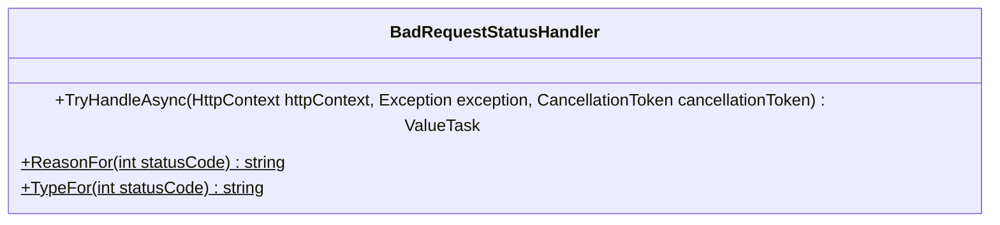

<div id="ValidationEndpointFilter&lt;T&gt;-class-diagram"></div>

##### `ValidationEndpointFilter<T>` class diagram

```mermaid
classDiagram
class ValidationEndpointFilter<T>{
    -ValidationProblemOptions _options
    -int? _statusCode
    +ationEndpointFilter(IOptions<ValidationProblemOptions> options, int? statusCode = null) void
    +InvokeAsync(EndpointFilterInvocationContext context, EndpointFilterDelegate next) ValueTask<object?>
    +TryFindArgument(EndpointFilterInvocationContext context, out T value)$ bool
    +ValidateAsync(HttpContext http, T value) ValueTask<ValidationResult>
}

```

<div id="ValidationEndpointFilterFactory-class-diagram"></div>

##### `ValidationEndpointFilterFactory` class diagram

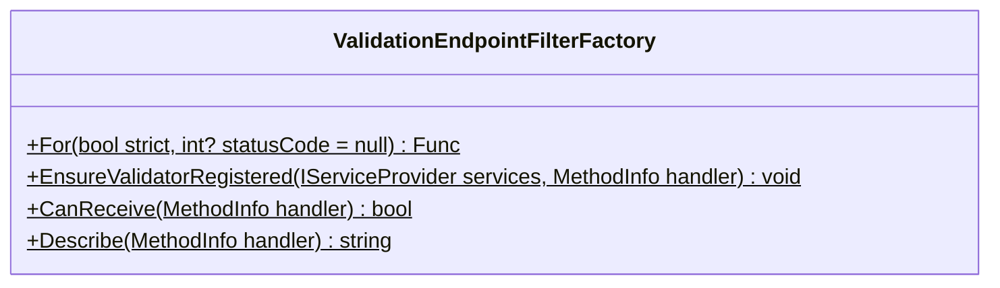

<div id="ValidationExceptionHandler-class-diagram"></div>

##### `ValidationExceptionHandler` class diagram

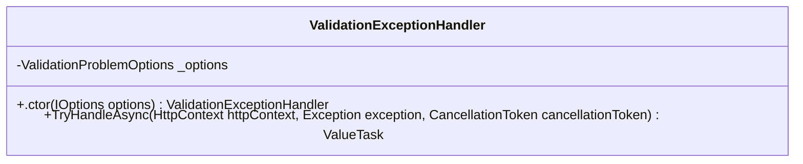

<div id="ValidationProblem-class-diagram"></div>

##### `ValidationProblem` class diagram

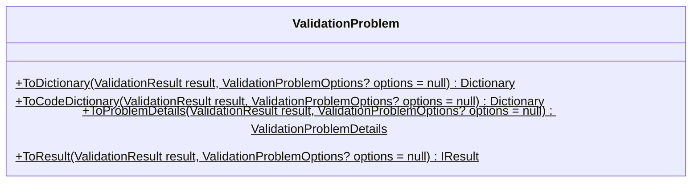

<div id="ValidationProblemJsonContext-class-diagram"></div>

##### `ValidationProblemJsonContext` class diagram

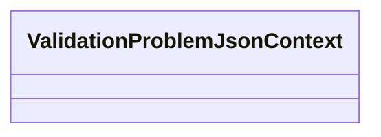

<div id="ValidationProblemOptions-class-diagram"></div>

##### `ValidationProblemOptions` class diagram

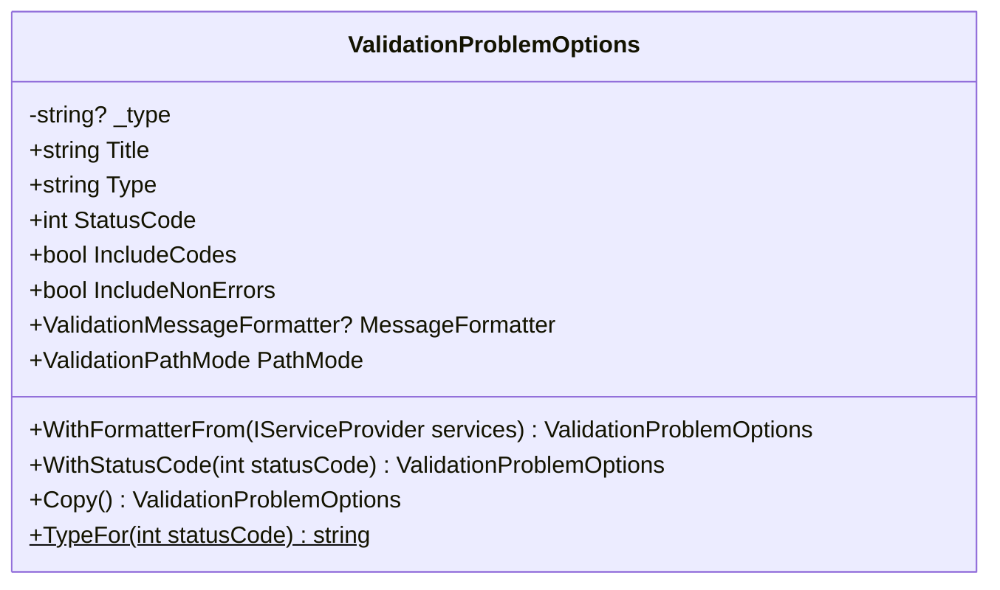

<div id="ValidationProblemResult-class-diagram"></div>

##### `ValidationProblemResult` class diagram

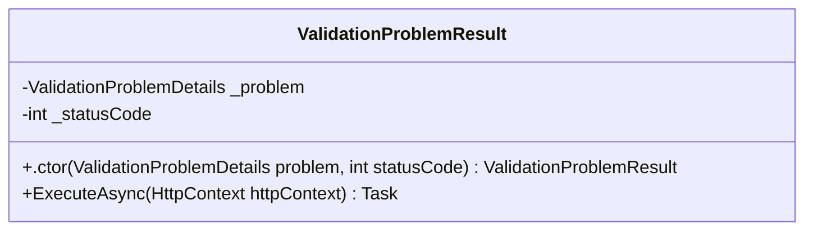

<div id="ValidationModulesEndpointExtensions-class-diagram"></div>

##### `ValidationModulesEndpointExtensions` class diagram

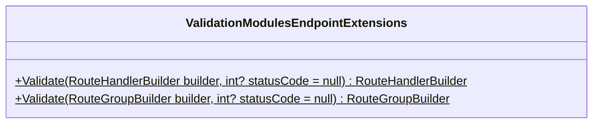

<div id="ValidationModulesAspNetCoreExtensions-class-diagram"></div>

##### `ValidationModulesAspNetCoreExtensions` class diagram

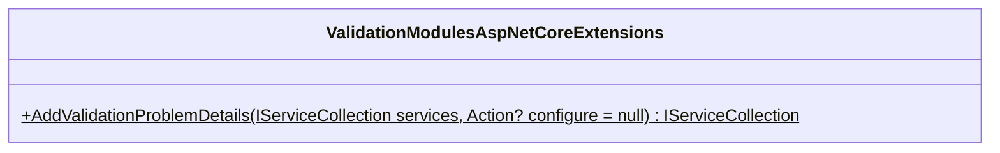

<div id="ValidationModulesOptionsExtensions-class-diagram"></div>

##### `ValidationModulesOptionsExtensions` class diagram

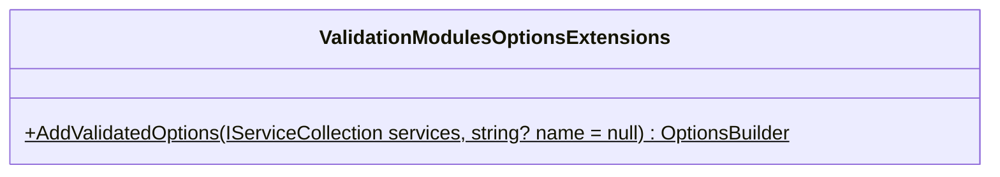

<div id="ValidatorForValidateOptions&lt;TOptions&gt;-class-diagram"></div>

##### `ValidatorForValidateOptions<TOptions>` class diagram

```mermaid
classDiagram
class ValidatorForValidateOptions<TOptions>{
    -string? _name
    -IValidatorFor<TOptions>[] _validators
    +atorForValidateOptions(string? name, IEnumerable<IValidatorFor<TOptions>> validators) void
    +Validate(string? name, TOptions options) ValidateOptionsResult
}

```

<div id="AllowedValuesAttribute-class-diagram"></div>

##### `AllowedValuesAttribute` class diagram

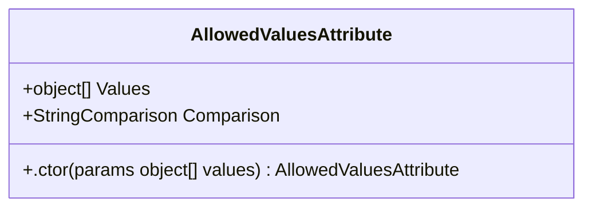

<div id="Base64StringAttribute-class-diagram"></div>

##### `Base64StringAttribute` class diagram

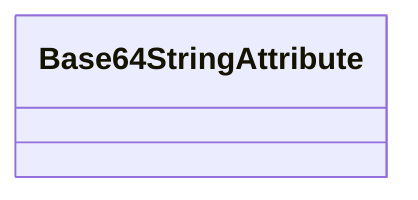

<div id="CreditCardAttribute-class-diagram"></div>

##### `CreditCardAttribute` class diagram

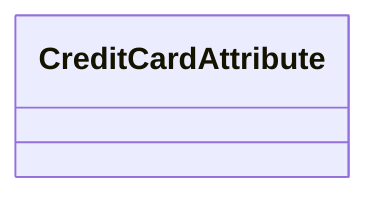

<div id="CustomConstraintAttribute-class-diagram"></div>

##### `CustomConstraintAttribute` class diagram

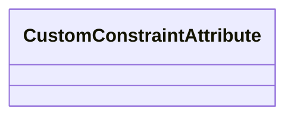

<div id="DeniedValuesAttribute-class-diagram"></div>

##### `DeniedValuesAttribute` class diagram

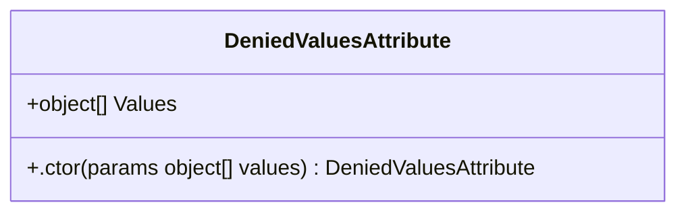

<div id="EmailAddressAttribute-class-diagram"></div>

##### `EmailAddressAttribute` class diagram

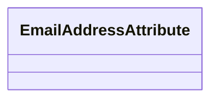

<div id="EnumDefinedAttribute-class-diagram"></div>

##### `EnumDefinedAttribute` class diagram

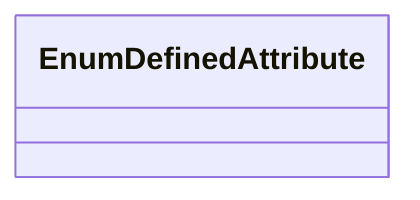

<div id="FileExtensionsAttribute-class-diagram"></div>

##### `FileExtensionsAttribute` class diagram

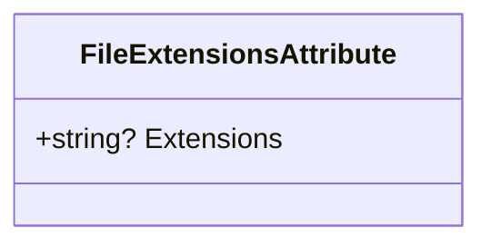

<div id="GenerateValidatorAttribute-class-diagram"></div>

##### `GenerateValidatorAttribute` class diagram

```mermaid
classDiagram
class GenerateValidatorAttribute{
}

```

<div id="ItemCountAttribute-class-diagram"></div>

##### `ItemCountAttribute` class diagram

```mermaid
classDiagram
class ItemCountAttribute{
    +int Min
    +int Max
    +.ctor() ItemCountAttribute
    +.ctor(int min = 0, int max = null) ItemCountAttribute
}

```

<div id="MultipleOfAttribute-class-diagram"></div>

##### `MultipleOfAttribute` class diagram

```mermaid
classDiagram
class MultipleOfAttribute{
    +object Divisor
    +.ctor(int divisor) MultipleOfAttribute
    +.ctor(long divisor) MultipleOfAttribute
    +.ctor(double divisor) MultipleOfAttribute
    +.ctor(string divisor) MultipleOfAttribute
}

```

<div id="PatternAttribute-class-diagram"></div>

##### `PatternAttribute` class diagram

```mermaid
classDiagram
class PatternAttribute{
    +string? Pattern
    +Type? RegexProvider
    +string? RegexMember
    +RegexOptions Options
    +int MatchTimeoutMilliseconds
    +.ctor(string pattern) PatternAttribute
    +.ctor(Type regexProvider, string regexMember) PatternAttribute
}

```

<div id="PerValidationInstanceAttribute-class-diagram"></div>

##### `PerValidationInstanceAttribute` class diagram

```mermaid
classDiagram
class PerValidationInstanceAttribute{
}

```

<div id="PhoneAttribute-class-diagram"></div>

##### `PhoneAttribute` class diagram

```mermaid
classDiagram
class PhoneAttribute{
}

```

<div id="Polymorphism-class-diagram"></div>

##### `Polymorphism` class diagram

```mermaid
classDiagram
class Polymorphism{
    -DeclaredOnly$
    -CompileTime$
    -Runtime$
}

```

<div id="RangeAttribute-class-diagram"></div>

##### `RangeAttribute` class diagram

```mermaid
classDiagram
class RangeAttribute{
    +object? Min
    +object? Max
    +bool ExclusiveMin
    +bool ExclusiveMax
    +.ctor() RangeAttribute
    +.ctor(int min, int max) RangeAttribute
    +.ctor(long min, long max) RangeAttribute
    +.ctor(double min, double max) RangeAttribute
    +.ctor(string min, string max) RangeAttribute
}

```

<div id="RequiredAttribute-class-diagram"></div>

##### `RequiredAttribute` class diagram

```mermaid
classDiagram
class RequiredAttribute{
    +bool AllowEmptyStrings
}

```

<div id="StringLengthAttribute-class-diagram"></div>

##### `StringLengthAttribute` class diagram

```mermaid
classDiagram
class StringLengthAttribute{
    +int Min
    +int Max
    +.ctor() StringLengthAttribute
    +.ctor(int max) StringLengthAttribute
}

```

<div id="UniqueItemsAttribute-class-diagram"></div>

##### `UniqueItemsAttribute` class diagram

```mermaid
classDiagram
class UniqueItemsAttribute{
}

```

<div id="UrlAttribute-class-diagram"></div>

##### `UrlAttribute` class diagram

```mermaid
classDiagram
class UrlAttribute{
}

```

<div id="ValidateNestedAttribute-class-diagram"></div>

##### `ValidateNestedAttribute` class diagram

```mermaid
classDiagram
class ValidateNestedAttribute{
    +Polymorphism Polymorphism
    +.ctor() ValidateNestedAttribute
    +.ctor(Polymorphism polymorphism) ValidateNestedAttribute
}

```

<div id="ValidationConstraintAttribute-class-diagram"></div>

##### `ValidationConstraintAttribute` class diagram

```mermaid
classDiagram
class ValidationConstraintAttribute{
    +string? Code
    +string? Message
    +string? When
    +string? Unless
}

```

<div id="ValidationModulesServiceCollectionExtensions-class-diagram"></div>

##### `ValidationModulesServiceCollectionExtensions` class diagram

```mermaid
classDiagram
class ValidationModulesServiceCollectionExtensions{
    +AddValidationModules(IServiceCollection services, IReadOnlyList<ValidatorRegistration> registrations)$ IServiceCollection
    +AddValidationRunner<T>(IServiceCollection services)$ IServiceCollection
    +AddCollectionValidatorsFor<TElement>(IServiceCollection services)$ IServiceCollection
}

```

<div id="CamelCaseFieldNamer-class-diagram"></div>

##### `CamelCaseFieldNamer` class diagram

```mermaid
classDiagram
class CamelCaseFieldNamer{
    +CamelCaseFieldNamer Instance$
    +ToFieldName(string clrPropertyName) string
}

```

<div id="FieldNamer-class-diagram"></div>

##### `FieldNamer` class diagram

```mermaid
classDiagram
IValidationFieldNamer <|-- FieldNamer : implements
class FieldNamer{
    +ToFieldName(string clrPropertyName)* string
    +Combine(string parentPath, string fieldName) string
    +CombineIndex(string parentPath, string fieldName, int index) string
}

```

<div id="IValidationFieldNamer-class-diagram"></div>

##### `IValidationFieldNamer` class diagram

```mermaid
classDiagram
class IValidationFieldNamer{
    +ToFieldName(string clrPropertyName)* string
    +Combine(string parentPath, string fieldName)* string
    +CombineIndex(string parentPath, string fieldName, int index)* string
}

```

<div id="PascalCaseFieldNamer-class-diagram"></div>

##### `PascalCaseFieldNamer` class diagram

```mermaid
classDiagram
class PascalCaseFieldNamer{
    +PascalCaseFieldNamer Instance$
    +ToFieldName(string clrPropertyName) string
}

```

<div id="SnakeCaseFieldNamer-class-diagram"></div>

##### `SnakeCaseFieldNamer` class diagram

```mermaid
classDiagram
class SnakeCaseFieldNamer{
    +SnakeCaseFieldNamer Instance$
    +ToFieldName(string clrPropertyName) string
}

```

<div id="RuleText-class-diagram"></div>

##### `RuleText` class diagram

```mermaid
classDiagram
class RuleText{
    -int CodeDerivationContract$
    -string CodeDerivationChecksum$
    +PropertyOfSelector(string? selectorText)$ string?
    +AnchorOfPredicate(string? predicateText)$ string?
    +RenderPredicate(string? predicateText, Func<string, string> fieldNamer)$ string
    +RenderPredicate(string? predicateText, Func<IReadOnlyList<string>, IReadOnlyList<string>> pathNamer)$ string
    +CodeOfPredicate(string? predicateText, Func<string, string> fieldNamer)$ string?
    +TryAppendBlankIdiom(string text, ref int index, StringBuilder builder)$ bool
    +TryAppendEmptinessIdiom(string identifier, string text, ref int index, int end, StringBuilder builder)$ bool
    +TryAppendNullIdiom(string text, ref int index, int end, StringBuilder builder)$ bool
    +Matches(string text, int index, string expected)$ bool
    +MatchingParenthesis(string text, int index)$ int
    +PopTrailingNot(StringBuilder builder)$ bool
    +IsLambdaArrowAhead(string text, int index)$ bool
    +SkipLambdaArrow(string text, ref int index)$ void
    +ReadLambdaHead(string text, ref int index, List<string> parameters)$ bool
    +AppendLiteral(StringBuilder builder, string text)$ void
    +PunctuationWord(char character)$ string
    +ReadOperator(string text, ref int index)$ string?
    +TwoCharacterOperator(char first, char second)$ string?
    +OneCharacterOperator(char character)$ string?
    +AppendWords(StringBuilder builder, string text)$ void
    +AppendSegment(StringBuilder builder, string segment)$ void
    +BodyOf(string? text, out string? parameter)$ string?
    +IndexOfArrow(string text)$ int
    +ReadParameterMember(string body, ref int index, string parameter)$ string?
    +ReadMemberPath(string body, ref int index, string first, List<string> separators)$ List<string>
    +SeparatorWidth(string body, int index)$ int
    +SpellFirst(IReadOnlyList<string> path, Func<string, string> fieldNamer)$ IReadOnlyList<string>
    +SkipNonIdentifier(string body, ref int index)$ bool
    +SkipLiteral(string text, ref int index)$ void
    +ReadIdentifier(string text, ref int index)$ string?
    +IsIdentifierStart(char character)$ bool
    +IsIdentifierPart(char character)$ bool
    +NormalizeWhitespace(string text)$ string
}

```

<div id="-class-diagram"></div>

##### `` class diagram

```mermaid
classDiagram
IEquatable~~ <|--  : implements
class {
}

```

<div id="LanguagePackFormatter.-class-diagram"></div>

##### `LanguagePackFormatter.` class diagram

```mermaid
classDiagram
IEquatable~~ <|--  : implements
class {
}

```

<div id="CollectionAsyncValidatorFor&lt;TElement&gt;-class-diagram"></div>

##### `CollectionAsyncValidatorFor<TElement>` class diagram

```mermaid
classDiagram
IAsyncValidatorFor~IReadOnlyList~ <|-- CollectionAsyncValidatorFor<TElement> : implements
class CollectionAsyncValidatorFor<TElement>{
    -IAsyncValidatorFor<TElement>[] _element
    +ctionAsyncValidatorFor(IEnumerable<IAsyncValidatorFor<TElement>> element) void
    +ValidateAsync(ValidationContext context, IReadOnlyList<TElement> value, CancellationToken cancellationToken = null) ValueTask
}

```

<div id="CollectionValidatorFor&lt;TElement&gt;-class-diagram"></div>

##### `CollectionValidatorFor<TElement>` class diagram

```mermaid
classDiagram
IValidatorFor~IReadOnlyList~ <|-- CollectionValidatorFor<TElement> : implements
class CollectionValidatorFor<TElement>{
    -IValidatorFor<TElement>[] _element
    +ctionValidatorFor(IEnumerable<IValidatorFor<TElement>> element) void
    +Validate(ref ValidationContext context, IReadOnlyList<TElement> value) ValidationFlow
}

```

<div id="ConstraintChecks-class-diagram"></div>

##### `ConstraintChecks` class diagram

```mermaid
classDiagram
class ConstraintChecks{
    -string PhoneCharacters$
    -string PhoneExtensionExtDot$
    -string PhoneExtensionExt$
    -string PhoneExtensionX$
    -int PhoneStackLimit$
    -int PairwiseLimit$
    -double DecimalRange$
    +AllUnique<T>(IEnumerable<T> items)$ bool
    +IsMultipleOf(double value, decimal divisor)$ bool
    +IsMultipleOf(float value, decimal divisor)$ bool
    +IsMatch(Regex regex, string value)$ bool
    +IsEmail(string value)$ bool
    +IsPhone(string value)$ bool
    +IsUrl(string value)$ bool
    +IsUrl(Uri value)$ bool
    +IsCreditCard(string value)$ bool
    +IsBase64(string value)$ bool
    +HasFileExtension(string value, string[] extensions)$ bool
    +RemovePhoneExtension(ReadOnlySpan<char> potentialPhoneNumber)$ ReadOnlySpan<char>
    +MatchesPhoneExtension(ReadOnlySpan<char> potentialExtension)$ bool
}

```

<div id="DataAnnotationsSupport-class-diagram"></div>

##### `DataAnnotationsSupport` class diagram

```mermaid
classDiagram
class DataAnnotationsSupport{
    +Validate(ref ValidationContext context, ValidationAttribute attribute, object instance, object? value, string field, string memberName, string displayName)$ ValidationFlow
    +IsValid(ValidationAttribute attribute, object instance, object? value, string memberName, string displayName)$ bool
    +Apply(ref ValidationContext context, ValidationResult? result, string? field, IValidationFieldNamer namer)$ ValidationFlow
    +ValidateObject(ref ValidationContext context, IValidatableObject value, IValidationFieldNamer namer)$ ValidationFlow
    +CreateContext(IServiceProvider? services, object instance, string? memberName, string displayName)$ ValidationContext
    +Net8Context(IServiceProvider? services, object instance, string? memberName, string displayName)$ ValidationContext
    +Message(ValidationResult result, string? field)$ string
}

```

<div id="DelegateMessageProvider-class-diagram"></div>

##### `DelegateMessageProvider` class diagram

```mermaid
classDiagram
IValidationMessageProvider <|-- DelegateMessageProvider : implements
class DelegateMessageProvider{
    -Func<string> _template
    +.ctor(Func<string> template) DelegateMessageProvider
    +Template(in ValidationError error) string
}

```

<div id="DynamicValidation-class-diagram"></div>

##### `DynamicValidation` class diagram

```mermaid
classDiagram
class DynamicValidation{
    +Validate(ref ValidationContext context, object value, string property, string owner)$ ValidationFlow
    +IsValid(IServiceProvider? services, object value, string property, string owner)$ bool
    +Resolve(IServiceProvider? services, object value, string property, string owner)$ IDynamicValidator
}

```

<div id="DynamicValidatorRegistry-class-diagram"></div>

##### `DynamicValidatorRegistry` class diagram

```mermaid
classDiagram
class DynamicValidatorRegistry{
    -Dictionary<Type, IDynamicValidator> _byType
    +.ctor(IEnumerable<IDynamicValidator> validators) DynamicValidatorRegistry
    +Find(Type type) IDynamicValidator?
}

```

<div id="LanguagePackFormatter.Entry-class-diagram"></div>

##### `LanguagePackFormatter.Entry` class diagram

```mermaid
classDiagram
class Entry{
}

```

<div id="ValidationErrorCollector.ErrorNode-class-diagram"></div>

##### `ValidationErrorCollector.ErrorNode` class diagram

```mermaid
classDiagram
class ErrorNode{
    -ValidationError Error
    -ErrorNode? Next
}

```

<div id="IAsyncValidatorFor&lt;T&gt;-class-diagram"></div>

##### `IAsyncValidatorFor<T>` class diagram

```mermaid
classDiagram
class IAsyncValidatorFor<T>{
    +ValidateAsync(ValidationContext context, T value, CancellationToken cancellationToken = null)* ValueTask
}

```

<div id="IConstraintFor&lt;T&gt;-class-diagram"></div>

##### `IConstraintFor<T>` class diagram

```mermaid
classDiagram
class IConstraintFor<T>{
    +IsValid(T value)* bool
    +Validate(ref ValidationContext context, T value, string field) ValidationFlow
}

```

<div id="IDynamicValidator-class-diagram"></div>

##### `IDynamicValidator` class diagram

```mermaid
classDiagram
class IDynamicValidator{
    +Type ValidatedType*
    +Validate(ref ValidationContext context, object value)* ValidationFlow
    +IsValid(object value)* bool
}

```

<div id="IValidationContextReporter-class-diagram"></div>

##### `IValidationContextReporter` class diagram

```mermaid
classDiagram
class IValidationContextReporter{
    +Report(string field, string code, string message, ValidationSeverity severity = default(ValidationSeverity))* ValidationFlow
    +Report(string field, string code, object? value, ValidationMessageInfo messageInfo, ValidationSeverity severity = default(ValidationSeverity))* ValidationFlow
    +ReportHere(string code, string message, ValidationSeverity severity = default(ValidationSeverity))* ValidationFlow
}

```

<div id="IValidationLanguagePack-class-diagram"></div>

##### `IValidationLanguagePack` class diagram

```mermaid
classDiagram
class IValidationLanguagePack{
    +string Culture*
    +IReadOnlyList<KeyValuePair<string, string>> Templates*
}

```

<div id="IValidationMessageProvider-class-diagram"></div>

##### `IValidationMessageProvider` class diagram

```mermaid
classDiagram
class IValidationMessageProvider{
    +Template(in ValidationError error)* string
}

```

<div id="IValidationRulesFor&lt;T&gt;-class-diagram"></div>

##### `IValidationRulesFor<T>` class diagram

```mermaid
classDiagram
class IValidationRulesFor<T>{
    +Describe(ValidationRules<T> rules, T x)$ void
}

```

<div id="IValidatorFor&lt;T&gt;-class-diagram"></div>

##### `IValidatorFor<T>` class diagram

```mermaid
classDiagram
class IValidatorFor<T>{
    +Validate(ref ValidationContext context, T value)* ValidationFlow
    +IsValid(T value) bool
}

```

<div id="LanguagePackFormatter-class-diagram"></div>

##### `LanguagePackFormatter` class diagram

```mermaid
classDiagram
class LanguagePackFormatter{
    -IValidationLanguagePack[] _packs
    -ConcurrentDictionary<string, Dictionary<string, Entry>> _byCulture
    +.ctor(IEnumerable<IValidationLanguagePack> packs) LanguagePackFormatter
    +Format(in ValidationError error) string
    +matter.BuildTable(string cultureName, LanguagePackFormatter self)$ Dictionary<string,
    +Culture(string name)$ CultureInfo
}

```

<div id="ValidationMessageMap.MessageRenderer-class-diagram"></div>

##### `ValidationMessageMap.MessageRenderer` class diagram

```mermaid
classDiagram
class MessageRenderer{
}

```

<div id="PathSegment-class-diagram"></div>

##### `PathSegment` class diagram

```mermaid
classDiagram
class PathSegment{
    -string Name
    -string? Key
    -int Index
    -long Stamp
}

```

<div id="PropertyRules&lt;T, TValue&gt;-class-diagram"></div>

##### `PropertyRules<T, TValue>` class diagram

```mermaid
classDiagram
class PropertyRules<T, TValue>{
    +rtyRules() void
}

```

<div id="PropertyRulesExtensions-class-diagram"></div>

##### `PropertyRulesExtensions` class diagram

```mermaid
classDiagram
class PropertyRulesExtensions{
    +tensions.Require<T>(PropertyRules<T, string?> rules)$ PropertyRules<T,
    +tensions.RequireAllowingEmpty<T>(PropertyRules<T, string?> rules)$ PropertyRules<T,
    +tensions.Require<T, TValue>(PropertyRules<T, TValue?> rules)$ PropertyRules<T,
    +tensions.Require<T, TValue>(PropertyRules<T, TValue?> rules)$ PropertyRules<T,
    +tensions.Length<T>(PropertyRules<T, string?> rules, int min = 0, int max = null)$ PropertyRules<T,
    +tensions.Pattern<T>(PropertyRules<T, string?> rules, Func<Regex> pattern)$ PropertyRules<T,
    +tensions.Range<T, TValue>(PropertyRules<T, TValue?> rules, TValue min, TValue max)$ PropertyRules<T,
    +ensions.Range<T, TValue>(PropertyRules<T, TValue> rules, TValue min, TValue max)$ PropertyRules<T,
    +tensions.RangeAtLeast<T, TValue>(PropertyRules<T, TValue?> rules, TValue min)$ PropertyRules<T,
    +ensions.RangeAtLeast<T, TValue>(PropertyRules<T, TValue> rules, TValue min)$ PropertyRules<T,
    +tensions.RangeAtMost<T, TValue>(PropertyRules<T, TValue?> rules, TValue max)$ PropertyRules<T,
    +ensions.RangeAtMost<T, TValue>(PropertyRules<T, TValue> rules, TValue max)$ PropertyRules<T,
    +ensions.AllowedValues<T, TValue>(PropertyRules<T, TValue> rules, params TValue[] allowed)$ PropertyRules<T,
    +> PropertyRulesExtensions.Count<T, TElement>(PropertyRules<T, IReadOnlyList<TElement>?> rules, int min = 0, int max = null)$ PropertyRules<T,
    +PropertyRulesExtensions.Unique<T, TElement>(PropertyRules<T, IEnumerable<TElement>?> rules)$ PropertyRules<T,
    +nsions.MultipleOf<T>(PropertyRules<T, long?> rules, long divisor)$ PropertyRules<T,
    +xtensions.MultipleOf<T>(PropertyRules<T, decimal?> rules, decimal divisor)$ PropertyRules<T,
    +tensions.MultipleOf<T>(PropertyRules<T, double?> rules, double divisor)$ PropertyRules<T,
    +tensions.MultipleOf<T, TValue>(PropertyRules<T, TValue?> rules, TValue divisor)$ PropertyRules<T,
    +ensions.MultipleOf<T, TValue>(PropertyRules<T, TValue> rules, TValue divisor)$ PropertyRules<T,
    +> PropertyRulesExtensions.Each<T, TElement>(PropertyRules<T, IReadOnlyList<TElement>?> rules)$ PropertyRules<T,
    +> PropertyRulesExtensions.Each<T, TElement>(PropertyRules<T, IReadOnlyList<TElement>?> rules, Polymorphism polymorphism)$ PropertyRules<T,
    +tensions.Each<T>(PropertyRules<T, IReadOnlyList<string>?> rules)$ PropertyRules<T,
    +tensions.Nested<T, TValue>(PropertyRules<T, TValue?> rules)$ PropertyRules<T,
    +tensions.Nested<T, TValue>(PropertyRules<T, TValue?> rules, Polymorphism polymorphism)$ PropertyRules<T,
}

```

<div id="RuleAction&lt;T&gt;-class-diagram"></div>

##### `RuleAction<T>` class diagram

```mermaid
classDiagram
class RuleAction<T>{
}

```

<div id="RuntimeContract-class-diagram"></div>

##### `RuntimeContract` class diagram

```mermaid
classDiagram
class RuntimeContract{
    -int Version$
}

```

<div id="ValidationCodes-class-diagram"></div>

##### `ValidationCodes` class diagram

```mermaid
classDiagram
class ValidationCodes{
    -string Required$
    -string StringLength$
    -string Range$
    -string Pattern$
    -string Enum$
    -string ArrayBounds$
    -string MultipleOf$
    -string UniqueItems$
    -string Invalid$
    -string Email$
    -string Phone$
    -string Url$
    -string CreditCard$
    -string Base64$
    -string FileExtension$
    -string Custom$
    -string Predicate$
}

```

<div id="ValidationContext-class-diagram"></div>

##### `ValidationContext` class diagram

```mermaid
classDiagram
IValidationContextReporter <|-- ValidationContext : implements
class ValidationContext{
    -int NoIndex$
    -ValidationErrorCollector _collector
    -PathSegment[] _path
    -int _depth
    -bool _resolvedFieldNames
    -long _stamp
    -char[] FieldShaping$
    +IServiceProvider? Services
    +bool HasErrors
    +ValidationStopMode StopMode
    +int ErrorCount
    +.ctor(ValidationErrorCollector collector) ValidationContext
    +.ctor(ValidationErrorCollector collector, PathSegment[] path) ValidationContext
    +.ctor(ValidationErrorCollector collector, PathSegment[] path, int depth, long stamp, bool resolvedFieldNames = false) ValidationContext
    +WithResolvedFieldNames(bool resolved = true) ValidationContext
    +Push(string segment) ValidationContext
    +PushIndex(string segment, int index) ValidationContext
    +PushKey(string segment, string key) ValidationContext
    +Report(string field, string code, string message, ValidationSeverity severity = default(ValidationSeverity)) ValidationFlow
    +Report(string field, string code, object? value, ValidationMessageInfo messageInfo, ValidationSeverity severity = default(ValidationSeverity)) ValidationFlow
    +Normalized(string field) string
    +ReportAuthored(string field, string code, string message, ValidationSeverity severity = default(ValidationSeverity)) ValidationFlow
    +ReportHere(string code, string message, ValidationSeverity severity = default(ValidationSeverity)) ValidationFlow
    +Mark() ValidationMark
    +HasBlockingErrorsSince(ValidationMark mark) bool
    +Descend(string segment, int index, string? key) ValidationContext
    +BuildPath(string? field) string
    +BuildBoundedPath(string? field) string
    +BuildFullPath(string? field) string
    +Append(StringBuilder builder, in PathSegment segment)$ void
    +EnsurePathIsIntact() void
    +Segment(in PathSegment segment)$ string
}

```

<div id="ValidationContextExtensions-class-diagram"></div>

##### `ValidationContextExtensions` class diagram

```mermaid
classDiagram
class ValidationContextExtensions{
    +ReportRequired<TReporter>(TReporter context, string field, ValidationSeverity severity = default(ValidationSeverity), string? code = null, object? value = null)$ ValidationFlow
    +ReportStringLength<TReporter>(TReporter context, string field, int min = 0, int max = null, ValidationSeverity severity = default(ValidationSeverity), string? code = null, object? value = null)$ ValidationFlow
    +ReportItemCount<TReporter>(TReporter context, string field, int min = 0, int max = null, ValidationSeverity severity = default(ValidationSeverity), string? code = null, object? value = null)$ ValidationFlow
    +ReportMultipleOf<TReporter>(TReporter context, string field, decimal divisor, ValidationSeverity severity = default(ValidationSeverity), string? code = null, object? value = null)$ ValidationFlow
    +ReportUniqueItems<TReporter>(TReporter context, string field, ValidationSeverity severity = default(ValidationSeverity), string? code = null, object? value = null)$ ValidationFlow
    +ReportRange<TReporter, T>(TReporter context, string field, T min, T max, ValidationSeverity severity = default(ValidationSeverity), string? code = null, object? value = null, bool exclusiveMin = false, bool exclusiveMax = false)$ ValidationFlow
    +ReportRangeAtLeast<TReporter, T>(TReporter context, string field, T min, ValidationSeverity severity = default(ValidationSeverity), string? code = null, object? value = null, bool exclusive = false)$ ValidationFlow
    +ReportRangeAtMost<TReporter, T>(TReporter context, string field, T max, ValidationSeverity severity = default(ValidationSeverity), string? code = null, object? value = null, bool exclusive = false)$ ValidationFlow
    +ReportPattern<TReporter>(TReporter context, string field, ValidationSeverity severity = default(ValidationSeverity), string? code = null, object? value = null)$ ValidationFlow
    +ReportAllowedValues<TReporter>(TReporter context, string field, string allowedValues, ValidationSeverity severity = default(ValidationSeverity), string? code = null, object? value = null)$ ValidationFlow
    +ReportDeniedValues<TReporter>(TReporter context, string field, string deniedValues, ValidationSeverity severity = default(ValidationSeverity), string? code = null, object? value = null)$ ValidationFlow
    +ReportEmail<TReporter>(TReporter context, string field, ValidationSeverity severity = default(ValidationSeverity), string? code = null, object? value = null)$ ValidationFlow
    +ReportPhone<TReporter>(TReporter context, string field, ValidationSeverity severity = default(ValidationSeverity), string? code = null, object? value = null)$ ValidationFlow
    +ReportUrl<TReporter>(TReporter context, string field, ValidationSeverity severity = default(ValidationSeverity), string? code = null, object? value = null)$ ValidationFlow
    +ReportCreditCard<TReporter>(TReporter context, string field, ValidationSeverity severity = default(ValidationSeverity), string? code = null, object? value = null)$ ValidationFlow
    +ReportBase64<TReporter>(TReporter context, string field, ValidationSeverity severity = default(ValidationSeverity), string? code = null, object? value = null)$ ValidationFlow
    +ReportFileExtension<TReporter>(TReporter context, string field, string extensions, ValidationSeverity severity = default(ValidationSeverity), string? code = null, object? value = null)$ ValidationFlow
    +ReportCustom<TReporter>(TReporter context, string field, ValidationSeverity severity = default(ValidationSeverity), string? code = null, object? value = null)$ ValidationFlow
    +BoundedInfo(int min, int max, string between, string betweenSingular, string atMost, string atMostSingular, string atLeast, string atLeastSingular)$ ValidationMessageInfo
}

```

<div id="ValidationError-class-diagram"></div>

##### `ValidationError` class diagram

```mermaid
classDiagram
class ValidationError{
    -string? _message
    +string Field
    +string Code
    +object? Value
    +ValidationSeverity Severity
    +ValidationMessageInfo? MessageInfo
    +bool MessageIsAuthored
    +string Message
    +.ctor(string field, string code, string message) ValidationError
    +.ctor(string field, string code, object? value, ValidationMessageInfo messageInfo) ValidationError
    +ToMessage(ValidationMessageFormatter formatter) string
    +Deconstruct(out string field, out string code, out string message) void
    +ToString() string
}

```

<div id="ValidationErrorCollector-class-diagram"></div>

##### `ValidationErrorCollector` class diagram

```mermaid
classDiagram
class ValidationErrorCollector{
    -int DefaultDepthLimit$
    -ErrorNode? _head
    -long _stamp
    -List<string>? _requiredFields
    +IServiceProvider? Services
    +ValidationPathMode PathMode
    +ValidationStopMode StopMode
    +bool HasErrors
    +int Count
    +object? ChangeToken
    +bool HasBlockingErrors
    +bool Finished
    +.ctor() ValidationErrorCollector
    +.ctor(ValidationPathMode pathMode) ValidationErrorCollector
    +.ctor(IServiceProvider? services) ValidationErrorCollector
    +.ctor(IServiceProvider? services, ValidationPathMode pathMode) ValidationErrorCollector
    +HasBlockingErrorsSince(object? token) bool
    +NextStamp() long
    +AddDirect(in ValidationError error) ValidationFlow
    +Add(in ValidationError error) ValidationFlow
    +ToResult() ValidationResult
    +Reset() void
    +AddCore(in ValidationError error) void
    +Flow(in ValidationError error) ValidationFlow
    +Record(in ValidationError error) void
    +IsSuppressed(string field) bool
}

```

<div id="ValidationException-class-diagram"></div>

##### `ValidationException` class diagram

```mermaid
classDiagram
class ValidationException{
    +ValidationResult Result
    +.ctor(ValidationResult result) ValidationException
    +BuildMessage(ValidationResult result)$ string
}

```

<div id="ValidationFlow-class-diagram"></div>

##### `ValidationFlow` class diagram

```mermaid
classDiagram
IEquatable~ValidationFlow~ <|-- ValidationFlow : implements
class ValidationFlow{
    -bool _stop
    +ValidationFlow Continue$
    +ValidationFlow Stop$
    +bool ShouldStop
    +.ctor(bool stop) ValidationFlow
    +Equals(ValidationFlow other) bool
    +Equals(object? obj) bool
    +GetHashCode() int
    +ToString() string
    +operator ==(ValidationFlow left, ValidationFlow right)$ bool
    +operator !=(ValidationFlow left, ValidationFlow right)$ bool
}

```

<div id="ValidationMark-class-diagram"></div>

##### `ValidationMark` class diagram

```mermaid
classDiagram
class ValidationMark{
    +object? Token
    +.ctor(object? token) ValidationMark
}

```

<div id="ValidationMessageFormatter-class-diagram"></div>

##### `ValidationMessageFormatter` class diagram

```mermaid
classDiagram
class ValidationMessageFormatter{
    +Format(in ValidationError error)* string
}

```

<div id="ValidationMessageInfo-class-diagram"></div>

##### `ValidationMessageInfo` class diagram

```mermaid
classDiagram
class ValidationMessageInfo{
    -object[] None$
    -object[] _args
    -ValidationMessageInfo Required$
    -ValidationMessageInfo UniqueItems$
    -ValidationMessageInfo Pattern$
    -ValidationMessageInfo Email$
    -ValidationMessageInfo Phone$
    -ValidationMessageInfo Url$
    -ValidationMessageInfo CreditCard$
    -ValidationMessageInfo Base64$
    -ValidationMessageInfo Custom$
    +string Template
    +IReadOnlyList<object> Args
    +IValidationMessageProvider? Provider
    +bool DataAnnotationsHoles
    +string? DisplayName
    +.ctor(string template, params object[]? args) ValidationMessageInfo
    +Render(in ValidationError error, IFormatProvider? formatProvider = null) string
    +Render(in ValidationError error, string template, IFormatProvider? formatProvider = null) string
    +RenderStandalone(string template, string field, IFormatProvider? formatProvider = null)$ string
    +HasArgumentHole(string template)$ bool
    +Leaf(string field)$ string
    +RenderTemplate(string template, string field, object[] args, bool daHoles, IFormatProvider formatProvider)$ string
    +Fill(Span<char> span, string template, int start, int holeLength, string replacement, ref int read, ref int written)$ void
    +RenderSlow(string template, string field, object[] args, bool daHoles, IFormatProvider formatProvider)$ string
    +Resolve(ReadOnlySpan<char> hole, string field, object[] args, bool daHoles, IFormatProvider formatProvider)$ string?
    +IsArgumentHole(ReadOnlySpan<char> hole)$ bool
}

```

<div id="ValidationMessageMap-class-diagram"></div>

##### `ValidationMessageMap` class diagram

```mermaid
classDiagram
class ValidationMessageMap{
    -Dictionary<string, MessageRenderer> _renderers
    +Map(string code, MessageRenderer renderer) ValidationMessageMap
    +Format(in ValidationError error) string
}

```

<div id="ValidationMessageTemplates-class-diagram"></div>

##### `ValidationMessageTemplates` class diagram

```mermaid
classDiagram
class ValidationMessageTemplates{
    -string Required$
    -string StringLengthBetween$
    -string StringLengthBetweenSingular$
    -string StringLengthAtMost$
    -string StringLengthAtMostSingular$
    -string StringLengthAtLeast$
    -string StringLengthAtLeastSingular$
    -string ItemCountBetween$
    -string ItemCountBetweenSingular$
    -string ItemCountAtMost$
    -string ItemCountAtMostSingular$
    -string ItemCountAtLeast$
    -string ItemCountAtLeastSingular$
    -string RangeBetween$
    -string RangeGreaterAndAtMost$
    -string RangeAtLeastAndLess$
    -string RangeGreaterAndLess$
    -string RangeAtLeast$
    -string RangeGreaterThan$
    -string RangeAtMost$
    -string RangeLessThan$
    -string MultipleOf$
    -string UniqueItems$
    -string Pattern$
    -string AllowedValues$
    -string DeniedValues$
    -string EnumFlags$
    -string Email$
    -string Phone$
    -string Url$
    -string CreditCard$
    -string Base64$
    -string FileExtension$
    -string Custom$
    -string ShapeVocabularyChecksum$
    -Dictionary<string, string> KeysByTemplate$
    +IReadOnlyDictionary<string, string> TemplatesByKey$
    +IReadOnlyCollection<string> KnownKeys$
    +BuildReverse()$ Dictionary<string, string>
    +KeyOf(string? template)$ string?
}

```

<div id="ValidationPathMode-class-diagram"></div>

##### `ValidationPathMode` class diagram

```mermaid
classDiagram
class ValidationPathMode{
    -Bounded$
    -Full$
}

```

<div id="ValidationResult-class-diagram"></div>

##### `ValidationResult` class diagram

```mermaid
classDiagram
class ValidationResult{
    -IReadOnlyList<ValidationError> NoErrors$
    +ValidationResult Valid$
    +IReadOnlyList<ValidationError> Errors
    +bool IsValid
    +bool HasErrors
    +.ctor(IReadOnlyList<ValidationError> errors) ValidationResult
    +FromErrors(IEnumerable<ValidationError> errors)$ ValidationResult
    +FromOwnedArray(ValidationError[] errors)$ ValidationResult
    +Merge(ValidationResult other) ValidationResult
}

```

<div id="ValidationRules&lt;T&gt;-class-diagram"></div>

##### `ValidationRules<T>` class diagram

```mermaid
classDiagram
class ValidationRules<T>{
    +IValidationContextReporter Context
    +ationRules() void
    +ules<T>.For<TValue>(TValue value, string? field = null) PropertyRules<T,
    +Rules<T>.Require(string? value, string? field = null) PropertyRules<T,
    +Rules<T>.RequireAllowingEmpty(string? value, string? field = null) PropertyRules<T,
    +Rules<T>.Require<TValue>(TValue? value, string? field = null) PropertyRules<T,
    +Rules<T>.Require<TValue>(TValue? value, string? field = null) PropertyRules<T,
    +ent>?> ValidationRules<T>.Require<TElement>(ImmutableArray<TElement> value, string? field = null) PropertyRules<T,
    +Rules<T>.Require(object? value, string? field = null) PropertyRules<T,
    +Rules<T>.Length(string? value, int min = 0, int max = null, string? field = null) PropertyRules<T,
    +Rules<T>.Range<TValue>(TValue value, TValue min, TValue max, string? field = null) PropertyRules<T,
    +Rules<T>.Range<TValue>(TValue? value, TValue min, TValue max, string? field = null) PropertyRules<T,
    +Rules<T>.RangeAtLeast<TValue>(TValue value, TValue min, string? field = null) PropertyRules<T,
    +Rules<T>.RangeAtLeast<TValue>(TValue? value, TValue min, string? field = null) PropertyRules<T,
    +Rules<T>.RangeAtMost<TValue>(TValue value, TValue max, string? field = null) PropertyRules<T,
    +Rules<T>.RangeAtMost<TValue>(TValue? value, TValue max, string? field = null) PropertyRules<T,
    +Rules<T>.Pattern(string? value, Func<Regex> pattern, string? field = null) PropertyRules<T,
    +ules<T>.AllowedValues<TValue>(TValue value, TValue[] allowed, string? field = null) PropertyRules<T,
    +ent>?> ValidationRules<T>.Count<TElement>(IReadOnlyList<TElement>? value, int min = 0, int max = null, string? field = null) PropertyRules<T,
    +t>?> ValidationRules<T>.Unique<TElement>(IEnumerable<TElement>? value, string? field = null) PropertyRules<T,
    +les<T>.MultipleOf(long? value, long divisor, string? field = null) PropertyRules<T,
    +nRules<T>.MultipleOf(decimal? value, decimal divisor, string? field = null) PropertyRules<T,
    +Rules<T>.MultipleOf(double? value, double divisor, string? field = null) PropertyRules<T,
    +Rules<T>.Nested<TValue>(TValue? value, string? field = null) PropertyRules<T,
    +Rules<T>.Nested<TValue>(TValue? value, Polymorphism polymorphism, string? field = null) PropertyRules<T,
    +ent>?> ValidationRules<T>.Each<TElement>(IReadOnlyList<TElement>? value, string? field = null) PropertyRules<T,
    +ent>?> ValidationRules<T>.Each<TElement>(IReadOnlyList<TElement>? value, Polymorphism polymorphism, string? field = null) PropertyRules<T,
    +Rules<T>.Each(IReadOnlyList<string>? value, string? field = null) PropertyRules<T,
    +Ensure(bool condition, string? field = null, string? code = null, string? message = null, ValidationSeverity severity = default(ValidationSeverity)) ValidationRules<T>
    +As<TFacet>(TFacet value) ValidationRules<T>
    +Apply(RuleAction<T> rule) ValidationRules<T>
    +Inert()$ NotSupportedException
}

```

<div id="ValidationRunner&lt;T&gt;-class-diagram"></div>

##### `ValidationRunner<T>` class diagram

```mermaid
classDiagram
class ValidationRunner<T>{
    -IValidatorFor<T>[] _structural
    -IAsyncValidatorFor<T>[] _business
    -IServiceProvider? _services
    +ationRunner(IEnumerable<IValidatorFor<T>> structural, IEnumerable<IAsyncValidatorFor<T>> business, IServiceProvider? services = null) void
    +Validate(T value) ValidationResult
    +Validate(T value, ValidationPathMode pathMode) ValidationResult
    +ValidateAsync(T value, CancellationToken cancellationToken = null) ValueTask<ValidationResult>
    +ValidateAsync(T value, ValidationPathMode pathMode, CancellationToken cancellationToken = null) ValueTask<ValidationResult>
    +RunAsync(T value, ValidationPathMode pathMode, CancellationToken cancellationToken) ValueTask<ValidationResult>
    +RunStructural(ValidationErrorCollector collector, PathSegment[] path, T value) void
}

```

<div id="ValidationSeverity-class-diagram"></div>

##### `ValidationSeverity` class diagram

```mermaid
classDiagram
class ValidationSeverity{
    -Error$
    -Warning$
    -Info$
}

```

<div id="ValidationStopMode-class-diagram"></div>

##### `ValidationStopMode` class diagram

```mermaid
classDiagram
class ValidationStopMode{
    -CollectAll$
    -StopOnFirstError$
}

```

<div id="ValidatorForExtensions-class-diagram"></div>

##### `ValidatorForExtensions` class diagram

```mermaid
classDiagram
class ValidatorForExtensions{
    +Validate<T>(IValidatorFor<T> validator, T value)$ ValidationResult
    +Validate<T>(IValidatorFor<T> validator, T value, ValidationPathMode pathMode)$ ValidationResult
    +ValidateFirst<T>(IValidatorFor<T> validator, T value)$ ValidationResult
    +IsValid<T>(IValidatorFor<T> validator, T value)$ bool
    +ValidateAndThrow<T>(IValidatorFor<T> validator, T value)$ void
    +ValidateInto<T>(IValidatorFor<T> validator, ValidationErrorCollector collector, T value)$ void
    +ThrowIfNullValue<T>(T value)$ void
}

```

<div id="ValidatorRegistration-class-diagram"></div>

##### `ValidatorRegistration` class diagram

```mermaid
classDiagram
class ValidatorRegistration{
}

```

<div id="EntryPointLookup-class-diagram"></div>

##### `EntryPointLookup` class diagram

```mermaid
classDiagram
class EntryPointLookup{
    -string DependencyModuleAttribute$
    -string HardenedModuleAttribute$
    +IsCandidate(SyntaxNode node)$ bool
    +Read(GeneratorSyntaxContext context, CancellationToken token)$ ModuleEntryPoint?
    +DeclaresAModule(INamedTypeSymbol symbol)$ bool
}

```

<div id="ValidatorEmitter.ConditionScope-class-diagram"></div>

##### `ValidatorEmitter.ConditionScope` class diagram

```mermaid
classDiagram
class ConditionScope{
    -Dictionary<string, string> _names
    -List<(string Name, string Expression)> _declarations
    +IReadOnlyList<(string Name, string Expression)> Declarations
    +Local(string condition) string
}

```

<div id="EmitterOutput-class-diagram"></div>

##### `EmitterOutput` class diagram

```mermaid
classDiagram
class EmitterOutput{
    -char[] UnexpectedInATypeName$
    +GeneratedFile(string ns)$ CSharpFileDefinition
    +Header(CSharpFileDefinition file)$ void
    +Render(CSharpFileDefinition file, BraceStyle style)$ string
    +TypeRef(string qualifiedName)$ ITypeDefinition
    +NamedType(string ns, string name)$ ITypeDefinition
    +ValidatorFor(ITypeDefinition validated)$ ITypeDefinition
    +EnumerableOf(ITypeDefinition element)$ ITypeDefinition
    +NamerFor(string? fieldNamer)$ string
    +NamerInstance(string? fieldNamer)$ string
    +BlankLine(BaseBlockDefinition block)$ void
}

```

<div id="LanguagePackEmitter.EntriesInitializer-class-diagram"></div>

##### `LanguagePackEmitter.EntriesInitializer` class diagram

```mermaid
classDiagram
class EntriesInitializer{
    -LanguagePackModel _model
    +.ctor(LanguagePackModel model) EntriesInitializer
    +WriteComponentOutput(IOutputContext output) void
}

```

<div id="GeneratedCodeStyle-class-diagram"></div>

##### `GeneratedCodeStyle` class diagram

```mermaid
classDiagram
class GeneratedCodeStyle{
    -string BuildProperty$
    +Parse(string? value)$ BraceStyle
}

```

<div id="LanguagePackEmitter-class-diagram"></div>

##### `LanguagePackEmitter` class diagram

```mermaid
classDiagram
class LanguagePackEmitter{
    -ITypeDefinition PackInterface$
    -ITypeDefinition Pair$
    +Emit(LanguagePackModel model, string assemblyNamespace, BraceStyle style = null) string
    +Literal(string value)$ string
}

```

<div id="ValidatorEmitter.MessageInfoPool-class-diagram"></div>

##### `ValidatorEmitter.MessageInfoPool` class diagram

```mermaid
classDiagram
class MessageInfoPool{
    -Dictionary<string, string> _byInitializer
    -List<(string Field, string Initializer)> _fields
    -string _prefix
    -int _seed
    +IReadOnlyList<(string Field, string Initializer)> Fields
    +.ctor(string prefix = "_message", int seed = 0) MessageInfoPool
    +Get(string initializer) string
}

```

<div id="NestingGraph-class-diagram"></div>

##### `NestingGraph` class diagram

```mermaid
classDiagram
class NestingGraph{
    -Dictionary<string, HashSet<string>> _reachable
    +NestingGraph Empty$
    +.ctor(Dictionary<string, HashSet<string>> reachable) NestingGraph
    +Build(IEnumerable<ValidatedTypeModel> models)$ NestingGraph
    +Close(string start, Dictionary<string, HashSet<string>> edges)$ HashSet<string>
    +DescentReturnsToDeclarer(ValidatedTypeModel model, ValidatedPropertyModel property) bool
    +ParticipatesInACycle(ValidatedTypeModel model) bool
    +NameOf(ValidatedTypeModel model)$ string
}

```

<div id="RegionEmitter-class-diagram"></div>

##### `RegionEmitter` class diagram

```mermaid
classDiagram
class RegionEmitter{
    +EmitRegion(IReadOnlyList<RulesDeclaration> declarations, BraceStyle style = null) string
    +EmitFragments(FragmentContainer fragments, BraceStyle style = null) string?
    +Fields(ClassDefinition container, IReadOnlyList<CompanionField> fields)$ void
    +MessageInfos(ClassDefinition container, IReadOnlyList<(string Field, string Initializer)> infos)$ void
    +Body(BaseBlockDefinition block, IReadOnlyList<RegionStatement> statements)$ void
    +WriteLines(IOutputContext output, string text)$ void
    +LinesOf(string text)$ IReadOnlyList<string>
    +SymbolType(INamedTypeSymbol type)$ ITypeDefinition
    +CopyUsings(CSharpFileDefinition file, INamedTypeSymbol declaringType)$ void
    +ImportOf(string directive)$ string?
    +UsingsOf(INamedTypeSymbol declaringType)$ IEnumerable<string>
}

```

<div id="RegistrationEmitter-class-diagram"></div>

##### `RegistrationEmitter` class diagram

```mermaid
classDiagram
class RegistrationEmitter{
    -string DependencyInjection$
    -string RegistrationMethod$
    -string RegistrationField$
    -ITypeDefinition ServiceCollection$
    -ITypeDefinition ServiceExtensions$
    -ITypeDefinition DescriptorExtensions$
    -ITypeDefinition RunnerExtensions$
    -ITypeDefinition LanguagePack$
    -ITypeDefinition DynamicValidator$
    +Emit(IReadOnlyList<ValidatedTypeModel> models, RegistrationMode mode, string assemblyNamespace, string? fieldNamer = null, bool withDynamicAdapters = false, BraceStyle style = null, IReadOnlyList<LanguagePackModel>? languagePacks = null, IReadOnlyList<ModuleEntryPoint>? entryPoints = null) string?
    +EmitExtension(NamespaceDefinition di, IReadOnlyList<ValidatedTypeModel> models, string ns, string? fieldNamer, bool withDynamicAdapters, IReadOnlyList<LanguagePackModel> languagePacks)$ void
    +Registry()$ IOutputComponent
    +PackFormatter()$ IOutputComponent
    +EmitEntryPointRegistrations(CSharpFileDefinition file, IReadOnlyList<ModuleEntryPoint> entryPoints, string ns)$ void
    +EmitEntryPointRegistration(IConstructContainer container, ModuleEntryPoint entryPoint, string ns)$ void
    +RegistryOf(ITypeDefinition entryPoint)$ ITypeDefinition
    +ApplyRecordDeclarations(string source, IReadOnlyList<ModuleEntryPoint> entryPoints)$ string
    +EmitModule(NamespaceDefinition consumer, string ns)$ void
    +Identifier(string ns)$ string
    +NamerFor(string? fieldNamer)$ string
    +AdapterType(ValidatedTypeModel model)$ ITypeDefinition
    +ValidatorType(ValidatedTypeModel model)$ ITypeDefinition
}

```

<div id="EmitterOutput.StatementBuffer-class-diagram"></div>

##### `EmitterOutput.StatementBuffer` class diagram

```mermaid
classDiagram
class StatementBuffer{
    +WriteComponentOutput(IOutputContext outputContext) void
}

```

<div id="RegionEmitter.TranscribedBlock-class-diagram"></div>

##### `RegionEmitter.TranscribedBlock` class diagram

```mermaid
classDiagram
class TranscribedBlock{
    -RegionBlock _block
    +.ctor(RegionBlock block) TranscribedBlock
    +WriteComponentOutput(IOutputContext output) void
    +WriteIndented(IOutputContext output) void
}

```

<div id="RegionEmitter.TranscribedCode-class-diagram"></div>

##### `RegionEmitter.TranscribedCode` class diagram

```mermaid
classDiagram
class TranscribedCode{
    -string _text
    +.ctor(string text) TranscribedCode
    +WriteComponentOutput(IOutputContext output) void
}

```

<div id="ValidatorEmitter-class-diagram"></div>

##### `ValidatorEmitter` class diagram

```mermaid
classDiagram
class ValidatorEmitter{
    -string Flow$
    -string Codes$
    -string DataAnnotations$
    -string SeverityEnum$
    -string ContextExtensions$
    -string MessageInfoType$
    -string MessageTemplates$
    -string MessageProviderType$
    -string ObjectMark$
    +Guarded(ConditionScope scope, string? condition, string test)$ string
    +Emit(ValidatedTypeModel model, bool withDynamicAdapter = false, bool failFast = true, NestingGraph? nesting = null, BraceStyle style = null, string? fieldNamer = null, bool captureValues = true) string
    +EmitRegionDescent(ClassDefinition validator, ValidatedPropertyModel property, PolymorphismMode polymorphism, string owner, List<string> dispatchers, bool failFast)$ void
    +DescentMethod(string propertyName, PolymorphismMode polymorphism)$ string
    +EmitDynamicAdapter(CSharpFileDefinition file, ValidatedTypeModel model)$ void
    +MemberNamerFor(ClassDefinition validator, ValidatedTypeModel model, string? fieldNamer)$ string
    +EmitNestedDependencies(ClassDefinition validator, ValidatedTypeModel model, NestingGraph graph)$ void
    +NestsItsOwnType(ValidatedPropertyModel property, ValidatedTypeModel model)$ bool
    +ElementType(ValidatedPropertyModel property)$ string
    +ElementTypeRef(ValidatedPropertyModel property)$ ITypeDefinition
    +Field(ValidatedPropertyModel property)$ string
    +Parameter(ValidatedPropertyModel property)$ string
    +Accessor(ValidatedPropertyModel property)$ string
    +Camel(string name)$ string
    +Escape(string identifier)$ string
    +Qualify(ValidatedTypeModel model)$ string
    +DisplayName(ValidatedTypeModel model)$ string
    +EmitProperty(StatementBuffer builder, StatementBuffer fast, ValidatedPropertyModel property, ValidatedTypeModel model, List<(string, ConstraintModel)> patterns, List<(string, ConstraintModel)> extensionSets, List<(string, ConstraintModel)> customAttributes, List<(string, ConstraintModel)> instanceConstraints, ConditionScope conditions, ConditionScope fastConditions, List<string> dispatchers, bool failFast, string memberNamer, MessageInfoPool messageInfos, bool captureValues)$ void
    +EmitDescent(BaseBlockDefinition block, ValidatedPropertyModel property, string value, string context, string validators, string owner, List<string> dispatchers, bool boolean, bool failFast = true)$ void
    +EmitDeclaredCall(BaseBlockDefinition block, ValidatedPropertyModel property, string value, string context, string validators, bool boolean, bool failFast = true)$ void
    +EmitNested(StatementBuffer builder, StatementBuffer fast, ValidatedPropertyModel property, string access, ConditionScope conditions, ConditionScope fastConditions, List<string> dispatchers, string owner, bool failFast)$ void
    +EmitElementWalk(BaseBlockDefinition block, ValidatedPropertyModel property, string items, string index, string owner, List<string> dispatchers, bool boolean, bool failFast, Action<BaseBlockDefinition>? beforeDescent)$ void
    +RequiredTest(string access, ValidatedPropertyModel property, ConstraintModel constraint)$ string
    +CustomCalls(string access, ValidatedPropertyModel property, ConstraintModel constraint, List<(string, ConstraintModel)> customAttributes, List<(string, ConstraintModel)> instanceConstraints, string memberNamer)$ (string Flow, string Boolean)
    +ObjectRuleCall(ConstraintModel rule, List<(string, ConstraintModel)> customAttributes, string memberNamer)$ string
    +PresentTest(string access, ValidatedPropertyModel property)$ string?
    +PresentPattern(bool missingWhenDefault)$ string
    +TestFor(string access, ValidatedPropertyModel property, ConstraintModel constraint, List<(string, ConstraintModel)> patterns, List<(string, ConstraintModel)> extensionSets)$ string?
    +AddRule(StatementBuffer block, string test, string report, bool failFast)$ void
    +Conjoin(string test, string report)$ string
    +HasTopLevelOr(string text)$ bool
    +ReportFor(string field, ConstraintModel constraint, ValidatedPropertyModel property, string? valueAccess = null, MessageInfoPool? infos = null)$ string
    +LabelFor(ConstraintModel constraint, ValidatedPropertyModel property)$ string?
    +HasArguments(ConstraintKind kind)$ bool
    +StructuredShape(ConstraintModel constraint)$ (string Template, string Arguments)
    +DisplayArguments(ConstraintModel constraint)$ string
    +RangeReport(string field, ConstraintModel constraint, ValidatedPropertyModel property, string? valueAccess)$ string
    +RangeArgs(ConstraintModel constraint)$ string
    +Exclusivity(bool exclusive, string parameter)$ string
    +Bounds(ConstraintModel constraint)$ string
    +BoundedTemplate(ConstraintModel constraint, string prefix)$ string
    +BoundedArgs(ConstraintModel constraint)$ string
    +RangeTemplate(ConstraintModel constraint)$ string
    +TemplateFor(ConstraintModel constraint)$ string
    +Structured(string field, ConstraintModel constraint, string? valueAccess, MessageInfoPool infos, string template, string argumentsExpression, string? initializerSuffix = null)$ string
    +LiteralReport(string field, ConstraintModel constraint, ValidatedPropertyModel property)$ string
    +Report(string field, ConstraintModel constraint, string helper, string arguments, ValidatedPropertyModel property, string? valueAccess)$ string
    +CodeConstant(ConstraintKind kind)$ string
    +Unquote(string literal)$ string
    +Displays(ConstraintModel constraint)$ IEnumerable<string>
}

```

<div id="DataAnnotationsConstraintReader.-class-diagram"></div>

##### `DataAnnotationsConstraintReader.` class diagram

```mermaid
classDiagram
IEquatable~~ <|--  : implements
class {
}

```

<div id="LanguagePackReader.-class-diagram"></div>

##### `LanguagePackReader.` class diagram

```mermaid
classDiagram
IEquatable~~ <|--  : implements
class {
}

```

<div id="MemberWalk.-class-diagram"></div>

##### `MemberWalk.` class diagram

```mermaid
classDiagram
IEquatable~~ <|--  : implements
class {
}

```

<div id="AttributeConstructionRenderer-class-diagram"></div>

##### `AttributeConstructionRenderer` class diagram

```mermaid
classDiagram
class AttributeConstructionRenderer{
    +Render(AttributeData attribute, string? code = null)$ string?
    +RenderArgument(TypedConstant constant)$ string?
    +Argument(TypedConstant constant)$ string?
    +Scalar(TypedConstant constant)$ string
}

```

<div id="AttributeFrontEnd-class-diagram"></div>

##### `AttributeFrontEnd` class diagram

```mermaid
classDiagram
class AttributeFrontEnd{
    -List<Diagnostic> _diagnostics
    -Compilation _compilation
    -bool _compileDataAnnotations
    -Func<string, string> _fieldNamer
    -PatternPolicy _patternPolicy
    -string? _codeNamespace
    -bool _quiet
    -INamedTypeSymbol? _validatedType
    -Func<INamedTypeSymbol, IReadOnlyList<(INamedTypeSymbol Type, int Depth)>>? _subtypesOf
    -Func<INamedTypeSymbol, bool>? _hasRulesClass
    -Private or
    +IReadOnlyList<Diagnostic> Diagnostics
    +.ctor(Compilation compilation, bool compileDataAnnotations, Func<string, string> fieldNamer, PatternPolicy patternPolicy, string? codeNamespace = null) AttributeFrontEnd
    +Build(INamedTypeSymbol type, Func<INamedTypeSymbol, string> validatorNameFor, IReadOnlyList<DeclaredRule>? declared = null, IReadOnlyList<string>? applied = null, Func<INamedTypeSymbol, bool>? hasRulesClass = null, Func<INamedTypeSymbol, IReadOnlyList<(INamedTypeSymbol Type, int Depth)>>? subtypesOf = null, IReadOnlyList<RegionModel>? regions = null, IReadOnlyList<INamedTypeSymbol>? facets = null) ValidatedTypeModel?
    +MemberFieldNamesOf(INamedTypeSymbol type) ImmutableArray<MemberFieldName>
    +ReadObjectRules(INamedTypeSymbol type) List<ConstraintModel>
    +ReadObjectRule(INamedTypeSymbol type, AttributeData attribute, INamedTypeSymbol attributeClass, bool isCustomValidation, List<ConstraintModel> rules) void
    +ObjectRuleSources(INamedTypeSymbol type)$ IEnumerable<INamedTypeSymbol>
    +ObjectRuleKey(AttributeData attribute, INamedTypeSymbol attributeClass, bool isCustomValidation)$ string?
    +DescentTargetOf(IPropertySymbol property)$ ITypeSymbol
    +FacetDeclarations(INamedTypeSymbol type, IReadOnlyList<INamedTypeSymbol>? facets) HashSet<IPropertySymbol>
    +ProducesAValidator(INamedTypeSymbol type) bool
    +CarriesConstraints(IPropertySymbol property) bool
    +IsExternallyVisible(INamedTypeSymbol type)$ bool
    +Ordered(ImmutableArray<ValidatedPropertyModel> properties, List<int> order, bool sawAttribute)$ ImmutableArray<ValidatedPropertyModel>
    +FirstMentionOf(IPropertySymbol property, IReadOnlyList<DeclaredRule>? declared)$ int
    +BuildProperty(IPropertySymbol property, List<ConstraintModel> constraints, bool validateNested, Func<INamedTypeSymbol, string> validatorNameFor, string? overriddenField = null, string? condition = null, PolymorphismMode polymorphism = default(PolymorphismMode), bool nestedWalkInRegion = false, bool regionCompileTime = false, bool regionRuntime = false) ValidatedPropertyModel
    +DisplayNameFor(IPropertySymbol property)$ string
    +Order(List<ConstraintModel> constraints)$ IEnumerable<ConstraintModel>
    +ReportRecordParameterConstraints(INamedTypeSymbol type) void
    +ReportConstraintsOnSkippedMembers(INamedTypeSymbol type) void
    +InstanceProperty(ISymbol member, ITypeSymbol type, string accessors)$ string
    +IsPrimaryConstructor(IMethodSymbol constructor)$ bool
    +IsConstraintAttribute(INamedTypeSymbol attributeClass) bool
    +IsCompiledCustomValidation(INamedTypeSymbol attributeClass) bool
    +Unsuffixed(string attributeName)$ string
    +ResolveRangeBounds(ISymbol member, ITypeSymbol memberType, List<ConstraintModel> constraints) void
    +ReportUnsatisfiableRange(ISymbol member, ConstraintModel constraint, IComparable? low, IComparable? high) void
    +WrittenBound(string literal)$ string
    +ValidateAndResolve(ISymbol member, ITypeSymbol memberType, List<ConstraintModel> constraints, bool isString, ITypeSymbol? elementType) void
    +ResolveMultipleOfDivisors(ISymbol member, ITypeSymbol memberType, List<ConstraintModel> constraints) void
    +ResolveEnumMembers(ISymbol member, ITypeSymbol memberType, List<ConstraintModel> constraints) void
    +ValidateConstraintsAgainstType(ISymbol member, ITypeSymbol memberType, List<ConstraintModel> constraints, bool isString, ITypeSymbol? elementType) void
    +FormatConstraintDisplay(ConstraintKind kind)$ string
    +ReadConstraintsFor(ISymbol member, ITypeSymbol memberType) List<ConstraintModel>
    +ResolvePattern(ConstraintModel constraint, AttributeData attribute, ISymbol owner) ConstraintModel?
}

```

<div id="CompanionField-class-diagram"></div>

##### `CompanionField` class diagram

```mermaid
classDiagram
IEquatable~CompanionField~ <|-- CompanionField : implements
class CompanionField{
    +string TypeQualified
    +string Name
    +.ctor(string TypeQualified, string Name) CompanionField
}

```

<div id="DataAnnotationsConstraintReader-class-diagram"></div>

##### `DataAnnotationsConstraintReader` class diagram

```mermaid
classDiagram
class DataAnnotationsConstraintReader{
    -string[] Constraints$
    -string[] FormatValidators$
    -string DefaultFileExtensions$
    -int DefaultMatchTimeoutMilliseconds$
    +IsConstraint(string attributeName)$ bool
    +Compiles(string attributeName)$ bool
    +Read(AttributeData attribute, string attributeName, ITypeSymbol memberType, Compilation compilation)$ Outcome
    +ReadCore(AttributeData attribute, string attributeName, ITypeSymbol memberType)$ Outcome
    +NormalizedFileExtensions(string? raw)$ ImmutableArray<string>
    +Format(ConstraintKind kind, AttributeData attribute, ITypeSymbol memberType, string semantics)$ Outcome
    +IsUri(ITypeSymbol type)$ bool
    +CustomValidation(AttributeData attribute, ITypeSymbol memberType)$ Outcome
    +Accepts(ITypeSymbol parameter, ITypeSymbol memberType)$ bool
    +Sized(AttributeData attribute, ITypeSymbol memberType, string min, string max)$ Outcome
    +Bounded(ConstraintKind kind, AttributeData attribute, string min, string max)$ ConstraintModel
    +First(AttributeData attribute)$ string?
    +FinishMessage(Outcome outcome, AttributeData attribute, string attributeName, Compilation compilation)$ Outcome
    +UnreadableResource(INamedTypeSymbol resourceType, string name, Compilation compilation)$ string?
    +BakeComposite(string message, AttributeData attribute, string attributeName)$ string
    +FormatArgumentValues(AttributeData attribute, string attributeName)$ ImmutableArray<object?>
    +FormatArgumentLiterals(AttributeData attribute, string attributeName)$ ImmutableArray<string>
}

```

<div id="DeclaredRule-class-diagram"></div>

##### `DeclaredRule` class diagram

```mermaid
classDiagram
IEquatable~DeclaredRule~ <|-- DeclaredRule : implements
class DeclaredRule{
    +IPropertySymbol? Property
    +string? Field
    +ConstraintModel? Constraint
    +Nesting Nesting
    +string? Condition
    +PolymorphismMode Polymorphism
    +.ctor(IPropertySymbol? Property, string? Field, ConstraintModel? Constraint, Nesting Nesting, string? Condition = null, PolymorphismMode Polymorphism = default(PolymorphismMode)) DeclaredRule
}

```

<div id="DescentTargets-class-diagram"></div>

##### `DescentTargets` class diagram

```mermaid
classDiagram
class DescentTargets{
    +Judge(ITypeSymbol target, Compilation compilation, bool compileDataAnnotations, Func<INamedTypeSymbol, bool>? hasRulesClass)$ Verdict
    +Problem(Verdict verdict, ITypeSymbol target, string member, string construct)$ (DiagnosticDescriptor Descriptor, object?[] Arguments)?
    +ProducesAValidator(INamedTypeSymbol type, Compilation compilation, bool compileDataAnnotations, Func<INamedTypeSymbol, bool>? hasRulesClass)$ bool
    +CarriesConstraints(IPropertySymbol property, bool compileDataAnnotations)$ bool
    +HasGenerateValidator(INamedTypeSymbol type)$ bool
    +HasValidateNested(IPropertySymbol property)$ bool
    +HasReachableValidator(INamedTypeSymbol target, Compilation compilation)$ bool
    +Validates(INamedTypeSymbol candidate, INamedTypeSymbol target)$ bool
    +MetadataName(INamespaceSymbol ns, string typeName)$ string
}

```

<div id="FragmentContainer-class-diagram"></div>

##### `FragmentContainer` class diagram

```mermaid
classDiagram
class FragmentContainer{
    +string Namespace
    +string Name
    +INamedTypeSymbol DeclaringType
    +List<FragmentMethod> Methods
    +.ctor(string ns, string name, INamedTypeSymbol declaringType) FragmentContainer
}

```

<div id="FragmentMethod-class-diagram"></div>

##### `FragmentMethod` class diagram

```mermaid
classDiagram
class FragmentMethod{
    +string Name
    +IMethodSymbol Definition
    +INamedTypeSymbol Target
    +IParameterSymbol? Subject
    +string BuilderParameterName
    +IReadOnlyList<IParameterSymbol> ExtraParameters
    +List<RegionStatement> Body
    +List<CompanionField> Fields
    +List<(string Field, string Initializer)> MessageInfos
    +List<INamedTypeSymbol> Facets
    +.ctor(string name, IMethodSymbol definition, INamedTypeSymbol target, IParameterSymbol? subject, string builderParameterName, IReadOnlyList<IParameterSymbol> extraParameters) FragmentMethod
}

```

<div id="RulesFrontEnd.RegionWriter.IslandExpansion-class-diagram"></div>

##### `RulesFrontEnd.RegionWriter.IslandExpansion` class diagram

```mermaid
classDiagram
class RegionWriter.IslandExpansion{
    -RegionWriter IslandExpansion._writer
    -int IslandExpansion._depth
    -ExpressionSyntax? IslandExpansion._value
    -string? IslandExpansion._access
    -ValidatedPropertyModel? IslandExpansion._facts
    -string? IslandExpansion._field
    -ConstraintModel? IslandExpansion._required
    -List<ConstraintModel> IslandExpansion._constraints
    -List<(bool Elements, ExpressionSyntax Value, string? Field, InvocationExpressionSyntax Site, PolymorphismMode Polymorphism, bool Stated)> IslandExpansion._descents
    -bool IslandExpansion._perElement
    -List<ConstraintModel> IslandExpansion._elementConstraints
    +bool IslandExpansion.DescendedIntoElements
    +dExpansion(RegionWriter writer, int depth) void
    +ReadCall(InvocationExpressionSyntax call, SyntaxNode report) bool
    +ReadFacet(InvocationExpressionSyntax call, IMethodSymbol method, IReadOnlyDictionary<string, ExpressionSyntax> arguments) bool
    +ModuleIdentifier(string assemblyName)$ string
    +ReadDescent(InvocationExpressionSyntax call, IReadOnlyDictionary<string, ExpressionSyntax> arguments, bool elements) bool
    +ReadApply(InvocationExpressionSyntax call, IReadOnlyDictionary<string, ExpressionSyntax> arguments) bool
    +ReadEnsure(InvocationExpressionSyntax call, IReadOnlyDictionary<string, ExpressionSyntax> arguments) bool
    +Emit() void
    +EmitElementRules(string access, ValidatedPropertyModel collection, string? missing) void
    +EmitDescent(bool elements, ExpressionSyntax value, string? explicitField, string? missing, InvocationExpressionSyntax site, PolymorphismMode polymorphism, bool stated) void
    +Descend(RegionDependency dependency, int n, string context, string item) void
    +WithCompileTime(InvocationExpressionSyntax call)$ string
    +essionSyntax value, List<IPropertySymbol>? path, bool labelled) ValidatedPropertyModel
    +traintModel constraint, ValidatedPropertyModel facts) MessageInfoPool?
    +(string name, IReadOnlyDictionary<string, ExpressionSyntax> arguments, InvocationExpressionSyntax call) ConstraintModel?
    +ReadMultipleOf(InvocationExpressionSyntax call, IMethodSymbol method, IReadOnlyDictionary<string, ExpressionSyntax> arguments) bool
    +Constraint(ConstraintKind kind, IReadOnlyDictionary<string, ExpressionSyntax> arguments, InvocationExpressionSyntax call) ConstraintModel
    +nt(IReadOnlyDictionary<string, ExpressionSyntax> arguments, InvocationExpressionSyntax call) ConstraintModel
    +ReportInvertedBounds(IReadOnlyDictionary<string, ExpressionSyntax> arguments, InvocationExpressionSyntax call) void
    +ConstantBound(ExpressionSyntax bound) decimal?
    +aint(IReadOnlyDictionary<string, ExpressionSyntax> arguments, InvocationExpressionSyntax call) ConstraintModel?
    +CalledMethod(ExpressionSyntax argument, string vocabulary, string replacement) IMethodSymbol?
    +LambdaTarget(ExpressionSyntax argument) IMethodSymbol?
    +StaticMethod(ISymbol? symbol)$ IMethodSymbol?
    +RefKindOf(ArgumentSyntax argument)$ RefKind
    +ReadAllowedValues(InvocationExpressionSyntax call, IReadOnlyDictionary<string, ExpressionSyntax> arguments) bool
    +ElementsOf(IArgumentOperation allowed)$ IReadOnlyList<SyntaxNode>?
    +ElementSyntax(IOperation element)$ SyntaxNode
    +DisplayOf(SyntaxNode element, object? constant) string
    +Literal(IReadOnlyDictionary<string, ExpressionSyntax> arguments, string parameter) string?
    +FieldLiteral(IReadOnlyDictionary<string, ExpressionSyntax> arguments) string?
    +SeverityOf(IReadOnlyDictionary<string, ExpressionSyntax> arguments) string?
    +Bound(IReadOnlyDictionary<string, ExpressionSyntax> arguments, string parameter, string fallback) string
    +OptionalBound(IReadOnlyDictionary<string, ExpressionSyntax> arguments, string parameter) string?
    +Quote(string text)$ string
}

```

<div id="LanguagePackReader-class-diagram"></div>

##### `LanguagePackReader` class diagram

```mermaid
classDiagram
class LanguagePackReader{
    -ImmutableDictionary<string, int> ShapeInventory$
    -ImmutableHashSet<string> KnownCodes$
    +Read(LanguagePackFile file, int index)$ Outcome
    +IsCultureName(string culture)$ bool
    +Identifier(string culture)$ string
    +HighestHole(string template)$ int?
    +NearestKey(string key)$ string
    +Distance(string a, string b)$ int
    +FileLocation(string path)$ Location
    +PackName(string path)$ string
    +FileNameCulture(string path)$ string?
}

```

<div id="MemberWalk.Member-class-diagram"></div>

##### `MemberWalk.Member` class diagram

```mermaid
classDiagram
class Member{
}

```

<div id="MemberWalk-class-diagram"></div>

##### `MemberWalk` class diagram

```mermaid
classDiagram
class MemberWalk{
    +PropertiesOf(INamedTypeSymbol type, Compilation compilation, Func<IPropertySymbol, bool> carriesConstraints)$ ImmutableArray<Member>
    +Overrides(IPropertySymbol property, IPropertySymbol candidate)$ bool
    +IsReadableFrom(IPropertySymbol property, INamedTypeSymbol type, Compilation compilation)$ bool
}

```

<div id="LanguagePackReader.MiniJson-class-diagram"></div>

##### `LanguagePackReader.MiniJson` class diagram

```mermaid
classDiagram
class MiniJson{
    +TryParse(string text, out string? culture, out List<(string Key, string Value)> templates, out string error)$ bool
    +ReadTemplates(string text, ref int position, List<(string, string)> templates)$ void
    +ReadString(string text, ref int position)$ string
    +Unicode(string text, ref int position)$ char
    +SkipValue(string text, ref int position)$ void
    +SkipWhitespace(string text, ref int position)$ void
    +Peek(string text, int position)$ char
    +Expect(string text, ref int position, char expected)$ void
    +Line(string text, int position)$ int
}

```

<div id="MultipleOfReader-class-diagram"></div>

##### `MultipleOfReader` class diagram

```mermaid
classDiagram
class MultipleOfReader{
    +TryResolve(ITypeSymbol type, string literal, out string expression, out decimal value, out bool decimalDomain)$ bool
    +IsSupported(ITypeSymbol type)$ bool
    +Integral(decimal value, string suffix, out string expression)$ bool
}

```

<div id="NativeConstraintReader-class-diagram"></div>

##### `NativeConstraintReader` class diagram

```mermaid
classDiagram
class NativeConstraintReader{
    +Read(AttributeData attribute, string attributeName)$ ConstraintModel?
    +StringComparisonOf(AttributeData attribute)$ string?
    +ReadCommon(AttributeData attribute)$ ConstraintModel
    +ReadBounds(AttributeData attribute)$ (string Min, string Max)
    +NamedBounds(AttributeData attribute, string min, string max)$ (string Min, string Max)
    +NamedConstant(AttributeData attribute, string name)$ TypedConstant?
    +Named(AttributeData attribute, string name)$ object?
    +Literal(TypedConstant constant)$ string
    +EnumLiteral(TypedConstant constant)$ string
    +Display(TypedConstant constant)$ string
    +Scalar(TypedConstant constant)$ string
    +NonFinite(string type, double value)$ string
}

```

<div id="Nesting-class-diagram"></div>

##### `Nesting` class diagram

```mermaid
classDiagram
class Nesting{
    -None$
    -Object$
    -Elements$
}

```

<div id="DataAnnotationsConstraintReader.Outcome-class-diagram"></div>

##### `DataAnnotationsConstraintReader.Outcome` class diagram

```mermaid
classDiagram
class Outcome{
}

```

<div id="LanguagePackReader.Outcome-class-diagram"></div>

##### `LanguagePackReader.Outcome` class diagram

```mermaid
classDiagram
class Outcome{
}

```

<div id="RangeBoundReader-class-diagram"></div>

##### `RangeBoundReader` class diagram

```mermaid
classDiagram
class RangeBoundReader{
    +TryResolve(ITypeSymbol type, string literal, out string expression)$ bool
    +TryResolve(ITypeSymbol type, string literal, out string expression, out IComparable? value)$ bool
    +SuffixFor(ITypeSymbol underlying)$ string?
    +IsIntegral(ITypeSymbol underlying)$ bool
    +Retype(ITypeSymbol underlying, string? suffix, string literal, out string expression, out IComparable? value)$ bool
    +IsQuoted(string literal)$ bool
    +Unquote(string literal)$ string
    +Numeric(string text, string suffix, out string expression, out IComparable? value)$ bool
    +Integral(string text, string suffix, out string expression, out IComparable? value)$ bool
    +TryDate(string text, out DateTime value)$ bool
    +DateTimeBound(string text, out string expression, out IComparable? value)$ bool
    +DateOnly(string text, out string expression, out IComparable? value)$ bool
    +TimeOnly(string text, out string expression, out IComparable? value)$ bool
    +TimeSpanBound(string text, out string expression, out IComparable? value)$ bool
    +DateTimeOffsetBound(string text, out string expression, out IComparable? value)$ bool
}

```

<div id="RegionBlock-class-diagram"></div>

##### `RegionBlock` class diagram

```mermaid
classDiagram
class RegionBlock{
    +string? Header
    +bool Braced
    +string? Footer
    +List<RegionStatement> Body
    +.ctor(string? header, bool braced = true) RegionBlock
}

```

<div id="RegionCode-class-diagram"></div>

##### `RegionCode` class diagram

```mermaid
classDiagram
class RegionCode{
    +string Text
    +.ctor(string text) RegionCode
}

```

<div id="RegionDependency-class-diagram"></div>

##### `RegionDependency` class diagram

```mermaid
classDiagram
IEquatable~RegionDependency~ <|-- RegionDependency : implements
class RegionDependency{
    +IPropertySymbol Property
    +bool Elements
    +string ParameterName
    +string AccessorName
    +string ElementQualifiedType
    +string CountAccessor
    +PolymorphismMode Polymorphism
    +.ctor(IPropertySymbol Property, bool Elements, string ParameterName, string AccessorName, string ElementQualifiedType, string CountAccessor, PolymorphismMode Polymorphism = default(PolymorphismMode)) RegionDependency
}

```

<div id="RegionStatement-class-diagram"></div>

##### `RegionStatement` class diagram

```mermaid
classDiagram
class RegionStatement{
}

```

<div id="RegionSyntax-class-diagram"></div>

##### `RegionSyntax` class diagram

```mermaid
classDiagram
class RegionSyntax{
    +Add(List<RegionStatement> into, StatementSyntax statement)$ void
    +BodyOf(StatementSyntax statement)$ StatementSyntax?
    +Header(string text, int start, StatementSyntax body)$ string
    +Nest(List<RegionStatement> into, string? header, StatementSyntax body)$ RegionBlock
}

```

<div id="RulesFrontEnd.RegionWriter-class-diagram"></div>

##### `RulesFrontEnd.RegionWriter` class diagram

```mermaid
classDiagram
class RegionWriter{
    -string Flow$
    -string Codes$
    -string SeverityEnum$
    -RulesFrontEnd _owner
    -Compilation _compilation
    -SemanticModel _model
    -INamedTypeSymbol _target
    -INamedTypeSymbol _declaringClass
    -IParameterSymbol _builder
    -IParameterSymbol? _subject
    -List<IMethodSymbol> _expanding
    -bool _insideFragment
    -IReadOnlyDictionary<ITypeParameterSymbol, ITypeSymbol> _typeArguments
    -List<RegionStatement> _body
    -Stack<RegionBlock> _open
    -List<RegionDependency> _dependencies
    -List<string> _applied
    -List<CompanionField> _fields
    -List<INamedTypeSymbol> _facets
    -string _fieldPrefix
    -int _fieldSeed
    -string _validatorParameter
    -MessageInfoPool _infos
    -int _locals
    -HashSet<string> _missingLocals
    +IReadOnlyList<RegionStatement> Body
    +IReadOnlyList<RegionDependency> Dependencies
    +IReadOnlyList<string> AppliedRules
    +IReadOnlyList<INamedTypeSymbol> Facets
    +IReadOnlyList<CompanionField> Fields
    +IReadOnlyList<(string Field, string Initializer)> MessageInfos
    +List<RegionStatement> Current
    +MissingLocal(string propertyName) string
    +.ctor(RulesFrontEnd owner, Compilation compilation, SemanticModel model, INamedTypeSymbol target, INamedTypeSymbol declaringClass, IParameterSymbol builder, IParameterSymbol? subject, List<IMethodSymbol>? expanding = null, bool insideFragment = false, string fieldPrefix = "_facet", int fieldSeed = 0, string infoPrefix = "_message", int infoSeed = 0, IReadOnlyDictionary<ITypeParameterSymbol, ITypeSymbol>? typeArguments = null, string validatorParameter = "validator") RegionWriter
    +AddFacet(INamedTypeSymbol facet) void
    +CompanionField(string typeQualified) string
    +FacetHasRules(INamedTypeSymbol facet) bool
    +CarriesValidateNested(IPropertySymbol property) bool
    +ReadBlock(IEnumerable<StatementSyntax> statements, int depth, bool inLoop = false, bool inSwitch = false) void
    +ReadStatement(StatementSyntax statement, int depth, bool inLoop, bool inSwitch = false) void
    +ReadExpressionStatement(ExpressionSyntax expression, int depth, SyntaxNode report, bool inLoop = false) void
    +ReadIf(IfStatementSyntax conditional, int depth, bool inLoop, bool inSwitch = false) void
    +ReadSwitch(SwitchStatementSyntax dispatch, int depth, bool inLoop) void
    +ReadLoop(StatementSyntax loop, StatementSyntax body, string header, int depth) void
    +ReadEmbedded(StatementSyntax statement, int depth, bool inLoop, bool inSwitch = false) void
    +PropertyNamed(string name) IPropertySymbol?
    +RootsAtBuilder(ExpressionSyntax expression) bool
    +Roots(ExpressionSyntax expression, ISymbol? root) bool
    +ReadIsland(ExpressionSyntax expression, int depth, SyntaxNode report) void
    +ReachesThroughContext(ExpressionSyntax expression) bool
    +IsFragmentCall(ExpressionSyntax expression, out InvocationExpressionSyntax? call, out IMethodSymbol? method) bool
    +Instantiated(IMethodSymbol method) IMethodSymbol
    +Substituted(ITypeSymbol type) ITypeSymbol
    +TypeArgumentOf(IdentifierNameSyntax name) (ITypeParameterSymbol Parameter, ITypeSymbol Concrete)?
    +ReadFragmentCall(InvocationExpressionSyntax call, IMethodSymbol method) void
    +FormatDefault(IParameterSymbol parameter)$ string
    +MapArguments(InvocationExpressionSyntax call, IMethodSymbol parameters, bool reducedForm) Dictionary<string, ExpressionSyntax>
    +GuardIslandsInside(SyntaxNode scope, string what) void
    +Transcribe(StatementSyntax statement) void
    +RewriteOptional(ExpressionSyntax? expression) string
    +Rewrite(SyntaxNode node) string
    +Rewritten(SyntaxNode node) SyntaxNode
    +GuardBuilderInside(SyntaxNode node) void
    +IsContextAccess(IdentifierNameSyntax identifier)$ bool
    +CapturingScope(SyntaxNode node, SyntaxNode root)$ string?
    +CheckAccessibility(SyntaxNode node) void
    +Explicitly(ISymbol implementation)$ bool
    +ConstantText(SyntaxNode identifier, IFieldSymbol field) string?
    +Primitive(object value)$ string?
    +Floating(bool nan, bool positiveInfinity, bool negativeInfinity, string type, string formatted, string suffix)$ string
    +Statement(string text) void
    +Open(string? header, bool braced = true) void
    +Close(string? footer = null) void
    +StopIf(string condition) void
    +NullableUnwrapReceiver(ExpressionSyntax expression) ExpressionSyntax?
    +PathOf(ExpressionSyntax expression) List<IPropertySymbol>?
    +CollectBindings(ExpressionSyntax whenNotNull) List<IPropertySymbol>?
    +WirePathOf(List<IPropertySymbol> segments) string
    +SpellMemberPath(IReadOnlyList<string> path) IReadOnlyList<string>
    +PropertyNamed(INamedTypeSymbol type, string identifier)$ IPropertySymbol?
    +IsFrameworkType(INamedTypeSymbol type)$ bool
    +PathIsReachable(List<IPropertySymbol> path, SyntaxNode site) bool
    +WireNameOf(IPropertySymbol property) string
    +LabelOf(IPropertySymbol property) string?
    +OnTarget(IPropertySymbol property) IPropertySymbol
    +DependencyFor(IPropertySymbol property, bool elements, ExpressionSyntax value, SyntaxNode call, string construct, PolymorphismMode polymorphism) RegionDependency?
    +Unwrap(ITypeSymbol type)$ ITypeSymbol
}

```

<div id="RulesDeclaration-class-diagram"></div>

##### `RulesDeclaration` class diagram

```mermaid
classDiagram
IEquatable~RulesDeclaration~ <|-- RulesDeclaration : implements
class RulesDeclaration{
    +INamedTypeSymbol Target
    +INamedTypeSymbol RulesClass
    +string SubjectParameterName
    +IReadOnlyList<RegionStatement> Body
    +IReadOnlyList<RegionDependency> Dependencies
    +IReadOnlyList<string> AppliedRules
    +IReadOnlyList<CompanionField> Fields
    +IReadOnlyList<(string Field, string Initializer)> MessageInfos
    +IReadOnlyList<INamedTypeSymbol> Facets
    +IEnumerable<RegionDependency> Parameters
    +.ctor(INamedTypeSymbol Target, INamedTypeSymbol RulesClass, string SubjectParameterName, IReadOnlyList<RegionStatement> Body, IReadOnlyList<RegionDependency> Dependencies, IReadOnlyList<string> AppliedRules, IReadOnlyList<CompanionField> Fields, IReadOnlyList<(string Field, string Initializer)> MessageInfos, IReadOnlyList<INamedTypeSymbol> Facets) RulesDeclaration
}

```

<div id="RulesFrontEnd-class-diagram"></div>

##### `RulesFrontEnd` class diagram

```mermaid
classDiagram
class RulesFrontEnd{
    -List<Diagnostic> _diagnostics
    -Func<string, string> _fieldNamer
    -Func<INamedTypeSymbol, bool>? _rulesTarget
    -Dictionary<string, FragmentMethod> _fragments
    -List<FragmentContainer> _containers
    -string? _codeNamespace
    -bool _compileDataAnnotations
    +IReadOnlyList<Diagnostic> Diagnostics
    +IReadOnlyList<FragmentContainer> FragmentContainers
    +.ctor(Func<string, string> fieldNamer, Func<INamedTypeSymbol, bool>? rulesTarget = null, string? codeNamespace = null, bool compileDataAnnotations = true) RulesFrontEnd
    +Build(INamedTypeSymbol rulesClass, Compilation compilation) IReadOnlyList<RulesDeclaration>
    +Report(DiagnosticDescriptor descriptor, SyntaxNode node, params object?[] args) void
    +UnusedIdentifier(SyntaxNode method, string name)$ string
    +FailedSince(int before) bool
    +WireNameOf(IPropertySymbol property) string
    +FragmentFor(IMethodSymbol constructed, INamedTypeSymbol target, Compilation compilation, SyntaxNode site, List<IMethodSymbol> expanding) FragmentMethod?
    +Unnameable(ITypeSymbol type, Compilation compilation)$ string?
    +TypeArgumentsOf(IMethodSymbol definition, IMethodSymbol constructed)$ Dictionary<ITypeParameterSymbol, ITypeSymbol>
    +IndexOf(IMethodSymbol definition, IParameterSymbol constructedParameter)$ int
    +ContainerFor(INamedTypeSymbol declaringType) FragmentContainer
}

```

<div id="RulesFrontEnd.RegionWriter.TranscriptionRewriter-class-diagram"></div>

##### `RulesFrontEnd.RegionWriter.TranscriptionRewriter` class diagram

```mermaid
classDiagram
class RegionWriter.TranscriptionRewriter{
    -SymbolDisplayFormat TranscriptionRewriter.Annotated$
    -SymbolDisplayFormat TranscriptionRewriter.Plain$
    -RegionWriter TranscriptionRewriter._writer
    +criptionRewriter(RegionWriter writer) void
    +VisitInvocationExpression(InvocationExpressionSyntax node) SyntaxNode?
    +VisitNullableType(NullableTypeSyntax node) SyntaxNode?
    +VisitMemberAccessExpression(MemberAccessExpressionSyntax node) SyntaxNode?
    +VisitIdentifierName(IdentifierNameSyntax node) SyntaxNode?
    +VisitGenericName(GenericNameSyntax node) SyntaxNode?
    +IsAnchored(SimpleNameSyntax name)$ bool
    +Written(INamedTypeSymbol type)$ string
    +TakesPlainType(IdentifierNameSyntax name)$ bool
    +ScopeOf(INamedTypeSymbol declaring) INamedTypeSymbol?
}

```

<div id="TypeFacts-class-diagram"></div>

##### `TypeFacts` class diagram

```mermaid
classDiagram
class TypeFacts{
    +DictionaryTypesOf(ITypeSymbol type)$ (ITypeSymbol Key, ITypeSymbol Value)?
    +Interfaces(ITypeSymbol type)$ IEnumerable<INamedTypeSymbol>
    +ElementTypeOf(ITypeSymbol type)$ ITypeSymbol?
    +CountAccessor(ITypeSymbol type)$ string?
    +HasPublicProperty(ITypeSymbol type, string name)$ bool
    +DeclaresPublicProperty(ITypeSymbol type, string name)$ bool
    +IsIndexable(ITypeSymbol type)$ bool
    +IsNullableValueType(ITypeSymbol type)$ bool
    +Held(ITypeSymbol type)$ ITypeSymbol
    +IsMissingWhenDefault(ITypeSymbol type)$ bool
    +IsOrdered(ITypeSymbol type)$ bool
    +ComparesByReference(ITypeSymbol type)$ bool
    +IsValidRegex(string pattern, out string error)$ bool
    +IsValidMatchTimeout(int milliseconds)$ bool
}

```

<div id="DescentTargets.Verdict-class-diagram"></div>

##### `DescentTargets.Verdict` class diagram

```mermaid
classDiagram
class Verdict{
    -Callable$
    -NoRules$
    -CannotHaveValidator$
    -NoValidatorVisible$
}

```

<div id="-class-diagram"></div>

##### `` class diagram

```mermaid
classDiagram
IEquatable~~ <|--  : implements
class {
}

```

<div id="CodeNaming-class-diagram"></div>

##### `CodeNaming` class diagram

```mermaid
classDiagram
class CodeNaming{
    -string BuildProperty$
    +Apply(string? codeNamespace, string? code)$ string?
}

```

<div id="EmitterContract-class-diagram"></div>

##### `EmitterContract` class diagram

```mermaid
classDiagram
class EmitterContract{
    -int RequiredRuntimeContract$
    -string RuntimeContractType$
    -string VersionField$
    +Probe(Compilation compilation)$ Diagnostic?
    +ResolveRuntimeContract(Compilation compilation)$ int
}

```

<div id="EquatableArray&lt;T&gt;-class-diagram"></div>

##### `EquatableArray<T>` class diagram

```mermaid
classDiagram
IEquatable~EquatableArray~ <|-- EquatableArray<T> : implements
IEnumerable~T~ <|-- EquatableArray<T> : implements
class EquatableArray<T>{
    -ImmutableArray<T> _values
    +EquatableArray<T> Empty$
    +int Count
    +T this[int index]
    +ableArray(ImmutableArray<T> values) void
    +Equals(EquatableArray<T> other) bool
    +Equals(object? obj) bool
    +GetHashCode() int
    +GetEnumerator() IEnumerator<T>
    +GetEnumerator() IEnumerator
}

```

<div id="EquatableArrayExtensions-class-diagram"></div>

##### `EquatableArrayExtensions` class diagram

```mermaid
classDiagram
class EquatableArrayExtensions{
    +ToEquatableArray<T>(IEnumerable<T> source)$ EquatableArray<T>
}

```

<div id="GeneratedNames-class-diagram"></div>

##### `GeneratedNames` class diagram

```mermaid
classDiagram
class GeneratedNames{
    +Flattened(INamedTypeSymbol type)$ string
    +Validator(INamedTypeSymbol type)$ string
    +QualifiedValidator(INamedTypeSymbol type)$ string
    +Companion(INamedTypeSymbol rulesClass)$ string
    +FragmentContainer(INamedTypeSymbol declaringType)$ string
}

```

<div id="KnownTypes-class-diagram"></div>

##### `KnownTypes` class diagram

```mermaid
classDiagram
class KnownTypes{
    -string ConstraintsNamespace$
    -string DataAnnotationsNamespace$
    -string GenerateValidatorAttribute$
    -string CustomConstraintAttribute$
    -string ValidationConstraintAttribute$
    -string PerValidationInstanceAttribute$
    -string ConstraintForInterface$
    -string ValidatorForInterface$
    -string ValidationAttribute$
    -string ValidatableObject$
    -string CustomValidationAttribute$
    -string JsonPropertyName$
    -string GeneratedRegexAttribute$
    -string DisplayAttribute$
    -string DependencyModule$
    -string ValidationRulesForInterface$
    -string ValidationRulesBuilder$
}

```

<div id="ModuleEntryPoint-class-diagram"></div>

##### `ModuleEntryPoint` class diagram

```mermaid
classDiagram
class ModuleEntryPoint{
}

```

<div id="RegistrationNaming-class-diagram"></div>

##### `RegistrationNaming` class diagram

```mermaid
classDiagram
class RegistrationNaming{
    +Identifier(string assemblyNamespace)$ string
}

```

<div id="ValidationDiagnostics-class-diagram"></div>

##### `ValidationDiagnostics` class diagram

```mermaid
classDiagram
class ValidationDiagnostics{
    -string Usage$
    -DiagnosticDescriptor StringConstraintOnNonString$
    -DiagnosticDescriptor ItemCountOnNonCollection$
    -DiagnosticDescriptor RangeOnUnorderedType$
    -DiagnosticDescriptor MultipleOfOnUnsupportedType$
    -DiagnosticDescriptor UniqueItemsOnNonCollection$
    -DiagnosticDescriptor EnumDefinedOnNonEnum$
    -DiagnosticDescriptor InaccessibleProperty$
    -DiagnosticDescriptor RecordParameterMissingPropertyTarget$
    -DiagnosticDescriptor HiddenBaseConstraints$
    -DiagnosticDescriptor GenericTypeCannotBeValidated$
    -DiagnosticDescriptor ConstraintOnFieldOrStaticProperty$
    -DiagnosticDescriptor GeneratedNameCollision$
    -string NeitherValidatorGenerated$
    -string NeitherRulesClassCompiled$
    -string NeitherFragmentContainerGenerated$
    -DiagnosticDescriptor ConstraintOnIndexer$
    -DiagnosticDescriptor MinExceedsMax$
    -string InvertedBounds$
    -string EmptyBounds$
    -DiagnosticDescriptor RangeHasNoBounds$
    -DiagnosticDescriptor RangeBoundsNotParseable$
    -DiagnosticDescriptor MultipleOfDivisorNotPositive$
    -DiagnosticDescriptor MultipleOfDivisorNotParseable$
    -DiagnosticDescriptor InvalidPattern$
    -DiagnosticDescriptor RegexMemberUnusable$
    -DiagnosticDescriptor RequiredOnNonNullableValueType$
    -DiagnosticDescriptor UniqueItemsComparesByReference$
    -DiagnosticDescriptor ComparisonOnNonString$
    -DiagnosticDescriptor InlinePatternUnderAot$
    -DiagnosticDescriptor CompiledRegexRequested$
    -DiagnosticDescriptor ReferencedPatternSettingIgnored$
    -string ReferencedPatternCompiledTail$
    -string ReferencedPatternRedundantTail$
    -(int Flag, string Name)[] RegexOptionNames$
    -DiagnosticDescriptor InvalidMatchTimeout$
    -string PatternTimeoutTail$
    -string RegularExpressionTimeoutTail$
    -DiagnosticDescriptor ConditionMemberNotFound$
    -DiagnosticDescriptor ConditionMemberNotAPredicate$
    -DiagnosticDescriptor ConditionSetBothWays$
    -DiagnosticDescriptor NestedTypeHasNoRules$
    -DiagnosticDescriptor NestedTargetCannotHaveValidator$
    -DiagnosticDescriptor UnsealedNestedTargetHasNoMode$
    -DiagnosticDescriptor RuntimePolymorphismOnClosedType$
    -DiagnosticDescriptor NestedTargetHasNoVisibleValidator$
    -DiagnosticDescriptor CustomConstraintUnusable$
    -DiagnosticDescriptor ConstraintInterfaceUnusable$
    -DiagnosticDescriptor PerValidationInstanceCost$
    -DiagnosticDescriptor DataAnnotationsSkipped$
    -DiagnosticDescriptor CustomValidationAttribute$
    -string CustomValidationInvokeTail$
    -string CustomValidationEnforceTail$
    -string CustomValidationIgnoreTail$
    -DiagnosticDescriptor CrossFieldAttribute$
    -DiagnosticDescriptor FormatValidatorCompiled$
    -DiagnosticDescriptor LengthOnUnsupportedMember$
    -DiagnosticDescriptor ValidatableObjectCompiled$
    -string ValidatableObjectEnforceTail$
    -string ValidatableObjectIgnoreTail$
    -DiagnosticDescriptor EnumDataTypeNotCompiled$
    -DiagnosticDescriptor CustomValidationTargetUnusable$
    -DiagnosticDescriptor ResourceErrorMessageUnderTrimming$
    -DiagnosticDescriptor ClassLevelValidationAttribute$
    -string ClassLevelInvokeTail$
    -string ClassLevelMethodTail$
    -string ClassLevelEnforceTail$
    -DiagnosticDescriptor ErrorMessageResourceUnreadable$
    -DiagnosticDescriptor NotTranscribable$
    -DiagnosticDescriptor RulesFlowNotFollowable$
    -DiagnosticDescriptor IslandInUnreadableScope$
    -string IslandScopeTail$
    -DiagnosticDescriptor MemberNotReachableFromRegion$
    -DiagnosticDescriptor FragmentIsCompiledIl$
    -DiagnosticDescriptor FragmentCallCycle$
    -DiagnosticDescriptor SelectorNotAPath$
    -DiagnosticDescriptor DelegateArgumentNamesNoMethod$
    -DiagnosticDescriptor FragmentTypeArgumentNotNameable$
    -string AnonymousTypeArgumentTail$
    -DiagnosticDescriptor RequireCannotFail$
    -DiagnosticDescriptor EnsureHasNoField$
    -DiagnosticDescriptor EnsureCodeDerived$
    -DiagnosticDescriptor NullableValueUnwrapped$
    -DiagnosticDescriptor FacetDeclaresNoRules$
    -DiagnosticDescriptor RulesDescentRepeatsValidateNested$
    -DiagnosticDescriptor AllowedValueNotConstant$
    -string AllowedValueNotConstantTail$
    -string AllowedSetNotConstantTail$
    -DiagnosticDescriptor AllowedValuesEmpty$
    -DiagnosticDescriptor FacetIsTheSubjectType$
    -DiagnosticDescriptor RulesDescentIntoUnsealedType$
    -DiagnosticDescriptor LanguagePackUnreadable$
    -DiagnosticDescriptor LanguagePackUnknownShape$
    -DiagnosticDescriptor LanguagePackHoleOutOfRange$
    -DiagnosticDescriptor LanguagePackDuplicateKey$
    -DiagnosticDescriptor LanguagePackNameMismatch$
    -DiagnosticDescriptor LanguagePackCoverage$
    -DiagnosticDescriptor RuntimeContractTooOld$
    -DiagnosticDescriptor GeneratorFailed$
    -DiagnosticDescriptor ValidateTargetHasNoValidator$
    -DiagnosticDescriptor UnrecognisedBuildPropertyValue$
    -DiagnosticDescriptor ValidatorsRegisteredIntoSeveralEntryPoints$
    +Descriptor(string id, string title, string message, DiagnosticSeverity severity)$ DiagnosticDescriptor
    +InvertedBoundsFix(string min, string max)$ string
    +EmptyBoundsFix(string bound, bool exclusiveMin, bool exclusiveMax)$ string
    +InlinePatternFix(string member, string? type, bool passesOptions)$ string
    +RegularExpressionFix(string member, string? type, string pattern, int? matchTimeoutMilliseconds)$ string
    +ReferencedPatternMoveTail(string declaration)$ string
    +GeneratedRegexDeclaration(string? pattern, int options, int? matchTimeoutMilliseconds, string? cultureName)$ string
    +RegexOptionsText(int options)$ string
    +ContextCaptureTail(string scope)$ string
    +InaccessibleTypeArgumentTail(string type)$ string
    +RulesDescentIntoUnsealedTypeFix(bool sealable, string type, string replacement)$ string
}

```

<div id="-class-diagram"></div>

##### `` class diagram

```mermaid
classDiagram
IEquatable~~ <|--  : implements
class {
}

```

<div id="ConstraintKind-class-diagram"></div>

##### `ConstraintKind` class diagram

```mermaid
classDiagram
class ConstraintKind{
    -Required$
    -StringLength$
    -Range$
    -Pattern$
    -AllowedValues$
    -EnumDefined$
    -ItemCount$
    -MultipleOf$
    -UniqueItems$
    -Email$
    -Phone$
    -Url$
    -CreditCard$
    -Base64$
    -FileExtension$
    -CustomAttribute$
    -CustomValidationMethod$
    -CustomCheck$
    -CustomInstance$
    -Predicate$
}

```

<div id="ConstraintModel-class-diagram"></div>

##### `ConstraintModel` class diagram

```mermaid
classDiagram
IEquatable~ConstraintModel~ <|-- ConstraintModel : implements
class ConstraintModel{
    +ConstraintKind Kind
    +string? Code
    +string? Message
    +bool AllowEmptyStrings
    +string? Min
    +string? Max
    +bool ExclusiveMin
    +bool ExclusiveMax
    +string? Pattern
    +bool Anchored
    +int RegexOptions
    +int MatchTimeoutMilliseconds
    +string? RegexAccessor
    +string? Divisor
    +bool DecimalDomain
    +EquatableArray<string> Values
    +EquatableArray<string> ValueDisplays
    +bool Negated
    +string? Comparison
    +string? PredicateAccessor
    +string? Field
    +string? Severity
    +string? FlagsMask
    +string? WhenMember
    +string? UnlessMember
    +string? Condition
    +string? CustomConstruction
    +string? CustomAccessor
    +bool CustomTakesContext
    +string? InstanceType
    +string? InstanceInterface
    +bool ValidateThroughInterface
    +bool IsValidThroughInterface
    +bool PerPassInstance
    +bool DataAnnotationsMessage
    +string? MessageResourceAccessor
    +EquatableArray<string> MessageResourceArgs
    +bool PassesEmpty
    +.ctor(ConstraintKind Kind, string? Code = null, string? Message = null, bool AllowEmptyStrings = false, string? Min = null, string? Max = null, bool ExclusiveMin = false, bool ExclusiveMax = false, string? Pattern = null, bool Anchored = false, int RegexOptions = 0, int MatchTimeoutMilliseconds = 0, string? RegexAccessor = null, string? Divisor = null, bool DecimalDomain = false, EquatableArray<string> Values = default(EquatableArray<string>), EquatableArray<string> ValueDisplays = default(EquatableArray<string>), bool Negated = false, string? Comparison = null, string? PredicateAccessor = null, string? Field = null, string? Severity = null, string? FlagsMask = null, string? WhenMember = null, string? UnlessMember = null, string? Condition = null, string? CustomConstruction = null, string? CustomAccessor = null, bool CustomTakesContext = false, string? InstanceType = null, string? InstanceInterface = null, bool ValidateThroughInterface = false, bool IsValidThroughInterface = false, bool PerPassInstance = false, bool DataAnnotationsMessage = false, string? MessageResourceAccessor = null, EquatableArray<string> MessageResourceArgs = default(EquatableArray<string>), bool PassesEmpty = false) ConstraintModel
}

```

<div id="LanguagePackEntry-class-diagram"></div>

##### `LanguagePackEntry` class diagram

```mermaid
classDiagram
class LanguagePackEntry{
}

```

<div id="LanguagePackFile-class-diagram"></div>

##### `LanguagePackFile` class diagram

```mermaid
classDiagram
IEquatable~LanguagePackFile~ <|-- LanguagePackFile : implements
class LanguagePackFile{
    +string Path
    +string Content
    +.ctor(string Path, string Content) LanguagePackFile
}

```

<div id="LanguagePackModel-class-diagram"></div>

##### `LanguagePackModel` class diagram

```mermaid
classDiagram
IEquatable~LanguagePackModel~ <|-- LanguagePackModel : implements
class LanguagePackModel{
    +string Culture
    +string ClassName
    +string HintName
    +EquatableArray<LanguagePackEntry> Entries
    +.ctor(string Culture, string ClassName, string HintName, EquatableArray<LanguagePackEntry> Entries) LanguagePackModel
}

```

<div id="MemberFieldName-class-diagram"></div>

##### `MemberFieldName` class diagram

```mermaid
classDiagram
IEquatable~MemberFieldName~ <|-- MemberFieldName : implements
class MemberFieldName{
    +string MemberName
    +string FieldName
    +.ctor(string MemberName, string FieldName) MemberFieldName
}

```

<div id="PatternPolicy-class-diagram"></div>

##### `PatternPolicy` class diagram

```mermaid
classDiagram
class PatternPolicy{
    -Auto$
    -Error$
    -Warn$
    -Allow$
}

```

<div id="PolymorphismMode-class-diagram"></div>

##### `PolymorphismMode` class diagram

```mermaid
classDiagram
class PolymorphismMode{
    -DeclaredOnly$
    -CompileTime$
    -Runtime$
}

```

<div id="PropertyShape-class-diagram"></div>

##### `PropertyShape` class diagram

```mermaid
classDiagram
class PropertyShape{
    -Scalar$
    -Object$
    -Collection$
    -Dictionary$
}

```

<div id="RegionModel-class-diagram"></div>

##### `RegionModel` class diagram

```mermaid
classDiagram
IEquatable~RegionModel~ <|-- RegionModel : implements
class RegionModel{
    +string CompanionQualifiedName
    +string MethodName
    +EquatableArray<string> ValidatorAccessors
    +.ctor(string CompanionQualifiedName, string MethodName, EquatableArray<string> ValidatorAccessors = default(EquatableArray<string>)) RegionModel
}

```

<div id="RegistrationMode-class-diagram"></div>

##### `RegistrationMode` class diagram

```mermaid
classDiagram
class RegistrationMode{
    -DependencyModules$
    -ServiceCollection$
    -None$
}

```

<div id="SubtypeModel-class-diagram"></div>

##### `SubtypeModel` class diagram

```mermaid
classDiagram
IEquatable~SubtypeModel~ <|-- SubtypeModel : implements
class SubtypeModel{
    +string QualifiedTypeName
    +string ValidatorName
    +int Depth
    +.ctor(string QualifiedTypeName, string ValidatorName, int Depth) SubtypeModel
}

```

<div id="ValidatedPropertyModel-class-diagram"></div>

##### `ValidatedPropertyModel` class diagram

```mermaid
classDiagram
IEquatable~ValidatedPropertyModel~ <|-- ValidatedPropertyModel : implements
class ValidatedPropertyModel{
    +string PropertyName
    +string FieldName
    +string TypeName
    +PropertyShape Shape
    +string? ElementTypeName
    +string? ElementValidatorName
    +bool IsReferenceType
    +bool IsString
    +bool IsNullableValueType
    +bool IsIndexable
    +string? CountAccessor
    +bool ValidateNested
    +EquatableArray<ConstraintModel> Constraints
    +string? Condition
    +PolymorphismMode Polymorphism
    +EquatableArray<SubtypeModel> Subtypes
    +string? DisplayName
    +bool NestedWalkInRegion
    +string? Label
    +bool MissingWhenDefault
    +bool RegionCompileTime
    +bool RegionRuntime
    +bool DispatchesAtRuntime
    +.ctor(string PropertyName, string FieldName, string TypeName, PropertyShape Shape, string? ElementTypeName, string? ElementValidatorName, bool IsReferenceType, bool IsString, bool IsNullableValueType, bool IsIndexable, string? CountAccessor, bool ValidateNested, EquatableArray<ConstraintModel> Constraints, string? Condition = null, PolymorphismMode Polymorphism = default(PolymorphismMode), EquatableArray<SubtypeModel> Subtypes = default(EquatableArray<SubtypeModel>), string? DisplayName = null, bool NestedWalkInRegion = false, string? Label = null, bool MissingWhenDefault = false, bool RegionCompileTime = false, bool RegionRuntime = false) ValidatedPropertyModel
}

```

<div id="ValidatedTypeModel-class-diagram"></div>

##### `ValidatedTypeModel` class diagram

```mermaid
classDiagram
IEquatable~ValidatedTypeModel~ <|-- ValidatedTypeModel : implements
class ValidatedTypeModel{
    +string Namespace
    +string TypeName
    +string QualifiedTypeName
    +string ValidatorName
    +EquatableArray<ValidatedPropertyModel> Properties
    +EquatableArray<string> AppliedRules
    +bool IsPublic
    +bool ImplementsValidatableObject
    +EquatableArray<RegionModel> Regions
    +EquatableArray<ConstraintModel> ObjectRules
    +bool IsValueType
    +EquatableArray<MemberFieldName> MemberFieldNames
    +.ctor(string Namespace, string TypeName, string QualifiedTypeName, string ValidatorName, EquatableArray<ValidatedPropertyModel> Properties, EquatableArray<string> AppliedRules = default(EquatableArray<string>), bool IsPublic = true, bool ImplementsValidatableObject = false, EquatableArray<RegionModel> Regions = default(EquatableArray<RegionModel>), EquatableArray<ConstraintModel> ObjectRules = default(EquatableArray<ConstraintModel>), bool IsValueType = false, EquatableArray<MemberFieldName> MemberFieldNames = default(EquatableArray<MemberFieldName>)) ValidatedTypeModel
}

```

<div id="RuleText-class-diagram"></div>

##### `RuleText` class diagram

```mermaid
classDiagram
class RuleText{
    -int CodeDerivationContract$
    -string CodeDerivationChecksum$
    +PropertyOfSelector(string? selectorText)$ string?
    +AnchorOfPredicate(string? predicateText)$ string?
    +RenderPredicate(string? predicateText, Func<string, string> fieldNamer)$ string
    +RenderPredicate(string? predicateText, Func<IReadOnlyList<string>, IReadOnlyList<string>> pathNamer)$ string
    +CodeOfPredicate(string? predicateText, Func<string, string> fieldNamer)$ string?
    +TryAppendBlankIdiom(string text, ref int index, StringBuilder builder)$ bool
    +TryAppendEmptinessIdiom(string identifier, string text, ref int index, int end, StringBuilder builder)$ bool
    +TryAppendNullIdiom(string text, ref int index, int end, StringBuilder builder)$ bool
    +Matches(string text, int index, string expected)$ bool
    +MatchingParenthesis(string text, int index)$ int
    +PopTrailingNot(StringBuilder builder)$ bool
    +IsLambdaArrowAhead(string text, int index)$ bool
    +SkipLambdaArrow(string text, ref int index)$ void
    +ReadLambdaHead(string text, ref int index, List<string> parameters)$ bool
    +AppendLiteral(StringBuilder builder, string text)$ void
    +PunctuationWord(char character)$ string
    +ReadOperator(string text, ref int index)$ string?
    +TwoCharacterOperator(char first, char second)$ string?
    +OneCharacterOperator(char character)$ string?
    +AppendWords(StringBuilder builder, string text)$ void
    +AppendSegment(StringBuilder builder, string segment)$ void
    +BodyOf(string? text, out string? parameter)$ string?
    +IndexOfArrow(string text)$ int
    +ReadParameterMember(string body, ref int index, string parameter)$ string?
    +ReadMemberPath(string body, ref int index, string first, List<string> separators)$ List<string>
    +SeparatorWidth(string body, int index)$ int
    +SpellFirst(IReadOnlyList<string> path, Func<string, string> fieldNamer)$ IReadOnlyList<string>
    +SkipNonIdentifier(string body, ref int index)$ bool
    +SkipLiteral(string text, ref int index)$ void
    +ReadIdentifier(string text, ref int index)$ string?
    +IsIdentifierStart(char character)$ bool
    +IsIdentifierPart(char character)$ bool
    +NormalizeWhitespace(string text)$ string
}

```

<div id="EntryPointLookup-class-diagram"></div>

##### `EntryPointLookup` class diagram

```mermaid
classDiagram
class EntryPointLookup{
    -string DependencyModuleAttribute$
    -string HardenedModuleAttribute$
    +IsCandidate(SyntaxNode node)$ bool
    +Read(GeneratorSyntaxContext context, CancellationToken token)$ ModuleEntryPoint?
    +DeclaresAModule(INamedTypeSymbol symbol)$ bool
}

```

<div id="ValidatorEmitter.ConditionScope-class-diagram"></div>

##### `ValidatorEmitter.ConditionScope` class diagram

```mermaid
classDiagram
class ConditionScope{
    -Dictionary<string, string> _names
    -List<(string Name, string Expression)> _declarations
    +IReadOnlyList<(string Name, string Expression)> Declarations
    +Local(string condition) string
}

```

<div id="EmitterOutput-class-diagram"></div>

##### `EmitterOutput` class diagram

```mermaid
classDiagram
class EmitterOutput{
    -char[] UnexpectedInATypeName$
    +GeneratedFile(string ns)$ CSharpFileDefinition
    +Header(CSharpFileDefinition file)$ void
    +Render(CSharpFileDefinition file, BraceStyle style)$ string
    +TypeRef(string qualifiedName)$ ITypeDefinition
    +NamedType(string ns, string name)$ ITypeDefinition
    +ValidatorFor(ITypeDefinition validated)$ ITypeDefinition
    +EnumerableOf(ITypeDefinition element)$ ITypeDefinition
    +NamerFor(string? fieldNamer)$ string
    +NamerInstance(string? fieldNamer)$ string
    +BlankLine(BaseBlockDefinition block)$ void
}

```

<div id="LanguagePackEmitter.EntriesInitializer-class-diagram"></div>

##### `LanguagePackEmitter.EntriesInitializer` class diagram

```mermaid
classDiagram
class EntriesInitializer{
    -LanguagePackModel _model
    +.ctor(LanguagePackModel model) EntriesInitializer
    +WriteComponentOutput(IOutputContext output) void
}

```

<div id="GeneratedCodeStyle-class-diagram"></div>

##### `GeneratedCodeStyle` class diagram

```mermaid
classDiagram
class GeneratedCodeStyle{
    -string BuildProperty$
    +Parse(string? value)$ BraceStyle
}

```

<div id="LanguagePackEmitter-class-diagram"></div>

##### `LanguagePackEmitter` class diagram

```mermaid
classDiagram
class LanguagePackEmitter{
    -ITypeDefinition PackInterface$
    -ITypeDefinition Pair$
    +Emit(LanguagePackModel model, string assemblyNamespace, BraceStyle style = null) string
    +Literal(string value)$ string
}

```

<div id="ValidatorEmitter.MessageInfoPool-class-diagram"></div>

##### `ValidatorEmitter.MessageInfoPool` class diagram

```mermaid
classDiagram
class MessageInfoPool{
    -Dictionary<string, string> _byInitializer
    -List<(string Field, string Initializer)> _fields
    -string _prefix
    -int _seed
    +IReadOnlyList<(string Field, string Initializer)> Fields
    +.ctor(string prefix = "_message", int seed = 0) MessageInfoPool
    +Get(string initializer) string
}

```

<div id="NestingGraph-class-diagram"></div>

##### `NestingGraph` class diagram

```mermaid
classDiagram
class NestingGraph{
    -Dictionary<string, HashSet<string>> _reachable
    +NestingGraph Empty$
    +.ctor(Dictionary<string, HashSet<string>> reachable) NestingGraph
    +Build(IEnumerable<ValidatedTypeModel> models)$ NestingGraph
    +Close(string start, Dictionary<string, HashSet<string>> edges)$ HashSet<string>
    +DescentReturnsToDeclarer(ValidatedTypeModel model, ValidatedPropertyModel property) bool
    +ParticipatesInACycle(ValidatedTypeModel model) bool
    +NameOf(ValidatedTypeModel model)$ string
}

```

<div id="RegionEmitter-class-diagram"></div>

##### `RegionEmitter` class diagram

```mermaid
classDiagram
class RegionEmitter{
    +EmitRegion(IReadOnlyList<RulesDeclaration> declarations, BraceStyle style = null) string
    +EmitFragments(FragmentContainer fragments, BraceStyle style = null) string?
    +Fields(ClassDefinition container, IReadOnlyList<CompanionField> fields)$ void
    +MessageInfos(ClassDefinition container, IReadOnlyList<(string Field, string Initializer)> infos)$ void
    +Body(BaseBlockDefinition block, IReadOnlyList<RegionStatement> statements)$ void
    +WriteLines(IOutputContext output, string text)$ void
    +LinesOf(string text)$ IReadOnlyList<string>
    +SymbolType(INamedTypeSymbol type)$ ITypeDefinition
    +CopyUsings(CSharpFileDefinition file, INamedTypeSymbol declaringType)$ void
    +ImportOf(string directive)$ string?
    +UsingsOf(INamedTypeSymbol declaringType)$ IEnumerable<string>
}

```

<div id="RegistrationEmitter-class-diagram"></div>

##### `RegistrationEmitter` class diagram

```mermaid
classDiagram
class RegistrationEmitter{
    -string DependencyInjection$
    -string RegistrationMethod$
    -string RegistrationField$
    -ITypeDefinition ServiceCollection$
    -ITypeDefinition ServiceExtensions$
    -ITypeDefinition DescriptorExtensions$
    -ITypeDefinition RunnerExtensions$
    -ITypeDefinition LanguagePack$
    -ITypeDefinition DynamicValidator$
    +Emit(IReadOnlyList<ValidatedTypeModel> models, RegistrationMode mode, string assemblyNamespace, string? fieldNamer = null, bool withDynamicAdapters = false, BraceStyle style = null, IReadOnlyList<LanguagePackModel>? languagePacks = null, IReadOnlyList<ModuleEntryPoint>? entryPoints = null) string?
    +EmitExtension(NamespaceDefinition di, IReadOnlyList<ValidatedTypeModel> models, string ns, string? fieldNamer, bool withDynamicAdapters, IReadOnlyList<LanguagePackModel> languagePacks)$ void
    +Registry()$ IOutputComponent
    +PackFormatter()$ IOutputComponent
    +EmitEntryPointRegistrations(CSharpFileDefinition file, IReadOnlyList<ModuleEntryPoint> entryPoints, string ns)$ void
    +EmitEntryPointRegistration(IConstructContainer container, ModuleEntryPoint entryPoint, string ns)$ void
    +RegistryOf(ITypeDefinition entryPoint)$ ITypeDefinition
    +ApplyRecordDeclarations(string source, IReadOnlyList<ModuleEntryPoint> entryPoints)$ string
    +EmitModule(NamespaceDefinition consumer, string ns)$ void
    +Identifier(string ns)$ string
    +NamerFor(string? fieldNamer)$ string
    +AdapterType(ValidatedTypeModel model)$ ITypeDefinition
    +ValidatorType(ValidatedTypeModel model)$ ITypeDefinition
}

```

<div id="EmitterOutput.StatementBuffer-class-diagram"></div>

##### `EmitterOutput.StatementBuffer` class diagram

```mermaid
classDiagram
class StatementBuffer{
    +WriteComponentOutput(IOutputContext outputContext) void
}

```

<div id="RegionEmitter.TranscribedBlock-class-diagram"></div>

##### `RegionEmitter.TranscribedBlock` class diagram

```mermaid
classDiagram
class TranscribedBlock{
    -RegionBlock _block
    +.ctor(RegionBlock block) TranscribedBlock
    +WriteComponentOutput(IOutputContext output) void
    +WriteIndented(IOutputContext output) void
}

```

<div id="RegionEmitter.TranscribedCode-class-diagram"></div>

##### `RegionEmitter.TranscribedCode` class diagram

```mermaid
classDiagram
class TranscribedCode{
    -string _text
    +.ctor(string text) TranscribedCode
    +WriteComponentOutput(IOutputContext output) void
}

```

<div id="ValidatorEmitter-class-diagram"></div>

##### `ValidatorEmitter` class diagram

```mermaid
classDiagram
class ValidatorEmitter{
    -string Flow$
    -string Codes$
    -string DataAnnotations$
    -string SeverityEnum$
    -string ContextExtensions$
    -string MessageInfoType$
    -string MessageTemplates$
    -string MessageProviderType$
    -string ObjectMark$
    +Guarded(ConditionScope scope, string? condition, string test)$ string
    +Emit(ValidatedTypeModel model, bool withDynamicAdapter = false, bool failFast = true, NestingGraph? nesting = null, BraceStyle style = null, string? fieldNamer = null, bool captureValues = true) string
    +EmitRegionDescent(ClassDefinition validator, ValidatedPropertyModel property, PolymorphismMode polymorphism, string owner, List<string> dispatchers, bool failFast)$ void
    +DescentMethod(string propertyName, PolymorphismMode polymorphism)$ string
    +EmitDynamicAdapter(CSharpFileDefinition file, ValidatedTypeModel model)$ void
    +MemberNamerFor(ClassDefinition validator, ValidatedTypeModel model, string? fieldNamer)$ string
    +EmitNestedDependencies(ClassDefinition validator, ValidatedTypeModel model, NestingGraph graph)$ void
    +NestsItsOwnType(ValidatedPropertyModel property, ValidatedTypeModel model)$ bool
    +ElementType(ValidatedPropertyModel property)$ string
    +ElementTypeRef(ValidatedPropertyModel property)$ ITypeDefinition
    +Field(ValidatedPropertyModel property)$ string
    +Parameter(ValidatedPropertyModel property)$ string
    +Accessor(ValidatedPropertyModel property)$ string
    +Camel(string name)$ string
    +Escape(string identifier)$ string
    +Qualify(ValidatedTypeModel model)$ string
    +DisplayName(ValidatedTypeModel model)$ string
    +EmitProperty(StatementBuffer builder, StatementBuffer fast, ValidatedPropertyModel property, ValidatedTypeModel model, List<(string, ConstraintModel)> patterns, List<(string, ConstraintModel)> extensionSets, List<(string, ConstraintModel)> customAttributes, List<(string, ConstraintModel)> instanceConstraints, ConditionScope conditions, ConditionScope fastConditions, List<string> dispatchers, bool failFast, string memberNamer, MessageInfoPool messageInfos, bool captureValues)$ void
    +EmitDescent(BaseBlockDefinition block, ValidatedPropertyModel property, string value, string context, string validators, string owner, List<string> dispatchers, bool boolean, bool failFast = true)$ void
    +EmitDeclaredCall(BaseBlockDefinition block, ValidatedPropertyModel property, string value, string context, string validators, bool boolean, bool failFast = true)$ void
    +EmitNested(StatementBuffer builder, StatementBuffer fast, ValidatedPropertyModel property, string access, ConditionScope conditions, ConditionScope fastConditions, List<string> dispatchers, string owner, bool failFast)$ void
    +EmitElementWalk(BaseBlockDefinition block, ValidatedPropertyModel property, string items, string index, string owner, List<string> dispatchers, bool boolean, bool failFast, Action<BaseBlockDefinition>? beforeDescent)$ void
    +RequiredTest(string access, ValidatedPropertyModel property, ConstraintModel constraint)$ string
    +CustomCalls(string access, ValidatedPropertyModel property, ConstraintModel constraint, List<(string, ConstraintModel)> customAttributes, List<(string, ConstraintModel)> instanceConstraints, string memberNamer)$ (string Flow, string Boolean)
    +ObjectRuleCall(ConstraintModel rule, List<(string, ConstraintModel)> customAttributes, string memberNamer)$ string
    +PresentTest(string access, ValidatedPropertyModel property)$ string?
    +PresentPattern(bool missingWhenDefault)$ string
    +TestFor(string access, ValidatedPropertyModel property, ConstraintModel constraint, List<(string, ConstraintModel)> patterns, List<(string, ConstraintModel)> extensionSets)$ string?
    +AddRule(StatementBuffer block, string test, string report, bool failFast)$ void
    +Conjoin(string test, string report)$ string
    +HasTopLevelOr(string text)$ bool
    +ReportFor(string field, ConstraintModel constraint, ValidatedPropertyModel property, string? valueAccess = null, MessageInfoPool? infos = null)$ string
    +LabelFor(ConstraintModel constraint, ValidatedPropertyModel property)$ string?
    +HasArguments(ConstraintKind kind)$ bool
    +StructuredShape(ConstraintModel constraint)$ (string Template, string Arguments)
    +DisplayArguments(ConstraintModel constraint)$ string
    +RangeReport(string field, ConstraintModel constraint, ValidatedPropertyModel property, string? valueAccess)$ string
    +RangeArgs(ConstraintModel constraint)$ string
    +Exclusivity(bool exclusive, string parameter)$ string
    +Bounds(ConstraintModel constraint)$ string
    +BoundedTemplate(ConstraintModel constraint, string prefix)$ string
    +BoundedArgs(ConstraintModel constraint)$ string
    +RangeTemplate(ConstraintModel constraint)$ string
    +TemplateFor(ConstraintModel constraint)$ string
    +Structured(string field, ConstraintModel constraint, string? valueAccess, MessageInfoPool infos, string template, string argumentsExpression, string? initializerSuffix = null)$ string
    +LiteralReport(string field, ConstraintModel constraint, ValidatedPropertyModel property)$ string
    +Report(string field, ConstraintModel constraint, string helper, string arguments, ValidatedPropertyModel property, string? valueAccess)$ string
    +CodeConstant(ConstraintKind kind)$ string
    +Unquote(string literal)$ string
    +Displays(ConstraintModel constraint)$ IEnumerable<string>
}

```

<div id="DataAnnotationsConstraintReader.-class-diagram"></div>

##### `DataAnnotationsConstraintReader.` class diagram

```mermaid
classDiagram
IEquatable~~ <|--  : implements
class {
}

```

<div id="LanguagePackReader.-class-diagram"></div>

##### `LanguagePackReader.` class diagram

```mermaid
classDiagram
IEquatable~~ <|--  : implements
class {
}

```

<div id="MemberWalk.-class-diagram"></div>

##### `MemberWalk.` class diagram

```mermaid
classDiagram
IEquatable~~ <|--  : implements
class {
}

```

<div id="AttributeConstructionRenderer-class-diagram"></div>

##### `AttributeConstructionRenderer` class diagram

```mermaid
classDiagram
class AttributeConstructionRenderer{
    +Render(AttributeData attribute, string? code = null)$ string?
    +RenderArgument(TypedConstant constant)$ string?
    +Argument(TypedConstant constant)$ string?
    +Scalar(TypedConstant constant)$ string
}

```

<div id="AttributeFrontEnd-class-diagram"></div>

##### `AttributeFrontEnd` class diagram

```mermaid
classDiagram
class AttributeFrontEnd{
    -List<Diagnostic> _diagnostics
    -Compilation _compilation
    -bool _compileDataAnnotations
    -Func<string, string> _fieldNamer
    -PatternPolicy _patternPolicy
    -string? _codeNamespace
    -bool _quiet
    -INamedTypeSymbol? _validatedType
    -Func<INamedTypeSymbol, IReadOnlyList<(INamedTypeSymbol Type, int Depth)>>? _subtypesOf
    -Func<INamedTypeSymbol, bool>? _hasRulesClass
    -Private or
    +IReadOnlyList<Diagnostic> Diagnostics
    +.ctor(Compilation compilation, bool compileDataAnnotations, Func<string, string> fieldNamer, PatternPolicy patternPolicy, string? codeNamespace = null) AttributeFrontEnd
    +Build(INamedTypeSymbol type, Func<INamedTypeSymbol, string> validatorNameFor, IReadOnlyList<DeclaredRule>? declared = null, IReadOnlyList<string>? applied = null, Func<INamedTypeSymbol, bool>? hasRulesClass = null, Func<INamedTypeSymbol, IReadOnlyList<(INamedTypeSymbol Type, int Depth)>>? subtypesOf = null, IReadOnlyList<RegionModel>? regions = null, IReadOnlyList<INamedTypeSymbol>? facets = null) ValidatedTypeModel?
    +MemberFieldNamesOf(INamedTypeSymbol type) ImmutableArray<MemberFieldName>
    +ReadObjectRules(INamedTypeSymbol type) List<ConstraintModel>
    +ReadObjectRule(INamedTypeSymbol type, AttributeData attribute, INamedTypeSymbol attributeClass, bool isCustomValidation, List<ConstraintModel> rules) void
    +ObjectRuleSources(INamedTypeSymbol type)$ IEnumerable<INamedTypeSymbol>
    +ObjectRuleKey(AttributeData attribute, INamedTypeSymbol attributeClass, bool isCustomValidation)$ string?
    +DescentTargetOf(IPropertySymbol property)$ ITypeSymbol
    +FacetDeclarations(INamedTypeSymbol type, IReadOnlyList<INamedTypeSymbol>? facets) HashSet<IPropertySymbol>
    +ProducesAValidator(INamedTypeSymbol type) bool
    +CarriesConstraints(IPropertySymbol property) bool
    +IsExternallyVisible(INamedTypeSymbol type)$ bool
    +Ordered(ImmutableArray<ValidatedPropertyModel> properties, List<int> order, bool sawAttribute)$ ImmutableArray<ValidatedPropertyModel>
    +FirstMentionOf(IPropertySymbol property, IReadOnlyList<DeclaredRule>? declared)$ int
    +BuildProperty(IPropertySymbol property, List<ConstraintModel> constraints, bool validateNested, Func<INamedTypeSymbol, string> validatorNameFor, string? overriddenField = null, string? condition = null, PolymorphismMode polymorphism = default(PolymorphismMode), bool nestedWalkInRegion = false, bool regionCompileTime = false, bool regionRuntime = false) ValidatedPropertyModel
    +DisplayNameFor(IPropertySymbol property)$ string
    +Order(List<ConstraintModel> constraints)$ IEnumerable<ConstraintModel>
    +ReportRecordParameterConstraints(INamedTypeSymbol type) void
    +ReportConstraintsOnSkippedMembers(INamedTypeSymbol type) void
    +InstanceProperty(ISymbol member, ITypeSymbol type, string accessors)$ string
    +IsPrimaryConstructor(IMethodSymbol constructor)$ bool
    +IsConstraintAttribute(INamedTypeSymbol attributeClass) bool
    +IsCompiledCustomValidation(INamedTypeSymbol attributeClass) bool
    +Unsuffixed(string attributeName)$ string
    +ResolveRangeBounds(ISymbol member, ITypeSymbol memberType, List<ConstraintModel> constraints) void
    +ReportUnsatisfiableRange(ISymbol member, ConstraintModel constraint, IComparable? low, IComparable? high) void
    +WrittenBound(string literal)$ string
    +ValidateAndResolve(ISymbol member, ITypeSymbol memberType, List<ConstraintModel> constraints, bool isString, ITypeSymbol? elementType) void
    +ResolveMultipleOfDivisors(ISymbol member, ITypeSymbol memberType, List<ConstraintModel> constraints) void
    +ResolveEnumMembers(ISymbol member, ITypeSymbol memberType, List<ConstraintModel> constraints) void
    +ValidateConstraintsAgainstType(ISymbol member, ITypeSymbol memberType, List<ConstraintModel> constraints, bool isString, ITypeSymbol? elementType) void
    +FormatConstraintDisplay(ConstraintKind kind)$ string
    +ReadConstraintsFor(ISymbol member, ITypeSymbol memberType) List<ConstraintModel>
    +ResolvePattern(ConstraintModel constraint, AttributeData attribute, ISymbol owner) ConstraintModel?
}

```

<div id="CompanionField-class-diagram"></div>

##### `CompanionField` class diagram

```mermaid
classDiagram
IEquatable~CompanionField~ <|-- CompanionField : implements
class CompanionField{
    +string TypeQualified
    +string Name
    +.ctor(string TypeQualified, string Name) CompanionField
}

```

<div id="DataAnnotationsConstraintReader-class-diagram"></div>

##### `DataAnnotationsConstraintReader` class diagram

```mermaid
classDiagram
class DataAnnotationsConstraintReader{
    -string[] Constraints$
    -string[] FormatValidators$
    -string DefaultFileExtensions$
    -int DefaultMatchTimeoutMilliseconds$
    +IsConstraint(string attributeName)$ bool
    +Compiles(string attributeName)$ bool
    +Read(AttributeData attribute, string attributeName, ITypeSymbol memberType, Compilation compilation)$ Outcome
    +ReadCore(AttributeData attribute, string attributeName, ITypeSymbol memberType)$ Outcome
    +NormalizedFileExtensions(string? raw)$ ImmutableArray<string>
    +Format(ConstraintKind kind, AttributeData attribute, ITypeSymbol memberType, string semantics)$ Outcome
    +IsUri(ITypeSymbol type)$ bool
    +CustomValidation(AttributeData attribute, ITypeSymbol memberType)$ Outcome
    +Accepts(ITypeSymbol parameter, ITypeSymbol memberType)$ bool
    +Sized(AttributeData attribute, ITypeSymbol memberType, string min, string max)$ Outcome
    +Bounded(ConstraintKind kind, AttributeData attribute, string min, string max)$ ConstraintModel
    +First(AttributeData attribute)$ string?
    +FinishMessage(Outcome outcome, AttributeData attribute, string attributeName, Compilation compilation)$ Outcome
    +UnreadableResource(INamedTypeSymbol resourceType, string name, Compilation compilation)$ string?
    +BakeComposite(string message, AttributeData attribute, string attributeName)$ string
    +FormatArgumentValues(AttributeData attribute, string attributeName)$ ImmutableArray<object?>
    +FormatArgumentLiterals(AttributeData attribute, string attributeName)$ ImmutableArray<string>
}

```

<div id="DeclaredRule-class-diagram"></div>

##### `DeclaredRule` class diagram

```mermaid
classDiagram
IEquatable~DeclaredRule~ <|-- DeclaredRule : implements
class DeclaredRule{
    +IPropertySymbol? Property
    +string? Field
    +ConstraintModel? Constraint
    +Nesting Nesting
    +string? Condition
    +PolymorphismMode Polymorphism
    +.ctor(IPropertySymbol? Property, string? Field, ConstraintModel? Constraint, Nesting Nesting, string? Condition = null, PolymorphismMode Polymorphism = default(PolymorphismMode)) DeclaredRule
}

```

<div id="DescentTargets-class-diagram"></div>

##### `DescentTargets` class diagram

```mermaid
classDiagram
class DescentTargets{
    +Judge(ITypeSymbol target, Compilation compilation, bool compileDataAnnotations, Func<INamedTypeSymbol, bool>? hasRulesClass)$ Verdict
    +Problem(Verdict verdict, ITypeSymbol target, string member, string construct)$ (DiagnosticDescriptor Descriptor, object?[] Arguments)?
    +ProducesAValidator(INamedTypeSymbol type, Compilation compilation, bool compileDataAnnotations, Func<INamedTypeSymbol, bool>? hasRulesClass)$ bool
    +CarriesConstraints(IPropertySymbol property, bool compileDataAnnotations)$ bool
    +HasGenerateValidator(INamedTypeSymbol type)$ bool
    +HasValidateNested(IPropertySymbol property)$ bool
    +HasReachableValidator(INamedTypeSymbol target, Compilation compilation)$ bool
    +Validates(INamedTypeSymbol candidate, INamedTypeSymbol target)$ bool
    +MetadataName(INamespaceSymbol ns, string typeName)$ string
}

```

<div id="FragmentContainer-class-diagram"></div>

##### `FragmentContainer` class diagram

```mermaid
classDiagram
class FragmentContainer{
    +string Namespace
    +string Name
    +INamedTypeSymbol DeclaringType
    +List<FragmentMethod> Methods
    +.ctor(string ns, string name, INamedTypeSymbol declaringType) FragmentContainer
}

```

<div id="FragmentMethod-class-diagram"></div>

##### `FragmentMethod` class diagram

```mermaid
classDiagram
class FragmentMethod{
    +string Name
    +IMethodSymbol Definition
    +INamedTypeSymbol Target
    +IParameterSymbol? Subject
    +string BuilderParameterName
    +IReadOnlyList<IParameterSymbol> ExtraParameters
    +List<RegionStatement> Body
    +List<CompanionField> Fields
    +List<(string Field, string Initializer)> MessageInfos
    +List<INamedTypeSymbol> Facets
    +.ctor(string name, IMethodSymbol definition, INamedTypeSymbol target, IParameterSymbol? subject, string builderParameterName, IReadOnlyList<IParameterSymbol> extraParameters) FragmentMethod
}

```

<div id="RulesFrontEnd.RegionWriter.IslandExpansion-class-diagram"></div>

##### `RulesFrontEnd.RegionWriter.IslandExpansion` class diagram

```mermaid
classDiagram
class RegionWriter.IslandExpansion{
    -RegionWriter IslandExpansion._writer
    -int IslandExpansion._depth
    -ExpressionSyntax? IslandExpansion._value
    -string? IslandExpansion._access
    -ValidatedPropertyModel? IslandExpansion._facts
    -string? IslandExpansion._field
    -ConstraintModel? IslandExpansion._required
    -List<ConstraintModel> IslandExpansion._constraints
    -List<(bool Elements, ExpressionSyntax Value, string? Field, InvocationExpressionSyntax Site, PolymorphismMode Polymorphism, bool Stated)> IslandExpansion._descents
    -bool IslandExpansion._perElement
    -List<ConstraintModel> IslandExpansion._elementConstraints
    +bool IslandExpansion.DescendedIntoElements
    +dExpansion(RegionWriter writer, int depth) void
    +ReadCall(InvocationExpressionSyntax call, SyntaxNode report) bool
    +ReadFacet(InvocationExpressionSyntax call, IMethodSymbol method, IReadOnlyDictionary<string, ExpressionSyntax> arguments) bool
    +ModuleIdentifier(string assemblyName)$ string
    +ReadDescent(InvocationExpressionSyntax call, IReadOnlyDictionary<string, ExpressionSyntax> arguments, bool elements) bool
    +ReadApply(InvocationExpressionSyntax call, IReadOnlyDictionary<string, ExpressionSyntax> arguments) bool
    +ReadEnsure(InvocationExpressionSyntax call, IReadOnlyDictionary<string, ExpressionSyntax> arguments) bool
    +Emit() void
    +EmitElementRules(string access, ValidatedPropertyModel collection, string? missing) void
    +EmitDescent(bool elements, ExpressionSyntax value, string? explicitField, string? missing, InvocationExpressionSyntax site, PolymorphismMode polymorphism, bool stated) void
    +Descend(RegionDependency dependency, int n, string context, string item) void
    +WithCompileTime(InvocationExpressionSyntax call)$ string
    +essionSyntax value, List<IPropertySymbol>? path, bool labelled) ValidatedPropertyModel
    +traintModel constraint, ValidatedPropertyModel facts) MessageInfoPool?
    +(string name, IReadOnlyDictionary<string, ExpressionSyntax> arguments, InvocationExpressionSyntax call) ConstraintModel?
    +ReadMultipleOf(InvocationExpressionSyntax call, IMethodSymbol method, IReadOnlyDictionary<string, ExpressionSyntax> arguments) bool
    +Constraint(ConstraintKind kind, IReadOnlyDictionary<string, ExpressionSyntax> arguments, InvocationExpressionSyntax call) ConstraintModel
    +nt(IReadOnlyDictionary<string, ExpressionSyntax> arguments, InvocationExpressionSyntax call) ConstraintModel
    +ReportInvertedBounds(IReadOnlyDictionary<string, ExpressionSyntax> arguments, InvocationExpressionSyntax call) void
    +ConstantBound(ExpressionSyntax bound) decimal?
    +aint(IReadOnlyDictionary<string, ExpressionSyntax> arguments, InvocationExpressionSyntax call) ConstraintModel?
    +CalledMethod(ExpressionSyntax argument, string vocabulary, string replacement) IMethodSymbol?
    +LambdaTarget(ExpressionSyntax argument) IMethodSymbol?
    +StaticMethod(ISymbol? symbol)$ IMethodSymbol?
    +RefKindOf(ArgumentSyntax argument)$ RefKind
    +ReadAllowedValues(InvocationExpressionSyntax call, IReadOnlyDictionary<string, ExpressionSyntax> arguments) bool
    +ElementsOf(IArgumentOperation allowed)$ IReadOnlyList<SyntaxNode>?
    +ElementSyntax(IOperation element)$ SyntaxNode
    +DisplayOf(SyntaxNode element, object? constant) string
    +Literal(IReadOnlyDictionary<string, ExpressionSyntax> arguments, string parameter) string?
    +FieldLiteral(IReadOnlyDictionary<string, ExpressionSyntax> arguments) string?
    +SeverityOf(IReadOnlyDictionary<string, ExpressionSyntax> arguments) string?
    +Bound(IReadOnlyDictionary<string, ExpressionSyntax> arguments, string parameter, string fallback) string
    +OptionalBound(IReadOnlyDictionary<string, ExpressionSyntax> arguments, string parameter) string?
    +Quote(string text)$ string
}

```

<div id="LanguagePackReader-class-diagram"></div>

##### `LanguagePackReader` class diagram

```mermaid
classDiagram
class LanguagePackReader{
    -ImmutableDictionary<string, int> ShapeInventory$
    -ImmutableHashSet<string> KnownCodes$
    +Read(LanguagePackFile file, int index)$ Outcome
    +IsCultureName(string culture)$ bool
    +Identifier(string culture)$ string
    +HighestHole(string template)$ int?
    +NearestKey(string key)$ string
    +Distance(string a, string b)$ int
    +FileLocation(string path)$ Location
    +PackName(string path)$ string
    +FileNameCulture(string path)$ string?
}

```

<div id="MemberWalk.Member-class-diagram"></div>

##### `MemberWalk.Member` class diagram

```mermaid
classDiagram
class Member{
}

```

<div id="MemberWalk-class-diagram"></div>

##### `MemberWalk` class diagram

```mermaid
classDiagram
class MemberWalk{
    +PropertiesOf(INamedTypeSymbol type, Compilation compilation, Func<IPropertySymbol, bool> carriesConstraints)$ ImmutableArray<Member>
    +Overrides(IPropertySymbol property, IPropertySymbol candidate)$ bool
    +IsReadableFrom(IPropertySymbol property, INamedTypeSymbol type, Compilation compilation)$ bool
}

```

<div id="LanguagePackReader.MiniJson-class-diagram"></div>

##### `LanguagePackReader.MiniJson` class diagram

```mermaid
classDiagram
class MiniJson{
    +TryParse(string text, out string? culture, out List<(string Key, string Value)> templates, out string error)$ bool
    +ReadTemplates(string text, ref int position, List<(string, string)> templates)$ void
    +ReadString(string text, ref int position)$ string
    +Unicode(string text, ref int position)$ char
    +SkipValue(string text, ref int position)$ void
    +SkipWhitespace(string text, ref int position)$ void
    +Peek(string text, int position)$ char
    +Expect(string text, ref int position, char expected)$ void
    +Line(string text, int position)$ int
}

```

<div id="MultipleOfReader-class-diagram"></div>

##### `MultipleOfReader` class diagram

```mermaid
classDiagram
class MultipleOfReader{
    +TryResolve(ITypeSymbol type, string literal, out string expression, out decimal value, out bool decimalDomain)$ bool
    +IsSupported(ITypeSymbol type)$ bool
    +Integral(decimal value, string suffix, out string expression)$ bool
}

```

<div id="NativeConstraintReader-class-diagram"></div>

##### `NativeConstraintReader` class diagram

```mermaid
classDiagram
class NativeConstraintReader{
    +Read(AttributeData attribute, string attributeName)$ ConstraintModel?
    +StringComparisonOf(AttributeData attribute)$ string?
    +ReadCommon(AttributeData attribute)$ ConstraintModel
    +ReadBounds(AttributeData attribute)$ (string Min, string Max)
    +NamedBounds(AttributeData attribute, string min, string max)$ (string Min, string Max)
    +NamedConstant(AttributeData attribute, string name)$ TypedConstant?
    +Named(AttributeData attribute, string name)$ object?
    +Literal(TypedConstant constant)$ string
    +EnumLiteral(TypedConstant constant)$ string
    +Display(TypedConstant constant)$ string
    +Scalar(TypedConstant constant)$ string
    +NonFinite(string type, double value)$ string
}

```

<div id="Nesting-class-diagram"></div>

##### `Nesting` class diagram

```mermaid
classDiagram
class Nesting{
    -None$
    -Object$
    -Elements$
}

```

<div id="DataAnnotationsConstraintReader.Outcome-class-diagram"></div>

##### `DataAnnotationsConstraintReader.Outcome` class diagram

```mermaid
classDiagram
class Outcome{
}

```

<div id="LanguagePackReader.Outcome-class-diagram"></div>

##### `LanguagePackReader.Outcome` class diagram

```mermaid
classDiagram
class Outcome{
}

```

<div id="RangeBoundReader-class-diagram"></div>

##### `RangeBoundReader` class diagram

```mermaid
classDiagram
class RangeBoundReader{
    +TryResolve(ITypeSymbol type, string literal, out string expression)$ bool
    +TryResolve(ITypeSymbol type, string literal, out string expression, out IComparable? value)$ bool
    +SuffixFor(ITypeSymbol underlying)$ string?
    +IsIntegral(ITypeSymbol underlying)$ bool
    +Retype(ITypeSymbol underlying, string? suffix, string literal, out string expression, out IComparable? value)$ bool
    +IsQuoted(string literal)$ bool
    +Unquote(string literal)$ string
    +Numeric(string text, string suffix, out string expression, out IComparable? value)$ bool
    +Integral(string text, string suffix, out string expression, out IComparable? value)$ bool
    +TryDate(string text, out DateTime value)$ bool
    +DateTimeBound(string text, out string expression, out IComparable? value)$ bool
    +DateOnly(string text, out string expression, out IComparable? value)$ bool
    +TimeOnly(string text, out string expression, out IComparable? value)$ bool
    +TimeSpanBound(string text, out string expression, out IComparable? value)$ bool
    +DateTimeOffsetBound(string text, out string expression, out IComparable? value)$ bool
}

```

<div id="RegionBlock-class-diagram"></div>

##### `RegionBlock` class diagram

```mermaid
classDiagram
class RegionBlock{
    +string? Header
    +bool Braced
    +string? Footer
    +List<RegionStatement> Body
    +.ctor(string? header, bool braced = true) RegionBlock
}

```

<div id="RegionCode-class-diagram"></div>

##### `RegionCode` class diagram

```mermaid
classDiagram
class RegionCode{
    +string Text
    +.ctor(string text) RegionCode
}

```

<div id="RegionDependency-class-diagram"></div>

##### `RegionDependency` class diagram

```mermaid
classDiagram
IEquatable~RegionDependency~ <|-- RegionDependency : implements
class RegionDependency{
    +IPropertySymbol Property
    +bool Elements
    +string ParameterName
    +string AccessorName
    +string ElementQualifiedType
    +string CountAccessor
    +PolymorphismMode Polymorphism
    +.ctor(IPropertySymbol Property, bool Elements, string ParameterName, string AccessorName, string ElementQualifiedType, string CountAccessor, PolymorphismMode Polymorphism = default(PolymorphismMode)) RegionDependency
}

```

<div id="RegionStatement-class-diagram"></div>

##### `RegionStatement` class diagram

```mermaid
classDiagram
class RegionStatement{
}

```

<div id="RegionSyntax-class-diagram"></div>

##### `RegionSyntax` class diagram

```mermaid
classDiagram
class RegionSyntax{
    +Add(List<RegionStatement> into, StatementSyntax statement)$ void
    +BodyOf(StatementSyntax statement)$ StatementSyntax?
    +Header(string text, int start, StatementSyntax body)$ string
    +Nest(List<RegionStatement> into, string? header, StatementSyntax body)$ RegionBlock
}

```

<div id="RulesFrontEnd.RegionWriter-class-diagram"></div>

##### `RulesFrontEnd.RegionWriter` class diagram

```mermaid
classDiagram
class RegionWriter{
    -string Flow$
    -string Codes$
    -string SeverityEnum$
    -RulesFrontEnd _owner
    -Compilation _compilation
    -SemanticModel _model
    -INamedTypeSymbol _target
    -INamedTypeSymbol _declaringClass
    -IParameterSymbol _builder
    -IParameterSymbol? _subject
    -List<IMethodSymbol> _expanding
    -bool _insideFragment
    -IReadOnlyDictionary<ITypeParameterSymbol, ITypeSymbol> _typeArguments
    -List<RegionStatement> _body
    -Stack<RegionBlock> _open
    -List<RegionDependency> _dependencies
    -List<string> _applied
    -List<CompanionField> _fields
    -List<INamedTypeSymbol> _facets
    -string _fieldPrefix
    -int _fieldSeed
    -string _validatorParameter
    -MessageInfoPool _infos
    -int _locals
    -HashSet<string> _missingLocals
    +IReadOnlyList<RegionStatement> Body
    +IReadOnlyList<RegionDependency> Dependencies
    +IReadOnlyList<string> AppliedRules
    +IReadOnlyList<INamedTypeSymbol> Facets
    +IReadOnlyList<CompanionField> Fields
    +IReadOnlyList<(string Field, string Initializer)> MessageInfos
    +List<RegionStatement> Current
    +MissingLocal(string propertyName) string
    +.ctor(RulesFrontEnd owner, Compilation compilation, SemanticModel model, INamedTypeSymbol target, INamedTypeSymbol declaringClass, IParameterSymbol builder, IParameterSymbol? subject, List<IMethodSymbol>? expanding = null, bool insideFragment = false, string fieldPrefix = "_facet", int fieldSeed = 0, string infoPrefix = "_message", int infoSeed = 0, IReadOnlyDictionary<ITypeParameterSymbol, ITypeSymbol>? typeArguments = null, string validatorParameter = "validator") RegionWriter
    +AddFacet(INamedTypeSymbol facet) void
    +CompanionField(string typeQualified) string
    +FacetHasRules(INamedTypeSymbol facet) bool
    +CarriesValidateNested(IPropertySymbol property) bool
    +ReadBlock(IEnumerable<StatementSyntax> statements, int depth, bool inLoop = false, bool inSwitch = false) void
    +ReadStatement(StatementSyntax statement, int depth, bool inLoop, bool inSwitch = false) void
    +ReadExpressionStatement(ExpressionSyntax expression, int depth, SyntaxNode report, bool inLoop = false) void
    +ReadIf(IfStatementSyntax conditional, int depth, bool inLoop, bool inSwitch = false) void
    +ReadSwitch(SwitchStatementSyntax dispatch, int depth, bool inLoop) void
    +ReadLoop(StatementSyntax loop, StatementSyntax body, string header, int depth) void
    +ReadEmbedded(StatementSyntax statement, int depth, bool inLoop, bool inSwitch = false) void
    +PropertyNamed(string name) IPropertySymbol?
    +RootsAtBuilder(ExpressionSyntax expression) bool
    +Roots(ExpressionSyntax expression, ISymbol? root) bool
    +ReadIsland(ExpressionSyntax expression, int depth, SyntaxNode report) void
    +ReachesThroughContext(ExpressionSyntax expression) bool
    +IsFragmentCall(ExpressionSyntax expression, out InvocationExpressionSyntax? call, out IMethodSymbol? method) bool
    +Instantiated(IMethodSymbol method) IMethodSymbol
    +Substituted(ITypeSymbol type) ITypeSymbol
    +TypeArgumentOf(IdentifierNameSyntax name) (ITypeParameterSymbol Parameter, ITypeSymbol Concrete)?
    +ReadFragmentCall(InvocationExpressionSyntax call, IMethodSymbol method) void
    +FormatDefault(IParameterSymbol parameter)$ string
    +MapArguments(InvocationExpressionSyntax call, IMethodSymbol parameters, bool reducedForm) Dictionary<string, ExpressionSyntax>
    +GuardIslandsInside(SyntaxNode scope, string what) void
    +Transcribe(StatementSyntax statement) void
    +RewriteOptional(ExpressionSyntax? expression) string
    +Rewrite(SyntaxNode node) string
    +Rewritten(SyntaxNode node) SyntaxNode
    +GuardBuilderInside(SyntaxNode node) void
    +IsContextAccess(IdentifierNameSyntax identifier)$ bool
    +CapturingScope(SyntaxNode node, SyntaxNode root)$ string?
    +CheckAccessibility(SyntaxNode node) void
    +Explicitly(ISymbol implementation)$ bool
    +ConstantText(SyntaxNode identifier, IFieldSymbol field) string?
    +Primitive(object value)$ string?
    +Floating(bool nan, bool positiveInfinity, bool negativeInfinity, string type, string formatted, string suffix)$ string
    +Statement(string text) void
    +Open(string? header, bool braced = true) void
    +Close(string? footer = null) void
    +StopIf(string condition) void
    +NullableUnwrapReceiver(ExpressionSyntax expression) ExpressionSyntax?
    +PathOf(ExpressionSyntax expression) List<IPropertySymbol>?
    +CollectBindings(ExpressionSyntax whenNotNull) List<IPropertySymbol>?
    +WirePathOf(List<IPropertySymbol> segments) string
    +SpellMemberPath(IReadOnlyList<string> path) IReadOnlyList<string>
    +PropertyNamed(INamedTypeSymbol type, string identifier)$ IPropertySymbol?
    +IsFrameworkType(INamedTypeSymbol type)$ bool
    +PathIsReachable(List<IPropertySymbol> path, SyntaxNode site) bool
    +WireNameOf(IPropertySymbol property) string
    +LabelOf(IPropertySymbol property) string?
    +OnTarget(IPropertySymbol property) IPropertySymbol
    +DependencyFor(IPropertySymbol property, bool elements, ExpressionSyntax value, SyntaxNode call, string construct, PolymorphismMode polymorphism) RegionDependency?
    +Unwrap(ITypeSymbol type)$ ITypeSymbol
}

```

<div id="RulesDeclaration-class-diagram"></div>

##### `RulesDeclaration` class diagram

```mermaid
classDiagram
IEquatable~RulesDeclaration~ <|-- RulesDeclaration : implements
class RulesDeclaration{
    +INamedTypeSymbol Target
    +INamedTypeSymbol RulesClass
    +string SubjectParameterName
    +IReadOnlyList<RegionStatement> Body
    +IReadOnlyList<RegionDependency> Dependencies
    +IReadOnlyList<string> AppliedRules
    +IReadOnlyList<CompanionField> Fields
    +IReadOnlyList<(string Field, string Initializer)> MessageInfos
    +IReadOnlyList<INamedTypeSymbol> Facets
    +IEnumerable<RegionDependency> Parameters
    +.ctor(INamedTypeSymbol Target, INamedTypeSymbol RulesClass, string SubjectParameterName, IReadOnlyList<RegionStatement> Body, IReadOnlyList<RegionDependency> Dependencies, IReadOnlyList<string> AppliedRules, IReadOnlyList<CompanionField> Fields, IReadOnlyList<(string Field, string Initializer)> MessageInfos, IReadOnlyList<INamedTypeSymbol> Facets) RulesDeclaration
}

```

<div id="RulesFrontEnd-class-diagram"></div>

##### `RulesFrontEnd` class diagram

```mermaid
classDiagram
class RulesFrontEnd{
    -List<Diagnostic> _diagnostics
    -Func<string, string> _fieldNamer
    -Func<INamedTypeSymbol, bool>? _rulesTarget
    -Dictionary<string, FragmentMethod> _fragments
    -List<FragmentContainer> _containers
    -string? _codeNamespace
    -bool _compileDataAnnotations
    +IReadOnlyList<Diagnostic> Diagnostics
    +IReadOnlyList<FragmentContainer> FragmentContainers
    +.ctor(Func<string, string> fieldNamer, Func<INamedTypeSymbol, bool>? rulesTarget = null, string? codeNamespace = null, bool compileDataAnnotations = true) RulesFrontEnd
    +Build(INamedTypeSymbol rulesClass, Compilation compilation) IReadOnlyList<RulesDeclaration>
    +Report(DiagnosticDescriptor descriptor, SyntaxNode node, params object?[] args) void
    +UnusedIdentifier(SyntaxNode method, string name)$ string
    +FailedSince(int before) bool
    +WireNameOf(IPropertySymbol property) string
    +FragmentFor(IMethodSymbol constructed, INamedTypeSymbol target, Compilation compilation, SyntaxNode site, List<IMethodSymbol> expanding) FragmentMethod?
    +Unnameable(ITypeSymbol type, Compilation compilation)$ string?
    +TypeArgumentsOf(IMethodSymbol definition, IMethodSymbol constructed)$ Dictionary<ITypeParameterSymbol, ITypeSymbol>
    +IndexOf(IMethodSymbol definition, IParameterSymbol constructedParameter)$ int
    +ContainerFor(INamedTypeSymbol declaringType) FragmentContainer
}

```

<div id="RulesFrontEnd.RegionWriter.TranscriptionRewriter-class-diagram"></div>

##### `RulesFrontEnd.RegionWriter.TranscriptionRewriter` class diagram

```mermaid
classDiagram
class RegionWriter.TranscriptionRewriter{
    -SymbolDisplayFormat TranscriptionRewriter.Annotated$
    -SymbolDisplayFormat TranscriptionRewriter.Plain$
    -RegionWriter TranscriptionRewriter._writer
    +criptionRewriter(RegionWriter writer) void
    +VisitInvocationExpression(InvocationExpressionSyntax node) SyntaxNode?
    +VisitNullableType(NullableTypeSyntax node) SyntaxNode?
    +VisitMemberAccessExpression(MemberAccessExpressionSyntax node) SyntaxNode?
    +VisitIdentifierName(IdentifierNameSyntax node) SyntaxNode?
    +VisitGenericName(GenericNameSyntax node) SyntaxNode?
    +IsAnchored(SimpleNameSyntax name)$ bool
    +Written(INamedTypeSymbol type)$ string
    +TakesPlainType(IdentifierNameSyntax name)$ bool
    +ScopeOf(INamedTypeSymbol declaring) INamedTypeSymbol?
}

```

<div id="TypeFacts-class-diagram"></div>

##### `TypeFacts` class diagram

```mermaid
classDiagram
class TypeFacts{
    +DictionaryTypesOf(ITypeSymbol type)$ (ITypeSymbol Key, ITypeSymbol Value)?
    +Interfaces(ITypeSymbol type)$ IEnumerable<INamedTypeSymbol>
    +ElementTypeOf(ITypeSymbol type)$ ITypeSymbol?
    +CountAccessor(ITypeSymbol type)$ string?
    +HasPublicProperty(ITypeSymbol type, string name)$ bool
    +DeclaresPublicProperty(ITypeSymbol type, string name)$ bool
    +IsIndexable(ITypeSymbol type)$ bool
    +IsNullableValueType(ITypeSymbol type)$ bool
    +Held(ITypeSymbol type)$ ITypeSymbol
    +IsMissingWhenDefault(ITypeSymbol type)$ bool
    +IsOrdered(ITypeSymbol type)$ bool
    +ComparesByReference(ITypeSymbol type)$ bool
    +IsValidRegex(string pattern, out string error)$ bool
    +IsValidMatchTimeout(int milliseconds)$ bool
}

```

<div id="DescentTargets.Verdict-class-diagram"></div>

##### `DescentTargets.Verdict` class diagram

```mermaid
classDiagram
class Verdict{
    -Callable$
    -NoRules$
    -CannotHaveValidator$
    -NoValidatorVisible$
}

```

<div id="-class-diagram"></div>

##### `` class diagram

```mermaid
classDiagram
IEquatable~~ <|--  : implements
class {
}

```

<div id="CodeNaming-class-diagram"></div>

##### `CodeNaming` class diagram

```mermaid
classDiagram
class CodeNaming{
    -string BuildProperty$
    +Apply(string? codeNamespace, string? code)$ string?
}

```

<div id="EmitterContract-class-diagram"></div>

##### `EmitterContract` class diagram

```mermaid
classDiagram
class EmitterContract{
    -int RequiredRuntimeContract$
    -string RuntimeContractType$
    -string VersionField$
    +Probe(Compilation compilation)$ Diagnostic?
    +ResolveRuntimeContract(Compilation compilation)$ int
}

```

<div id="EquatableArray&lt;T&gt;-class-diagram"></div>

##### `EquatableArray<T>` class diagram

```mermaid
classDiagram
IEquatable~EquatableArray~ <|-- EquatableArray<T> : implements
IEnumerable~T~ <|-- EquatableArray<T> : implements
class EquatableArray<T>{
    -ImmutableArray<T> _values
    +EquatableArray<T> Empty$
    +int Count
    +T this[int index]
    +ableArray(ImmutableArray<T> values) void
    +Equals(EquatableArray<T> other) bool
    +Equals(object? obj) bool
    +GetHashCode() int
    +GetEnumerator() IEnumerator<T>
    +GetEnumerator() IEnumerator
}

```

<div id="EquatableArrayExtensions-class-diagram"></div>

##### `EquatableArrayExtensions` class diagram

```mermaid
classDiagram
class EquatableArrayExtensions{
    +ToEquatableArray<T>(IEnumerable<T> source)$ EquatableArray<T>
}

```

<div id="GeneratedNames-class-diagram"></div>

##### `GeneratedNames` class diagram

```mermaid
classDiagram
class GeneratedNames{
    +Flattened(INamedTypeSymbol type)$ string
    +Validator(INamedTypeSymbol type)$ string
    +QualifiedValidator(INamedTypeSymbol type)$ string
    +Companion(INamedTypeSymbol rulesClass)$ string
    +FragmentContainer(INamedTypeSymbol declaringType)$ string
}

```

<div id="KnownTypes-class-diagram"></div>

##### `KnownTypes` class diagram

```mermaid
classDiagram
class KnownTypes{
    -string ConstraintsNamespace$
    -string DataAnnotationsNamespace$
    -string GenerateValidatorAttribute$
    -string CustomConstraintAttribute$
    -string ValidationConstraintAttribute$
    -string PerValidationInstanceAttribute$
    -string ConstraintForInterface$
    -string ValidatorForInterface$
    -string ValidationAttribute$
    -string ValidatableObject$
    -string CustomValidationAttribute$
    -string JsonPropertyName$
    -string GeneratedRegexAttribute$
    -string DisplayAttribute$
    -string DependencyModule$
    -string ValidationRulesForInterface$
    -string ValidationRulesBuilder$
}

```

<div id="ModuleEntryPoint-class-diagram"></div>

##### `ModuleEntryPoint` class diagram

```mermaid
classDiagram
class ModuleEntryPoint{
}

```

<div id="RegistrationNaming-class-diagram"></div>

##### `RegistrationNaming` class diagram

```mermaid
classDiagram
class RegistrationNaming{
    +Identifier(string assemblyNamespace)$ string
}

```

<div id="ValidationDiagnostics-class-diagram"></div>

##### `ValidationDiagnostics` class diagram

```mermaid
classDiagram
class ValidationDiagnostics{
    -string Usage$
    -DiagnosticDescriptor StringConstraintOnNonString$
    -DiagnosticDescriptor ItemCountOnNonCollection$
    -DiagnosticDescriptor RangeOnUnorderedType$
    -DiagnosticDescriptor MultipleOfOnUnsupportedType$
    -DiagnosticDescriptor UniqueItemsOnNonCollection$
    -DiagnosticDescriptor EnumDefinedOnNonEnum$
    -DiagnosticDescriptor InaccessibleProperty$
    -DiagnosticDescriptor RecordParameterMissingPropertyTarget$
    -DiagnosticDescriptor HiddenBaseConstraints$
    -DiagnosticDescriptor GenericTypeCannotBeValidated$
    -DiagnosticDescriptor ConstraintOnFieldOrStaticProperty$
    -DiagnosticDescriptor GeneratedNameCollision$
    -string NeitherValidatorGenerated$
    -string NeitherRulesClassCompiled$
    -string NeitherFragmentContainerGenerated$
    -DiagnosticDescriptor ConstraintOnIndexer$
    -DiagnosticDescriptor MinExceedsMax$
    -string InvertedBounds$
    -string EmptyBounds$
    -DiagnosticDescriptor RangeHasNoBounds$
    -DiagnosticDescriptor RangeBoundsNotParseable$
    -DiagnosticDescriptor MultipleOfDivisorNotPositive$
    -DiagnosticDescriptor MultipleOfDivisorNotParseable$
    -DiagnosticDescriptor InvalidPattern$
    -DiagnosticDescriptor RegexMemberUnusable$
    -DiagnosticDescriptor RequiredOnNonNullableValueType$
    -DiagnosticDescriptor UniqueItemsComparesByReference$
    -DiagnosticDescriptor ComparisonOnNonString$
    -DiagnosticDescriptor InlinePatternUnderAot$
    -DiagnosticDescriptor CompiledRegexRequested$
    -DiagnosticDescriptor ReferencedPatternSettingIgnored$
    -string ReferencedPatternCompiledTail$
    -string ReferencedPatternRedundantTail$
    -(int Flag, string Name)[] RegexOptionNames$
    -DiagnosticDescriptor InvalidMatchTimeout$
    -string PatternTimeoutTail$
    -string RegularExpressionTimeoutTail$
    -DiagnosticDescriptor ConditionMemberNotFound$
    -DiagnosticDescriptor ConditionMemberNotAPredicate$
    -DiagnosticDescriptor ConditionSetBothWays$
    -DiagnosticDescriptor NestedTypeHasNoRules$
    -DiagnosticDescriptor NestedTargetCannotHaveValidator$
    -DiagnosticDescriptor UnsealedNestedTargetHasNoMode$
    -DiagnosticDescriptor RuntimePolymorphismOnClosedType$
    -DiagnosticDescriptor NestedTargetHasNoVisibleValidator$
    -DiagnosticDescriptor CustomConstraintUnusable$
    -DiagnosticDescriptor ConstraintInterfaceUnusable$
    -DiagnosticDescriptor PerValidationInstanceCost$
    -DiagnosticDescriptor DataAnnotationsSkipped$
    -DiagnosticDescriptor CustomValidationAttribute$
    -string CustomValidationInvokeTail$
    -string CustomValidationEnforceTail$
    -string CustomValidationIgnoreTail$
    -DiagnosticDescriptor CrossFieldAttribute$
    -DiagnosticDescriptor FormatValidatorCompiled$
    -DiagnosticDescriptor LengthOnUnsupportedMember$
    -DiagnosticDescriptor ValidatableObjectCompiled$
    -string ValidatableObjectEnforceTail$
    -string ValidatableObjectIgnoreTail$
    -DiagnosticDescriptor EnumDataTypeNotCompiled$
    -DiagnosticDescriptor CustomValidationTargetUnusable$
    -DiagnosticDescriptor ResourceErrorMessageUnderTrimming$
    -DiagnosticDescriptor ClassLevelValidationAttribute$
    -string ClassLevelInvokeTail$
    -string ClassLevelMethodTail$
    -string ClassLevelEnforceTail$
    -DiagnosticDescriptor ErrorMessageResourceUnreadable$
    -DiagnosticDescriptor NotTranscribable$
    -DiagnosticDescriptor RulesFlowNotFollowable$
    -DiagnosticDescriptor IslandInUnreadableScope$
    -string IslandScopeTail$
    -DiagnosticDescriptor MemberNotReachableFromRegion$
    -DiagnosticDescriptor FragmentIsCompiledIl$
    -DiagnosticDescriptor FragmentCallCycle$
    -DiagnosticDescriptor SelectorNotAPath$
    -DiagnosticDescriptor DelegateArgumentNamesNoMethod$
    -DiagnosticDescriptor FragmentTypeArgumentNotNameable$
    -string AnonymousTypeArgumentTail$
    -DiagnosticDescriptor RequireCannotFail$
    -DiagnosticDescriptor EnsureHasNoField$
    -DiagnosticDescriptor EnsureCodeDerived$
    -DiagnosticDescriptor NullableValueUnwrapped$
    -DiagnosticDescriptor FacetDeclaresNoRules$
    -DiagnosticDescriptor RulesDescentRepeatsValidateNested$
    -DiagnosticDescriptor AllowedValueNotConstant$
    -string AllowedValueNotConstantTail$
    -string AllowedSetNotConstantTail$
    -DiagnosticDescriptor AllowedValuesEmpty$
    -DiagnosticDescriptor FacetIsTheSubjectType$
    -DiagnosticDescriptor RulesDescentIntoUnsealedType$
    -DiagnosticDescriptor LanguagePackUnreadable$
    -DiagnosticDescriptor LanguagePackUnknownShape$
    -DiagnosticDescriptor LanguagePackHoleOutOfRange$
    -DiagnosticDescriptor LanguagePackDuplicateKey$
    -DiagnosticDescriptor LanguagePackNameMismatch$
    -DiagnosticDescriptor LanguagePackCoverage$
    -DiagnosticDescriptor RuntimeContractTooOld$
    -DiagnosticDescriptor GeneratorFailed$
    -DiagnosticDescriptor ValidateTargetHasNoValidator$
    -DiagnosticDescriptor UnrecognisedBuildPropertyValue$
    -DiagnosticDescriptor ValidatorsRegisteredIntoSeveralEntryPoints$
    +Descriptor(string id, string title, string message, DiagnosticSeverity severity)$ DiagnosticDescriptor
    +InvertedBoundsFix(string min, string max)$ string
    +EmptyBoundsFix(string bound, bool exclusiveMin, bool exclusiveMax)$ string
    +InlinePatternFix(string member, string? type, bool passesOptions)$ string
    +RegularExpressionFix(string member, string? type, string pattern, int? matchTimeoutMilliseconds)$ string
    +ReferencedPatternMoveTail(string declaration)$ string
    +GeneratedRegexDeclaration(string? pattern, int options, int? matchTimeoutMilliseconds, string? cultureName)$ string
    +RegexOptionsText(int options)$ string
    +ContextCaptureTail(string scope)$ string
    +InaccessibleTypeArgumentTail(string type)$ string
    +RulesDescentIntoUnsealedTypeFix(bool sealable, string type, string replacement)$ string
}

```

<div id="-class-diagram"></div>

##### `` class diagram

```mermaid
classDiagram
IEquatable~~ <|--  : implements
class {
}

```

<div id="ConstraintKind-class-diagram"></div>

##### `ConstraintKind` class diagram

```mermaid
classDiagram
class ConstraintKind{
    -Required$
    -StringLength$
    -Range$
    -Pattern$
    -AllowedValues$
    -EnumDefined$
    -ItemCount$
    -MultipleOf$
    -UniqueItems$
    -Email$
    -Phone$
    -Url$
    -CreditCard$
    -Base64$
    -FileExtension$
    -CustomAttribute$
    -CustomValidationMethod$
    -CustomCheck$
    -CustomInstance$
    -Predicate$
}

```

<div id="ConstraintModel-class-diagram"></div>

##### `ConstraintModel` class diagram

```mermaid
classDiagram
IEquatable~ConstraintModel~ <|-- ConstraintModel : implements
class ConstraintModel{
    +ConstraintKind Kind
    +string? Code
    +string? Message
    +bool AllowEmptyStrings
    +string? Min
    +string? Max
    +bool ExclusiveMin
    +bool ExclusiveMax
    +string? Pattern
    +bool Anchored
    +int RegexOptions
    +int MatchTimeoutMilliseconds
    +string? RegexAccessor
    +string? Divisor
    +bool DecimalDomain
    +EquatableArray<string> Values
    +EquatableArray<string> ValueDisplays
    +bool Negated
    +string? Comparison
    +string? PredicateAccessor
    +string? Field
    +string? Severity
    +string? FlagsMask
    +string? WhenMember
    +string? UnlessMember
    +string? Condition
    +string? CustomConstruction
    +string? CustomAccessor
    +bool CustomTakesContext
    +string? InstanceType
    +string? InstanceInterface
    +bool ValidateThroughInterface
    +bool IsValidThroughInterface
    +bool PerPassInstance
    +bool DataAnnotationsMessage
    +string? MessageResourceAccessor
    +EquatableArray<string> MessageResourceArgs
    +bool PassesEmpty
    +.ctor(ConstraintKind Kind, string? Code = null, string? Message = null, bool AllowEmptyStrings = false, string? Min = null, string? Max = null, bool ExclusiveMin = false, bool ExclusiveMax = false, string? Pattern = null, bool Anchored = false, int RegexOptions = 0, int MatchTimeoutMilliseconds = 0, string? RegexAccessor = null, string? Divisor = null, bool DecimalDomain = false, EquatableArray<string> Values = default(EquatableArray<string>), EquatableArray<string> ValueDisplays = default(EquatableArray<string>), bool Negated = false, string? Comparison = null, string? PredicateAccessor = null, string? Field = null, string? Severity = null, string? FlagsMask = null, string? WhenMember = null, string? UnlessMember = null, string? Condition = null, string? CustomConstruction = null, string? CustomAccessor = null, bool CustomTakesContext = false, string? InstanceType = null, string? InstanceInterface = null, bool ValidateThroughInterface = false, bool IsValidThroughInterface = false, bool PerPassInstance = false, bool DataAnnotationsMessage = false, string? MessageResourceAccessor = null, EquatableArray<string> MessageResourceArgs = default(EquatableArray<string>), bool PassesEmpty = false) ConstraintModel
}

```

<div id="LanguagePackEntry-class-diagram"></div>

##### `LanguagePackEntry` class diagram

```mermaid
classDiagram
class LanguagePackEntry{
}

```

<div id="LanguagePackFile-class-diagram"></div>

##### `LanguagePackFile` class diagram

```mermaid
classDiagram
IEquatable~LanguagePackFile~ <|-- LanguagePackFile : implements
class LanguagePackFile{
    +string Path
    +string Content
    +.ctor(string Path, string Content) LanguagePackFile
}

```

<div id="LanguagePackModel-class-diagram"></div>

##### `LanguagePackModel` class diagram

```mermaid
classDiagram
IEquatable~LanguagePackModel~ <|-- LanguagePackModel : implements
class LanguagePackModel{
    +string Culture
    +string ClassName
    +string HintName
    +EquatableArray<LanguagePackEntry> Entries
    +.ctor(string Culture, string ClassName, string HintName, EquatableArray<LanguagePackEntry> Entries) LanguagePackModel
}

```

<div id="MemberFieldName-class-diagram"></div>

##### `MemberFieldName` class diagram

```mermaid
classDiagram
IEquatable~MemberFieldName~ <|-- MemberFieldName : implements
class MemberFieldName{
    +string MemberName
    +string FieldName
    +.ctor(string MemberName, string FieldName) MemberFieldName
}

```

<div id="PatternPolicy-class-diagram"></div>

##### `PatternPolicy` class diagram

```mermaid
classDiagram
class PatternPolicy{
    -Auto$
    -Error$
    -Warn$
    -Allow$
}

```

<div id="PolymorphismMode-class-diagram"></div>

##### `PolymorphismMode` class diagram

```mermaid
classDiagram
class PolymorphismMode{
    -DeclaredOnly$
    -CompileTime$
    -Runtime$
}

```

<div id="PropertyShape-class-diagram"></div>

##### `PropertyShape` class diagram

```mermaid
classDiagram
class PropertyShape{
    -Scalar$
    -Object$
    -Collection$
    -Dictionary$
}

```

<div id="RegionModel-class-diagram"></div>

##### `RegionModel` class diagram

```mermaid
classDiagram
IEquatable~RegionModel~ <|-- RegionModel : implements
class RegionModel{
    +string CompanionQualifiedName
    +string MethodName
    +EquatableArray<string> ValidatorAccessors
    +.ctor(string CompanionQualifiedName, string MethodName, EquatableArray<string> ValidatorAccessors = default(EquatableArray<string>)) RegionModel
}

```

<div id="RegistrationMode-class-diagram"></div>

##### `RegistrationMode` class diagram

```mermaid
classDiagram
class RegistrationMode{
    -DependencyModules$
    -ServiceCollection$
    -None$
}

```

<div id="SubtypeModel-class-diagram"></div>

##### `SubtypeModel` class diagram

```mermaid
classDiagram
IEquatable~SubtypeModel~ <|-- SubtypeModel : implements
class SubtypeModel{
    +string QualifiedTypeName
    +string ValidatorName
    +int Depth
    +.ctor(string QualifiedTypeName, string ValidatorName, int Depth) SubtypeModel
}

```

<div id="ValidatedPropertyModel-class-diagram"></div>

##### `ValidatedPropertyModel` class diagram

```mermaid
classDiagram
IEquatable~ValidatedPropertyModel~ <|-- ValidatedPropertyModel : implements
class ValidatedPropertyModel{
    +string PropertyName
    +string FieldName
    +string TypeName
    +PropertyShape Shape
    +string? ElementTypeName
    +string? ElementValidatorName
    +bool IsReferenceType
    +bool IsString
    +bool IsNullableValueType
    +bool IsIndexable
    +string? CountAccessor
    +bool ValidateNested
    +EquatableArray<ConstraintModel> Constraints
    +string? Condition
    +PolymorphismMode Polymorphism
    +EquatableArray<SubtypeModel> Subtypes
    +string? DisplayName
    +bool NestedWalkInRegion
    +string? Label
    +bool MissingWhenDefault
    +bool RegionCompileTime
    +bool RegionRuntime
    +bool DispatchesAtRuntime
    +.ctor(string PropertyName, string FieldName, string TypeName, PropertyShape Shape, string? ElementTypeName, string? ElementValidatorName, bool IsReferenceType, bool IsString, bool IsNullableValueType, bool IsIndexable, string? CountAccessor, bool ValidateNested, EquatableArray<ConstraintModel> Constraints, string? Condition = null, PolymorphismMode Polymorphism = default(PolymorphismMode), EquatableArray<SubtypeModel> Subtypes = default(EquatableArray<SubtypeModel>), string? DisplayName = null, bool NestedWalkInRegion = false, string? Label = null, bool MissingWhenDefault = false, bool RegionCompileTime = false, bool RegionRuntime = false) ValidatedPropertyModel
}

```

<div id="ValidatedTypeModel-class-diagram"></div>

##### `ValidatedTypeModel` class diagram

```mermaid
classDiagram
IEquatable~ValidatedTypeModel~ <|-- ValidatedTypeModel : implements
class ValidatedTypeModel{
    +string Namespace
    +string TypeName
    +string QualifiedTypeName
    +string ValidatorName
    +EquatableArray<ValidatedPropertyModel> Properties
    +EquatableArray<string> AppliedRules
    +bool IsPublic
    +bool ImplementsValidatableObject
    +EquatableArray<RegionModel> Regions
    +EquatableArray<ConstraintModel> ObjectRules
    +bool IsValueType
    +EquatableArray<MemberFieldName> MemberFieldNames
    +.ctor(string Namespace, string TypeName, string QualifiedTypeName, string ValidatorName, EquatableArray<ValidatedPropertyModel> Properties, EquatableArray<string> AppliedRules = default(EquatableArray<string>), bool IsPublic = true, bool ImplementsValidatableObject = false, EquatableArray<RegionModel> Regions = default(EquatableArray<RegionModel>), EquatableArray<ConstraintModel> ObjectRules = default(EquatableArray<ConstraintModel>), bool IsValueType = false, EquatableArray<MemberFieldName> MemberFieldNames = default(EquatableArray<MemberFieldName>)) ValidatedTypeModel
}

```

<div id="RuleText-class-diagram"></div>

##### `RuleText` class diagram

```mermaid
classDiagram
class RuleText{
    -int CodeDerivationContract$
    -string CodeDerivationChecksum$
    +PropertyOfSelector(string? selectorText)$ string?
    +AnchorOfPredicate(string? predicateText)$ string?
    +RenderPredicate(string? predicateText, Func<string, string> fieldNamer)$ string
    +RenderPredicate(string? predicateText, Func<IReadOnlyList<string>, IReadOnlyList<string>> pathNamer)$ string
    +CodeOfPredicate(string? predicateText, Func<string, string> fieldNamer)$ string?
    +TryAppendBlankIdiom(string text, ref int index, StringBuilder builder)$ bool
    +TryAppendEmptinessIdiom(string identifier, string text, ref int index, int end, StringBuilder builder)$ bool
    +TryAppendNullIdiom(string text, ref int index, int end, StringBuilder builder)$ bool
    +Matches(string text, int index, string expected)$ bool
    +MatchingParenthesis(string text, int index)$ int
    +PopTrailingNot(StringBuilder builder)$ bool
    +IsLambdaArrowAhead(string text, int index)$ bool
    +SkipLambdaArrow(string text, ref int index)$ void
    +ReadLambdaHead(string text, ref int index, List<string> parameters)$ bool
    +AppendLiteral(StringBuilder builder, string text)$ void
    +PunctuationWord(char character)$ string
    +ReadOperator(string text, ref int index)$ string?
    +TwoCharacterOperator(char first, char second)$ string?
    +OneCharacterOperator(char character)$ string?
    +AppendWords(StringBuilder builder, string text)$ void
    +AppendSegment(StringBuilder builder, string segment)$ void
    +BodyOf(string? text, out string? parameter)$ string?
    +IndexOfArrow(string text)$ int
    +ReadParameterMember(string body, ref int index, string parameter)$ string?
    +ReadMemberPath(string body, ref int index, string first, List<string> separators)$ List<string>
    +SeparatorWidth(string body, int index)$ int
    +SpellFirst(IReadOnlyList<string> path, Func<string, string> fieldNamer)$ IReadOnlyList<string>
    +SkipNonIdentifier(string body, ref int index)$ bool
    +SkipLiteral(string text, ref int index)$ void
    +ReadIdentifier(string text, ref int index)$ string?
    +IsIdentifierStart(char character)$ bool
    +IsIdentifierPart(char character)$ bool
    +NormalizeWhitespace(string text)$ string
}

```

<div id="BuildProperty-class-diagram"></div>

##### `BuildProperty` class diagram

```mermaid
classDiagram
class BuildProperty{
    -BuildProperty Registration$
    -BuildProperty FieldNaming$
    -BuildProperty PatternPolicy$
    -BuildProperty DataAnnotations$
    -BuildProperty FailFast$
    -BuildProperty CaptureValues$
    -string[] _values
    +string Name
    +string Key
    +string Default
    +string AcceptedValues
    +.ctor(string name, string defaultValue, params string[] others) BuildProperty
    +Canonical(string? setting) string?
    +IsUnrecognised(string? setting) bool
}

```

<div id="ValidationSourceGenerator.FilePlan&lt;TModel&gt;-class-diagram"></div>

##### `ValidationSourceGenerator.FilePlan<TModel>` class diagram

```mermaid
classDiagram
IEquatable~FilePlan~ <|-- FilePlan<TModel> : implements
class FilePlan<TModel>{
    +ImmutableArray<(string HintName, string Text)> Files
    +ImmutableArray<Diagnostic> Diagnostics
    +EquatableArray<TModel> Added
    +lan(ImmutableArray<(string HintName, string Text)> Files, ImmutableArray<Diagnostic> Diagnostics, EquatableArray<TModel> Added) void
    +Failed(IEnumerable<Diagnostic> diagnostics)$ FilePlan<TModel>
}

```

<div id="ValidationSourceGenerator.GeneratorOptions-class-diagram"></div>

##### `ValidationSourceGenerator.GeneratorOptions` class diagram

```mermaid
classDiagram
IEquatable~GeneratorOptions~ <|-- GeneratorOptions : implements
class GeneratorOptions{
    +string? RegistrationSetting
    +string? NamingSetting
    +string? DataAnnotationsSetting
    +string? PatternPolicySetting
    +string? FailFastSetting
    +bool IsAotFacing
    +string? CodeStyleSetting
    +string? CaptureValuesSetting
    +string? CodeNamespace
    +string? Registration
    +string? Naming
    +IEnumerable<(BuildProperty Property, string Value)> UnrecognisedSettings
    +bool CaptureValues
    +BraceStyle CodeStyle
    +PatternPolicy ResolvedPatternPolicy
    +bool CompileDataAnnotations
    +bool EmitFailFast
    +Func<string, string> FieldNamer
    +.ctor(string? RegistrationSetting, string? NamingSetting, string? DataAnnotationsSetting, string? PatternPolicySetting, string? FailFastSetting, bool IsAotFacing, string? CodeStyleSetting = null, string? CaptureValuesSetting = null, string? CodeNamespace = null) GeneratorOptions
    +CamelCase(string name)$ string
    +SnakeCase(string name)$ string
}

```

<div id="ValidationSourceGenerator.ModelResult-class-diagram"></div>

##### `ValidationSourceGenerator.ModelResult` class diagram

```mermaid
classDiagram
IEquatable~ModelResult~ <|-- ModelResult : implements
class ModelResult{
    +ValidatedTypeModel? Model
    +ImmutableArray<Diagnostic> Diagnostics
    +string? Predicates
    +string? PredicateHintName
    +string? ClassName
    +.ctor(ValidatedTypeModel? Model, ImmutableArray<Diagnostic> Diagnostics, string? Predicates, string? PredicateHintName, string? ClassName = null) ModelResult
}

```

<div id="ValidationSourceGenerator.PlannedFile&lt;TModel&gt;-class-diagram"></div>

##### `ValidationSourceGenerator.PlannedFile<TModel>` class diagram

```mermaid
classDiagram
IEquatable~PlannedFile~ <|-- PlannedFile<TModel> : implements
class PlannedFile<TModel>{
    +string What
    +string HintName
    +string ClassName
    +Func<string> Emit
    +TModel? Model
    +edFile(string What, string HintName, string ClassName, Func<string> Emit, TModel? Model) void
}

```

<div id="ValidateCallAnalyzer-class-diagram"></div>

##### `ValidateCallAnalyzer` class diagram

```mermaid
classDiagram
class ValidateCallAnalyzer{
    +ImmutableArray<DiagnosticDescriptor> SupportedDiagnostics
    +Initialize(AnalysisContext context) void
    +Judge(CompilationAnalysisContext context, ITypeSymbol type, Location location, ConcurrentDictionary<INamedTypeSymbol, byte> ruleTargets, bool compileDataAnnotations)$ void
    +ElementOf(ITypeSymbol type)$ ITypeSymbol?
}

```

<div id="ValidationSourceGenerator-class-diagram"></div>

##### `ValidationSourceGenerator` class diagram

```mermaid
classDiagram
class ValidationSourceGenerator{
    -string HintNamePunctuation$
    +Func<string, bool>? FailingEmit
    +Initialize(IncrementalGeneratorInitializationContext context) void
    +HintNameFor(ValidatedTypeModel model)$ string
    +HintSafe(string hintName)$ string
    +UniqueHintNames(IEnumerable<string> hintNames)$ Dictionary<string, string>
    +PlanValidatorFiles(ImmutableArray<ModelResult> results, (bool EmitFailFast, BraceStyle CodeStyle, string? Naming, bool CaptureValues) settings, Func<string, bool>? failingEmit)$ FilePlan<ValidatedTypeModel>
    +PlanLanguagePacks(ImmutableArray<LanguagePackFile> packFiles, string ns, BraceStyle style, Func<string, bool>? failingEmit)$ FilePlan<LanguagePackModel>
    +Plan<TModel>(List<PlannedFile<TModel>> files, IEnumerable<string> missing, Builder diagnostics, Func<string, bool>? failingEmit)$ FilePlan<TModel>
    +CheckHintName(string hintName, HashSet<string> taken)$ void
    +Names(string text, string className)$ bool
    +Add<TModel>(SourceProductionContext production, FilePlan<TModel> plan)$ void
    +GlobalName(string ns, string className)$ string
    +BuildModels(ImmutableArray<INamedTypeSymbol> candidates, Compilation compilation, GeneratorOptions options)$ ImmutableArray<ModelResult>
    +DropCollidingValidators(Builder results, List<(int Index, INamedTypeSymbol Type, ValidatedTypeModel Model)> validated)$ void
    +DropCollidingCompanions(List<RulesDeclaration> declarations, Builder results)$ void
    +DropCollidingContainers(IReadOnlyList<FragmentContainer> containers, Builder results)$ HashSet<FragmentContainer>
    +ReportNameCollision(Builder results, IReadOnlyList<INamedTypeSymbol> types, string name, string consequence)$ void
    +Build(INamedTypeSymbol target, List<RulesDeclaration>? declared, Compilation compilation, GeneratorOptions options, Func<INamedTypeSymbol, bool> hasRulesClass, Func<INamedTypeSymbol, IReadOnlyList<(INamedTypeSymbol Type, int Depth)>> subtypesOf)$ ModelResult?
    +CompanionName(INamedTypeSymbol rulesClass)$ string
    +CompanionQualifiedName(INamedTypeSymbol rulesClass)$ string
    +ValidatorGlobalName(INamedTypeSymbol type)$ string
    +InvertBaseChains(ImmutableArray<INamedTypeSymbol> candidates)$ Dictionary<INamedTypeSymbol, List<(INamedTypeSymbol Type, int Depth)>>
    +Add(Dictionary<INamedTypeSymbol, List<(INamedTypeSymbol, int)>> index, INamedTypeSymbol ancestor, INamedTypeSymbol candidate, int depth)$ void
    +QualifiedName(INamedTypeSymbol type)$ string
    +ReportEmitFailure(SourceProductionContext production, string what, Exception exception)$ void
    +FailureResult(string what, Exception exception, string? className = null)$ ModelResult
    +FailureDiagnostic(string what, Exception exception)$ Diagnostic
    +SanitizeNamespace(string? assemblyName)$ string
    +IsTrue(string? value)$ bool
}

```

*This file is maintained by a bot.*

<!-- markdownlint-restore -->
